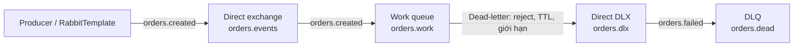

# Khai báo Dead Letter Exchange bằng policy hoặc đối số queue trong Spring AMQP

## 1. Mục tiêu và bối cảnh

Khi tích hợp RabbitMQ bằng **Spring AMQP**, một message xử lý thất bại đôi khi không nên được đưa trở lại hàng đợi chính vô hạn. Ta có thể cấu hình **Dead Letter Exchange (DLX)** để RabbitMQ định tuyến message đó sang một exchange khác, thường đi tiếp đến **Dead Letter Queue (DLQ)** phục vụ điều tra, xử lý lại hoặc cảnh báo.

Sau bài này, bạn có thể:

- Phân biệt **DLX** (exchange nhận message bị dead-letter) với **DLQ** (queue nhận message sau khi exchange định tuyến).
- Khai báo DLX cho một queue bằng **RabbitMQ policy** hoặc bằng **optional arguments** lúc khai báo queue trong Spring AMQP.
- Giải thích quy tắc ưu tiên khi policy và queue arguments cùng cấu hình DLX, và hệ quả đối với việc thay đổi cấu hình trên môi trường đang chạy.
- Tạo topology, thử một trường hợp consumer từ chối message, xác minh kết quả và nhận diện những lỗi vận hành phổ biến.

Ví dụ xuyên suốt: hệ thống xử lý đơn hàng nhận message từ `orders.events`, đưa vào `orders.work`. Message không thể xử lý sẽ qua `orders.dlx` để vào `orders.dead`.



**Điểm cần nhớ:** DLX **không tự động tạo DLQ**. DLX vẫn là một RabbitMQ exchange bình thường; cần khai báo exchange, queue đích và binding phù hợp. Chính **queue nguồn** `orders.work` mang cấu hình chỉ đến DLX.

## 2. Message được dead-letter khi nào?

RabbitMQ có thể dead-letter một message khi:

1. Consumer gọi `basic.reject` hoặc `basic.nack` với `requeue=false`.
2. Message hết TTL (đặt theo từng message hoặc theo queue).
3. Queue vượt giới hạn độ dài và một message bị loại bỏ theo cơ chế overflow tương ứng.
4. Message trong **quorum queue** vượt giới hạn số lần delivery (`delivery-limit`).

**Không phải mọi exception đều tạo DLX:** với listener Spring AMQP, nếu lỗi khiến message được requeue (`requeue=true`), message có thể quay lại queue chính. Việc **một queue tự hết hạn** cũng không làm toàn bộ message bên trong nó được dead-letter.

Ví dụ một listener cố ý từ chối message không hợp lệ:

```java
import org.springframework.amqp.AmqpRejectAndDontRequeueException;
import org.springframework.amqp.rabbit.annotation.RabbitListener;
import org.springframework.stereotype.Component;

@Component
public class OrderListener {

    @RabbitListener(queues = "orders.work")
    public void consume(String payload) {
        if (payload.startsWith("FAIL:")) {
            // Chế độ AUTO ack: Spring sẽ reject/nack và không requeue.
            throw new AmqpRejectAndDontRequeueException("Đơn hàng không hợp lệ");
        }
        System.out.println("Đã xử lý: " + payload);
    }
}
```

Mẫu trên giả định listener container sử dụng acknowledgment `AUTO` (cấu hình thông dụng). Nếu dùng `MANUAL`, ứng dụng phải tự xử lý ack/nack đúng cách; đừng giả định việc ném exception sẽ luôn có cùng hành vi. Trong ứng dụng thật, chỉ từ chối vĩnh viễn khi lỗi không thể phục hồi; lỗi tạm thời nên có chiến lược retry giới hạn.

## 3. Chuẩn bị topology chung với Spring AMQP

Với Spring Boot, sử dụng dependency `spring-boot-starter-amqp` và một RabbitMQ broker khả dụng. Ví dụ tạo **hai direct exchange**, **hai durable queue** và **hai binding**. Ở bước này, `orders.work` **chưa có hardcoded DLX arguments**, vì ta sẽ áp dụng policy ở phần tiếp theo.

```java
import org.springframework.amqp.core.BindingBuilder;
import org.springframework.amqp.core.Declarables;
import org.springframework.amqp.core.DirectExchange;
import org.springframework.amqp.core.Queue;
import org.springframework.amqp.core.QueueBuilder;
import org.springframework.context.annotation.Bean;
import org.springframework.context.annotation.Configuration;

@Configuration
public class OrderRabbitTopology {

    @Bean
    public Declarables orderDeclarations() {
        DirectExchange ordersExchange =
                new DirectExchange("orders.events", true, false);
        DirectExchange deadLetterExchange =
                new DirectExchange("orders.dlx", true, false);

        // Biến thể A: queue không khai báo DLX trong x-arguments.
        Queue workQueue = QueueBuilder.durable("orders.work").build();
        Queue deadQueue = QueueBuilder.durable("orders.dead").build();

        return new Declarables(
                ordersExchange,
                deadLetterExchange,
                workQueue,
                deadQueue,
                BindingBuilder.bind(workQueue)
                        .to(ordersExchange).with("orders.created"),
                BindingBuilder.bind(deadQueue)
                        .to(deadLetterExchange).with("orders.failed")
        );
    }
}
```

Với `RabbitAdmin` được cấu hình để tự khai báo (Spring Boot thường cấu hình tự động khi sử dụng starter), các đối tượng `Declarables` này sẽ được declare khi ứng dụng kết nối RabbitMQ.

Từng thành phần có nhiệm vụ riêng:

| Thành phần | Vai trò |
| --- | --- |
| `orders.events` | Direct exchange nhận message nghiệp vụ ban đầu. |
| `orders.work` | Queue được listener xử lý; **đây là nơi cấu hình DLX**. |
| `orders.dlx` | Direct exchange nhận message bị dead-letter từ queue nguồn. |
| `orders.dead` | DLQ giữ message thất bại, phục vụ kiểm tra hoặc xử lý sau. |
| Binding `orders.failed` | Cho phép `orders.dlx` chuyển message đến `orders.dead`. |

Không cần viết thêm code publish sang DLQ trong `OrderListener`: khi broker nhận nack/reject với `requeue=false`, broker thực hiện dead-letter theo cấu hình của queue nguồn.

## 4. Cách A — Khai báo DLX bằng RabbitMQ policy

**Policy** là cấu hình do RabbitMQ quản lý theo tên queue (biểu thức chính quy). Nó phù hợp khi muốn thay đổi DLX mà không phải chỉnh code hoặc tạo lại queue.

Trong shell Bash, chạy lệnh sau trên máy có quyền quản trị RabbitMQ:

```bash
rabbitmqctl set_policy -p / \
  --apply-to queues \
  --priority 10 \
  orders-work-dlx \
  '^orders\.work$' \
  '{"dead-letter-exchange":"orders.dlx","dead-letter-routing-key":"orders.failed"}'
```

Giải thích từng phần:

- `-p /`: áp dụng trong virtual host `/`; thay bằng vhost thật nếu khác.
- `orders-work-dlx`: tên policy, độc lập với tên exchange.
- `^orders\.work$`: chỉ khớp queue tên **chính xác** `orders.work`; dấu chấm được escape vì đây là regex.
- `--apply-to queues`: giới hạn phạm vi áp dụng vào các queue.
- `--priority 10`: thứ tự ưu tiên khi có nhiều **user policy** cùng khớp; policy có priority cao hơn sẽ được chọn.
- `dead-letter-exchange`: exchange đích, ở đây là `orders.dlx`.
- `dead-letter-routing-key`: routing key dùng khi broker republish message sang DLX, ở đây là `orders.failed`.

**Lưu ý cú pháp:** trong **policy**, hai key **không** có tiền tố `x-`. Trong **queue arguments**, hai key tương ứng sẽ có tiền tố `x-`.

Để xem policy đang có:

```bash
rabbitmqctl list_policies -p /
```

Hoặc mở RabbitMQ Management UI → **Admin → Policies** để xem/sửa policy. RabbitMQ áp dụng policy cho các queue khớp mẫu; có thể chỉnh policy trong khi queue vẫn đang tồn tại:

```bash
# Chuyển DLX sang một exchange khác (exchange mới phải có route hợp lệ):
rabbitmqctl set_policy -p / \
  --apply-to queues --priority 10 \
  orders-work-dlx '^orders\.work$' \
  '{"dead-letter-exchange":"orders.dlx.v2","dead-letter-routing-key":"orders.failed"}'

# Trả về cấu hình minh họa ban đầu:
rabbitmqctl set_policy -p / \
  --apply-to queues --priority 10 \
  orders-work-dlx '^orders\.work$' \
  '{"dead-letter-exchange":"orders.dlx","dead-letter-routing-key":"orders.failed"}'
```

Khi thay đổi exchange đích, phải khai báo exchange và binding đích trước khi phát sinh dead-letter, nếu không message có nguy cơ bị mất. Policy không tự tạo exchange/queue và không thể sửa những x-arguments đã được hardcode trên queue.

### 4.1. Trường hợp không đặt dead-letter routing key

Có thể chỉ khai báo:

```json
{"dead-letter-exchange": "orders.dlx"}
```

Khi đó RabbitMQ dùng **routing key gốc** (hoặc các routing key gốc của message) để publish sang DLX. Ví dụ message ban đầu dùng `orders.created`, binding đích phải khớp `orders.created`; binding `orders.failed` ở topology phía trên sẽ **không nhận** được message. Đặt tường minh `dead-letter-routing-key=orders.failed` giúp ví dụ này ổn định, dễ quan sát.

## 5. Cách B — Khai báo DLX bằng optional arguments của queue

Với Spring AMQP, có thể khai báo DLX ngay trên `QueueBuilder`:

```java
// Biến thể B: thay đúng dòng khai báo workQueue trong orderDeclarations().
Queue workQueue = QueueBuilder.durable("orders.work")
        .deadLetterExchange("orders.dlx")
        .deadLetterRoutingKey("orders.failed")
        .build();
```

Các builder method trên tạo ra hai optional arguments khi declare queue:

```json
{
  "x-dead-letter-exchange": "orders.dlx",
  "x-dead-letter-routing-key": "orders.failed"
}
```

Nếu không dùng `QueueBuilder`, có thể tạo queue bằng `Map<String, Object>` tương đương:

```java
import java.util.Map;
import org.springframework.amqp.core.Queue;

Queue workQueue = new Queue(
        "orders.work",
        true,   // durable
        false,  // exclusive
        false,  // autoDelete
        Map.of(
                "x-dead-letter-exchange", "orders.dlx",
                "x-dead-letter-routing-key", "orders.failed"
        )
);
```

Hai ví dụ trong mục này là **hai cú pháp tương đương**, chỉ chọn **một** để khai báo `orders.work`. Đồng thời, **Cách A và Cách B là hai cấu hình thay thế trong bài thực hành**: khi kiểm tra policy, dùng queue không có các đối số DLX; khi kiểm tra arguments, dùng queue mới được khai báo với các đối số DLX.

Điểm hạn chế lớn nhất của x-arguments: các giá trị DLX thuộc khai báo queue. Nếu `orders.work` đã tồn tại với arguments khác và ứng dụng cố declare lại cùng tên với bộ arguments không tương thích, broker có thể đóng channel với lỗi dạng `PRECONDITION_FAILED - inequivalent arg ...`. Chỉ sửa Java rồi restart **không đủ** để thay đổi DLX của queue hiện hữu. Cần có kế hoạch tạo queue mới/chuyển consumer và message, hoặc xóa rồi tạo lại queue sau khi xử lý an toàn dữ liệu.

Vì vậy, RabbitMQ khuyến nghị dùng **policy** cho các thông số DLX cần thay đổi linh hoạt trong vận hành.

## 6. Policy và queue arguments: cái nào có hiệu lực?

| Tiêu chí | RabbitMQ policy | Queue arguments trong Spring AMQP |
| --- | --- | --- |
| Khai báo ở đâu? | RabbitMQ CLI, Management UI hoặc HTTP API. | Trong code Java khi khai báo `Queue`. |
| Tên key | `dead-letter-exchange`, `dead-letter-routing-key`. | `x-dead-letter-exchange`, `x-dead-letter-routing-key`. |
| Queue nào chịu ảnh hưởng? | Các queue khớp regex trong vhost, phạm vi và priority. | Queue được ứng dụng declare với arguments đó. |
| Đổi cấu hình trên queue đang tồn tại | Có thể cập nhật policy và áp dụng động. | Thường phải dùng queue mới hoặc xóa/tạo lại theo kế hoạch. |
| Khi cùng cấu hình một thuộc tính | **Thua giá trị khai báo tường minh bằng queue argument**. | **Ưu tiên hơn user policy** cho thuộc tính tương ứng. |
| Trường hợp phù hợp | Vận hành production, nhiều queue, cần điều chỉnh tập trung. | Demo, bài tập, queue mới có cấu hình cố định. |

**Quy tắc ưu tiên quan trọng:** nếu policy đặt `dead-letter-exchange=orders.dlx.v2` nhưng `orders.work` được khai báo với `x-dead-letter-exchange=orders.dlx`, cấu hình tường minh trong **queue arguments** sẽ thắng. Chỉnh policy không làm message chuyển sang `orders.dlx.v2` trong trường hợp này. Có thể có **operator policy** với quy tắc bổ sung ở cấp quản trị; bảng trên mô tả **user policy** thông thường.

Đừng nhầm **priority giữa các policy** với **độ ưu tiên giữa policy và x-arguments**. Tăng `--priority` không thể ghi đè x-argument đã được hardcode trên queue.

## 7. Kiểm thử end-to-end

Chọn **một** trong hai cấu hình của mục 4 hoặc 5; bảo đảm `orders.events`, `orders.dlx`, `orders.work`, `orders.dead` và các binding đã được khai báo trong cùng vhost.

1. Chạy ứng dụng Spring Boot có `OrderRabbitTopology` và `OrderListener`.
2. Nếu chọn **policy**, chạy lệnh `set_policy` ở mục 4. Với **queue arguments**, tạo queue mới có các arguments ở mục 5 (tránh redeclare queue cũ với định nghĩa khác).
3. Dùng `RabbitTemplate` gửi message hợp lệ và message cố ý gây lỗi:

   ```java
   rabbitTemplate.convertAndSend("orders.events", "orders.created", "ORDER-001");
   rabbitTemplate.convertAndSend("orders.events", "orders.created", "FAIL:ORDER-002");
   ```

4. Listener xử lý `ORDER-001` thành công. Với `FAIL:ORDER-002`, listener ném `AmqpRejectAndDontRequeueException`; RabbitMQ dead-letter message qua `orders.dlx` với routing key `orders.failed` rồi đưa vào `orders.dead`.
5. Xem **Queues and Streams → orders.dead → Get messages** trên RabbitMQ Management UI. Chọn chế độ xem message phù hợp và tránh ack/xóa message nếu cần giữ lại để điều tra. Quan sát payload `FAIL:ORDER-002` và header `x-death` để biết queue/reason liên quan (ví dụ `rejected`).

Có thể quan sát số message bằng RabbitMQ CLI:

```bash
rabbitmqctl list_queues -p / name messages_ready messages_unacknowledged
```

Kỳ vọng: `orders.dead` có message lỗi; `orders.work` không còn giữ message lỗi đó sau khi dead-letter thành công. Nếu hai queue đều trống, hãy kiểm tra listener có hoạt động, policy có thật sự áp dụng cho `orders.work`, routing key của DLX có binding tương ứng và có consumer khác đang lấy message khỏi DLQ hay không.

### Thử khác biệt giữa policy và queue argument

Trên một **queue chỉ dùng policy**, đổi `dead-letter-exchange` sang exchange đích khác đã được khai báo/bind đúng; quan sát message bị dead-letter tiếp theo tới đích mới. Trên một **queue đã hardcode x-arguments**, đổi cùng policy sẽ không thay thế giá trị `x-dead-letter-exchange`. Để thực hành hai biến thể mà không xung đột khai báo, dùng môi trường/broker riêng hoặc tên queue khác nhau.

## 8. Lỗi thường gặp và cách chẩn đoán

| Hiện tượng | Nguyên nhân khả dĩ | Hướng xử lý |
| --- | --- | --- |
| Message lỗi cứ quay lại `orders.work`. | Consumer nack với `requeue=true` hoặc listener container tự requeue sau exception. | Kiểm tra cơ chế ack; với lỗi không hồi phục, dùng `AmqpRejectAndDontRequeueException` hoặc cấu hình reject sau khi hết retry. |
| `orders.dead` không nhận message. | DLX chưa tồn tại, binding/routing key không khớp, policy không match hoặc bị argument ghi đè. | Kiểm tra exchange, binding, policy trên queue nguồn và routing key thực tế. |
| Restart app báo `PRECONDITION_FAILED - inequivalent arg`. | Khai báo lại queue đã tồn tại với arguments khác. | Không cố sửa bằng redeclare; thiết kế kế hoạch chuyển queue/dữ liệu trước khi đổi x-arguments. |
| Có policy nhưng DLX vẫn là giá trị cũ. | `x-dead-letter-exchange` của queue đã khai báo tường minh. | Xem arguments hiện hữu; muốn quản trị động thì chuyển sang queue không hardcode DLX. |
| Policy ảnh hưởng nhiều queue ngoài dự kiến. | Regex quá rộng, ví dụ `.*`. | Dùng regex có `^`, `$` và escape dấu `.`; xác nhận vhost và scope. |
| Không khai báo được queue có DLX. | Thiếu quyền hoặc tên exchange không đúng vhost. | Kiểm tra `configure`/`read` trên queue và `write` trên DLX, cùng vhost. |
| Message bị mất khi dead-letter. | DLX không tồn tại lúc dead-letter, không route được đến queue đích hoặc đích không sẵn sàng. | Khai báo và xác minh đích trước; giám sát DLQ và cân nhắc cơ chế tin cậy phù hợp. |

Về quyền truy cập: khi declare queue có cấu hình DLX, RabbitMQ kiểm tra quyền `read` trên queue nguồn và `write` trên DLX, bên cạnh quyền `configure` cần thiết cho việc khai báo queue.

Về độ tin cậy: mặc định, broker republish message sang DLX **không dùng publisher confirms nội bộ**. Vì vậy, DLX thông thường không tự bảo đảm giao nhận tuyệt đối khi đích không sẵn sàng. Với nhu cầu chặt chẽ hơn, cần nghiên cứu cơ chế **at-least-once dead-lettering của quorum queue** và các điều kiện cấu hình của nó; đây là vấn đề khác với lựa chọn policy hay x-arguments.

## 9. Liên hệ với TTL, delayed retry và vận hành an toàn

DLX không tự tạo độ trễ. Để trì hoãn, có thể đưa message qua một retry queue có TTL; khi hết TTL, queue đó dead-letter về work exchange. Nhưng chuỗi retry cần **giới hạn số lần thử**, backoff, theo dõi header `x-death` và tuyến cuối về DLQ để tránh lặp vô hạn. RabbitMQ cũng có cơ chế phát hiện một số vòng dead-letter khép kín và có thể loại message nếu vòng lặp không có lần reject, do đó không nên dùng vòng lặp tự do làm retry strategy.

Trong hệ thống xử lý bất đồng bộ đáng tin cậy, nên kết hợp:

- **Phân loại lỗi**: lỗi tạm thời được retry có giới hạn; lỗi dữ liệu/không thể phục hồi đưa sang DLQ.
- **Idempotency**: consumer chịu được việc xử lý lại cùng message mà không tạo tác dụng phụ trùng lặp.
- **Quan sát**: theo dõi số lượng message trong DLQ, thời gian tồn đọng, lý do trong `x-death` và cảnh báo vượt ngưỡng.
- **Vận hành DLQ**: có quy trình xem, sửa dữ liệu, replay có kiểm soát hoặc loại bỏ message sau điều tra.
- **Kiểm chứng định tuyến**: exchange, binding và routing key được khai báo đúng trước khi message bị dead-letter.

## 10. Tự kiểm tra

1. Một queue có policy `dead-letter-exchange=orders.dlx.v2` nhưng khi declare có `x-dead-letter-exchange=orders.dlx`. Message lỗi đi tới DLX nào? Vì sao?
2. Một message ban đầu dùng routing key `orders.created`. Nếu cấu hình DLX không đặt `dead-letter-routing-key`, binding chỉ nhận `orders.failed` có nhận được message không?
3. Tại sao không thể chuyển từ x-arguments sang policy bằng cách đơn giản xóa `deadLetterExchange(...)` trong code rồi restart với cùng queue đã tồn tại?
4. Khi consumer ném exception nhưng message liên tục quay lại, cần kiểm tra `requeue` ở đâu trước khi kiểm tra DLX?
5. Bạn sẽ thêm những chỉ số và quy trình xử lý nào để DLQ hữu ích trong môi trường production?

**Gợi ý đáp án:** (1) `orders.dlx` vì queue argument ưu tiên hơn user policy; (2) không, nếu không có binding khác khớp routing key gốc; (3) arguments của queue hiện hữu không tự biến mất khi code thay đổi, có thể gặp lỗi redeclare; (4) listener acknowledgment/requeue/retry; (5) DLQ depth, thời gian chờ, `x-death`, cảnh báo và replay có kiểm soát.

## Tài liệu tham khảo

- [RabbitMQ — Dead Letter Exchanges](https://www.rabbitmq.com/docs/dlx): cơ chế dead-letter, policy, x-arguments, routing và giới hạn an toàn.
- [RabbitMQ — Policies](https://www.rabbitmq.com/docs/policies): cách policy khớp queue, ưu tiên và cập nhật động.
- [Spring AMQP — Resilience: Recovering from Errors and Broker Failures](https://docs.spring.io/spring-amqp/reference/amqp/resilience-recovering-from-errors-and-broker-failures.html): auto declaration, xử lý lỗi listener và `AmqpRejectAndDontRequeueException`.
