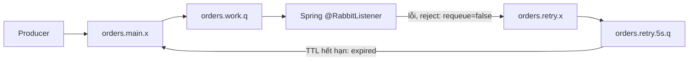

# x-death, lịch sử chuyển queue và đếm số lần xử lý

Trong hệ thống xử lý bất đồng bộ bằng **RabbitMQ và Spring AMQP**, một thông điệp có thể thất bại ở consumer, đi qua dead-letter exchange (DLX), nằm chờ trong queue trì hoãn rồi được đưa trở lại queue xử lý. Muốn giới hạn retry và điều tra vì sao thông điệp xuất hiện trong dead-letter queue (DLQ), cần hiểu chính xác header `x-death`.

Bài học thuộc chương **Dead-letter và trì hoãn**; tập trung vào cách RabbitMQ ghi dấu những lần *dead-letter*, cách Spring AMQP đọc lịch sử đó, và cách đếm retry mà không nhầm với số lần hàm `@RabbitListener` thực sự chạy.

## 1. Mục tiêu học tập

Sau bài này, bạn có thể:

- Giải thích khi nào RabbitMQ sinh hoặc cập nhật `x-death` và ý nghĩa của các `reason`.
- Đọc các trường `queue`, `reason`, `count`, `exchange`, `routing-keys`, `time` và các header `x-first-death-*`, `x-last-death-*`.
- Phân biệt **số sự kiện dead-letter** với **số lần delivery**, **số lần listener được gọi** và **số lần retry của ứng dụng**.
- Cấu hình đường đi `work queue → retry queue có TTL → work queue` bằng Spring AMQP.
- Đọc `x-death` an toàn từ `MessageProperties`, giới hạn số lần quay lại queue xử lý và phát hiện các trường hợp đếm sai.
- Biết khi nào dùng header `retry_count` của Spring AMQP hoặc bộ đếm riêng thay cho `x-death`.

## 2. Khi nào thông điệp trở thành dead letter?

RabbitMQ tạo sự kiện dead-letter khi một queue loại thông điệp khỏi luồng xử lý thông thường và chuyển nó tới DLX đã cấu hình. Ví dụ:

| `reason` trong `x-death` | Tình huống | Điều cần nhớ |
| --- | --- | --- |
| `rejected` | Consumer gọi `basic.reject` hoặc `basic.nack` với `requeue=false`; trong Spring AMQP có thể phát sinh qua `AmqpRejectAndDontRequeueException`. | Chỉ sự kiện **không requeue** này mới dead-letter theo nhánh từ chối. |
| `expired` | TTL của thông điệp hết hạn trong queue. | Thường xuất hiện tại **retry queue** đặt TTL để đưa thông điệp về work queue. |
| `maxlen` | Queue vượt giới hạn độ dài và thông điệp bị loại theo chính sách giới hạn. | Đây là sự kiện sức chứa, không phải consumer xử lý thất bại. |
| `delivery_limit` | Quorum queue vượt giới hạn delivery và đưa thông điệp sang DLX. | Bộ đếm delivery của quorum queue có quy tắc riêng, khác `x-death.count`. |

Nếu queue không có DLX phù hợp, không thể mặc định rằng thông điệp sẽ được lưu trong DLQ. Cũng cần cấu hình DLX, binding và quyền truy cập thích hợp để thông điệp được định tuyến tới đích.

**Các thao tác không tự làm tăng `x-death`:**

- Listener xử lý lỗi rồi tự retry trong cùng một lần giao nhận (ví dụ Spring Retry gọi lại phương thức).
- Consumer `nack/reject` với `requeue=true`, khiến broker giao lại thông điệp mà **chưa** dead-letter qua DLX.
- Ứng dụng gọi `RabbitTemplate.send(...)` để publish một message mới hoặc publish lại message đang có; đó là hành động publish từ client, không phải sự kiện broker dead-letter.
- Listener nhận thông điệp thành công rồi ACK.

Vì vậy, `x-death` không phải nhật ký mọi lần consumer được gọi.

## 3. Hình dạng và ý nghĩa của `x-death`

Với giao thức AMQP 0-9-1 mà Spring AMQP thường dùng, `x-death` là **mảng các bảng/map**, do RabbitMQ cập nhật mỗi khi thông điệp dead-letter. Ví dụ minh họa khi thông điệp đã đi qua hai vòng retry:

```json
{
  "x-death": [
    {
      "queue": "orders.retry.5s.q",
      "reason": "expired",
      "count": 2,
      "exchange": "orders.retry.x",
      "routing-keys": ["orders.retry"],
      "time": "2026-11-26T02:00:05Z"
    },
    {
      "queue": "orders.work.q",
      "reason": "rejected",
      "count": 2,
      "exchange": "orders.main.x",
      "routing-keys": ["orders.work"],
      "time": "2026-11-26T02:00:00Z"
    }
  ],
  "x-first-death-queue": "orders.work.q",
  "x-first-death-reason": "rejected",
  "x-first-death-exchange": "orders.main.x",
  "x-last-death-queue": "orders.retry.5s.q",
  "x-last-death-reason": "expired",
  "x-last-death-exchange": "orders.retry.x"
}
```

> Đây là cách **hiển thị đơn giản hóa** để dễ đọc. Trên wire AMQP, `x-death` là một array các AMQP table và `time` là kiểu timestamp, không nhất thiết là chuỗi ISO 8601 như trong JSON minh họa.

| Trường | Cách đọc chính xác |
| --- | --- |
| `queue` | Tên **queue mà thông điệp rời khỏi khi bị dead-letter**, không phải queue nhận tiếp theo. |
| `reason` | Nguyên nhân dead-letter, chẳng hạn `rejected` hay `expired`. |
| `count` | Số lần dead-letter được gom vào **cùng cặp (queue, reason)**. Đọc như một số nguyên dài (`long`/`Number`). |
| `exchange` | Exchange thông điệp được publish tới **trước lần dead-letter đầu tiên của nhóm này**; không mặc nhiên là DLX đích. |
| `routing-keys` | Những routing key gắn với thông điệp trước lần dead-letter đầu tiên của nhóm. |
| `time` | Thời điểm **đầu tiên** nhóm (queue, reason) đó được ghi nhận trong AMQP 0-9-1. |
| `original-expiration` | Tùy chọn: giá trị thuộc tính `expiration` ban đầu nếu có; RabbitMQ gỡ TTL từng message khi dead-letter để tránh hết hạn lặp ngoài ý muốn. |

**RabbitMQ nén lịch sử theo cặp `(queue, reason)`.** Ví dụ cùng thông điệp bị `rejected` khỏi `orders.work.q` ba lần thì thường có một phần tử với `count=3`, thay vì ba phần tử riêng biệt. Nếu cũng bị `expired` khỏi `orders.retry.5s.q` ba lần, đó là *phần tử khác* với `count=3`.

Mảng được sắp theo **mức độ gần đây của lần dead-letter**, phần tử đầu tiên là nhóm vừa xảy ra sự kiện gần nhất. Tuy nhiên, vì các sự kiện lặp lại được gộp, nó **không phải lịch sử tuyến đường đầy đủ theo từng hop**. Bạn không thể chỉ dựa vào mảng này để khôi phục thời gian chính xác của mỗi lần đi qua queue.

### Các header tóm tắt lần đầu và lần cuối

RabbitMQ cũng gắn các header:

- `x-first-death-queue`, `x-first-death-reason`, `x-first-death-exchange`: lưu nguồn và lý do dead-letter **đầu tiên**, không đổi ở những lần tiếp theo.
- `x-last-death-queue`, `x-last-death-reason`, `x-last-death-exchange`: lưu nguồn và lý do dead-letter **gần nhất**, được cập nhật về sau.

Ví dụ, một thông điệp đang trở về work queue sau khi hết TTL tại retry queue sẽ có `x-first-death-reason=rejected` nhưng `x-last-death-reason=expired`. Hai giá trị này không mâu thuẫn: chúng chỉ mô tả hai mốc khác nhau.

**Lưu ý:** các giá trị `exchange`, `routing-keys` trong một nhóm được ghi từ lần dead-letter đầu tiên của nhóm. Nếu hệ thống đổi binding/routing khi message đang di chuyển, không nên xem chúng là bản ghi của từng bước mới nhất.

## 4. Theo dõi một thông điệp qua nhiều queue

Giả sử đặt ba tuyến chính:

- `orders.main.x` định tuyến `orders.work` tới `orders.work.q`.
- `orders.work.q` có DLX là `orders.retry.x`, routing key `orders.retry`.
- `orders.retry.5s.q` nhận từ `orders.retry.x`, có TTL 5 giây và DLX đưa về `orders.main.x` theo routing key `orders.work`.



Dòng thời gian khi listener thất bại liên tiếp:

| Mốc | Điều xảy ra | Nhóm `(orders.work.q, rejected)` | Nhóm `(orders.retry.5s.q, expired)` |
| --- | --- | ---: | ---: |
| Lần giao vào work queue đầu tiên | Chưa từng dead-letter | 0 (chưa có) | 0 (chưa có) |
| Listener lần 1 thất bại, reject không requeue | Message chuyển sang retry queue | 1 | 0 |
| TTL retry queue hết hạn, message về work queue | Broker dead-letter khỏi retry queue | 1 | 1 |
| Listener lần 2 thất bại, reject không requeue | Message trở lại retry queue | 2 | 1 |
| TTL hết hạn lần 2, message về work queue | Bắt đầu lần xử lý thứ 3 | 2 | 2 |
| Listener lần 3 thất bại; TTL retry hết hạn lần 3 | Message về work queue cho lần thứ 4 | 3 | 3 |

Ngay trước lần xử lý thứ 4 trong **đúng mô hình trên**:

```text
số_lần_work_queue_đã_rejected = x-death.count(queue=orders.work.q, reason=rejected) = 3
lần_đang_xử_lý_tại_work_queue = số_lần_work_queue_đã_rejected + 1 = 4
```

Công thức chỉ đúng theo các giả định rõ ràng: mọi vòng thử trước đó đều kết thúc bằng `rejected` từ **cùng work queue**, broker giữ cùng chuỗi dead-letter, không có retry nội bộ hay requeue khác và không có đường vào queue từ luồng độc lập. Nó không tự động chứng minh rằng nghiệp vụ chỉ chạy bốn lần.

**Vì sao không cộng hết `count`?** Ở lần xử lý thứ 4, tổng hai nhóm là `3 + 3 = 6`, nhưng đó là sáu lần **rời queue do dead-letter**, gồm ba lần consumer từ chối và ba lần TTL hết hạn. Đây không phải sáu lần business handler chạy.

## 5. Cấu hình ví dụ với Spring AMQP

Ví dụ sau sử dụng Spring Boot có dependency `spring-boot-starter-amqp` và một RabbitMQ broker. Các exchange là `direct`; tên queue, exchange và routing key được khai báo tường minh để theo dõi đường đi.

```java
import org.springframework.amqp.core.Binding;
import org.springframework.amqp.core.BindingBuilder;
import org.springframework.amqp.core.DirectExchange;
import org.springframework.amqp.core.Queue;
import org.springframework.amqp.core.QueueBuilder;
import org.springframework.context.annotation.Bean;
import org.springframework.context.annotation.Configuration;

@Configuration
public class OrderRetryTopology {
    public static final String WORK_EXCHANGE = "orders.main.x";
    public static final String WORK_QUEUE = "orders.work.q";
    public static final String WORK_KEY = "orders.work";

    public static final String RETRY_EXCHANGE = "orders.retry.x";
    public static final String RETRY_QUEUE = "orders.retry.5s.q";
    public static final String RETRY_KEY = "orders.retry";

    @Bean
    DirectExchange workExchange() {
        return new DirectExchange(WORK_EXCHANGE);
    }

    @Bean
    DirectExchange retryExchange() {
        return new DirectExchange(RETRY_EXCHANGE);
    }

    @Bean
    Queue workQueue() {
        return QueueBuilder.durable(WORK_QUEUE)
                .deadLetterExchange(RETRY_EXCHANGE)
                .deadLetterRoutingKey(RETRY_KEY)
                .build();
    }

    @Bean
    Queue retryQueue() {
        return QueueBuilder.durable(RETRY_QUEUE)
                .ttl(5_000)
                .deadLetterExchange(WORK_EXCHANGE)
                .deadLetterRoutingKey(WORK_KEY)
                .build();
    }

    @Bean
    Binding workBinding() {
        return BindingBuilder.bind(workQueue())
                .to(workExchange()).with(WORK_KEY);
    }

    @Bean
    Binding retryBinding() {
        return BindingBuilder.bind(retryQueue())
                .to(retryExchange()).with(RETRY_KEY);
    }
}
```

**Điểm cần kiểm tra:** `deadLetterExchange(...)` và `deadLetterRoutingKey(...)` là **cấu hình của queue nguồn**. `orders.work.q` quy định đường đi khi bị reject; `orders.retry.5s.q` quy định đường đi khi TTL hết hạn. Đây là hai hành động dead-letter độc lập, nên sinh hai nhóm `x-death`.

`ttl(5_000)` là giới hạn TTL ở queue, không phải lời hứa chính xác listener sẽ nhận message lại sau đúng 5.000 ms. Độ trễ thực tế phụ thuộc cơ chế expiry, định tuyến và tải của broker. Trong thực tế, cân nhắc sử dụng **policy** để thay đổi DLX/TTL linh hoạt hơn, vì sửa argument của queue đang tồn tại có thể gây lỗi `PRECONDITION_FAILED` khi khai báo lại.

## 6. Đọc và đếm `x-death` trong Java

Spring AMQP cho phép truy cập danh sách đã được giải mã qua `MessageProperties.getXDeathHeader()`. Nó có thể là `null` ở lần giao nhận đầu tiên. Các giá trị map có kiểu tổng quát, vì vậy cần kiểm tra kiểu trước khi chuyển đổi.

```java
import java.util.List;
import java.util.Map;
import org.springframework.amqp.core.MessageProperties;

public final class XDeathReader {
    private XDeathReader() {}

    public static long count(
            MessageProperties properties,
            String queue,
            String reason
    ) {
        List<Map<String, ?>> history = properties.getXDeathHeader();
        if (history == null || history.isEmpty()) {
            return 0L;
        }

        return history.stream()
                .filter(item -> queue.equals(item.get("queue")))
                .filter(item -> reason.equals(item.get("reason")))
                .map(item -> item.get("count"))
                .filter(Number.class::isInstance)
                .mapToLong(value -> ((Number) value).longValue())
                .sum();
    }
}
```

Hàm này chỉ đếm số sự kiện dead-letter ở **queue và reason mà người gọi yêu cầu**; không cộng tùy tiện mọi nhóm. `Number.longValue()` tránh giả định sai rằng `count` luôn là `Integer`. Với một header do broker sinh hợp lệ, thường chỉ có một nhóm cho một cặp `(queue, reason)`; phép `sum()` giúp phương thức vẫn rõ nghĩa khi dữ liệu được duyệt qua danh sách.

Ví dụ đọc trong listener:

```java
import org.springframework.amqp.core.Message;
import org.springframework.amqp.rabbit.annotation.RabbitListener;
import org.springframework.stereotype.Component;

@Component
public class OrderHistoryLogger {
    @RabbitListener(queues = OrderRetryTopology.WORK_QUEUE)
    public void onMessage(Message message) {
        var properties = message.getMessageProperties();

        long priorRejects = XDeathReader.count(
                properties,
                OrderRetryTopology.WORK_QUEUE,
                "rejected"
        );
        long thisWorkDelivery = priorRejects + 1;

        System.out.printf(
                "messageId=%s, priorRejects=%d, thisWorkDelivery=%d%n",
                properties.getMessageId(),
                priorRejects,
                thisWorkDelivery
        );

        // Tại đây xử lý nghiệp vụ hoặc chuyển tới nhánh retry.
        // Phương thức trả về bình thường => container thường ACK thành công
        // trong chế độ acknowledge AUTO.
    }
}
```

Đây là ví dụ **quan sát header**, không phải mã tạo retry: nếu listener trả về bình thường, container ở chế độ `AUTO` sẽ ACK message. Muốn thấy `rejected` và vòng TTL trong mục 4, listener xử lý nghiệp vụ phải gặp lỗi và thực hiện chính sách reject thích hợp. Đồng thời, `messageId` có thể không có nếu publisher không đặt; nên dùng định danh nghiệp vụ riêng để đối chiếu log.

## 7. Dùng bộ đếm để giới hạn retry

Giả sử muốn tối đa **4 lần** thực thi nghiệp vụ trên work queue: lần đầu và nhiều nhất 3 lần retry. Sau một lỗi tạm thời, quyết định có thể viết như sau:

```java
long priorRejects = XDeathReader.count(
        message.getMessageProperties(),
        OrderRetryTopology.WORK_QUEUE,
        "rejected"
);
long currentAttempt = priorRejects + 1;

try {
    orderService.process(message.getBody());
} catch (TemporaryOrderException ex) {
    if (currentAttempt < 4) {
        // Container phải reject/nack mà không requeue,
        // để broker chuyển message từ work queue qua DLX.
        throw new AmqpRejectAndDontRequeueException(
                "Retry through orders.retry.x", ex
        );
    }

    // Đã hết giới hạn: lưu bền vững hoặc publish có xác nhận
    // tới parking queue, kèm lý do lỗi và metadata nghiệp vụ.
    parkingService.storeFailure(message, currentAttempt, ex);
    // Chỉ trả về để container ACK sau khi thao tác lưu đã hoàn tất.
}
```

Trong đoạn minh họa, `orderService`, `parkingService` và `TemporaryOrderException` là các thành phần nghiệp vụ do ứng dụng triển khai. Khi `currentAttempt=4` mà vẫn lỗi, ứng dụng chuyển tới **parking** để điều tra thay vì reject trở lại retry queue. Một cách triển khai parking là publish qua `RabbitTemplate` tới exchange/queue dành riêng, có **publisher confirms, kiểm tra unroutable returns và xử lý thất bại trước khi ACK**. Nếu bước chuyển sang parking lỗi, phải có cơ chế phục hồi/ghi nhận bền vững; không ACK chỉ vì lệnh gửi đã được gọi.

Các lỗi vĩnh viễn như sai cấu trúc payload hoặc vi phạm schema thường nên đến khu vực cách ly sớm hơn, thay vì thử lại đủ số lần. Tác vụ cần idempotent theo mã nghiệp vụ để tránh tác động lặp lại khi broker giao lại cùng thông điệp.

**Chú ý với Spring AMQP:** `ConditionalRejectingErrorHandler` có hành vi đặc biệt cho một số lỗi *fatal*; khi phát hiện `x-death`, nó có thể ghi log và loại bỏ message để tránh vòng lặp độc hại. Vì vậy, cần kiểm tra error handler thực tế và phân loại exception trước khi khẳng định mọi lỗi listener đều sẽ quay lại retry queue.

## 8. Trường hợp `x-death` không đủ để đếm số lần xử lý

Đặt tên biến `retryCount` bằng `x-death.count` mà không nói rõ nguồn gốc sẽ dẫn đến quyết định sai trong các tình huống sau:

| Tình huống | `x-death` phản ánh | Cách đếm phù hợp hơn |
| --- | --- | --- |
| Retry nội bộ trong một lần nhận (Spring Retry) | Có thể vẫn là 0 vì broker chưa dead-letter. | Bộ đếm retry trong ứng dụng hoặc interceptor. |
| `requeue=true` | Không sinh `rejected` dead-letter ở mỗi lần requeue. | Chính sách delivery/requeue riêng; với quorum queue có header delivery liên quan. |
| Vòng TTL work ↔ retry | Có nhóm `rejected` **và** nhóm `expired`. | Chỉ đếm `(work queue, rejected)` nếu muốn tính số lần đã thất bại tại work. |
| Một thông điệp đi qua nhiều work queue | Mỗi queue và reason có nhóm riêng. | Xác định chính xác queue nghiệp vụ hoặc giữ bộ đếm ứng dụng thống nhất. |
| Ứng dụng dùng `RabbitTemplate` tự publish lại | Client publish không phải broker dead-letter, lịch sử có thể không tiếp tục được tăng. | Header ứng dụng như `retry_count`/`app-retry-count` hoặc trạng thái bền vững. |
| Quorum queue vượt `delivery-limit` | Có thể có nhóm `reason=delivery_limit` khi message bị dead-letter. | Xem thêm các chỉ số delivery của quorum queue và quy tắc phiên bản RabbitMQ. |

### `redelivered` và `x-delivery-count` có khác `x-death` không?

Có. Cờ `redelivered` cho biết broker đang giao lại một message, **không biểu diễn số lần**. Quorum queue còn cung cấp `x-delivery-count` để theo dõi những lần giao nhận thất bại theo quy tắc của queue; `x-death.count` chỉ ghi sự kiện bị chuyển đi bởi dead-letter. Hai loại counter không thể tráo đổi cho nhau.

Các phiên bản RabbitMQ mới có thay đổi cách quorum queue tính delivery limit (đặc biệt từ RabbitMQ 4.3). Khi dùng quorum queue, cần đối chiếu chính xác phiên bản broker và hành vi `basic.reject`/`basic.nack` trước khi xây giới hạn retry dựa trên `x-delivery-count`.

## 9. RabbitMQ 4.x và header `retry_count` của Spring AMQP

Có một khác biệt đặc biệt quan trọng giữa **broker tự dead-letter** và **client tự republish**:

1. Khi broker chuyển message qua DLX, RabbitMQ cập nhật `x-death` phù hợp với sự kiện dead-letter.
2. Khi ứng dụng tạo/publish lại message qua `RabbitTemplate`, không nên gửi `x-death` giả rồi kỳ vọng RabbitMQ sử dụng nó để tiếp tục đếm. Từ RabbitMQ 4.0, broker không tin cậy/không xử lý `x-death` do client gửi theo cách đó.

Spring AMQP **từ 3.2** có header ứng dụng `retry_count` và API `MessageProperties.getRetryCount()`, `setRetryCount(long)`, `incrementRetryCount()`. Khi chưa có `retry_count` nhưng có lịch sử DLX do broker tạo, Spring AMQP có thể ánh xạ `x-death.count` vào thuộc tính này. Khi ứng dụng **tự republish** để retry, chính ứng dụng phải tăng bộ đếm.

```java
// Minh họa manual republish trong Spring AMQP 3.2+:
var properties = message.getMessageProperties();
long retries = properties.getRetryCount();

if (retries < 3) {
    properties.incrementRetryCount();
    rabbitTemplate.send("orders.main.x", "orders.work", message);
} else {
    // Chuyển parking / ghi trạng thái thất bại cuối cùng.
}
```

**Không phối trộn công thức:** `getRetryCount()` là abstraction phục vụ retry qua broker, còn `XDeathReader.count(work, "rejected")` là phép đếm **một cặp queue/reason cụ thể**. Nếu hệ thống có cả DLX và manual republish, hãy xác định rõ *một* chính sách đếm cho quyết định giới hạn retry và kiểm thử đường đi chuyển tiếp giữa hai hình thức.

Khi xuất một message mới từ ứng dụng sang parking queue, đừng trông chờ `x-death` lịch sử cũ sẽ tiếp tục tồn tại và được broker công nhận. Muốn lưu dấu để điều tra, hãy ghi số lần thử, queue gốc, lý do thất bại, correlation ID và các mốc thời gian vào **metadata ứng dụng hoặc cơ sở dữ liệu** riêng.

## 10. Quan sát và chẩn đoán trong thực tế

Khi một message bị kẹt hoặc xuất hiện trong DLQ, có thể điều tra theo thứ tự:

1. **Định danh thông điệp:** lấy mã nghiệp vụ/correlation ID (không chỉ dựa vào `deliveryTag`, vì tag chỉ có ý nghĩa trên channel).
2. **Đọc nguồn gốc:** xem `x-first-death-queue` và `x-first-death-reason` để biết nơi xảy ra sự kiện đầu tiên.
3. **Đọc sự kiện gần nhất:** xem `x-last-death-*` và phần tử đầu `x-death`; đối chiếu với queue đang chứa message.
4. **Đếm đúng nhóm:** lọc `x-death` theo `queue` **và** `reason`, sau đó đọc `count` dưới dạng `long`.
5. **Kiểm tra topology:** soát DLX, binding, routing key và TTL của từng queue; queue nguồn phải có tuyến tới queue đích.
6. **Soát log ứng dụng:** đối chiếu thời điểm listener chạy, exception, ACK/NACK, publish confirms và dữ liệu nghiệp vụ.

Nên ghi vào log/metric các trường như `messageId` hoặc `orderId`, `sourceQueue`, `deadLetterReason`, `deadLetterCount`, `currentAttempt` và `correlationId`. Tuy nhiên, **không dùng số nhóm trong `x-death` làm tổng số sự kiện lịch sử chính xác**: lịch sử đã được nén. Nếu cần trace từng bước, phải chủ động ghi event/log hoặc sử dụng hạ tầng quan sát phù hợp.

Các lỗi thường gặp:

- **Lấy `x-death[0].count` làm retry count:** phần tử đầu có thể là `(retry queue, expired)`, hoàn toàn khác mục đích đếm retry tại work queue.
- **Cộng tất cả count:** một vòng retry qua TTL thường ghi hai sự kiện dead-letter.
- **Giả định `x-death` luôn tồn tại:** lần delivery đầu tiên thường chưa có header này.
- **Ép kiểu `count` thành `Integer`:** một số thư viện giải mã ra `Long`; kiểm tra `Number` sẽ an toàn hơn.
- **Xem `time` là thời điểm mới nhất của nhóm:** trong AMQP 0-9-1 đó là thời điểm lần đầu của nhóm.
- **Phụ thuộc vào `requeue=true` để tăng `x-death`:** requeue không đồng nghĩa dead-letter; có thể gây vòng lặp nóng.
- **ACK trước khi lưu/publish parking an toàn:** nếu parking chưa nhận message mà work đã ACK, có nguy cơ mất dữ liệu.
- **Cố điều khiển broker bằng cách tự ghi `x-death`:** header này do broker quản lý; dùng `retry_count` hoặc metadata riêng cho client republish.

## 11. Bài thực hành tự kiểm chứng

Dùng topology ở mục 5 và một message có mã `orderId` duy nhất. Để quan sát, cho listener cố tình phát sinh lỗi tạm thời và ném `AmqpRejectAndDontRequeueException` khi `priorRejects < 3`; trên lần thứ tư, xử lý thành công hoặc đưa message sang parking bằng nhánh hoàn tất an toàn. Sau mỗi lần message tới work queue, log:

```text
orderId | priorRejects(work,rejected) | expired(retry,expired) | currentAttempt
A-101   | 0                           | 0                      | 1
A-101   | 1                           | 1                      | 2
A-101   | 2                           | 2                      | 3
A-101   | 3                           | 3                      | 4
```

Tiếp tục thử ba thay đổi và giải thích kết quả:

1. Đổi `reason` trong bộ lọc từ `rejected` sang `expired` nhưng giữ `queue=orders.work.q`: kết quả sẽ không khớp, vì `expired` xảy ra tại **retry queue**.
2. Thay cách reject bằng `requeue=true`: quan sát vì sao `x-death` không tăng theo các lần listener được gọi; dừng thử nghiệm sớm để tránh vòng lặp nóng.
3. Đọc cùng message ở retry queue trước khi TTL hết hạn: thường thấy `rejected` của work đã tăng nhưng `expired` của retry **chưa** tăng cho vòng hiện tại.

Trong RabbitMQ Management UI, xem headers của một message lấy từ queue phù hợp để đối chiếu `x-death`; tránh dùng `Get messages` với chế độ requeue/ack không hiểu rõ trên môi trường đang xử lý dữ liệu thật. Khi phát sinh failure liên tục, cần kiểm soát số lần thử và có parking queue để không gây vòng lặp vô hạn.

## 12. Ghi nhớ cốt lõi

- `x-death` phản ánh **lịch sử dead-letter của broker**, được nén theo `(queue, reason)` và xếp theo sự kiện gần đây nhất.
- `count` của `(work queue, rejected)` có thể dùng để suy ra số lần retry quay lại work queue **chỉ khi** topology và quy tắc retry nhất quán.
- `expired` tại queue trì hoãn là một sự kiện dead-letter riêng; đừng cộng nó vào số lần handler xử lý.
- `x-first-death-*` giúp xác định nguồn gốc; `x-last-death-*` giúp xác định lần dead-letter gần đây nhất.
- Manual republish, Spring Retry, `requeue=true` và quorum delivery counter có quy tắc khác; cần bộ đếm và chiến lược ACK phù hợp.

### Tài liệu tham khảo

- [RabbitMQ — Dead Letter Exchanges](https://www.rabbitmq.com/docs/dlx): điều kiện dead-letter, cấu trúc `x-death`, các `reason`, first/last death.
- [RabbitMQ — Quorum Queues](https://www.rabbitmq.com/docs/quorum-queues): delivery limit, `x-delivery-count` và khác biệt theo phiên bản.
- [Spring AMQP — Recovering from Errors and Broker Failures](https://docs.spring.io/spring-amqp/reference/amqp/resilience-recovering-from-errors-and-broker-failures.html): retry qua DLX, manual republish và `retry_count`.
- [Spring AMQP — Exception Handling](https://docs.spring.io/spring-amqp/reference/amqp/exception-handling.html): error handler và hành vi xử lý lỗi fatal khi có `x-death`.
