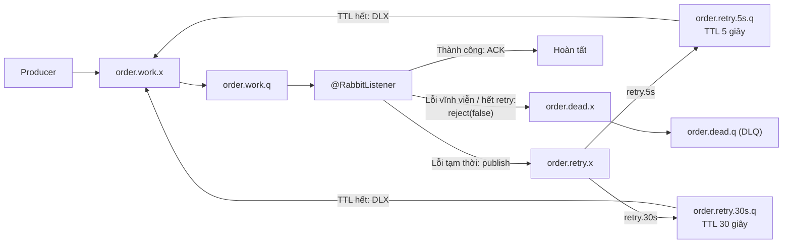

# Retry queue dùng TTL và DLX để trì hoãn

Trong ứng dụng dùng **Spring AMQP** và **RabbitMQ**, lỗi tạm thời như dịch vụ thanh toán đang quá tải, API đối tác trả về HTTP 503 hoặc cơ sở dữ liệu vừa mất kết nối không nhất thiết phải khiến một message thất bại vĩnh viễn. Ta thường muốn **thử lại sau một khoảng chờ**, nhưng không muốn consumer liên tục nhận rồi xử lý thất bại cùng message. Một cách làm phổ biến là kết hợp **retry queue**, **TTL (time to live)** và **DLX (dead-letter exchange)**.

Bài này tập trung vào thiết kế hàng đợi retry có trì hoãn, khai báo topology bằng Spring AMQP, quyết định retry bằng `@RabbitListener` và kiểm tra các trường hợp lỗi. Đây là một phần của việc xây dựng luồng xử lý bất đồng bộ đáng tin cậy với exchange, queue, binding, `RabbitTemplate`, acknowledgement và dead-letter.

## 1. Vì sao phải có retry queue?

Giả sử consumer đang nhận sự kiện `OrderPlaced` để gọi một dịch vụ bên ngoài. Cuộc gọi bị timeout:

- **ACK ngay**: broker xóa message khỏi hàng đợi; công việc chưa hoàn thành có thể bị mất.
- **`basicNack(requeue=true)` ngay**: message quay lại hàng đợi xử lý, có thể được nhận lại tức thì. Nếu lỗi kéo dài, hệ thống rơi vào vòng lặp retry nóng, tăng CPU, log và tải lên hệ thống đang lỗi.
- **`basicReject(requeue=false)`**: message bị loại khỏi queue hiện tại và chuyển qua DLX nếu queue đã cấu hình DLX; phù hợp với lỗi không thể phục hồi hoặc đã hết số lần thử.
- **Đưa sang retry queue có TTL**: message rời hàng đợi xử lý, nằm chờ trong hàng đợi retry; khi TTL hết hạn, RabbitMQ dead-letter nó trở lại exchange xử lý. Consumer chỉ thấy message sau khi RabbitMQ đưa nó trở lại.

Retry queue vì vậy là cơ chế **chờ trước khi thử lại**, còn dead-letter queue (DLQ) là nơi **cách ly message cuối cùng không xử lý được**. Hai loại queue phục vụ mục tiêu khác nhau, dù đều sử dụng DLX.

## 2. Cơ chế TTL + DLX

RabbitMQ hỗ trợ một số lý do khiến message bị dead-letter, trong đó có **hết TTL**, **reject/nack với `requeue=false`** và **vượt giới hạn độ dài queue**. Với retry queue, ta tận dụng lý do *expired*:

1. Consumer nhận message từ `order.work.q` và phát hiện lỗi tạm thời.
2. Ứng dụng dùng `RabbitTemplate` publish message sang exchange `order.retry.x`, với routing key chọn mức trì hoãn mong muốn.
3. Exchange chuyển message tới queue retry tương ứng, ví dụ `order.retry.5s.q`.
4. Queue retry đặt `x-message-ttl = 5000` và `x-dead-letter-exchange = order.work.x`; sau khi message hết hạn, broker chuyển nó qua DLX.
5. DLX dùng routing key `order.process` để đưa message về `order.work.q`. Consumer có thể thử xử lý lần nữa.
6. Khi vượt giới hạn retry hoặc gặp lỗi không thể khắc phục, consumer từ chối message với `requeue=false`; DLX của **work queue** chuyển nó sang `order.dead.q`.



**Điểm cần phân biệt:** DLX là một **exchange**, không phải queue. RabbitMQ chỉ có thể định tuyến một dead-letter đến queue nếu có binding phù hợp. Trong ví dụ này:

| Thành phần | Vai trò |
| --- | --- |
| `order.work.x` / `order.process` | Exchange và routing key để đưa message vào luồng xử lý chính |
| `order.work.q` | Queue consumer thực sự lắng nghe; cấu hình DLX trỏ về `order.dead.x` |
| `order.retry.x` | Exchange nhận các message cần trì hoãn từ consumer |
| `order.retry.5s.q`, `order.retry.30s.q` | Queue chỉ chứa message chờ; mỗi queue có TTL riêng và DLX quay về `order.work.x` |
| `order.dead.x` / `order.dead.q` | Exchange và queue cách ly message cuối cùng không xử lý được |

Không gắn `@RabbitListener` vào retry queue. Nếu consumer lấy message ra khỏi retry queue trước khi TTL hết, việc trì hoãn sẽ không còn ý nghĩa.

### TTL không phải bộ định thời chính xác

`x-message-ttl` là TTL tính bằng **mili giây** áp dụng cho message trong một queue. `5000` nghĩa là 5 giây; đây **không phải** `x-expires` (thời gian queue không được sử dụng thì bị xóa).

TTL định nghĩa thời điểm message **đủ điều kiện hết hạn**, không cam kết consumer nhận lại đúng tại mốc đó. Độ trễ thực tế còn chịu ảnh hưởng của cách broker xử lý message hết hạn, backlog, routing, tải hệ thống và việc consumer có sẵn hay không. Các message dùng TTL riêng từng message còn có thể bị ảnh hưởng bởi thứ tự trong queue (*head-of-line blocking*). Vì vậy, ví dụ này dùng các **queue theo nhóm thời gian** với TTL cố định thay vì nhồi mọi mức trì hoãn vào một queue bằng thuộc tính expiration trên từng message.

## 3. Khai báo topology trong Spring AMQP

Ví dụ dùng Spring Boot đã có dependency `spring-boot-starter-amqp` và một RabbitMQ broker đang chạy. Đặt các khai báo sau vào một lớp cấu hình:

```java
import org.springframework.amqp.core.BindingBuilder;
import org.springframework.amqp.core.Declarables;
import org.springframework.amqp.core.DirectExchange;
import org.springframework.amqp.core.Queue;
import org.springframework.amqp.core.QueueBuilder;
import org.springframework.context.annotation.Bean;
import org.springframework.context.annotation.Configuration;

@Configuration
public class OrderRetryTopology {
    @Bean
    public Declarables orderRetryDeclarables() {
        DirectExchange workX = new DirectExchange("order.work.x", true, false);
        DirectExchange retryX = new DirectExchange("order.retry.x", true, false);
        DirectExchange deadX = new DirectExchange("order.dead.x", true, false);

        // Queue xử lý chính: reject(false) sẽ đến DLQ.
        Queue workQ = QueueBuilder.durable("order.work.q")
                .deadLetterExchange("order.dead.x")
                .deadLetterRoutingKey("order.dead")
                .build();

        // Queue retry chỉ giữ message cho đến khi hết TTL.
        Queue retry5s = QueueBuilder.durable("order.retry.5s.q")
                .ttl(5_000)
                .deadLetterExchange("order.work.x")
                .deadLetterRoutingKey("order.process")
                .build();

        Queue retry30s = QueueBuilder.durable("order.retry.30s.q")
                .ttl(30_000)
                .deadLetterExchange("order.work.x")
                .deadLetterRoutingKey("order.process")
                .build();

        Queue deadQ = QueueBuilder.durable("order.dead.q").build();

        return new Declarables(
                workX, retryX, deadX,
                workQ, retry5s, retry30s, deadQ,
                BindingBuilder.bind(workQ).to(workX).with("order.process"),
                BindingBuilder.bind(retry5s).to(retryX).with("retry.5s"),
                BindingBuilder.bind(retry30s).to(retryX).with("retry.30s"),
                BindingBuilder.bind(deadQ).to(deadX).with("order.dead")
        );
    }
}
```

Các queue và exchange đều được khai báo **durable** để tồn tại khi broker khởi động lại. Tuy nhiên, độ bền queue **không tự biến mọi message thành persistent**; khi publish nên đặt `deliveryMode=PERSISTENT`. Broker có thể sử dụng RabbitAdmin do Spring Boot cấu hình để khai báo các đối tượng này khi kết nối.

Hai đường đi khác nhau cần chú ý:

```text
Retry: order.retry.x --retry.5s--> order.retry.5s.q
       --TTL/DLX: order.work.x + order.process--> order.work.q

DLQ:   order.work.q --reject(false)/DLX: order.dead.x
       + order.dead--> order.dead.q
```

**Bẫy cấu hình:** Nếu `order.retry.5s.q` không có `x-dead-letter-routing-key` phù hợp với binding của `order.work.x`, message sẽ không quay về `order.work.q`. Nếu công việc xử lý lại lỗi rồi cứ publish sang retry mà không giới hạn, có thể tạo vòng lặp vô hạn.

### Những đối số queue quan trọng

| Argument RabbitMQ | Spring AMQP builder | Ý nghĩa |
| --- | --- | --- |
| `x-message-ttl` | `.ttl(5_000)` | Message trong queue hết hạn sau 5.000 ms |
| `x-dead-letter-exchange` | `.deadLetterExchange("order.work.x")` | Exchange nhận message khi dead-letter |
| `x-dead-letter-routing-key` | `.deadLetterRoutingKey("order.process")` | Routing key dùng khi dead-letter |

Trong môi trường vận hành, RabbitMQ **policies** thường linh hoạt hơn so với việc đóng cứng TTL/DLX vào khai báo queue. Việc đổi giá trị đối số của **queue đã tồn tại** và khai báo lại cùng tên có thể gây lỗi `PRECONDITION_FAILED` vì thuộc tính không tương đương; cần có kế hoạch chuyển đổi queue hoặc chính sách phù hợp.

## 4. Cấu hình listener ACK thủ công và publisher confirms

Để kiểm soát đúng thời điểm xóa message gốc, đặt `acknowledge-mode: manual`. Để tránh ACK khi bản sao retry chưa được broker tiếp nhận, bật publisher confirms và kiểm tra cả trường hợp message **không được route**:

```yaml
spring:
  rabbitmq:
    host: localhost
    port: 5672
    publisher-confirm-type: correlated
    publisher-returns: true
    template:
      mandatory: true
    listener:
      simple:
        acknowledge-mode: manual
        prefetch: 10
```

`publisher-confirm-type: correlated` cho phép kiểm tra broker đã xác nhận publish; `publisher-returns: true` kết hợp với `mandatory: true` cho phép phát hiện message không đi đến queue nào. Đây là hai tín hiệu khác nhau: **broker ACK một publish không đồng nghĩa đã route được message đến queue đích**. Trong ví dụ có thể dùng `CorrelationData` để đợi confirm và kiểm tra returned message.

Chỉ ACK message ở work queue **sau khi** publish sang retry exchange được xác nhận. Nếu ACK trước rồi publish thất bại, message gốc có thể bị mất. Ngược lại, nếu publish đã được xác nhận nhưng ứng dụng chết trước ACK, có thể xuất hiện **bản sao** khi message gốc được giao lại. Do đó luồng này có ý nghĩa *at-least-once* về mặt ứng dụng và handler phải có khả năng xử lý lặp (*idempotent*).

## 5. Viết consumer giới hạn retry

Để dễ quan sát, ví dụ dùng payload chuỗi và một bộ xử lý giả lập:

- `ok:42` xử lý thành công.
- `fail-once:42` thất bại ở lần đầu, sau đó thành công.
- `always-fail:42` luôn thất bại tạm thời, hết lượt sẽ vào DLQ.
- `invalid:42` là lỗi dữ liệu vĩnh viễn, được chuyển thẳng vào DLQ.

Đây là mẫu Java có thể ghép với `OrderRetryTopology` ở trên; trong ứng dụng thật, thay `processBusiness(...)` bằng service nghiệp vụ. Các message được gửi theo cùng routing key `order.process`.

```java
import java.io.IOException;
import java.nio.charset.StandardCharsets;
import java.util.UUID;
import java.util.concurrent.TimeUnit;

import com.rabbitmq.client.Channel;
import org.springframework.amqp.core.Message;
import org.springframework.amqp.core.MessageBuilder;
import org.springframework.amqp.core.MessageDeliveryMode;
import org.springframework.amqp.rabbit.annotation.RabbitListener;
import org.springframework.amqp.rabbit.connection.CorrelationData;
import org.springframework.amqp.rabbit.core.RabbitTemplate;
import org.springframework.stereotype.Component;

@Component
public class OrderConsumer {
    private static final String RETRY_EXCHANGE = "order.retry.x";
    private static final String RETRY_COUNT = "x-app-retry-count";
    private static final int MAX_RETRIES = 3;

    private final RabbitTemplate rabbitTemplate;

    public OrderConsumer(RabbitTemplate rabbitTemplate) {
        this.rabbitTemplate = rabbitTemplate;
    }

    @RabbitListener(queues = "order.work.q")
    public void consume(Message incoming, Channel channel) throws IOException {
        long tag = incoming.getMessageProperties().getDeliveryTag();

        try {
            processBusiness(incoming);
        } catch (PermanentOrderFailure e) {
            // DLX của order.work.q đưa message tới order.dead.q.
            channel.basicReject(tag, false);
            return;
        } catch (Exception temporaryFailure) {
            retryOrDeadLetter(incoming, channel, tag);
            return;
        }

        channel.basicAck(tag, false);
    }

    private void retryOrDeadLetter(Message original,
                                   Channel channel,
                                   long deliveryTag) throws IOException {
        int previousRetries = retryCount(original);
        if (previousRetries >= MAX_RETRIES) {
            channel.basicReject(deliveryTag, false);
            return;
        }

        // Lần retry #1 sau 5s; các lần #2, #3 sau 30s.
        String key = previousRetries == 0 ? "retry.5s" : "retry.30s";

        Message toRetry = MessageBuilder.fromMessage(original)
                .setHeader(RETRY_COUNT, previousRetries + 1)
                .setDeliveryMode(MessageDeliveryMode.PERSISTENT)
                .build();

        try {
            CorrelationData correlation =
                    new CorrelationData(UUID.randomUUID().toString());

            rabbitTemplate.send(RETRY_EXCHANGE, key, toRetry, correlation);

            CorrelationData.Confirm confirm =
                    correlation.getFuture().get(5, TimeUnit.SECONDS);

            if (!confirm.isAck() || correlation.getReturned() != null) {
                throw new IllegalStateException("Retry publish not confirmed/routed");
            }

            // Chỉ ACK bản gốc sau khi bản retry được broker chấp nhận và route.
            channel.basicAck(deliveryTag, false);
        } catch (Exception publishFailure) {
            // Không ACK bản gốc khi chưa chắc đã publish thành công.
            channel.basicNack(deliveryTag, false, true);
            // Hệ thống thật cần log/metric/alert ở đây, tránh retry nóng kéo dài.
        }
    }

    private int retryCount(Message message) {
        Object value = message.getMessageProperties()
                .getHeaders().get(RETRY_COUNT);
        return value instanceof Number n ? Math.max(0, n.intValue()) : 0;
    }

    private void processBusiness(Message message) {
        String payload = new String(message.getBody(), StandardCharsets.UTF_8);
        int retries = retryCount(message);

        if (payload.startsWith("invalid:")) {
            throw new PermanentOrderFailure("Invalid order payload");
        }
        if (payload.startsWith("always-fail:")
                || (payload.startsWith("fail-once:") && retries == 0)) {
            throw new IllegalStateException("Temporary dependency failure");
        }

        System.out.println("Processed " + payload + ", retries=" + retries);
    }

    static class PermanentOrderFailure extends RuntimeException {
        PermanentOrderFailure(String message) {
            super(message);
        }
    }
}
```

Trong ví dụ, `MAX_RETRIES = 3` là **ba lần thử lại sau lần xử lý đầu tiên**, tức tối đa bốn lần gọi nghiệp vụ. Nếu dữ liệu `always-fail:42` được gửi vào work queue, lịch dự kiến là:

| Lượt xử lý | Header `x-app-retry-count` lúc nhận | Hành động sau lỗi | Thời gian chờ |
| --- | ---: | --- | --- |
| Ban đầu | 0 (chưa có header) | Publish vào `retry.5s` | Khoảng 5 giây |
| Retry #1 | 1 | Publish vào `retry.30s` | Khoảng 30 giây |
| Retry #2 | 2 | Publish vào `retry.30s` | Khoảng 30 giây |
| Retry #3 | 3 | `basicReject(false)` đến DLQ | Không chờ thêm |

Tổng khoảng chờ lý thuyết trước lượt xử lý cuối là **65 giây**, chưa tính thời gian xử lý và trễ của broker. Nếu `fail-once:42`, message sẽ thành công ngay ở retry #1 và được ACK, không vào DLQ.

### Tại sao cần header retry riêng?

Khi RabbitMQ dead-letter một message, broker quản lý thông tin như header `x-death` (queue, nguyên nhân và số lần dead-letter). Header này hữu ích để **điều tra đường đi thực tế**, nhưng cấu trúc của nó phản ánh sự kiện dead-letter của broker chứ không trực tiếp biểu diễn chính sách retry nghiệp vụ. Một message có thể đi qua nhiều queue và nhiều lý do dead-letter.

Ứng dụng vì thế dùng header riêng `x-app-retry-count`, tăng một lần mỗi khi **chủ động gửi sang retry exchange**. Không tự viết hoặc chỉnh sửa `x-death`. Khi triển khai thực tế, cần xác thực message đầu vào và kiểm soát header để producer bên ngoài không thể tự đặt số lượt retry gây vượt qua luồng xử lý dự kiến.

## 6. Gửi message và quan sát hành vi

Có thể gửi bằng `RabbitTemplate` từ bất kỳ bean thử nghiệm nào, hoặc nhập message trực tiếp vào exchange `order.work.x` trên RabbitMQ Management UI với routing key `order.process`:

```java
import org.springframework.amqp.rabbit.core.RabbitTemplate;

// Phần mã có thể gọi trong CommandLineRunner hoặc service thử nghiệm.
rabbitTemplate.convertAndSend("order.work.x", "order.process", "ok:42");
rabbitTemplate.convertAndSend("order.work.x", "order.process", "fail-once:42");
rabbitTemplate.convertAndSend("order.work.x", "order.process", "always-fail:42");
rabbitTemplate.convertAndSend("order.work.x", "order.process", "invalid:42");
```

Với những thông điệp thực tế quan trọng, producer cũng nên dùng publisher confirm và thông điệp persistent như consumer làm khi chuyển sang retry. Đoạn trên được rút gọn để minh họa luồng.

Quan sát tại RabbitMQ Management UI (thường là `http://localhost:15672` nếu bật management plugin):

1. `ok:42`: listener in kết quả và ACK; không xuất hiện ở retry queue hay DLQ.
2. `fail-once:42`: message đi vào `order.retry.5s.q`, hết TTL quay về `order.work.q`, sau đó được xử lý thành công.
3. `always-fail:42`: đi qua các queue retry theo lịch 5s → 30s → 30s; cuối cùng nằm trong `order.dead.q`.
4. `invalid:42`: consumer `basicReject(false)` ngay tại lần đầu; message vào `order.dead.q`.

Với mỗi lần thất bại, có thể đối chiếu `x-app-retry-count`, các bản ghi dead-letter (`x-death`), số message ready/unacked và log xử lý. Trong thử nghiệm, cần xác nhận **không có consumer nào lắng nghe retry queue**, các binding đã tồn tại và không có message bị chuyển về một routing key không có queue nhận.

## 7. Các lỗi triển khai thường gặp

| Hiện tượng | Nguyên nhân hay gặp | Cách xử lý |
| --- | --- | --- |
| Message bị xử lý lại liên tục không có thời gian chờ | Dùng `basicNack(requeue=true)` cho lỗi nghiệp vụ | Publish sang retry queue rồi ACK bản gốc khi publish đã được xác nhận |
| Message hết TTL nhưng không quay về work queue | Sai DLX, sai routing key hoặc thiếu binding | Kiểm tra `x-dead-letter-exchange`, `x-dead-letter-routing-key` và binding của work exchange |
| Message vào DLQ ngay khi mới lỗi tạm thời | Gọi `basicReject(false)` trên work queue | Chỉ dùng reject cho lỗi vĩnh viễn hoặc khi hết lượt; retry cần publish tới retry exchange |
| Message không bao giờ hết thời gian chờ | Nhầm `x-expires` với `x-message-ttl`, hoặc có consumer lấy message khỏi retry queue | Dùng `.ttl(...)` và không consume retry queue |
| Một message được xử lý hai lần | Publish bản retry thành công nhưng ACK bản gốc chưa hoàn tất; broker giao lại | Xử lý idempotent theo message ID hoặc khóa nghiệp vụ |
| Deploy mới báo `PRECONDITION_FAILED` | Khai báo lại queue cũ với TTL/DLX khác | Quản lý thay đổi queue/policy có kế hoạch; không đổi đối số bất tương thích tùy tiện |
| Retry mãi không dừng | Không theo dõi số lần retry hoặc logic routing sai | Tăng `x-app-retry-count`, giới hạn số lượt và đưa vào DLQ |

### Lưu ý vận hành để cơ chế thực sự đáng tin cậy

**Phân loại lỗi.** Timeout, 429, 503 hoặc hạ tầng ngắn hạn thường đáng retry; payload sai schema, thiếu trường bắt buộc hoặc không thỏa điều kiện nghiệp vụ thường không thể sửa bằng cách chờ. Không dùng `catch (Exception)` rồi retry vô hạn cho mọi lỗi.

**Backoff và jitter.** Ví dụ hai bucket 5s/30s dễ hiểu nhưng không phải chính sách duy nhất. Hệ thống lớn có thể dùng các bucket 5s → 30s → 2 phút → 10 phút, hoặc thêm jitter ở tầng điều phối để tránh nhiều message cùng thức dậy tạo đột biến tải. Với TTL queue cố định, jitter cần thêm bucket, phân nhóm thời gian hoặc một cơ chế lập lịch khác.

**Idempotency.** RabbitMQ + ACK thủ công + publish confirms không tạo ra giao dịch nguyên tử giữa xử lý nghiệp vụ, publish message mới và ACK message cũ. Lưu khóa xử lý duy nhất, dùng upsert hoặc ràng buộc unique, và định nghĩa hành vi khi message bị giao lại.

**Publisher confirm, returned message, và DLX.** Confirm/return giúp xác minh hành động **publish từ ứng dụng** tới retry exchange. Bước **broker dead-letter từ retry queue về work exchange** là một giai đoạn khác; độ an toàn và bảo đảm chuyển tiếp phụ thuộc cấu hình RabbitMQ, loại queue và điều kiện lỗi broker. Cần giám sát unroutable/dead-letter, giữ queue bền vững và chọn cơ chế phù hợp với yêu cầu dữ liệu.

**Theo dõi và xử lý DLQ.** Theo dõi số message ở `order.retry.*.q`, `order.dead.q`, thời gian nằm trong queue, số lần retry và tỷ lệ xử lý thành công sau retry. DLQ cần quy trình điều tra, sửa nguyên nhân rồi phát lại có kiểm soát; không tự động đưa toàn bộ DLQ quay lại work queue theo vòng lặp vô hạn.

**Lỗi publish lại.** Trong ví dụ, khi không xác nhận được publish, consumer `basicNack(requeue=true)` bản gốc để tránh mất việc. Đây là đường hồi phục khi hạ tầng có vấn đề, nhưng có thể tạo retry nóng nếu broker tiếp tục không nhận publish. Hệ thống thật nên ghi log/metric, cảnh báo, giới hạn tốc độ hoặc tạm dừng consumer trong tình trạng lỗi kéo dài.

**Độ chính xác của thời gian chờ.** TTL + DLX phù hợp khi cần độ trễ xấp xỉ theo nhóm thời gian. Nếu cần lịch chạy chính xác theo thời điểm hoặc điều phối hàng triệu tác vụ có ngày hẹn riêng, hãy đánh giá thêm scheduler, hệ thống quản lý job hoặc cơ chế delayed messaging phù hợp.

## 8. Câu hỏi tự kiểm tra

1. Vì sao `basicNack(requeue=true)` không tạo được khoảng chờ retry ổn định?
2. Message ở retry queue chuyển về work queue khi xảy ra sự kiện gì? Exchange và binding nào quyết định đích đến?
3. `x-message-ttl` khác `x-expires` như thế nào?
4. Vì sao nên ACK message gốc **sau** khi publish bản retry được xác nhận? Rủi ro xử lý trùng vẫn còn ở điểm nào?
5. Với `MAX_RETRIES = 3`, consumer xử lý tối đa mấy lần trước khi reject vào DLQ?
6. Vì sao cần giới hạn retry, phân loại lỗi vĩnh viễn và triển khai idempotency dù đã có DLQ?

**Ghi nhớ:** Consumer chủ động publish message cần thử lại vào retry exchange. TTL giữ message trong retry queue; khi hết hạn, DLX đưa nó về work queue. Luồng thất bại cuối cùng đi vào DLQ, còn ACK, confirm, giới hạn retry và idempotency giúp kiểm soát nguy cơ mất hoặc xử lý trùng message.
