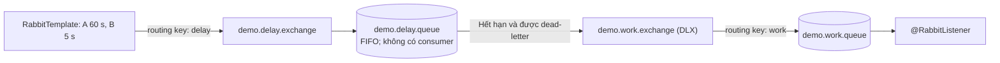

# Giới hạn TTL theo từng thông điệp và hiện tượng chặn ở đầu queue

> **Chương:** Dead-letter và trì hoãn  
> **Công nghệ:** Spring AMQP, RabbitMQ  
> **Trọng tâm:** Vì sao thông điệp có TTL ngắn vẫn có thể được chuyển qua dead-letter exchange rất muộn khi xếp sau một thông điệp có TTL dài.

## 1. Vấn đề thực tế

Giả sử một hệ thống đặt hàng cần xử lý bất đồng bộ: nhắc thanh toán sau 5 giây, hủy đơn chưa thanh toán sau 60 giây, và thử lại một tác vụ sau các khoảng chờ khác nhau. Với **Spring AMQP**, ứng dụng có thể dùng `RabbitTemplate` gửi thông điệp đến RabbitMQ, gắn TTL riêng cho từng thông điệp và cấu hình **dead-letter exchange (DLX)** để chuyển thông điệp đã hết hạn sang queue xử lý. `@RabbitListener` sẽ nhận thông điệp từ queue xử lý đó.

Cách làm này dễ triển khai nhưng có một giới hạn quan trọng: **TTL là thời hạn tồn tại trong queue, không phải cam kết rằng RabbitMQ sẽ phát thông điệp đúng thời điểm TTL kết thúc**. Khi các thông điệp có TTL khác nhau nằm trong cùng một queue FIFO, một thông điệp đã hết hạn có thể bị giữ phía sau thông điệp ở đầu queue chưa hết hạn. Đây là hiện tượng **head-of-line blocking** (chặn ở đầu queue).

Sau bài này, bạn có thể:

- Gắn `expiration` theo từng thông điệp bằng `RabbitTemplate` và phân biệt với TTL ở mức queue.
- Giải thích thời điểm thông điệp **hết hạn về mặt logic** và thời điểm RabbitMQ **loại bỏ/dead-letter** thông điệp.
- Dựng exchange, queue, binding và DLX bằng Spring AMQP để quan sát hiện tượng chặn ở đầu queue.
- Chọn cách thiết kế phù hợp khi có nhiều mức trì hoãn, đồng thời hiểu giới hạn độ chính xác và độ tin cậy.

## 2. TTL theo thông điệp hoạt động thế nào?

RabbitMQ hỗ trợ các cơ chế TTL có tên dễ nhầm lẫn:

| Cơ chế | Cấu hình | Ý nghĩa |
| --- | --- | --- |
| **Per-message TTL** | Thuộc tính AMQP `expiration`, kiểu **chuỗi chứa số mili giây**; Spring AMQP: `MessageProperties#setExpiration("5000")` | Thông điệp cụ thể được phép nằm trong một queue tối đa khoảng 5.000 ms nếu chưa được tiêu thụ. |
| **Per-queue message TTL** | Chính sách `message-ttl` hoặc đối số queue `x-message-ttl` | Mọi thông điệp trong queue chịu cùng giới hạn TTL. |
| **Queue TTL** | `expires` trong policy hoặc `x-expires` | Quy định khi nào **bản thân queue** không được sử dụng sẽ hết hạn; không phải cơ chế trì hoãn thông điệp. |

Khi một thông điệp chịu đồng thời TTL riêng và `x-message-ttl`, RabbitMQ áp dụng **giá trị nhỏ hơn**. TTL áp dụng cho thời gian thông điệp nằm trong từng queue: thông điệp được route vào hai queue có thể hết hạn ở hai thời điểm khác nhau. TTL cũng không bảo đảm thông điệp tồn tại đủ khoảng thời gian đó: nếu có consumer đang chờ, nó có thể được giao ngay trước khi hết hạn.

Ví dụ gửi một thông điệp tồn tại tối đa 5 giây:

```java
rabbitTemplate.convertAndSend("demo.delay.exchange", "delay", "order-42", message -> {
    message.getMessageProperties().setExpiration("5000"); // mili giây, kiểu String
    return message;
});
```

`expiration` không phải `LocalDateTime` hoặc timestamp tuyệt đối. RabbitMQ diễn giải nó là **thời lượng TTL bằng mili giây**. Giá trị phải là chuỗi số không âm hợp lệ; truyền `"5s"`, `"PT5S"` hoặc số nguyên trực tiếp dưới dạng thuộc tính AMQP này là sai.

Nếu queue có cấu hình DLX và một thông điệp hết hạn được loại bỏ, RabbitMQ sẽ dead-letter thông điệp qua exchange đó. Nếu không có đích dead-letter hợp lệ, thông điệp có thể bị loại bỏ mà không đến được queue xử lý mong muốn. Dead-lettering là một hoạt động định tuyến, **không tương đương việc một bộ lập lịch đã thực thi tác vụ**.

## 3. Head-of-line blocking: tại sao TTL 5 giây có thể chờ gần 60 giây?

Xét một queue trì hoãn **không có consumer**, các thông điệp xếp vào cùng queue theo thứ tự:

1. **A** vào trước, TTL = **60 giây**.
2. **B** vào ngay sau, TTL = **5 giây**.

```text
Thời điểm vừa publish:

    Đầu queue                                      Cuối queue
         |                                             |
         v                                             v
    +--------------------+     +--------------------+
    | A: TTL 60 giây     | --> | B: TTL 5 giây      |
    +--------------------+     +--------------------+

Sau khoảng 5 giây:

    +--------------------+     +--------------------+
    | A: CHƯA hết hạn    | --> | B: ĐÃ hết hạn      |
    +--------------------+     +--------------------+
              ^                         |
              |                         +-- Chưa đến đầu queue:
              +-- đang chặn                 chưa được dead-letter

Sau khoảng 60 giây:

    A hết hạn và rời đầu queue -> B trở thành đầu queue
    -> B vốn đã hết hạn -> B mới có thể được dead-letter.
```

| Mốc gần đúng | Trạng thái A | Trạng thái B |
| --- | --- | --- |
| `t = 0 s` | A vào queue, hạn `t ≈ 60 s`. | B vào sau, hạn `t ≈ 5 s`. |
| `t ≈ 5 s` | A chưa hết hạn, vẫn ở đầu queue. | **B đã hết hạn về mặt logic**, nhưng chưa được dead-letter vì đứng sau A. |
| `t ≈ 60 s` | A hết hạn, được loại bỏ và dead-letter nếu DLX hợp lệ. | B tiến đến đầu queue; khi được kiểm tra, B có thể được dead-letter ngay. |
| Kết quả | A trễ xấp xỉ 60 giây theo thiết kế. | B có thể phải chờ xấp xỉ 60 giây thay vì 5 giây, tức muộn khoảng 55 giây. |

**Điểm mấu chốt:** RabbitMQ bảo đảm thông điệp hết hạn không được giao cho consumer như một thông điệp còn hợp lệ, nhưng không bảo đảm dọn hoặc dead-letter ngay khi đồng hồ TTL chạm ngưỡng. Với per-message TTL, thông điệp hết hạn có thể nằm sau thông điệp chưa hết hạn và tiếp tục chiếm tài nguyên, được tính trong số liệu queue. Với quorum queue, thông điệp per-message TTL được dead-letter khi tới đầu queue; với classic queue, việc dọn có thể còn được kích hoạt bởi một số sự kiện khác như thay đổi policy.

Hiện tượng này đặc biệt dễ thấy trong mô hình **TTL + DLX làm delay queue**, vì queue trì hoãn thường không có consumer: các thông điệp chỉ rời queue khi bị hết hạn và được dead-letter. Nếu một consumer đọc trực tiếp queue trì hoãn, thông điệp có thể được lấy đi ngay và cơ chế chờ TTL không còn đúng mục đích.

## 4. Thực hành với Spring AMQP

Mô hình minh họa dùng **một delay queue** để cố ý tái hiện vấn đề:



Ở đây `demo.work.queue` là **queue xử lý sau trì hoãn**, không nhất thiết là queue lưu lỗi cuối cùng. Thuật ngữ DLX chỉ cách thông điệp rời queue gốc khi hết hạn; nghiệp vụ có thể tiếp tục xử lý bình thường ở đích mới.

### 4.1. Khai báo exchange, queue và binding

Trong ứng dụng Spring Boot đã kết nối RabbitMQ, thêm dependency `spring-boot-starter-amqp` nếu dự án chưa có. Cấu hình sau đặt DLX cho delay queue và **không** đặt `x-message-ttl`, vì từng thông điệp sẽ có TTL riêng:

```java
import org.springframework.amqp.core.Binding;
import org.springframework.amqp.core.BindingBuilder;
import org.springframework.amqp.core.DirectExchange;
import org.springframework.amqp.core.Queue;
import org.springframework.amqp.core.QueueBuilder;
import org.springframework.context.annotation.Bean;
import org.springframework.context.annotation.Configuration;
import org.springframework.amqp.rabbit.annotation.EnableRabbit;

@Configuration
@EnableRabbit
public class TtlDemoTopology {
    public static final String DELAY_EXCHANGE = "demo.delay.exchange";
    public static final String DELAY_QUEUE = "demo.delay.queue";
    public static final String WORK_EXCHANGE = "demo.work.exchange";
    public static final String WORK_QUEUE = "demo.work.queue";

    @Bean
    DirectExchange delayExchange() {
        return new DirectExchange(DELAY_EXCHANGE);
    }

    @Bean
    DirectExchange workExchange() {
        return new DirectExchange(WORK_EXCHANGE);
    }

    @Bean
    Queue delayQueue() {
        return QueueBuilder.durable(DELAY_QUEUE)
                .deadLetterExchange(WORK_EXCHANGE)
                .deadLetterRoutingKey("work")
                .build();
    }

    @Bean
    Queue workQueue() {
        return QueueBuilder.durable(WORK_QUEUE).build();
    }

    @Bean
    Binding delayBinding() {
        return BindingBuilder.bind(delayQueue())
                .to(delayExchange()).with("delay");
    }

    @Bean
    Binding workBinding() {
        return BindingBuilder.bind(workQueue())
                .to(workExchange()).with("work");
    }
}
```

Khi cấu hình được khai báo, Spring AMQP sẽ sử dụng hạ tầng AMQP administration để khai báo các thành phần với broker. Hai binding có nhiệm vụ khác nhau: binding đầu nhận thông điệp mới vào delay queue; binding sau nhận thông điệp được dead-letter sang work queue. **Không đặt `@RabbitListener` trên `demo.delay.queue`** trong thí nghiệm này.

Trong môi trường vận hành, RabbitMQ khuyến nghị cấu hình DLX/TTL bằng **policy** để có thể điều chỉnh mà không cần khai báo lại queue; `QueueBuilder` ở đây giúp ví dụ độc lập và dễ đọc. Nếu queue cùng tên đã tồn tại với bộ arguments khác, broker có thể từ chối khai báo; hãy dùng queue tên mới hoặc quản lý lại cấu hình queue trong môi trường thử nghiệm.

### 4.2. Publish hai thông điệp với TTL khác nhau

Đoạn `CommandLineRunner` dưới đây tự gửi A rồi B khi ứng dụng thử nghiệm khởi động. Chỉ bật runner này trong môi trường demo để tránh gửi lại thông điệp mỗi lần restart.

```java
import java.time.Instant;
import org.springframework.amqp.rabbit.core.RabbitTemplate;
import org.springframework.boot.CommandLineRunner;
import org.springframework.stereotype.Component;

@Component
public class TtlDemoPublisher implements CommandLineRunner {
    private final RabbitTemplate rabbitTemplate;

    public TtlDemoPublisher(RabbitTemplate rabbitTemplate) {
        this.rabbitTemplate = rabbitTemplate;
    }

    @Override
    public void run(String... args) {
        publish("A-60s", 60_000L);
        publish("B-5s", 5_000L);
    }

    private void publish(String payload, long ttlMillis) {
        System.out.println("Published " + payload + " at " + Instant.now());
        rabbitTemplate.convertAndSend(
                TtlDemoTopology.DELAY_EXCHANGE,
                "delay",
                payload,
                message -> {
                    message.getMessageProperties()
                            .setExpiration(Long.toString(ttlMillis));
                    return message;
                }
        );
    }
}
```

`RabbitTemplate.convertAndSend(...)` thực hiện chuyển đổi payload, chạy `MessagePostProcessor` để đặt TTL rồi publish đến exchange với routing key chỉ định. Mỗi thông điệp mang một giá trị `expiration` riêng. TTL ở đây không làm thread Java ngủ và không tạo bộ hẹn giờ trong ứng dụng.

### 4.3. Nhận thông điệp sau khi dead-letter

```java
import java.time.Instant;
import org.springframework.amqp.rabbit.annotation.RabbitListener;
import org.springframework.stereotype.Component;

@Component
public class TtlDemoConsumer {
    @RabbitListener(queues = TtlDemoTopology.WORK_QUEUE)
    public void handle(String body) {
        System.out.println("Received " + body + " at " + Instant.now());
    }
}
```

Với RabbitMQ local mặc định, cấu hình kết nối Spring Boot thường có dạng:

```yaml
spring:
  rabbitmq:
    host: localhost
    port: 5672
    username: guest
    password: guest
```

Tài khoản `guest` mặc định chỉ phù hợp thử nghiệm cục bộ; môi trường triển khai thực tế cần tài khoản và quyền truy cập riêng.

### 4.4. Đọc kết quả đúng cách

Khởi động ứng dụng với broker đang chạy và các queue demo còn trống. Quan sát thời điểm publish/receive trong log và số lượng thông điệp ở `demo.delay.queue` bằng RabbitMQ Management UI:

1. Gần lúc khởi động, A và B cùng nằm trong delay queue, **A ở đầu**.
2. Sau khoảng 5 giây, B đã hết TTL nhưng thường **chưa xuất hiện** ở work queue; A vẫn chưa hết TTL.
3. Gần khoảng 60 giây, A tới hạn và được dead-letter; sau đó B mới có thể rời delay queue. Work listener nhận cả hai gần nhau, dù B chỉ có TTL 5 giây.
4. Số liệu độ sâu queue có thể vẫn tính B trong thời gian nó đã hết hạn nhưng chưa được dọn. Hãy xem cả log, độ sâu queue và thời điểm nhận; đừng suy đoán chỉ từ một chỉ số.

Đây là **kết quả dự kiến**, không phải SLA chính xác tới mili giây. Kết quả quan sát có thể thay đổi theo tải, loại queue, thời điểm broker thực hiện expiration và cấu hình hệ thống. Nếu thông điệp vào sai queue, work exchange không có binding phù hợp hoặc có consumer trực tiếp ở delay queue, hiện tượng sẽ khác thí nghiệm.

## 5. Cách tránh chặn đầu queue khi cần trì hoãn đa mức

### Lựa chọn A: phân nhóm queue theo mức trì hoãn

Thay vì để TTL 5 giây và 60 giây chung một queue, tạo các queue riêng với TTL ở **mức queue**, ví dụ:

```text
             +--> retry.5s.queue  (x-message-ttl: 5000)  --+
Producer ----|                                              +--> work.exchange --> work.queue
             +--> retry.60s.queue (x-message-ttl: 60000) --+
```

Mỗi queue chứa thông điệp có cùng khoảng trì hoãn, nên thông điệp cần chờ ngắn không bị một thông điệp chờ dài ở **queue khác** chặn lại. Một cấu hình queue minh họa:

```java
@Bean
Queue retry5sQueue() {
    return QueueBuilder.durable("retry.5s.queue")
            .ttl(5_000)
            .deadLetterExchange(TtlDemoTopology.WORK_EXCHANGE)
            .deadLetterRoutingKey("work")
            .build();
}
```

Cần binding route thông điệp tới `retry.5s.queue` và tạo queue/binding tương ứng cho mức 60 giây. Tránh gắn thêm `expiration` biến thiên lớn lên các thông điệp trong cùng một bucket, vì như vậy có thể tái xuất hiện head-of-line blocking. Cách chia bucket phù hợp cho retry/backoff có vài mốc cố định, đổi lại phải quản lý nhiều queue và không hỗ trợ thời điểm chờ tùy ý với độ chính xác cao.

### Lựa chọn B: dùng cơ chế lập lịch thích hợp

- **Delayed-message exchange** (nếu plugin tương ứng được cài đặt và hỗ trợ trên phiên bản RabbitMQ đang vận hành): hỗ trợ delay theo từng lần publish và có cơ chế định tuyến riêng; cần kiểm tra giới hạn, vòng đời và khả năng hỗ trợ của plugin trước khi áp dụng.
- **Bộ lập lịch dựa trên dữ liệu bền vững** (database, job scheduler): lưu `dueAt`, quét/đánh thức tác vụ tới hạn rồi publish vào work queue; phù hợp khi cần lịch dài, hủy hoặc đổi lịch, kiểm soát khôi phục và độ chính xác theo yêu cầu nghiệp vụ.
- **Retry do broker hỗ trợ**: nếu đang sử dụng quorum queues với cơ chế delayed retry phù hợp, cân nhắc khả năng sẵn có của phiên bản RabbitMQ trước khi tự tạo vòng dead-letter.

| Nhu cầu | Hướng ưu tiên | Giới hạn cần chấp nhận |
| --- | --- | --- |
| Vài mức retry cố định, ví dụ 5 s / 60 s / 5 phút | Các delay queue có `x-message-ttl` cố định | Nhiều queue và TTL không phải bộ hẹn giờ chính xác. |
| Trì hoãn riêng theo từng thông điệp với độ chính xác vừa phải | Cơ chế delayed-message phù hợp hạ tầng | Phụ thuộc hỗ trợ của broker/plugin và đặc tính lưu trữ. |
| Lịch theo thời điểm tuyệt đối, cần sửa/hủy, thời gian dài | Persistent scheduler + RabbitTemplate | Phải thiết kế quản lý lịch, phát lại và chống xử lý trùng. |

## 6. Đảm bảo vận hành đúng và quan sát được

**Kiểm tra topology.** DLX phải tồn tại, routing key của dead-letter phải khớp binding của queue đích. Nếu không có DLX hoặc không route được sang queue nào, không thể giả định thông điệp sẽ xuất hiện ở work queue. Queue cần phù hợp với độ bền dữ liệu; publisher confirms giúp biết broker đã tiếp nhận bản publish đầu vào, nhưng **không tự chứng minh** rằng lần dead-letter về sau đã được xử lý thành công. Tùy loại queue và cấu hình, dead-lettering còn có các lựa chọn bảo đảm chuyển tiếp khác nhau.

**Kiểm tra quan sát.** Ghi một `messageId`, thời điểm publish và TTL dự kiến; đo thêm thời điểm message tới consumer để tính độ lệch. Đọc `messages_ready`, tốc độ dead-letter, số lượng xử lý và các chỉ số lưu trữ. Thông điệp per-message TTL hết hạn vẫn có thể nằm trong queue phía sau phần tử chưa hết hạn, nên số lượng `ready` cao không đồng nghĩa tất cả đều còn hợp lệ về TTL. RabbitMQ có các header lịch sử dead-letter như `x-death` với lý do `expired`, hỗ trợ lần theo vòng đời thông điệp.

**Phân biệt lỗi và trì hoãn.** Khi `@RabbitListener` xử lý thất bại, cần quyết định retry, `ack`/`nack` hoặc dead-letter theo loại lỗi; không lẫn trường hợp `rejected` với `expired`. Nếu dùng lại TTL + DLX cho retry, phải giới hạn số lần thử và tránh vòng lặp vô hạn. Consumer nên xử lý idempotent khi nghiệp vụ không được phép thực hiện hai lần.

**Không xem TTL là deadline thực thi.** TTL thể hiện giới hạn giữ thông điệp trong queue, còn thực thi còn phụ thuộc dead-letter, routing, hàng đợi đích và năng lực consumer. Hãy định nghĩa yêu cầu nghiệp vụ là **độ trễ chấp nhận được** và thiết kế cơ chế hẹn giờ tương ứng.

## 7. Các lỗi hiểu nhầm thường gặp

| Nhận định | Điều chỉnh |
| --- | --- |
| “B có `expiration = 5000` thì listener chắc chắn nhận sau đúng 5 giây.” | Sai: B chỉ hết hạn về mặt TTL sau khoảng 5 giây; dead-letter còn phụ thuộc vị trí trong queue và hoạt động của broker. |
| “Message hết TTL thì biến mất khỏi mọi metric ngay.” | Sai: với per-message TTL, message hết hạn phía sau head có thể vẫn chiếm chỗ và được tính vào số lượng queue. |
| “`x-expires` là TTL áp dụng cho từng message.” | Sai: `x-expires` nói về vòng đời queue không được sử dụng; `x-message-ttl` mới giới hạn TTL message ở mức queue. |
| “Có thể đặt listener trên delay queue để tự chờ TTL.” | Sai với mô hình này: listener có thể nhận message trước TTL, làm mất tác dụng trì hoãn bằng DLX. |
| “Đổi A và B sang hai queue cùng TTL 5 giây sẽ giải quyết mọi vấn đề thời gian.” | Queue cố định giảm chặn giữa các mức TTL nhưng vẫn không cung cấp cam kết xử lý đúng từng mili giây. |

## 8. Ghi nhớ

Trong **Spring AMQP**, `RabbitTemplate` có thể đặt `MessageProperties.expiration` riêng cho từng thông điệp; RabbitMQ sẽ kiểm tra TTL của thông điệp trong queue và dùng DLX nếu thông điệp hết hạn cần được dead-letter. Tuy nhiên, **TTL hết hạn không đồng nghĩa message được dead-letter ngay**. Với các TTL khác nhau trong cùng một delay queue FIFO, phần tử chưa hết hạn ở đầu có thể giữ các phần tử đã hết hạn phía sau rất lâu. Vì vậy, dùng queue có TTL cố định cho các mốc retry, hoặc chọn cơ chế scheduling phù hợp nếu cần delay linh hoạt và chính xác hơn.

### Tài liệu tham khảo

- [RabbitMQ — Time-to-Live and Expiration](https://www.rabbitmq.com/docs/ttl): per-message TTL, queue message TTL, trường hợp expired message ở sau head.
- [RabbitMQ — Dead Letter Exchanges](https://www.rabbitmq.com/docs/dlx): nguyên nhân dead-letter, routing key và header `x-death`.
- [Spring AMQP — Sending Messages](https://docs.spring.io/spring-amqp/reference/amqp/sending-messages.html): `RabbitTemplate`, `convertAndSend` và `MessagePostProcessor`.
