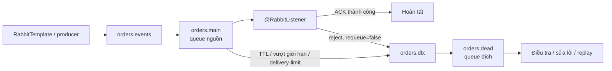
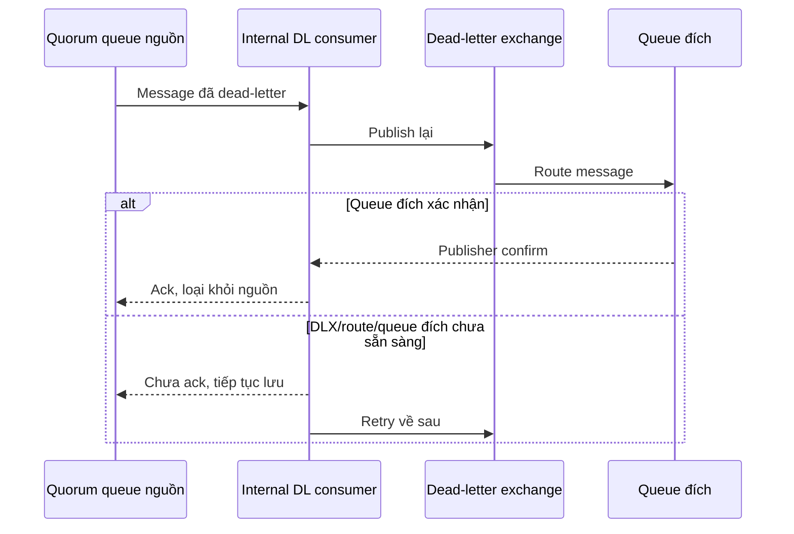

# Độ tin cậy của dead-letter theo loại queue và chính sách

Trong ứng dụng Spring AMQP, gửi một message lỗi sang **dead-letter exchange (DLX)** giúp cô lập dữ liệu không thể xử lý và hỗ trợ điều tra, khôi phục. Tuy nhiên, **có DLX không đồng nghĩa với việc message chắc chắn đến dead-letter queue**. Mức bảo đảm còn phụ thuộc vào **loại queue nguồn**, **chiến lược dead-letter**, **chính sách overflow**, khả năng sẵn sàng của queue đích và cách ứng dụng xác nhận message.

Bài này tập trung vào một bài toán thực tế: hệ thống xử lý đơn hàng dùng `RabbitTemplate` và `@RabbitListener` phải giữ lại được đơn lỗi khi RabbitMQ gặp sự cố, đồng thời kiểm soát được trường hợp trùng message, queue đầy hoặc DLX định tuyến sai.

**Sau bài học, bạn có thể:**

- Phân biệt độ tin cậy của đường chuyển dead-letter từ **classic queue**, **quorum queue** và vai trò của **stream**.
- Giải thích vì sao `at-most-once` có thể làm mất message, còn `at-least-once` có thể tạo message trùng.
- Cấu hình policy cho quorum queue và nhận diện các điều kiện khiến `at-least-once` không có hiệu lực.
- Kết hợp Spring AMQP, publisher confirms, manual ack, xử lý idempotent và quan sát `x-death` để thiết kế quy trình xử lý lỗi có thể vận hành.

## 1. Dead-letter là một lần publish mới bên trong broker

Giả sử producer gửi sự kiện `order.created` vào `orders.main`. Consumer đọc sự kiện và phát hiện dữ liệu sai, gọi `basicReject(deliveryTag, false)`. Nếu `orders.main` được cấu hình DLX, RabbitMQ sẽ thử **publish lại** message tới DLX, sau đó DLX định tuyến sang queue đích theo binding.



RabbitMQ đưa message vào luồng dead-letter trong những tình huống phổ biến sau:

| Nguyên nhân | Cơ chế | Giá trị `reason` trong `x-death` |
| --- | --- | --- |
| Consumer từ chối và không requeue | `basic.reject` hoặc `basic.nack` với `requeue=false` | `rejected` |
| Message hết TTL | TTL theo message hoặc queue | `expired` |
| Message bị loại do giới hạn chiều dài queue | Tùy `max-length` và cách xử lý overflow | `maxlen` |
| Quorum queue vượt giới hạn lần giao thất bại | `delivery-limit` | `delivery_limit` |

Lưu ý: **queue hết hạn do `expires` không làm các message bên trong tự động được dead-letter**. `basicAck` báo xử lý thành công nên cũng không phát sinh dead-letter.

Một message có thể bị thất lạc ở chặng **queue nguồn → DLX → queue đích** ngay cả khi producer đã publish thành công tới queue nguồn. Đó là lý do phải xét mức bảo đảm **của chính bước chuyển dead-letter**, tách khỏi bảo đảm gửi ban đầu và bảo đảm xử lý nghiệp vụ.

## 2. Loại queue nguồn quyết định mức bảo đảm

| Queue nguồn / cấu hình | Mức bảo đảm khi dead-letter | Khi DLX sai hoặc queue đích không sẵn sàng | Đánh đổi chính |
| --- | --- | --- | --- |
| **Classic queue** với DLX | `at-most-once` | Message có thể đã bị xóa khỏi nguồn và không tới đích | Ít chi phí hơn, không giữ được message chờ xác nhận chuyển |
| **Quorum queue** mặc định | `at-most-once` | Vẫn có khả năng mất message khi chuyển | Có sao chép dữ liệu nguồn nhưng **chưa bảo đảm** đường dead-letter |
| **Quorum queue** có `dead-letter-strategy=at-least-once` và đủ điều kiện | `at-least-once` **cho bước chuyển** tới các đích | Giữ message đã dead-letter tại nguồn cho đến khi đích xác nhận; tiếp tục thử lại | Tốn tài nguyên, có thể gây áp lực dung lượng và tạo bản sao trùng |
| **Stream** là nguồn | Không hỗ trợ cơ chế DLX như classic/quorum queue | Áp dụng cơ chế tiêu thụ theo offset và retention riêng | Không chọn stream nguồn để triển khai mẫu DLX |

**Phân biệt queue nguồn và đích:** quy tắc `at-least-once` nói trên phụ thuộc vào **quorum queue nguồn**. Queue đích có thể là classic queue, quorum queue hoặc stream, miễn là topology và khả năng nhận message phù hợp. Việc chỉ đổi `orders.dead` thành quorum queue **không nâng** một classic queue nguồn lên `at-least-once`.

### 2.1. Vì sao `at-most-once` có thể mất message?

Ở chiến lược mặc định, RabbitMQ publish lại message qua DLX **không đợi publisher confirms nội bộ** từ các queue đích. Message được loại khỏi nguồn sau khi publish lại, vì vậy có khoảng rủi ro:

1. `orders.main` loại message khỏi queue nguồn.
2. DLX không tồn tại, routing key không khớp binding, một queue đích mất kết nối/quorum hoặc từ chối publish do đầy.
3. Không có xác nhận lưu trữ thành công từ đích; message có thể không còn ở nguồn lẫn đích.

Điều này vẫn đúng khi **queue nguồn là quorum** nhưng chưa bật chiến lược `at-least-once`. Sao chép bằng Raft bảo vệ dữ liệu đang thuộc quorum queue, nhưng tự nó không làm bước publish qua DLX thành giao dịch bảo đảm.

### 2.2. `At-least-once` của quorum queue hoạt động thế nào?

Với chiến lược `at-least-once`, RabbitMQ có **internal dead-letter consumer** gắn với quorum queue nguồn. Message đã dead-letter vẫn được giữ ở nguồn trong khi tiến trình này publish sang DLX. Chỉ sau khi có **publisher confirms từ mọi queue đích được định tuyến tới**, tiến trình mới xác nhận và loại message khỏi nguồn.



**Lợi ích:** sự cố tạm thời ở DLX hoặc queue đích không buộc nguồn xóa ngay message. **Giới hạn:** nếu một message được route tới hai queue và một queue xác nhận, một queue không xác nhận, RabbitMQ có thể thử publish lại toàn bộ. Queue đã nhận trước đó có thể thấy **bản sao trùng**. Vì vậy `at-least-once` không phải `exactly-once`.

Đảm bảo này chỉ nói về **chuyển message chết sang queue đích**. Nó không thay cho publisher confirms khi producer gửi `order.created` ban đầu, cũng không đảm bảo consumer của `orders.dead` xử lý nghiệp vụ đúng một lần.

## 3. Các policy bắt buộc và ảnh hưởng của chúng

Để bật `at-least-once` trên một **quorum queue nguồn**, cần đồng thời:

1. Queue đã được khai báo với `x-queue-type=quorum`.
2. Policy đặt `dead-letter-strategy` thành `at-least-once`.
3. Policy đặt `overflow` thành `reject-publish`, **không phải** `drop-head`.
4. Policy chỉ rõ `dead-letter-exchange` và DLX cùng binding thực sự tồn tại.
5. Feature flag `stream_queue` được bật nếu phiên bản/cụm RabbitMQ đang dùng còn yêu cầu bật thủ công.

Nên cấu hình thêm `dead-letter-routing-key` để đích rõ ràng và `max-length`/`max-length-bytes` để giới hạn mức tích tụ message. Chúng giúp bảo vệ tài nguyên nhưng **không giải quyết tự động** việc queue đích ngừng nhận.

| Policy key | Vai trò | Sai sót dễ gặp |
| --- | --- | --- |
| `dead-letter-exchange` | Chỉ định exchange nhận message lỗi | Exchange không tồn tại hoặc chưa có quyền publish |
| `dead-letter-routing-key` | Đổi routing key khi đưa qua DLX | Routing key không khớp binding của đích |
| `dead-letter-strategy` | `at-most-once` hoặc `at-least-once` cho **quorum source** | Tưởng rằng quorum mặc định đã là `at-least-once` |
| `overflow` | `drop-head` hoặc `reject-publish` | `drop-head` làm chiến lược `at-least-once` **rơi về `at-most-once`**, kể cả chưa đặt giới hạn độ dài |
| `max-length` / `max-length-bytes` | Giới hạn dung lượng logic tại nguồn | Message đang chờ chuyển DLX cũng chiếm giới hạn; queue có thể từ chối publish mới |
| `delivery-limit` | Giới hạn số lần giao thất bại của **quorum queue** | Không có DLX thì message vượt limit có thể bị loại bỏ |

**Phân biệt `overflow`:** `drop-head` loại message cũ khi vượt giới hạn, có thể phát sinh dead-letter với `reason=maxlen`; `reject-publish` chặn publish mới khi đầy, giúp không âm thầm đẩy message cũ ra khỏi nguồn. Việc producer bị từ chối publish cần được ứng dụng xử lý bằng publisher confirms, retry có giới hạn hoặc backpressure; đừng xem `reject-publish` là bảo đảm producer đã gửi thành công.

**Ưu tiên policy:** RabbitMQ ưu tiên queue arguments được truyền cứng trong lúc khai báo (`x-dead-letter-exchange`, `x-dead-letter-routing-key`, ...) so với policy cùng mục đích. Vì vậy nên giữ các tham số DLX có khả năng thay đổi trong **broker policy**, để operator cập nhật mà không cần tái triển khai ứng dụng. Riêng **loại queue** (`x-queue-type`) được quyết định khi khai báo và không thể đổi một queue hiện hữu từ classic sang quorum chỉ bằng policy.

**Cảnh báo vận hành:** thay đổi chiến lược của quorum queue từ `at-least-once` xuống `at-most-once`, hoặc chuyển `overflow` từ `reject-publish` thành `drop-head`, có thể **xóa các dead-letter đang chờ confirm**. Phải đánh giá lượng message pending trước khi đổi policy.

## 4. Ví dụ Spring AMQP: queue nguồn quorum và dead-letter queue

Ví dụ dùng hai direct exchange: `orders.events` cho nghiệp vụ và `orders.dlx` cho message lỗi. `orders.main` là **quorum queue nguồn**, `orders.dead` là queue đích cũng dùng quorum để tăng khả năng sẵn sàng. Phần `dead-letter-strategy` được cấp bằng RabbitMQ policy ở bước sau.

```java
import org.springframework.amqp.core.Binding;
import org.springframework.amqp.core.BindingBuilder;
import org.springframework.amqp.core.DirectExchange;
import org.springframework.amqp.core.Queue;
import org.springframework.amqp.core.QueueBuilder;
import org.springframework.context.annotation.Bean;
import org.springframework.context.annotation.Configuration;

@Configuration
public class OrdersRabbitConfig {
    @Bean
    DirectExchange ordersEvents() {
        return new DirectExchange("orders.events", true, false);
    }

    @Bean
    DirectExchange ordersDlx() {
        return new DirectExchange("orders.dlx", true, false);
    }

    @Bean
    Queue ordersMain() {
        return QueueBuilder.durable("orders.main").quorum().build();
    }

    @Bean
    Queue ordersDead() {
        return QueueBuilder.durable("orders.dead").quorum().build();
    }

    @Bean
    Binding ordersMainBinding() {
        return BindingBuilder.bind(ordersMain())
                .to(ordersEvents()).with("orders.created");
    }

    @Bean
    Binding ordersDeadBinding() {
        return BindingBuilder.bind(ordersDead())
                .to(ordersDlx()).with("orders.dead");
    }
}
```

Giả sử ứng dụng/Spring AMQP đã kết nối đúng vhost và được cấp quyền khai báo topology, operator áp dụng policy sau trên broker (ví dụ lệnh chạy trong Bash, quyền quản trị RabbitMQ):

```bash
rabbitmqctl set_policy orders-main-reliable '^orders\.main$' \
  '{"dead-letter-exchange":"orders.dlx",
    "dead-letter-routing-key":"orders.dead",
    "dead-letter-strategy":"at-least-once",
    "overflow":"reject-publish",
    "delivery-limit":5,
    "max-length":100000}' \
  --priority 10 --apply-to quorum_queues
```

Policy trên áp dụng cho `orders.main` (quorum) và có ý nghĩa:

- Message bị từ chối với `requeue=false` hoặc vượt `delivery-limit` được đưa qua `orders.dlx` với routing key `orders.dead`.
- RabbitMQ giữ message dead-letter chưa được đích xác nhận trong queue nguồn và tiếp tục thử lại khi topology/đích có thể nhận.
- Message chưa chuyển xong vẫn chiếm giới hạn; nếu tích tụ đủ nhiều, `orders.main` có thể từ chối publish mới.
- Giới hạn 5 lần giao lỗi giúp tránh vòng lặp vô hạn **nếu** cách consumer trả lại message làm bộ đếm lỗi tăng (xem ghi chú phiên bản bên dưới).

Trong môi trường thực tế, nên quản lý policy bằng IaC/Automation của broker và kiểm tra kết quả bằng `rabbitmqctl list_policies` hoặc trang **Admin → Policies** trên RabbitMQ Management. Đảm bảo không có `x-arguments` cũ đang ghi đè policy.

### 4.1. Producer: lưu message bền vững và theo dõi xác nhận gửi

Ở nhánh gửi ban đầu, `RabbitTemplate` nên publish message với `deliveryMode=PERSISTENT` và bật publisher confirms/returns phù hợp trong cấu hình connection factory. Ví dụ:

```java
import java.util.UUID;
import org.springframework.amqp.core.MessageDeliveryMode;
import org.springframework.amqp.rabbit.core.RabbitTemplate;

public class OrderPublisher {
    private final RabbitTemplate rabbitTemplate;

    public OrderPublisher(RabbitTemplate rabbitTemplate) {
        this.rabbitTemplate = rabbitTemplate;
    }

    public void send(String orderId) {
        rabbitTemplate.convertAndSend(
            "orders.events", "orders.created", "order:" + orderId,
            message -> {
                message.getMessageProperties()
                       .setDeliveryMode(MessageDeliveryMode.PERSISTENT);
                message.getMessageProperties()
                       .setMessageId(UUID.randomUUID().toString());
                return message;
            }
        );
    }
}
```

Đây là ví dụ về payload và thuộc tính message; bản thân lời gọi `convertAndSend` **không tự chứng minh broker đã nhận**. Với yêu cầu không mất message ở chặng producer → queue nguồn, cần xử lý publisher confirm/return thực sự và sử dụng outbox nếu cần đảm bảo nhất quán với giao dịch cơ sở dữ liệu.

**Chi tiết thường bị bỏ qua:** quorum queue nguồn lưu message bền vững, nhưng khi chuyển qua DLX, RabbitMQ **giữ nguyên delivery mode ban đầu**. Muốn message tại `orders.dead` còn sau khởi động lại broker, cần queue đích durable và message ban đầu có delivery mode persistent.

### 4.2. Consumer: ack đúng lúc, phân loại lỗi và không requeue vô hạn

Ví dụ dưới đây dùng manual acknowledgement. `OrderService#processOnce` là dịch vụ nghiệp vụ **do ứng dụng triển khai**, phải idempotent theo một khóa nghiệp vụ hoặc event ID.

```java
import java.io.IOException;
import java.nio.charset.StandardCharsets;

import com.rabbitmq.client.Channel;
import org.springframework.amqp.core.Message;
import org.springframework.amqp.rabbit.annotation.RabbitListener;
import org.springframework.dao.TransientDataAccessException;
import org.springframework.stereotype.Component;

@Component
public class OrderConsumer {
    private final OrderService orderService;

    public OrderConsumer(OrderService orderService) {
        this.orderService = orderService;
    }

    @RabbitListener(queues = "orders.main", ackMode = "MANUAL")
    public void onMessage(Message message, Channel channel)
            throws IOException {
        long tag = message.getMessageProperties().getDeliveryTag();
        String payload = new String(
                message.getBody(), StandardCharsets.UTF_8);

        try {
            if (!payload.startsWith("order:")) {
                channel.basicReject(tag, false); // Dữ liệu sai -> DLX
                return;
            }

            orderService.processOnce(payload);    // Idempotent
            channel.basicAck(tag, false);         // Chỉ ack sau thành công
        } catch (TransientDataAccessException ex) {
            channel.basicReject(tag, true);      // Thử lại qua broker
        } catch (RuntimeException ex) {
            channel.basicReject(tag, false);     // Không retry mãi
        }
    }
}
```

Ở đây `basicReject(tag, true)` là một ví dụ đơn giản để minh họa việc trả message về queue. Hệ thống thật nên **giới hạn retry và có khoảng giãn cách** (backoff) để tránh hot loop; có thể dùng delayed retry native của quorum queue khi phiên bản RabbitMQ hỗ trợ, hoặc cơ chế retry được thiết kế rõ ràng. Lỗi vĩnh viễn cần `requeue=false` để đi vào DLX, thay vì lặp vô hạn.

**Lưu ý RabbitMQ 4.3+:** việc `basic.nack(requeue=true)` không còn làm tăng `delivery-count` giống các phiên bản trước. Nếu dựa vào `delivery-limit` để đưa poison message sang DLX, hãy kiểm tra semantics theo phiên bản broker và ưu tiên `basic.reject(requeue=true)` cho trường hợp giao thất bại cần được đếm. Đừng nhầm `x-delivery-count` (số lần giao thất bại của quorum queue) với `x-death` (lịch sử **dead-letter** qua queue).

Trong Spring AMQP ở chế độ AUTO ack, exception thường do listener container quyết định requeue; mặc định có thể requeue tùy cấu hình. Có thể dùng `AmqpRejectAndDontRequeueException` hoặc cấu hình `defaultRequeueRejected=false` nếu muốn lỗi được dead-letter. Không được kết hợp thao tác ack thủ công với AUTO ack một cách tùy tiện.

## 5. Những trường hợp `at-least-once` vẫn cần xử lý

| Tình huống | `at-most-once` | Quorum `at-least-once` | Việc cần làm |
| --- | --- | --- | --- |
| DLX chưa được tạo hoặc binding sai | Có thể mất message | Message pending ở nguồn, tiếp tục retry | Kiểm tra exchange, routing key, bindings và quyền |
| Queue đích mất quorum, không thể nhận publish | Có thể mất message | Đợi xác nhận; tích tụ ở nguồn | Khôi phục đích, theo dõi backlog/disk |
| Queue đích đầy và dùng `reject-publish` | Có thể mất message | Chưa ack nguồn; sẽ retry | Tăng năng lực xử lý/đánh giá hạn mức của đích |
| DLX route tới **hai** queue, chỉ một queue confirm | Có thể thiếu ở một đích | Có thể publish lại, sinh trùng ở đích đã nhận | Idempotent ở mọi đích |
| Nguồn đổi `overflow` sang `drop-head` | Vẫn `at-most-once` | **Mất hiệu lực `at-least-once`**, pending có thể bị xóa | Kiểm soát thay đổi policy |
| Producer gửi message `transient`, đích bị restart | Dễ mất sau restart | Xác nhận chuyển không thay thế độ bền của message | Persistent message + durable target |

**Tại sao queue nguồn có thể bị đầy dù consumer đã xử lý xong?** Message đã bị reject là «dead» đối với nghiệp vụ, nhưng vẫn được tính là message **live về mặt tài nguyên** cho đến khi internal consumer nhận đủ xác nhận từ các đích. Nếu DLX bị lỗi lâu, số lượng pending tăng, nguồn có thể chạm `max-length`; với `reject-publish`, publisher mới sẽ bị từ chối. Cần chủ động đặt cảnh báo và có quy trình sửa topology/khôi phục đích.

**Tại sao không nên tự tạo vòng DLX vô hạn?** Nếu dead-letter queue được cấu hình trỏ ngược về queue nguồn mà không có điểm dừng, hệ thống có thể tạo chu trình. RabbitMQ phát hiện và loại bỏ một số dead-letter cycle không có sự kiện reject trong vòng lặp; cách này không thay được retry có giới hạn, backoff và DLQ cuối cùng.

## 6. Cách kiểm chứng và quan sát trên môi trường thử nghiệm

Hãy thử riêng từng kịch bản trong môi trường tích hợp, không cố ý làm hỏng topology production:

1. **Luồng bình thường:** gửi `order:123`, `OrderService` xử lý và consumer ack. `orders.dead` không tăng.
2. **Lỗi vĩnh viễn:** gửi `payload-invalid`, listener `basicReject(..., false)`. Message xuất hiện ở `orders.dead`, `x-death.reason=rejected`.
3. **Queue đích không có route:** tạm gỡ binding của `orders.dead` khỏi `orders.dlx` rồi gửi message lỗi. Với quorum `at-least-once`, message dead-letter chưa được xác nhận vẫn pending ở nguồn; tạo lại binding và quan sát việc chuyển tiếp.
4. **Queue đích ngừng nhận:** thử làm đích từ chối publish trong môi trường cô lập. Xác minh nguồn không xóa message chờ confirm; quan sát backlog và khả năng xuất hiện duplicate sau khi phục hồi.
5. **Kiểm tra thay đổi policy:** đọc policy hiện có, xác nhận `dead-letter-strategy=at-least-once` và `overflow=reject-publish`. Không đổi chúng khi còn pending chỉ để thử ở production.

Lệnh kiểm tra gợi ý (tùy quyền trên broker và vhost):

```bash
rabbitmqctl list_policies
rabbitmqctl list_queues name type durable messages_ready messages_unacknowledged
rabbitmq-queues quorum_status orders.main
```

Các chỉ báo nên theo dõi qua RabbitMQ Management, metrics exporter và logging:

- **Queue nguồn:** số message ready/unacked, tốc độ publish/ack, dung lượng disk, tình trạng quorum/leader và dấu hiệu message dead-letter chờ chuyển.
- **Queue đích:** độ sâu của `orders.dead`, tốc độ vào/ra, lỗi không thể publish, trạng thái replica/quorum và khả năng xử lý các message bị cách ly.
- **Đường định tuyến:** exchange/binding tồn tại, routing key đúng, log broker khi forwarding qua DLX thất bại.
- **Chất lượng dữ liệu:** đếm `x-death` theo queue và reason; gắn event ID/correlation ID, đo độ trễ từ lần thất bại đầu tiên đến khi vào DLQ.
- **Vận hành retry:** cảnh báo khi backlog tăng, số lần giao thất bại tăng bất thường, hoặc một loại lỗi xuất hiện liên tục; định nghĩa SLA sửa lỗi và replay.

Trong header `x-death`, RabbitMQ ghi lịch sử theo cặp `{queue, reason}` để không tăng vô hạn theo từng lần dead-letter. Các trường như `x-first-death-queue`, `x-first-death-reason` và `x-last-death-reason` hỗ trợ điều tra. **Không coi `x-death.count` là bộ đếm retry tổng quát**: requeue trong cùng queue không nhất thiết là một lần dead-letter.

Khi replay từ `orders.dead` về luồng nghiệp vụ, hãy kiểm tra dữ liệu đã sửa, có cơ chế duyệt/giới hạn tốc độ và bảo đảm **idempotency** theo khóa ổn định. Đừng dùng số lần nhận message hay vị trí trong queue làm định danh duy nhất.

## 7. Lựa chọn theo yêu cầu độ tin cậy

| Nhu cầu | Định hướng |
| --- | --- |
| Dead-letter chỉ để lấy mẫu, chấp nhận mất một phần dữ liệu lỗi | Classic queue hoặc quorum queue mặc định với DLX; ghi rõ hạn chế `at-most-once` |
| Đơn hàng, thanh toán hoặc tác vụ cần giữ message lỗi để xử lý lại | Quorum **nguồn** + policy `at-least-once` + `reject-publish` + DLX/binding hợp lệ |
| Cần lưu trữ dài hạn, nhiều consumer phân tích hoặc replay theo offset | Cân nhắc stream ở **đích** với retention phù hợp; stream không dùng DLX làm queue nguồn theo cùng cơ chế |
| Cần không mất message ở mọi chặng và tránh xử lý trùng | Bổ sung publisher confirms/returns, persistent message, durable queues, outbox, idempotent consumer và giám sát |

Một thiết kế đáng tin cậy cần nêu rõ **bảo đảm ở từng chặng**:

```text
Producer --(confirm/return + outbox nếu cần)--> Queue nguồn
Consumer --(manual ack/reject có chủ đích)----> Xử lý nghiệp vụ
Queue nguồn --(at-least-once DLX nếu là quorum)--> Queue dead-letter
DLQ consumer --(idempotency + kiểm soát replay)--> Kết quả cuối
```

Không có một cờ cấu hình duy nhất biến toàn bộ đường đi thành `exactly-once`. Điểm mấu chốt là **chọn đúng queue nguồn, cấu hình đúng policy, nhận diện các trạng thái chờ và chấp nhận khả năng trùng để xử lý an toàn**.

## 8. Câu hỏi tự kiểm tra

1. Nếu `orders.main` là classic queue nhưng `orders.dead` là quorum queue, quá trình dead-letter đã được bảo đảm `at-least-once` chưa? Vì sao?
2. Đã đặt `dead-letter-strategy=at-least-once` cho nguồn quorum nhưng để `overflow=drop-head`; khi DLX lỗi có rủi ro gì?
3. Vì sao một message có thể xuất hiện hai lần trong `orders.dead` dù RabbitMQ không mất message khi chuyển?
4. Khi `orders.main` đầy do các dead-letter đang chờ confirm, vì sao chỉ tăng consumer xử lý nghiệp vụ có thể chưa giải quyết được?
5. Trong RabbitMQ 4.3+, điều gì cần lưu ý nếu retry sử dụng `basic.nack(requeue=true)` và dựa vào `delivery-limit`?

## Tài liệu tham khảo

- RabbitMQ — [Dead Letter Exchanges](https://www.rabbitmq.com/docs/dlx): nguyên nhân dead-letter, routing, policy, `x-death` và rủi ro publish nội bộ.
- RabbitMQ — [Quorum Queues](https://www.rabbitmq.com/docs/quorum-queues): `at-least-once`, `overflow`, giới hạn, tài nguyên và delivery limit theo phiên bản.
- RabbitMQ — [Streams](https://www.rabbitmq.com/docs/streams): sự khác biệt giữa stream và queue thông thường.
- RabbitMQ — [Consumer Acknowledgements and Publisher Confirms](https://www.rabbitmq.com/docs/confirms): phân biệt xác nhận phía producer và consumer.
- Spring AMQP — [Annotation-driven Listener Endpoints](https://docs.spring.io/spring-amqp/reference/amqp/receiving-messages/async-annotation-driven.html): `@RabbitListener` và kiểu ack.
