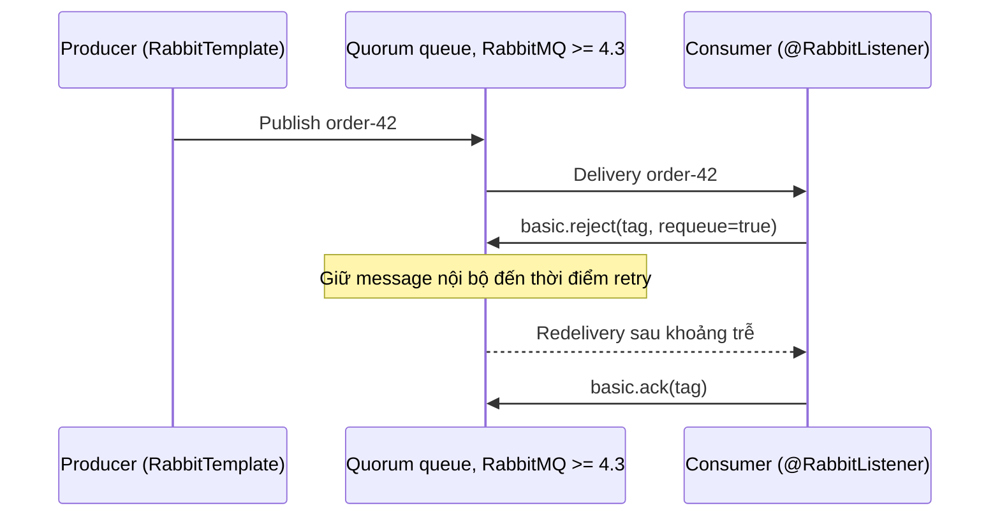
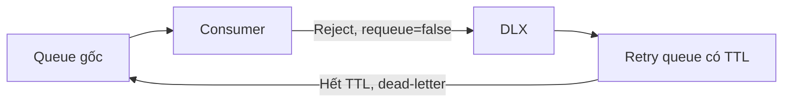

# Delayed retry tích hợp của broker theo loại queue và phiên bản hỗ trợ

> **Phạm vi:** RabbitMQ kết hợp Spring AMQP (`RabbitTemplate`, `@RabbitListener`), tập trung vào khả năng trì hoãn **giao lại** (redelivery) do chính broker quản lý. Các mốc phiên bản dưới đây được đối chiếu với tài liệu RabbitMQ 4.3 và 4.4 (đến tháng 11/2026).

## 1. Vấn đề: vì sao phải trì hoãn retry?

Giả sử ứng dụng xử lý đơn hàng nhận một message yêu cầu xác nhận thanh toán. Dịch vụ thanh toán trả lỗi HTTP 429 trong vài giây. Nếu consumer lập tức đưa message trở lại queue, nó có thể nhận lại chính message đó gần như ngay lập tức, tiếp tục thất bại và tạo thành **vòng lặp requeue nóng**:

```text
RabbitMQ queue → @RabbitListener → lỗi 429 → requeue ngay
               ↑                           |
               └───────────────────────────┘
```

Hệ quả là số lần xử lý tăng nhanh, làm tốn CPU, kết nối, log và tiếp tục gây áp lực lên hệ thống đang quá tải. `Thread.sleep()` trong listener không giải quyết triệt để: nó giữ luồng consumer bận và làm giảm thông lượng của các message khác.

**Delayed retry do broker tích hợp** cho phép consumer trả message về queue; broker giữ message ở trạng thái chưa sẵn sàng cho đến khi hết khoảng trễ, rồi mới giao lại. Với RabbitMQ **4.3 trở lên, khả năng này có sẵn cho quorum queue**, không cần tạo chuỗi retry queue + TTL + dead-letter exchange (DLX) để chỉ thực hiện việc chờ.



Điểm cần phân biệt: cơ chế trên xử lý **message đã được giao nhưng xử lý thất bại**. Nó khác với **delayed message** (producer đặt thời điểm giao lần đầu), **deferred message** (consumer chủ động cất message và lấy lại theo token), và **dead-letter** (chuyển message sang đường xử lý lỗi).

## 2. Ma trận hỗ trợ theo phiên bản và queue type

| RabbitMQ | Classic queue | Quorum queue | Stream | Phương án cho delayed retry |
| --- | --- | --- | --- | --- |
| 3.13 và 4.0–4.2 | Không có delayed retry nội bộ | Chưa có delayed retry nội bộ | Không có cùng cơ chế requeue của queue | Dùng TTL + DLX, tầng ứng dụng hoặc giải pháp lên lịch phù hợp |
| **4.3** | **Không hỗ trợ** | **Có**, cấu hình theo queue/policy, linear backoff | Không áp dụng | Dùng native delayed retry nếu queue là quorum |
| **4.4** | **Không hỗ trợ** | **Có**, kế thừa từ 4.3 | Không áp dụng | Native delayed retry; có thêm tính năng trì hoãn khác cho quorum |

Từ RabbitMQ 4.4, quorum queue còn có:

- **Delayed message:** producer đặt `x-opt-delivery-time` để chỉ định thời điểm giao lần đầu; có thể đặt message annotation qua AMQP 1.0 hoặc header kiểu `long` qua AMQP 0-9-1.
- **Deferred message:** consumer AMQP 1.0 lưu tạm message bằng deferral token và sau đó yêu cầu lấy lại. Đây là cách chờ điều kiện nghiệp vụ chưa đủ, thay vì retry theo thời gian.

**Không được suy diễn** rằng cứ dùng Spring AMQP hay phiên bản RabbitMQ mới là mọi queue đều có delayed retry. Phải kiểm tra đồng thời **phiên bản broker ≥ 4.3**, **`x-queue-type=quorum`**, và **cấu hình delayed retry đã bật**. Mặc định chế độ retry này là `disabled`.

> `x-delayed-message` exchange của plugin `rabbitmq_delayed_message_exchange` là một lựa chọn khác để trì hoãn việc **publish/routing**. Nó không phải tính năng redelivery nội bộ trên quorum queue; nếu muốn dùng cho retry, ứng dụng thường phải tổ chức việc publish lại message.

## 3. Broker giữ message và tính thời gian như thế nào?

Khi một delivery được **trả về queue** với khả năng requeue, RabbitMQ quyết định có trì hoãn không dựa trên cấu hình `delayed-retry-type`. Nếu có, quorum queue lưu message ở phần trì hoãn nội bộ theo thời điểm được phép giao tiếp; hết thời gian mới chuyển sang trạng thái có thể nhận. Message không phải đi vòng qua retry queue và không bị publish lại chỉ để chờ.

Quorum queue dùng **linear backoff**, với giới hạn trên:

```text
delay_ms = min(delayed_retry_min_ms × delivery_count, delayed_retry_max_ms)
```

Ví dụ chọn `min=2_000 ms` và `max=10_000 ms`; với những lần xử lý thất bại **làm tăng `delivery-count`**, khoảng trễ tương ứng như sau:

| `delivery-count` | Cách tính | Thời gian chờ |
| ---: | ---: | ---: |
| 1 | min(2 × 1, 10) giây | 2 giây |
| 2 | min(2 × 2, 10) giây | 4 giây |
| 3 | min(2 × 3, 10) giây | 6 giây |
| 4 | min(2 × 4, 10) giây | 8 giây |
| 5 trở lên | Chạm mức tối đa | 10 giây |

**Cảnh báo về công thức:** không phải cứ message được trả về một lần thì `delivery-count` cũng tăng. Trong RabbitMQ 4.3+, `basic.nack` không được coi là một lần xử lý thất bại, nên nhiều lần nack có thể chỉ chịu **mức trễ tối thiểu** thay vì tăng dần. Muốn mô hình “lỗi 1 lần → lỗi 2 lần → ... → đạt giới hạn → DLQ”, phải chọn đúng phương thức settlement ở consumer.

## 4. `basic.reject` và `basic.nack`: khác biệt quyết định hành vi

RabbitMQ 4.3 tách hai bộ đếm:

- `x-acquired-count`: số lần broker gán message cho consumer (không khẳng định ứng dụng đã xử lý nó).
- `x-delivery-count`: số lần broker ghi nhận **delivery bị thất bại**. `delivery-limit` của quorum queue 4.3+ dựa vào bộ đếm này.

| Hành động ở consumer (AMQP 0-9-1) | Trả lại queue? | Tăng `delivery-count`? | Loại cấu hình có thể delay |
| --- | --- | --- | --- |
| `basicAck(tag, false)` | Không, đã xử lý xong | Không | Không cần |
| `basicReject(tag, true)` | Có | **Có** | `failed` hoặc `all` |
| `basicNack(tag, false, true)` | Có | **Không** | `returned` hoặc `all` |
| `basicReject(tag, false)` / `basicNack(tag, false, false)` | Không; loại bỏ hoặc dead-letter nếu có DLX | Không dùng để lên lịch retry | Không áp dụng |
| Consumer/channel mất kết nối khi còn message chưa ack | Broker có thể giao lại | Có đối với delivery thất bại | `failed` hoặc `all` |

*Các quy tắc đếm ở bảng áp dụng cho RabbitMQ 4.3+. Ở 4.2 trở về trước, logic liên quan delivery limit khác; không mang giả định cũ sang 4.3.*

Giá trị của `delayed-retry-type`:

| Giá trị | Ý nghĩa | Tình huống sử dụng |
| --- | --- | --- |
| `disabled` | Không trì hoãn (mặc định) | Tắt tính năng |
| `failed` | Chỉ trì hoãn những lần trả về được đánh dấu thất bại, ví dụ `basic.reject(..., true)` | **Phù hợp với retry lỗi tạm thời kèm delivery limit** |
| `returned` | Chỉ trì hoãn những lần trả về không tăng `delivery-count`, ví dụ `basic.nack(..., true)` | Trả message về vì chưa muốn xử lý, không tính thất bại |
| `all` | Trì hoãn cả hai nhóm | Muốn hạn chế requeue nóng bất kể loại return |

Ví dụ quan trọng: chọn `delayed-retry-type=all` nhưng consumer cứ gọi `basicNack(tag, false, true)` sẽ **có delay**, song `delivery-count` không tăng, nên `delivery-limit` không tự chặn vòng lặp này. Khi yêu cầu retry hữu hạn rồi vào DLQ, dùng `basicReject(tag, true)` hoặc bảo đảm một cơ chế đếm và dừng rõ ràng khác.

## 5. Cấu hình broker: ưu tiên policy để dễ thay đổi

Với RabbitMQ 4.3+ và **quorum queue** tên `orders.jobs`, ta cấu hình chỉ trì hoãn những lần thất bại thật sự, từ 2 giây đến 10 giây, và giới hạn số lần xử lý lỗi:

```bash
# Chạy trong môi trường có rabbitmqctl (cú pháp shell kiểu Bash).
rabbitmqctl set_policy orders-retry '^orders\.jobs$' \
  '{"delayed-retry-type":"failed","delayed-retry-min":2000,"delayed-retry-max":10000,"delivery-limit":5}' \
  --apply-to quorum_queues --priority 10
```

Ba khóa delayed retry dùng trong **policy** là:

| Policy key | Queue argument tương ứng | Ý nghĩa |
| --- | --- | --- |
| `delayed-retry-type` | `x-delayed-retry-type` | `disabled` / `all` / `failed` / `returned` |
| `delayed-retry-min` | `x-delayed-retry-min` | Mức chờ tối thiểu, **mili giây**, bắt buộc khi bật |
| `delayed-retry-max` | `x-delayed-retry-max` | Mức chờ tối đa, **mili giây**, không bắt buộc |

`delivery-limit` là policy key khác, giới hạn số lần delivery thất bại; phía khai báo queue dùng `x-delivery-limit`. Khi quá giới hạn, message có thể được dead-letter nếu queue có DLX, hoặc bị loại nếu không có. Từ RabbitMQ 4.0, quorum queue có delivery limit mặc định bằng 20; ví dụ phía trên đặt lại thành 5 để dễ quan sát. Đây **không phải** số lần retry chung cho mọi kiểu nack.

Có thể cấu hình bằng queue arguments lúc khai báo, ví dụ:

```java
Queue retryQueue = QueueBuilder.durable("orders.jobs")
    .quorum()
    .withArgument("x-delayed-retry-type", "failed")
    .withArgument("x-delayed-retry-min", 2000)
    .withArgument("x-delayed-retry-max", 10000)
    .deliveryLimit(5)
    .build();
```

**Chỉ chọn một nguồn cấu hình chủ đạo cho mỗi tham số.** Nếu tham số trùng nhau giữa khai báo và policy, queue arguments thường được ưu tiên; các `x-arguments` cố định thường buộc ứng dụng thay đổi/khai báo lại queue để cập nhật. Policy thuận tiện hơn khi điều chỉnh vận hành. Đặc biệt, không cố khai báo lại một queue đã tồn tại với các argument bất tương đương: broker có thể trả `PRECONDITION_FAILED`.

## 6. Tích hợp Spring AMQP: topology, listener và đường vào DLQ

Ví dụ một hệ thống xử lý tác vụ đơn hàng. `RabbitTemplate` gửi message vào queue `orders.jobs` thông qua default exchange; `@RabbitListener` xử lý và quyết định `ack/reject`. Queue lỗi `orders.failed` là nơi kiểm tra hoặc xử lý thủ công các message không thể hoàn tất.

### 6.1. Khai báo quorum queue và dead-letter route

Giả sử **policy delayed retry đã được áp dụng như mục 5**, cấu hình Java chỉ khai báo topology. Đoạn mã có thể dùng trong ứng dụng Spring Boot đã cấu hình kết nối RabbitMQ:

```java
import org.springframework.amqp.core.Binding;
import org.springframework.amqp.core.BindingBuilder;
import org.springframework.amqp.core.DirectExchange;
import org.springframework.amqp.core.Queue;
import org.springframework.amqp.core.QueueBuilder;
import org.springframework.context.annotation.Bean;
import org.springframework.context.annotation.Configuration;

@Configuration
class RabbitTopology {
    @Bean
    Queue ordersJobs() {
        return QueueBuilder.durable("orders.jobs")
            .quorum()
            .deadLetterExchange("orders.dlx")
            .deadLetterRoutingKey("orders.failed")
            .build();
    }

    @Bean
    DirectExchange ordersDlx() {
        return new DirectExchange("orders.dlx", true, false);
    }

    @Bean
    Queue ordersFailed() {
        return QueueBuilder.durable("orders.failed").build();
    }

    @Bean
    Binding ordersFailedBinding(Queue ordersFailed, DirectExchange ordersDlx) {
        return BindingBuilder.bind(ordersFailed)
            .to(ordersDlx)
            .with("orders.failed");
    }
}
```

Ở đây `orders.jobs` là quorum queue; `orders.failed` là queue giữ message thất bại (có thể chọn loại queue khác tùy yêu cầu). Trong sản xuất, đảm bảo các tên bean và cấu hình DLX không xung đột với topology hiện hữu.

### 6.2. Publish với `RabbitTemplate`

```java
import org.springframework.amqp.rabbit.core.RabbitTemplate;
import org.springframework.stereotype.Service;

@Service
class OrderPublisher {
    private final RabbitTemplate rabbitTemplate;

    OrderPublisher(RabbitTemplate rabbitTemplate) {
        this.rabbitTemplate = rabbitTemplate;
    }

    void send(String orderId) {
        // Default exchange ("") định tuyến theo tên queue.
        rabbitTemplate.convertAndSend("", "orders.jobs", orderId);
    }
}
```

Producer gửi thông điệp **bình thường**, không cần gửi kèm TTL hay chọn retry exchange. Khi yêu cầu độ tin cậy cao, bật và xử lý **publisher confirms**; việc producer publish thành công không thay thế cho consumer acknowledgement.

### 6.3. Listener phân loại lỗi và settlement thủ công

```java
import com.rabbitmq.client.Channel;
import java.io.IOException;
import org.springframework.amqp.rabbit.annotation.RabbitListener;
import org.springframework.amqp.support.AmqpHeaders;
import org.springframework.messaging.handler.annotation.Header;
import org.springframework.stereotype.Component;

@Component
class OrderConsumer {
    private final OrderService orderService;

    OrderConsumer(OrderService orderService) {
        this.orderService = orderService;
    }

    @RabbitListener(queues = "orders.jobs", ackMode = "MANUAL")
    public void onOrder(
            String orderId,
            Channel channel,
            @Header(AmqpHeaders.DELIVERY_TAG) long deliveryTag) throws IOException {
        try {
            orderService.process(orderId);
            channel.basicAck(deliveryTag, false); // Xong việc.
        } catch (TemporaryProcessingException ex) {
            // Lỗi tạm thời: broker giữ và retry với linear backoff.
            // basic.reject có tăng delivery-count (RabbitMQ 4.3+).
            channel.basicReject(deliveryTag, true);
        } catch (PermanentProcessingException ex) {
            // Dữ liệu không hợp lệ: không retry, chuyển DLX nếu đã cấu hình.
            channel.basicReject(deliveryTag, false);
        }
    }
}
```

`OrderService`, `TemporaryProcessingException` và `PermanentProcessingException` là những kiểu nghiệp vụ ví dụ, do ứng dụng tự định nghĩa. Với `ackMode="MANUAL"`, mỗi message phải được **settle đúng một lần**; không tự ack thêm sau `basicReject`. Lỗi kết nối/channel có thể phát sinh trước khi settle và khiến broker giao lại message: xử lý nghiệp vụ nên **idempotent** (ví dụ kiểm tra mã đơn hàng đã thanh toán trước khi ghi thêm giao dịch).

Với ví dụ policy ở trên, khi API thanh toán bị giới hạn tạm thời: `basicReject(tag, true)` tăng `delivery-count` → message chờ 2, 4, 6... giây (tối đa 10 giây) → broker giao lại. Khi lỗi vĩnh viễn: `basicReject(tag, false)` sẽ dùng DLX ngay. Khi số lần thất bại vượt `delivery-limit`, broker cũng chuyển message qua DLX nếu đã cấu hình.

**Lưu ý về phiên bản Spring AMQP:** hành vi settlement khi listener tự ném exception phụ thuộc phiên bản Spring AMQP, container, batch và chế độ ack. Tài liệu Spring AMQP ghi nhận thay đổi từ **4.0.6**: trong các trường hợp thích hợp, container chuyển sang reject từng message để broker đếm thất bại; trước đó hoặc với một số cấu hình, container có thể dùng `basic.nack` (kể cả nack nhiều delivery). Vì vậy, đừng mặc định rằng “ném exception” luôn làm tăng `x-delivery-count` trên RabbitMQ 4.3+. Ví dụ manual ở trên chọn `basicReject` một cách tường minh để thống nhất cách đếm.

## 7. So sánh native delayed retry với TTL + DLX và ứng dụng tự retry

| Phương án | Chỗ giữ message trong thời gian chờ | Ưu điểm | Hạn chế/cảnh báo |
| --- | --- | --- | --- |
| **Native delayed retry** (quorum, RabbitMQ ≥ 4.3) | Ngay trong quorum queue gốc | Ít topology, không phải publish lại để chờ, broker thực hiện backoff | Chỉ hỗ trợ quorum; cần chọn đúng reject/nack và version |
| **TTL + DLX cycle** | Retry queue có TTL, hết hạn rồi dead-letter về queue gốc | Dùng được với các hệ thống cũ và nhiều loại queue | Có thêm queue/binding, có bước dead-letter/re-publish, phải cân nhắc mất message/nhân bản và thứ tự |
| **Retry ở Spring** (`RetryTemplate`/interceptor) | Trong tiến trình consumer | Dễ làm vài lần retry nhanh trong một lần delivery | Consumer bị giữ bận khi backoff; không thay thế delayed redelivery do broker |
| **Republish qua scheduler hoặc delayed-message plugin** | Exchange/plugin/dịch vụ lập lịch | Hỗ trợ kiểu đặt lịch linh hoạt | Cần giải quyết thứ tự publish lại → ack và khả năng trùng/lỗi khi thao tác không nguyên tử |

Ví dụ quy trình cũ:



Quy trình này vẫn có giá trị khi phải hỗ trợ RabbitMQ trước 4.3 hoặc classic queue. Tuy nhiên, native delayed retry giảm số lần message phải đi qua đường dead-letter chỉ vì cần chờ. **Không nên dùng DLX như một nơi chờ nếu đã dùng cơ chế native cho cùng mục đích**, vì điều đó làm cấu hình khó kiểm soát.

Native delayed retry giảm rủi ro phát sinh từ việc **republish để retry**, nhưng **không tạo ra exactly-once processing**. Consumer vẫn có thể đã ghi DB xong rồi mất kết nối trước `basicAck`, dẫn đến redelivery. Idempotency, giám sát và xử lý message lỗi cuối cùng vẫn cần thiết.

## 8. Giới hạn và cách vận hành an toàn

1. **Chọn đúng tình huống retry.** Lỗi tạm thời theo từng message (rate limit từng khách hàng, DB lock một bản ghi) phù hợp. Nếu toàn bộ cơ sở dữ liệu ngừng hoạt động, tạm dừng consumer có thể tốt hơn việc đưa mọi message vào vòng retry.
2. **Có điểm kết thúc.** Đặt `delivery-limit` phù hợp, định tuyến DLX/DLQ và có quy trình xử lý message gây lỗi lặp lại. Với `basic.nack`, delivery limit của RabbitMQ 4.3+ không tự đóng vai trò giới hạn retry.
3. **Theo dõi hàng đợi.** Kiểm tra effective policy, queue type, số message delayed, `x-delivery-count` và `x-acquired-count`, tỷ lệ xử lý thất bại, độ sâu DLQ, latency đến lúc hoàn tất. Management UI RabbitMQ 4.3+ hiển thị thông tin delayed retry/quorum queue.
4. **Kiểm thử khi nâng phiên bản.** Migration từ 4.2 → 4.3 cần đặc biệt kiểm tra semantics `basic.nack`: hành vi tăng delivery count đã thay đổi. Tương tự, kiểm tra các container Spring AMQP đang phát ra reject hay nack.
5. **Tính đến khả năng quá tải và thứ tự.** Message đang trì hoãn có thể được giao sau message khác; nếu từng khóa nghiệp vụ cần đúng thứ tự, phải thiết kế serialization, idempotency hoặc dùng tính năng phù hợp (chẳng hạn deferred message trên RabbitMQ 4.4 qua AMQP 1.0).
6. **Hiểu giới hạn queue.** Quorum queue dùng lưu trữ bền vững và replication, nhưng có chi phí tài nguyên và không phải mọi mô hình workload đều thích hợp; chọn quorum vì yêu cầu độ tin cậy và tính năng cần dùng, không chỉ vì tên gọi “mới hơn”.

## 9. Bài thực hành kiểm chứng trên RabbitMQ 4.3+

**Mục tiêu:** chứng minh broker tự trì hoãn message trên quorum queue và giải thích sự khác nhau giữa reject, nack và dead-letter.

**Chuẩn bị:** RabbitMQ 4.3 trở lên với Management UI; Spring Boot có `spring-boot-starter-amqp`; topology `orders.jobs`, `orders.dlx`, `orders.failed` như ví dụ; policy `orders-retry` ở mục 5. Không sử dụng retry interceptor trong bài này để quan sát trực tiếp retry do broker.

| Thử nghiệm | Hành động | Kỳ vọng cần kiểm tra |
| --- | --- | --- |
| A — Thành công | `orderService.process` hoàn tất, listener `basicAck` | Message không xuất hiện lại |
| B — Lỗi tạm thời | Cố ý ném `TemporaryProcessingException` hai lần rồi thành công | Retry có khoảng chờ tăng theo `delivery-count`; lần sau thành công được ack |
| C — Lỗi vĩnh viễn | Ném `PermanentProcessingException` | Message tới `orders.failed` qua DLX, không tiếp tục retry |
| D — Quá giới hạn | Luôn ném lỗi tạm thời, quan sát sau khi vượt `delivery-limit` | Message đi vào DLQ; queue gốc không chạy vô tận |
| E — So sánh nack | Tạo listener kiểm thử tách biệt dùng `basicNack(tag, false, true)` | Với policy `failed` không áp dụng delay dạng failed; `delivery-count` không tăng |
| F — Đổi chế độ | Chuyển policy sang `all`, lặp lại trường hợp nack | Message có delay, nhưng tăng dần theo số lần nack **không** được bảo đảm, delivery limit không tăng theo nack |

Để đo thời gian, ghi log ở **mỗi lần nhận** gồm mã nghiệp vụ, timestamp, header `x-delivery-count`, `x-acquired-count` và cờ `redelivered`; so sánh chênh lệch thời gian với mức trễ được cấu hình. Đây là kiểm chứng hữu ích hơn việc chỉ quan sát thứ tự log. Khi thử nghiệm với queue đã có sẵn, đảm bảo policy thực sự áp dụng và tránh thay đổi cấu hình của queue sản xuất.

**Câu hỏi tự kiểm tra:**

1. RabbitMQ 4.2 có quorum queue nhưng chưa có native delayed retry. Nếu muốn retry sau 5 giây, có những phương án nào?
2. Vì sao `basicNack(tag, false, true)` có thể khiến message không bao giờ tới DLQ dù có `delivery-limit=5` trên RabbitMQ 4.3?
3. Khi dùng policy `delayed-retry-type=failed`, consumer nên gọi gì để ghi nhận lỗi tạm thời và giao lại sau delay?
4. Trong RabbitMQ 4.4, delayed message do producer lên lịch khác delayed retry ở thời điểm quyết định trì hoãn như thế nào?
5. Vì sao vẫn phải triển khai idempotency khi broker hỗ trợ delayed retry?

## 10. Nguồn tham khảo chính thức

- [RabbitMQ — Quorum Queues: Delayed Retry, Poison Message Handling và Policy Support](https://www.rabbitmq.com/docs/quorum-queues).
- [RabbitMQ 4.3 Highlights — Delayed Retries (23/04/2026)](https://www.rabbitmq.com/blog/2026/04/23/rabbitmq-4.3-release).
- [RabbitMQ 4.4 Highlights — Delayed Messages, Delayed Retry, Deferred Messages (20/10/2026)](https://www.rabbitmq.com/blog/2026/10/20/rabbitmq-4.4-release).
- [RabbitMQ — Dead Letter Exchanges](https://www.rabbitmq.com/docs/dlx).
- [RabbitMQ — Negative Acknowledgements](https://www.rabbitmq.com/docs/nack).
- [Spring AMQP — Broker Delivery Limits và xử lý lỗi](https://docs.spring.io/spring-amqp/reference/amqp/resilience-recovering-from-errors-and-broker-failures.html).
- [Spring AMQP — Cấu hình `@RabbitListener` và manual acknowledgement](https://docs.spring.io/spring-amqp/reference/amqp/receiving-messages/async-annotation-driven/enable.html).

**Ghi nhớ:** native delayed retry là một **năng lực của quorum queue từ RabbitMQ 4.3**, cần bật bằng policy/argument; hành vi retry và giới hạn lỗi phụ thuộc cả cách consumer **reject/nack**. Trong Spring AMQP, hãy kiểm soát rõ settlement và thiết kế DLQ cho những message không thể xử lý.
