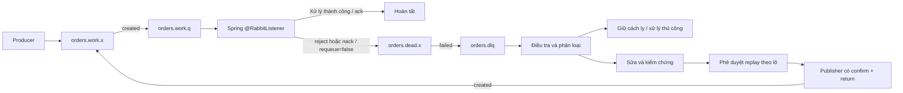
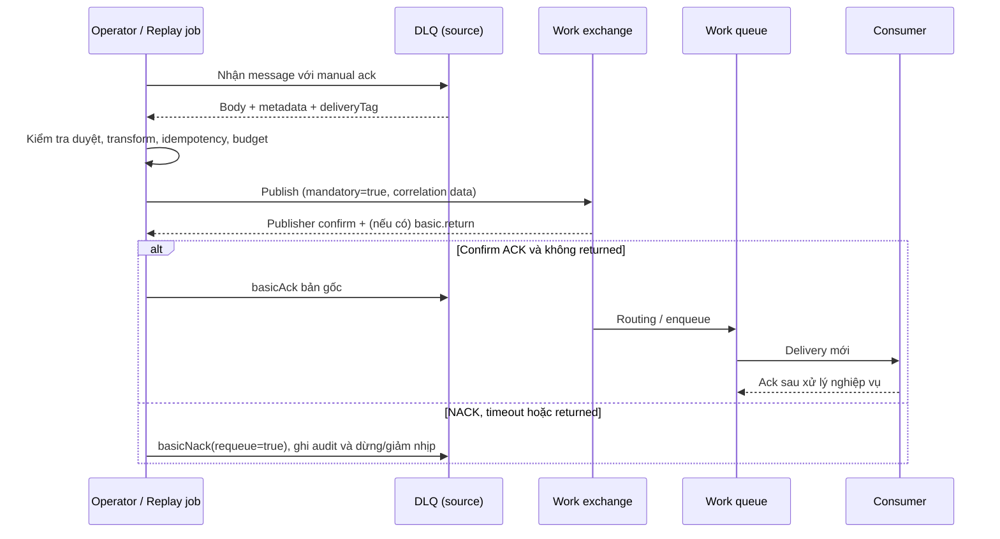

# Kiểm tra, sửa và phát lại thông điệp lỗi có kiểm soát

> **Chương:** Dead-letter và trì hoãn  
> **Công nghệ:** RabbitMQ với Spring AMQP (`RabbitTemplate`, `@RabbitListener`, exchange, queue và binding).  
> **Trọng tâm:** Tìm hiểu vì sao message vào dead-letter queue (DLQ), xác định cách khắc phục, rồi replay có giới hạn và có bằng chứng giao nhận. Đây là một quy trình vận hành cho hệ thống bất đồng bộ đáng tin cậy, không phải thao tác gửi lại mọi message lỗi.

## 1. Mục tiêu học tập

Sau bài này, bạn có thể:

1. Lần theo đường đi của một message từ queue xử lý tới DLQ, đọc `x-death` và kết hợp với log, trace, dữ liệu nghiệp vụ để xác định nguyên nhân.
2. Phân biệt lỗi dữ liệu, lỗi nghiệp vụ vĩnh viễn, lỗi hạ tầng tạm thời và lỗi phần mềm; quyết định **giữ cách ly, sửa, retry có độ trễ hay replay**.
3. Thiết kế quy trình replay có phê duyệt, kiểm tra điều kiện trước khi phát, giới hạn số lượng/tốc độ, ghi audit và xử lý trường hợp phát lại thất bại.
4. Dùng Spring AMQP để cấu hình DLX/DLQ, reject message, phát lại message đã được duyệt và kiểm tra publisher confirm cùng returned message.
5. Giải thích được vì sao replay thường có ngữ nghĩa **at-least-once**, cần idempotency, và vì sao `basicAck` bản gốc phải đặt sau khi đã có bằng chứng publish thành công.

### Tình huống xuyên suốt

Ứng dụng bán hàng nhận sự kiện `OrderCreated` từ `orders.work.x` qua `orders.work.q`. Consumer cập nhật đơn hàng và có thể gọi dịch vụ ngoài. Một số message chứa phiên bản payload cũ khiến consumer không đọc được; số khác gặp lỗi kết nối cơ sở dữ liệu. Nếu cứ `requeue=true`, chúng có thể lặp vô hạn và chiếm worker. Hệ thống chuyển chúng tới `orders.dlq` để vận hành viên điều tra, triển khai bản sửa phù hợp và chỉ phát lại những sự kiện đủ điều kiện.

Một message bị đưa vào DLQ **không có nghĩa** là nên phát lại ngay. Nó là một sự kiện cần quyết định xử lý dựa trên nguyên nhân, tính hợp lệ của dữ liệu và trạng thái nghiệp vụ hiện tại.

## 2. Đường đi của message và các điểm có thể mất kiểm soát



Các khái niệm cần phân biệt:

| Thành phần | Vai trò | Điểm cần lưu ý |
|---|---|---|
| **DLX** (dead-letter exchange) | Exchange nhận message do RabbitMQ dead-letter từ queue nguồn. | DLX vẫn định tuyến theo exchange type, routing key và binding. Có DLX không đồng nghĩa có DLQ nhận được message. |
| **DLQ** (dead-letter queue) | Queue được binding tới DLX để giữ message lỗi. | Cần theo dõi độ sâu, tuổi message, quyền truy cập và chính sách lưu giữ. |
| **Reject/Nack** | Consumer từ chối một delivery. | `requeue=false` cho phép broker dead-letter nếu queue có DLX; `requeue=true` đưa lại queue, thường không tăng dấu vết dead-letter. |
| **Retry queue** | Queue trung gian dùng TTL/DLX để thử lại sau một khoảng trễ. | Là cơ chế retry tự động có giới hạn; không thay thế bước điều tra và phê duyệt replay thủ công. |
| **Replay** | Publish một message đã được kiểm tra vào luồng xử lý đã chọn. | Tạo một lần delivery mới; có thể lặp hiệu ứng nếu consumer không idempotent. |
| **Quarantine** | Giữ dữ liệu chưa an toàn để xử lý. | Có thể là DLQ hoặc vùng lưu trữ riêng có quyền và thời hạn lưu giữ. |

RabbitMQ có thể dead-letter khi consumer reject/nack với `requeue=false`, message hết TTL, queue vượt giới hạn độ dài hoặc quorum queue vượt `delivery-limit`. Không nên suy ra mọi message trong DLQ đều xuất phát từ exception của `@RabbitListener`. Từng trường hợp có hướng xử lý khác nhau.

**Ranh giới bảo đảm:** Trong cấu hình thông thường, việc broker chuyển message sang DLX không tự động tương đương một giao dịch end-to-end có xác nhận từ queue đích. Sai exchange/routing key, thiếu binding hoặc lỗi ở đích có thể khiến dead-letter không tới nơi. Với quorum queue, RabbitMQ hỗ trợ chiến lược dead-letter `at-least-once` trong những điều kiện cấu hình nhất định; cần kiểm tra phiên bản và chính sách thực tế. Hãy giám sát đường đi vào DLQ và kiểm tra topology bằng thử nghiệm.

## 3. Cấu hình topology tối thiểu với Spring AMQP

Ví dụ dùng Java configuration cho mục đích học tập. Trong hệ thống vận hành, cân nhắc **RabbitMQ policy** để quản lý DLX/routing key thay vì đóng cứng mọi `x-argument` khi khai báo queue: thay đổi argument của queue hiện hữu có thể cần tái tạo queue và di chuyển dữ liệu.

```java
import org.springframework.amqp.core.*;
import org.springframework.context.annotation.Bean;
import org.springframework.context.annotation.Configuration;

@Configuration
public class OrderRabbitTopology {
    public static final String WORK_EXCHANGE = "orders.work.x";
    public static final String WORK_QUEUE = "orders.work.q";
    public static final String DEAD_EXCHANGE = "orders.dead.x";
    public static final String DEAD_QUEUE = "orders.dlq";
    public static final String WORK_KEY = "created";
    public static final String DEAD_KEY = "failed";

    @Bean
    public Declarables orderDeclarables() {
        DirectExchange workExchange =
            new DirectExchange(WORK_EXCHANGE, true, false);
        DirectExchange deadExchange =
            new DirectExchange(DEAD_EXCHANGE, true, false);

        Queue workQueue = QueueBuilder.durable(WORK_QUEUE)
            .deadLetterExchange(DEAD_EXCHANGE)
            .deadLetterRoutingKey(DEAD_KEY)
            .build();

        Queue deadQueue = QueueBuilder.durable(DEAD_QUEUE).build();

        return new Declarables(
            workExchange,
            deadExchange,
            workQueue,
            deadQueue,
            BindingBuilder.bind(workQueue)
                .to(workExchange).with(WORK_KEY),
            BindingBuilder.bind(deadQueue)
                .to(deadExchange).with(DEAD_KEY)
        );
    }
}
```

Điều kiện để ví dụ hoạt động: RabbitMQ có quyền tạo exchange/queue/binding; ứng dụng dùng Spring Boot với `spring-boot-starter-amqp`; producer publish tới `orders.work.x` với routing key `created`. Các tên topology là ví dụ, không bắt buộc phải trùng tên của ứng dụng thật.

Consumer sử dụng manual acknowledgment để quyết định rõ thời điểm hoàn tất hoặc dead-letter:

```java
import com.fasterxml.jackson.databind.ObjectMapper;
import com.rabbitmq.client.Channel;
import java.io.IOException;
import org.springframework.amqp.core.Message;
import org.springframework.amqp.rabbit.annotation.RabbitListener;
import org.springframework.stereotype.Component;

@Component
public class OrderConsumer {
    private final ObjectMapper mapper;
    private final OrderService service;

    public OrderConsumer(ObjectMapper mapper, OrderService service) {
        this.mapper = mapper;
        this.service = service;
    }

    @RabbitListener(
        queues = OrderRabbitTopology.WORK_QUEUE,
        ackMode = "MANUAL"
    )
    public void onMessage(Message raw, Channel channel) throws IOException {
        long deliveryTag = raw.getMessageProperties().getDeliveryTag();

        try {
            OrderCreated event =
                mapper.readValue(raw.getBody(), OrderCreated.class);
            service.processIdempotently(event);
        } catch (Exception processingError) {
            // Ghi log có eventId/correlationId và mã lỗi đã phân loại
            // ở hệ thống thực tế; không log vô điều kiện toàn bộ payload.
            channel.basicReject(deliveryTag, false);
            return;
        }

        // Chỉ ack sau khi xử lý nghiệp vụ cần thiết đã hoàn tất.
        channel.basicAck(deliveryTag, false);
    }
}
```

`OrderCreated` và `OrderService` là các kiểu nghiệp vụ của ứng dụng; ví dụ cố ý không áp đặt schema cụ thể. Với mã production, cần bổ sung phân loại exception, logging/metrics và chính sách retry có giới hạn. Trong đoạn minh họa, mọi lỗi xử lý đều được gửi về DLQ để tránh vòng lặp requeue nóng; đây không phải chính sách tối ưu cho mọi hệ thống.

**Lưu ý:** `basicReject(tag, false)` từ chối một delivery; `basicNack(tag, false, false)` cũng có thể dùng cho một delivery. Nếu queue nguồn không cấu hình DLX thích hợp, reject có thể khiến message bị loại bỏ, thay vì xuất hiện trong DLQ. Không dùng `basicAck` khi chưa hoàn tất xử lý cần bảo đảm.

## 4. Điều tra: xem cái gì trước khi quyết định sửa?

### 4.1. Thu thập một “hồ sơ sự cố” cho từng message

Ở lần kiểm tra đầu, ghi nhận ít nhất:

| Nhóm thông tin | Nội dung nên lấy | Mục đích |
|---|---|---|
| Định danh | `messageId`, `correlationId`, `eventId` nghiệp vụ, loại sự kiện, phiên bản schema | Truy vết, chống trùng và đối chiếu trạng thái hiện tại. |
| Đường đi | Queue đang nằm, `exchange`/`routingKey` đầu vào ứng dụng ghi nhận, `x-first-death-*`, `x-death` | Xác định bước đưa vào DLQ và khả năng replay về đúng đích. |
| Kỹ thuật | Timestamp producer, content type, encoding, kích thước payload, exception, stack trace rút gọn, phiên bản ứng dụng | Phân biệt lỗi mã hóa, schema, lỗi code và hạ tầng. |
| Nghiệp vụ | Trạng thái đơn hàng hiện tại, sự kiện liên quan đã xử lý, hiệu ứng phụ đã thực hiện | Xem replay còn hợp lệ không và có nguy cơ xử lý trùng không. |
| Vận hành | Thời điểm vào DLQ, số lần xử lý/replay, số message cùng lỗi, tình trạng dependency | Xác định mức độ lan rộng và thứ tự ưu tiên. |

Không dùng riêng `messageId` làm bằng chứng duy nhất rằng một sự kiện chưa được xử lý: producer có thể không điền trường này hoặc điền không ổn định. Một `eventId` nghiệp vụ có hợp đồng rõ ràng thường phù hợp hơn để deduplicate.

Đối với dữ liệu nhạy cảm, chỉ lưu thông tin cần điều tra; che thông tin cá nhân trong log/dashboard và bảo vệ bản sao message theo quyền truy cập.

### 4.2. Đọc header `x-death` đúng cách

Khi broker dead-letter, RabbitMQ thường gắn thông tin lịch sử dead-letter như `x-death` và các header `x-first-death-*`. Dưới đây là cách diễn giải **minh họa sau khi chuyển header AMQP sang dạng JSON**, không phải biểu diễn byte chính xác trên wire:

```json
{
  "messageId": "msg-4821",
  "headers": {
    "event-id": "order-created-4821",
    "x-first-death-queue": "orders.work.q",
    "x-first-death-reason": "rejected",
    "x-first-death-exchange": "orders.work.x",
    "x-death": [
      {
        "queue": "orders.work.q",
        "reason": "rejected",
        "count": 1,
        "exchange": "orders.work.x",
        "routing-keys": ["created"]
      }
    ]
  }
}
```

Diễn giải:

- `x-first-death-queue` cho biết queue nơi message **lần đầu** bị dead-letter; `x-first-death-reason` có thể là `rejected`, `expired`, `maxlen` hoặc `delivery_limit` tùy trường hợp và phiên bản RabbitMQ.
- `x-death` là danh sách các lần dead-letter được **gộp theo queue và lý do**; `count` không phải số lần consumer đã thử xử lý nói chung. Một chuỗi retry `requeue=true` không thể suy ra đầy đủ chỉ từ `x-death`.
- Các header `x-first-death-*` hoặc `x-death` là bằng chứng hữu ích nhưng không thay thế audit ứng dụng. Một message được ứng dụng publish mới có thể không còn đầy đủ header dead-letter của bản cũ.
- `exchange` và `routing-keys` trong lịch sử phản ánh lần dead-letter tương ứng; không tùy tiện dùng chúng làm đích replay khi topology đã thay đổi. Nên lưu đích nghiệp vụ được cho phép trong cấu hình công cụ replay.
- Bản sao từ UI, script hay exporter có thể chuyển đổi kiểu AMQP (timestamp, long-string, bảng header); khi kiểm tra cần giữ nguyên giá trị và nguồn trích xuất.

Kiểm tra thêm **messages ready** và **messages unacknowledged**: một DLQ ít message ready chưa chắc đã sạch nếu có tool đang lấy message nhưng chưa ack. So sánh biểu đồ độ sâu DLQ, tốc độ đi vào, tuổi message lâu nhất và các log có cùng `correlationId`.

### 4.3. Đọc message từ Management UI mà không vô tình xóa

Trong RabbitMQ Management UI, truy cập queue DLQ, xem bindings, arguments và chọn mục lấy mẫu message nếu cần. Đặc biệt kiểm tra chế độ xác nhận khi “Get messages”:

| Chế độ/phương án | Hệ quả | Dùng khi nào |
|---|---|---|
| Get rồi **requeue** | Broker trả message về queue; thứ tự có thể thay đổi, và thao tác không tạo bản sao lưu bền vững. | Chỉ dùng để xem mẫu với tần suất thấp, biết tác động lên consumer. |
| Get rồi **ack** | Message bị xóa khỏi queue sau khi lấy. | Chỉ dùng trong quy trình di chuyển/lưu trữ đã được phê duyệt, có bằng chứng đầu ra. |
| Reject/Nack không requeue | Message có thể bị dead-letter lần nữa hoặc bị bỏ tùy DLX. | Không phải thao tác mặc định để điều tra. |
| Consumer quan sát chuyên dụng / bản sao cách ly | Có thể giữ bản ghi an toàn và audit thao tác. | Nên ưu tiên khi cần phân tích hàng loạt hoặc chứa dữ liệu nhạy cảm. |

Không thử nghiệm `purge` trên DLQ đang phục vụ xử lý thật. Việc nhận message để quan sát qua `basic.get`/Management API cũng là một thao tác trên queue, không giống đọc một bảng dữ liệu bất biến.

### 4.4. Checklist xác định nguyên nhân gốc

Theo trình tự sau, tránh “replay thử xem có chạy”:

1. **Xác nhận DLQ nhận đúng message:** kiểm tra binding từ DLX đến DLQ, routing key, vhost và tên queue; đối chiếu trạng thái producer/consumer.
2. **Tìm lỗi đầu tiên:** dùng timestamp, `correlationId` và log consumer để tìm exception gốc; tránh chỉ xem lỗi cuối cùng sau nhiều retry.
3. **Tách lỗi hàng loạt và lỗi cá biệt:** bao nhiêu event cùng schema version, cùng order type hoặc cùng dependency?
4. **Đánh giá ảnh hưởng nghiệp vụ:** message trùng, quá hạn, thứ tự sai, giao dịch đã hoàn tất hay đơn hàng đã hủy?
5. **Xác định cách sửa kiểm chứng được:** sửa code, cấu hình, dependency hay payload? Có test/đối chiếu trước khi replay không?
6. **Ghi quyết định:** mỗi nhóm message phải có người phê duyệt, lý do, phiên bản sửa, đích replay, ngưỡng số lần và thời điểm hết hiệu lực.

## 5. Phân loại lỗi và chọn hành động

| Dấu hiệu | Ví dụ | Hướng xử lý | Điều kiện trước replay |
|---|---|---|---|
| **Payload không hợp lệ** | JSON hỏng, thiếu khóa bắt buộc, kiểu dữ liệu sai | Cách ly; sửa tại nguồn hoặc bằng bản biến đổi có quy tắc, lưu bản gốc | Schema hợp lệ, giá trị nghiệp vụ được xác thực; không bịa dữ liệu. |
| **Khác phiên bản schema** | Consumer mới bỏ hỗ trợ payload v1 | Triển khai bộ chuyển đổi tương thích hoặc consumer sửa lỗi | Chạy test với mẫu thực và xác nhận trường dữ liệu được ánh xạ chính xác. |
| **Lỗi tạm thời** | Database timeout, API 503 | Retry có backoff/TTL và giới hạn; DLQ nếu vượt ngưỡng | Dependency đã phục hồi, sức chứa còn đủ; không flood khi hồi phục. |
| **Bug consumer** | NullPointerException cho nhóm dữ liệu hợp lệ | Sửa và triển khai code | Có kiểm thử hồi quy; phiên bản sửa đang chạy ở tất cả consumer đích. |
| **Lỗi nghiệp vụ vĩnh viễn** | Đơn hàng bị hủy, mã đối tượng không tồn tại và không được tạo lại | Giữ để audit/đóng sự cố; không replay mù | Phải có quyết định nghiệp vụ rõ ràng nếu muốn tái xử lý. |
| **Đã xử lý nhưng ack thất bại** | Giao dịch DB commit rồi mất kết nối RabbitMQ | Kiểm tra trạng thái/nhật ký hiệu ứng trước | Consumer idempotent và xác nhận không tạo tác dụng phụ lần hai. |
| **Quá nhiều lần thất bại** | Message poison lặp qua nhiều đợt | Dừng tự động, chuyển sang xử lý thủ công | Tìm và khắc phục nguyên nhân; phê duyệt mới trước khi tiếp tục. |

**Nguyên tắc sửa lỗi:** ưu tiên khắc phục tại producer/consumer hoặc bằng cơ chế chuyển đổi có phiên bản, có thể kiểm thử. Nếu buộc phải sửa payload để replay, lưu **bản gốc bất biến**, bản đã sửa, diff, lý do và người phê duyệt. Không sửa dữ liệu tiền tệ, danh tính hay trạng thái nghiệp vụ chỉ để qua validation.

### Retry tự động khác replay vận hành

Retry tự động có thể được xử lý bởi Spring Retry, container retry interceptor hoặc mô hình queue TTL/DLX. Đối với tác vụ ngắn hạn, giới hạn số lần thử và backoff; chuyển sang DLQ khi vượt ngưỡng. Replay vận hành là một hành động mới sau khi đã biết nguyên nhân và đủ điều kiện, thường theo danh sách `eventId`/batch đã duyệt.

Không đưa message từ DLQ quay ngay về work queue bằng một consumer tự động không giới hạn: chu trình `work → DLQ → work` có thể lặp mãi, làm nghẽn RabbitMQ và khuếch đại tác dụng phụ. Với retry queue sử dụng TTL, cần hiểu rằng TTL/DLX quyết định độ trễ dựa trên thiết lập queue và vị trí message; không nên coi đó là bộ hẹn giờ chính xác đến mili-giây.

## 6. Quy trình replay có kiểm soát trong production

Một quy trình tốt tách **điều tra**, **chuẩn bị**, **thực thi** và **đối soát**. Ví dụ chính sách nội bộ cho một batch:

| Quy tắc mẫu | Giá trị minh họa | Mục đích |
|---|---|---|
| Danh sách được duyệt | `eventId` cụ thể hoặc bộ lọc đã được xem xét | Tránh phát lại toàn bộ DLQ. |
| Kích thước batch | Tối đa 100 message | Giảm ảnh hưởng nếu bản sửa chưa đủ tốt. |
| Tốc độ | Tối đa 10 message/giây | Không gây đột biến tải downstream. |
| Replay budget | Tối đa 2 lượt replay vận hành cho một `eventId` | Chặn poison message quay vòng. |
| Điều kiện thành công | Broker confirm ACK, không có basic.return; sau đó consumer xử lý thành công | Tách “đã publish” và “đã hoàn tất nghiệp vụ”. |
| Audit | `batchId`, `eventId`, hash bản gốc, người duyệt, mã sửa, kết quả confirm, thời điểm | Truy vết và có thể dừng/hủy batch an toàn. |

Các con số là **ví dụ cấu hình**, cần điều chỉnh theo năng lực consumer, lưu lượng và mức độ quan trọng của dữ liệu.

### Bước 1 — Chốt phạm vi và điểm phục hồi

- Chụp metric và lưu thông tin đủ nhận diện các message cần xử lý, gồm hash của payload và phiên bản schema; lưu bản gốc an toàn khi cần sửa nội dung.
- Chọn đích replay từ danh sách exchange/routing key được phép. Không nhận tên exchange hoặc routing key tùy ý từ yêu cầu người dùng/HTTP.
- Đối chiếu số message theo lỗi, số message trùng `eventId`, trạng thái nghiệp vụ đang có và thứ tự phụ thuộc giữa các event.
- Với hàng đợi FIFO hoặc quy trình phụ thuộc thứ tự, lên kế hoạch theo từng aggregate/order; replay ngẫu nhiên có thể tạo trạng thái sai dù từng message riêng lẻ hợp lệ.

### Bước 2 — Sửa và kiểm chứng

Với mỗi loại lỗi, tạo bản sửa có thể tái lập (code fix/schema migration/transform). Thử trên dữ liệu đã che thông tin nhạy cảm và môi trường kiểm thử bằng các message đại diện. Kiểm tra cả trường hợp thất bại lặp lại, duplicate và downstream không sẵn sàng.

Nếu sửa payload, giữ khóa nghiệp vụ `eventId` ổn định để deduplicate; chỉ tạo `messageId` mới theo quy định định danh message của ứng dụng, không cố giả mạo header do broker sở hữu như `x-death`. Một số metadata dùng cho replay nên được thêm mới: `replay-batch-id`, `replay-attempt`, `replayed-at`, `original-event-id`.

### Bước 3 — Duyệt và khóa batch

Lưu bản ghi batch với trạng thái `APPROVED`, danh sách message, người duyệt, lý do và chính sách giới hạn. Job chỉ chạy khi batch được phê duyệt và các dependency đã qua health check. Duy trì nút dừng (kill switch), giới hạn concurrency và prefetch; xử lý batch nhỏ trước, rồi tăng dần khi kết quả tốt.

Nếu công cụ đọc trực tiếp bằng `basicGet(queue, autoAck=false)`, RabbitMQ **chỉ trả message ở đầu queue**, không hỗ trợ tìm tùy ý theo `eventId`. Nếu phải chọn từng ID, cần thiết kế vùng cách ly/index/staging riêng hoặc cơ chế chuẩn bị được kiểm soát; không quét queue sống rồi ack những bản tin không khớp.

### Bước 4 — Publish, xác nhận và ack nguồn theo đúng thứ tự



**Điểm dễ nhầm:** publisher confirm ACK cho biết broker đã nhận/xử lý publish ở cấp broker theo cơ chế confirm; nó **không** bảo đảm consumer đã thực thi thành công. Khi `mandatory=true` và broker không route được message, message có thể được trả qua `basic.return` dù publish được confirm ACK. Chỉ ack bản gốc sau khi đã kiểm tra **cả confirm lẫn return**. Nếu cần chứng minh kết quả nghiệp vụ, theo dõi thêm trạng thái xử lý bằng `eventId` ở consumer hoặc hệ thống audit.

Trong cửa sổ lỗi “publish thành công nhưng tiến trình chết trước khi ack DLQ”, cả bản gốc và bản publish mới có thể tồn tại. Vì vậy thiết kế vẫn cần **idempotent consumer** và không được tự nhận là exactly-once.

### Bước 5 — Đối soát và đóng batch

Phân biệt ba con số:

1. `selected`: message thuộc batch được duyệt.
2. `republished`: có confirm ACK và không bị return; bản nguồn đã được ack sau khi xác nhận.
3. `processed`: consumer đích đã hoàn tất nghiệp vụ và ack.

Đối soát bằng `eventId` thay vì chỉ nhìn DLQ giảm hay work queue rỗng. Lưu danh sách lỗi chưa khôi phục, số message replay sinh ra dead-letter mới và thời điểm dừng batch. Nếu tỉ lệ lỗi hoặc độ trễ tăng bất thường, dừng batch và điều tra trước khi tiếp tục.

## 7. Ví dụ Java: publish lại một message đã được duyệt

Ví dụ sau minh họa **bước phát lại**. Giả định một job vận hành đã lấy message nguồn bằng cơ chế manual ack, xác minh batch/`eventId`, sửa và validate payload. Hàm chỉ publish và xác nhận; chính job giữ delivery nguồn có trách nhiệm gọi `basicAck` **sau khi hàm trả về thành công**. Nếu hàm ném lỗi, job cần `basicNack(requeue=true)` hoặc để message được requeue khi channel mất kết nối.

Kích hoạt publisher confirms và returns:

```yaml
spring:
  rabbitmq:
    publisher-confirm-type: correlated
    publisher-returns: true
    template:
      mandatory: true
```

```java
import java.nio.charset.StandardCharsets;
import java.time.Instant;
import java.util.UUID;
import java.util.concurrent.TimeUnit;

import org.springframework.amqp.core.Message;
import org.springframework.amqp.core.MessageDeliveryMode;
import org.springframework.amqp.core.MessageProperties;
import org.springframework.amqp.rabbit.connection.CorrelationData;
import org.springframework.amqp.rabbit.core.RabbitTemplate;
import org.springframework.stereotype.Service;

@Service
public class ApprovedReplayPublisher {
    private final RabbitTemplate rabbitTemplate;

    public ApprovedReplayPublisher(RabbitTemplate rabbitTemplate) {
        this.rabbitTemplate = rabbitTemplate;
    }

    public void publishApproved(
        Message original,
        byte[] validatedBody,
        String eventId,
        String approvedBatchId,
        int newReplayAttempt
    ) throws Exception {
        // Những tham số này PHẢI đã được xác thực bởi replay job:
        // batch đã duyệt, eventId được phép, payload hợp lệ,
        // số lần replay trong giới hạn, đích publish thuộc allowlist.
        MessageProperties props = new MessageProperties();
        props.setContentType("application/json");
        props.setContentEncoding(StandardCharsets.UTF_8.name());
        props.setDeliveryMode(MessageDeliveryMode.PERSISTENT);
        props.setMessageId(UUID.randomUUID().toString());
        props.setCorrelationId(
            original.getMessageProperties().getCorrelationId()
        );

        props.setHeader("event-id", eventId);
        props.setHeader("replay-batch-id", approvedBatchId);
        props.setHeader("replay-attempt", newReplayAttempt);
        props.setHeader("replayed-at", Instant.now().toString());

        // Tạo MessageProperties mới để không copy x-death, deliveryTag,
        // redelivered... vốn gắn với delivery/hành trình cũ.
        Message replay = new Message(validatedBody, props);
        CorrelationData correlation =
            new CorrelationData(UUID.randomUUID().toString());

        rabbitTemplate.send(
            OrderRabbitTopology.WORK_EXCHANGE,
            OrderRabbitTopology.WORK_KEY,
            replay,
            correlation
        );

        CorrelationData.Confirm confirm =
            correlation.getFuture().get(10, TimeUnit.SECONDS);

        if (!confirm.isAck()) {
            throw new IllegalStateException(
                "Broker NACK: " + confirm.getReason()
            );
        }
        if (correlation.getReturned() != null) {
            throw new IllegalStateException(
                "Message unroutable: " +
                correlation.getReturned().getReplyText()
            );
        }

        // Chỉ xác nhận đã PUBLISH thành công, chưa khẳng định
        // consumer đích đã hoàn thành nghiệp vụ.
    }
}
```

Hàm sử dụng Spring AMQP với correlated publisher confirms. Khi publisher returns và `mandatory` hoạt động, Spring AMQP liên kết returned message vào `CorrelationData` tương ứng trước khi hoàn tất confirm future. Nếu dùng callback/channel tùy biến, cần bảo đảm vẫn đối chiếu return và confirm cho **đúng lần publish**.

Trong ứng dụng thực tế, nếu payload ban đầu có content type khác JSON hoặc cần bảo toàn header nghiệp vụ, hãy xây dựng **allowlist header** rõ ràng. Không copy nguyên `MessageProperties` từ delivery cũ vì chứa các header/properties gắn với broker và có thể gây sai lệch lịch sử. `eventId` nghiệp vụ phải ổn định qua các lần replay dù `messageId` transport có thể thay đổi.

### 7.1. Kết nối với manual ack của job nhận DLQ

Mẫu điều khiển dưới đây là **pseudocode**, thể hiện thứ tự và các ranh giới nghiệp vụ; cần hiện thực bằng consumer thủ công có giới hạn hoặc công cụ replay nội bộ:

```text
for each APPROVED event in this replay batch, while budget is available:
    delivery = receiveFromSourceWithManualAck()
    if delivery is not approved or does not match the batch:
        keepSafelyForReview(delivery)  // không ack/xóa nhầm
        stopOrSkipUsingAnExplicitQuarantineDesign()
        continue

    validateCurrentBusinessState(delivery.eventId)
    repaired = applyVersionedFixAndValidate(delivery.body)
    assertReplayBudgetNotExceeded(delivery.eventId)

    try:
        publishApproved(delivery, repaired, eventId, batchId, attempt)
        persistAudit("PUBLISH_CONFIRMED", eventId, batchId)
        basicAck(delivery.tag, multiple=false)
        persistAudit("SOURCE_ACK_REQUESTED", eventId, batchId)
    catch publish-or-confirm-error:
        basicNack(delivery.tag, multiple=false, requeue=true)
        persistAudit("REPLAY_FAILED", eventId, batchId)
        pauseBatchAndAlert()

afterwards:
    reconcileWithDestinationConsumerByEventId()
```

Một job thật phải xử lý riêng sự cố **audit đã ghi nhưng ack chưa thành công**, hoặc **ack thành công nhưng audit lưu lỗi**. Cần cho phép retry an toàn bằng khóa idempotency và mô hình trạng thái batch; không nên xem thứ tự gọi cơ bản ở trên là một giao dịch phân tán nguyên tử giữa RabbitMQ và database.

Với retry có trì hoãn, sau khi được phép retry có thể publish tới một retry exchange/queue có TTL và DLX trả về work exchange, nhưng vẫn phải có bộ đếm/budget và cơ chế đưa về DLQ khi hết giới hạn. Đừng dùng TTL queue để tự động replay vô hạn các message đã bị cách ly.

## 8. Idempotency: điều kiện bắt buộc để replay an toàn

Giả sử một `OrderCreated(eventId=evt-77)` đã ghi đơn hàng vào DB, nhưng kết nối RabbitMQ ngắt ngay trước `basicAck`. Broker có thể giao lại bản gốc; replay vận hành sau đó còn có thể tạo thêm một bản nữa. Nếu mỗi delivery đều tăng điểm thưởng hoặc trừ tồn kho, kết quả sẽ sai.

Thiết kế consumer dựa trên **định danh sự kiện ổn định**. Một cách đơn giản khi hiệu ứng nghiệp vụ nằm cùng database là đặt unique key `event_id` và thực hiện trong **cùng transaction**:

```sql
CREATE TABLE processed_events (
    event_id VARCHAR(128) PRIMARY KEY,
    processed_at TIMESTAMP NOT NULL DEFAULT CURRENT_TIMESTAMP
);

-- Pseudocode SQL theo cú pháp PostgreSQL, thực hiện trong 1 transaction:
INSERT INTO processed_events(event_id)
VALUES (:eventId)
ON CONFLICT DO NOTHING;

-- Nếu số hàng vừa insert = 0:
--   sự kiện đã được ghi nhận, bỏ qua hiệu ứng trùng.
-- Nếu số hàng vừa insert = 1:
--   thực hiện cập nhật nghiệp vụ trong cùng transaction,
--   rồi COMMIT trước khi ack RabbitMQ.
```

Nếu side effect nằm ngoài DB (gửi email, thanh toán, gọi REST), DB transaction đơn lẻ không bao phủ được hệ thống ngoài. Khi đó cần idempotency key được bên nhận hỗ trợ, outbox/inbox, hoặc cơ chế đối soát trạng thái trước khi gọi lại. Đừng chỉ kiểm tra `existsById` ngoài transaction rồi mới ghi, vì hai consumer đồng thời có thể vượt qua cùng một phép kiểm tra.

Phân biệt ba loại trùng lặp: message được broker redeliver; message mới do replay job publish; và producer gửi lại cùng sự kiện. Thiết kế idempotency phải chịu được cả ba.

## 9. Quan sát, cảnh báo và quyền vận hành

Các tín hiệu quan trọng:

| Tín hiệu | Ý nghĩa | Phản ứng gợi ý |
|---|---|---|
| `dlq_messages_ready`, `dlq_messages_unacked` | DLQ tồn đọng hoặc đang bị tool giữ delivery | Kiểm tra rate dead-letter, consumer/tool liên quan và thời gian giữ unacked. |
| Tuổi message cũ nhất | Nguy cơ vi phạm SLA và quá hạn nghiệp vụ | Ưu tiên phân loại và đối soát, không replay theo tuổi đơn thuần. |
| Số dead-letter theo `reason`/queue | Phân biệt invalid payload, TTL, delivery limit | Tìm thay đổi schema, bug, cấu hình TTL hay retry. |
| `replay_attempts_total` theo result | Replay có thành công, bị return hay NACK | Dừng batch khi tỉ lệ thất bại vượt ngưỡng. |
| Consumer error và processing latency | Ảnh hưởng phía đích sau replay | Giảm tốc, tạm dừng và điều tra nguyên nhân mới. |
| Số duplicate bị bỏ qua | Idempotency có đang chặn xử lý lặp | Đối chiếu với số replay và redelivery. |

Tên metric là gợi ý cho ứng dụng, không phải khẳng định RabbitMQ tự cung cấp nguyên xi các metric trên. Có thể lấy queue metrics từ RabbitMQ Management/Prometheus plugin và tự xuất application metrics bằng Micrometer. Đừng đưa `eventId`/`messageId` vào **label metric** vì cardinality sẽ tăng không kiểm soát; dùng log có cấu trúc và trace cho định danh từng bản tin.

Phân quyền cần tách vai trò đọc/điều tra, duyệt batch và kích hoạt replay. Audit phải trả lời: **ai duyệt**, **vì sao**, **bản gốc là gì**, **đã sửa gì**, **đã gửi về đâu**, **kết quả xác nhận ra sao**. Bảo vệ quyền `purge`, sửa policy và publish tới exchange sản xuất; không mở endpoint replay công khai.

### Những sai lầm phổ biến

- **Ack bản gốc trước khi publish:** tiến trình chết ở giữa sẽ làm mất cơ hội khôi phục từ DLQ.
- **Chỉ kiểm tra publisher ACK:** broker có thể confirm một publish không route tới queue đích; phải kiểm tra `basic.return` khi dùng `mandatory`.
- **Sao chép nguyên header `x-death`:** gây nhiễu nguồn gốc message; lưu lịch sử replay ở audit/header nghiệp vụ riêng.
- **Replay toàn bộ DLQ sau deploy:** có thể gửi lại message không hợp lệ, đã quá hạn hoặc đã hoàn thành.
- **Nack requeue=true trong vòng lặp nóng:** không tạo backoff và có thể làm đầy worker/log.
- **Dùng `x-death.count` làm số lần thử duy nhất:** redelivery, publish mới và dead-letter qua queue khác tạo lịch sử khác nhau.
- **Xem queue rỗng là thành công:** message có thể đang unacked, đã bị thất lạc trong routing, hoặc consumer đích chưa hoàn tất.

## 10. Thực hành: khôi phục có chọn lọc một batch lỗi

### Bài tập

Giả sử `orders.dlq` đang có 12 sự kiện. Bảy sự kiện v1 có trường `customerId` kiểu chuỗi trong khi consumer mới yêu cầu đối tượng con; ba sự kiện lỗi do DB timeout; hai sự kiện thuộc đơn hàng đã bị hủy.

Hãy lập kế hoạch:

1. Tạo báo cáo phân loại 12 message theo `eventId`, `x-first-death-reason`, schema version, thời điểm lỗi và trạng thái đơn hàng; đối chiếu log với `x-death`.
2. Với bảy sự kiện v1: xây dựng transform v1 → v2 có test; triển khai consumer tương thích hoặc dùng bản transform đã duyệt. Giữ bản gốc và diff.
3. Với ba sự kiện timeout: kiểm tra DB đã hồi phục, hiệu ứng DB có bị commit trước khi mất ack hay không; replay theo nhịp nhỏ có idempotency.
4. Với hai đơn hàng đã hủy: giữ cách ly/đóng sự cố theo quyết định nghiệp vụ; **không** mặc định replay.
5. Mở batch pilot 2 message, xác minh publisher confirm + route + xử lý nghiệp vụ, rồi mới tăng số lượng; dừng nếu phát sinh DLQ mới hoặc lỗi đích.
6. Kết thúc bằng báo cáo `selected`/`republished`/`processed`, message còn cách ly, duplicate đã chặn và audit người duyệt.

### Kịch bản kiểm thử bắt buộc trước khi áp dụng

| Thử nghiệm | Kết quả cần quan sát |
|---|---|
| Consumer nhận payload sai schema và reject `requeue=false` | Message xuất hiện ở DLQ đúng binding; có metadata dead-letter phù hợp. |
| Replay đã duyệt, exchange và binding tồn tại | Publisher confirm ACK, không returned; nguồn chỉ ack sau khi có kết quả. |
| Đích publish không có binding | Mandatory return được phát hiện; nguồn chưa bị xóa, batch ghi lỗi. |
| Broker/connection gián đoạn trước confirm | Không ack nguồn; retry có giới hạn, ghi audit và đối soát khi phục hồi. |
| Publish thành công nhưng job chết trước ack nguồn | Có thể có message trùng; consumer chỉ thực hiện hiệu ứng nghiệp vụ một lần. |
| Message không trong batch/đã quá budget | Không publish, không xóa nguồn trái phép; được giữ để điều tra. |
| Consumer sau replay vẫn thất bại | Message được cách ly lại; replay job dừng theo ngưỡng, không tạo vòng lặp vô hạn. |

**Câu hỏi tự kiểm tra:** Vì sao `confirm.isAck() == true` chưa đủ để xóa bản gốc khỏi DLQ? Vì sao hai message có cùng `eventId` nhưng `messageId` khác nhau vẫn phải được xem là có khả năng trùng hiệu ứng? Nếu DLQ tăng đột biến do outage, bạn sẽ chọn retry theo giờ hay replay theo batch dựa vào những bằng chứng nào?

## 11. Ghi nhớ

Quy trình **inspect → classify → fix → approve → replay → reconcile** là cách xử lý DLQ có trách nhiệm. Với Spring AMQP, `RabbitTemplate` giúp publish và nhận confirm, `@RabbitListener` cùng manual acknowledgment giúp kiểm soát delivery, còn exchange/queue/binding quyết định message đi tới đâu. Chỉ khi có đủ thông tin nguyên nhân, trạng thái nghiệp vụ, idempotency và quan sát sau replay, việc gửi lại message mới thực sự góp phần xây dựng hệ thống bất đồng bộ đáng tin cậy.

**Tài liệu tham khảo chính thức:**

- RabbitMQ — Dead Letter Exchanges: https://www.rabbitmq.com/docs/dlx
- RabbitMQ — Consumer Acknowledgements and Publisher Confirms: https://www.rabbitmq.com/docs/confirms
- RabbitMQ — Time-To-Live and Expiration: https://www.rabbitmq.com/docs/ttl
- Spring AMQP — Reference Documentation: https://docs.spring.io/spring-amqp/reference/
