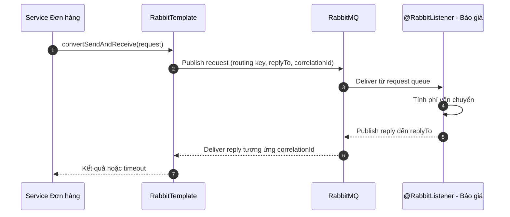

# Mô hình request–reply qua RabbitMQ và chi phí so với gọi HTTP

## 1. Bài toán và mục tiêu học tập

RabbitMQ thường được dùng để **gửi công việc bất đồng bộ**: bên gửi phát một message rồi tiếp tục công việc, còn bên nhận xử lý khi có tài nguyên. Tuy nhiên, đôi khi một service cần gửi yêu cầu qua RabbitMQ và **chờ một kết quả cụ thể** để quyết định bước tiếp theo. Đó là mô hình *request–reply* (còn gọi là RPC qua message broker).

Trong Spring AMQP, `RabbitTemplate` có API `convertSendAndReceive(...)` để gửi yêu cầu và chờ phản hồi; phía xử lý có thể dùng `@RabbitListener` và trả về giá trị. Cơ chế này vẫn dựa trên các khái niệm quen thuộc của RabbitMQ: **exchange**, **queue**, **binding**, định tuyến message, xác nhận giao nhận, timeout và xử lý lỗi.

Sau bài này, bạn cần có khả năng:

- Giải thích luồng request–reply, vai trò của `replyTo` và `correlationId`, và tại sao có queue vẫn chưa đồng nghĩa với lời gọi bất đồng bộ từ góc nhìn bên yêu cầu.
- Viết ví dụ RPC tối thiểu bằng `RabbitTemplate` và `@RabbitListener`, cấu hình thời gian chờ và xử lý phản hồi thiếu hoặc lỗi.
- Phân biệt request–reply với giao tiếp sự kiện một chiều, đồng thời so sánh chi phí, độ trễ và hành vi lỗi với HTTP đồng bộ.
- Xác định các biện pháp cần có khi đưa mô hình vào hệ thống thực tế: idempotency, retry có giới hạn, dead-letter, quan sát và giới hạn tải.

## 2. Request–reply hoạt động như thế nào?

Giả sử service **Đơn hàng** cần tính phí vận chuyển do service **Báo giá** phụ trách, nhưng giao tiếp giữa hai service dùng RabbitMQ. Một yêu cầu RPC phải có đường đi cho **cả request lẫn response**:

1. Service Đơn hàng gửi message yêu cầu tới exchange, dùng routing key để RabbitMQ chuyển vào queue của service Báo giá.
2. Yêu cầu mang thông tin `replyTo` (địa chỉ gửi phản hồi) và `correlationId` (mã ghép phản hồi với yêu cầu đang chờ).
3. Consumer nhận yêu cầu từ queue, xử lý nghiệp vụ và gửi message phản hồi về `replyTo`, giữ tương quan với yêu cầu gốc.
4. `RabbitTemplate` nhận phản hồi đúng `correlationId`, kết thúc lời gọi đang chờ. Nếu hết thời gian chờ, lời gọi trả về `null` theo hợp đồng của `convertSendAndReceive(...)`.



### Vai trò của các trường và thành phần

| Thành phần | Vai trò | Điểm dễ nhầm |
|---|---|---|
| Request exchange + routing key | Định tuyến message yêu cầu đến queue phù hợp | Exchange không xử lý nghiệp vụ; binding quyết định queue nào nhận được message. |
| Request queue | Giữ yêu cầu chờ consumer xử lý (theo cấu hình độ bền và TTL) | Queue có thể tồn tại dù client đã timeout, nên server vẫn có thể xử lý yêu cầu cũ. |
| `replyTo` | Chỉ ra địa chỉ nhận phản hồi | Đây là địa chỉ trả kết quả, không phải địa chỉ queue nhận request. |
| `correlationId` | Ghép response với request, nhất là khi nhiều lời gọi đang chờ song song | Nó không tự bảo đảm xử lý nghiệp vụ đúng một lần. |
| Reply timeout | Giới hạn thời gian caller chờ kết quả | Timeout không tự hủy yêu cầu đã vào queue và cũng không chứng minh server chưa xử lý. |
| Consumer acknowledgement (ack) | Báo cho broker biết việc giao nhận/tiêu thụ message đã được xác nhận | Ack của request không đồng nghĩa client đã nhận reply hay nghiệp vụ đạt trạng thái cuối cùng. |

Khi client là Spring AMQP, `RabbitTemplate` thường tự quản lý `replyTo`, `correlationId` và nơi nhận reply; không cần tự viết một consumer chỉ để ghép response cho ví dụ cơ bản. Trên RabbitMQ hỗ trợ **direct reply-to**, Spring AMQP có thể dùng địa chỉ đặc biệt `amq.rabbitmq.reply-to` để nhận reply mà không phải khai báo một reply queue thông thường cho từng lời gọi. Cơ chế này giảm chi phí quản lý queue nhưng reply không được lưu bền như công việc trong queue; nếu client mất kết nối hoặc không còn chờ, phản hồi có thể bị mất. Khi cần reply queue cố định, phải cấu hình consumer, correlation và vòng đời phản hồi cẩn thận hơn.

> **Điểm mấu chốt:** Request–reply qua RabbitMQ là *lời gọi đồng bộ ở phía caller* khi sử dụng `convertSendAndReceive(...)`. Message đi qua broker không làm cho luồng xử lý đang chờ trở thành bất đồng bộ. Muốn tách rời vòng đời, hãy cân nhắc gửi command và nhận event/callback sau, hoặc trả về `jobId` để tra cứu trạng thái.

## 3. Ví dụ triển khai với Spring AMQP

Ví dụ sử dụng payload `String` để tập trung vào request–reply. Trong hệ thống thực, hãy định nghĩa hợp đồng JSON có phiên bản, kiểm tra dữ liệu đầu vào và cấu hình message converter tương ứng ở cả bên gửi và nhận. Giả sử **mỗi đơn vị** có đơn giá 12.000 đồng; client gửi số lượng, server trả tổng tiền.

### 3.1. Thêm dependency và kết nối RabbitMQ

Với Spring Boot, thêm starter (phiên bản được quản lý bằng BOM của dự án):

```xml
<dependency>
    <groupId>org.springframework.boot</groupId>
    <artifactId>spring-boot-starter-amqp</artifactId>
</dependency>
```

```yaml
# application.yml - ví dụ môi trường phát triển
spring:
  rabbitmq:
    host: localhost
    port: 5672
    username: ${RABBITMQ_USERNAME:guest}
    password: ${RABBITMQ_PASSWORD:guest}
```

Không dùng tài khoản mặc định cho môi trường sản xuất; cấu hình tài khoản, quyền truy cập virtual host và TLS theo hạ tầng đang vận hành.

### 3.2. Khai báo exchange, queue, binding và RabbitTemplate

```java
import org.springframework.amqp.core.Binding;
import org.springframework.amqp.core.BindingBuilder;
import org.springframework.amqp.core.DirectExchange;
import org.springframework.amqp.core.Queue;
import org.springframework.amqp.core.QueueBuilder;
import org.springframework.amqp.rabbit.connection.ConnectionFactory;
import org.springframework.amqp.rabbit.core.RabbitTemplate;
import org.springframework.context.annotation.Bean;
import org.springframework.context.annotation.Configuration;

@Configuration
public class QuoteRpcTopology {
    public static final String EXCHANGE = "quote.rpc.exchange";
    public static final String REQUEST_QUEUE = "quote.rpc.requests";
    public static final String ROUTING_KEY = "quote.calculate";

    @Bean
    DirectExchange quoteExchange() {
        return new DirectExchange(EXCHANGE, true, false);
    }

    @Bean
    Queue quoteQueue() {
        return QueueBuilder.durable(REQUEST_QUEUE).build();
    }

    @Bean
    Binding quoteBinding(Queue quoteQueue, DirectExchange quoteExchange) {
        return BindingBuilder.bind(quoteQueue)
                .to(quoteExchange)
                .with(ROUTING_KEY);
    }

    @Bean
    RabbitTemplate rabbitTemplate(ConnectionFactory connectionFactory) {
        RabbitTemplate template = new RabbitTemplate(connectionFactory);
        template.setReplyTimeout(3_000L); // tối đa 3 giây chờ reply
        return template;
    }
}
```

Exchange kiểu `direct` định tuyến request theo routing key khớp chính xác. Queue bền (`durable`) cho phép khai báo queue tồn tại qua khởi động lại broker; **độ bền của từng message** còn phụ thuộc delivery mode, xác nhận publish và các giới hạn của broker. Việc queue bền không làm cho reply qua direct reply-to trở thành bền.

Trong thực tế, client và worker thường là **hai ứng dụng Spring Boot riêng**. Chúng phải thống nhất tên exchange, routing key và queue; cấu hình khai báo topology có thể đặt ở service sở hữu queue hoặc một bước provisioning chung. Ở ví dụ đơn giản, các lớp dưới đây có thể chạy trong cùng ứng dụng để quan sát luồng. Với Spring AMQP ngoài Spring Boot, cần kích hoạt hỗ trợ listener bằng `@EnableRabbit` nếu chưa được cấu hình.

### 3.3. Worker xử lý request và trả response

```java
import org.springframework.amqp.rabbit.annotation.RabbitListener;
import org.springframework.stereotype.Component;

@Component
public class QuoteRpcHandler {

    @RabbitListener(queues = QuoteRpcTopology.REQUEST_QUEUE)
    public String calculate(String payload) {
        try {
            int quantity = Integer.parseInt(payload);
            if (quantity <= 0) {
                return "ERR:INVALID_QUANTITY";
            }
            return Long.toString(quantity * 12_000L);
        } catch (NumberFormatException ex) {
            return "ERR:INVALID_QUANTITY";
        }
    }
}
```

Khi request mang `replyTo`, infrastructure listener của Spring AMQP có thể tự gửi giá trị trả về của phương thức `@RabbitListener` về địa chỉ đó. Việc trả chuỗi lỗi theo hợp đồng `ERR:...` là lựa chọn cố ý cho ví dụ: nếu phương thức ném exception, cần chính sách xử lý lỗi riêng; không được giả định exception phía consumer tự động biến thành HTTP-like error response cho caller.

### 3.4. Caller gửi và chờ reply

```java
import org.springframework.amqp.rabbit.core.RabbitTemplate;
import org.springframework.stereotype.Service;

@Service
public class QuoteRpcClient {
    private final RabbitTemplate rabbitTemplate;

    public QuoteRpcClient(RabbitTemplate rabbitTemplate) {
        this.rabbitTemplate = rabbitTemplate;
    }

    public long calculateTotal(int quantity) {
        Object reply = rabbitTemplate.convertSendAndReceive(
                QuoteRpcTopology.EXCHANGE,
                QuoteRpcTopology.ROUTING_KEY,
                Integer.toString(quantity));

        if (reply == null) {
            throw new IllegalStateException("Hết thời gian chờ RPC RabbitMQ");
        }
        if (!(reply instanceof String result)) {
            throw new IllegalStateException("Sai định dạng phản hồi RPC");
        }
        if (result.startsWith("ERR:")) {
            throw new IllegalArgumentException(result);
        }
        return Long.parseLong(result);
    }
}
```

Lời gọi `calculateTotal(3)` kỳ vọng nhận `36000` khi worker hoạt động bình thường. Nếu không có response trong 3 giây, `convertSendAndReceive(...)` trả `null`. Với yêu cầu thực tế, cần bắt riêng lỗi kết nối/publish, lỗi định dạng phản hồi, và nghiệp vụ báo lỗi; chúng có nguyên nhân và chính sách retry khác nhau. Các luồng dùng `CompletableFuture` hoặc API async có thể giải phóng thread caller, nhưng vẫn phải giải quyết correlation, timeout và quy trình nghiệp vụ chờ kết quả.

## 4. Chi phí so với HTTP đồng bộ

HTTP và RabbitMQ đều có thể dùng để hỏi–đáp giữa các service. Khác biệt chính là **đường truyền, tài nguyên trung gian và cách xử lý khi bên nhận chậm hoặc không sẵn sàng**.

| Tiêu chí | HTTP đồng bộ | Request–reply qua RabbitMQ |
|---|---|---|
| Đường đi | Client → HTTP server → client | Caller → broker → request queue → consumer → broker → caller |
| Trung gian | Có thể có gateway/proxy/load balancer | Cần broker, exchange, binding, request queue và đường reply |
| Lời gọi ở caller | Chờ phản hồi, trừ khi chọn API bất đồng bộ | `convertSendAndReceive(...)` cũng chờ phản hồi |
| Độ trễ | Thường ít bước định tuyến hơn ở mạng ổn định | Thêm thời gian publish, broker, chờ queue, xử lý và deliver reply |
| Khi worker chậm | Client chờ đến timeout; server có thể quá tải | Request có thể xếp hàng; caller vẫn timeout nếu đợi quá lâu |
| Khi worker tạm ngừng | Thường nhận lỗi kết nối hoặc timeout | Request có thể được lưu chờ worker trở lại nếu cấu hình phù hợp, nhưng reply có thể đến sau timeout |
| Kiểm soát tải | Connection pool, rate limit, circuit breaker, gateway | Prefetch, consumer concurrency, queue depth, TTL, DLQ, giới hạn message và số RPC đồng thời |
| Hợp đồng và quan sát | Status code, header, HTTP tracing quen thuộc | Cần quy ước result/error, correlation, tracing qua message và metric queue |
| Vận hành | Hạ tầng HTTP thông dụng | Phải vận hành thêm broker, queue, consumer, retry, DLQ và chính sách xác nhận |

### 4.1. Độ trễ và số lượng yêu cầu đang chờ

Có thể mô hình hóa thời gian một RPC như sau:

\[
T_{RPC} \approx T_{publish\ request} + T_{queue} + T_{process} + T_{publish\ reply} + T_{deliver\ reply}
\]

Đối với HTTP, thường bắt đầu từ `T_network + T_server` (có thể cộng thêm thời gian xếp hàng, proxy, TLS và retries). Các thành phần thời gian thực tế phụ thuộc kiến trúc; **không có bảo đảm rằng RPC qua RabbitMQ luôn chậm hơn trong mọi tình huống**, nhưng nó cần thêm một broker và đường reply, nên khó có lợi thế về độ trễ của một truy vấn nhỏ, xử lý nhanh trong điều kiện bình thường.

Theo định luật Little, số request trung bình đang chờ xấp xỉ:

\[
L = \lambda \times W
\]

Trong đó `λ` là số request mỗi giây, `W` là thời gian mỗi request ở trạng thái chờ (giây). Ví dụ **giả định** có 200 RPC/giây và độ trễ cuối–cuối 0,4 giây thì trung bình có khoảng **80 lời gọi đang chờ**. Nếu worker mất trung bình 100 ms cho một request và có 10 consumer xử lý tuần tự, năng lực lý tưởng chỉ khoảng **100 request/giây** trước khi tính overhead. Với đầu vào kéo dài ở 200 request/giây, queue tăng dần, độ trễ và tỷ lệ timeout tăng theo. Đây là phép tính minh họa, không thay thế đo tải thực tế.

Thời gian chờ RPC cần nhỏ hơn ngân sách timeout của lời gọi cấp trên. Ví dụ một HTTP API có deadline 2 giây thì cấu hình `replyTimeout = 3_000 ms` cho RPC nằm bên trong sẽ khiến yêu cầu cấp trên có thể hết hạn trước khi RPC kết thúc. Ngoài timeout, phải giới hạn số lời gọi đồng thời để không chiếm hết tài nguyên khi broker hoặc consumer gặp sự cố.

### 4.2. Thêm queue không loại bỏ coupling đồng bộ

Nếu service Đơn hàng chỉ có thể trả response sau khi nhận báo giá thì tính sẵn sàng của endpoint vẫn phụ thuộc vào service Báo giá và RabbitMQ. Queue có thể giúp **đệm yêu cầu** qua những khoảng ngừng ngắn, nhưng caller không thể chờ vô hạn. Khi hết hạn, yêu cầu đã được enqueue vẫn có khả năng được worker xử lý và tạo tác dụng phụ.

Vì vậy, chuyển từ `HTTP GET /quote` sang `RabbitTemplate.convertSendAndReceive(...)` chỉ để “tăng bất đồng bộ” thường chưa giải quyết bài toán. Nếu cần xử lý lâu hoặc chịu được chờ, thiết kế `submit → jobId → status/event` giúp request HTTP ban đầu kết thúc nhanh, còn kết quả được theo dõi sau.

## 5. Hành vi lỗi và độ tin cậy

Các tín hiệu xác nhận trong RabbitMQ cần được hiểu đúng:

- **Publisher confirm** cho biết broker đã xác nhận việc publish theo cơ chế confirm; nó không xác nhận logic nghiệp vụ thành công hay caller đã nhận reply.
- **Return khi không định tuyến** (khi có cấu hình `mandatory` và return callback phù hợp) giúp phát hiện publish không tới queue; không nên chỉ chờ hết reply timeout mới điều tra lỗi routing.
- **Consumer ack** xác nhận message đã được xử lý ở mức tiêu thụ theo chế độ ack; việc reply được gửi và nhận là những bước riêng.
- **Reply hợp lệ** mới là tín hiệu cho caller về kết quả theo hợp đồng RPC; ứng dụng vẫn phải kiểm tra dữ liệu và trạng thái nghiệp vụ.

| Sự cố | Biểu hiện ở caller | Cách ứng xử cần thiết |
|---|---|---|
| Routing key sai hoặc không có binding | Không nhận được reply; có thể timeout | Theo dõi unroutable/return, kiểm tra topology, báo lỗi rõ ràng. |
| Worker tắt hoặc xử lý quá lâu | Request có thể nằm trong queue; caller timeout | Đặt deadline, TTL nếu phù hợp, giới hạn backlog và quan sát độ sâu queue. |
| Client timeout, worker vẫn xử lý thành công | Caller không thấy kết quả dù nghiệp vụ đã chạy | Dùng `requestId`/idempotency key, truy vấn trạng thái hoặc đối soát trước khi retry. |
| Reply đến muộn hoặc client mất kết nối | Reply không còn caller chờ; direct reply-to có thể làm mất response | Chấp nhận reply muộn trong thiết kế; cân nhắc kênh kết quả bền nếu cần. |
| Listener ném exception | Tùy cấu hình, request có thể retry/requeue/DLQ; caller thường không có reply nghiệp vụ | Phân biệt lỗi có thể retry và lỗi vĩnh viễn, trả mã lỗi có chủ đích hoặc báo kết quả qua kênh khác. |
| Redelivery hoặc caller retry | Một thao tác nghiệp vụ có thể chạy nhiều lần | Xử lý idempotent theo khóa nghiệp vụ; không giả định exactly-once. |
| Broker gián đoạn | Lỗi kết nối, publish thất bại hoặc timeout | Giới hạn retry với backoff và jitter, đặt deadline tổng, có phương án degrade. |

### Idempotency và correlation không giống nhau

`correlationId` giúp Spring AMQP **ghép đúng phản hồi** với một lời gọi đang chờ. `requestId` hoặc **idempotency key** giúp nghiệp vụ nhận ra một thao tác đã xử lý trước đó. Chẳng hạn, yêu cầu “trừ tiền đơn hàng X” timeout sau khi thực hiện; nếu caller gửi lại mà worker không có khóa chống lặp, tài khoản có nguy cơ bị trừ hai lần. Cách phổ biến là dùng một mã thao tác ổn định qua mọi lần retry, lưu trạng thái/kết quả theo mã đó bằng cơ chế ghi nguyên tử phù hợp, rồi trả lại kết quả cũ khi nhận request trùng.

Không retry vô hạn. Với lỗi tạm thời, cấu hình số lần retry hữu hạn và backoff; với lỗi dữ liệu vĩnh viễn, phản hồi lỗi nghiệp vụ hoặc đưa message vào DLQ theo chính sách. DLQ giúp điều tra request thất bại nhưng **không tự gửi lỗi cho caller đã chờ timeout**. Không dùng timeout RPC như cơ chế hủy công việc trên broker; nếu cần hủy, phải thiết kế protocol riêng và xử lý trạng thái đua giữa hoàn thành/hủy.

## 6. Quan sát và vận hành

Trong môi trường production, tối thiểu cần theo dõi:

1. **Ở caller:** tổng số RPC gửi, thành công, business error, timeout, lỗi publish/connection; histogram độ trễ p50/p95/p99; số RPC đang chờ và tổng thời gian deadline còn lại.
2. **Ở broker:** số message `ready`/`unacked` trong request queue, tỷ lệ ingress/egress, consumer count, unroutable publish, redelivery, số message vào DLQ, tình trạng kết nối/channel và bộ nhớ/đĩa.
3. **Ở consumer:** độ trễ xử lý, lỗi theo loại, retry count, số worker đồng thời, số request bị từ chối vì quá tải.
4. **Theo từng lời gọi:** một `requestId` nghiệp vụ ổn định, `correlationId` cho RPC và trace context trong message headers; tránh ghi thông tin nhạy cảm trong log.

Cần làm rõ SLA và độ trễ cuối–cuối bằng cả thời gian **chờ trong queue** và thời gian **xử lý**. Queue sâu nhưng consumer vẫn healthy có thể là dấu hiệu số request đến lớn hơn công suất. Chỉ tăng timeout sẽ làm caller chờ lâu hơn và gia tăng số request tồn đọng; cần đo và xử lý nguyên nhân quá tải.

## 7. Khi nào nên chọn mỗi cách?

**Ưu tiên HTTP/gRPC cho giao tiếp hỏi–đáp ngắn** khi phía gọi cần phản hồi ngay, hợp đồng request/response rõ ràng và có thể truy cập trực tiếp phía cung cấp. Tận dụng timeout, cancellation (nếu hai đầu hỗ trợ), status/error code, load balancing, circuit breaker và distributed tracing có sẵn. Đây thường là lựa chọn đơn giản hơn cho việc kiểm tra tồn kho hoặc lấy thông tin giá tức thời.

**Cân nhắc request–reply qua RabbitMQ** khi hệ thống đã vận hành RabbitMQ, consumer chỉ nhận yêu cầu từ broker, cần routing theo exchange/routing key hoặc cần cơ chế queue để hấp thụ biến động ngắn. Chấp nhận chi phí thêm broker, correlation, timeout và các trường hợp phản hồi đến muộn. Đây vẫn là mô hình phụ thuộc phản hồi trong thời hạn xác định, không phải lời giải mặc định cho xử lý dài.

**Ưu tiên command/event bất đồng bộ** khi công việc kéo dài, có thể xử lý sau, hoặc bên gọi không cần kết quả ngay. Ví dụ: phát sự kiện `OrderPlaced`, trả `202 Accepted` kèm `jobId`, consumer xử lý và phát `ShippingFeeCalculated`, rồi client cập nhật qua polling/webhook/WebSocket tùy yêu cầu. Kiểu này giúp tách thời gian xử lý khỏi thời gian chờ một HTTP request, nhưng đòi hỏi quản lý trạng thái và tính nhất quán cuối cùng.

Một phép kiểm tra thiết kế hữu ích: “Nếu worker xử lý thành công **sau khi caller timeout**, điều gì phải xảy ra với nghiệp vụ?” Nếu câu trả lời chưa rõ, hãy giải quyết hợp đồng trạng thái và idempotency trước khi chọn HTTP, RabbitMQ RPC hay command/event.

## 8. Bài tập tự kiểm tra

1. Chạy demo với payload `3` và `-1`. Nêu output kỳ vọng; chỉ ra chỗ nào xử lý lỗi nghiệp vụ, chỗ nào xử lý timeout.
2. Tạm dừng consumer, gửi request với timeout 3 giây, sau đó chạy lại consumer. Giải thích tại sao caller có thể đã timeout mà worker vẫn nhận yêu cầu.
3. Thay routing key thành một giá trị không khớp binding. Dự đoán kết quả; bổ sung quan sát publisher return/confirm để phân biệt lỗi định tuyến và lỗi worker chậm.
4. Đề xuất schema JSON gồm `requestId`, `orderId`, `quantity`, `deadlineAt` và response có `requestId`, `status`, `amount`, `errorCode`. Mô tả cách worker đảm bảo một `requestId` bị gửi lặp không thực hiện tác dụng phụ hai lần.
5. Giả sử hệ thống có 50 request/giây, p95 xử lý 600 ms và HTTP API cấp trên có deadline 800 ms. Phân tích liệu nên dùng request–reply trực tiếp hay nhận công việc bất đồng bộ; nêu ít nhất hai metric cần đo trước khi quyết định.

**Ghi nhớ:** `RabbitTemplate.convertSendAndReceive(...)` giúp triển khai request–reply ngắn gọn, nhưng ứng dụng vẫn phải xử lý phản hồi đến muộn, timeout, message trùng và áp lực tải. Khả năng lưu trữ request trong queue là một tính chất của broker, còn độ tin cậy của **kết quả nghiệp vụ từ đầu đến cuối** là trách nhiệm của thiết kế ứng dụng.
