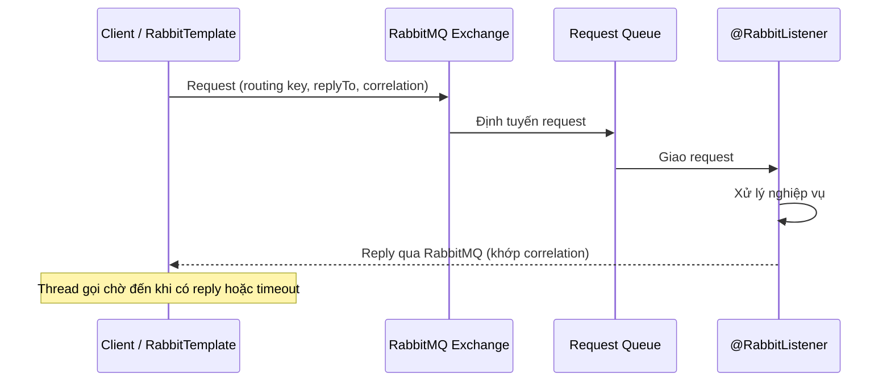

# `sendAndReceive()` và `convertSendAndReceive()` trong Spring AMQP

Trong hệ thống sử dụng RabbitMQ, phần lớn message được gửi theo kiểu *fire-and-forget*: bên gửi phát sự kiện hoặc giao việc rồi tiếp tục chạy, không chờ một giá trị trả về. Tuy nhiên, đôi khi một thành phần cần hỏi thành phần khác và nhận kết quả ngay trong luồng xử lý. **Request–reply (RPC qua message broker)** đáp ứng nhu cầu đó.

Spring AMQP cung cấp hai nhóm API quan trọng trên `RabbitTemplate`:

- `sendAndReceive()`: gửi một `Message` đã tạo sẵn và nhận lại `Message`, cho phép làm việc trực tiếp với body, headers và metadata AMQP.
- `convertSendAndReceive()`: nhận một đối tượng Java, sử dụng `MessageConverter` để tạo message trước khi gửi và chuyển đổi message phản hồi thành đối tượng sau khi nhận.

Hai API đều dùng RabbitMQ để truyền message, nhưng **lời gọi từ phía client là đồng bộ**: thread gọi sẽ chờ phản hồi hoặc hết thời gian chờ. Hiểu rõ cách tạo request, định tuyến reply, chuyển đổi dữ liệu và xử lý timeout giúp xây dựng các luồng bất đồng bộ đáng tin cậy mà không nhầm RPC với cơ chế phát sự kiện thông thường.

## 1. Cơ chế request–reply hoạt động thế nào?

Giả sử dịch vụ Đơn hàng cần tra cứu một thông tin do dịch vụ Kho xử lý:

1. Client gửi request đến một exchange, kèm routing key để broker chuyển đến request queue.
2. RabbitMQ chuyển message cho consumer đang lắng nghe queue.
3. Consumer xử lý và phát message phản hồi đến địa chỉ reply mà request chỉ định.
4. `RabbitTemplate` nhận reply, ghép với lời gọi đang chờ và trả kết quả cho client.

`replyTo` chỉ ra nơi gửi phản hồi; `correlationId` giúp đối chiếu reply với request tương ứng. Với RPC tiêu chuẩn, **`RabbitTemplate` quản lý thông tin reply và tương quan này**. Ứng dụng không cần tự tạo một queue phản hồi riêng cho từng lời gọi.



RabbitMQ hỗ trợ cơ chế *direct reply-to*, thường được `RabbitTemplate` sử dụng khi broker và cấu hình cho phép. Cơ chế này tối ưu việc nhận phản hồi mà không phải tạo một reply queue vật lý cho mỗi yêu cầu. Nếu ứng dụng dùng reply queue cố định, cần cấu hình listener cho queue ấy và xử lý tương quan phù hợp.

**Phân biệt hai tính chất:** việc truyền request và reply qua RabbitMQ là trao đổi message; riêng phương thức `sendAndReceive()` hoặc `convertSendAndReceive()` vẫn chặn thread của caller cho đến khi hoàn tất. Vì vậy, RPC qua broker không tự biến đoạn code gọi thành bất đồng bộ.

## 2. So sánh hai API

| Tiêu chí | `sendAndReceive()` | `convertSendAndReceive()` |
|---|---|---|
| Dữ liệu đầu vào | `org.springframework.amqp.core.Message` | Một đối tượng Java (`Object`) |
| Dữ liệu trả về | `Message` hoặc `null` | `Object` hoặc `null` |
| Chuyển đổi payload | Caller tự chuẩn bị và đọc byte array | `MessageConverter` chuyển đổi khi gửi và nhận |
| Kiểm soát metadata | Trực tiếp qua `MessageProperties` | Có thể dùng overload với `MessagePostProcessor` hoặc cấu hình converter |
| Thường dùng khi | Cần thao tác bytes, content type, headers, hoặc giao thức tùy biến | Gửi String/DTO, nghiệp vụ ưu tiên dữ liệu Java |
| Thời gian chờ reply | Cấu hình trên `RabbitTemplate` | Cùng cấu hình trên `RabbitTemplate` |

Những overload tiêu biểu:

```java
Message sendAndReceive(String exchange, String routingKey, Message request);

Object convertSendAndReceive(String exchange, String routingKey, Object request);
```

Ngoài ra còn có overload không truyền exchange/routing key, dùng cấu hình mặc định của template. Trong hệ thống có nhiều exchange, nên truyền exchange và routing key rõ ràng để dễ kiểm soát định tuyến.

Tên `convertSendAndReceive()` không có nghĩa là chuyển đổi bất đồng bộ; từ *convert* chỉ việc tuần tự hóa và giải tuần tự hóa payload thông qua message converter.

## 3. Ví dụ hoàn chỉnh với Spring Boot và RabbitMQ

Ví dụ dùng một RPC endpoint tên `echo`: client gửi chuỗi; worker trả lại chuỗi có tiền tố `"Đã nhận: "`. Hai cách gọi bên dưới cùng sử dụng một exchange, queue và consumer.

### 3.1. Khai báo dependency và kết nối

Với ứng dụng Spring Boot sử dụng Gradle:

```groovy
dependencies {
    implementation 'org.springframework.boot:spring-boot-starter-amqp'
}
```

Ví dụ `application.yml` khi RabbitMQ chạy trên máy phát triển:

```yaml
spring:
  rabbitmq:
    host: localhost
    port: 5672
    username: guest
    password: guest
```

Tài khoản `guest/guest` trong ví dụ chỉ phù hợp môi trường RabbitMQ cục bộ có cấu hình mặc định. Trong môi trường triển khai thực tế, sử dụng tài khoản riêng, cấu hình bảo mật và thông tin kết nối theo môi trường.

### 3.2. Tạo exchange, queue và binding

```java
import org.springframework.amqp.core.Binding;
import org.springframework.amqp.core.BindingBuilder;
import org.springframework.amqp.core.DirectExchange;
import org.springframework.amqp.core.Queue;
import org.springframework.amqp.core.QueueBuilder;
import org.springframework.amqp.rabbit.annotation.EnableRabbit;
import org.springframework.beans.factory.annotation.Qualifier;
import org.springframework.context.annotation.Bean;
import org.springframework.context.annotation.Configuration;

@Configuration
@EnableRabbit
public class RpcTopologyConfig {

    public static final String EXCHANGE = "demo.rpc.exchange";
    public static final String REQUEST_QUEUE = "demo.rpc.requests";
    public static final String ROUTING_KEY = "demo.rpc.echo";

    @Bean
    public DirectExchange rpcExchange() {
        return new DirectExchange(EXCHANGE);
    }

    @Bean
    public Queue requestQueue() {
        return QueueBuilder.durable(REQUEST_QUEUE).build();
    }

    @Bean
    public Binding requestBinding(
            @Qualifier("requestQueue") Queue queue,
            @Qualifier("rpcExchange") DirectExchange exchange) {
        return BindingBuilder.bind(queue).to(exchange).with(ROUTING_KEY);
    }
}
```

Ở đây, exchange kiểu `direct` so khớp routing key chính xác. Message được gửi đến `demo.rpc.exchange` với routing key `demo.rpc.echo` sẽ đến queue `demo.rpc.requests`. Queue được khai báo durable để metadata của queue tồn tại qua lần khởi động lại broker; độ bền của từng message còn phụ thuộc chế độ lưu trữ và cấu hình liên quan.

### 3.3. Consumer nhận request và trả reply

```java
import org.springframework.amqp.rabbit.annotation.RabbitListener;
import org.springframework.stereotype.Component;

@Component
public class EchoRpcListener {

    @RabbitListener(queues = RpcTopologyConfig.REQUEST_QUEUE)
    public String echo(String request) {
        return "Đã nhận: " + request;
    }
}
```

Với `@RabbitListener`, giá trị return từ method được Spring AMQP chuyển thành reply khi request có địa chỉ phản hồi phù hợp. Không cần viết `RabbitTemplate.convertAndSend()` trong listener chỉ để trả kết quả cho caller. Nếu listener ném exception, không thể mặc định kỳ vọng client sẽ nhận được một phản hồi nghiệp vụ; cần xử lý lỗi và chính sách reply riêng.

### 3.4. Cách 1 — `sendAndReceive()` với `Message`

```java
import java.nio.charset.StandardCharsets;
import org.springframework.amqp.core.Message;
import org.springframework.amqp.core.MessageProperties;
import org.springframework.amqp.rabbit.core.RabbitTemplate;
import org.springframework.stereotype.Service;

@Service
public class EchoRpcClient {

    private final RabbitTemplate rabbitTemplate;

    public EchoRpcClient(RabbitTemplate rabbitTemplate) {
        this.rabbitTemplate = rabbitTemplate;
    }

    public String echoRaw(String text) {
        byte[] requestBody = text.getBytes(StandardCharsets.UTF_8);

        MessageProperties properties = new MessageProperties();
        properties.setContentType(MessageProperties.CONTENT_TYPE_TEXT_PLAIN);
        properties.setContentEncoding(StandardCharsets.UTF_8.name());
        properties.setHeader("source", "order-service");

        Message request = new Message(requestBody, properties);

        Message reply = rabbitTemplate.sendAndReceive(
                RpcTopologyConfig.EXCHANGE,
                RpcTopologyConfig.ROUTING_KEY,
                request
        );

        if (reply == null) {
            throw new IllegalStateException("Không nhận được RPC reply trong thời gian chờ");
        }

        return new String(reply.getBody(), StandardCharsets.UTF_8);
    }
}
```

**Điểm cần hiểu:**

- `Message` gồm `byte[] body` và `MessageProperties`. Caller tự chuyển String sang UTF-8 và giải mã body của reply.
- `contentType` báo loại payload; `contentEncoding` mô tả cách mã hóa ký tự. Header `source` minh họa cách đính kèm metadata nghiệp vụ.
- `RabbitTemplate` bổ sung và quản lý metadata cần thiết cho lời gọi RPC. Tránh tự đặt hoặc ghi đè `replyTo`, `correlationId` nếu chưa có yêu cầu thiết kế và cấu hình reply queue rõ ràng.
- Khi nhận `null`, caller biết chưa có reply hợp lệ trong thời gian chờ, **không thể kết luận chắc chắn worker chưa xử lý request**.

Trong các ứng dụng phải trao đổi payload nhị phân, thông điệp có cấu trúc phi chuẩn hoặc cần đọc header phản hồi, cách làm với `Message` cho phép kiểm soát trực tiếp hơn.

### 3.5. Cách 2 — `convertSendAndReceive()` với dữ liệu Java

Có thể thêm method sau vào chính `EchoRpcClient`:

```java
public String echoConverted(String text) {
    Object reply = rabbitTemplate.convertSendAndReceive(
            RpcTopologyConfig.EXCHANGE,
            RpcTopologyConfig.ROUTING_KEY,
            text
    );

    if (reply == null) {
        throw new IllegalStateException("RPC hết thời gian chờ phản hồi");
    }
    if (!(reply instanceof String)) {
        throw new IllegalStateException(
                "Kiểu phản hồi không mong đợi: " + reply.getClass().getName()
        );
    }
    return (String) reply;
}
```

Với `SimpleMessageConverter` mặc định, String thường được biến thành message văn bản; reply văn bản được chuyển về String. Vì thế đoạn code không cần tạo `MessageProperties` hay đọc `byte[]` thủ công.

Ví dụ kết quả khi gọi:

```text
echoRaw("xin chào")       -> "Đã nhận: xin chào"
echoConverted("xin chào") -> "Đã nhận: xin chào"
```

Hai method trả cùng kết quả, nhưng hợp đồng làm việc khác nhau: `echoRaw()` biết cấu trúc AMQP message, còn `echoConverted()` sử dụng dữ liệu Java thông qua converter.

## 4. MessageConverter quyết định kiểu dữ liệu nhận về

`convertSendAndReceive()` thực hiện hai lần chuyển đổi:

```text
Java request
    -- MessageConverter.toMessage() --> AMQP request
    -- RabbitMQ / @RabbitListener --> AMQP reply
    -- MessageConverter.fromMessage() --> Java reply
```

Một số điểm cần lưu ý:

| Payload | Cách tiếp cận |
|---|---|
| `String` | `SimpleMessageConverter` thường đủ cho nội dung văn bản |
| `byte[]` | Có thể gửi trực tiếp, nhưng phải thống nhất encoding và nội dung |
| DTO/record Java | Nên dùng JSON converter tương thích với phiên bản Spring AMQP và cấu hình của cả hai phía |
| Dữ liệu nhị phân hoặc schema đặc thù | Cân nhắc `Message` trực tiếp, converter riêng, hoặc định dạng có schema |

Ví dụ hợp đồng dữ liệu cho một RPC nghiệp vụ:

```java
public record StockRequest(String productId, int quantity) {}

public record StockReply(String productId, boolean available) {}
```

Nếu client gửi `StockRequest` bằng `convertSendAndReceive()` và listener trả `StockReply`, cả bên gửi lẫn bên nhận phải thống nhất định dạng (ví dụ JSON), cách map type và cấu hình `MessageConverter`. Trong Spring Boot, có thể khai báo bean converter phù hợp phiên bản đang dùng rồi bảo đảm template và listener container đều sử dụng converter ấy.

**Không nên giả định** rằng chỉ cần truyền một DTO là `SimpleMessageConverter` sẽ tự chuyển nó thành JSON hoặc luôn khôi phục đúng class mong muốn. Với converter mặc định, khả năng hỗ trợ phụ thuộc kiểu đối tượng và content type; Java serialization không phải lựa chọn mặc định tốt cho giao tiếp giữa các dịch vụ vì tính tương thích và rủi ro bảo mật. Với JSON, kiểm soát type mapping hoặc danh sách package được tin cậy, đồng thời xem xét cách trả về kiểu tổng quát (ví dụ `Map`) khi thiếu metadata kiểu.

Khi cần phản hồi kiểu generic như `List<StockReply>`, có thể tìm hiểu `convertSendAndReceiveAsType()` cùng một `SmartMessageConverter` hỗ trợ thông tin kiểu. Với code nghiệp vụ đơn giản, giữ payload và contract rõ ràng thường dễ vận hành hơn.

## 5. Timeout, lỗi và tính đúng đắn của RPC

### 5.1. Thời gian chờ phản hồi

`RabbitTemplate` có thuộc tính `replyTimeout` tính bằng **mili giây**; giá trị mặc định thường là **5.000 ms**. Có thể điều chỉnh khi cấu hình template:

```java
RabbitTemplate template = new RabbitTemplate(connectionFactory);
template.setReplyTimeout(10_000); // 10 giây
```

Đây là minh họa khi tự tạo template; trong ứng dụng Spring Boot nên cấu hình trực tiếp trên bean `RabbitTemplate` thực sự được client sử dụng. Đừng vô tình tạo một template mới rồi thay đổi timeout trên bean không được gọi đến.

Khi hết hạn, API đồng bộ trả `null` nếu không nhận được phản hồi. Những nguyên nhân thường gặp gồm:

- Routing key hoặc binding sai, request không vào đúng queue.
- Chưa có consumer, consumer bị lỗi hoặc xử lý lâu hơn thời gian chờ.
- Consumer xử lý xong nhưng không gửi reply, hoặc reply bị mất/đến quá muộn.
- Hệ thống quá tải, độ trễ mạng hoặc broker làm tăng tổng thời gian đi và về.

Timeout khác với lỗi kết nối: thao tác AMQP có thể ném exception khi không thể giao tiếp hoặc publish hợp lệ. Caller cần xử lý cả kết quả `null` **và** ngoại lệ, đồng thời có thể đặt giới hạn thời gian ở lớp nghiệp vụ.

### 5.2. Timeout không có nghĩa request đã thất bại

Giả sử client đợi 3 giây, nhưng worker hoàn thành thao tác ghi dữ liệu sau 4 giây. Client thấy timeout, trong khi thao tác vẫn có thể đã thành công. Nếu client gửi lại cùng yêu cầu một cách mù quáng, có nguy cơ thực thi nghiệp vụ hai lần.

Với các tác vụ thay đổi trạng thái (tạo đơn, trừ tiền, cấp phát hàng), nên:

1. Gửi một `businessRequestId` ổn định trong payload/header để nhận biết thao tác nghiệp vụ.
2. Thiết kế consumer **idempotent**, tức xử lý lặp cùng yêu cầu không làm lặp tác động.
3. Quy định rõ chính sách retry, backoff và giới hạn số lần thử.
4. Có cách tra cứu trạng thái kết quả sau timeout khi nghiệp vụ yêu cầu tính chính xác cao.

`correlationId` của giao thức dùng ghép reply với request; nó không tự thay thế khóa idempotency nghiệp vụ.

### 5.3. Phân biệt xác nhận publish, ack và reply

| Cơ chế | Xác nhận điều gì? | Không bảo đảm điều gì? |
|---|---|---|
| Publisher confirm | Broker đã xử lý publish theo cơ chế confirm | Consumer đã hoàn thành nghiệp vụ |
| Consumer ack | Consumer xác nhận việc nhận/xử lý message theo chính sách ack | Caller chắc chắn đã nhận được RPC reply |
| RPC reply | Caller đã nhận một message phản hồi tương ứng | Mọi side effect liên quan đều đúng nếu ứng dụng không xác định contract |

Vì vậy, publisher confirm, consumer ack và RPC reply phục vụ những mục đích khác nhau. Một lời gọi `convertSendAndReceive()` trả kết quả không thay thế việc định nghĩa rõ thành công/thất bại ở mức nghiệp vụ.

### 5.4. Retry, dead-letter và thông báo lỗi

Nếu consumer gặp lỗi, có thể cấu hình retry với backoff, đưa message vượt quá giới hạn retry vào dead-letter exchange/queue để điều tra. Tuy nhiên, quá trình retry trên worker có thể kéo dài vượt `replyTimeout` của caller. Hai chính sách này phải được thiết kế cùng nhau.

Với lỗi nghiệp vụ dự kiến (ví dụ `PRODUCT_NOT_FOUND`), một phương án là trả một reply có cấu trúc:

```json
{
  "requestId": "req-123",
  "success": false,
  "errorCode": "PRODUCT_NOT_FOUND",
  "message": "Không tìm thấy sản phẩm"
}
```

Phản hồi kiểu này giúp client phân biệt lỗi nghiệp vụ đã xử lý với timeout vận chuyển. Không nên mặc định coi mọi exception trong `@RabbitListener` là một reply JSON hoặc Java exception được tự động gửi về client.

## 6. Vận hành request–reply ổn định

**Định tuyến:** kiểm tra exchange, queue, binding, routing key và số consumer. Nếu request không được định tuyến, client thường chỉ thấy hết timeout; các cơ chế mandatory/returned-message và publisher confirm giúp phát hiện một số tình huống publish không đến đích, tùy cấu hình.

**Quan sát:** ghi log `businessRequestId`, correlation identifier khi phù hợp, routing key, thời điểm bắt đầu/kết thúc và kết quả. Theo dõi độ trễ RPC, tỷ lệ timeout, queue depth, message chưa ack và số consumer; không đưa thông tin nhạy cảm vào log.

**Tài nguyên:** mỗi lời gọi đồng bộ giữ một thread chờ. Nếu có hàng nghìn request song song, có thể cạn thread hoặc làm tăng thời gian phản hồi của API. Giới hạn concurrency, cấu hình timeout hợp lý và cân nhắc `AsyncRabbitTemplate` hoặc mô hình event-driven nếu không bắt buộc chờ kết quả ngay.

**Độ tin cậy:** direct reply-to tối ưu phản hồi ngắn hạn, không phải nơi lưu reply bền vững để truy xuất sau nhiều giờ. Nếu cần lưu kết quả dài hạn, báo trạng thái từng bước, hoặc một workflow chạy lâu, nên lưu trạng thái nghiệp vụ và phát event thay vì giữ RPC call mở.

**Hợp đồng dữ liệu:** thống nhất version của payload, content type, encoding, JSON type mapping, mã lỗi và ngữ nghĩa idempotency. Test cả trường hợp thành công, consumer không chạy, reply chậm, message không được định tuyến và consumer xử lý trùng.

## 7. Khi nào chọn phương thức nào?

- Chọn **`sendAndReceive()`** khi phải kiểm soát message ở mức thấp: tự tạo body, cấu hình header, đọc metadata phản hồi, làm việc với định dạng nhị phân hay giao thức tích hợp đặc biệt.
- Chọn **`convertSendAndReceive()`** khi yêu cầu và phản hồi có thể biểu diễn rõ bằng String hoặc DTO, và hai đầu đã thống nhất `MessageConverter`. Đây thường là lựa chọn ngắn gọn hơn cho RPC nghiệp vụ.
- Cân nhắc **không dùng RPC đồng bộ** cho công việc lâu, có nhiều bước hoặc không cần kết quả ngay. Gửi command/event, trả mã công việc và cập nhật kết quả sau sẽ phù hợp hơn trong nhiều hệ thống bất đồng bộ.

### Câu hỏi tự kiểm tra

1. Vì sao gọi `convertSendAndReceive()` vẫn có thể làm nghẽn thread HTTP của ứng dụng?
2. Sự khác nhau giữa `Message` và đối tượng Java trước/sau khi chuyển đổi là gì?
3. Vì sao một request bị timeout vẫn có thể đã thay đổi dữ liệu ở consumer?
4. `correlationId` và `businessRequestId` giải quyết hai vấn đề khác nhau thế nào?
5. Tại sao cần phân biệt publisher confirm, consumer ack và RPC reply?

**Ghi nhớ:** cả hai API đều dùng cơ chế request–reply của Spring AMQP và trả `null` khi quá thời gian chờ phản hồi. Điểm khác nhau cốt lõi là **mức trừu tượng của payload**: `sendAndReceive()` xử lý trực tiếp `Message`, còn `convertSendAndReceive()` dùng `MessageConverter` để giao tiếp bằng các đối tượng Java.
