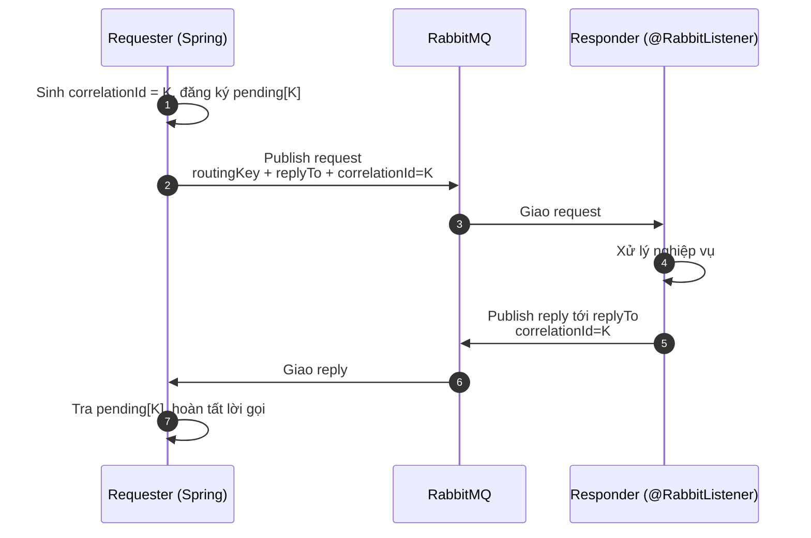

# replyTo, correlationId và đối chiếu phản hồi trong Spring AMQP

## 1. Vì sao request–reply cần hai thuộc tính này?

RabbitMQ thường được dùng để gửi sự kiện một chiều: bên phát gửi message, bên nhận xử lý khi có thể. Tuy nhiên, một số luồng cần **gửi yêu cầu và đợi kết quả**: kiểm tra giá, tra cứu trạng thái đơn hàng, tính phí vận chuyển hoặc gọi một tác vụ từ dịch vụ khác. Trong Spring AMQP, đây là mẫu **request–reply**, thường còn được gọi là RPC qua message broker.

Ví dụ, dịch vụ Đặt hàng gửi mã sản phẩm `SKU-42` cho dịch vụ Danh mục để nhận giá. Hai dịch vụ không trao đổi qua một kết nối HTTP trực tiếp; chúng gửi và nhận message qua RabbitMQ. Để phản hồi quay về đúng nơi và đúng lời gọi, yêu cầu cần hai thông tin:

- **`replyTo`:** nơi dịch vụ xử lý yêu cầu sẽ gửi phản hồi về.
- **`correlationId`:** mã dùng để ghép phản hồi với yêu cầu đã gửi, đặc biệt khi có nhiều yêu cầu đồng thời.

Đây là hai thuộc tính của **AMQP message properties**; chúng không phải trường bắt buộc trong JSON body.

| Thuộc tính | Câu hỏi cần trả lời | Ví dụ | Trách nhiệm chính |
|---|---|---|---|
| `replyTo` | Gửi kết quả đi đâu? | `rpc.reply.instance-1` hoặc địa chỉ Direct Reply-to của RabbitMQ | Định tuyến phản hồi |
| `correlationId` | Kết quả này thuộc yêu cầu nào? | `8db4f4d0-...` | Đối chiếu yêu cầu–phản hồi |
| `messageId` | Message cụ thể này có định danh gì? | `msg-103` | Theo dõi/định danh message; không thay thế cơ chế correlation |
| `CorrelationData` của Spring | Broker có xác nhận publish không? | ID của publisher confirm | Xác nhận publish; **khác** `correlationId` của RPC |

**Mấu chốt:** cùng một `replyTo` có thể nhận phản hồi của hàng trăm yêu cầu; chỉ biết hàng đợi đích chưa đủ để ghép phản hồi về đúng tác vụ đang chờ.

## 2. Luồng trao đổi và nguyên tắc đối chiếu



1. **Requester** tạo yêu cầu, xác định nơi nhận phản hồi và mã đối chiếu. Nếu tự quản lý các lời gọi đang chờ, phải đăng ký `pending[correlationId]` **trước khi publish** để tránh phản hồi đến quá sớm.
2. **RabbitMQ** dùng exchange, routing key và queue/binding để giao *request* tới responder.
3. **Responder** đọc `replyTo`, xử lý nghiệp vụ, gửi *reply* về địa chỉ đó và **giữ nguyên `correlationId`** từ request.
4. **Requester** đọc `correlationId` của reply, tìm yêu cầu tương ứng trong tập `pending` và hoàn tất đúng lời gọi. Khi hết hạn chờ, nó phải giải phóng phần tử pending.

Giả sử hai request A và B đều khai báo `replyTo=rpc.reply.instance-1` nhưng có ID lần lượt là `req-A` và `req-B`. B xử lý nhanh hơn nên kết quả có thể về theo thứ tự B rồi A. Dựa vào thứ tự message để ghép kết quả sẽ sai; đối chiếu bằng `correlationId` vẫn đúng.

```text
Request A: replyTo=rpc.reply.instance-1, correlationId=req-A
Request B: replyTo=rpc.reply.instance-1, correlationId=req-B

Reply B:   correlationId=req-B  -> pending[req-B]
Reply A:   correlationId=req-A  -> pending[req-A]
```

Lưu ý, `replyTo` là thông tin **định tuyến phản hồi**. Trong cách dùng queue thông thường, responder có thể publish vào **default exchange** (tên exchange rỗng) với routing key là tên queue chứa trong `replyTo`. Với Direct Reply-to, RabbitMQ dùng một địa chỉ phản hồi đặc biệt do client/framework xử lý; không nên tự giả định đó là queue bền vững.

## 3. Cách thường dùng: RabbitTemplate và @RabbitListener

Spring AMQP cung cấp `RabbitTemplate.convertSendAndReceive(...)` để thực hiện request–reply và `@RabbitListener` để nhận request. Với listener trả về một giá trị, Spring gửi giá trị đó thành reply theo thông tin phản hồi của request. `RabbitTemplate` quản lý việc chờ và đối chiếu kết quả cho lời gọi RPC; ứng dụng không cần tự tạo `ConcurrentHashMap` cho trường hợp thông thường.

### 3.1. Khai báo exchange, request queue và binding

Ví dụ sau chỉ gửi chuỗi để tập trung vào routing và correlation. Dự án Spring Boot cần dependency `spring-boot-starter-amqp` và cấu hình kết nối RabbitMQ phù hợp.

```java
import org.springframework.amqp.core.Binding;
import org.springframework.amqp.core.BindingBuilder;
import org.springframework.amqp.core.DirectExchange;
import org.springframework.amqp.core.Queue;
import org.springframework.amqp.core.QueueBuilder;
import org.springframework.amqp.rabbit.connection.ConnectionFactory;
import org.springframework.amqp.rabbit.core.RabbitTemplate;
import org.springframework.context.annotation.Bean;
import org.springframework.context.annotation.Configuration;

@Configuration
public class CatalogRpcConfig {
    public static final String EXCHANGE = "catalog.rpc.exchange";
    public static final String REQUEST_QUEUE = "catalog.rpc.requests";
    public static final String ROUTING_KEY = "catalog.price.lookup";

    @Bean
    DirectExchange catalogRpcExchange() {
        return new DirectExchange(EXCHANGE);
    }

    @Bean
    Queue catalogRpcRequestQueue() {
        return QueueBuilder.durable(REQUEST_QUEUE).build();
    }

    @Bean
    Binding catalogRpcBinding(Queue catalogRpcRequestQueue,
                              DirectExchange catalogRpcExchange) {
        return BindingBuilder.bind(catalogRpcRequestQueue)
                .to(catalogRpcExchange)
                .with(ROUTING_KEY);
    }

    @Bean
    RabbitTemplate catalogRpcTemplate(ConnectionFactory connectionFactory) {
        RabbitTemplate template = new RabbitTemplate(connectionFactory);
        template.setReplyTimeout(5_000); // 5 giây; giới hạn chờ phản hồi
        return template;
    }
}
```

Ở đây, exchange và binding chỉ xác định **đường đi của request**. Reply đi theo `replyTo` được requester gửi kèm; không cần dùng ngược lại routing key của request để trả lời.

### 3.2. Responder trả về kết quả

```java
import org.springframework.amqp.rabbit.annotation.RabbitListener;
import org.springframework.stereotype.Component;

@Component
public class CatalogRpcResponder {

    @RabbitListener(queues = CatalogRpcConfig.REQUEST_QUEUE)
    public String lookupPrice(String sku) {
        if ("SKU-42".equals(sku)) {
            return "120000";
        }
        return "NOT_FOUND";
    }
}
```

Với cách viết này, listener không cần gọi `rabbitTemplate.send(...)` để gửi reply. Adapter của `@RabbitListener` xử lý việc tạo reply dựa trên kết quả trả về. Nếu phương thức trả về `void` hoặc xảy ra lỗi không được xử lý, không nên mặc định rằng requester sẽ nhận được reply nghiệp vụ hợp lệ.

### 3.3. Requester gửi yêu cầu và đợi kết quả

```java
import org.springframework.amqp.rabbit.core.RabbitTemplate;
import org.springframework.stereotype.Service;

@Service
public class CatalogRpcClient {
    private final RabbitTemplate rabbitTemplate;

    public CatalogRpcClient(RabbitTemplate rabbitTemplate) {
        this.rabbitTemplate = rabbitTemplate;
    }

    public String lookupPrice(String sku) {
        Object response = rabbitTemplate.convertSendAndReceive(
                CatalogRpcConfig.EXCHANGE,
                CatalogRpcConfig.ROUTING_KEY,
                sku
        );

        if (response == null) {
            throw new IllegalStateException(
                    "Không nhận được phản hồi tra cứu giá trong thời hạn chờ"
            );
        }
        return (String) response;
    }
}
```

- `convertSendAndReceive` gửi request và **chặn luồng gọi** đến khi có reply hoặc hết `replyTimeout`. Nếu quá hạn, kết quả có thể là `null`; chính ứng dụng phải quyết định trả lỗi, thử lại hoặc chuyển sang luồng bất đồng bộ.
- Với broker hỗ trợ, Spring AMQP có thể sử dụng **RabbitMQ Direct Reply-to** để nhận phản hồi mà không cần khai báo một reply queue riêng cho mỗi lời gọi. Framework tự quản lý cơ chế phản hồi này.
- Khi tự cấu hình **fixed reply queue** cho `RabbitTemplate`, ứng dụng phải cấu hình đúng địa chỉ reply và listener container nhận reply theo mô hình Spring AMQP; chỉ khai báo queue là chưa đủ.
- Mã ví dụ dùng converter chuỗi mặc định. Nếu chuyển sang DTO/JSON, phải cấu hình message converter tương ứng cho cả bên gửi và bên nhận.

**Đừng trộn hai cơ chế:** trong luồng `convertSendAndReceive`, hãy để `RabbitTemplate` quản lý correlation theo cấu hình của nó. Chỉ chủ động tự gán `replyTo`, tạo pending map và tự tiêu thụ reply khi triển khai một luồng thủ công riêng.

## 4. Tự quản lý replyTo và correlationId khi nào?

Cách thủ công hữu ích khi ứng dụng muốn nhận kết quả ở một consumer độc lập, xử lý bất đồng bộ hoặc tích hợp client không dùng `convertSendAndReceive`. Khi đó, requester phải tự tạo và lưu trạng thái của mỗi lời gọi đang chờ.

### 4.1. Tạo request có metadata rõ ràng

```java
import java.nio.charset.StandardCharsets;
import java.util.UUID;
import org.springframework.amqp.core.Message;
import org.springframework.amqp.core.MessageProperties;

// Trước khi gửi: đăng ký một future/promise bằng correlationId vào pending.
String correlationId = UUID.randomUUID().toString();

MessageProperties properties = new MessageProperties();
properties.setReplyTo("catalog.rpc.reply.client-1");
properties.setCorrelationId(correlationId);

Message request = new Message(
        "SKU-42".getBytes(StandardCharsets.UTF_8),
        properties
);

rabbitTemplate.send(
        CatalogRpcConfig.EXCHANGE,
        CatalogRpcConfig.ROUTING_KEY,
        request
);
```

Ví dụ này giả định queue `catalog.rpc.reply.client-1` đã được khai báo và có consumer nhận reply. Đây là **một luồng thủ công độc lập** với ví dụ `convertSendAndReceive` ở phần 3. Queue tên cố định chỉ phù hợp để minh họa cho **một requester instance**; nếu nhiều instance cùng consume queue này, reply có thể được giao đến instance không sở hữu phần tử pending tương ứng.

### 4.2. Responder sao chép correlationId vào phản hồi

Khi tự publish reply, responder phải lấy cả hai thuộc tính từ request và không tự sinh ID mới cho reply:

```java
import java.nio.charset.StandardCharsets;
import org.springframework.amqp.core.Message;
import org.springframework.amqp.core.MessageProperties;
import org.springframework.amqp.rabbit.annotation.RabbitListener;
import org.springframework.amqp.rabbit.core.RabbitTemplate;
import org.springframework.stereotype.Component;

// Ví dụ thay thế responder tự động ở phần 3; không bật cả hai listener
// trên cùng request queue khi thực hành ví dụ này.
@Component
public class ManualCatalogResponder {
    private final RabbitTemplate rabbitTemplate;

    public ManualCatalogResponder(RabbitTemplate rabbitTemplate) {
        this.rabbitTemplate = rabbitTemplate;
    }

    @RabbitListener(queues = CatalogRpcConfig.REQUEST_QUEUE)
    public void handle(Message request) {
        MessageProperties incoming = request.getMessageProperties();
        String replyTo = incoming.getReplyTo();
        String correlationId = incoming.getCorrelationId();

        if (replyTo == null || replyTo.isBlank() || correlationId == null) {
            // Ghi nhận request sai hợp đồng và xử lý theo chính sách lỗi.
            return;
        }

        String sku = new String(request.getBody(), StandardCharsets.UTF_8);
        String result = "SKU-42".equals(sku) ? "120000" : "NOT_FOUND";

        MessageProperties outgoing = new MessageProperties();
        outgoing.setCorrelationId(correlationId); // giữ nguyên ID của request

        Message reply = new Message(
                result.getBytes(StandardCharsets.UTF_8),
                outgoing
        );

        // Ví dụ replyTo là tên một queue: publish qua default exchange.
        rabbitTemplate.send("", replyTo, reply);
    }
}
```

Cách gửi qua default exchange trong đoạn mã trên dành cho `replyTo` là **tên queue RabbitMQ thông thường**. Nếu dùng địa chỉ có cú pháp khác hoặc cơ chế Direct Reply-to, cần tuân theo cơ chế định tuyến tương ứng; không nên coi mọi `replyTo` là tên queue được khai báo sẵn.

### 4.3. Ghép reply vào lời gọi đang chờ

Requester tự triển khai cần cấu trúc thread-safe, chẳng hạn `ConcurrentHashMap<String, CompletableFuture<String>>`:

```java
import java.nio.charset.StandardCharsets;
import java.util.Map;
import java.util.UUID;
import java.util.concurrent.CompletableFuture;
import java.util.concurrent.ConcurrentHashMap;
import java.util.concurrent.TimeUnit;
import org.springframework.amqp.core.Message;
import org.springframework.amqp.core.MessageProperties;
import org.springframework.amqp.rabbit.annotation.RabbitListener;

private final Map<String, CompletableFuture<String>> pending =
        new ConcurrentHashMap<>();

public String requestPrice(String sku) throws Exception {
    String id = UUID.randomUUID().toString();
    CompletableFuture<String> future = new CompletableFuture<>();
    pending.put(id, future); // đăng ký trước khi publish

    try {
        MessageProperties props = new MessageProperties();
        props.setReplyTo("catalog.rpc.reply.client-1");
        props.setCorrelationId(id);

        rabbitTemplate.send(
                CatalogRpcConfig.EXCHANGE,
                CatalogRpcConfig.ROUTING_KEY,
                new Message(sku.getBytes(StandardCharsets.UTF_8), props)
        );

        return future.get(5, TimeUnit.SECONDS);
    } finally {
        pending.remove(id); // thành công, lỗi hay timeout đều dọn trạng thái
    }
}

@RabbitListener(queues = "catalog.rpc.reply.client-1")
public void onReply(Message reply) {
    String id = reply.getMessageProperties().getCorrelationId();
    if (id == null) {
        // Thiếu ID: ghi metric và xử lý theo chính sách của ứng dụng.
        return;
    }

    CompletableFuture<String> future = pending.remove(id);
    if (future == null) {
        // Không khớp: reply quá hạn, trùng lặp hoặc gửi nhầm instance.
        return;
    }

    future.complete(new String(reply.getBody(), StandardCharsets.UTF_8));
}
```

Đoạn mã trên tập trung minh họa **thuật toán đối chiếu**, nên giả định `rabbitTemplate` đã được inject, queue reply đã tồn tại, listener được đặt trong một Spring bean, và chỉ có một requester instance nhận queue này. Trong ứng dụng thực, cần xử lý gián đoạn thread (khôi phục interrupt flag), log lỗi có cấu trúc, giới hạn số phần tử pending và xác định chính sách retry. Không dùng ví dụ này như một RPC client hoàn chỉnh mà bỏ qua các điều kiện đó.

Hai lỗi phổ biến khi tự triển khai là:

- **Đăng ký pending sau khi publish:** reply có thể đến trước khi map chứa ID, khiến reply bị đánh dấu không khớp.
- **Lưu ID nhưng không xóa khi timeout:** request đã hết hạn vẫn giữ future, gây rò rỉ bộ nhớ khi lưu lượng cao.

## 5. Direct Reply-to và reply queue riêng

| Tiêu chí | Direct Reply-to | Reply queue riêng |
|---|---|---|
| Cách nhận kết quả | RabbitMQ có cơ chế địa chỉ phản hồi trực tiếp đặc biệt | Requester tạo/cấu hình queue để nhận reply |
| Phù hợp | RPC ngắn, caller đang trực tuyến, thường dùng với `RabbitTemplate` | Cần kiểm soát queue, consumer hoặc xử lý reply độc lập |
| Chi phí | Tránh tạo nhiều queue tạm cho mỗi request | Cần quản lý vòng đời queue, listener, binding/routing khi cần |
| Độ bền | Không có cơ chế lưu bền reply để phát lại cho requester mất kết nối; delivery theo kiểu at-most-once của Direct Reply-to | Phụ thuộc độ bền queue, persistence message, ACK, TTL và chính sách xử lý |
| Nhiều replica | Framework hỗ trợ correlation của lời gọi trong phạm vi kết nối/instance tương ứng | Phải bảo đảm reply về đúng instance sở hữu pending, hoặc lưu correlation trong hệ chia sẻ |

**Chọn theo yêu cầu nghiệp vụ:** nếu chỉ cần query kết quả nhanh, `convertSendAndReceive` thường là điểm xuất phát đơn giản. Nếu kết quả cần tồn tại qua lúc requester tắt, hoặc tác vụ chạy nhiều phút, nên cân nhắc mô hình **gửi command rồi nhận event/result bất đồng bộ**, lưu trạng thái yêu cầu bền vững và có cơ chế tra cứu trạng thái; RPC đồng bộ không tự tạo bảo đảm đó.

Một fixed reply queue dùng chung giữa các requester instance có thể gặp lỗi rất khó thấy: broker giao reply đến instance B, trong khi phần tử `pending[id]` chỉ tồn tại trong bộ nhớ instance A. Bỏ qua reply ở B không khiến RabbitMQ tự động chuyển đúng về A. Cần thiết kế queue riêng theo instance, định tuyến đúng instance, hoặc một cơ chế đối chiếu dùng chung được quản lý rõ ràng.

## 6. Timeout, retry và độ tin cậy

`replyTo` và `correlationId` giải quyết **định tuyến và ghép kết quả**, không tự đảm bảo responder chỉ chạy một lần hay request luôn thành công.

- **Timeout không hủy request:** requester có thể hết thời gian chờ khi responder vẫn đang xử lý. Một reply đến muộn cần được nhận diện và bỏ qua/ghi nhận an toàn.
- **Gửi lại có thể tạo xử lý trùng:** nếu requester retry vì timeout, request lần đầu có thể đã được xử lý. Tác vụ có tác dụng phụ (trừ tiền, tạo đơn) cần **idempotency key** và lưu trạng thái xử lý phù hợp. `correlationId` dùng để ghép kết quả; không mặc nhiên là khóa chống trùng nghiệp vụ.
- **Publisher confirm không đồng nghĩa reply:** broker xác nhận đã nhận publish không có nghĩa consumer đã xử lý hoặc reply đã đến.
- **Consumer ACK không đồng nghĩa RPC thành công:** ACK là cơ chế ghi nhận việc tiêu thụ message; cần theo dõi riêng kết quả nghiệp vụ và đường reply.
- **Retry/DLQ chỉ áp dụng khi được cấu hình:** nên phân biệt lỗi tạm thời, lỗi nghiệp vụ, request sai định dạng và message không thể xử lý. Tránh retry vô hạn trên cùng request.
- **Đứt kết nối hoặc crash:** pending map trong RAM mất khi instance khởi động lại. Với Direct Reply-to, reply không được lưu bền cho caller đã mất kết nối.
- **Bảo mật định tuyến:** responder không nên tùy tiện publish dữ liệu nhạy cảm đến mọi `replyTo` mà client không tin cậy cung cấp; cần giới hạn quyền publish và kiểm tra hợp đồng yêu cầu.

Đối với luồng có giao dịch dữ liệu quan trọng, nên quy định rõ timeout, retry, cách phân loại lỗi, cơ chế idempotency, TTL và dead-letter, cũng như điều kiện chọn luồng bất đồng bộ bền vững thay vì RPC.

## 7. Quan sát và xử lý sự cố

Khi điều tra lỗi, ghi log ở các chặng **gửi request → nhận request → gửi reply → nhận/đối chiếu reply**. Trường nên có: `correlationId` (hoặc request ID ứng dụng), exchange/routing key, loại request, thời gian bắt đầu, thời gian xử lý, kết quả/timeout và instance xử lý. Tránh đưa token hoặc dữ liệu nhạy cảm trong payload vào log.

| Hiện tượng | Khả năng thường gặp | Kiểm tra đầu tiên |
|---|---|---|
| Requester luôn timeout | Không có consumer, sai binding, responder ném lỗi, reply không được gửi | Queue request, listener, log exception, `replyTimeout` |
| Responder xử lý xong nhưng client vẫn timeout | Sai `replyTo`, queue reply không tồn tại, consumer reply chưa chạy | Giá trị `replyTo` thực tế và đường publish reply |
| Có reply nhưng không khớp | Mất/đổi `correlationId`, reply đến muộn, sai instance | ID trên cả request và reply; bảng pending tại instance |
| Lỗi chỉ xuất hiện khi scale nhiều replica | Các instance cùng consume reply queue, nhưng pending lưu cục bộ | Queue reply theo instance và chính sách phân phối consumer |
| Kết quả cũ/đúp sau retry | Request ban đầu vẫn xử lý; hai lần thực thi cùng thao tác | Idempotency key, trạng thái nghiệp vụ, chiến lược retry |
| Thỉnh thoảng mất reply với Direct Reply-to | Caller ngắt kết nối hoặc không còn nhận được reply | Kết nối requester, timeout, yêu cầu độ bền của use case |

Các chỉ số hữu ích gồm số request theo trạng thái, tỉ lệ timeout, độ trễ từ lúc gửi đến lúc nhận, số reply không khớp, số retry và số pending đang chờ. Có thể gắn `traceId` để nối các span qua dịch vụ, nhưng **`traceId` dùng cho quan sát phân tán, không thay thế `correlationId` dùng để đối chiếu RPC**.

## 8. Bài thực hành ngắn

1. Chạy responder và requester ở phần 3. Gửi `SKU-42` để nhận `120000`, sau đó gửi SKU khác để nhận `NOT_FOUND`.
2. Cho responder xử lý lâu hơn 5 giây. Quan sát requester timeout; sau đó khôi phục tốc độ bình thường. Giải thích vì sao timeout không chứng minh message chưa được xử lý.
3. Trong mô hình thủ công ở phần 4, gửi hai request với cùng `replyTo` nhưng hai `correlationId` khác nhau, cố tình đảo thứ tự trả kết quả. Xác minh hai future vẫn nhận đúng reply.
4. Thử trả reply không có `correlationId` hoặc dùng ID sai. Xác minh hệ thống ghi nhận reply không khớp và không hoàn tất nhầm request.
5. Tăng từ một lên hai requester instance dùng chung một reply queue thủ công. Quan sát nguy cơ phản hồi đi vào sai instance và đề xuất cơ chế reply riêng cho từng instance.

**Tự kiểm tra:** Nếu phản hồi được gửi đúng queue nhưng `correlationId` khác request, điều gì sẽ xảy ra? Nếu request đã timeout nhưng responder tiếp tục tạo đơn, retry có thể gây hậu quả gì? Nếu một RPC cần kết quả ngay cả khi caller đã tắt, Direct Reply-to có còn là thiết kế phù hợp không?

## Ghi nhớ

- `replyTo` cho biết **đường trả lời**; `correlationId` cho biết **lời gọi tương ứng**.
- Với Spring AMQP thông thường, kết hợp `RabbitTemplate.convertSendAndReceive` và `@RabbitListener` trả giá trị để framework quản lý request–reply.
- Với luồng thủ công, tạo ID duy nhất, đăng ký pending trước khi gửi, sao chép ID vào reply, đối chiếu thread-safe và dọn pending khi hoàn tất hoặc timeout.
- Đối chiếu thành công vẫn khác với bảo đảm xử lý đúng một lần hoặc lưu bền kết quả. Hãy thiết kế timeout, retry, idempotency và quan sát theo mức độ quan trọng của nghiệp vụ.
