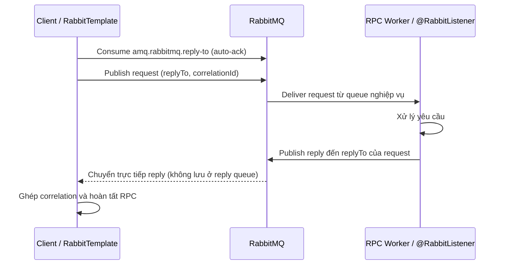

# RabbitMQ Direct Reply-To và điều kiện sử dụng

## 1. Bối cảnh: Request/Reply trên một hệ thống nhắn tin bất đồng bộ

RabbitMQ thường được dùng để gửi công việc bất đồng bộ: producer gửi message vào exchange, broker định tuyến tới queue, consumer nhận và xử lý. Tuy nhiên, có những lúc dịch vụ gửi yêu cầu cần **nhận một kết quả cụ thể** để tiếp tục luồng nghiệp vụ. Mẫu **Request/Reply (RPC qua message broker)** giải quyết tình huống đó:

1. Client gửi một request tới queue xử lý.
2. Client cho biết nơi muốn nhận phản hồi thông qua thuộc tính AMQP `replyTo`.
3. Worker nhận request, xử lý rồi gửi một message trả lời tới địa chỉ `replyTo`.
4. Client liên kết phản hồi với request ban đầu, thường qua `correlationId`, và hoàn tất lời gọi đang chờ.

Ví dụ, dịch vụ đặt hàng hỏi dịch vụ tồn kho về số lượng có thể giữ cho một sản phẩm. Request đi qua RabbitMQ, nhưng dịch vụ đặt hàng vẫn cần một phản hồi trong thời gian giới hạn để quyết định bước tiếp theo.

Vấn đề của cách RPC truyền thống qua RabbitMQ là **queue phản hồi**: tạo queue riêng cho mỗi lời gọi hoặc mỗi client làm tăng số queue, binding, consumer và chi phí quản lý trên broker. **RabbitMQ Direct Reply-To** được thiết kế để giảm phần chi phí đó.

> **Điểm cốt lõi:** Direct Reply-To tối ưu cách chuyển *phản hồi RPC* về client. Nó không biến request/reply thành giao dịch đồng bộ, cũng không làm cho phản hồi được lưu bền vững.

## 2. Direct Reply-To hoạt động như thế nào?

Direct Reply-To sử dụng địa chỉ đặc biệt **`amq.rabbitmq.reply-to`**, gọi là *pseudo-queue*. Client đăng ký nhận phản hồi qua địa chỉ này, không cần tự khai báo một queue phản hồi thông thường bằng `queue.declare`.



Chi tiết quan trọng của giao thức:

- **Request vẫn đi qua queue thật.** Ví dụ exchange `rpc.requests` định tuyến tới queue `rpc.customer.lookup`; độ bền, retry và cơ chế acknowledgment của request phụ thuộc vào cấu hình queue/consumer đó.
- **Phản hồi không nằm trong queue thông thường.** RabbitMQ định tuyến reply trực tiếp đến consumer đang chờ trên kết nối của requester; không có reply queue thông thường để lưu và lấy lại message nếu requester vắng mặt.
- **Requester tiêu thụ pseudo-queue ở chế độ tự động xác nhận (`noAck`/auto-ack).** Direct Reply-To không hỗ trợ consumer acknowledgment cho reply. Ở mức AMQP client trực tiếp, thao tác consume và publish request phải tuân thủ ràng buộc channel của Direct Reply-To; Spring AMQP quản lý điều này thay cho ứng dụng.
- **Responder phải tôn trọng `replyTo` được nhận.** RabbitMQ có thể chuyển địa chỉ `amq.rabbitmq.reply-to` thành địa chỉ nội bộ dạng `amq.rabbitmq.reply-to.<token>` khi chuyển request tới worker. Worker nên trả lời tới chính giá trị `replyTo` của request, không tự ghép hay cố định địa chỉ.
- **`correlationId` phục vụ ghép cặp request/reply.** Nhiều yêu cầu có thể đang chờ đồng thời; địa chỉ phản hồi đơn thuần chưa cho biết reply thuộc yêu cầu nào. Spring AMQP hỗ trợ việc ghép cặp này trong `RabbitTemplate`.

### Điều gì xảy ra nếu client không còn nhận phản hồi?

Direct Reply-To có ngữ nghĩa phân phối **at-most-once** cho reply: message có thể đến một lần hoặc bị mất, nhưng không có hàng đợi phản hồi để broker giữ lại và phát lại. Nếu client ngắt kết nối, đóng channel, hủy consumer hoặc không còn chờ khi reply đến, ứng dụng **không được giả định** rằng mình sẽ nhận được phản hồi đó.

Publisher confirm trên phía gửi reply (nếu bật) chỉ cho biết mức xác nhận của broker đối với thao tác publish; **không chứng minh** requester đã nhận hoặc xử lý thành công reply. Đây là khác biệt quan trọng giữa việc broker nhận message và việc kết quả nghiệp vụ đã được client ghi nhận.

## 3. Điều kiện sử dụng

### Điều kiện kỹ thuật

| Điều kiện | Lý do |
| --- | --- |
| Broker RabbitMQ và thư viện client hỗ trợ Direct Reply-To | `amq.rabbitmq.reply-to` là cơ chế riêng của RabbitMQ, không phải tên queue AMQP dùng được trên mọi broker. |
| Requester đăng ký consumer Direct Reply-To theo quy tắc của RabbitMQ | Reply được chuyển tới consumer đang hoạt động; chế độ nhận reply là auto-ack. |
| Request có `replyTo` và responder gửi reply đúng địa chỉ này | Không có nơi trả lời hợp lệ thì RPC sẽ không nhận được kết quả. |
| Có cơ chế liên kết request/reply và giới hạn thời gian chờ | Nhiều RPC đồng thời cần correlation; phản hồi thất lạc không được khiến lời gọi chờ vô hạn. |
| Ứng dụng chấp nhận khả năng mất reply | Direct Reply-To không cung cấp lưu trữ hoặc phát lại reply khi requester không nhận được. |

Khi dùng `RabbitTemplate`, Spring AMQP tự quản lý consumer, channel, `replyTo` và tương quan reply cho các phương thức request/reply. Điều kiện giao thức vẫn tồn tại, nhưng phần lớn không cần tự cài đặt trong business code.

### Điều kiện phù hợp về nghiệp vụ

Direct Reply-To phù hợp khi request có **thời gian xử lý tương đối ngắn**, client đang hoạt động và **việc mất reply có thể xử lý bằng timeout, truy vấn trạng thái hoặc retry có kiểm soát**. Ví dụ: tra cứu thông tin ít tốn tài nguyên, kiểm tra dữ liệu hoặc lấy kết quả tính toán nhanh giữa hai dịch vụ.

Nên cân nhắc cơ chế khác khi phản hồi bắt buộc phải được lưu đến khi client quay lại, xử lý kéo dài hàng phút/giờ, số lượng request đang chờ quá lớn, hoặc workflow cần bảo đảm cuối cùng có kết quả dù client bị khởi động lại. Với các bài toán đó, thường phù hợp hơn nếu sử dụng **queue phản hồi bền vững**, lưu trạng thái xử lý theo `requestId`, hoặc mô hình **gửi lệnh rồi nhận sự kiện/kết quả bất đồng bộ**.

### So sánh ba cách nhận reply

| Tiêu chí | Direct Reply-To | Queue tạm thời cho reply | Queue phản hồi cố định |
| --- | --- | --- | --- |
| Queue phản hồi thật | Không | Có, thường tự xóa/độc quyền | Có, do ứng dụng quản lý |
| Chi phí tạo queue và consumer | Thấp, có thể tái sử dụng consumer | Có chi phí tạo/hủy queue | Không cần tạo mới mỗi RPC, nhưng phải quản lý queue và consumer |
| Lưu lại reply khi requester vắng mặt | Không | Chỉ trong thời gian queue còn tồn tại và tùy thuộc cấu hình | Có thể, nếu queue durable, reply persistent và cấu hình phù hợp |
| Ack ở phía nhận reply | Không, auto-ack | Có thể cấu hình | Có thể cấu hình |
| Trường hợp điển hình | RPC ngắn, chấp nhận mất reply | RPC cần reply queue độc lập tạm thời | Workflow cần kiểm soát và phục hồi reply |

Queue cố định cũng **không tự động bảo đảm kết quả nghiệp vụ**: phải thiết kế thêm publisher confirms, acknowledgment, xử lý trùng lặp và lưu trạng thái khi cần.

## 4. Triển khai Request/Reply bằng Spring AMQP

Ví dụ dưới đây dùng **Spring Boot** với dependency `spring-boot-starter-amqp`. Một dịch vụ gửi mã khách hàng; worker trả về tên mô phỏng. Exchange, queue và binding dành cho *request* vẫn được khai báo như thường lệ.

### 4.1. Cấu hình exchange, request queue và RabbitTemplate

```java
import org.springframework.amqp.core.Binding;
import org.springframework.amqp.core.BindingBuilder;
import org.springframework.amqp.core.DirectExchange;
import org.springframework.amqp.core.Queue;
import org.springframework.amqp.core.QueueBuilder;
import org.springframework.amqp.rabbit.connection.ConnectionFactory;
import org.springframework.amqp.rabbit.core.RabbitTemplate;
import org.springframework.context.annotation.Bean;
import org.springframework.context.annotation.Configuration;

@Configuration
public class RpcConfig {

    @Bean
    DirectExchange rpcExchange() {
        return new DirectExchange("rpc.requests", true, false);
    }

    @Bean
    Queue customerLookupQueue() {
        return QueueBuilder.durable("rpc.customer.lookup").build();
    }

    @Bean
    Binding customerLookupBinding(
            Queue customerLookupQueue, DirectExchange rpcExchange) {
        return BindingBuilder.bind(customerLookupQueue)
                .to(rpcExchange)
                .with("customer.lookup");
    }

    @Bean
    RabbitTemplate rabbitTemplate(ConnectionFactory connectionFactory) {
        RabbitTemplate template = new RabbitTemplate(connectionFactory);
        template.setReplyTimeout(3_000); // Chờ tối đa 3 giây
        return template;
    }
}
```

Khi kết nối tới RabbitMQ có hỗ trợ Direct Reply-To và **không cấu hình reply queue cố định**, `RabbitTemplate` có thể tự động dùng Direct Reply-To cho các phương thức request/reply. Không cần khai báo bean `Queue("amq.rabbitmq.reply-to")`, không tạo binding cho pseudo-queue và không gắn `@RabbitListener` vào pseudo-queue.

Các thuộc tính kết nối thông dụng trong `application.yml`:

```yaml
spring:
  rabbitmq:
    host: localhost
    port: 5672
    username: guest
    password: guest
```

Thông tin xác thực ở trên chỉ dùng để minh họa môi trường RabbitMQ cục bộ.

### 4.2. Requester: gửi yêu cầu và chờ kết quả

```java
import org.springframework.amqp.rabbit.core.RabbitTemplate;
import org.springframework.stereotype.Service;

@Service
public class CustomerRpcClient {
    private final RabbitTemplate rabbitTemplate;

    public CustomerRpcClient(RabbitTemplate rabbitTemplate) {
        this.rabbitTemplate = rabbitTemplate;
    }

    public String lookupName(String customerId) {
        Object reply = rabbitTemplate.convertSendAndReceive(
                "rpc.requests",
                "customer.lookup",
                customerId
        );

        if (reply == null) {
            throw new IllegalStateException(
                    "Khong nhan duoc RPC reply trong thoi gian cho: "
                            + customerId);
        }

        return (String) reply;
    }
}
```

`convertSendAndReceive(...)` gửi message, chờ phản hồi tương ứng rồi trả về payload sau khi chuyển đổi. Khi quá thời hạn `replyTimeout` mà chưa nhận reply, lời gọi trả về `null`; ứng dụng nên xử lý riêng trường hợp này. **Timeout ở client không hủy việc xử lý tại worker** và cũng không đồng nghĩa worker đã thất bại.

### 4.3. Responder: xử lý và trả lời về `replyTo`

```java
import org.springframework.amqp.rabbit.annotation.RabbitListener;
import org.springframework.stereotype.Component;

@Component
public class CustomerRpcHandler {

    @RabbitListener(queues = "rpc.customer.lookup")
    public String lookup(String customerId) {
        return "Customer-" + customerId;
    }
}
```

Với `@RabbitListener`, **giá trị trả về của method** được Spring AMQP dùng để tạo reply khi request có `replyTo`. Framework đảm nhận việc gửi về địa chỉ reply và ghép correlation phù hợp; trường hợp này không cần tự gọi `RabbitTemplate.convertAndSend(...)` từ handler và không cần `@SendTo` để chỉ định địa chỉ cố định.

Luồng chạy ví dụ:

1. Client gọi `lookupName("C42")`.
2. `RabbitTemplate` publish request `C42` với metadata request/reply cần thiết.
3. RabbitMQ định tuyến request tới `rpc.customer.lookup`.
4. Worker trả về `Customer-C42`; Spring AMQP gửi reply theo `replyTo`.
5. Nếu reply đến trước timeout, client nhận chuỗi `Customer-C42`.

Ví dụ minh họa payload dạng `String` với message converter mặc định. Khi dùng DTO/JSON, hãy cấu hình message converter tương thích ở cả hai phía và xác định rõ kiểu dữ liệu của reply.

### 4.4. Spring AMQP quản lý Direct Reply-To ra sao?

Trong các phiên bản Spring AMQP hiện đại, `RabbitTemplate` sử dụng `DirectReplyToMessageListenerContainer` để **tái sử dụng consumer Direct Reply-To** thay vì tạo consumer mới cho từng lời gọi RPC. `RabbitTemplate` còn quản lý tương quan giữa reply và lời gọi đang chờ, bao gồm trường hợp nhiều request đồng thời.

Để chủ động chọn queue phản hồi tạm thời thay cho Direct Reply-To, có thể cấu hình:

```java
template.setUseTemporaryReplyQueues(true);
```

Đây là một quyết định về cơ chế nhận phản hồi, **không thay đổi độ bền của request queue**. Nếu dùng một reply queue cố định, cần thêm cấu hình `replyAddress` và listener container nhận reply; không thể chỉ đặt tên queue mà bỏ qua consumer phản hồi.

## 5. Timeout, retry, xác nhận giao nhận và dead-letter

Direct Reply-To chỉ thay đổi **đường đi của reply**. Độ tin cậy của toàn bộ quy trình còn phụ thuộc vào cả request, nghiệp vụ và cách xử lý lỗi.

| Tình huống | Hậu quả có thể xảy ra | Cách xử lý |
| --- | --- | --- |
| Worker xử lý lâu hơn `replyTimeout` | Client báo timeout dù worker có thể hoàn tất sau đó | Chọn timeout có cơ sở, đo latency, cân nhắc xử lý bất đồng bộ cho tác vụ dài |
| Client ngắt kết nối trước khi reply đến | Reply Direct Reply-To có thể mất | Dùng `requestId` nghiệp vụ và cơ chế tra cứu trạng thái hoặc durable reply khi cần |
| Request không được định tuyến đến queue | Worker không nhận được yêu cầu; client có thể chờ hết hạn | Kiểm tra exchange/routing key/binding; dùng mandatory returns và publisher confirms khi phù hợp |
| Worker ném exception và không tạo reply thành công | Client có thể timeout | Quy định contract lỗi, ghi log, xử lý exception và retry/DLQ ở phía request |
| Client retry sau timeout nhưng lần xử lý đầu đã thành công | Tác động nghiệp vụ có thể lặp lại | Dùng khóa idempotency/`requestId` để chống xử lý trùng |
| Reply đến muộn sau khi lời gọi đã hết hạn | Không còn lời gọi tương ứng để hoàn tất | Ghi nhận late reply/timeout; không giả định reply muộn được lưu để lấy lại |

Phân biệt ba khái niệm thường bị nhầm:

- **Request acknowledgment:** consumer xác nhận đã xử lý hoặc nhận request theo cấu hình listener. Queue request có thể dùng manual ack, retry, TTL và dead-letter exchange tùy yêu cầu.
- **Publisher confirm:** broker xác nhận việc publish ở mức broker; không thay thế việc client RPC nhận và áp dụng reply.
- **Reply acknowledgment của Direct Reply-To:** consumer reply hoạt động ở chế độ auto-ack; không có cơ chế requeue hoặc dead-letter reply tương tự queue thông thường.

Nếu đặt DLX/DLQ cho **request queue**, message request thất bại có thể được xử lý tiếp theo chính sách đó. Điều này **không** biến Direct Reply-To thành một reply queue có khả năng retry hoặc dead-letter. Với tác vụ thay đổi dữ liệu quan trọng (ví dụ trừ tiền, đặt chỗ), hãy thiết kế idempotency và cách xác minh trạng thái sau timeout, thay vì retry RPC một cách vô hạn.

## 6. Quan sát và chẩn đoán hệ thống

Trong RabbitMQ Management, hãy kiểm tra **exchange, binding, request queue, số consumer và tốc độ xử lý request**. Pseudo-queue `amq.rabbitmq.reply-to` không xuất hiện như một queue nghiệp vụ thông thường để kiểm tra độ dài hàng chờ hay số lượng message tồn đọng.

Ở ứng dụng, nên đo:

- Số RPC gửi đi, thành công, timeout và lỗi theo tên operation.
- Thời gian từ lúc gửi request đến khi nhận reply, đặc biệt các percentile cao.
- Số request bị retry, số lần idempotency ngăn thao tác trùng và số phản hồi đến muộn (nếu có cơ chế thống kê).
- Lỗi xử lý tại `@RabbitListener`, lỗi publish reply, publisher returns/confirms và số request đi vào DLQ.

Đưa **`requestId` nghiệp vụ** vào log xuyên suốt client và worker. `correlationId` của AMQP hỗ trợ ghép RPC, còn `requestId` nghiệp vụ giúp theo dõi và chống xử lý trùng qua nhiều lần retry. Hai giá trị có thể liên quan nhưng không nên mặc định coi chúng là một.

### Cách kiểm chứng trong môi trường thử nghiệm

1. Khởi động RabbitMQ, requester và worker; gọi `lookupName("C42")` và xác minh nhận `Customer-C42` trước timeout.
2. Xác minh có queue request `rpc.customer.lookup` nhưng không có queue phản hồi tạm thời mới cho mỗi RPC khi dùng Direct Reply-To.
3. Cố tình làm worker trả lời sau 3 giây: requester timeout, dù worker vẫn có thể xử lý xong. Quan sát log của cả hai phía.
4. Ngắt kết nối requester khi worker còn xử lý: sau khi kết nối lại, không kỳ vọng reply cũ được broker phát lại.
5. Thử retry cùng một tác vụ thay đổi dữ liệu và xác minh cơ chế idempotency, thay vì suy ra kết quả từ timeout.

## 7. Những lỗi thiết kế cần tránh

**Nhầm `replyTo` với queue phải khai báo.** Direct Reply-To là địa chỉ đặc biệt do RabbitMQ cung cấp; việc khai báo `amq.rabbitmq.reply-to` như một queue ứng dụng là sai cơ chế.

**Giả định timeout nghĩa là request chưa chạy.** Request có thể đã được xử lý thành công, chỉ riêng reply bị trễ hoặc mất. Retry mà không có idempotency có thể tạo ra kết quả lặp.

**Dùng Direct Reply-To để chuyển kết quả quan trọng cần giữ lâu.** Nếu requester phải nhận được kết quả ngay cả sau khi restart, hãy dùng thiết kế có trạng thái bền vững và cơ chế tiêu thụ kết quả thích hợp.

**Đồng nhất độ tin cậy của request và reply.** Request có queue durable, manual ack và DLQ vẫn không có nghĩa reply qua Direct Reply-To cũng có các tính chất đó.

**Dùng RPC qua RabbitMQ cho mọi tương tác giữa các dịch vụ.** Một RPC đồng bộ vẫn giữ thread hoặc lời gọi chờ kết quả, tạo phụ thuộc thời gian vào worker. Nếu nghiệp vụ không cần kết quả ngay, gửi message một chiều hoặc xử lý theo sự kiện thường thích hợp hơn.

## 8. Tóm tắt lựa chọn

Hãy chọn **Direct Reply-To + `RabbitTemplate.convertSendAndReceive`** khi cần phản hồi nhanh, có thể đặt timeout rõ ràng, chấp nhận rằng reply không được lưu và đã có phương án xử lý retry/idempotency. Hãy dùng **queue phản hồi bền vững hoặc workflow bất đồng bộ có lưu trạng thái** khi việc mất reply là không chấp nhận được.

Trong Spring AMQP, `RabbitTemplate` và `@RabbitListener` giúp ẩn phần lớn thao tác giao thức; người phát triển vẫn phải tự thiết kế hợp đồng phản hồi, timeout, theo dõi và xử lý thất bại theo đúng tính chất **at-most-once của Direct Reply-To**.
