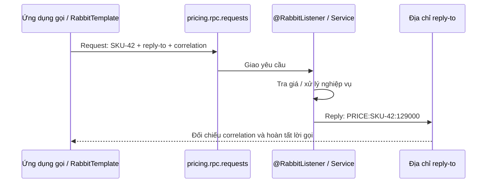
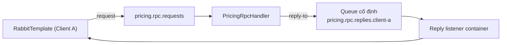

# Queue phản hồi cố định hoặc tạm thời trong Request–Reply với Spring AMQP

## 1. Tại sao Request–Reply cần queue phản hồi?

RabbitMQ truyền message bất đồng bộ: một producer gửi yêu cầu vào queue, consumer nhận và xử lý vào thời điểm phù hợp. Tuy nhiên, có những thao tác cần trả kết quả cho bên gửi, chẳng hạn hỏi giá một sản phẩm trước khi tạo đơn hàng. Mô hình **Request–Reply** (thường gọi là RPC qua message broker) cho phép ứng dụng gửi một yêu cầu rồi chờ message phản hồi tương ứng.

Trong **Spring AMQP**, thành phần thường dùng ở phía gọi là `RabbitTemplate` với `convertSendAndReceive(...)`; phía xử lý có thể dùng `@RabbitListener` trả về một giá trị. Để broker chuyển phản hồi về đúng nơi, request mang địa chỉ **reply-to**. Để một lời gọi đang chờ nhận đúng phản hồi của nó khi có nhiều yêu cầu đồng thời, cần cơ chế **correlation**.

Bài học tập trung vào việc lựa chọn và khai báo **queue phản hồi cố định (fixed reply queue)** hay **queue phản hồi tạm thời (temporary reply queue)**, đồng thời làm rõ cơ chế **RabbitMQ Direct Reply-to** mà `RabbitTemplate` thường sử dụng mặc định.

### Luồng trao đổi



Ba ý cần phân biệt:

- **Request queue** là nơi service nhận công việc; ví dụ `pricing.rpc.requests`.
- **Reply destination** là nơi nhận câu trả lời; có thể là một queue thực sự, hoặc một địa chỉ đặc biệt của Direct Reply-to.
- **Correlation** liên kết từng phản hồi với một request đang chờ. Chỉ biết tên reply queue là chưa đủ nếu nhiều yêu cầu đồng thời sử dụng cùng queue đó.

**Giới hạn quan trọng:** `convertSendAndReceive(...)` chặn luồng của caller trong lúc chờ (đến khi có phản hồi hoặc hết timeout). Dù broker truyền message bất đồng bộ, API gọi ở đây có hành vi đồng bộ. Nếu không cần kết quả ngay, mô hình event-driven một chiều thường phù hợp hơn.

## 2. Ba lựa chọn reply destination cần hiểu

| Cơ chế | Reply destination thực tế | Vòng đời | Phù hợp khi |
| --- | --- | --- | --- |
| **Fixed reply queue** | Queue có tên xác định, ví dụ `pricing.rpc.replies.client-a`. | Tồn tại theo cấu hình queue; có thể bền vững (durable). | Cần tên queue ổn định để vận hành, phân quyền hoặc theo dõi rõ ràng. |
| **Temporary reply queue** | Queue thực sự có tên được tạo riêng cho instance, ví dụ `spring.gen-...`. | Thường non-durable, exclusive và auto-delete. | Cần cô lập phản hồi theo instance và tự dọn khi instance rời hệ thống. |
| **Direct Reply-to** | Địa chỉ đặc biệt `amq.rabbitmq.reply-to` của RabbitMQ; **không phải queue thông thường**. | Gắn với requester/consumer; không có queue lưu phản hồi truyền thống. | Request–Reply ngắn, muốn tránh chi phí tạo và quản lý reply queue. |

Với **RabbitMQ hỗ trợ Direct Reply-to** và `RabbitTemplate` không cấu hình `replyAddress` cố định, Spring AMQP thường chọn **Direct Reply-to** tự động. Vì vậy, *không đặt reply queue* **không đồng nghĩa** ứng dụng đang tạo một queue tạm thời mỗi lần gọi.

Một số môi trường không hỗ trợ Direct Reply-to có thể dùng temporary reply queue theo cơ chế của template. Nếu cần **chủ động quản lý** một queue phản hồi tạm thời, có thể khai báo `AnonymousQueue` như phần 5.

## 3. Ví dụ request queue và service xử lý dùng chung

Để thực hành, dùng Spring Boot với dependency `spring-boot-starter-amqp` và RabbitMQ đang chạy. Ví dụ sử dụng **default exchange** (tên rỗng `""`), nhờ đó routing key bằng đúng tên queue sẽ đưa request đến queue ấy. Trong ví dụ này, không cần khai báo thêm business exchange/binding.

Khai báo request queue:

```java
import org.springframework.amqp.core.Queue;
import org.springframework.amqp.core.QueueBuilder;
import org.springframework.context.annotation.Bean;
import org.springframework.context.annotation.Configuration;

@Configuration
public class PricingRpcQueueConfig {

    public static final String REQUEST_QUEUE = "pricing.rpc.requests";

    @Bean
    public Queue pricingRequests() {
        return QueueBuilder.durable(REQUEST_QUEUE).build();
    }
}
```

Phía xử lý:

```java
import org.springframework.amqp.rabbit.annotation.RabbitListener;
import org.springframework.stereotype.Component;

@Component
public class PricingRpcHandler {

    @RabbitListener(queues = PricingRpcQueueConfig.REQUEST_QUEUE)
    public String lookupPrice(String sku) {
        // Mô phỏng truy xuất giá; thực tế phải kiểm tra đầu vào và dữ liệu.
        return "PRICE:" + sku + ":129000";
    }
}
```

Khi request mang `replyTo`, Spring AMQP có thể tự gửi giá trị trả về của `@RabbitListener` đến reply destination đó. Code handler không phải tự đọc `replyTo` rồi gọi `RabbitTemplate` để publish phản hồi. Nếu tự xây consumer bằng RabbitMQ Java client ở cấp thấp, bạn phải tự publish đúng `replyTo` và trả lại metadata correlation cần thiết.

Ứng dụng gọi dùng một `RabbitTemplate` cấu hình theo **một trong các biến thể** ở phần 4, 5 hoặc 6:

```java
import org.springframework.amqp.rabbit.core.RabbitTemplate;
import org.springframework.beans.factory.annotation.Qualifier;
import org.springframework.stereotype.Service;

@Service
public class PricingRpcClient {

    private final RabbitTemplate rpcTemplate;

    public PricingRpcClient(
            @Qualifier("pricingRpcTemplate") RabbitTemplate rpcTemplate) {
        this.rpcTemplate = rpcTemplate;
    }

    public String getPrice(String sku) {
        Object reply = rpcTemplate.convertSendAndReceive(
                "", // Default exchange
                PricingRpcQueueConfig.REQUEST_QUEUE,
                sku
        );

        if (reply == null) {
            throw new IllegalStateException(
                    "Quá thời gian chờ phản hồi cho SKU: " + sku);
        }
        if (!(reply instanceof String price)) {
            throw new IllegalStateException(
                    "Kiểu phản hồi không hợp lệ: " + reply.getClass());
        }
        return price;
    }
}
```

Ở đây dùng bộ chuyển đổi message mặc định cho `String`. Trong hệ thống thực, có thể dùng DTO/JSON và cấu hình `MessageConverter` tương thích ở cả bên gửi lẫn bên nhận. `null` là kết quả thường gặp khi request hết `replyTimeout` mà chưa có phản hồi phù hợp.

## 4. Phương án A — Fixed reply queue

### 4.1. Nguyên lý

Client khai báo một queue có tên **ổn định** và cấu hình `RabbitTemplate` gửi tên đó trong thuộc tính `replyTo` của request. Một **reply listener container** ở phía client sẽ consume queue phản hồi và chuyển message nhận được đến **chính RabbitTemplate đang chờ**, để template ghép phản hồi với lời gọi dựa trên correlation.



Khi sử dụng **fixed reply queue**, chỉ `setReplyAddress(...)` là **chưa đủ**: phải có listener chuyên nhận reply và gọi vào `RabbitTemplate`. Nếu thiếu listener, request có thể đã xử lý thành công nhưng caller vẫn hết thời gian chờ.

### 4.2. Cấu hình Spring AMQP

Trong ứng dụng client, khai báo:

```java
import org.springframework.amqp.core.Queue;
import org.springframework.amqp.core.QueueBuilder;
import org.springframework.amqp.rabbit.connection.ConnectionFactory;
import org.springframework.amqp.rabbit.core.RabbitTemplate;
import org.springframework.amqp.rabbit.listener.SimpleMessageListenerContainer;
import org.springframework.beans.factory.annotation.Qualifier;
import org.springframework.context.annotation.Bean;
import org.springframework.context.annotation.Configuration;

@Configuration
public class FixedReplyRpcConfig {

    public static final String REPLY_QUEUE =
            "pricing.rpc.replies.client-a";

    @Bean
    public Queue fixedReplyQueue() {
        return QueueBuilder.durable(REPLY_QUEUE).build();
    }

    @Bean("pricingRpcTemplate")
    public RabbitTemplate pricingRpcTemplate(ConnectionFactory connectionFactory) {
        RabbitTemplate template = new RabbitTemplate(connectionFactory);
        template.setReplyAddress(REPLY_QUEUE);
        template.setReplyTimeout(5_000); // milliseconds
        return template;
    }

    @Bean
    public SimpleMessageListenerContainer pricingReplyListener(
            ConnectionFactory connectionFactory,
            @Qualifier("pricingRpcTemplate") RabbitTemplate rpcTemplate) {

        SimpleMessageListenerContainer container =
                new SimpleMessageListenerContainer(connectionFactory);
        container.setQueueNames(REPLY_QUEUE);
        container.setMessageListener(rpcTemplate);
        return container;
    }
}
```

Các điểm đáng chú ý:

1. `fixedReplyQueue()` tạo queue có tên ổn định. Chọn `durable` để tên/định nghĩa queue có thể tồn tại qua broker restart; không có nghĩa lời gọi Java đang chờ cũng tồn tại qua restart.
2. `setReplyAddress(REPLY_QUEUE)` chỉ định destination cho message trả lời.
3. `setReplyTimeout(5_000)` giới hạn mỗi lần chờ tối đa 5 giây trong ví dụ.
4. `SimpleMessageListenerContainer` lắng nghe **reply queue** và chuyển reply cho `RabbitTemplate` thông qua `setMessageListener(rpcTemplate)`.
5. `@RabbitListener` của **service xử lý request** vẫn nằm ở `pricing.rpc.requests`; reply listener ở client là thành phần hoàn toàn khác.

Bean `Queue` thường được `RabbitAdmin` tự động khai báo khi ứng dụng Spring Boot có cấu hình AMQP phù hợp và kết nối broker. Đảm bảo reply queue đã tồn tại và reply listener đang hoạt động trước khi bắt đầu các lời gọi RPC.

### 4.3. Cẩn thận với nhiều client instance

Giả sử **Client A** và **Client B** đều dùng một fixed reply queue `pricing.rpc.replies.shared`, và mỗi instance có một reply listener riêng:

```text
Service --reply for A--> pricing.rpc.replies.shared
                            |             |
                     consumer A      consumer B
```

RabbitMQ có thể giao reply dành cho A đến consumer B. Template của B không có request đang chờ tương ứng, nên không thể hoàn tất lời gọi ở A. **Correlation giúp nhận diện phản hồi, nhưng không biến shared queue với competing consumers thành kênh multicast**.

Trong triển khai nhiều replica, cách an toàn đơn giản với fixed reply queue là **mỗi client instance có tên reply queue riêng**, kèm listener riêng. Phải thiết kế quy trình cấp tên, dọn queue không còn dùng, quyền truy cập và khả năng khởi tạo lại đúng tên nếu chọn durable queue.

## 5. Phương án B — Temporary reply queue bằng AnonymousQueue

### 5.1. Đặc tính

`AnonymousQueue` của Spring AMQP sinh tên khó trùng cho một queue thuộc **vòng đời của instance ứng dụng**. Queue này thường **non-durable**, **exclusive** và **auto-delete**: nó không được kỳ vọng tồn tại lâu dài, và RabbitMQ sẽ dọn theo vòng đời connection/consumer tương ứng.

Trong ví dụ, queue được tạo **một lần cho instance lúc khởi tạo bean**, không phải một lần cho mỗi request. Nhiều RPC đồng thời từ cùng instance vẫn có thể dùng chung queue tạm thời, và `RabbitTemplate` ghép từng reply theo correlation.

### 5.2. Cấu hình đầy đủ

Thay **toàn bộ lớp `FixedReplyRpcConfig`** ở phần 4 bằng cấu hình sau; giữ nguyên request queue, handler và client ở phần 3:

```java
import org.springframework.amqp.core.AnonymousQueue;
import org.springframework.amqp.rabbit.connection.ConnectionFactory;
import org.springframework.amqp.rabbit.core.RabbitTemplate;
import org.springframework.amqp.rabbit.listener.SimpleMessageListenerContainer;
import org.springframework.beans.factory.annotation.Qualifier;
import org.springframework.context.annotation.Bean;
import org.springframework.context.annotation.Configuration;

@Configuration
public class TemporaryReplyRpcConfig {

    @Bean
    public AnonymousQueue instanceReplyQueue() {
        return new AnonymousQueue();
    }

    @Bean("pricingRpcTemplate")
    public RabbitTemplate pricingRpcTemplate(
            ConnectionFactory connectionFactory,
            AnonymousQueue instanceReplyQueue) {

        RabbitTemplate template = new RabbitTemplate(connectionFactory);
        template.setReplyAddress(instanceReplyQueue.getName());
        template.setReplyTimeout(5_000);
        return template;
    }

    @Bean
    public SimpleMessageListenerContainer pricingReplyListener(
            ConnectionFactory connectionFactory,
            @Qualifier("pricingRpcTemplate") RabbitTemplate rpcTemplate,
            AnonymousQueue instanceReplyQueue) {

        SimpleMessageListenerContainer container =
                new SimpleMessageListenerContainer(connectionFactory);
        container.setQueues(instanceReplyQueue);
        container.setMessageListener(rpcTemplate);
        return container;
    }
}
```

`instanceReplyQueue` cung cấp tên queue cho **cả template lẫn listener**, bảo đảm hai bên thống nhất cùng một destination. Listener vẫn cần thiết vì đây là **một queue thực sự** đang được template dùng làm `replyAddress`.

**Chú ý về kết nối:** exclusive queue chỉ có thể được khai thác bởi connection có quyền sở hữu phù hợp. Với cấu hình trên, dùng chung `ConnectionFactory` cho việc khai báo và consume reply queue; không tự ý tách reply listener sang connection factory không tương thích. Khi broker/connection đứt, client có thể mất queue và phải chờ khai báo/consumer được khôi phục trước khi gọi tiếp.

Không sử dụng queue tạm thời khi yêu cầu phải lưu giữ reply để đọc lại sau khi ứng dụng gọi đã ngừng chạy. Tuy nhiên, kể cả dùng durable fixed queue, ứng dụng vẫn cần cơ chế lưu trạng thái yêu cầu riêng nếu muốn phục hồi lời gọi qua restart.

## 6. Phương án C — Dùng Direct Reply-to mặc định của RabbitTemplate

Nếu mục tiêu chỉ là RPC ngắn thông thường trên RabbitMQ, có thể **không khai báo reply queue**:

```java
import org.springframework.amqp.rabbit.connection.ConnectionFactory;
import org.springframework.amqp.rabbit.core.RabbitTemplate;
import org.springframework.context.annotation.Bean;
import org.springframework.context.annotation.Configuration;

@Configuration
public class DirectReplyToRpcConfig {

    @Bean("pricingRpcTemplate")
    public RabbitTemplate pricingRpcTemplate(ConnectionFactory connectionFactory) {
        RabbitTemplate template = new RabbitTemplate(connectionFactory);
        template.setReplyTimeout(5_000);
        return template;
    }
}
```

Khi broker hỗ trợ tính năng **Direct Reply-to**, Spring AMQP thường tự sử dụng nó cho `sendAndReceive`/`convertSendAndReceive` nếu template không có reply address cố định. RabbitMQ dùng cơ chế trả reply trực tiếp đến requester qua địa chỉ đặc biệt `amq.rabbitmq.reply-to`, không khai báo một queue durable hay auto-delete trong danh sách queue ứng dụng để chứa các reply đó. Spring AMQP tự quản lý thành phần lắng nghe thích hợp; **không cần tạo `SimpleMessageListenerContainer` cho reply queue** như hai phương án trên.

Direct Reply-to có ưu điểm giảm chi phí khai báo và dọn queue. Đổi lại, nó có ngữ nghĩa **at-most-once** cho reply: requester không sẵn sàng có thể mất phản hồi, thay vì nhận lại từ một queue lưu trữ. Đây thường là đánh đổi chấp nhận được cho request–reply đồng bộ có timeout, nhưng cần cân nhắc nếu phản hồi là dữ liệu không thể mất và phải truy xuất lại.

**Không khai báo đồng thời** các lớp `FixedReplyRpcConfig`, `TemporaryReplyRpcConfig` và `DirectReplyToRpcConfig` trong cùng ứng dụng demo: cả ba dùng tên bean `pricingRpcTemplate` và là các **biến thể lựa chọn** cho cùng caller.

## 7. Correlation, timeout và những bảo đảm thật sự

### 7.1. Correlation hoạt động như thế nào?

Hai lệnh gọi cùng dùng một reply queue có thể trả lời không theo thứ tự gửi:

```text
T0: Client gửi request A -> correlation A
T1: Client gửi request B -> correlation B
T2: Service trả reply B trước -> hoàn tất lời gọi B
T3: Service trả reply A sau   -> hoàn tất lời gọi A
```

`RabbitTemplate` quản lý thông tin correlation cho các request đang chờ. Với `@RabbitListener` trả về giá trị, Spring AMQP xử lý reply và thông tin cần thiết để template ghép đúng request. Nếu tự viết consumer/publisher ở mức thấp, phải bảo toàn metadata correlation phù hợp; chỉ gửi payload mà bỏ các thuộc tính liên quan sẽ dễ gây timeout dù reply đã đến queue.

Không nên **tự gán tùy tiện cùng một correlation ID** cho nhiều request đồng thời. Nếu tích hợp với hệ thống ngoài Spring AMQP, thống nhất hợp đồng reply-to/correlation của hai phía rồi kiểm thử trường hợp nhiều request đang chờ và reply đến đảo thứ tự.

### 7.2. Hết timeout không đồng nghĩa yêu cầu đã bị hủy

Giả sử client chờ 5 giây nhưng server mất 8 giây mới tính xong:

- Ở giây thứ 5, `convertSendAndReceive(...)` có thể trả `null` và caller báo timeout.
- Server **vẫn có thể** hoàn tất nghiệp vụ và gửi reply muộn ở giây thứ 8.
- Reply muộn có thể không còn request đang chờ để tương quan; cách xử lý phụ thuộc cơ chế nhận reply và trạng thái consumer.

Vì vậy, **không retry mù quáng** một yêu cầu có tác dụng phụ như trừ tiền, xác nhận đặt hàng hoặc tạo đơn. Khi gọi lại, phải dùng idempotency key/business request ID để phía server nhận diện một nghiệp vụ đã thực hiện, hoặc cung cấp API tra cứu trạng thái theo request ID.

### 7.3. Durable reply queue không làm RPC thành giao dịch bền vững

Một fixed reply queue `durable` giữ **định nghĩa queue** qua lần khởi động lại broker. Muốn message được lưu bền vững còn phụ thuộc chế độ lưu message và cách broker/producer xác nhận. Hơn nữa, một thread đang chờ trong JVM biến mất khi process chết; khởi động lại ứng dụng không khôi phục tự động lời gọi `convertSendAndReceive(...)` cũ.

Do đó, chọn fixed queue vì nhu cầu **quản trị topology**, không xem nó là cơ chế thay thế cho persisted request state, transaction, publisher confirms, retry an toàn hoặc giám sát.

## 8. Chọn cấu hình nào trong thực tế?

| Tình huống | Gợi ý | Lý do |
| --- | --- | --- |
| Spring Boot gọi RPC ngắn, broker RabbitMQ hỗ trợ Direct Reply-to | **Direct Reply-to** | Ít cấu hình, không phải quản lý queue reply riêng. |
| Cần quan sát và phân quyền trên reply queue có tên xác định | **Fixed reply queue** | Tên cố định, dễ cấu hình tại broker; cần reply listener. |
| Nhiều instance độc lập, không muốn cấp tên queue thủ công | **AnonymousQueue tạm thời** | Queue riêng theo instance, tự dọn theo vòng đời. |
| Nhiều replica dùng một queue reply cố định chung | **Tránh cấu hình competing consumers** | Reply có thể bị giao nhầm instance đang chờ. |
| Phản hồi cần phục hồi sau client restart hoặc giao dịch chạy hàng phút | **Thiết kế workflow bất đồng bộ có lưu trạng thái** | RPC blocking và timeout không cung cấp bảo đảm khôi phục nghiệp vụ. |

Với ứng dụng Spring AMQP mới dùng RabbitMQ, thông thường hãy bắt đầu bằng **Direct Reply-to**; chủ động chuyển sang fixed/temporary reply queue khi có yêu cầu cụ thể về topology, hạ tầng hoặc cách vận hành.

## 9. Thực hành kiểm thử

Chỉ chọn **một** cấu hình reply trong các phần 4–6. Có thể chạy request handler và caller cùng một ứng dụng demo; hệ thống thật thường tách chúng thành hai service.

1. Khởi động RabbitMQ và ứng dụng chứa `PricingRpcQueueConfig`, `PricingRpcHandler`, `PricingRpcClient` và **một** cấu hình reply. Đảm bảo ứng dụng kết nối được và request queue đã được declare.
2. Sau khi listener sẵn sàng, gọi `new PricingRpcClient(...)` thông qua bean Spring, chẳng hạn từ một controller/service khác, với `getPrice("SKU-42")`.
3. Kiểm tra kết quả mong đợi là `PRICE:SKU-42:129000`.
4. Thử gọi nhiều SKU song song và làm server trả kết quả với thời gian khác nhau; đối chiếu mỗi caller nhận đúng phản hồi.
5. Đặt `replyTimeout(1_000)` và mô phỏng server xử lý lâu hơn 1 giây; caller phải xử lý tình huống trả `null`/timeout mà không mặc định nghiệp vụ bị hủy.
6. Trên RabbitMQ Management UI, quan sát queue. Với **fixed** thấy `pricing.rpc.replies.client-a`; với **AnonymousQueue** thấy tên queue sinh ngẫu nhiên khi container hoạt động; với **Direct Reply-to** không mong đợi một queue reply vật lý do ứng dụng tạo.
7. Nếu dùng fixed/temporary queue, thử dừng reply listener rồi gửi yêu cầu. Phân tích timeout và số message chờ (nếu có). Khôi phục listener để kiểm tra hành vi reply muộn; đừng xem việc phản hồi đến sau timeout là hoàn tất một request đã kết thúc ở caller.

Để minh họa timeout, sửa handler tạm thời:

```java
@RabbitListener(queues = PricingRpcQueueConfig.REQUEST_QUEUE)
public String lookupPrice(String sku) throws InterruptedException {
    if ("SLOW".equals(sku)) {
        Thread.sleep(3_000); // Chỉ dùng để mô phỏng trong bài thực hành
    }
    return "PRICE:" + sku + ":129000";
}
```

Đây là code demo chủ ý chặn thread listener. Trong hệ thống production, tác vụ mất nhiều thời gian nên có thiết kế hàng đợi xử lý phù hợp, giới hạn tải và timeout nhất quán; tránh khóa các consumer threads tùy tiện.

## 10. Sự cố thường gặp và hướng xử lý

| Hiện tượng | Nguyên nhân khả dĩ | Cách kiểm tra |
| --- | --- | --- |
| Request được xử lý nhưng caller vẫn timeout khi dùng fixed queue | Chỉ đặt `replyAddress` mà chưa có reply listener; listener nghe sai queue. | Kiểm tra `SimpleMessageListenerContainer`, `setQueueNames(...)` và `setMessageListener(rpcTemplate)`. |
| Reply xuất hiện trong queue nhưng không hoàn tất lời gọi | Correlation không phù hợp hoặc reply được consumer khác nhận. | Kiểm tra correlation metadata, consumer trên reply queue và số client instance. |
| Một số replica timeout ngẫu nhiên | Các replica dùng chung fixed reply queue với competing consumers. | Tách reply queue theo instance hoặc chuyển sang Direct Reply-to. |
| Queue tạm thời biến mất | Connection đóng; queue `exclusive`/`autoDelete` đã bị xóa. | Kiểm tra kết nối, lifecycle của listener, khả năng tự khai báo lại. |
| Không thấy reply queue trong Management UI | Đang dùng Direct Reply-to, không có queue reply thông thường. | Kiểm tra `replyAddress` và chế độ Direct Reply-to; đây có thể là trạng thái đúng. |
| `convertSendAndReceive(...)` trả `null` | Không có phản hồi phù hợp trong `replyTimeout`; service lỗi hoặc xử lý chậm. | Kiểm tra request listener, thời gian xử lý, log lỗi, reply destination và timeout. |
| Gọi lại sau timeout tạo thao tác nghiệp vụ hai lần | Server có thể xử lý xong request đầu dù client đã timeout. | Thêm idempotency key và lưu trạng thái nghiệp vụ. |
| RabbitMQ đã chạy nhưng request không vào handler | Request queue chưa được khai báo hoặc routing key của default exchange sai. | Xác nhận queue `pricing.rpc.requests`, listener và tên vhost. |

Ngoài queue depth của request/reply queue, nên theo dõi **RPC latency (p50/p95/p99), tỷ lệ timeout, số request đang chờ, lỗi handler, reply muộn/không khớp correlation**, và tình trạng kết nối broker. Nếu lỗi có thể phục hồi, áp dụng retry có kiểm soát và cơ chế idempotency; nếu không, dùng dead-letter và quy trình điều tra riêng cho request queue.

## 11. Câu hỏi tự kiểm tra

1. Khi `RabbitTemplate` không khai báo `replyAddress` và RabbitMQ hỗ trợ Direct Reply-to, nó có cần tạo một reply queue tạm thời cho mỗi request không?
2. Vì sao fixed reply queue cần `SimpleMessageListenerContainer` chuyển reply đến chính `RabbitTemplate`?
3. Hai replica cùng consume một fixed reply queue có thể khiến client timeout dù server đã trả lời như thế nào?
4. `AnonymousQueue` khác queue durable về vòng đời và mục tiêu sử dụng ra sao?
5. Nếu client timeout sau 5 giây nhưng server hoàn tất giao dịch sau 8 giây, việc retry ngay có thể gây hậu quả gì?

**Đáp án gợi ý:** (1) Không, Direct Reply-to là cơ chế riêng không dùng queue reply thông thường; (2) template cần nhận và tương quan reply với request đang chờ; (3) reply của A có thể bị B consume; (4) `AnonymousQueue` dành cho instance và tự dọn khi vòng đời kết thúc; (5) nghiệp vụ có thể thực hiện trùng nếu không có idempotency.

## Tài liệu tham khảo

- [Spring AMQP Reference — Request/Reply Messaging](https://docs.spring.io/spring-amqp/reference/amqp/request-reply.html): `RabbitTemplate`, reply-to, fixed reply queues, Direct Reply-to và correlation.
- [Spring AMQP Reference — Configuring the Broker](https://docs.spring.io/spring-amqp/reference/amqp/broker-configuration.html): khai báo queue, `RabbitAdmin` và `AnonymousQueue`.
- [RabbitMQ — Direct Reply-to](https://www.rabbitmq.com/docs/direct-reply-to): cơ chế reply-to không tạo queue truyền thống, giới hạn và đặc tính giao nhận.
