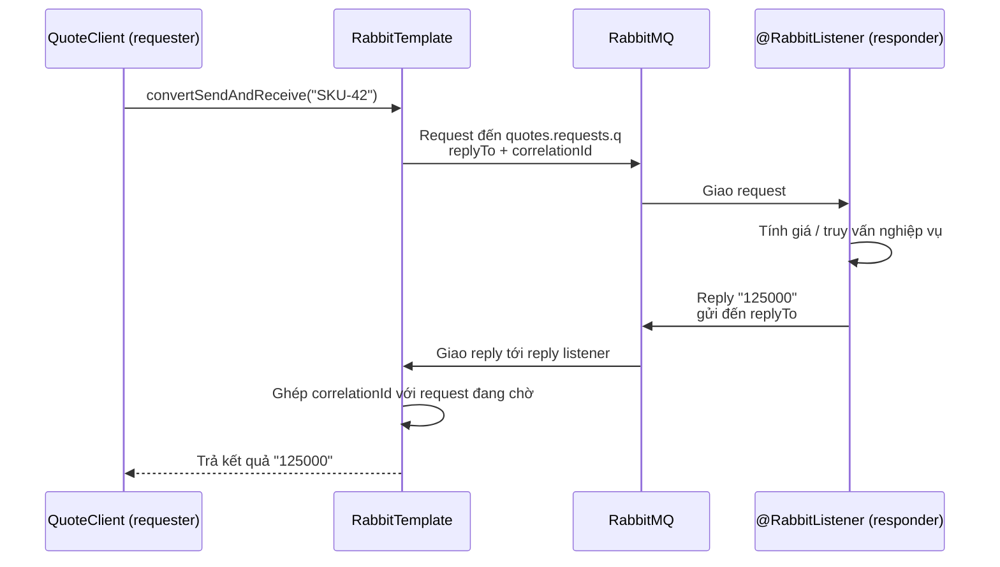

# Cấu hình reply listener và phân biệt với listener nghiệp vụ

Trong **Spring AMQP**, cùng một ứng dụng có thể vừa gửi lệnh bằng `RabbitTemplate`, vừa nhận sự kiện bằng `@RabbitListener`, vừa chờ kết quả từ dịch vụ khác qua RabbitMQ. Những luồng này đều liên quan đến "listener", nhưng **reply listener** và **listener nghiệp vụ** đảm nhiệm hai công việc khác nhau. Nếu nhầm vai trò, người học rất dễ tạo nhầm consumer cho queue phản hồi, làm mất liên kết `correlationId` hoặc khiến lời gọi request–reply luôn hết thời gian chờ.

Bài học thuộc chương **Yêu cầu và phản hồi** của module **SPRING_AMQP**, nối tiếp kiến thức về `RabbitTemplate`, `@RabbitListener`, exchange, queue và binding để thiết kế giao tiếp bất đồng bộ đáng tin cậy. Trọng tâm ở đây là **cấu hình bộ nhận reply trên phía gửi request**, quan sát vai trò của listener nghiệp vụ trên phía xử lý, và hiểu khi nào cần hoặc không cần khai báo `MessageListenerContainer` riêng.

## 1. Kết quả cần đạt

Sau bài này, bạn có thể:

1. Mô tả luồng request → xử lý nghiệp vụ → reply và vai trò của `replyTo`, `correlationId`.
2. Phân biệt **request listener** ở phía xử lý nghiệp vụ với **reply listener** ở phía chờ kết quả.
3. Dùng `RabbitTemplate.convertSendAndReceive(...)` với **Direct Reply-To** mà không cấu hình listener reply thủ công.
4. Cấu hình **fixed reply queue** bằng `RabbitTemplate.setReplyAddress(...)` và `SimpleMessageListenerContainer` có `RabbitTemplate` làm listener.
5. Nhận biết lỗi timeout, reply sai queue, thiếu correlation và cấu hình sai khi triển khai nhiều instance.
6. Chọn request–reply phù hợp với loại tác vụ, hiểu giới hạn về delivery, thời gian chờ và khả năng xử lý trùng.

## 2. Reply listener khác listener nghiệp vụ ở đâu?

Giả sử dịch vụ đặt hàng hỏi dịch vụ báo giá: "Giá của SKU-42 là bao nhiêu?" Dịch vụ báo giá lấy dữ liệu và trả về "125000". Đây là request–reply (còn gọi là RPC qua message broker).



| Tiêu chí | Listener nghiệp vụ (request handler) | Reply listener (response receiver) |
| --- | --- | --- |
| Nằm phía nào? | **Responder**: dịch vụ được yêu cầu làm việc. | **Requester**: dịch vụ đã gửi yêu cầu và đang đợi phản hồi. |
| Nhận dữ liệu gì? | Message yêu cầu trên **request queue**. | Message kết quả tại **reply address / reply queue**. |
| Trách nhiệm chính | Chạy nghiệp vụ, xử lý lỗi và tạo kết quả. | Chuyển reply về đúng lời gọi đang chờ qua **correlation ID**. |
| Cách triển khai thường gặp | `@RabbitListener` trên phương thức service; có thể trả về giá trị. | Spring AMQP quản lý nội bộ khi dùng Direct Reply-To; hoặc `RabbitTemplate` làm `MessageListener` trong container của fixed queue. |
| Trạng thái cần quản lý | Idempotency, retry, ACK/NACK, DLQ của request. | In-flight requests, correlation, timeout, late/unknown replies. |
| Có nên chạy logic báo giá tại đây? | Có. | Không; đây là hạ tầng ghép phản hồi với request. |

**Phân biệt thêm:** một consumer `@RabbitListener(queues = "orders.events.q")` xử lý sự kiện `OrderCreated` và trả `void` cũng là **listener nghiệp vụ**, nhưng thuộc mô hình **one-way/event-driven**: không có lời gọi `convertSendAndReceive` chờ kết quả. Cùng annotation `@RabbitListener` có thể tạo **request handler** hoặc **event handler**; điều quyết định là hợp đồng message và cách sử dụng giá trị trả về.

## 3. Cơ chế `replyTo` và `correlationId`

Trong AMQP 0-9-1, mỗi request có thể mang các thuộc tính:

- `replyTo`: địa chỉ đích mà responder dùng để gửi phản hồi. Với queue thông thường, giá trị có thể là tên queue (đi qua default exchange) hoặc địa chỉ định tuyến `exchange/routingKey`; với Direct Reply-To là địa chỉ ảo do broker cung cấp.
- `correlationId`: mã giúp requester nhận biết reply này thuộc request nào. Khi có nhiều request đồng thời, chỉ nhìn tên reply queue là **không đủ** để ghép kết quả.
- `messageId`: định danh message tùy publisher đặt; không tự thay thế `correlationId` trong thuật toán ghép reply của template.

Ví dụ ý nghĩa, lược bỏ header và body để dễ đọc:

```text
Request A: body="SKU-42", replyTo="quotes.replies.instance-a.q", correlationId="req-a"
Request B: body="SKU-43", replyTo="quotes.replies.instance-a.q", correlationId="req-b"

Reply B: body="130000", correlationId="req-b"  -> hoàn tất request B
Reply A: body="125000", correlationId="req-a"  -> hoàn tất request A
```

Ở phía requester, `RabbitTemplate` tự tạo và quản lý thông tin tương quan trong các lần gọi `sendAndReceive` / `convertSendAndReceive` thông thường. Responder viết bằng Spring `@RabbitListener` có thể **trả kết quả trực tiếp** để framework gửi reply theo `replyTo` của request, đồng thời giữ thông tin correlation cần thiết.

Nếu tích hợp với responder viết bằng thư viện AMQP khác, hai phía phải thống nhất quy ước: lấy `replyTo` của request làm đích và trả lại `correlationId` đúng như request (trừ trường hợp chủ động dùng cơ chế tương quan theo channel mà Spring AMQP hỗ trợ). Nếu trả lời về đúng queue nhưng **sai correlation**, requester vẫn không hoàn tất được request.

> `RabbitTemplate` tự quản lý request/reply **không làm nhiệm vụ "đảm bảo tác vụ nghiệp vụ đã hoàn thành đúng một lần"**. Nếu client timeout, responder vẫn có thể đang xử lý hoặc đã xử lý xong; cần timeout hợp lý và idempotency ở cấp nghiệp vụ.

## 4. Cách mặc định: Direct Reply-To, không cấu hình reply listener thủ công

Với RabbitMQ hiện đại, cơ chế thường được Spring AMQP chọn mặc định là **Direct Reply-To**. RabbitMQ cung cấp pseudo-queue `amq.rabbitmq.reply-to`, giúp requester nhận kết quả mà không phải tự khai báo reply queue thông thường. Spring AMQP sử dụng `DirectReplyToMessageListenerContainer` để nhận phản hồi và tái sử dụng consumer/channel theo cơ chế của framework.

Các điểm quyết định:

- **Không tạo queue thật có tên** `amq.rabbitmq.reply-to` bằng `QueueBuilder` hoặc `RabbitAdmin`.
- **Không tạo** `SimpleMessageListenerContainer`/`@RabbitListener` thủ công cho pseudo-queue này; `RabbitTemplate` đã tự cấu hình đường nhận reply.
- **Không gọi** `setReplyAddress("some.fixed.queue")` nếu muốn đường mặc định.
- Khi broker hỗ trợ Direct Reply-To và template không được gán fixed reply queue, template tự chọn đường nhận phù hợp. Với broker không hỗ trợ, Spring có thể dùng temporary reply queue thay thế.

### 4.1 Khai báo topology của request

Ví dụ dùng **Spring Boot + `spring-boot-starter-amqp`**, với `MessageConverter` mặc định để trao đổi `String`. Exchange và binding dưới đây tạo request queue cho dịch vụ báo giá. Mã minh họa các class có thể đặt trong cùng project hoặc chia sang hai ứng dụng; topology cần được khai báo ở môi trường broker.

```java
import org.springframework.amqp.core.Binding;
import org.springframework.amqp.core.BindingBuilder;
import org.springframework.amqp.core.DirectExchange;
import org.springframework.amqp.core.Queue;
import org.springframework.amqp.core.QueueBuilder;
import org.springframework.beans.factory.annotation.Qualifier;
import org.springframework.context.annotation.Bean;
import org.springframework.context.annotation.Configuration;
import org.springframework.amqp.rabbit.annotation.EnableRabbit;

@Configuration
@EnableRabbit
public class QuoteTopology {
    public static final String EXCHANGE = "quotes.requests.x";
    public static final String QUEUE = "quotes.requests.q";
    public static final String ROUTING_KEY = "quotes.get";

    @Bean
    Queue quoteRequestQueue() {
        return QueueBuilder.durable(QUEUE).build();
    }

    @Bean
    DirectExchange quoteRequestExchange() {
        return new DirectExchange(EXCHANGE);
    }

    @Bean
    Binding quoteRequestBinding(@Qualifier("quoteRequestQueue") Queue quoteRequestQueue,
                                DirectExchange quoteRequestExchange) {
        return BindingBuilder.bind(quoteRequestQueue)
                .to(quoteRequestExchange)
                .with(ROUTING_KEY);
    }
}
```

Ở production, topology có thể do hạ tầng/provisioning quản lý, nhưng vẫn phải thống nhất **request exchange, routing key và request queue** giữa hai dịch vụ.

### 4.2 Request listener: chạy nghiệp vụ và trả kết quả

```java
import org.springframework.amqp.rabbit.annotation.RabbitListener;
import org.springframework.stereotype.Component;

@Component
public class QuoteRequestHandler {

    @RabbitListener(queues = QuoteTopology.QUEUE)
    public String getQuote(String sku) {
        // Logic demo: thay bằng kiểm tra SKU và đọc dữ liệu thực.
        if ("SKU-42".equals(sku)) {
            return "125000";
        }
        return "NOT_FOUND";
    }
}
```

Đây là **listener nghiệp vụ**. Nó nhận request từ `quotes.requests.q`, chạy hàm xử lý và **trả String**. Khi request có thuộc tính `replyTo`, cơ chế `@RabbitListener` sẽ gửi kết quả về địa chỉ đó. Với luồng này, **không cần `@SendTo`**; `@SendTo` chủ yếu cung cấp địa chỉ phản hồi mặc định khi request không mang `replyTo`.

Phương thức trên được gọi theo delivery của request queue. Việc gửi reply và ACK request là các bước riêng của container; không coi chúng là một giao dịch phân tán tự động. Nếu xử lý nghiệp vụ ném exception, thông thường **không có reply thành công**; cách retry/requeue/DLQ phụ thuộc listener container và error handler.

### 4.3 Requester: chỉ cần `RabbitTemplate`

```java
import org.springframework.amqp.rabbit.connection.ConnectionFactory;
import org.springframework.amqp.rabbit.core.RabbitTemplate;
import org.springframework.context.annotation.Bean;
import org.springframework.context.annotation.Configuration;

@Configuration
public class QuoteRpcClientConfig {

    @Bean
    RabbitTemplate quoteRpcTemplate(ConnectionFactory connectionFactory) {
        RabbitTemplate template = new RabbitTemplate(connectionFactory);
        template.setReplyTimeout(3_000); // 3 giây, đơn vị mili giây
        // Không setReplyAddress: sử dụng cơ chế reply mặc định.
        return template;
    }
}
```

Dùng template từ service phía requester:

```java
import org.springframework.amqp.rabbit.core.RabbitTemplate;
import org.springframework.stereotype.Service;

@Service
public class QuoteClient {
    private final RabbitTemplate quoteRpcTemplate;

    public QuoteClient(RabbitTemplate quoteRpcTemplate) {
        this.quoteRpcTemplate = quoteRpcTemplate;
    }

    public String getQuote(String sku) {
        Object result = quoteRpcTemplate.convertSendAndReceive(
                QuoteTopology.EXCHANGE,
                QuoteTopology.ROUTING_KEY,
                sku
        );

        if (result == null) {
            throw new IllegalStateException(
                    "Không nhận được phản hồi báo giá trong 3 giây");
        }
        return (String) result;
    }
}
```

Khi `getQuote("SKU-42")` chạy:

1. `RabbitTemplate` tạo request, điền địa chỉ nhận reply và correlation.
2. Broker chuyển request tới `quotes.requests.q` qua exchange và binding.
3. `QuoteRequestHandler` trả `"125000"`.
4. Framework publish reply tới `replyTo`; bộ nhận reply nội bộ của template nhận kết quả.
5. `RabbitTemplate` ghép correlation rồi trả `"125000"` cho `QuoteClient`.

Mặc định, `sendAndReceive` / `convertSendAndReceive` **đợi đồng bộ** đến khi có kết quả hoặc hết `replyTimeout`. Mặc định thường là **5 giây**; ví dụ đặt 3 giây để minh họa. Nếu hết hạn chờ, phương thức trả `null`; điều này **không chứng minh** request chưa tới broker hay responder chưa xử lý.

> Cấu hình bean `RabbitTemplate` phía trên là một ví dụ độc lập. Nếu Spring Boot đã cung cấp template được cấu hình theo chính sách chung, có thể tùy biến bean hiện có thay vì tạo nhiều template không cần thiết.

## 5. Khi nào cần reply listener riêng? Fixed reply queue

Một số hệ thống cần queue phản hồi có tên rõ ràng để kiểm soát consumer, quan sát queue hoặc tích hợp với topology có sẵn. Lúc này, cấu hình **fixed reply queue** thay cho Direct Reply-To.

Nguyên tắc bắt buộc: **địa chỉ `replyAddress` mà `RabbitTemplate` gắn lên request phải được listener container của requester thực sự lắng nghe**.

### 5.1 Cấu hình Java cho reply queue cố định

Đoạn sau là **phương án thay thế** `QuoteRpcClientConfig` của mục 4.3: không khai báo đồng thời hai bean template đó trong cùng một ví dụ. Request queue, request handler và `QuoteClient` vẫn dùng như trước.

```java
import org.springframework.amqp.core.Queue;
import org.springframework.amqp.core.QueueBuilder;
import org.springframework.amqp.rabbit.connection.ConnectionFactory;
import org.springframework.amqp.rabbit.core.RabbitTemplate;
import org.springframework.amqp.rabbit.listener.SimpleMessageListenerContainer;
import org.springframework.beans.factory.annotation.Qualifier;
import org.springframework.context.annotation.Bean;
import org.springframework.context.annotation.Configuration;

@Configuration
public class FixedReplyConfig {
    // Tên minh họa dành riêng cho MỘT requester instance.
    public static final String REPLY_QUEUE = "quotes.replies.instance-a.q";

    @Bean
    Queue quoteReplyQueue() {
        return QueueBuilder.nonDurable(REPLY_QUEUE).build();
    }

    @Bean
    RabbitTemplate quoteRpcTemplate(ConnectionFactory connectionFactory) {
        RabbitTemplate template = new RabbitTemplate(connectionFactory);
        template.setReplyAddress(REPLY_QUEUE);
        template.setReplyTimeout(3_000);
        return template;
    }

    @Bean
    SimpleMessageListenerContainer quoteReplyListener(
            ConnectionFactory connectionFactory,
            @Qualifier("quoteReplyQueue") Queue replyQueue,
            @Qualifier("quoteRpcTemplate") RabbitTemplate template) {

        SimpleMessageListenerContainer container =
                new SimpleMessageListenerContainer(connectionFactory);

        container.setQueues(replyQueue);
        container.setMessageListener(template);
        return container;
    }
}
```

Cấu hình này có **ba thành phần khác nhau**:

1. `quoteReplyQueue`: queue thật dùng làm địa chỉ reply. Trong ví dụ, queue không durable để dễ thực hành; yêu cầu độ bền dữ liệu ở production cần được thiết kế riêng.
2. `quoteRpcTemplate`: gửi request, ghi `replyTo=quotes.replies.instance-a.q` và giữ bảng các request đang chờ.
3. `quoteReplyListener`: container nhận reply từ queue; chính **`RabbitTemplate`** là `MessageListener` được gọi để ghép `correlationId` và hoàn tất lời gọi tương ứng.

**Đường định tuyến:** nếu `replyAddress` chỉ là tên queue, responder gửi reply tới **default exchange** với routing key chính là tên queue. Do đó ví dụ không cần thêm reply exchange/binding riêng; queue phải tồn tại để broker định tuyến được. Nếu dùng `replyAddress` dạng `exchange/routingKey`, phải có exchange/binding khớp và container vẫn phải nghe **queue thực** nhận reply.

Không gắn `@RabbitListener(queues = FixedReplyConfig.REPLY_QUEUE)` để gọi hàm nghiệp vụ báo giá lần nữa. Làm vậy sẽ có consumer cạnh tranh với `quoteReplyListener` và gây mất phản hồi hoặc reply không được ghép đúng request. Reply listener ở đây là lớp hạ tầng của **client**.

### 5.2 Vì sao phải đặt `RabbitTemplate` làm `MessageListener`?

`RabbitTemplate` không chỉ gửi request: nó quản lý các request đang chờ reply trong bộ nhớ của requester. Mỗi request có correlation ID. Khi container gọi `RabbitTemplate.onMessage(reply)`, template dựa vào thông tin tương quan để giải phóng đúng lời gọi đang chờ.

Nếu chỉ cấu hình:

```java
template.setReplyAddress("quotes.replies.instance-a.q");
```

mà **không** cấu hình `SimpleMessageListenerContainer` để chuyển message về template, request sẽ không nhận được kết quả. Spring AMQP hiện đại còn kiểm tra trường hợp thiếu reply listener và có thể ném `IllegalStateException` khi cố gọi request–reply qua fixed reply address. Không nên tự viết consumer khác để nhận rồi tự `return` kết quả; hãy dùng đường ghép tương quan của framework.

### 5.3 Chạy nhiều instance: mỗi requester cần reply queue riêng

Một reply queue RabbitMQ thông thường sẽ phân phối message giữa **các consumer cạnh tranh**, không tự chọn đúng ứng dụng dựa trên `correlationId`.

Giả sử có hai instance:

```text
Client A: đã gửi request #a, đang chờ correlationId=a
Client B: đã gửi request #b, đang chờ correlationId=b

CẢ HAI cùng consume từ reply queue "quotes.replies.shared.q"
Reply của #a có thể bị broker giao cho Client B.
Client B không có request #a đang chờ -> không hoàn tất được #a ở Client A.
```

Vì vậy, khi dùng **fixed reply queue**, **mỗi instance `RabbitTemplate` cần reply queue duy nhất** (hoặc một kiến trúc điều phối reply khác được thiết kế chủ động). Trong production có thể sinh tên từ instance ID, đồng thời xác định chính sách tạo/xóa queue và vòng đời listener phù hợp. Không lấy hằng `instance-a` trong ví dụ rồi nhân bản nguyên xi cho nhiều replica.

Direct Reply-To thường giúp tránh chính vấn đề quản lý queue riêng từng instance.

## 6. So sánh hai cách nhận reply

| Đặc tính | Direct Reply-To | Fixed reply queue |
| --- | --- | --- |
| Queue phản hồi | Địa chỉ ảo `amq.rabbitmq.reply-to`; broker không tạo queue vật lý thông thường. | Queue thật có tên; phải tồn tại và phù hợp với topology. |
| Cấu hình reply listener phía requester | `RabbitTemplate` và framework tự quản lý; không tạo container thủ công. | Tạo container nghe queue và `setMessageListener(rabbitTemplate)`. |
| Vị trí giữ correlation | `RabbitTemplate`. | `RabbitTemplate`. |
| Nhiều instance | Không cần chia sẻ fixed reply queue giữa replica. | Mỗi template/instance cần queue riêng để tránh consumer nhận nhầm. |
| Khả năng buffer phản hồi | Không buffer; at-most-once đối với reply, có thể mất khi requester không còn hiện diện. | Có thể buffer trên queue theo cấu hình broker; vẫn cần xử lý timeout và trạng thái requester. |
| Phù hợp | RPC ngắn, lượng requester lớn, chấp nhận retry khi mất reply. | Cần quan sát queue, điều khiển consumer hoặc dùng topology reply có chủ đích. |
| Chi phí vận hành | Ít tài nguyên và cấu hình queue hơn. | Phải quản lý queue, lifecycle, concurrency và cấu hình nhiều replica. |

**Không đồng nhất "có queue durable" với "RPC không mất kết quả".** Với fixed reply queue, nếu ứng dụng requester restart, danh sách pending request trong bộ nhớ template đã mất. Một reply cũ còn nằm trong queue vẫn có thể không ghép được với lời gọi đang chờ; cần một giao thức bền vững ở cấp ứng dụng nếu muốn tiếp tục tác vụ sau restart.

**Direct Reply-To** có ngữ nghĩa nhận reply **at-most-once**: broker không lưu đệm reply, và có thể loại bỏ reply nếu requester disconnect. Nếu mất reply là không thể chấp nhận, hãy thiết kế reply queue thực với cơ chế lưu trạng thái, theo dõi tiến trình và khôi phục nghiệp vụ tương ứng.

## 7. Phân biệt ba loại listener qua ví dụ

### 7.1 Request handler: một `@RabbitListener` trả về dữ liệu

```java
@RabbitListener(queues = "quotes.requests.q")
public String calculatePrice(String sku) {
    return pricingService.findPrice(sku);
}
```

Phương thức tiêu thụ **request message**. Giá trị trả về có thể trở thành reply nhờ `replyTo` có trên request. Chức năng chính vẫn là nghiệp vụ.

### 7.2 Event handler: một `@RabbitListener` nhận sự kiện one-way

```java
@RabbitListener(queues = "orders.events.q")
public void onOrderCreated(String orderId) {
    auditService.recordOrderCreated(orderId);
}
```

Phương thức xử lý một **event** và không cung cấp kết quả qua request–reply. Nếu nó lỗi, chính sách retry, reject, ACK/NACK và DLQ của queue sự kiện cần được cấu hình riêng.

### 7.3 Reply listener: nhận kết quả cho `RabbitTemplate`

```java
SimpleMessageListenerContainer container =
        new SimpleMessageListenerContainer(connectionFactory);
container.setQueueNames("quotes.replies.instance-a.q");
container.setMessageListener(rabbitTemplate);
```

Đây là **infrastructure listener** của requester đối với fixed reply queue. Nó không gọi `pricingService` hay `auditService`. Đúng việc của nó là đưa reply tới template để framework tra correlation và hoàn tất `convertSendAndReceive`.

Trong Direct Reply-To, đoạn cấu hình thủ công trên **không cần viết** vì Spring AMQP tự dùng `DirectReplyToMessageListenerContainer`. Đó vẫn là cơ chế nhận reply, chỉ khác nơi cấu hình và cách vận hành.

## 8. Tác động của exception, timeout, ACK và retry

Request–reply **trông giống** lời gọi hàm đồng bộ, nhưng đi qua message broker nên có những tình huống không chắc chắn:

| Tình huống | Điều có thể quan sát | Hướng xử lý |
| --- | --- | --- |
| Responder xử lý nhanh, trả đúng reply | Caller nhận kết quả trước timeout. | Trả kết quả cho tầng gọi; ghi correlation và thời gian xử lý. |
| Responder xử lý xong nhưng reply đến muộn | `RabbitTemplate` đã trả `null`; reply cũ không còn request đang chờ. | Theo dõi late reply; thiết kế truy vấn trạng thái hoặc retry có idempotency. |
| Responder ném exception | Thường không có reply thành công; request có thể bị requeue/retry/DLQ. | Phân loại lỗi nghiệp vụ, quy định retry/DLQ; quyết định rõ khi nào cần trả phản hồi lỗi dạng dữ liệu. |
| Request không route đến queue nào | Caller có thể timeout nếu không phát hiện unroutable publish. | Bật publisher returns/mandatory theo nhu cầu và giám sát exchange/binding. |
| Reply tới sai queue | Reply listener của template không thấy kết quả. | Kiểm tra `replyAddress`, queue đích và binding. |
| Reply thiếu/sai `correlationId` | Template không ghép được reply với pending request. | Đảm bảo responder bảo toàn correlation; kiểm tra interop giữa các ngôn ngữ/thư viện. |
| Requester mất kết nối với Direct Reply-To | Reply có thể bị mất vì không có queue lưu đệm. | Timeout, retry có kiểm soát và idempotency; cân nhắc fixed queue nếu cần buffer. |

### 8.1 Timeout khác lỗi nghiệp vụ

Giả sử caller đặt `replyTimeout=3000`. Sau 3 giây không nhận được reply, `convertSendAndReceive` trả `null`. Có ít nhất bốn khả năng:

1. Request chưa được broker định tuyến tới responder.
2. Request nằm trong queue nhưng chưa có consumer rảnh.
3. Responder đang xử lý hoặc đã xử lý xong nhưng reply chưa đến.
4. Responder trả lời rồi, nhưng reply bị thất lạc hoặc không ghép được correlation.

Vì vậy, **timeout không có nghĩa chắc chắn nghiệp vụ thất bại**. Đặc biệt với các thao tác có tác dụng phụ (tạo đơn hàng, thanh toán, trừ tồn kho), nếu caller gửi lại request mới sau timeout, responder phải xử lý lặp an toàn theo `requestId`/`idempotencyKey`. Correlation ID phục vụ ghép transport reply; không thay thế ID chống xử lý trùng ở nghiệp vụ.

### 8.2 ACK của request và delivery của reply

ACK/NACK thuộc về **message đang được consumer nhận**:

- Listener nghiệp vụ ACK hoặc NACK **request** tùy container mode và kết quả xử lý.
- Reply listener tiêu thụ **reply** theo ngữ nghĩa delivery của loại reply queue. Với Direct Reply-To, RabbitMQ dùng no-ack và không có cơ chế lưu đệm để xử lý lại reply.
- Publisher confirm cho message request/reply (nếu bật) chỉ xác nhận bước publish theo cơ chế của broker; nó không có nghĩa responder đã hoàn tất nghiệp vụ, và cũng không thay thế việc caller thực sự nhận reply.

Trong cấu hình **fixed reply queue**, listener container phía requester và consumer phía responder vận hành trên các channel khác nhau; request và reply không được tự động thực thi như **một giao dịch duy nhất**.

### 8.3 Khi nào nên tránh RPC đồng bộ qua broker?

Nếu tác vụ mất hàng phút hoặc cần xử lý bền vững qua restart, giữ thread chờ `convertSendAndReceive` đến khi hoàn thành thường không phù hợp. Nên cân nhắc **command/event + jobId**, lưu trạng thái tác vụ, rồi gọi API truy vấn kết quả hoặc nhận event hoàn tất. Request–reply thích hợp hơn với thao tác ngắn và có timeout giới hạn rõ ràng.

## 9. Checklist cấu hình và lỗi thường gặp

Khi lời gọi RPC chỉ trả `null` hoặc có reply không đúng request, kiểm tra lần lượt:

1. **Request topology:** exchange, routing key và binding có đưa message tới request queue không? Queue có consumer nghiệp vụ chưa?
2. **Responder:** hàm `@RabbitListener` có thực thi, có trả dữ liệu hay ném exception? Message trả về có được publish đến `replyTo` không?
3. **Direct Reply-To:** template có đang để cơ chế mặc định không? Có lỡ tạo reply listener thủ công hoặc khai báo `amq.rabbitmq.reply-to` như queue bình thường không?
4. **Fixed reply queue:** `replyAddress` có trùng queue mà container nghe? `container.setMessageListener(...)` có thực sự gắn đúng **cùng instance** `RabbitTemplate` gửi request không?
5. **Correlation:** request và reply có liên kết chính xác không? Với responder bên ngoài Spring, có giữ nguyên `correlationId` không?
6. **Mở rộng nhiều instance:** fixed reply queue có bị replica khác cùng consume không?
7. **Thời gian:** `replyTimeout` có phù hợp với độ trễ, thời gian xử lý và thời gian message chờ trong queue không?
8. **Lỗi và quan sát:** logging có chứa request ID, correlation ID, queue nguồn, thời gian gửi/nhận và exception? Có phân biệt "request không route", "responder lỗi" và "reply đến muộn" không?

Một số sai lầm phổ biến:

- **Đặt `@RabbitListener` lên reply queue để xử lý nghiệp vụ:** listener này cạnh tranh với consumer của `RabbitTemplate`, khiến caller timeout.
- **Thêm fixed `replyAddress` rồi quên reply listener container:** template không nhận được reply và có thể từ chối khởi chạy đường RPC.
- **Cho mọi replica dùng chung một reply queue:** RabbitMQ giao cho một consumer bất kỳ; correlation đúng cũng không cứu được nếu reply bị nhận bởi instance khác.
- **Nghĩ `@SendTo` luôn bắt buộc:** khi request đã mang `replyTo`, Spring có thể sử dụng địa chỉ đó để trả kết quả.
- **Không kiểm tra `null` sau `convertSendAndReceive`:** caller hiểu nhầm timeout thành một kết quả nghiệp vụ hợp lệ.
- **Tăng timeout vô hạn:** làm tích tụ nhiều lời gọi đang chờ và gây quá tải dưới áp lực hệ thống.
- **Tự thay `correlationId` hoặc tự đổi converter thiếu kiểm chứng:** có thể làm reply không ghép được hoặc deserialization thất bại.
- **Dùng Direct Reply-To với yêu cầu phải lưu bền vững từng reply:** cơ chế này có thể mất reply khi requester không còn hiện diện.

## 10. Bài thực hành: xác nhận listener nào nhận message nào

Có thể thực hiện bằng một ứng dụng Spring Boot kết nối broker RabbitMQ thử nghiệm. Dùng `String` để tránh phức tạp từ JSON converter trong giai đoạn đầu.

### Bước 1. Chạy theo Direct Reply-To

- Khai báo `QuoteTopology`, `QuoteRequestHandler`, `QuoteRpcClientConfig` và `QuoteClient` như mục 4.
- Gọi `quoteClient.getQuote("SKU-42")`.
- Quan sát giá trị `"125000"`, thời gian chờ và log phía request handler.
- Kiểm tra RabbitMQ Management UI: có `quotes.requests.q` nhưng **không** có queue thật tên `amq.rabbitmq.reply-to`.

**Dự đoán:** request handler nhận request; reply listener do template quản lý nội bộ nhận reply; caller có kết quả, không cần bean reply listener thủ công.

### Bước 2. Chuyển sang fixed reply queue

- Thay `QuoteRpcClientConfig` bằng `FixedReplyConfig` ở mục 5, giữ nguyên handler.
- Chạy **một instance** requester và gọi lại request.
- Kiểm tra `quotes.replies.instance-a.q` tồn tại; xác nhận `quoteReplyListener` đang nghe queue và `messageListener` là `quoteRpcTemplate`.

**Dự đoán:** reply đến queue thật rồi được container chuyển vào `RabbitTemplate` để hoàn tất lời gọi; request handler vẫn dùng **request queue cũ**.

### Bước 3. Cố tình tạo lỗi cấu hình trong môi trường thử nghiệm

| Thay đổi thử nghiệm | Hiện tượng dự kiến | Giải thích |
| --- | --- | --- |
| Đặt `replyAddress` khác `container.setQueueNames(...)` | Spring có thể phát hiện cấu hình sai ngay khi khởi tạo hoặc caller không nhận reply. | Địa chỉ reply và queue lắng nghe phải khớp. |
| Bỏ bean `quoteReplyListener` khi vẫn dùng fixed reply address | Spring AMQP có thể ném `IllegalStateException` khi gửi RPC. | Không có consumer chuyển reply về template. |
| Cho responder sleep lâu hơn 3 giây | Caller timeout và nhận `null` từ template. | Việc xử lý request không tự bị hủy khi caller timeout. |
| Chạy hai requester dùng chung fixed reply queue | Một số reply có thể về sai instance và caller timeout. | Queue dispatch cho consumer cạnh tranh, không định tuyến theo correlation. |

Chỉ thực hiện những thử nghiệm lỗi và timeout này trên broker hoặc virtual host dành riêng; dừng thử nghiệm sau khi quan sát được hành vi cần học để tránh phát sinh lượng retry không kiểm soát.

### Bước 4. Đối chiếu ba vai trò

Điền bảng sau từ log thực tế:

| Message | Ai tiêu thụ? | Chỗ viết mã | Kết quả mong đợi |
| --- | --- | --- | --- |
| Request `SKU-42` | Responder | `QuoteRequestHandler.getQuote` | Trả giá, publish reply theo `replyTo` |
| Reply `125000` qua Direct Reply-To | Requester | Hạ tầng `RabbitTemplate` / `DirectReplyToMessageListenerContainer` | Hoàn tất đúng `convertSendAndReceive` |
| Reply `125000` qua fixed queue | Requester | `SimpleMessageListenerContainer` → `RabbitTemplate` | Hoàn tất đúng `convertSendAndReceive` |
| Event `OrderCreated` | Consumer sự kiện | `@RabbitListener` nghiệp vụ trả `void` | Xử lý event và ACK theo chính sách |

## 11. Tóm tắt kiến thức trọng tâm

- **Request listener** là consumer của **request queue**, thường viết bằng `@RabbitListener` để thực thi nghiệp vụ và có thể trả một reply.
- **Reply listener** là bộ nhận kết quả của **requester**, giúp `RabbitTemplate` tìm đúng request còn chờ bằng correlation ID; nó không cần chạy nghiệp vụ.
- Với **Direct Reply-To**, Spring AMQP tự tổ chức bộ nhận reply; **không cần tự tạo reply queue hoặc reply listener container**.
- Với **fixed reply queue**, phải gắn `replyAddress`, tạo queue thật và cấu hình listener container nhận queue đó với **`RabbitTemplate` là `MessageListener`**.
- Mỗi requester instance dùng fixed reply queue phải có địa chỉ reply riêng, tránh giao nhầm do competing consumers.
- **Timeout không chứng minh nghiệp vụ thất bại**. Thiết kế retry, correlation, idempotency, ACK/NACK và khả năng nhận reply phù hợp với độ tin cậy yêu cầu.

## Tài liệu tham khảo

- [Spring AMQP Reference — Request/Reply Messaging](https://docs.spring.io/spring-amqp/reference/amqp/request-reply.html): Direct Reply-To, fixed reply queue, reply listener container, correlation và timeout.
- [Spring AMQP Reference — Reply Management with `@RabbitListener`](https://docs.spring.io/spring-amqp/reference/amqp/receiving-messages/async-annotation-driven/reply.html): cách Spring định tuyến giá trị trả về, `replyTo` và `@SendTo`.
- [RabbitMQ — Direct Reply-To](https://www.rabbitmq.com/docs/direct-reply-to): pseudo-queue, điều kiện sử dụng và ngữ nghĩa at-most-once của reply.
