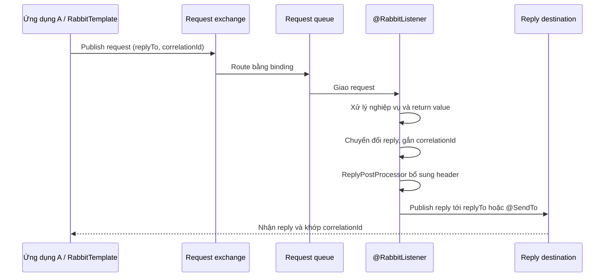

# `@SendTo`, `ReplyPostProcessor` và chọn đích phản hồi

## 1. Bối cảnh: request/reply trong Spring AMQP

Với **Spring AMQP** và **RabbitMQ**, luồng bất đồng bộ thường chỉ cần producer gửi message đến exchange và một `@RabbitListener` xử lý. Tuy nhiên, một số nghiệp vụ còn cần **trả kết quả về cho bên gọi**, chẳng hạn ứng dụng A yêu cầu hệ thống B tra cứu trạng thái đơn hàng và cần biết kết quả trong vài giây. Đây là mẫu **request/reply** (hay RPC qua message broker).

Trong Spring AMQP:

- **Bên gửi** có thể dùng `RabbitTemplate.convertSendAndReceive(...)` để gửi request, chờ response và chuyển đổi payload.
- **Bên nhận** dùng `@RabbitListener` với phương thức **có giá trị trả về**. Spring AMQP có thể tự chuyển giá trị đó thành reply message và gửi đi.
- **Đích phản hồi** thường do thuộc tính AMQP `replyTo` trong request quyết định. Khi request không có `replyTo`, có thể đặt đích mặc định bằng **`@SendTo`**.
- **`ReplyPostProcessor`** cho phép chỉnh sửa reply *sau khi framework đã thiết lập correlation ID*, chẳng hạn sao chép `trace-id` từ request để quan sát xuyên dịch vụ.

Bài này thuộc chương **Yêu cầu và phản hồi** của module `SPRING_AMQP`: trọng tâm là **ai quyết định nơi nhận reply**, **khi nào `@SendTo` được dùng**, và **cách bổ sung metadata an toàn trước khi phản hồi được gửi**.

> **Phạm vi ví dụ:** Cú pháp API dưới đây dùng Spring AMQP 3.x / Spring Boot 3.x. Khi sử dụng một nhánh major khác, cần đối chiếu package import và cấu hình tương ứng; các nguyên tắc `replyTo`, đích mặc định và correlation vẫn có ý nghĩa.

## 2. Đường đi của request và reply



Chú ý ba thuộc tính và khái niệm dễ bị nhầm:

| Thành phần | Tồn tại ở đâu? | Mục đích |
| --- | --- | --- |
| `replyTo` / `replyToAddress` | Thuộc tính **request message** | Chỉ ra exchange/routing key hoặc queue mà bên gửi muốn nhận reply |
| `correlationId` | Thuộc tính message dùng để **ghép cặp request và reply** | Giúp client nhận đúng reply khi có nhiều RPC đồng thời |
| `@SendTo` | Annotation của **listener** | Xác định **đích phản hồi mặc định** khi request không mang `replyTo` |
| `ReplyPostProcessor` | Bean được listener tham chiếu hoặc cấu hình trên factory | Điều chỉnh **reply message** trước khi gửi, có thể đọc cả request |

Đích reply và correlation ID giải quyết hai câu hỏi khác nhau: **gửi reply tới đâu?** và **reply này thuộc request nào?**. Routing đúng mà correlation sai vẫn có thể làm lời gọi RPC bị timeout.

## 3. Quy tắc chọn đích phản hồi: `replyTo` ưu tiên hơn `@SendTo`

Khi `@RabbitListener` trả về một giá trị không phải `void` (và khác `null`), Spring AMQP sẽ xây dựng reply message rồi chọn địa chỉ gửi:

1. **Request có `replyTo`**: gửi reply tới địa chỉ đó; `@SendTo` không thay thế địa chỉ do bên gửi cung cấp.
2. **Request không có `replyTo`, listener có `@SendTo`**: gửi đến địa chỉ được chỉ định bởi `@SendTo`.
3. **Request không có `replyTo`, listener không có đích mặc định phù hợp**: không có địa chỉ hợp lệ cho việc gửi reply; đây là lỗi thiết kế cần xử lý.
4. **Listener trả về `void` hoặc `null`**: không tạo response payload thông thường, nên bên đang đợi RPC có thể hết thời gian chờ.

Ví dụ:

```java
import org.springframework.amqp.rabbit.annotation.RabbitListener;
import org.springframework.messaging.handler.annotation.SendTo;

@RabbitListener(queues = "order.request.q")
@SendTo("order.reply.x/order.status")
public String status(String orderId) {
    return "READY:" + orderId;
}
```

| Request | `@SendTo` | Đích thực tế |
| --- | --- | --- |
| `replyTo = "order.client.reply.q"` | `order.reply.x/order.status` | Default exchange + routing key `order.client.reply.q` (tức reply queue của client) |
| `replyTo = "amq.rabbitmq.reply-to"` | `order.reply.x/order.status` | RabbitMQ **direct reply-to** dành cho lời gọi RPC đó |
| `replyTo` không được đặt | `order.reply.x/order.status` | Exchange `order.reply.x`, routing key `order.status` |
| `replyTo` không được đặt | Không có `@SendTo` | Không có địa chỉ fallback để gửi reply |

**Điểm cốt lõi:** `@SendTo` là **fallback**, không phải cách ép reply tới một queue cố định bất kể caller muốn gì. `RabbitTemplate.convertSendAndReceive(...)` thường tự thiết lập `replyTo`, nên với lời gọi RPC chuẩn, đích phản hồi do template của caller quyết định.

### Cú pháp địa chỉ của `@SendTo`

Spring AMQP diễn giải `@SendTo` theo mẫu **`exchange/routingKey`**:

| Annotation | Ý nghĩa |
| --- | --- |
| `@SendTo("order.reply.x/order.status")` | Gửi qua `order.reply.x` với routing key `order.status` |
| `@SendTo("order.reply.q")` | Gửi qua **default exchange** (`""`) đến queue tên `order.reply.q` |
| `@SendTo("/order.reply.q")` | Tương đương dòng trên |
| `@SendTo("order.reply.x/")` | Gửi tới exchange `order.reply.x` với routing key rỗng |
| `@SendTo` | Dùng đích mặc định rỗng; chỉ hữu ích nếu topology và cách sử dụng thực sự hỗ trợ địa chỉ đó |

`@SendTo("order.reply.q")` **không có nghĩa** là exchange tên `order.reply.q`: đây là routing key gửi vào default exchange. Với custom exchange, phải khai báo exchange **và binding tương ứng**. Nếu exchange/routing key không route được tới queue nào, reply có thể không đến client dù phương thức listener đã xử lý thành công.

## 4. Ví dụ hoàn chỉnh: một fallback reply queue và một client RPC

Ta tạo request exchange, request queue, reply exchange và fallback reply queue. Queue fallback có ích khi producer gửi một request **không đặt `replyTo`** và vẫn muốn ứng dụng nhận xử lý kết quả ở đích đã quy định trước.

### 4.1. Khai báo exchange, queue và binding

```java
import org.springframework.amqp.core.BindingBuilder;
import org.springframework.amqp.core.Declarables;
import org.springframework.amqp.core.DirectExchange;
import org.springframework.amqp.core.Queue;
import org.springframework.amqp.core.QueueBuilder;
import org.springframework.context.annotation.Bean;
import org.springframework.context.annotation.Configuration;

@Configuration
public class OrderRpcTopology {

    @Bean
    public Declarables rpcDeclarables() {
        DirectExchange requestExchange =
                new DirectExchange("order.request.x", true, false);
        DirectExchange replyExchange =
                new DirectExchange("order.reply.x", true, false);

        Queue requestQueue = QueueBuilder
                .durable("order.request.q").build();
        Queue fallbackReplyQueue = QueueBuilder
                .durable("order.reply.fallback.q").build();

        return new Declarables(
                requestExchange,
                replyExchange,
                requestQueue,
                fallbackReplyQueue,
                BindingBuilder.bind(requestQueue)
                        .to(requestExchange).with("order.lookup"),
                BindingBuilder.bind(fallbackReplyQueue)
                        .to(replyExchange).with("order.status")
        );
    }
}
```

Có hai routing key phục vụ hai mục đích:

```text
REQUEST:
order.request.x --[order.lookup]--> order.request.q --> @RabbitListener

FALLBACK REPLY (khi không có replyTo):
@RabbitListener --> order.reply.x --[order.status]--> order.reply.fallback.q
```

Đối với request có `replyTo`, reply đi theo địa chỉ do client chỉ định, **không nhất thiết** đi qua `order.reply.x`.

### 4.2. `@RabbitListener` trả về giá trị và gắn `ReplyPostProcessor`

```java
import org.springframework.amqp.rabbit.annotation.RabbitListener;
import org.springframework.messaging.handler.annotation.SendTo;
import org.springframework.stereotype.Component;

@Component
public class OrderRpcListener {

    @RabbitListener(
            queues = "order.request.q",
            replyPostProcessor = "orderReplyPostProcessor")
    @SendTo("order.reply.x/order.status")
    public String lookup(String orderId) {
        if (orderId == null || orderId.isBlank()) {
            throw new IllegalArgumentException("orderId is required");
        }

        return "READY:" + orderId;
    }
}
```

- `return "READY:..."` được framework đóng gói thành reply message qua message converter.
- `@SendTo("order.reply.x/order.status")` cung cấp địa chỉ mặc định.
- `replyPostProcessor = "orderReplyPostProcessor"` tham chiếu tên bean Spring sẽ khai báo bên dưới.
- Không cần gọi `RabbitTemplate.convertAndSend(...)` trong phương thức để tạo reply thông thường; listener adapter thực hiện sau khi phương thức trả về.
- Một exception ném ra từ phương thức **không mặc định trở thành success reply**. Cách trả lỗi cho caller cần được thiết kế riêng (ví dụ error handler hoặc cấu trúc response có trường trạng thái).

### 4.3. `ReplyPostProcessor` bổ sung header trên phản hồi

Ở Spring AMQP 3.x, `ReplyPostProcessor` nằm trong package `org.springframework.amqp.rabbit.listener.adapter` và nhận **hai message**: request, reply.

```java
import org.springframework.amqp.rabbit.listener.adapter.ReplyPostProcessor;
import org.springframework.context.annotation.Bean;
import org.springframework.context.annotation.Configuration;

@Configuration
public class OrderReplyConfig {

    @Bean("orderReplyPostProcessor")
    public ReplyPostProcessor orderReplyPostProcessor() {
        return (request, reply) -> {
            Object traceId = request.getMessageProperties()
                    .getHeaders().get("trace-id");

            if (traceId instanceof String trace && !trace.isBlank()) {
                reply.getMessageProperties().setHeader("trace-id", trace);
            }

            reply.getMessageProperties()
                    .setHeader("handled-by", "order-rpc-service");

            // Giữ nguyên correlationId đã được framework thiết lập.
            return reply;
        };
    }
}
```

`ReplyPostProcessor` được gọi **sau khi Spring AMQP thiết lập correlation ID của reply** tương ứng với request. Vì thế ta có thể thêm `trace-id`, `handled-by` hoặc các header nghiệp vụ mà không phá hỏng cơ chế ghép cặp. Đặc biệt, **không tự sinh correlation ID mới trên reply**: caller đang đợi ID của chính request.

Interface này có kiểu hàm tương đương `BiFunction<Message, Message, Message>`; processor có thể trả về message đã sửa hoặc một reply message mới. Nếu tạo message mới, phải bảo toàn payload, headers cần thiết và `correlationId`. Không sao chép toàn bộ request headers tùy tiện vì có những header chỉ dành cho request hoặc mang thông tin không nên trả ra ngoài.

### 4.4. Client sử dụng `RabbitTemplate.convertSendAndReceive(...)`

`spring-boot-starter-amqp` thường cung cấp bean `RabbitTemplate` có thể inject vào service.

```java
import java.util.UUID;

import org.springframework.amqp.rabbit.core.RabbitTemplate;
import org.springframework.stereotype.Service;

@Service
public class OrderRpcClient {
    private final RabbitTemplate rabbitTemplate;

    public OrderRpcClient(RabbitTemplate rabbitTemplate) {
        this.rabbitTemplate = rabbitTemplate;
    }

    public String lookup(String orderId) {
        String traceId = UUID.randomUUID().toString();

        Object rawReply = rabbitTemplate.convertSendAndReceive(
                "order.request.x",
                "order.lookup",
                orderId,
                request -> {
                    request.getMessageProperties()
                            .setHeader("trace-id", traceId);
                    return request;
                }
        );

        if (rawReply == null) {
            throw new IllegalStateException(
                    "RPC timed out for order " + orderId);
        }
        return (String) rawReply;
    }
}
```

Luồng này dùng `RabbitTemplate` để đặt `replyTo`, quản lý việc nhận reply và khớp correlation cho lời gọi đang đợi. Trên RabbitMQ hỗ trợ **direct reply-to**, Spring AMQP có thể dùng địa chỉ dạng `amq.rabbitmq.reply-to`; không cần tự khai báo một queue trả lời cố định trong ví dụ client trên.

Nếu dùng message converter mặc định cho `String`, response sẽ là chuỗi `"READY:<orderId>"`. Nếu dùng DTO Java phức tạp, cần cấu hình converter tương ứng ở cả bên gửi và bên nhận, ví dụ JSON converter.

### 4.5. Quan sát fallback thực tế

Khi muốn thử đường `@SendTo`, ta phải gửi một message **không có `replyTo`**. Gọi `convertAndSend(...)` thay cho `convertSendAndReceive(...)`:

```java
// Gửi request một chiều, KHÔNG tự thiết lập replyTo.
rabbitTemplate.convertAndSend(
        "order.request.x", "order.lookup", "ORD-42");

// Chỉ dùng để minh họa khi chạy tuần tự, một client, không tranh chấp queue.
Object reply = rabbitTemplate.receiveAndConvert(
        "order.reply.fallback.q", 5_000L);
System.out.println(reply); // READY:ORD-42 nếu reply đến trong 5 giây
```

Message này có thể đến fallback reply queue do listener đã khai báo `@SendTo("order.reply.x/order.status")`. Trên hệ thống có nhiều client đồng thời, **không** dùng một queue chung rồi gọi `receiveAndConvert` như trên để ghép request và reply. Cần thiết kế consumer cho reply queue cùng correlation ID hoặc dùng RPC API của `RabbitTemplate`, vốn hỗ trợ quản lý tương quan.

## 5. `@SendTo` tĩnh và `@SendTo` động

`@SendTo` có ba cách khai báo hữu ích:

| Cách chọn | Ví dụ | Khi nào đánh giá |
| --- | --- | --- |
| Giá trị tĩnh | `@SendTo("order.reply.x/order.status")` | Mọi request thiếu `replyTo` dùng một đích cố định |
| Property/SpEL lúc khởi tạo | `@SendTo("${orders.reply.address}")` hoặc `@SendTo("#{replyAddressBean}")` | Đích thay đổi theo môi trường triển khai nhưng cố định trong quá trình chạy |
| Runtime SpEL | `@SendTo("!{'order.reply.x/' + result.replyRoutingKey}")` | Chọn đích theo nội dung request hoặc kết quả xử lý, chỉ khi request không có `replyTo` |

Khác biệt lớn nằm ở **thời điểm đánh giá biểu thức**:

- **`#{...}`** được đánh giá **một lần khi khởi tạo bean/listener**.
- **`!{...}`** được đánh giá **mỗi lần xử lý message**, với các thuộc tính `request`, `source` và `result` trong ngữ cảnh SpEL.

Ví dụ minh họa chọn fallback reply key theo kết quả xử lý:

```java
import org.springframework.amqp.rabbit.annotation.RabbitListener;
import org.springframework.messaging.handler.annotation.SendTo;

@RabbitListener(queues = "order.request.q")
@SendTo("!{'order.reply.x/' + result.replyRoutingKey}")
public RoutedOrderReply routeOrder(String orderId) {
    // Trả về DTO có getter getReplyRoutingKey() và getStatus().
    return findStatusAndRoute(orderId);
}
```

`RoutedOrderReply` là DTO minh họa; `findStatusAndRoute(...)` là hàm nghiệp vụ tự triển khai, không phải API của Spring AMQP. Ví dụ trên cần một message converter xử lý DTO và các binding tương ứng với `replyRoutingKey`. Không đặt thêm một listener cùng đọc `order.request.q` với listener ở mục 4 nếu muốn kiểm tra riêng từng trường hợp, vì các consumer sẽ cạnh tranh message.

**Đặc biệt:** Runtime SpEL của `@SendTo` cũng chỉ làm nhiệm vụ chọn **đích mặc định**. Nếu request đã mang `replyTo`, hãy ưu tiên quy tắc `replyTo` của request. Vì routing key có thể lấy từ dữ liệu nghiệp vụ, phải kiểm soát/giới hạn các giá trị hợp lệ và đảm bảo binding đã tồn tại.

## 6. `ReplyPostProcessor` khác gì `MessagePostProcessor`?

Hai interface đều sửa đổi message nhưng **không có cùng phạm vi và chữ ký**:

| Tiêu chí | `ReplyPostProcessor` | `MessagePostProcessor` |
| --- | --- | --- |
| Mục đích thường gặp | Chỉnh reply dựa trên **request và reply** | Chỉnh một message trước/sau một giai đoạn gửi, nhận hay chuyển đổi |
| Đầu vào | `(request, reply)` | `(message)` |
| Điểm dùng ví dụ | `@RabbitListener(replyPostProcessor = "...")` | `RabbitTemplate.convertAndSend(..., postProcessor)` hoặc factory reply processor |
| Ví dụ | Copy `trace-id` request sang reply | Thêm header trước khi gửi request |
| Correlation | Gọi sau khi framework thiết lập reply correlation ID | Thời điểm phụ thuộc điểm hook cấu hình |

Nếu chỉ cần thay đổi một reply message mà **không cần truy cập request**, có thể cân nhắc hook `beforeSendReplyMessagePostProcessors` của listener container factory. Ngược lại, `ReplyPostProcessor` cung cấp trực tiếp cả request lẫn response, nên rõ ràng hơn khi phải echo header có chọn lọc. Các hook khác nhau có thứ tự xử lý và ngữ cảnh khác nhau, không nên coi là hoàn toàn thay thế lẫn nhau.

### Cấu hình `ReplyPostProcessor` dùng chung từ container factory

Từ Spring AMQP **3.0**, có thể đăng ký một provider để tạo processor theo `listener id`:

```java
// Bên trong cấu hình SimpleRabbitListenerContainerFactory:
factory.setReplyPostProcessorProvider(listenerId -> (request, reply) -> {
    reply.getMessageProperties().setHeader(
            "processed-by-listener", listenerId);
    return reply;
});
```

Thiết lập `replyPostProcessor` **ngay tại annotation của listener có độ ưu tiên cao hơn** provider chung trên factory. Vì thế, với `OrderRpcListener` ở phần trước, bean `orderReplyPostProcessor` được chỉ định trực tiếp là processor áp dụng cho listener đó. Không dựa vào việc cả hai processor tự động chạy nối tiếp nếu chưa cấu hình việc kết hợp rõ ràng.

Khi chọn cách cấu hình, xét phạm vi: một listener có chính sách header riêng thì tham chiếu bean tại annotation; một nhóm listener cần cùng chính sách thì cấu hình ở factory có thể thuận tiện hơn.

## 7. Correlation, timeout và độ tin cậy của response

### Correlation ID không phải trace ID

- **Correlation ID** trả lời câu hỏi: *response này khớp với request RPC nào?*. Với `RabbitTemplate`, framework có thể tạo và quản lý ID để ghép cặp, đặc biệt khi các request đồng thời dùng cùng kết nối.
- **Trace ID** trả lời câu hỏi: *giao dịch này đi qua những service nào?*. Ứng dụng có thể đưa trace ID vào header riêng để log, metric và tracing.

Trong `ReplyPostProcessor`, copy trace ID một cách có kiểm soát; giữ nguyên correlation ID do framework thiết lập. Không dùng chung một giá trị ngẫu nhiên cho mọi request; không cho một processor thay đổi correlation ID mà không hiểu cơ chế ghép cặp.

### Timeout không đồng nghĩa với lỗi xử lý ở server

Mặc định các lời gọi `sendAndReceive`/`convertSendAndReceive` có thời gian chờ hữu hạn (thường 5 giây; có thể cấu hình `RabbitTemplate.replyTimeout`). Khi hết hạn, lời gọi đồng bộ có thể trả về `null`.

Timeout có thể xảy ra vì:

1. Request không được route tới request queue.
2. Consumer xử lý chậm hoặc bận.
3. Consumer exception và không gửi reply.
4. Reply bị gửi tới exchange/routing key không có queue nhận.
5. Reply đã gửi nhưng đến trễ, hoặc kết nối/client gặp sự cố.

Không suy luận rằng *server chưa làm gì* chỉ từ `null`/timeout. Nếu caller retry toàn bộ RPC, server có thể xử lý nghiệp vụ nhiều lần. Cần thiết kế **idempotency** dựa trên khóa nghiệp vụ/request ID, nhất là với các hành động thay đổi dữ liệu như thanh toán hoặc tạo đơn hàng.

### Direct reply-to, queue cố định và exchange tùy biến

| Cách nhận reply | Phù hợp | Lưu ý |
| --- | --- | --- |
| `RabbitTemplate.convertSendAndReceive` + direct reply-to | RPC ngắn, cùng kết nối client đang đợi | RabbitTemplate tự quản lý reply address/correlation; timeout phải được xử lý |
| Reply queue riêng cho mỗi ứng dụng/client | Client cần consumer reply độc lập hoặc cấu hình phức tạp | Quản lý queue, listener nhận reply và correlation; không để nhiều client tranh chấp một reply queue |
| Fallback `@SendTo` tới queue chung | Luồng không có `replyTo`, phản hồi theo kênh định trước | Cần thiết kế cách tiêu thụ phản hồi và ghép request–reply ngoài RPC API |
| Runtime SpEL chọn reply exchange/routing key | Định tuyến phản hồi theo nhánh nghiệp vụ | Kiểm soát route, binding, tính hợp lệ dữ liệu và bảo mật |

Direct reply-to là một cơ chế hiệu quả cho RPC nhưng không phải kho lưu trữ reply bền vững chờ client ngoại tuyến. Nếu yêu cầu phản hồi phải lưu lâu hoặc có thể xử lý sau khi client ngắt kết nối, nên dùng một reply queue bền vững/luồng sự kiện riêng với chiến lược tiêu thụ và theo dõi phù hợp.

## 8. Kiểm tra bằng hai kịch bản

Với topology, listener và client ở mục 4, có thể chạy RabbitMQ (cùng management plugin nếu muốn theo dõi UI) rồi kiểm tra:

**Kịch bản A — request có `replyTo` (RPC thông thường):**

1. Gọi `orderRpcClient.lookup("ORD-42")`.
2. `RabbitTemplate` publish tới `order.request.x` với routing key `order.lookup`, kèm `replyTo` của nó.
3. `OrderRpcListener` trả về `"READY:ORD-42"`, framework tạo reply và thiết lập correlation.
4. `orderReplyPostProcessor` chép `trace-id` sang reply.
5. Reply quay lại địa chỉ từ `replyTo`; `RabbitTemplate` trả chuỗi `"READY:ORD-42"`. Queue `order.reply.fallback.q` **không** nhận reply này.

**Kịch bản B — request không có `replyTo`:**

1. Gọi `rabbitTemplate.convertAndSend("order.request.x", "order.lookup", "ORD-43")`.
2. Listener xử lý, áp dụng `@SendTo("order.reply.x/order.status")`.
3. Message xuất hiện trong `order.reply.fallback.q` thông qua binding của `order.reply.x`.
4. Đọc queue trong RabbitMQ Management UI hoặc `receiveAndConvert(...)` để xác nhận payload là `"READY:ORD-43"`.

Có thể thử thêm việc sửa `@SendTo` thành routing key chưa được bind để nhận biết lỗi định tuyến, sau đó khôi phục cấu hình hợp lệ. Với hệ thống thực, bổ sung publisher returns/confirms và quan sát những reply không định tuyến được; việc method return thành công **không đủ** để kết luận caller đã nhận kết quả.

### Checklist chẩn đoán

| Triệu chứng | Nguyên nhân cần kiểm tra | Cách xác minh |
| --- | --- | --- |
| `convertSendAndReceive(...)` trả `null` | Hết timeout, consumer lỗi, reply gửi sai nơi | Kiểm tra request queue, listener logs, địa chỉ `replyTo`, routing và timeout |
| Fallback reply queue rỗng trong lời gọi RPC | RPC có `replyTo`, nên `@SendTo` không được dùng | Kiểm tra `replyTo` trên request; đây là hành vi dự kiến |
| Fallback không nhận dù request không có `replyTo` | Exchange/routing key không bind tới queue | Kiểm tra `order.reply.x` → `order.status` → `order.reply.fallback.q` |
| Header trace không xuất hiện | Chưa gắn header trên request, sai tên bean processor | Kiểm tra `replyPostProcessor` và giá trị `trace-id` của request |
| Reply không ghép được với request | Correlation ID bị ghi đè hoặc quản lý reply queue sai | Không sửa correlation ID trong processor; kiểm tra cấu hình client |
| Reply có dữ liệu nhưng giải mã lỗi | Bên gửi/bên nhận dùng converter hoặc kiểu DTO khác nhau | Cấu hình message converter tương thích ở hai đầu |
| Hệ thống chậm khi lượng RPC tăng | Quá nhiều thread đợi, queue backlog, dependency chậm | Đo latency, độ sâu queue, timeout, concurrency và cân nhắc luồng phản hồi bất đồng bộ |

## 9. Khi nào nên dùng request/reply?

Request/reply hợp lý khi người gọi thực sự cần kết quả sớm để tiếp tục, như tra cứu số dư khả dụng hoặc đánh giá điều kiện đặt hàng. Tuy nhiên, một lời gọi RPC qua broker vẫn khiến caller **phải chờ**; nó không tự biến ứng dụng thành phi đồng bộ từ đầu đến cuối.

Với công việc chạy nhiều phút, fan-out đến nhiều dịch vụ hoặc nghiệp vụ cần giữ được trạng thái khi caller ngoại tuyến, thường phù hợp hơn với **event-driven workflow** hoặc một yêu cầu bất đồng bộ kèm ID và thông báo kết quả sau. Khi dùng request/reply, cần đặt timeout rõ ràng, xác định cách xử lý reply trễ, giới hạn concurrency và giữ nghiệp vụ idempotent.

## 10. Câu hỏi tự luyện

1. Một `@RabbitListener` có `@SendTo("order.reply.x/order.status")`, nhưng request đặt `replyTo = "client.reply.q"`. Reply sẽ đi đâu, vì sao?
2. `@SendTo("abc")` và `@SendTo("abc/key")` khác nhau thế nào về exchange và routing key?
3. `ReplyPostProcessor` nhận những đầu vào nào? Vì sao processor không nên tự tạo correlation ID mới?
4. Vì sao `RabbitTemplate.convertSendAndReceive(...)` thường không làm message xuất hiện trong queue fallback mà `@SendTo` khai báo?
5. Phân biệt thời điểm đánh giá `#{...}` và `!{...}` trong `@SendTo`. Runtime SpEL có thể đọc những đối tượng nào?
6. Khi RPC timeout, có thể khẳng định xử lý nghiệp vụ ở server chưa chạy không? Cần thiết kế retry và idempotency ra sao?
7. Hãy sửa ví dụ để fallback reply theo routing key `order.status.eu` hoặc `order.status.apac` và tạo binding cho hai queue tương ứng; cần giới hạn dữ liệu điều khiển routing như thế nào?

**Ghi nhớ:** `@RabbitListener` trả giá trị để Spring AMQP tự xây dựng phản hồi; **`replyTo` từ request quyết định đích trước**, **`@SendTo` chỉ chọn đích mặc định**, còn **`ReplyPostProcessor` chỉnh metadata của reply sau khi correlation đã được framework thiết lập**. Kiểm tra đủ cả routing, correlation và timeout mới có thể đánh giá một luồng RPC hoạt động đúng.

### Tài liệu tham khảo chính thức

- [Spring AMQP — Reply Management](https://docs.spring.io/spring-amqp/reference/amqp/receiving-messages/async-annotation-driven/reply.html): `@SendTo`, lựa chọn đích, SpEL, `ReplyPostProcessor`.
- [Spring AMQP — Request/Reply Messaging](https://docs.spring.io/spring-amqp/reference/amqp/request-reply.html): `RabbitTemplate`, direct reply-to, correlation và timeout.
