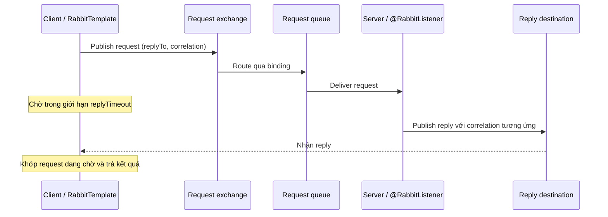
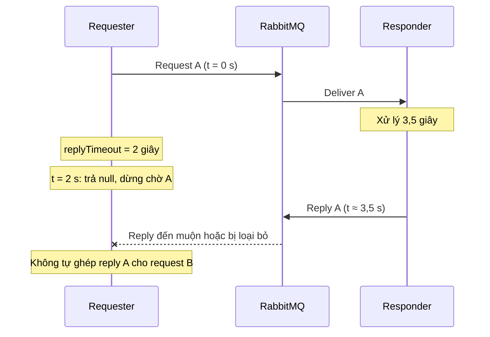
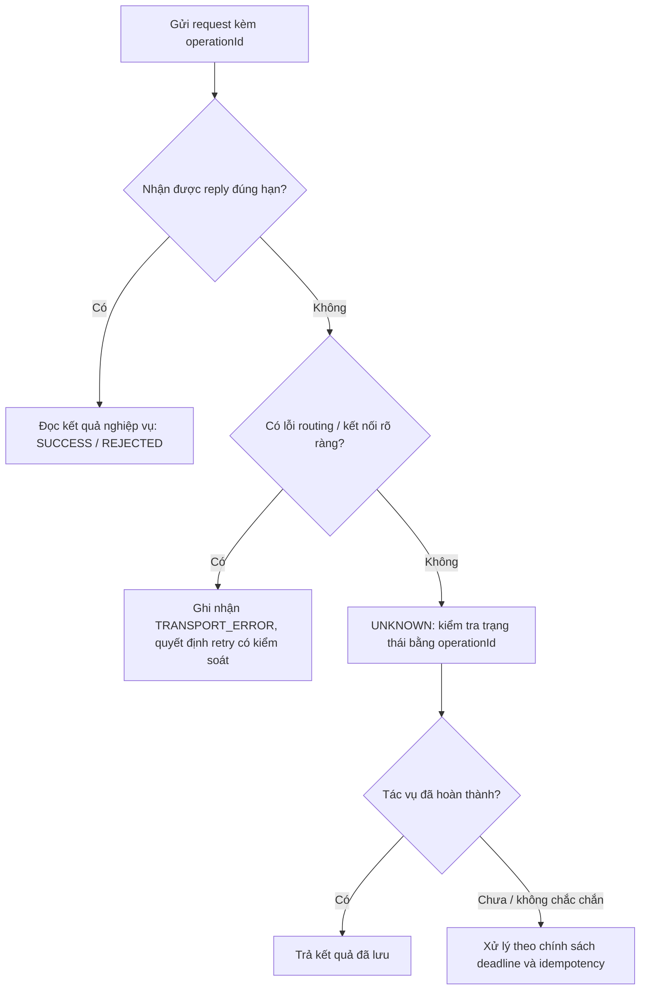

# `replyTimeout`, phản hồi đến muộn và yêu cầu không có phản hồi

> **Chương:** Yêu cầu và phản hồi  
> **Công nghệ:** Spring AMQP, RabbitMQ  
> **Phạm vi:** Điều gì xảy ra với lời gọi request/reply khi quá thời gian chờ, khi reply đến sau hạn, hoặc khi phía xử lý không gửi reply.

## 1. Bài toán: gửi yêu cầu rồi chờ câu trả lời đến bao giờ?

Trong hệ thống xử lý bất đồng bộ bằng **Spring AMQP**, `RabbitTemplate` gửi yêu cầu tới RabbitMQ thông qua exchange, queue và binding; một `@RabbitListener` xử lý yêu cầu rồi có thể trả kết quả cho bên gọi. Mô hình này thường được gọi là **request/reply** hoặc RPC qua message broker.

Ví dụ: dịch vụ đặt hàng hỏi dịch vụ tồn kho *"Có thể giữ 3 sản phẩm này không?"*. Phản hồi nhanh là điều kiện để API trả kết quả cho người dùng. Nhưng nếu dịch vụ tồn kho bị quá tải, chết tiến trình, không có consumer hoặc xử lý quá lâu thì luồng gọi phải có giới hạn thời gian chờ. Spring AMQP cung cấp thuộc tính **`RabbitTemplate.replyTimeout`** cho mục đích đó.

Sau bài này, bạn sẽ:

- Phân biệt thời gian chờ **reply của người gửi** với thời gian sống của message và thời gian xử lý của consumer.
- Hiểu ý nghĩa kết quả `null` từ `sendAndReceive` / `convertSendAndReceive`, gồm cả trường hợp có reply đến muộn.
- Dựng ví dụ thực tế với `RabbitTemplate`, `@RabbitListener`, direct reply-to và ba kịch bản: trả lời đúng hạn, trả lời muộn, không trả lời.
- Thiết kế cách ghi log, phân loại lỗi, retry và xử lý kết quả không chắc chắn mà không gây nhân đôi tác vụ nghiệp vụ.

## 2. Request/reply trong RabbitMQ diễn ra thế nào?



Hai thành phần rất quan trọng:

| Thành phần | Vai trò |
| --- | --- |
| `replyTo` | Địa chỉ để bên xử lý gửi kết quả về. Với RabbitMQ hiện đại, `RabbitTemplate` mặc định ưu tiên **Direct Reply-To** (`amq.rabbitmq.reply-to`) khi được broker hỗ trợ, trừ khi đã cấu hình reply queue khác. |
| `correlationId` hoặc cơ chế correlation tương đương | Giúp `RabbitTemplate` ghép đúng reply với request đang chờ. Bên gửi có thể có nhiều RPC đồng thời; kết quả của request A không được trả nhầm cho request B. |

Thông thường, khi `@RabbitListener` trả về một giá trị khác `null`, Spring AMQP tự gửi reply tới địa chỉ `replyTo` đã có trong request. Nếu dùng `replyTo` do `RabbitTemplate` cấp, không cần tự viết một `@RabbitListener` riêng cho direct reply-to ở bên gọi. `@SendTo` chỉ cần khi không có `replyTo` và muốn cấu hình địa chỉ phản hồi mặc định.

**Direct Reply-To không phải một queue lưu trữ thông thường.** Đây là cơ chế reply có độ trễ thấp, không lưu đệm bền vững và mang ngữ nghĩa phát tối đa một lần (*at-most-once*); reply có thể bị mất khi requester không còn kết nối. Nếu cần lưu lại reply khi requester vắng mặt, nên đánh giá kiến trúc với reply queue thực và lưu trạng thái nghiệp vụ riêng.

## 3. `replyTimeout` có nghĩa gì?

`replyTimeout` là **khoảng thời gian tối đa `RabbitTemplate` đồng bộ chờ reply sau khi gửi request**, đo bằng **mili giây**. Mặc định với các phương thức request/reply đồng bộ là **5.000 ms (5 giây)**; ứng dụng có thể đổi bằng `setReplyTimeout(...)`.

```java
RabbitTemplate template = new RabbitTemplate(connectionFactory);
template.setReplyTimeout(2_000L); // Tối đa 2 giây chờ reply

Object reply = template.convertSendAndReceive(
        "demo.rpc.exchange", "rpc", "check-stock"
);

if (reply == null) {
    // Không có reply hợp lệ được ghép với request trước khi hết hạn chờ.
}
```

**Hành vi cốt lõi:** Khi hết thời gian chờ mà không nhận được reply, các phương thức đồng bộ `sendAndReceive` và `convertSendAndReceive` **trả về `null`**, thay vì mặc định ném một exception timeout chuyên biệt.

Điều này không có nghĩa broker đã xóa request hoặc server dừng xử lý. `replyTimeout` chỉ giới hạn **phía requester chờ đến khi nào**; nó không phải lệnh hủy request và không thay thế TTL của message.

| Khái niệm | Điều khiển cái gì? | Hết hạn sẽ thế nào? |
| --- | --- | --- |
| `replyTimeout` | Thời gian thread gọi `RabbitTemplate` đợi kết quả. | Phương thức RPC đồng bộ trả `null` nếu chưa nhận reply. |
| Message TTL (`expiration`, `x-message-ttl`) | Thời gian message được giữ trong một queue trước khi bị hết hạn. | Broker loại bỏ/dead-letter message theo quy tắc TTL; không tự tạo phản hồi lỗi cho request RPC. |
| Thời gian xử lý của `@RabbitListener` | Thời gian logic nghiệp vụ chạy trên consumer. | Không bị dừng chỉ vì requester hết `replyTimeout`. |
| Publisher confirm / return | Xác nhận broker nhận publish hoặc thông báo không route được. | Là tín hiệu của bước gửi/routing; không đồng nghĩa đã có reply nghiệp vụ. |

Ví dụ `replyTimeout = 2.000 ms` không bảo đảm lời gọi hoàn thành ở đúng mili giây thứ 2.000 trong mọi điều kiện: còn có thời gian gửi message, lịch CPU, sự cố kết nối hoặc lỗi publish. Khi broker/truyền tải phát sinh lỗi, `RabbitTemplate` cũng có thể ném exception AMQP thay vì trả `null`.

## 4. Ba kịch bản phải phân biệt

### 4.1. Có reply trước khi timeout

```text
t = 0 ms         Request được publish
t = 300 ms       Server hoàn tất và gửi reply
t = 350 ms       RabbitTemplate nhận reply, trả "OK"
t = 2000 ms      Hạn chờ (không cần đợi đến mốc này)
```

Phía caller nhận được một kết quả nghiệp vụ hợp lệ. Cần phân biệt *"server trả mã lỗi nghiệp vụ"* (cũng là một reply hợp lệ) với *"không nhận được reply"* (`null`).

### 4.2. Reply đến muộn



Sau timeout, `RabbitTemplate` không còn một lời gọi đồng bộ đang chờ request A. Nếu reply A được chuyển đến sau đó, nó **không trở thành kết quả** cho lời gọi A đã trả `null`, và cơ chế correlation của template ngăn việc trả nhầm reply A cho một request khác.

Cách xử lý reply muộn phụ thuộc reply destination:

- **Direct Reply-To mặc định:** Reply có thể bị broker bỏ qua khi requester không còn nhận được nữa, vì cơ chế này không có queue bền vững để lưu reply. Trong một số trường hợp container phía client có thể nhận reply muộn và báo lỗi không ghép được correlation; không được giả định mọi reply muộn đều vào DLQ.
- **Reply queue cố định:** Khi nhận được một reply không còn request tương ứng, `RabbitTemplate` có thể từ chối nó bằng `AmqpRejectAndDontRequeueException`. Nếu reply queue có DLX cho message bị reject, có thể thu thập reply muộn để điều tra. Cấu hình reply queue cố định đòi hỏi listener container đúng cách và mỗi requester instance cần reply queue riêng thích hợp.

Spring AMQP cho phép đặt `replyErrorHandler` trên `RabbitTemplate` khi dùng `DirectReplyToMessageListenerContainer` mặc định để quan sát các lỗi nhận reply, trong đó có **late reply** và reply thiếu correlation, **nếu lỗi đó thực sự được đưa tới container**. Đây là cơ chế quan sát lỗi, không phải bảo đảm thu hồi mọi reply muộn.

### 4.3. Request không có reply

Có nhiều nguyên nhân dẫn đến biểu hiện tương tự ở bên gọi:

| Tình huống | Request thực tế | Caller thấy gì? |
| --- | --- | --- |
| Chưa có consumer trên request queue | Request có thể vẫn nằm trong queue chờ xử lý. | Thường trả `null` sau `replyTimeout`; server có thể xử lý sau đó. |
| Listener xử lý nhưng trả `null` hoặc không gửi reply | Request đã được consume; không có message phản hồi. | Trả `null` khi hết thời gian chờ. |
| Listener lỗi / bị restart trước khi trả lời | Xử lý thất bại hoặc sẽ retry/requeue theo cấu hình listener. | Có thể timeout; không thể suy ra tác vụ đã chạy đến đâu. |
| Reply được gửi nhưng bị mất, không route đúng, hoặc requester ngắt kết nối | Có thể đã xử lý nghiệp vụ thành công. | Có thể timeout hoặc gặp lỗi kết nối; cần tín hiệu khác để biết kết quả. |
| Publish request không route vào queue nào | Không có server nào nhận request. | Nếu bật publisher returns với `mandatory`, có thể nhận `AmqpMessageReturnedException`; nếu không, dễ chỉ thấy timeout. |

**Không được diễn giải mọi `null` là "server chưa làm gì".** `null` chỉ khẳng định requester chưa nhận được một reply phù hợp trong thời gian chờ. Nếu cần biết trạng thái thực sự của giao dịch, hãy tra cứu bằng `requestId`/`operationId` hoặc dùng luồng thông báo kết quả bất đồng bộ.

## 5. Thực hành Spring AMQP: tạo RPC với timeout 2 giây

Ví dụ chạy trong ứng dụng Spring Boot có `spring-boot-starter-amqp`, RabbitMQ hoạt động và tính năng `@RabbitListener` được bật. Dùng `String` làm payload để tập trung vào timeout, không phụ thuộc cấu hình JSON converter.

### 5.1. Khai báo topology và `RabbitTemplate`

```java
import org.springframework.amqp.core.Binding;
import org.springframework.amqp.core.BindingBuilder;
import org.springframework.amqp.core.DirectExchange;
import org.springframework.amqp.core.Queue;
import org.springframework.amqp.core.QueueBuilder;
import org.springframework.amqp.rabbit.annotation.EnableRabbit;
import org.springframework.amqp.rabbit.connection.ConnectionFactory;
import org.springframework.amqp.rabbit.core.RabbitTemplate;
import org.springframework.context.annotation.Bean;
import org.springframework.context.annotation.Configuration;

@Configuration
@EnableRabbit
public class RpcTopology {
    public static final String EXCHANGE = "demo.rpc.exchange";
    public static final String QUEUE = "demo.rpc.requests";
    public static final String ROUTING_KEY = "rpc";

    @Bean
    DirectExchange rpcExchange() {
        return new DirectExchange(EXCHANGE);
    }

    @Bean
    Queue rpcRequestQueue() {
        return QueueBuilder.durable(QUEUE).build();
    }

    @Bean
    Binding rpcBinding() {
        return BindingBuilder.bind(rpcRequestQueue())
                .to(rpcExchange())
                .with(ROUTING_KEY);
    }

    @Bean
    RabbitTemplate rpcRabbitTemplate(ConnectionFactory connectionFactory) {
        RabbitTemplate template = new RabbitTemplate(connectionFactory);
        template.setReplyTimeout(2_000L);
        return template;
    }
}
```

Exchange nhận request, binding đưa chúng vào `demo.rpc.requests`; **không cần tự khai báo `reply.queue`** trong ví dụ sử dụng Direct Reply-To. Trong ứng dụng Boot thật, nếu đã có `RabbitTemplate` được cấu hình chung, có thể đặt `replyTimeout` trên bean đó; tránh tạo nhiều template không cần thiết. Đoạn cấu hình minh họa dùng một template riêng để giữ thí nghiệm độc lập.

### 5.2. Responder: nhanh, chậm và không gửi reply

```java
import org.springframework.amqp.rabbit.annotation.RabbitListener;
import org.springframework.boot.autoconfigure.condition.ConditionalOnProperty;
import org.springframework.stereotype.Component;

@Component
@ConditionalOnProperty(name = "demo.rpc.responder-enabled",
        havingValue = "true", matchIfMissing = true)
public class RpcResponder {
    @RabbitListener(queues = RpcTopology.QUEUE)
    public String handle(String request) throws InterruptedException {
        switch (request) {
            case "fast":
                return "OK:fast";
            case "slow":
                Thread.sleep(3_500L); // Chỉ để mô phỏng xử lý chậm
                return "OK:slow";
            case "no-reply":
                return null; // Đã xử lý message nhưng không publish reply
            default:
                return "UNKNOWN:" + request;
        }
    }
}
```

Một hàm listener trả `String` có thể tạo reply tự động qua `replyTo` của request. Với nhánh `no-reply`, việc trả `null` làm listener **không gửi nội dung phản hồi** trong ví dụ này. `Thread.sleep(...)` chỉ mô phỏng lỗi hiệu năng, không phải cách trì hoãn công việc trong hệ thống sản xuất.

### 5.3. Requester: gọi và đo kết quả

```java
import java.util.List;
import java.util.concurrent.TimeUnit;
import org.springframework.amqp.rabbit.core.RabbitTemplate;
import org.springframework.boot.CommandLineRunner;
import org.springframework.stereotype.Component;

@Component
public class RpcDemoRunner implements CommandLineRunner {
    private final RabbitTemplate rabbitTemplate;

    public RpcDemoRunner(RabbitTemplate rabbitTemplate) {
        this.rabbitTemplate = rabbitTemplate;
    }

    @Override
    public void run(String... args) {
        for (String request : List.of("fast", "slow", "no-reply")) {
            long start = System.nanoTime();

            Object reply = rabbitTemplate.convertSendAndReceive(
                    RpcTopology.EXCHANGE,
                    RpcTopology.ROUTING_KEY,
                    request
            );

            long elapsedMs = TimeUnit.NANOSECONDS
                    .toMillis(System.nanoTime() - start);
            System.out.printf("request=%s, reply=%s, elapsed=%dms%n",
                    request, reply, elapsedMs);
        }
    }
}
```

Khởi động RabbitMQ và ứng dụng thử nghiệm với queue trống; không chạy thêm consumer hoặc publisher khác vào topology demo. Kết quả kỳ vọng:

```text
request=fast, reply=OK:fast, elapsed=...ms
request=slow, reply=null,    elapsed=~2000ms
request=no-reply, reply=null, elapsed=~2000ms
```

Thời gian thực tế có dao động. Với `slow`, phía responder vẫn có thể gửi `OK:slow` ở khoảng 3,5 giây tính từ khi nhận request, **sau khi** caller đã trả `null`. Với `no-reply`, server có thể đã nhận và hoàn tất xử lý nhưng không có message kết quả. Cả hai đều cho ra `null`; cần thêm log phía server để phân biệt.

Để thử tình huống *"không có consumer"* ngay trong ví dụ, chạy ứng dụng với đối số `--demo.rpc.responder-enabled=false`. Annotation `@ConditionalOnProperty` sẽ không tạo bean `RpcResponder`, trong khi `RpcDemoRunner` vẫn gửi request. Request được giữ trong queue (nếu không có TTL hoặc cơ chế khác loại bỏ), còn caller hết `replyTimeout` và trả `null`. Bật responder trở lại có thể khiến các request cũ được xử lý và tạo reply muộn; hãy xóa dữ liệu thử nghiệm khỏi queue trước khi chạy lại các kịch bản ban đầu.

## 6. Quan sát reply muộn và request không route được

### 6.1. Ghi log khi phía client nhận reply lỗi

Có thể gắn error handler khi khởi tạo `RabbitTemplate`:

```java
template.setReplyErrorHandler(error -> {
    System.err.println("Reply receive error: " + error.getMessage());
});
```

Đặt dòng này trong `rpcRabbitTemplate(...)` trước `return template;`. Handler được gọi khi container nhận reply nhưng không thể xử lý hợp lệ, chẳng hạn reply đến sau timeout hoặc thiếu correlation. Với Direct Reply-To, reply có thể bị broker bỏ trước khi đến container, nên **không thấy log lỗi không chứng minh reply đã đến đúng hạn**.

Nếu dùng reply queue cố định, phải cấu hình `replyAddress`/reply queue và listener container để đưa reply về đúng `RabbitTemplate`. Những instance chia sẻ chung một reply queue có nguy cơ consumer của instance khác lấy nhầm reply; vì vậy cần thiết kế reply queue riêng theo requester và quản lý vòng đời phù hợp.

### 6.2. Phân biệt timeout với request không route được

Khi publish vào exchange hợp lệ nhưng routing key không khớp binding nào, broker có thể trả message theo cơ chế **publisher returns** nếu bật `mandatory` và publisher returns. Ví dụ, khi dùng Spring Boot và `CachingConnectionFactory` được cấu hình cho publisher returns:

```yaml
spring:
  rabbitmq:
    host: localhost
    port: 5672
    publisher-returns: true
```

Thêm vào cấu hình template:

```java
template.setMandatory(true);
```

Trong đường đi request/reply có hỗ trợ returns, việc không route được request có thể tạo `AmqpMessageReturnedException`, giúp phân biệt lỗi định tuyến với *"đã vào queue nhưng chưa có reply"*. Không đăng ký `ReturnCallback` khác trên cùng `RabbitTemplate` nếu muốn template dùng cơ chế xử lý publisher return dành cho request/reply như tài liệu mô tả.

Lưu ý: **publisher confirm** xác nhận broker chấp nhận một lần publish; **publisher return** báo publish không được route; **RPC reply** xác nhận phía xử lý gửi kết quả nghiệp vụ. Ba tín hiệu này độc lập và không thay thế nhau.

## 7. Nên xử lý `null` và timeout trong ứng dụng như thế nào?

Một đoạn mã an toàn tối thiểu ở phía gọi là biến kết quả chờ thành trạng thái **chưa xác định** rõ ràng, đồng thời phân biệt lỗi AMQP:

```java
import org.springframework.amqp.AmqpException;
import org.springframework.amqp.rabbit.core.RabbitTemplate;

public class InventoryRpcClient {
    private final RabbitTemplate template;

    public InventoryRpcClient(RabbitTemplate template) {
        this.template = template;
    }

    public String reserve(String operationId) {
        try {
            Object reply = template.convertSendAndReceive(
                    RpcTopology.EXCHANGE,
                    RpcTopology.ROUTING_KEY,
                    "reserve:" + operationId
            );
            if (reply == null) {
                return "UNKNOWN: reply timeout for " + operationId;
            }
            return reply.toString();
        } catch (AmqpException ex) {
            return "ERROR: AMQP failure for " + operationId;
        }
    }
}
```

Đây là minh họa cách phân nhánh, chưa phải hợp đồng API tối ưu: trong hệ thống thực, nên dùng kiểu kết quả rõ ràng (`SUCCESS`, `REJECTED`, `UNKNOWN`, `TRANSPORT_ERROR`), ghi nguyên nhân vào log và giữ `operationId`. Không trả `"FAILED"` khi chỉ thấy `null`, bởi server có thể **đã giữ hàng hoặc ghi database thành công** nhưng reply bị mất.

Quy trình thiết kế nên cân nhắc:

1. **Dùng định danh nghiệp vụ ổn định:** gán `operationId` duy nhất cho mỗi thao tác; phía responder lưu và kiểm tra trạng thái theo ID đó. Correlation dùng để ghép reply; `operationId` dùng để **chống thực thi trùng** và tra cứu kết quả về sau.
2. **Giới hạn chờ phù hợp với SLA:** chọn `replyTimeout` dựa trên độ trễ end-to-end thực tế, bao gồm thời gian chờ trong queue, xử lý và gửi reply. Theo dõi tỷ lệ timeout và phân bố độ trễ, không chỉ giá trị trung bình.
3. **Không retry mù:** nếu caller timeout rồi gửi lại yêu cầu giữ hàng/thanh toán, responder có thể thực hiện hai lần. Chỉ retry an toàn khi thao tác idempotent, có khóa deduplication hoặc có bước hỏi trạng thái giao dịch trước.
4. **Tách tác vụ dài khỏi RPC đồng bộ:** với công việc mất hàng chục giây/phút, có thể trả ngay `ACCEPTED + operationId`, xử lý qua queue bất đồng bộ, lưu kết quả và cho client polling/callback/event khi hoàn thành.
5. **Quy định deadline phía server nếu cần:** kiểm tra deadline/TTL nghiệp vụ trong request và bỏ qua yêu cầu quá hạn theo chính sách đã định. `replyTimeout` của client không tự hủy việc xử lý trên server.

### Mô hình trạng thái khuyến nghị



## 8. Các nhầm lẫn thường gặp

| Nhầm lẫn | Cách hiểu đúng |
| --- | --- |
| “`replyTimeout = 2000` làm RabbitMQ hủy request sau 2 giây.” | `replyTimeout` chỉ dừng việc **requester chờ reply**. Request vẫn có thể nằm trong queue hoặc đang được xử lý. |
| “`convertSendAndReceive()` trả `null` nghĩa là server chắc chắn không chạy.” | `null` là không có reply hợp lệ trong thời gian chờ; server có thể đã chạy xong, chưa chạy hoặc đang chạy. |
| “Reply muộn của A sẽ bị hiểu thành reply của B.” | `RabbitTemplate` quản lý correlation để ghép đúng lời gọi, không tự ghép reply A cho request B. |
| “Direct Reply-To có queue và DLQ sẵn để giữ mọi late reply.” | Direct Reply-To không có hàng đợi bền vững; late reply có thể mất. Muốn thu thập reply phải thiết kế cơ chế riêng. |
| “Chỉ cần `publisher confirm` để biết RPC thành công.” | Confirm chỉ nói về lần publish; kết quả nghiệp vụ cần reply hoặc truy vấn trạng thái riêng. |
| “Timeout cứ retry ngay là an toàn.” | Retry có thể gây thao tác trùng nếu server đã xử lý lần trước; cần idempotency và trạng thái tác vụ. |
| “`AsyncRabbitTemplate` dùng `replyTimeout` giống RPC đồng bộ.” | `AsyncRabbitTemplate` có cấu hình thời gian chờ riêng (`receiveTimeout`) và biểu diễn kết quả qua future; không nên trộn hai API. |

## 9. Tổng kết

Trong mô hình **Yêu cầu và phản hồi** của Spring AMQP, `RabbitTemplate.replyTimeout` xác định caller chờ reply bao lâu. Với các API RPC đồng bộ, khi không có reply đúng hạn thì kết quả thường là `null`. **Reply đến muộn không tự khôi phục lời gọi đã timeout** và không được ghép nhầm sang request khác; tùy direct reply-to hay reply queue cố định, reply có thể bị loại bỏ hoặc bị từ chối để xử lý riêng. Request không có phản hồi cũng không chứng minh server chưa thực thi nghiệp vụ. Vì thế, các luồng đáng tin cậy phải có correlation, `operationId`/idempotency, quan sát routing và timeout, cùng trạng thái `UNKNOWN` cho kết quả chưa thể xác nhận.

### Tài liệu tham khảo

- [Spring AMQP — Request/Reply Messaging](https://docs.spring.io/spring-amqp/reference/amqp/request-reply.html): `replyTimeout`, direct reply-to, correlation, late reply và reply error handler.
- [Spring AMQP — Reply Management](https://docs.spring.io/spring-amqp/reference/amqp/receiving-messages/async-annotation-driven/reply.html): `@RabbitListener` trả kết quả và `replyTo`/`@SendTo`.
- [RabbitMQ — Direct Reply-To](https://www.rabbitmq.com/docs/direct-reply-to): cách triển khai, ngữ nghĩa at-most-once và giới hạn của direct reply-to.
- [Spring AMQP — AmqpTemplate: Correlated Publisher Confirms and Returns](https://docs.spring.io/spring-amqp/reference/amqp/template.html): phân biệt confirm/return ở bước publish request.
