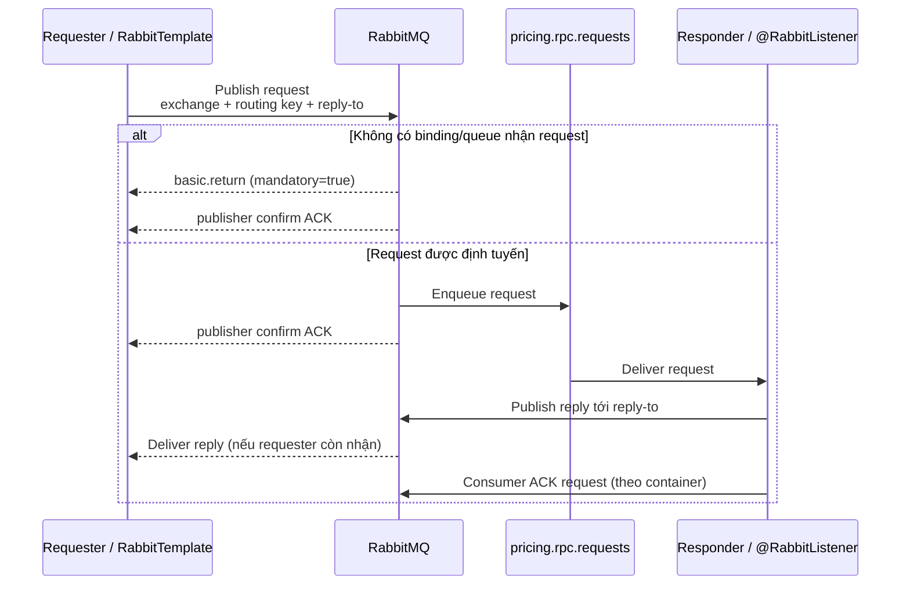

# Publisher confirm/return trong luồng request–reply

Trong **Spring AMQP**, một ứng dụng có thể dùng `RabbitTemplate` để gửi yêu cầu (request) qua RabbitMQ và chờ kết quả (reply) từ `@RabbitListener`. Dù lời gọi này có vẻ giống một hàm đồng bộ, phía dưới vẫn là **hai lần publish độc lập**, qua mạng và broker. Vì vậy cần phân biệt:

1. **Publisher confirm**: RabbitMQ đã chấp nhận hoặc từ chối lần publish **request**?
2. **Publisher return**: Request đã đi qua exchange nhưng **không định tuyến được tới queue** nào?
3. **Reply**: Responder đã xử lý request và gửi lại một kết quả mà requester nhận được?

Ba tín hiệu này trả lời **ba câu hỏi khác nhau**. Một publisher confirm `ack=true` không đảm bảo đã nhận reply; một request được trả về vì `NO_ROUTE` vẫn có thể nhận confirm `ack=true`; và reply timeout cũng không chứng minh thao tác nghiệp vụ chưa được thực hiện.

Bài học thuộc chương **Yêu cầu và phản hồi** của module `SPRING_AMQP`. Mục tiêu là cấu hình `RabbitTemplate`, exchange, queue và binding để thực hành request–reply với publisher confirms, publisher returns, correlation, timeout và xử lý lỗi đáng tin cậy.

## 1. Nhìn rõ hai lần publish trong một RPC

Một ví dụ thực tế: API cần hỏi dịch vụ định giá giá mới nhất của sản phẩm. Requester gửi mã sản phẩm vào `pricing.rpc` với routing key `price.lookup`. Responder đang nghe queue `pricing.rpc.requests` tính giá và trả về qua địa chỉ `reply-to` do requester cung cấp.



Sơ đồ minh họa hai nhánh, **không cam kết thứ tự chính xác** giữa xác nhận publish, xử lý của responder và reply. Publisher confirm đến bất đồng bộ; responder có thể xử lý rất nhanh hoặc mạng có thể làm reply đến trước khi callback confirm được thực thi. Consumer acknowledgement ở phía responder là một cơ chế **khác** với publisher confirm.

| Chặng | Chủ thể gửi | Cơ chế quan sát | Điều được biết |
| --- | --- | --- | --- |
| Requester → exchange/queue | Requester | `publisher confirm` | Broker đã chấp nhận publish theo mức bảo đảm của queue nhận; `ack=false` báo không thành công |
| Exchange → queue request | Requester | `mandatory` + `basic.return` | Exchange không tìm được đích hợp lệ cho request |
| Queue request → responder | Responder | `basic.ack` / `basic.nack` của consumer | Responder đã xác nhận xử lý delivery với broker theo logic của ứng dụng |
| Responder → địa chỉ reply | Responder | Publisher confirm/return **riêng cho reply**, nếu được cấu hình | Broker đã xử lý lần publish thứ hai; chưa chắc requester nhận được |
| Broker → requester | Requester | Reply + correlation ID | Ứng dụng gọi RPC thực sự nhận được câu trả lời tương ứng |

**Ranh giới bảo đảm:** confirm/return của **request** chỉ nói về lần publish request. Chúng không thay thế transaction, retry, dead-letter, xác nhận xử lý phía consumer hoặc bảo đảm gửi reply.

## 2. Publisher confirm: broker có nhận publish hay không?

Khi bật publisher confirms, broker gửi `basic.ack` hoặc `basic.nack` cho lần publish trên channel. Ở Spring AMQP, `RabbitTemplate` có thể nhận kết quả qua `ConfirmCallback` hoặc qua `CorrelationData.getFuture()`:

- `ack=true`: broker đã chấp nhận publish. Với message persistent đi tới durable queue, RabbitMQ chỉ xác nhận sau khi đáp ứng điều kiện lưu trữ tương ứng; với quorum queue, quorum replica phải chấp nhận message.
- `ack=false`: publish không thành công theo broker/client infrastructure; trường `cause`/`reason` có thể có chi tiết, nhưng không phải mọi broker `nack` đều cung cấp lý do.
- **Không có confirm trước thời hạn chờ**: trạng thái **chưa biết**, đặc biệt khi mất kết nối sau lúc broker nhận publish nhưng trước lúc requester nhận được confirm.

Publisher confirm **không nói** rằng một `@RabbitListener` đã chạy, rằng database đã commit hay reply đã phát ra. Bởi thế việc coi `ack=true` là kết quả RPC thành công sẽ gây sai lệch nghiệp vụ.

Ngoài ra, `ack=true` vẫn có thể xuất hiện khi exchange **không route tới bất kỳ queue nào**. Đó là vai trò bổ sung của publisher return.

## 3. Publisher return: request không tìm được queue đích

Với `mandatory=true` trên lần publish, khi một exchange hợp lệ không định tuyến được message tới queue nhận, RabbitMQ trả `basic.return` với mã và thông tin như `NO_ROUTE`. Sau đó broker **vẫn có thể** gửi publisher confirm `ack=true`: exchange đã xử lý publish thành công nhưng không có queue nào nhận.

Để Spring AMQP chuyển tín hiệu này tới requester, cần đủ hai điều kiện:

- Connection factory có `publisher-returns=true`.
- `RabbitTemplate` gửi request với `mandatory=true` (hoặc `mandatory-expression` phù hợp).

**Điểm đặc thù của RPC:** khi gọi `RabbitTemplate.sendAndReceive(...)` hoặc `convertSendAndReceive(...)`, nếu request không route và có publisher returns, template có thể **ném `AmqpMessageReturnedException` ngay**. Lỗi này chứa message bị trả lại, `replyCode`, `replyText`, exchange và routing key.

**Không đăng ký `ReturnsCallback` riêng trên cùng `RabbitTemplate` được dùng cho RPC** nếu muốn template phát hiện return và ném `AmqpMessageReturnedException` theo cơ chế trên. Template chỉ hỗ trợ một returns callback; callback riêng có thể chiếm đường xử lý return mà RPC cần. Nếu ứng dụng cũng publish event một chiều và muốn thống kê returns qua `setReturnsCallback(...)`, hãy dùng **một RabbitTemplate khác** cho nhánh gửi đó.

| Kết quả | Diễn giải đúng |
| --- | --- |
| `basic.return: NO_ROUTE` rồi `confirm: ack=true` | Broker chấp nhận publish nhưng **request không đến queue**; RPC báo lỗi định tuyến |
| Không có return và `confirm: ack=true` | Có cơ sở để xác nhận request đã được broker định tuyến/nhận, **chưa có kết luận về xử lý và reply** |
| `confirm: ack=false` | Publish thất bại hoặc gặp sự cố; xem cause và trạng thái kết nối |
| Publish tới exchange **không tồn tại** | Channel bị đóng với lỗi; **không phải** trường hợp `NO_ROUTE` thông thường và không có `basic.return` bắt buộc |
| Không có confirm, kết nối đứt | **Trạng thái mơ hồ**; retry có thể tạo request trùng |

Nếu exchange có alternate exchange (AE), việc không có return có thể do message đã được AE định tuyến. Khi xác định request có đi đúng queue nghiệp vụ hay không, phải kiểm tra cả topology và binding, không chỉ dựa vào một cờ.

## 4. Reply: tín hiệu ở tầng ứng dụng

Request–reply dựa vào hai message properties quan trọng:

- `replyTo`: địa chỉ để responder gửi kết quả; `RabbitTemplate` thường tự điền khi dùng API `sendAndReceive`/`convertSendAndReceive`.
- `correlationId`: mã ghép **reply** với đúng request đang chờ. `RabbitTemplate` quản lý correlation theo cơ chế của nó; nếu dùng fixed reply queue, cả hai phía phải thống nhất header tương ứng.

Spring AMQP còn có `CorrelationData` truyền vào lời gọi gửi. **Đây là đối tượng gắn publisher confirm với lần publish**, không đồng nghĩa với `MessageProperties.correlationId` dùng ghép reply.

| Định danh | Thuộc tầng nào | Dùng để làm gì? |
| --- | --- | --- |
| `MessageProperties.correlationId` | AMQP message / RPC | Ghép reply với request |
| `CorrelationData.id` | Spring AMQP publisher | Ghép publisher confirm/return với **một lần publish** |
| `messageId` hoặc `businessRequestId` | Dữ liệu nghiệp vụ | Chống xử lý trùng, kiểm toán, truy vấn kết quả |
| Trace ID | Quan sát phân tán | Nối log giữa requester, broker và responder |

Không sử dụng ngẫu nhiên một correlation ID mới ở mỗi chặng rồi xem chúng là cùng một định danh. Một **business request ID ổn định qua retry** giúp responder chống xử lý trùng; một **publish attempt ID riêng** giúp phân tích confirm của từng lần gửi.

### 4.1. Direct Reply-To và fixed reply queue

Khi không cấu hình reply queue cố định, `RabbitTemplate` mặc định ưu tiên **RabbitMQ Direct Reply-To** nếu broker hỗ trợ. Cách này tránh tạo queue tạm cho từng request và thuận tiện cho RPC ngắn:

```text
Requester -> pricing.rpc -> pricing.rpc.requests -> Responder
Requester <- amq.rabbitmq.reply-to.<opaque> <- Responder
```

Tuy nhiên, Direct Reply-To là cơ chế **at-most-once cho reply**, không lưu reply bền vững: requester ngắt kết nối hoặc không kịp nhận thì reply có thể bị mất. Quan trọng hơn, ở AMQP 0-9-1, reply gửi tới `amq.rabbitmq.reply-to.*` có thể được coi là **routed** ngay cả khi requester đã rời đi; phía responder không nhất thiết nhận `basic.return` dù bật `mandatory`. Publisher confirm của **reply** cũng không chứng minh requester đã đọc reply.

Khi reply cần được giữ nếu client tạm ngắt kết nối, cân nhắc **fixed reply queue**, lưu trạng thái xử lý hoặc chuyển sang mô hình asynchronous request/result. Nếu dùng fixed reply queue với nhiều instance requester, mỗi instance/template cần queue reply riêng và listener tương ứng để tránh các instance tranh nhau đọc reply của nhau.

## 5. Cấu hình Spring Boot và RabbitTemplate

Ví dụ sử dụng Spring Boot với `spring-boot-starter-amqp`, RabbitMQ hỗ trợ publisher confirms, và phía ứng dụng có quyền khai báo topology. Cấu hình trong `application.yml`:

```yaml
spring:
  rabbitmq:
    host: localhost
    port: 5672
    username: guest
    password: guest
    publisher-confirm-type: correlated
    publisher-returns: true
```

Hai thuộc tính trên thiết lập cơ sở hạ tầng confirms/returns của `CachingConnectionFactory`. Riêng `mandatory` và timeout đặt ở `RabbitTemplate` dùng cho RPC:

```java
import org.springframework.amqp.core.Binding;
import org.springframework.amqp.core.BindingBuilder;
import org.springframework.amqp.core.DirectExchange;
import org.springframework.amqp.core.Queue;
import org.springframework.amqp.core.QueueBuilder;
import org.springframework.amqp.rabbit.connection.ConnectionFactory;
import org.springframework.amqp.rabbit.core.RabbitTemplate;
import org.springframework.context.annotation.Bean;
import org.springframework.context.annotation.Configuration;

@Configuration
public class PricingRpcConfig {

    @Bean
    DirectExchange pricingRpcExchange() {
        return new DirectExchange("pricing.rpc", true, false);
    }

    @Bean
    Queue pricingRequestQueue() {
        return QueueBuilder.durable("pricing.rpc.requests").build();
    }

    @Bean
    Binding pricingRequestBinding(
            Queue pricingRequestQueue,
            DirectExchange pricingRpcExchange) {
        return BindingBuilder.bind(pricingRequestQueue)
                .to(pricingRpcExchange)
                .with("price.lookup");
    }

    @Bean("pricingRpcTemplate")
    RabbitTemplate pricingRpcTemplate(ConnectionFactory connectionFactory) {
        RabbitTemplate template = new RabbitTemplate(connectionFactory);
        template.setMandatory(true);
        template.setReplyTimeout(4_000L); // RPC timeout 4 giây
        // Không setReturnsCallback trên template RPC này.
        return template;
    }
}
```

`DirectExchange`, durable `Queue` và `Binding` làm rõ đường đi của request. `mandatory=true` cho phép phát hiện trường hợp queue không nhận request; `publisher-confirm-type=correlated` cho phép đối chiếu confirm theo từng publish. `replyTimeout` chỉ là thời gian requester chờ reply, không phải timeout cho publisher confirms.

> Trong hệ thống thực tế, thông tin đăng nhập nên nhận từ biến môi trường/secret manager. Tài khoản `guest/guest` trong ví dụ chỉ phù hợp môi trường RabbitMQ cục bộ theo cấu hình mặc định; không dùng cho máy chủ công khai.

## 6. Viết requester: nhận reply và quan sát confirm

Ví dụ sau dùng overload `sendAndReceive(exchange, routingKey, Message, CorrelationData)` để lấy reply **và** theo dõi publisher confirm của request. `businessRequestId` do tầng gọi cung cấp và **giữ nguyên** nếu thử lại cùng một nghiệp vụ; `CorrelationData.id` là ID của **lần publish hiện tại**.

```java
import java.nio.charset.StandardCharsets;
import java.util.UUID;

import org.slf4j.Logger;
import org.slf4j.LoggerFactory;
import org.springframework.amqp.core.Message;
import org.springframework.amqp.core.MessageBuilder;
import org.springframework.amqp.core.MessageProperties;
import org.springframework.amqp.rabbit.connection.CorrelationData;
import org.springframework.amqp.rabbit.core.AmqpMessageReturnedException;
import org.springframework.amqp.rabbit.core.RabbitTemplate;
import org.springframework.beans.factory.annotation.Qualifier;
import org.springframework.stereotype.Service;

@Service
public class PricingRpcRequester {
    private static final Logger log =
            LoggerFactory.getLogger(PricingRpcRequester.class);

    private final RabbitTemplate rpcTemplate;

    public PricingRpcRequester(
            @Qualifier("pricingRpcTemplate") RabbitTemplate rpcTemplate) {
        this.rpcTemplate = rpcTemplate;
    }

    public String getPrice(String sku, String businessRequestId) {
        String publishAttemptId = UUID.randomUUID().toString();
        CorrelationData publishData = new CorrelationData(publishAttemptId);

        // Callback này theo dõi broker confirm bất đồng bộ.
        publishData.getFuture().whenComplete((confirm, error) -> {
            if (error != null) {
                log.error("Publisher confirm không hoàn tất: {}",
                        publishAttemptId, error);
                return;
            }
            if (confirm == null || !confirm.isAck()) {
                log.warn("Request publish NACK: {}, reason={}",
                        publishAttemptId,
                        confirm == null ? "unknown" : confirm.getReason());
                return;
            }
            if (publishData.getReturn() != null) {
                log.warn("Request publish được ACK nhưng không route: {}",
                        publishAttemptId);
                return;
            }
            log.info("Request publish ACK: {}", publishAttemptId);
        });

        Message request = MessageBuilder
                .withBody(sku.getBytes(StandardCharsets.UTF_8))
                .setContentType(MessageProperties.CONTENT_TYPE_TEXT_PLAIN)
                .build();
        request.getMessageProperties().setMessageId(businessRequestId);

        try {
            Message reply = rpcTemplate.sendAndReceive(
                    "pricing.rpc", "price.lookup", request, publishData);
            if (reply == null) {
                throw new IllegalStateException(
                        "Reply timeout; chưa biết nghiệp vụ đã xử lý hay chưa. "
                        + "businessRequestId=" + businessRequestId);
            }
            return new String(reply.getBody(), StandardCharsets.UTF_8);
        } catch (AmqpMessageReturnedException ex) {
            throw new IllegalStateException(
                    "Request không được định tuyến: "
                    + ex.getReplyText() + ", businessRequestId="
                    + businessRequestId, ex);
        }
    }
}
```

**Cách đọc kết quả của ví dụ:**

- Nhận được `Message reply`: requester đã nhận câu trả lời. Đây là tín hiệu nghiệp vụ; listener có thể trả về kết quả thành công, lỗi hoặc trạng thái được mã hóa trong body tùy thiết kế giao thức.
- `AmqpMessageReturnedException`: request không đến queue nhận, nhờ `mandatory=true` và `publisher-returns=true`. Có thể sửa binding/routing key trước khi retry.
- `reply == null`: hết thời gian chờ; request **có thể đã được xử lý**, chỉ là không có reply kịp thời. Không tự động kết luận thất bại và tạo lại nghiệp vụ.
- Callback của `CorrelationData.getFuture()`: theo dõi confirm **bất đồng bộ**, có thể được gọi trước hoặc sau khi `sendAndReceive` kết thúc. Không dùng thứ tự callback làm logic xác nhận reply.
- `CorrelationData.getReturn()`: dùng để phân tích request bị trả về khi cả publisher returns và confirms đã bật. Trong RPC, đường lỗi chính của request không route vẫn là `AmqpMessageReturnedException`.

Code trên mô tả nguyên lý, dùng `IllegalStateException` để minh họa. Ứng dụng thật nên có kiểu lỗi riêng (chẳng hạn `RequestUnroutable`, `ReplyTimedOut`, `PublishOutcomeUnknown`), bộ đo metrics và quy trình xử lý retry dựa trên tính idempotent của nghiệp vụ.

### 6.1. Tại sao không chờ confirm như thể đó là reply?

Đây là hai tín hiệu với thời điểm hoàn tất khác nhau. Nếu `getFuture()` hoàn thành với `ack=true` nhưng `sendAndReceive` đang chờ, request có thể đang trong queue hoặc responder đang xử lý. Ngược lại, nếu reply đã tới mà callback confirm chưa chạy, điều đó không làm reply vô hiệu.

Không gọi `getFuture().get()` vô thời hạn trên luồng phục vụ HTTP. Nếu cần kiểm toán publish, hãy giới hạn thời gian chờ riêng cho confirm, theo dõi qua callback hoặc sự kiện bất đồng bộ, và mô hình hóa tình huống **không xác định kết quả gửi**. Hai timeout không thay thế nhau.

## 7. Viết responder: trả về kết quả qua @RabbitListener

Với `@RabbitListener` trả về một đối tượng hoặc `String`, Spring AMQP có thể tự gửi reply đến địa chỉ `replyTo` trong request. Ví dụ đơn giản:

```java
import org.springframework.amqp.rabbit.annotation.RabbitListener;
import org.springframework.stereotype.Component;

@Component
public class PricingRpcResponder {

    @RabbitListener(queues = "pricing.rpc.requests")
    public String lookupPrice(String sku) {
        // Ví dụ dữ liệu cố định; sản phẩm thật sẽ gọi pricing service.
        return "sku=" + sku + ";priceVnd=120000";
    }
}
```

Trong trường hợp này, listener adapter lo việc sử dụng `replyTo` và correlation liên quan khi phản hồi. Không cần `@SendTo` nếu request đã có địa chỉ reply thích hợp. Nếu không có `replyTo`, có thể cấu hình đích dự phòng bằng `@SendTo`, nhưng phải hiểu rõ đây là một cơ chế routing khác.

**Lỗi hay bị bỏ qua:** việc `@RabbitListener` hoàn tất và RabbitMQ xác nhận request ở phía consumer không có nghĩa là requester đã nhận reply. Phần publish reply là một chặng riêng; nếu cần xác nhận chặt chẽ chặng này, phải thiết kế việc publish, confirm, retry và ack của responder có chủ đích. Một phương thức listener chỉ `return String` không chứng minh end-to-end delivery.

Đặc biệt với Direct Reply-To, reply có thể mất khi requester ngắt kết nối ngay sau lúc responder xử lý. Cách khắc phục thường là **tra cứu trạng thái theo businessRequestId**, kết hợp xử lý idempotent để requester có thể retry mà không tạo nghiệp vụ mới.

## 8. Các tình huống lỗi và hành động phù hợp

| Tình huống | Confirm request | Return request | Reply | Hành động đề xuất |
| --- | --- | --- | --- | --- |
| Request vào queue, responder trả kết quả kịp | Thường `ack=true` | Không | Có | Dùng kết quả, log correlation |
| Sai routing key, exchange có tồn tại nhưng không có binding | Có thể `ack=true` | `NO_ROUTE` | Không | Báo lỗi topology, sửa route; không coi ACK là thành công |
| Exchange request không tồn tại | Lỗi channel / có thể NACK từ framework | Không phải `NO_ROUTE` | Không | Kiểm tra khai báo exchange và exception; tránh retry vô hạn |
| Request đã vào queue, responder xử lý chậm | `ack=true` | Không | Timeout | Truy vấn trạng thái; retry có business ID ổn định nếu an toàn |
| Responder commit database rồi requester mất kết nối | `ack=true` | Không | Có thể mất | Xem nghiệp vụ là **có thể đã hoàn thành**, áp dụng idempotency |
| Responder gửi reply bằng Direct Reply-To khi requester đã rời đi | Confirm reply có thể ACK | Return reply có thể **không** xảy ra | Requester không nhận | Không lấy confirm reply làm bằng chứng đã đọc |
| Kết nối requester bị đứt trước confirm | Không nhận được hoặc không chắc chắn | Không chắc chắn | Không chắc chắn | Trạng thái publish mơ hồ; tra cứu, retry có kiểm soát |
| Reply tới sau `replyTimeout` | Độc lập | Độc lập | Bị xem là reply muộn | Theo dõi late reply; không đưa nhầm vào RPC tiếp theo |

### 8.1. Khác nhau giữa timeout và lỗi định tuyến

`replyTimeout` của Spring AMQP mặc định là khoảng **5 giây**; `sendAndReceive` trả `null` nếu chưa nhận reply trong khoảng này. Với `mandatory=true` và publisher returns phù hợp, request không route có thể ném `AmqpMessageReturnedException` thay vì chờ hết timeout. Hai trường hợp cần thông báo và retry khác nhau:

- **Unroutable:** nhiều khả năng là lỗi cấu hình hoặc sai routing key, cần sửa topology.
- **Timeout:** request có thể nằm trong queue, responder đang chậm, responder lỗi, reply bị mất hoặc requester bị ngắt kết nối. Cần xác minh trạng thái nghiệp vụ trước khi phát lại tác vụ có tác dụng phụ.

Với reply muộn, Spring AMQP có cơ chế từ chối reply không còn request đang chờ; có thể cấu hình dead-letter cho **fixed reply queue** để điều tra. Với Direct Reply-To, không có queue reply bền vững để thu thập như vậy.

### 8.2. Khi nào nên dùng publisher returns callback?

Với publish thông thường một chiều, cách cấu hình hợp lệ là:

```java
// Một RabbitTemplate riêng cho publish một chiều (không dùng làm RPC).
eventTemplate.setMandatory(true);
eventTemplate.setReturnsCallback(returned -> {
    // Ghi metrics, log exchange / routing key / reply code.
    System.err.println("Unroutable: " + returned.getReplyText());
});
eventTemplate.setConfirmCallback((data, ack, cause) -> {
    // Ghi nhận trạng thái publish; không chờ reply ở đây.
});
```

Đoạn này minh họa phương thức callback trên một biến `eventTemplate` đã được khởi tạo/cấu hình ở nơi khác. Trong nhánh RPC ở mục 6, **không dùng callback return riêng** trên `pricingRpcTemplate`: template cần giữ đường xử lý return để phát hiện request không route và ném ngoại lệ.

## 9. Thực hành kiểm chứng từng tín hiệu

Chuẩn bị RabbitMQ đang chạy, ứng dụng có exchange `pricing.rpc`, queue `pricing.rpc.requests`, binding `price.lookup`, publisher confirms/returns và hai class requester/responder ở trên.

1. **Luồng thành công:** gọi `getPrice("P-100", "order-101")`. Quan sát reply `sku=P-100;priceVnd=120000` và publisher confirm `ack=true`; hai tín hiệu được log riêng.
2. **Không định tuyến:** trong môi trường thử nghiệm, tạm gỡ binding `price.lookup` rồi gọi RPC. Kỳ vọng `AmqpMessageReturnedException` với `NO_ROUTE`; cũng có thể thấy publisher confirm `ack=true`. Khôi phục binding sau phép thử.
3. **Chậm phản hồi:** cho responder chậm hơn `replyTimeout=4000` ms. Requester nhận `null` (được ví dụ chuyển thành lỗi timeout), nhưng responder vẫn có thể hoàn thành sau đó.
4. **Broker/ngắt mạng:** ngắt kết nối trong lúc request đang gửi. Không giả định request chắc chắn bị mất hay đã nhận; ghi `businessRequestId` để tra cứu và thử lại an toàn.
5. **Tắt responder:** request vẫn có thể được queue nhận và confirm ACK, nhưng không có reply trước timeout. Điều này cho thấy **ACK của broker ≠ xử lý của service**.
6. **Kiểm tra reply bị mất:** trong môi trường cô lập, để requester hết hạn/thoát trước khi responder phản hồi qua Direct Reply-To. Quan sát timeout dù responder có thể đã thực hiện công việc.

Để điều tra, ghi ít nhất `businessRequestId`, `CorrelationData.id`, correlation ID của message (nếu có), exchange, routing key, thời điểm gửi, thời điểm broker ACK/NACK, `replyCode` khi return, thời gian chờ reply và thời gian xử lý của responder. Không ghi toàn bộ payload chứa thông tin nhạy cảm trong log.

Các metric hữu ích: tỷ lệ `request_publish_ack`/`request_publish_nack`, `request_return_no_route`, `rpc_reply_timeout`, `rpc_response_latency`, số reply muộn, độ sâu queue request, số lần xử lý trùng bị chặn và độ trễ publisher confirm.

## 10. Nguyên tắc thiết kế request–reply đáng tin cậy

1. **Giữ riêng ba trạng thái** `publishOutcome`, `routingOutcome` và `businessReplyOutcome` trong log/metrics. Đừng gộp thành một biến `success` rồi suy diễn.
2. **Dùng `mandatory=true` và publisher returns** để phát hiện request không tìm được queue; nhớ ngoại lệ trong RPC cần template giữ returns callback nội bộ.
3. **Giữ idempotency key ổn định qua retry** vì timeout hoặc mất confirm không cho biết request có được xử lý hay chưa.
4. **Quy định timeout và retry theo SLA**, tránh request chồng chất khi responder chậm. Backoff, giới hạn số lần và circuit breaker giúp giảm áp lực.
5. **Chọn cơ chế reply theo độ bền cần thiết.** Direct Reply-To nhẹ nhưng at-most-once; fixed reply queue hoặc mô hình gửi job rồi truy vấn kết quả phù hợp hơn khi cần khôi phục sau đứt kết nối.
6. **Phân biệt xác nhận gửi reply với xác nhận requester nhận reply.** Nếu yêu cầu biết chắc requester đã nhận kết quả, cần application-level acknowledgement/protocol hoặc lưu trạng thái kết quả; publisher confirm ở responder không đủ.
7. **Phối hợp giao dịch nghiệp vụ với messaging có chủ đích.** Nếu thay đổi database rồi gửi reply, không có giao dịch nguyên tử mặc định qua cả hai. Với tác vụ quan trọng, dùng outbox hoặc trạng thái xử lý bền vững để retry an toàn.

Một cách ghi trạng thái rõ ràng là:

```text
Publish request: ACCEPTED | UNROUTABLE | NACKED | UNKNOWN
Business result: REPLIED_OK | REPLIED_ERROR | TIMED_OUT | UNKNOWN

ACCEPTED + TIMED_OUT  => Request có thể đã xử lý; tra cứu trước khi retry.
UNROUTABLE + UNKNOWN => Kiểm tra topology, không chờ responder.
ACCEPTED + REPLIED_OK => Requester nhận được kết quả, vẫn cần nghiệp vụ idempotent.
```

## 11. Câu hỏi tự kiểm tra

1. Vì sao một request có thể có `publisher confirm ack=true` nhưng `basic.return NO_ROUTE`?
2. Khi `RabbitTemplate.sendAndReceive` timeout, có thể kết luận responder chưa cập nhật database không? Vì sao?
3. `CorrelationData.id` và `MessageProperties.correlationId` khác nhau ở trách nhiệm nào?
4. Vì sao không nên đăng ký `setReturnsCallback` trực tiếp trên cùng RPC template đang cần `AmqpMessageReturnedException`?
5. Direct Reply-To có bảo đảm reply tới requester nếu responder nhận publisher confirm `ack=true` không?
6. Nếu gửi lại request sau lỗi mạng, ID nào nên giữ nguyên để tránh thực hiện lại một giao dịch nghiệp vụ?

## Tài liệu tham khảo

- [Spring AMQP — Request/Reply Messaging](https://docs.spring.io/spring-amqp/reference/amqp/request-reply.html): `sendAndReceive`, `replyTimeout`, `AmqpMessageReturnedException` và yêu cầu callback trong RPC.
- [Spring AMQP — AmqpTemplate: Correlated Publisher Confirms and Returns](https://docs.spring.io/spring-amqp/reference/amqp/template.html): `CorrelationData`, `getFuture()`, `getReturn()` và chính sách callbacks.
- [Spring AMQP — Reply Management](https://docs.spring.io/spring-amqp/reference/amqp/receiving-messages/async-annotation-driven/reply.html): responder `@RabbitListener` trả reply qua `replyTo`.
- [RabbitMQ — Consumer Acknowledgements and Publisher Confirms](https://www.rabbitmq.com/docs/confirms): phạm vi bảo đảm và thứ tự `basic.return`/publisher confirm.
- [RabbitMQ — Direct Reply-To](https://www.rabbitmq.com/docs/direct-reply-to): đặc điểm at-most-once, khi reply bị mất và giới hạn `mandatory` trên pseudo queue.
- [RabbitMQ — Reliability Guide](https://www.rabbitmq.com/docs/reliability): khả năng trùng message và idempotency khi retry.
