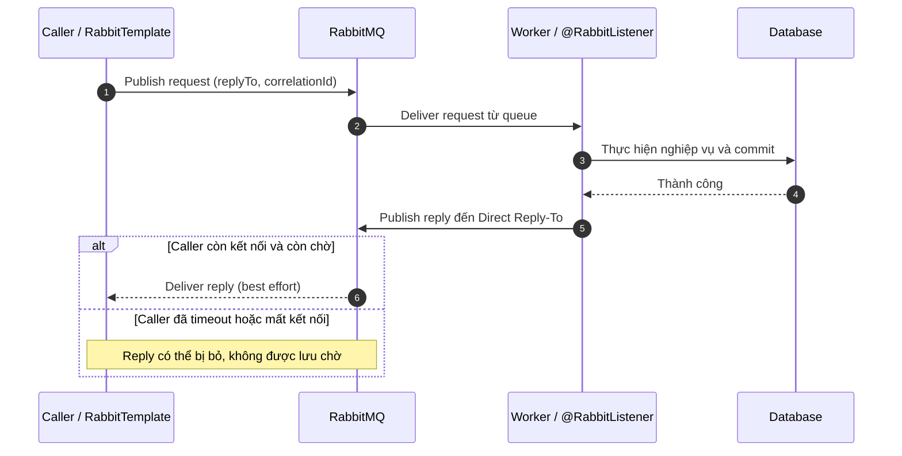
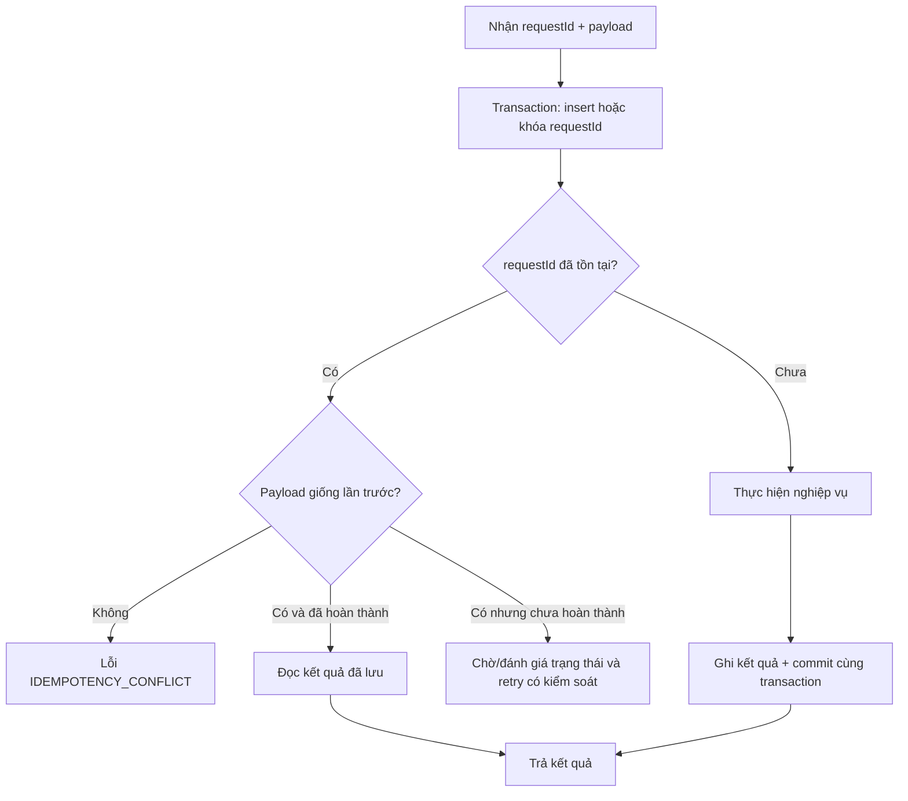

# Giới hạn độ tin cậy của Direct Reply-To và khả năng xử lý lại request

## 1. Bối cảnh: request thành công nhưng caller vẫn thấy timeout

Trong chương **Yêu cầu và phản hồi** của **Spring AMQP**, chúng ta có thể dùng `RabbitTemplate.convertSendAndReceive(...)` gửi một request qua RabbitMQ và chờ kết quả từ phương thức `@RabbitListener`. Khi RabbitMQ hỗ trợ **Direct Reply-To**, Spring AMQP thường tự sử dụng cơ chế này để trả lời mà không phải khai báo một reply queue thông thường cho mỗi caller.

Điểm cần hiểu ngay: **request đã được xử lý thành công không có nghĩa reply chắc chắn đến được caller**. Thậm chí cùng một request có thể được consumer xử lý lại sau khi redelivery hoặc sau khi client tự retry. Đây là hai vấn đề khác nhau nhưng thường xảy ra đồng thời.

Ví dụ, service **Đơn hàng** gửi lệnh giữ 2 sản phẩm trong kho:

1. Service gửi request vào queue; worker giữ hàng thành công và ghi giao dịch vào cơ sở dữ liệu.
2. Caller hết thời gian chờ, hoặc mất kết nối trước khi nhận reply.
3. Caller không biết hàng đã được giữ nên gửi lại lệnh.
4. Nếu worker không nhận diện lần gửi lặp, kho có thể bị trừ thêm 2 sản phẩm.

Mục tiêu của bài:

- Giải thích Direct Reply-To vận chuyển reply như thế nào và **tại sao nó không cung cấp lưu trữ reply bền vững**.
- Phân biệt độ tin cậy của **request**, **reply**, **ack/confirm** và **hiệu ứng nghiệp vụ**.
- Phân tích các trường hợp timeout, response đến muộn, consumer crash, redelivery và retry từ client.
- Thiết kế `requestId` và xử lý **idempotent** để một lệnh nghiệp vụ có thể nhận nhiều lần mà chỉ gây tác dụng phụ một lần.
- Biết khi nào nên dùng reply queue bền, event hoặc API tra cứu trạng thái thay vì phụ thuộc vào Direct Reply-To.

## 2. Direct Reply-To thực chất là gì?

Theo giao thức AMQP request–reply, request có thuộc tính **`replyTo`** để worker biết địa chỉ gửi response và **`correlationId`** để caller ghép reply với request đang chờ. Với một reply queue thông thường, broker có thể đưa reply vào queue đó. **Direct Reply-To** tối ưu bằng cách chuyển reply trực tiếp tới consumer đang chờ qua một địa chỉ đặc biệt bắt đầu bằng `amq.rabbitmq.reply-to`, không phải thông qua một queue thông thường có lưu trữ lâu dài.

Ở phía caller, Spring AMQP có thể dùng `DirectReplyToMessageListenerContainer` để nhận reply; `RabbitTemplate` quản lý thông tin correlation cho các RPC đồng thời. Cơ chế cụ thể phụ thuộc phiên bản và cấu hình Spring AMQP/RabbitMQ, nhưng ứng dụng vẫn gọi `convertSendAndReceive(...)` như một RPC.



### Những giới hạn phải nhớ

| Đặc tính | Hệ quả khi dùng Direct Reply-To |
|---|---|
| **Không lưu reply trong queue bền** | Reply không được giữ lại để client kết nối lại và nhận sau. |
| **Ngữ nghĩa truyền reply kiểu at-most-once** | Broker có thể giao được một lần hoặc không giao được; không có cơ chế redelivery bền cho reply đã mất. |
| **Consumer nhận reply theo cơ chế no-ack** | Client không thể dựa vào manual acknowledgement của reply để yêu cầu broker phát lại response thất lạc. |
| **Phụ thuộc consumer còn hoạt động** | Mất kết nối, caller dừng chờ hoặc tiến trình chết có thể làm reply không tới nơi. |
| **Giảm chi phí quản lý reply queue** | Phù hợp với RPC phản hồi nhanh và chịu được mất reply bằng timeout/đối soát; không phải bảo đảm kết quả đầu-cuối. |

Direct Reply-To không tự biến request thành kiểu `at-most-once`. Request vẫn đi qua **exchange → binding → request queue**, với chính sách lưu trữ và acknowledgement riêng. Vì thế, **request có thể được giao lại nhiều lần trong khi reply chỉ có một cơ hội giao thành công**.

> Tên `amq.rabbitmq.reply-to` có thể khiến bạn nghĩ đó là queue để kiểm tra bằng giao diện quản trị RabbitMQ. Trong mô hình Direct Reply-To, đây là cơ chế chuyển reply trực tiếp với semantics khác queue classic/quorum; không nên áp dụng các giả định của queue bền cho nó.

### So sánh các cách nhận phản hồi

| Cách nhận kết quả | Ưu điểm | Giới hạn cần xử lý |
|---|---|---|
| **Direct Reply-To** | Ít topology, không cần quản lý reply queue cho từng caller; tiện cho RPC ngắn. | Reply có thể mất, đến muộn; không có backlog reply bền. |
| **Reply queue thông thường** | Có thể cấu hình queue bền, message persistent, consumer ack và reconnect. | Cần quản lý queue, consumer, correlation, TTL và reply không còn người chờ. Queue bền một mình chưa bảo đảm caller xử lý kết quả đúng một lần. |
| **Command + event / lưu kết quả để tra cứu** | Caller không phải chờ RPC xuyên suốt; có thể nhận kết quả muộn hoặc đọc lại sau khi reconnect. | Phải quản lý trạng thái job, giao thức kết quả, deduplication và nhất quán cuối cùng. |

Đối với nghiệp vụ không thể mất dấu kết quả (ví dụ thanh toán hoặc giữ hàng), cần **lưu trạng thái nghiệp vụ bền vững** dù chọn cách truyền reply nào. Một reply queue bền là phương án tăng độ bền của thông điệp phản hồi, nhưng không thay thế việc lưu kết quả theo `requestId`.

## 3. Vì sao xác nhận giao nhận không bảo đảm RPC thành công?

RabbitMQ và Spring AMQP có nhiều lớp xác nhận khác nhau:

1. **Publisher confirm cho request:** broker xác nhận việc publish ở mức broker; không có nghĩa worker đã hoàn thành nghiệp vụ.
2. **Consumer ack cho request:** worker xác nhận đã tiêu thụ request theo chính sách ack; không có nghĩa caller đã nhận reply.
3. **Publish reply:** worker hoặc listener container đưa response lên broker; việc publish không chứng minh response đã được client nhận hoặc xử lý.
4. **Caller nhận reply:** `RabbitTemplate` tìm được response khớp `correlationId`; không chứng minh response đã được hệ thống gọi bên ngoài ghi nhận bền vững.
5. **Commit nghiệp vụ:** dữ liệu đã thay đổi trong database; bước này có thể xảy ra **trước cả khi reply được gửi**.

Không nên gộp những lớp này thành một cờ `success`.

| Thời điểm xảy ra lỗi | Điều có thể đã xảy ra | Hậu quả |
|---|---|---|
| Publish request không định tuyến vào queue | Worker chưa có request | Caller timeout nếu không bắt được lỗi routing; cần publisher return/monitoring. |
| Request vào queue nhưng worker chưa chạy | Message có thể đang chờ | Caller timeout; khi worker chạy lại, request vẫn có thể được thực thi. |
| Worker commit database rồi crash trước ack | Nghiệp vụ đã thành công, request chưa được ack | Broker có thể redeliver, gây xử lý trùng nếu không idempotent. |
| Worker ack request rồi reply bị mất | Broker không còn request để phát lại | Caller timeout dù nghiệp vụ thành công. |
| Worker gửi reply, caller mất kết nối | Reply có thể bị mất trên Direct Reply-To | Caller phải đối soát kết quả bằng một kênh bền khác nếu cần. |
| Caller timeout rồi tự gửi lại | Có hai lần gửi cùng một ý định nghiệp vụ | Cần cùng `requestId` để deduplicate; không tạo tác dụng phụ lần hai. |
| Worker ném exception trước commit | Request có thể được retry/requeue hoặc DLQ tùy cấu hình | Caller vẫn có thể timeout; DLQ không tự trở thành reply lỗi. |

### Ack sớm, ack muộn và cửa sổ lỗi

- **Ack trước khi hoàn thành nghiệp vụ:** giảm khả năng redelivery, nhưng nếu worker chết ngay sau ack thì request có thể mất mà nghiệp vụ chưa hoàn thành.
- **Ack sau khi hoàn thành nghiệp vụ:** thường an toàn hơn cho request, nhưng nếu worker chết **sau commit và trước ack** thì broker có thể giao lại. Bắt buộc có idempotency khi tác dụng phụ không được lặp.
- **Gửi reply trước/sau ack:** không có thứ tự nào bảo đảm atomic giữa database, ack request và delivery reply qua Direct Reply-To. Chúng thuộc các hệ thống và đường truyền khác nhau.

Ack thủ công, publisher confirms, transaction AMQP và transaction cơ sở dữ liệu giúp giải quyết các lớp lỗi riêng, nhưng **không tự tạo giao dịch nguyên tử end-to-end** giữa RabbitMQ, database và caller. Với request có tác dụng phụ, kỳ vọng hợp lý là **at-least-once delivery + idempotent processing**, thay vì giả định exactly-once delivery.

## 4. Timeout không phải lệnh hủy request

Với `RabbitTemplate`, `setReplyTimeout(2500)` giới hạn thời gian client chờ reply; khi hết hạn, `convertSendAndReceive(...)` trả `null`. Tuy nhiên:

- Request có thể vẫn ở queue vì worker đang offline hoặc chậm.
- Request có thể đang được xử lý và chưa commit.
- Request có thể **đã commit xong** nhưng response chưa tới.
- Reply đến sau timeout có thể không còn lời gọi nào chờ để ghép; ứng dụng không thể coi nó là kết quả được nhận thành công.

```mermaid
sequenceDiagram
    autonumber
    participant C as Caller
    participant B as RabbitMQ
    participant W as Worker
    C->>B: Request requestId=R1
    B->>W: Giao request R1
    Note over W: Xử lý chậm
    Note over C: Hết replyTimeout
    C-->>C: Báo trạng thái chưa xác định
    W->>W: Commit thay đổi nghiệp vụ
    W->>B: Reply cho R1
    Note over B,C: Reply Direct Reply-To có thể không đến
    C->>B: Retry requestId=R1
    B->>W: Giao lại R1
    W-->>B: Trả kết quả đã lưu; không thực hiện lại
    B-->>C: Reply của lần retry, nếu caller còn chờ
```

Hết hạn chờ nên được hiểu là **“chưa xác nhận được kết quả”**. Chỉ kết luận **thất bại nghiệp vụ** khi worker trả kết quả thất bại có hợp đồng rõ ràng hoặc truy vấn trạng thái bền xác nhận việc đó.

Không coi request TTL là cơ chế hủy giao dịch: TTL có thể giới hạn thời gian message nằm **trong queue**, nhưng không hoàn tác request đang xử lý hay giao dịch đã commit. Nếu cần hủy tác vụ, phải thiết kế trạng thái hủy và cách xử lý tình huống hoàn thành đồng thời.

## 5. Triển khai Spring AMQP: requestId ổn định và reply có thể mất

Ví dụ sau sử dụng lệnh **giữ tồn kho**. Caller có thể gửi cùng một request nhiều lần, nhưng worker phải chỉ tạo **một** reservation cho mỗi `requestId`. Dây chuyền AMQP sử dụng `RabbitTemplate`, `@RabbitListener`, direct exchange, queue và binding.

Để dễ tập trung vào cơ chế retry, payload minh họa dùng chuỗi `requestId|sku|quantity`, reply dùng `STATUS|requestId|value`. Trong ứng dụng thật hãy dùng JSON có schema, validation, converter tương thích giữa hai service và không dùng ký tự phân cách không được escape.

### 5.1. Khai báo topology và reply timeout

```java
import org.springframework.amqp.core.Binding;
import org.springframework.amqp.core.BindingBuilder;
import org.springframework.amqp.core.DirectExchange;
import org.springframework.amqp.core.Queue;
import org.springframework.amqp.core.QueueBuilder;
import org.springframework.amqp.rabbit.connection.ConnectionFactory;
import org.springframework.amqp.rabbit.core.RabbitTemplate;
import org.springframework.context.annotation.Bean;
import org.springframework.context.annotation.Configuration;

@Configuration
public class InventoryRpcConfig {
    public static final String EXCHANGE = "inventory.rpc";
    public static final String QUEUE = "inventory.reserve.requests";
    public static final String ROUTING_KEY = "inventory.reserve";

    @Bean
    DirectExchange inventoryExchange() {
        return new DirectExchange(EXCHANGE, true, false);
    }

    @Bean
    Queue reserveQueue() {
        return QueueBuilder.durable(QUEUE).build();
    }

    @Bean
    Binding reserveBinding(Queue reserveQueue, DirectExchange inventoryExchange) {
        return BindingBuilder.bind(reserveQueue)
                .to(inventoryExchange).with(ROUTING_KEY);
    }

    @Bean
    RabbitTemplate inventoryRpcTemplate(ConnectionFactory connectionFactory) {
        RabbitTemplate template = new RabbitTemplate(connectionFactory);
        template.setReplyTimeout(2_500L);
        return template;
    }
}
```

Ở broker hỗ trợ và cấu hình tương thích, `RabbitTemplate` có thể dùng Direct Reply-To tự động cho RPC; không cần tự khai báo reply queue trong ví dụ. `QueueBuilder.durable(...)` chỉ khai báo **request queue** bền. Để bảo vệ request trước lỗi broker còn cần xem xét message persistence, publisher confirms và cấu hình broker; các yếu tố đó không thay đổi tính không bền của Direct Reply-To.

### 5.2. Caller: retry với cùng requestId

```java
import org.springframework.amqp.rabbit.core.RabbitTemplate;
import org.springframework.stereotype.Service;

@Service
public class InventoryRpcClient {
    private final RabbitTemplate template;

    public InventoryRpcClient(RabbitTemplate template) {
        this.template = template;
    }

    // requestId phải được tạo một lần cho một ý định nghiệp vụ,
    // đồng thời giữ nguyên qua các lần retry.
    public String reserve(String requestId, String sku, int quantity) {
        if (requestId == null || requestId.isBlank() ||
                sku == null || sku.isBlank() || sku.contains("|") ||
                quantity <= 0) {
            throw new IllegalArgumentException("Request không hợp lệ");
        }

        String payload = requestId + "|" + sku + "|" + quantity;
        Object raw = template.convertSendAndReceive(
                InventoryRpcConfig.EXCHANGE,
                InventoryRpcConfig.ROUTING_KEY,
                payload
        );

        if (raw == null) {
            // Không khẳng định rằng worker chưa thực thi.
            throw new IllegalStateException(
                    "TIMEOUT_UNCONFIRMED: tra cứu trạng thái requestId="
                    + requestId + " trước khi retry");
        }
        if (!(raw instanceof String reply)) {
            throw new IllegalStateException("Định dạng reply không hợp lệ");
        }

        String[] fields = reply.split("\\|", 3);
        if (fields.length != 3 || !requestId.equals(fields[1])) {
            throw new IllegalStateException("Reply sai requestId/định dạng");
        }
        if ("REJECTED".equals(fields[0])) {
            throw new IllegalArgumentException(fields[2]);
        }
        if (!"OK".equals(fields[0])) {
            throw new IllegalStateException("Trạng thái reply không xác định");
        }
        return fields[2]; // reservationId đã được lưu
    }
}
```

**Hai loại mã không được đánh đồng:** `correlationId` ở AMQP giúp `RabbitTemplate` ghép reply cho **từng lần gọi RPC**; `requestId` trong payload đại diện cho **cùng một thao tác nghiệp vụ**, nên phải **giữ nguyên qua retry**. Nếu caller tạo UUID mới mỗi lần thử, worker sẽ xem đó là những thao tác độc lập và không thể nhận ra retry.

Ví dụ gọi đúng:

```java
String requestId = java.util.UUID.randomUUID().toString();
try {
    String reservationId = client.reserve(requestId, "SKU-42", 2);
    // Lưu reservationId vào tiến trình đặt hàng.
} catch (IllegalStateException timeoutOrTransportError) {
    // Trước hết đối soát trạng thái requestId bằng cơ chế bền.
    // Nếu chính sách cho phép retry, gọi lại bằng CÙNG requestId.
}
```

Không tự động retry mọi lỗi: lỗi dữ liệu hoặc hết hàng không cải thiện khi gửi lại. Với lỗi tạm thời, dùng retry có giới hạn, backoff và jitter cùng **deadline tổng** của giao dịch. Một lần RPC có thể timeout trong khi công việc gốc tiếp tục chạy.

### 5.3. Consumer: thực thi một lần, trả lại kết quả cũ khi nhận trùng

```java
import org.springframework.amqp.rabbit.annotation.RabbitListener;
import org.springframework.stereotype.Component;

@Component
public class InventoryRpcListener {
    private final ReservationService reservations;

    public InventoryRpcListener(ReservationService reservations) {
        this.reservations = reservations;
    }

    @RabbitListener(queues = InventoryRpcConfig.QUEUE)
    public String handle(String body) {
        String[] parts = body.split("\\|", 3);
        if (parts.length != 3) {
            return "REJECTED|unknown|INVALID_REQUEST";
        }

        String requestId = parts[0];
        String sku = parts[1];
        int quantity;
        try {
            quantity = Integer.parseInt(parts[2]);
        } catch (NumberFormatException ex) {
            return "REJECTED|" + requestId + "|INVALID_QUANTITY";
        }
        if (requestId.isBlank() || sku.isBlank() || quantity <= 0) {
            return "REJECTED|" + requestId + "|INVALID_REQUEST";
        }

        ReservationResult result =
                reservations.reserveOnce(requestId, sku, quantity);
        return result.status() + "|" + requestId + "|" + result.value();
    }
}

// Hợp đồng nghiệp vụ; triển khai bền vững ở mục 6.
interface ReservationService {
    ReservationResult reserveOnce(String requestId, String sku, int quantity);
}

record ReservationResult(String status, String value) {}
```

Đây là ví dụ minh họa luồng RPC; `ReservationService` cần được hiện thực bằng repository/transaction thật để bảo đảm idempotency. Không dùng `ConcurrentHashMap` làm nguồn sự thật cho nghiệp vụ quan trọng: khi service restart, lịch sử xử lý trùng sẽ biến mất; nhiều replica cũng không chia sẻ bộ nhớ.

Khi listener trả về một `String`, Spring AMQP có thể tự publish giá trị đó tới địa chỉ `replyTo` của request. Nếu listener ném exception và request bị retry/requeue, **không mặc định coi exception đó là reply lỗi gửi thành công tới caller**. Cần quy ước rõ loại lỗi được trả `REJECTED` và loại lỗi cần retry/DLQ.

## 6. Thiết kế khả năng xử lý lại request bằng cơ sở dữ liệu

Idempotency là đặc tính nghiệp vụ: **cùng một requestId + cùng nội dung** có thể nhận nhiều lần, nhưng trạng thái cuối cùng và tác dụng phụ chỉ được tạo một lần. Nếu một requestId bị tái sử dụng cho nội dung khác, phải trả lỗi xung đột, không âm thầm trả kết quả của thao tác cũ.

Ví dụ lược đồ quan hệ (PostgreSQL):

```sql
CREATE TABLE reservation_requests (
    request_id       VARCHAR(100) PRIMARY KEY,
    sku              VARCHAR(100) NOT NULL,
    quantity         INTEGER NOT NULL,
    status           VARCHAR(20) NOT NULL,
    reservation_id   VARCHAR(100),
    response_value   VARCHAR(200),
    created_at       TIMESTAMPTZ NOT NULL DEFAULT NOW()
);

-- Bảng tồn kho và bảng reservation nghiệp vụ
-- cần được cập nhật trong cùng transaction với dòng request_id.
```

Một thuật toán cho `ReservationService.reserveOnce(...)` khi **dữ liệu nghiệp vụ cùng nằm trong một database**:

1. Mở transaction ở database.
2. Cố gắng `INSERT` dòng theo `requestId` (ví dụ PostgreSQL `ON CONFLICT DO NOTHING`); sau đó đọc và khóa dòng đó bằng `SELECT ... FOR UPDATE`. Khóa/unique constraint phối hợp để hai worker nhận cùng request không cùng thực hiện thao tác.
3. Nếu `sku` hoặc `quantity` khác payload đã lưu, trả lỗi **IDEMPOTENCY_CONFLICT**.
4. Nếu dòng đã có trạng thái cuối `OK` hoặc `REJECTED`, đọc `response_value` đã lưu và trả lại **nguyên kết quả cũ**.
5. Nếu đây là lần xử lý đầu tiên, kiểm tra tồn kho, ghi reservation và giảm tồn kho **trong cùng transaction**, đồng thời ghi trạng thái và response của request.
6. Commit transaction. Chỉ sau commit mới trả kết quả cho listener gửi reply. Nếu commit thất bại, không được giả vờ thành công; request có thể retry.



Nếu cần thay đổi tồn kho đồng thời, bản thân cập nhật tồn kho cũng phải có cơ chế tránh race condition, chẳng hạn cập nhật có điều kiện:

```sql
UPDATE inventory
SET available = available - :quantity
WHERE sku = :sku
  AND available >= :quantity;
-- Phải kiểm tra row count = 1 trước khi coi việc giữ hàng thành công.
```

Đối với giao dịch với **hệ thống ngoài database** (cổng thanh toán, HTTP API của đối tác, gửi email), transaction nội bộ không thể rollback tác dụng phụ đã xảy ra bên ngoài. Khi đó cần idempotency key do đối tác hỗ trợ, outbox/inbox, trạng thái trung gian, đối soát hoặc quy trình bù trừ tùy nghiệp vụ. Không quảng bá một lệnh `@Transactional` đơn lẻ là đã đạt exactly-once toàn hệ thống.

### Lưu kết quả bao lâu?

Khoảng thời gian lưu `requestId` phải bao phủ **cửa sổ retry thực tế**: timeout caller, lần gửi lại từ broker, retry thủ công, thời gian offline và cả quy trình đối soát. Xóa lịch sử quá sớm sẽ biến một request cũ thành “chưa từng xử lý”, làm tác dụng phụ có thể lặp lại. Chọn retention theo SLA và nghiệp vụ; chỉ xóa khi chắc chắn sẽ không còn retry hợp lệ, hoặc còn cơ chế nhận diện ở tầng khác.

### Request bị redelivery và request được caller gửi lại khác nhau ra sao?

| Tình huống | Phát sinh từ | Dấu hiệu có thể quan sát | Chính sách đúng |
|---|---|---|---|
| **Broker redelivery** | Message chưa được ack, consumer mất kết nối hoặc bị requeue | Header/flag `redelivered` ở AMQP có thể xuất hiện | Deduplicate bằng `requestId`; ack sau khi đọc lại kết quả thành công. |
| **Client retry** | Caller timeout hoặc đánh giá kết quả chưa xác định | Message mới; `redelivered` không nhất thiết có | Giữ nguyên `requestId` trong payload qua các lần gửi. |
| **Hai caller xử lý cùng một thao tác** | Job trùng hoặc event bị lặp ở phía nguồn | Nhiều message có cùng khóa nghiệp vụ | Dùng unique constraint và lock/transaction; không chỉ dựa vào cache cục bộ. |

Flag `redelivered` không phải khóa deduplication đáng tin cậy: một bản request do client publish lại là message mới nhưng vẫn đại diện cùng thao tác. Dùng `requestId` độc lập với delivery tag, channel và correlation ID của từng lần RPC.

## 7. Retry, dead-letter, TTL và giới hạn tải

Để worker phục hồi từ lỗi tạm thời mà không tạo vòng lặp vô hạn:

- Chỉ retry các lỗi thực sự tạm thời (mất kết nối database, dịch vụ phụ trợ quá tải); dùng số lần tối đa, backoff và jitter.
- Lỗi dữ liệu không hợp lệ hoặc xung đột idempotency thường nên trả kết quả lỗi có cấu trúc, thay vì requeue vô hạn.
- Đưa poison message vào **dead-letter exchange/queue (DLX/DLQ)** sau số lần xử lý phù hợp; DLQ là nơi điều tra và replay có kiểm soát, **không phải reply tự động** cho caller đã timeout.
- Cấu hình TTL cho request khi deadline nghiệp vụ yêu cầu, nhưng nhớ rằng TTL không hủy transaction đã bắt đầu.
- Giới hạn `prefetch`, consumer concurrency, queue depth và số lượng RPC đang chờ; cảnh báo khi thời gian chờ trong queue vượt phần lớn reply timeout.

Khi replay từ DLQ, vẫn giữ **requestId gốc** và kiểm tra kết quả đã lưu trước khi thực hiện nghiệp vụ. Nếu một request đã commit thành công nhưng reply bị mất, replay nên trả lại kết quả từ database; không được tạo reservation thứ hai.

Với nhu cầu **reply chắc chắn có thể truy xuất sau sự cố**, cân nhắc thiết kế:

```text
POST /reservations  -> 202 Accepted + requestId
           |
           v
      RabbitMQ command queue
           |
           v
     Worker xử lý idempotent
           |
           v
 Database lưu trạng thái/kết quả bền
           |
           +--> Event "ReservationCompleted" / webhook
           |
           +--> GET /reservations/{requestId}
```

Với kiểu này, caller có thể reconnect và đọc lại kết quả bất kể reply RPC đã mất. Nếu cần message kết quả bền, dùng reply/event queue phù hợp với consumer acknowledgement và publisher confirms; vẫn phải xử lý replay và deduplication.

## 8. Quan sát, kiểm thử lỗi và tiêu chí chọn Direct Reply-To

### Các metric cần đo

| Nhóm | Chỉ số và ý nghĩa |
|---|---|
| Caller | RPC attempts, thành công, timeout, publish error, độ trễ p50/p95/p99, số request đang chờ. |
| Request queue | `ready`, `unacked`, throughput, redelivery, tuổi message, số consumer, DLQ. |
| Worker | Thời gian xử lý, tỷ lệ lỗi, retry count, duplicate requestId, idempotency conflict, lỗi transaction. |
| Nghiệp vụ | Số `requestId` duy nhất đã commit, số reservation thật, trạng thái chưa xác định, tuổi của yêu cầu chưa có kết quả. |
| Reply | Tỷ lệ callback đã có kết quả nhưng caller timeout, reply đến muộn hoặc bị bỏ qua, sự cố kết nối/channels. |

Gắn `requestId` nghiệp vụ vào log, cùng `correlationId` cho từng lời gọi và trace context trong headers để nối hành trình request–reply. Không ghi dữ liệu nhạy cảm trong message log. Khi xuất hiện timeout, đo **độ sâu queue**, thời gian worker xử lý và độ trễ reply; chỉ tăng `replyTimeout` có thể làm nhiều thread/luồng caller chờ lâu hơn mà không giải quyết nghẽn hệ thống.

### Kịch bản kiểm thử nên tự làm

1. **Timeout sau commit:** cho worker trì hoãn response vượt `replyTimeout` nhưng vẫn commit reservation. Gửi lại cùng `requestId`; kiểm tra chỉ có **một** reservation.
2. **Crash sau commit trước ack:** chủ động thử lỗi ở ranh giới này trong môi trường test. Quan sát redelivery rồi xác nhận worker trả kết quả đã lưu.
3. **Caller disconnect trước reply:** ngắt client sau khi gửi request. Xác nhận worker có thể đã hoàn thành nhưng Direct Reply-To không cung cấp replay reply.
4. **Duplicate đồng thời:** gửi hai message có cùng `requestId` qua hai consumer; kiểm tra unique constraint/transaction chỉ cho một tác dụng phụ.
5. **Payload xung đột:** cùng `requestId` nhưng thay SKU hoặc số lượng; hệ thống phải trả **IDEMPOTENCY_CONFLICT**.
6. **Poison message:** gửi payload sai; kiểm tra quy tắc reject/DLQ và bảo đảm không retry vô hạn.

### Bảng quyết định

| Yêu cầu | Cách tiếp cận nên cân nhắc |
|---|---|
| Kết quả cần ngay; mất một reply có thể timeout và gửi lại an toàn | Direct Reply-To với timeout hợp lý, idempotency và giới hạn retry. |
| Cần giữ phản hồi ở broker qua lần mất kết nối ngắn | Reply queue bền, publisher confirm, persistent message và consumer ack, kèm correlation/expiry. |
| Kết quả quan trọng và phải truy xuất được sau nhiều giờ/ngày | Ghi trạng thái/kết quả bền theo requestId, event hoặc API tra cứu; RPC chỉ là tiện ích nếu có. |
| Nghiệp vụ kéo dài vượt deadline HTTP | Command bất đồng bộ, trả job/request ID rồi theo dõi trạng thái; tránh chờ RPC kéo dài. |

## 9. Câu hỏi ôn tập

1. Vì sao request queue `durable` không đủ bảo đảm reply qua Direct Reply-To sẽ đến được caller?
2. Khi `convertSendAndReceive(...)` trả `null`, có thể khẳng định worker chưa thay đổi dữ liệu không? Nêu ít nhất hai khả năng.
3. Hai lần gửi cùng một lệnh nghiệp vụ cần giữ nguyên `correlationId` hay `requestId`? Giải thích vai trò từng mã.
4. Phân tích tình huống worker commit database rồi chết trước khi ack request. Hệ thống cần thiết kế gì để redelivery an toàn?
5. Vì sao dùng `@Transactional` tại worker không đủ nếu nghiệp vụ đồng thời gọi một cổng thanh toán ngoài hệ thống?
6. Hệ thống cần lưu kết quả như thế nào để client kết nối lại sau một ngày vẫn biết request đã thành công, ngay cả khi reply bị mất?

**Điểm nhớ:** Direct Reply-To tối ưu đường trả lời cho RPC ngắn nhưng **reply có thể mất và không được lưu để phát lại**. Request có thể được xử lý lại vì broker redelivery hoặc caller retry. Độ tin cậy thực tế đến từ **requestId ổn định, idempotency bền vững, transaction phù hợp, timeout/retry có kiểm soát và cơ chế tra cứu kết quả sau sự cố**.
