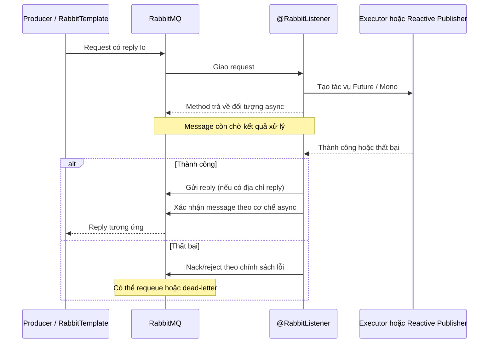

# `@RabbitListener` trả về `CompletableFuture` hoặc `Mono` trong Spring AMQP

Trong một ứng dụng dùng RabbitMQ, `@RabbitListener` thường được viết như một method đồng bộ: message đến queue, Spring gọi method, xử lý xong thì method trả về. Cách này dễ hiểu nhưng không luôn phù hợp khi xử lý phải chờ truy vấn cơ sở dữ liệu, gọi HTTP API hoặc phối hợp với một tác vụ chạy ở thread khác.

Spring AMQP hỗ trợ **listener có kiểu trả về bất đồng bộ**, phổ biến là `CompletableFuture<T>` của Java và `Mono<T>` của Project Reactor. Thay vì yêu cầu kết quả có ngay lúc method kết thúc, listener trả một đối tượng đại diện cho kết quả sẽ có trong tương lai. Spring AMQP theo dõi thời điểm hoàn tất để gửi reply (nếu có) và quyết định xác nhận message theo cơ chế hỗ trợ async listener.

Bài này thuộc chương **Xử lý bất đồng bộ** của **SPRING_AMQP**. Trọng tâm là xây consumer RabbitMQ đáng tin cậy: hiểu khi nào công việc thật sự được chạy ở thread khác, làm sao gửi reply, khi nào ack/nack, và cách phối hợp retry, dead-letter và quan sát hệ thống.

## 1. Vì sao cần kiểu trả về bất đồng bộ?

Xét dịch vụ Kho nhận yêu cầu kiểm tra tồn kho. Một listener đồng bộ có thể viết:

```java
@RabbitListener(queues = "stock.requests.sync")
public String check(String productId) {
    return stockService.check(productId); // Có thể chờ I/O
}
```

Consumer thread phải chờ `stockService.check()` xong mới rời method. Nếu thao tác chậm, khả năng nhận và xử lý các message khác bị hạn chế bởi số consumer thread.

Với kiểu trả về bất đồng bộ:

```java
@RabbitListener(queues = "stock.requests.future")
public CompletableFuture<String> checkAsync(String productId) {
    return CompletableFuture.supplyAsync(
            () -> stockService.check(productId),
            stockExecutor
    );
}
```

Listener tạo và trả `CompletableFuture` sớm; công việc `check()` chạy trên executor. Spring AMQP giữ việc xử lý message ở trạng thái đang chờ cho đến khi future hoàn tất. **Trả future không có nghĩa broker đã nhận ack**, cũng không có nghĩa thao tác nghiệp vụ đã thành công.

### Phân biệt ba khái niệm

| Khái niệm | Ý nghĩa |
|---|---|
| RabbitMQ giao message bất đồng bộ | Producer gửi message rồi consumer xử lý qua queue, có thể ở một thời điểm khác. |
| `@RabbitListener` trả `CompletableFuture`/`Mono` | Method trả về một kết quả chưa hoàn thành; framework theo dõi completion. |
| Client gửi request–reply bằng `RabbitTemplate.convertSendAndReceive()` | **Caller vẫn chờ reply** và có thể timeout, ngay cả khi listener bên nhận dùng future/Mono. |

Nếu mục đích là producer gửi sự kiện mà không cần phản hồi, không nhất thiết phải dùng request–reply. Listener có thể xử lý message không trả reply nhưng vẫn phải bảo đảm xử lý và xác nhận giao nhận đúng cách.

## 2. Vòng đời một listener trả kết quả async



Sơ đồ thể hiện **quan hệ logic**, không cam kết thứ tự tuyệt đối của các gói tin hoặc callback trong mọi phiên bản và cấu hình Spring AMQP. Điều cần nhớ là vòng đời message **chưa kết thúc chỉ vì method listener đã return**.

Khi listener nhận request có thuộc tính `replyTo`, Spring có thể gửi kết quả hoàn tất tới đích reply. Nếu không có nơi nhận phản hồi, việc xử lý message vẫn có thể hoàn thành, nhưng cần tránh thiết kế một listener trả kết quả mà không có hợp đồng reply rõ ràng. Có thể dùng `@SendTo` nếu ứng dụng chủ động định nghĩa đích phản hồi cố định.

### Acknowledge mode

Xác nhận message bằng `basicAck` cho broker biết message có thể được loại khỏi trạng thái chưa xác nhận. Với listener có kết quả async, **không được ack ngay khi method vừa trả future/Mono**, vì công việc thật có thể thất bại sau đó.

Spring AMQP sử dụng cơ chế xác nhận sau completion đối với kiểu return async được hỗ trợ; các phiên bản mới có thể tự thiết lập acknowledge mode phù hợp. Khi cần cấu hình nhất quán và dễ kiểm soát, có thể đặt `AcknowledgeMode.MANUAL` trên listener container factory (ví dụ ở phần sau). Trong kiểu sử dụng async return này, **framework quản lý ack/nack dựa trên completion**; tránh tự gọi `channel.basicAck()` thêm lần nữa.

## 3. Ví dụ end-to-end: hai queue, hai kiểu trả về

Ví dụ dưới đây dùng Spring Boot và RabbitMQ. Hai queue cùng nhận yêu cầu kiểm tra mã hàng, nhưng một listener trả `CompletableFuture<String>`, listener còn lại trả `Mono<String>`. Cả hai dùng cùng một dịch vụ tra cứu đơn giản để so sánh cách thực thi.

### 3.1. Dependency

Trong dự án Spring Boot với Gradle và dependency management tương thích:

```groovy
dependencies {
    implementation 'org.springframework.boot:spring-boot-starter-amqp'
    implementation 'io.projectreactor:reactor-core'
}
```

`reactor-core` cung cấp `Mono` và `Schedulers`. Không bắt buộc thêm Spring WebFlux chỉ để dùng `Mono` trong listener AMQP. Cần chọn phiên bản Spring AMQP có hỗ trợ asynchronous listener return; khi nâng cấp, kiểm tra tài liệu của phiên bản đang triển khai, nhất là hành vi ack và xử lý lỗi.

Ví dụ kết nối broker chạy cục bộ:

```yaml
spring:
  rabbitmq:
    host: localhost
    port: 5672
    username: guest
    password: guest
```

Tài khoản `guest/guest` chỉ dành cho môi trường phát triển cục bộ theo cấu hình mặc định của RabbitMQ. Môi trường thật cần credential và kết nối được quản lý riêng.

### 3.2. Exchange, queue, binding, executor và container

```java
import org.springframework.amqp.core.AcknowledgeMode;
import org.springframework.amqp.core.Binding;
import org.springframework.amqp.core.BindingBuilder;
import org.springframework.amqp.core.DirectExchange;
import org.springframework.amqp.core.Queue;
import org.springframework.amqp.core.QueueBuilder;
import org.springframework.amqp.rabbit.annotation.EnableRabbit;
import org.springframework.amqp.rabbit.config.SimpleRabbitListenerContainerFactory;
import org.springframework.amqp.rabbit.connection.ConnectionFactory;
import org.springframework.beans.factory.annotation.Qualifier;
import org.springframework.boot.autoconfigure.amqp.SimpleRabbitListenerContainerFactoryConfigurer;
import org.springframework.context.annotation.Bean;
import org.springframework.context.annotation.Configuration;
import org.springframework.scheduling.concurrent.ThreadPoolTaskExecutor;

@Configuration
@EnableRabbit
public class StockAsyncAmqpConfig {

    public static final String EXCHANGE = "demo.stock.rpc";
    public static final String FUTURE_QUEUE = "demo.stock.future.requests";
    public static final String MONO_QUEUE = "demo.stock.mono.requests";
    public static final String FUTURE_KEY = "stock.future";
    public static final String MONO_KEY = "stock.mono";

    @Bean
    public DirectExchange stockExchange() {
        return new DirectExchange(EXCHANGE);
    }

    @Bean
    public Queue futureQueue() {
        return QueueBuilder.durable(FUTURE_QUEUE).build();
    }

    @Bean
    public Queue monoQueue() {
        return QueueBuilder.durable(MONO_QUEUE).build();
    }

    @Bean
    public Binding futureBinding(
            @Qualifier("futureQueue") Queue queue,
            DirectExchange stockExchange) {
        return BindingBuilder.bind(queue).to(stockExchange).with(FUTURE_KEY);
    }

    @Bean
    public Binding monoBinding(
            @Qualifier("monoQueue") Queue queue,
            DirectExchange stockExchange) {
        return BindingBuilder.bind(queue).to(stockExchange).with(MONO_KEY);
    }

    @Bean
    public ThreadPoolTaskExecutor stockExecutor() {
        ThreadPoolTaskExecutor executor = new ThreadPoolTaskExecutor();
        executor.setCorePoolSize(4);
        executor.setMaxPoolSize(8);
        executor.setQueueCapacity(64);
        executor.setThreadNamePrefix("stock-async-");
        return executor;
    }

    @Bean
    public SimpleRabbitListenerContainerFactory rabbitListenerContainerFactory(
            ConnectionFactory connectionFactory,
            SimpleRabbitListenerContainerFactoryConfigurer configurer) {

        SimpleRabbitListenerContainerFactory factory =
                new SimpleRabbitListenerContainerFactory();
        configurer.configure(factory, connectionFactory);
        factory.setAcknowledgeMode(AcknowledgeMode.MANUAL);
        factory.setPrefetchCount(8);
        return factory;
    }
}
```

**Vai trò của cấu hình:**

- `DirectExchange` định tuyến theo routing key chính xác. `futureQueue` nhận `stock.future`; `monoQueue` nhận `stock.mono`.
- `ThreadPoolTaskExecutor` là pool có giới hạn thread và queue, dùng riêng cho tác vụ blocking trong ví dụ `CompletableFuture`.
- `MANUAL` bảo đảm container không tự ack ngay khi method listener trả về. Với kiểu return async mà Spring AMQP hỗ trợ, callback completion của framework xử lý xác nhận tương ứng.
- `prefetchCount(8)` giới hạn số message chưa ack được broker đẩy tới mỗi consumer; cần chỉnh theo thời gian xử lý, dung lượng executor và số consumer.

Khi một ứng dụng đã có bean `rabbitListenerContainerFactory` tùy biến, cần tích hợp cấu hình vào factory hiện có thay vì khai báo thêm bean trùng tên.

### 3.3. Dịch vụ nghiệp vụ dùng chung

Đây là phiên bản in-memory để ví dụ chạy được mà không cần cơ sở dữ liệu. Trong ứng dụng thực tế, method có thể gọi repository, HTTP client hoặc một hệ thống tồn kho:

```java
import org.springframework.stereotype.Service;

@Service
public class StockLookupService {

    public String lookup(String productId) {
        if (productId == null || productId.isBlank()) {
            throw new IllegalArgumentException("Mã sản phẩm không hợp lệ");
        }
        return "SKU-001".equals(productId) ? "AVAILABLE" : "OUT_OF_STOCK";
    }
}
```

### 3.4. Listener trả `CompletableFuture<String>`

```java
import java.util.concurrent.CompletableFuture;
import org.springframework.amqp.rabbit.annotation.RabbitListener;
import org.springframework.beans.factory.annotation.Qualifier;
import org.springframework.scheduling.concurrent.ThreadPoolTaskExecutor;
import org.springframework.stereotype.Component;

@Component
public class StockFutureListener {

    private final StockLookupService stockLookupService;
    private final ThreadPoolTaskExecutor stockExecutor;

    public StockFutureListener(
            StockLookupService stockLookupService,
            @Qualifier("stockExecutor") ThreadPoolTaskExecutor stockExecutor) {
        this.stockLookupService = stockLookupService;
        this.stockExecutor = stockExecutor;
    }

    @RabbitListener(queues = StockAsyncAmqpConfig.FUTURE_QUEUE)
    public CompletableFuture<String> check(String productId) {
        return CompletableFuture.supplyAsync(
                () -> stockLookupService.lookup(productId),
                stockExecutor
        );
    }
}
```

Các bước thực thi:

1. Container nhận message và gọi `check()` trên consumer thread.
2. `supplyAsync()` nộp công việc cho `stockExecutor`, trả lại `CompletableFuture<String>`.
3. Thread thuộc executor gọi `stockLookupService.lookup()` và hoàn tất future với String, hoặc hoàn tất lỗi nếu phát sinh exception.
4. Spring AMQP quan sát completion, gửi reply đến `replyTo` khi phù hợp và xác nhận/từ chối message theo kết quả xử lý.

**Không nên gọi `CompletableFuture.supplyAsync(...)` mà bỏ đối số executor** nếu chưa chủ động chọn `ForkJoinPool.commonPool` và hiểu ảnh hưởng đến tài nguyên chia sẻ. Pool dùng cho I/O blocking nên có giới hạn, được theo dõi và có chính sách khi quá tải.

Một method trả `CompletableFuture.completedFuture(value)` vẫn có hợp đồng async nhưng thực tế đã hoàn thành ngay; điều đó **không làm công việc trước khi return trở thành bất đồng bộ**. Tương tự, viết `CompletableFuture.completedFuture(stockLookupService.lookup(productId))` vẫn chạy `lookup()` ngay trên consumer thread.

### 3.5. Listener trả `Mono<String>`

`Mono<T>` là một `Publisher` trong Reactor, phát tối đa **một** giá trị khi hoàn tất. Trường hợp cần gọi API blocking nhưng muốn trình bày kết quả dưới dạng `Mono`, có thể dùng:

```java
import org.springframework.amqp.rabbit.annotation.RabbitListener;
import org.springframework.stereotype.Component;
import reactor.core.publisher.Mono;
import reactor.core.scheduler.Schedulers;

@Component
public class StockMonoListener {

    private final StockLookupService stockLookupService;

    public StockMonoListener(StockLookupService stockLookupService) {
        this.stockLookupService = stockLookupService;
    }

    @RabbitListener(queues = StockAsyncAmqpConfig.MONO_QUEUE)
    public Mono<String> check(String productId) {
        return Mono.fromCallable(() -> stockLookupService.lookup(productId))
                .subscribeOn(Schedulers.boundedElastic());
    }
}
```

`Mono.fromCallable()` **chưa chạy** `lookup()` tại thời điểm tạo publisher. Spring AMQP đăng ký nhận tín hiệu hoàn thành của `Mono` trả về; khi có subscription, `subscribeOn(Schedulers.boundedElastic())` chuyển lời gọi blocking sang scheduler phù hợp hơn cho I/O blocking.

Nếu dịch vụ đã có API reactive thực sự, hãy trả publisher đó trực tiếp:

```java
// stockReactiveService.findAvailability(productId) là Mono<Boolean>
@RabbitListener(queues = "stock.requests.reactive")
public Mono<String> checkReactive(String productId) {
    return stockReactiveService.findAvailability(productId)
            .map(available -> available ? "AVAILABLE" : "OUT_OF_STOCK");
}
```

Đoạn `checkReactive` minh họa cách phối hợp publisher; nó giả định bạn đã khai báo queue và `stockReactiveService` tương ứng. Với nguồn dữ liệu thật sự non-blocking, không cần đưa toàn bộ pipeline sang `boundedElastic`. Ngược lại, `Mono.just(stockLookupService.lookup(productId))` sẽ **gọi lookup ngay lập tức** trên consumer thread và không giải quyết bài toán blocking.

Không gọi `subscribe()` hoặc `block()` thủ công trong listener rồi trả một `Mono` khác: thao tác đó có thể tách vòng đời tác vụ khỏi cơ chế ack/reply của Spring AMQP, khiến lỗi khó theo dõi hoặc làm nghẽn thread.

## 4. Phía gửi request nhận kết quả thế nào?

Với ví dụ này, request có payload String và reply cũng là String nên `SimpleMessageConverter` mặc định đủ dùng. Client có thể dùng `RabbitTemplate`:

```java
import org.springframework.amqp.rabbit.core.RabbitTemplate;
import org.springframework.stereotype.Service;

@Service
public class StockRpcCaller {

    private final RabbitTemplate rabbitTemplate;

    public StockRpcCaller(RabbitTemplate rabbitTemplate) {
        this.rabbitTemplate = rabbitTemplate;
    }

    public String checkViaFuture(String productId) {
        return request(StockAsyncAmqpConfig.FUTURE_KEY, productId);
    }

    public String checkViaMono(String productId) {
        return request(StockAsyncAmqpConfig.MONO_KEY, productId);
    }

    private String request(String routingKey, String productId) {
        Object reply = rabbitTemplate.convertSendAndReceive(
                StockAsyncAmqpConfig.EXCHANGE,
                routingKey,
                productId
        );
        if (reply == null) {
            throw new IllegalStateException("Hết thời gian chờ reply từ Kho");
        }
        if (!(reply instanceof String)) {
            throw new IllegalStateException("Kiểu reply không mong đợi");
        }
        return (String) reply;
    }
}
```

Khi gọi `checkViaFuture("SKU-001")` hoặc `checkViaMono("SKU-001")`, kết quả dự kiến là `"AVAILABLE"`. Với mã khác, kết quả là `"OUT_OF_STOCK"`.

Trong RPC này, `RabbitTemplate` tự quản lý thông tin định tuyến phản hồi, thường gồm `replyTo` và correlation để khớp kết quả. **Client trên vẫn đồng bộ**, vì `convertSendAndReceive()` chờ reply hoặc timeout. Nếu chính caller cũng cần API không chặn thread, cân nhắc `AsyncRabbitTemplate` hoặc thiết kế gửi command rồi nhận kết quả qua event/callback.

Các ví dụ dùng String để tập trung vào async return. Khi dùng DTO, cần thống nhất `MessageConverter` (ví dụ JSON), mapping kiểu dữ liệu, version payload và contract lỗi của cả producer lẫn consumer.

## 5. `CompletableFuture` và `Mono` khác nhau ở đâu?

| Tiêu chí | `CompletableFuture<T>` | `Mono<T>` |
|---|---|---|
| Hệ sinh thái | Java `java.util.concurrent` | Project Reactor |
| Khi bắt đầu công việc | Phụ thuộc cách tạo future; `supplyAsync` thường nộp việc ngay | Pipeline thường **lazy**, bắt đầu khi được subscribe |
| Biểu diễn kết quả | Thành công với value, hoàn tất lỗi hoặc bị cancel | Phát 0 hoặc 1 value, hoàn tất lỗi hoặc hoàn tất rỗng |
| Chạy blocking I/O | Dùng executor riêng, quản lý giới hạn thread | Dùng `fromCallable` + `boundedElastic` nếu phải gọi API blocking |
| API xử lý lỗi | `handle`, `exceptionally`, `whenComplete` | `onErrorResume`, `onErrorMap`, `doOnError` |
| Phù hợp | Dịch vụ Java dùng Future/Executor, thư viện async trả `CompletionStage` | Hệ thống dùng Reactor/WebFlux hoặc dịch vụ trả publisher reactive |

**Không nên xem `Mono` là một thread.** Nó mô tả dòng tín hiệu kết quả; việc xử lý chạy trên thread nào phụ thuộc nguồn publisher và cấu hình scheduler. Tương tự, bản thân kiểu `CompletableFuture` không bảo đảm code nghiệp vụ đã được chuyển khỏi consumer thread.

Nếu một API reactive trả về `Mono.empty()` hoặc một future hoàn tất với `null`, cần xác minh hợp đồng reply: caller chờ một giá trị có thể không nhận được payload phản hồi hữu ích. Với RPC yêu cầu trả trạng thái rõ ràng, nên thiết kế phản hồi không rỗng có mã kết quả.

## 6. Ack/nack, retry và dead-letter: phần quan trọng nhất của async listener

### 6.1. Thành công và thất bại sau khi method return

Giả sử listener trả về future sau 1 ms nhưng tác vụ tra cứu tồn kho hoàn thành sau 2 giây:

- Khi future hoàn tất thành công, framework mới xử lý kết quả thành công tương ứng: có thể gửi reply và ack message.
- Nếu future hoàn tất với exception, việc xử lý thất bại phải đi theo chính sách nack/reject, requeue hoặc dead-letter của container/broker.
- Nếu lỗi xảy ra **trước khi future hoặc Mono được tạo**, method ném exception đồng bộ; lỗi ấy đi qua cơ chế xử lý lỗi thông thường của listener container. Không nên giả định mọi lỗi luôn đến từ completion callback.

`MANUAL` ở cấu hình ví dụ nhằm giữ ack gắn với thời điểm xử lý kết thúc. Đừng viết:

```java
@RabbitListener(queues = "stock.requests.unsafe")
public CompletableFuture<String> unsafe(String productId,
        com.rabbitmq.client.Channel channel,
        @org.springframework.messaging.handler.annotation.Header(
                org.springframework.amqp.support.AmqpHeaders.DELIVERY_TAG) long tag)
        throws java.io.IOException {
    channel.basicAck(tag, false); // Sai: tác vụ chưa chạy xong
    return CompletableFuture.supplyAsync(() -> stockService.check(productId));
}
```

Đây là **phản ví dụ**, không phải đoạn code để triển khai. Ack quá sớm có thể làm mất cơ hội broker redeliver message nếu tác vụ thất bại sau đó, và tự ack khi framework cũng quản lý async completion có thể gây xác nhận trùng.

### 6.2. Đừng biến mọi lỗi thành reply thành công

Ví dụ:

```java
return CompletableFuture.supplyAsync(() -> stockLookupService.lookup(productId),
                                     stockExecutor)
        .exceptionally(ex -> "OUT_OF_STOCK");
```

Đoạn này **nuốt mọi exception**, bao gồm lỗi mạng, timeout DB hoặc bug, rồi biến chúng thành reply bình thường. Spring AMQP sẽ coi future đã hoàn tất thành công; nghiệp vụ có thể hiểu nhầm rằng thực sự đã hết hàng.

Nếu muốn trả lỗi nghiệp vụ dự kiến, nên dùng hợp đồng phản hồi riêng, chẳng hạn:

```json
{
  "requestId": "stock-req-203",
  "success": false,
  "errorCode": "PRODUCT_NOT_FOUND",
  "message": "Không tìm thấy mã hàng"
}
```

Các lỗi hệ thống tạm thời nên được phân loại và xử lý theo chính sách retry/dead-letter phù hợp. Tương tự, `Mono.onErrorResume()` chỉ nên đổi lỗi thành giá trị khi đó là hành vi nghiệp vụ đã chủ động định nghĩa.

### 6.3. Retry, requeue và DLQ phải có giới hạn

Nếu một message xử lý lỗi sau khi đã chạy async, broker hoặc listener container có thể áp dụng chính sách requeue theo loại exception và cấu hình. Một message bị requeue liên tục có thể tạo vòng lặp lỗi.

Nên thiết kế cùng nhau:

1. **Retry có giới hạn:** retry lỗi tạm thời, dùng backoff để tránh dồn tải lên dịch vụ downstream.
2. **Dead-letter exchange/queue:** đưa message không thể xử lý sau các lần thử vào nơi có thể quan sát và điều tra; cần cấu hình DLX/binding/điều kiện dead-letter thích hợp.
3. **Idempotency:** dùng request ID nghiệp vụ ổn định để xử lý lại cùng message không nhân đôi side effect.
4. **Timeout của client:** `RabbitTemplate.replyTimeout` có thể hết trước khi listener retry xong; timeout không chứng minh rằng nghiệp vụ chưa hoàn thành.

Không có một giao dịch phân tán tự động bao trùm thao tác database, xử lý trong future và ack RabbitMQ. Với tác vụ cập nhật dữ liệu quan trọng, cần tính tới ranh giới transaction và chiến lược chống xử lý lặp.

## 7. Giới hạn tài nguyên, backpressure và quan sát

Listener return async giúp consumer thread sớm rời method, nhưng **không tạo ra năng lực xử lý vô hạn**. Message đã được phân phối vẫn chiếm chỗ trong số lượng unacked cho đến completion.

Một mô hình ước tính đơn giản:

```text
Số message in-flight tối đa do broker cấp
≈ số consumer × prefetch cho mỗi consumer

Ví dụ: 3 consumers × prefetch 8 = tối đa khoảng 24 message unacked
```

Đó chỉ là giới hạn message được giao chưa ack theo prefetch, không đồng nghĩa toàn bộ 24 thao tác đều chạy đồng thời. Năng lực thực tế còn phụ thuộc thread pool, connection pool, downstream và giới hạn scheduler.

Nên theo dõi:

- **Queue depth / unacked:** có bao nhiêu message đang chờ và đã được nhận nhưng chưa xác nhận.
- **Độ trễ:** thời gian từ nhận message đến completion, thời gian gửi reply và tỷ lệ timeout của caller.
- **Executor:** active threads, queue size, số tác vụ bị từ chối khi quá tải.
- **Kết quả:** số tác vụ thành công, thất bại, retry, redelivery và dead-letter; phân nhóm lỗi nghiệp vụ/lỗi hệ thống.
- **Tương quan:** request ID, correlation ID, message ID, routing key và trace span khi có tracing. Tránh ghi payload chứa thông tin nhạy cảm.

Với `CompletableFuture`, một pool đầy có thể ném `RejectedExecutionException` ngay khi `supplyAsync` nộp tác vụ; đây là lỗi cần xử lý như trường hợp quá tải, không phải một kết quả nghiệp vụ bình thường. Với Reactor, `boundedElastic` cũng có giới hạn thực thi và hàng đợi; không nên tạo luồng tác vụ vượt sức tải hoặc dựa vào `subscribeOn` để giải quyết mọi vấn đề năng lực hệ thống.

Thread-local context như MDC hoặc thông tin tracing có thể không tự đi theo công việc chuyển sang executor/scheduler; nên dùng cơ chế truyền context được hỗ trợ trong stack ứng dụng, không dựa vào việc thread luôn giữ nguyên.

## 8. Kiểm thử các tình huống cần thiết

Với ứng dụng dùng RabbitMQ thật hoặc integration test có broker, nên kiểm tra ít nhất:

| Trường hợp | Điều cần xác nhận |
|---|---|
| `SKU-001` được gửi tới routing key `stock.future` | Listener Future trả `AVAILABLE` đúng reply và message được ack sau khi hoàn tất |
| Cùng request gửi tới `stock.mono` | Listener Mono phát một kết quả và client nhận đúng reply |
| Service tra cứu ném exception | Completion thất bại được ghi nhận; hành vi nack/requeue/DLQ đúng policy |
| Executor bị quá tải | Phát hiện lỗi nộp task, message không bị ack như thể đã xử lý thành công |
| Consumer xử lý lâu hơn `replyTimeout` | Client nhận timeout; kiểm tra nghiệp vụ có thể vẫn tiếp tục và hoàn thành sau đó |
| Cùng request được giao lại | Idempotency ngăn việc ghi dữ liệu trùng |
| Không có consumer hoặc binding sai | Quan sát queue/message và timeout, không suy diễn đó là lỗi DTO |

Một lỗi hay gặp là chạy test chỉ với method Java, ví dụ gọi trực tiếp `listener.check()` rồi lấy `future.join()`. Test này có ích cho logic tính toán, nhưng **không kiểm tra** cơ chế replyTo, correlation, ack/nack và dead-letter của Spring AMQP. Cần integration test thật để xác nhận các thuộc tính trên.

## 9. Tình huống lựa chọn

**Tình huống A — Đang có service đồng bộ, blocking:** Trả `CompletableFuture.supplyAsync(..., executor)` khi cần nhường consumer thread cho message khác. Cấu hình executor có giới hạn và bảo đảm tác vụ không bị ack trước completion.

**Tình huống B — Dịch vụ downstream trả `Mono`:** Trả lại `Mono` đã map dữ liệu nghiệp vụ; để Spring AMQP subscribe và quản lý completion. Không gọi `block()` để ép thành xử lý đồng bộ.

**Tình huống C — Lệnh chạy hàng phút, producer không cần chờ:** Thường phù hợp hơn với command/event, trạng thái công việc và callback/event kết quả. Giữ một RPC reply chờ suốt nhiều phút dễ phát sinh timeout và khó xử lý sau khi client đã rời đi.

### Câu hỏi tự kiểm tra

1. Vì sao `CompletableFuture.completedFuture(blockingCall())` vẫn có thể chặn consumer thread?
2. Tại sao `Mono.fromCallable(...)` thường cần `subscribeOn(...)` khi lambda gọi một API blocking?
3. Vì sao không nên gọi `basicAck` ngay khi listener trả về future?
4. Khi client RPC timeout, liệu consumer chắc chắn chưa cập nhật dữ liệu?
5. Phần nào cần kiểm tra bằng integration test với RabbitMQ thật thay vì chỉ gọi trực tiếp method?

**Ghi nhớ:** `@RabbitListener` trả `CompletableFuture` hoặc `Mono` cho phép Spring AMQP theo dõi một kết quả được hoàn tất về sau. Thiết kế đúng cần gắn **completion, reply, ack/nack, giới hạn tài nguyên, retry và idempotency** vào cùng một vòng đời message; việc đổi kiểu trả về đơn thuần chưa đủ để tạo ra xử lý bất đồng bộ đáng tin cậy.
