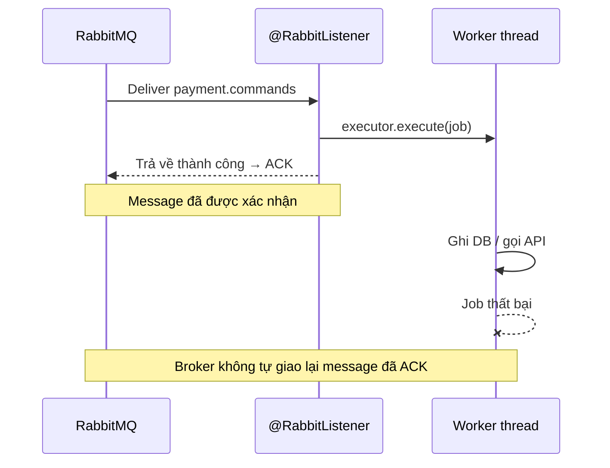
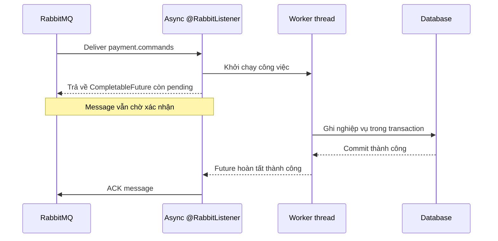

# Hoàn tất bất đồng bộ và thời điểm ack hoặc nack trong Spring AMQP

## 1. Vấn đề: trả về khỏi listener chưa chắc là xử lý xong

Trong hệ thống dùng RabbitMQ và Spring AMQP, một consumer nhận message rồi thực hiện công việc có thể mất thời gian: ghi dữ liệu, gọi dịch vụ bên ngoài, tạo báo cáo, gửi thông báo hoặc chạy nhiều bước song song. Khi công việc được chuyển sang `Executor`, `CompletableFuture` hoặc luồng reactive, phương thức `@RabbitListener` có thể kết thúc **trước** khi tác vụ nghiệp vụ hoàn thành.

Điều này dẫn đến câu hỏi quan trọng: **RabbitMQ nên nhận ACK/NACK khi phương thức listener trả về, hay khi toàn bộ xử lý bất đồng bộ hoàn tất?**

Ví dụ: dịch vụ Thanh toán đọc `payment.commands`, nhận lệnh `PAY-1001` và ghi nhận thanh toán trong cơ sở dữ liệu. Nếu nó ACK ngay sau khi xếp tác vụ vào thread pool, rồi tiến trình bị dừng trước khi ghi dữ liệu, RabbitMQ đã coi message được xử lý xong và sẽ không tự giao lại message đó. Ngược lại, nếu chờ công việc hoàn tất và chỉ ACK sau khi giao dịch ghi dữ liệu thành công, hệ thống có cơ hội giao lại khi consumer ngắt kết nối trước ACK.

Trong Spring AMQP, cần hiểu rõ ranh giới giữa **message đã được nhận**, **tác vụ đã được lên lịch**, **tác vụ đã hoàn tất**, **dữ liệu đã được commit** và **message đã được ACK**. Chúng không đồng nghĩa với nhau.

### Mục tiêu sau bài học

- Phân biệt `AcknowledgeMode.AUTO`, `MANUAL` và `NONE` với RabbitMQ consumer acknowledgment.
- Xác định thời điểm ACK, NACK hoặc reject khi xử lý đồng bộ và bất đồng bộ.
- Dùng `@RabbitListener` trả về `CompletableFuture` để framework xác nhận sau khi công việc thực sự hoàn tất.
- Hiểu cách tự ACK/NACK khi quản lý công việc bất đồng bộ thủ công và các rủi ro về channel.
- Thiết kế timeout, retry, dead-letter, idempotency và quan sát trạng thái message cho hệ thống đáng tin cậy.

## 2. ACK, NACK và trạng thái message ở RabbitMQ

Một message được giao tới consumer có thể ở trạng thái **unacknowledged** (đã giao nhưng chưa được xác nhận). Trong chế độ xác nhận thủ công của RabbitMQ, consumer gửi tín hiệu trên channel đã nhận message:

| Tín hiệu | Ý nghĩa | Tác động |
|---|---|---|
| `basicAck(deliveryTag, false)` | Xử lý thành công message có delivery tag tương ứng | Broker có thể loại message khỏi queue |
| `basicNack(deliveryTag, false, true)` | Chưa xử lý được; yêu cầu requeue | Message có thể được giao lại, có nguy cơ vòng lặp |
| `basicNack(deliveryTag, false, false)` | Từ chối và không requeue | Message được dead-letter **nếu** queue có chính sách DLX phù hợp; nếu không có thể bị loại bỏ |
| `basicReject(deliveryTag, requeue)` | Từ chối một message | Tương tự NACK một message, nhưng không có tùy chọn `multiple` |

`deliveryTag` là số định danh **trong phạm vi channel nhận message**, không phải ID nghiệp vụ và không phải `correlationId`. Giá trị này không được mang sang channel khác để ACK. Khi thao tác với nhiều công việc bất đồng bộ, dùng `multiple=false` để tránh ACK nhầm các delivery khác trên cùng channel.

### Ba chế độ acknowledgment của Spring AMQP

| Chế độ | Ai xác nhận? | Thời điểm cơ bản | Lưu ý với tác vụ bất đồng bộ |
|---|---|---|---|
| `AcknowledgeMode.AUTO` | Listener container của Spring AMQP | Sau khi listener chạy thành công; lỗi được xử lý theo chính sách container | Nếu listener khởi chạy job rồi trả về sớm, container có thể ACK **trước khi job xong** |
| `AcknowledgeMode.MANUAL` | Ứng dụng hoặc adapter hỗ trợ async của Spring | Khi bên quản lý gửi ACK/NACK rõ ràng | Phù hợp khi phải chờ một tín hiệu hoàn tất sau này; quên ACK làm message mắc ở `Unacked` |
| `AcknowledgeMode.NONE` | Broker tự coi message đã nhận khi giao (RabbitMQ auto-ack) | Khi giao message, không chờ xác nhận xử lý | Không thể dùng ACK/NACK để khôi phục lỗi xử lý sau khi đã giao |

**Chú ý về tên gọi:** `AcknowledgeMode.AUTO` của Spring **không phải** chế độ RabbitMQ auto-ack. Trong `AUTO`, Spring vẫn sử dụng consumer acknowledgments và xác nhận theo kết quả chạy listener. RabbitMQ auto-ack gần với `AcknowledgeMode.NONE`.

Trong các phiên bản Spring AMQP có hỗ trợ kiểu trả về bất đồng bộ cho `@RabbitListener`, adapter có thể chuyển sang cơ chế xác nhận thủ công ở cấp container **để framework tự gửi ACK/NACK sau khi đối tượng bất đồng bộ hoàn tất**. Người viết listener không cần đồng thời gọi `basicAck` thủ công cho chính message đó.

## 3. Hai dòng thời gian: ACK sớm và ACK đúng lúc

### Trường hợp sai: fire-and-forget trong listener đồng bộ

```java
@RabbitListener(queues = "payment.commands")
public void receive(String paymentId) {
    executor.execute(() -> paymentService.process(paymentId));
    // Listener trả về ngay; worker có thể chưa chạy xong.
}
```

Giả sử listener container dùng `AcknowledgeMode.AUTO` thông thường. Nó thấy phương thức `void` trả về thành công và ACK. Nếu `paymentService.process(...)` thất bại sau đó, lỗi xảy ra bên ngoài đường xử lý lỗi của listener, nên không có NACK tương ứng cho request đã được ACK.



`@Async` trên một phương thức `void` được gọi từ listener cũng có thể tạo vấn đề tương tự nếu listener không chờ và không trả lại một tín hiệu hoàn tất phù hợp. Việc có thread chạy nền **không tự khiến container biết khi nào xử lý xong**.

### Trường hợp đúng: tương lai kết quả bao trùm toàn bộ công việc



Nếu future hoàn tất với lỗi, adapter xử lý theo cơ chế từ chối và chính sách requeue/reject tương ứng; message không nên được coi là thành công. Các bước dưới đây cho thấy cách viết listener đúng với mô hình này.

## 4. Cách khuyến nghị: trả về CompletableFuture cho @RabbitListener

Spring AMQP hỗ trợ xử lý phản hồi bất đồng bộ từ listener thông qua các kiểu như `CompletableFuture<?>`; các phiên bản/tích hợp phù hợp cũng hỗ trợ kiểu reactive như `Mono<?>`. Khi adapter nhận biết đúng kiểu trả về, nó đợi kết quả cuối cùng để ACK hoặc NACK. Kiểm tra tài liệu phiên bản Spring AMQP đang dùng nếu dự án còn dùng phiên bản cũ hoặc tùy biến listener container.

Ví dụ sử dụng Spring Boot, dependency `spring-boot-starter-amqp`, RabbitMQ đã chạy và Java hỗ trợ `CompletableFuture`. Để tập trung vào acknowledgment, payload của message là một mã nghiệp vụ dạng `String`.

### 4.1. Khai báo queue, dead-letter và executor có giới hạn

```java
import java.util.concurrent.Executor;
import org.springframework.amqp.core.Binding;
import org.springframework.amqp.core.BindingBuilder;
import org.springframework.amqp.core.DirectExchange;
import org.springframework.amqp.core.Queue;
import org.springframework.amqp.core.QueueBuilder;
import org.springframework.beans.factory.annotation.Qualifier;
import org.springframework.context.annotation.Bean;
import org.springframework.context.annotation.Configuration;
import org.springframework.scheduling.concurrent.ThreadPoolTaskExecutor;

@Configuration
public class PaymentAmqpConfig {
    public static final String COMMAND_QUEUE = "payment.commands";

    @Bean
    Queue paymentCommands() {
        return QueueBuilder.durable(COMMAND_QUEUE)
                .deadLetterExchange("payment.dlx")
                .deadLetterRoutingKey("payment.failed")
                .build();
    }

    @Bean
    DirectExchange paymentDlx() {
        return new DirectExchange("payment.dlx");
    }

    @Bean
    Queue paymentFailedQueue() {
        return QueueBuilder.durable("payment.failed.queue").build();
    }

    @Bean
    Binding paymentFailedBinding(
            @Qualifier("paymentFailedQueue") Queue failedQueue,
            @Qualifier("paymentDlx") DirectExchange dlx) {
        return BindingBuilder.bind(failedQueue)
                .to(dlx)
                .with("payment.failed");
    }

    @Bean("paymentExecutor")
    Executor paymentExecutor() {
        ThreadPoolTaskExecutor executor = new ThreadPoolTaskExecutor();
        executor.setCorePoolSize(4);
        executor.setMaxPoolSize(8);
        executor.setQueueCapacity(100);
        executor.setThreadNamePrefix("payment-work-");
        executor.initialize();
        return executor;
    }
}
```

Các queue và binding trên khai báo đường đi tới dead-letter queue nếu message bị reject với `requeue=false`. Cấu hình này **không tự giới hạn số lần retry**; cần một chính sách retry rõ ràng nếu muốn thử lại có kiểm soát. `Executor` có giới hạn thread/queue giúp tránh phát sinh vô hạn công việc đang chờ khi lưu lượng tăng.

Có thể gửi request mẫu tới queue qua default exchange:

```java
rabbitTemplate.convertAndSend(
        "", PaymentAmqpConfig.COMMAND_QUEUE, "PAY-1001");
```

### 4.2. Listener trả về future đại diện cho công việc thật

```java
import java.util.concurrent.CompletableFuture;
import java.util.concurrent.Executor;
import java.util.concurrent.RejectedExecutionException;
import org.springframework.amqp.rabbit.annotation.RabbitListener;
import org.springframework.beans.factory.annotation.Qualifier;
import org.springframework.stereotype.Component;

@Component
public class AsyncPaymentListener {
    private final PaymentService paymentService;
    private final Executor executor;

    public AsyncPaymentListener(
            PaymentService paymentService,
            @Qualifier("paymentExecutor") Executor executor) {
        this.paymentService = paymentService;
        this.executor = executor;
    }

    @RabbitListener(queues = PaymentAmqpConfig.COMMAND_QUEUE)
    public CompletableFuture<Void> receive(String paymentId) {
        try {
            return CompletableFuture.runAsync(
                    () -> paymentService.processAndCommit(paymentId),
                    executor
            );
        } catch (RejectedExecutionException ex) {
            // Worker pool đã đầy; không biến sự cố thành kết quả thành công.
            return CompletableFuture.failedFuture(ex);
        }
    }
}
```

Ở đây, `PaymentService` là một Spring bean chứa nghiệp vụ. Phương thức `processAndCommit` phải hoàn tất việc ghi nhận bền vững trước khi trả về thành công. Nếu dùng `@Transactional`, đặt giao dịch ở **phương thức service được gọi trong worker thread** và bảo đảm lời gọi đi qua Spring proxy, ví dụ:

```java
import org.springframework.stereotype.Service;
import org.springframework.transaction.annotation.Transactional;

@Service
public class PaymentService {
    @Transactional
    public void processAndCommit(String paymentId) {
        // Kiểm tra idempotency key hoặc bản ghi đã xử lý.
        // Kiểm tra điều kiện nghiệp vụ.
        // Ghi các thay đổi DB cần thiết.
        // Phát sinh exception nếu giao dịch không thể hoàn tất.
        // Khi phương thức trả về qua transaction proxy,
        // giao dịch sẽ commit trước khi future hoàn tất thành công.
    }
}
```

Đây là khung minh họa, cần thay phần comment bằng logic thực tế và kiểm soát trùng lặp ở tầng dữ liệu. **Không** mặc định rằng `@Transactional` đặt trên phương thức listener trả về future sẽ bao phủ công việc chạy ở worker thread: transaction context không tự động đi theo qua thread khác.

**Quy tắc xác nhận trong mô hình này:**

- Future hoàn tất **thành công** sau khi công việc được coi là đã hoàn thành → adapter ACK.
- Future hoàn tất **exceptionally** → adapter xử lý NACK/reject theo chính sách lỗi và requeue của container.
- Future **chưa hoàn tất** → không nên ACK sớm; message vẫn chiếm một vị trí chưa xác nhận.
- Executor **từ chối** công việc → trả future lỗi hoặc để lỗi đi vào cơ chế xử lý của listener; đừng ghi nhận như đã thành công.
- Không gọi thêm `channel.basicAck(...)` trong listener này: framework đang quản lý xác nhận cho cùng delivery.

Trong dự án sử dụng phiên bản hoặc cấu hình không hỗ trợ async return, không dùng mẫu code này với giả định framework sẽ đợi future. Khi đó phải nâng phiên bản hoặc thiết kế chế độ `MANUAL` có kiểm soát.

### 4.3. Future được trả về phải bao phủ bước cuối cùng

Sai lầm khác là trả về một future *chỉ đại diện cho một phần* quy trình:

```java
CompletableFuture<Void> save = CompletableFuture.runAsync(
        () -> paymentService.save(paymentId), executor);

// Khởi chạy hậu xử lý nhưng không trả về future của hậu xử lý.
save.thenRunAsync(() -> auditService.persist(paymentId), executor);

return save; // Có thể ACK trước khi auditService.persist hoàn thành.
```

Nếu lưu audit là điều kiện thành công của consumer, hãy trả về chuỗi đầy đủ:

```java
return CompletableFuture.runAsync(
        () -> paymentService.save(paymentId), executor
).thenRunAsync(
        () -> auditService.persist(paymentId), executor
);
```

Ngược lại, nếu hợp đồng consumer chỉ yêu cầu **ghi bền vững một công việc** vào một hàng đợi nội bộ hoặc transactional outbox, có thể ACK sau khi việc chuyển giao bền vững đó hoàn tất. Thời điểm ACK phụ thuộc vào **ranh giới hoàn tất đã định nghĩa**; chỉ ghi một job trong bộ nhớ của tiến trình chưa phải chuyển giao bền vững.

### 4.4. Không nuốt lỗi rồi biến thành ACK

Xét một future thất bại nhưng listener xử lý lỗi theo cách biến nó thành thành công:

```java
return CompletableFuture.runAsync(
        () -> paymentService.processAndCommit(paymentId), executor
).exceptionally(ex -> {
    log.error("Thanh toán thất bại", ex);
    return null; // Chuỗi trở thành hoàn tất thành công: có thể ACK!
});
```

Nếu muốn **chỉ ghi log và giữ nguyên lỗi**, dùng `whenComplete`:

```java
return CompletableFuture.runAsync(
        () -> paymentService.processAndCommit(paymentId), executor
).whenComplete((ignored, ex) -> {
    if (ex != null) {
        log.error("Xử lý paymentId={} thất bại", paymentId, ex);
    }
});
```

`exceptionally` và `handle` có thể là lựa chọn đúng **nếu** lỗi đã được xử lý nghiệp vụ một cách có chủ đích. Nhưng nếu vẫn muốn broker retry/dead-letter thì phải để kết quả bất đồng bộ phản ánh sự thất bại, không trả về “thành công giả”.

## 5. Khi buộc phải tự gọi basicAck hoặc basicNack

Một số ứng dụng tự quản lý vòng đời công việc, cần ACK bằng API RabbitMQ hoặc chưa dùng được hỗ trợ async return. Khi đó listener có thể chọn `ackMode = "MANUAL"` và tự quyết định thời điểm xác nhận.

Đoạn sau minh họa nguyên tắc: **ACK đúng một lần sau khi job thành công; NACK khi job lỗi**. Đây là **một lựa chọn thay thế** cho listener ở phần 4. Không đăng ký đồng thời cả hai consumer ví dụ trên một queue khi muốn đánh giá hành vi của riêng từng cách.

```java
import com.rabbitmq.client.Channel;
import java.io.IOException;
import java.nio.charset.StandardCharsets;
import java.util.concurrent.CompletableFuture;
import java.util.concurrent.Executor;
import java.util.concurrent.RejectedExecutionException;
import org.slf4j.Logger;
import org.slf4j.LoggerFactory;
import org.springframework.amqp.core.Message;
import org.springframework.amqp.rabbit.annotation.RabbitListener;
import org.springframework.beans.factory.annotation.Qualifier;
import org.springframework.stereotype.Component;

@Component
public class ManualPaymentListener {
    private static final Logger log =
            LoggerFactory.getLogger(ManualPaymentListener.class);

    private final PaymentService paymentService;
    private final Executor executor;

    public ManualPaymentListener(
            PaymentService paymentService,
            @Qualifier("paymentExecutor") Executor executor) {
        this.paymentService = paymentService;
        this.executor = executor;
    }

    @RabbitListener(
            queues = PaymentAmqpConfig.COMMAND_QUEUE,
            ackMode = "MANUAL"
    )
    public void receive(Message message, Channel channel) throws IOException {
        long tag = message.getMessageProperties().getDeliveryTag();
        String paymentId = new String(
                message.getBody(), StandardCharsets.UTF_8);

        CompletableFuture<Void> work;
        try {
            work = CompletableFuture.runAsync(
                    () -> paymentService.processAndCommit(paymentId),
                    executor
            );
        } catch (RejectedExecutionException ex) {
            // Chưa được chạy: có thể requeue có kiểm soát nếu tài nguyên tạm đầy.
            channel.basicNack(tag, false, true);
            return;
        }

        work.whenComplete((ignored, error) -> {
            try {
                if (error == null) {
                    channel.basicAck(tag, false);
                } else {
                    log.error("Không xử lý được paymentId={}", paymentId, error);
                    // Ví dụ: đưa lỗi xử lý vào DLQ đã cấu hình.
                    channel.basicNack(tag, false, false);
                }
            } catch (IOException ackError) {
                // Không ACK/NACK lần hai một cách mù quáng:
                // kết quả broker có thể chưa được xác định rõ.
                log.error("Không gửi được ACK/NACK cho tag={}", tag, ackError);
            }
        });
    }
}
```

**Điểm cần thận trọng của ví dụ thủ công:**

- `Channel` và `deliveryTag` thuộc phiên nhận message ban đầu; nếu channel bị đóng trước khi job hoàn tất, không thể ACK bằng một channel mới với tag cũ. Message chưa ACK thường có thể được giao lại khi channel/kết nối đóng.
- Callback hoàn tất chạy ở thread khác. RabbitMQ Java client cho phép gửi xác nhận từ thread khác trong những điều kiện phù hợp, nhưng **không dùng `multiple=true` với ACK bất đồng bộ**, không chia sẻ channel tùy tiện cho các thao tác publish/consume và phải kiểm soát đồng thời cũng như vòng đời channel. Nên ưu tiên cơ chế async do Spring AMQP quản lý nếu có.
- Mẫu đang chọn `requeue=false` cho lỗi đã xử lý; message chỉ đi vào DLQ nếu cấu hình DLX/routing phù hợp. Đối với lỗi tạm thời phải thiết kế nhánh retry riêng. `requeue=true` ngay lập tức với mọi lỗi có thể tạo vòng lặp vô hạn.
- Callback hoàn tất cần xử lý cả tình huống đóng ứng dụng, executor bị dừng và future không bao giờ xong. Chế độ `MANUAL` không có cơ chế tự động dọn một delivery bị quên ACK khi channel vẫn mở.
- Không ACK/NACK hai lần cùng delivery. Hai lần xác nhận hoặc ACK nhầm tag có thể gây lỗi protocol và đóng channel.

Nếu không cần làm chủ channel hoặc định tuyến xác nhận thủ công, cách trả về `CompletableFuture` ở phần 4 thường ít rủi ro hơn và đơn giản hơn.

## 6. Quyết định ACK, NACK, requeue và dead-letter theo loại kết quả

Không phải mọi exception đều nên retry. Một chính sách có chủ đích có thể dùng bảng sau:

| Kết quả nghiệp vụ | Hành động phù hợp | Lý do |
|---|---|---|
| Ghi DB/commit thành công | ACK | Không cần giao lại cùng tác vụ |
| Job được ghi bền vững vào hàng đợi/outbox khác, đúng hợp đồng consumer | ACK sau khi commit việc chuyển giao | Consumer đã hoàn tất nghĩa vụ của nó |
| Lỗi dữ liệu không thể sửa bằng retry | NACK/reject với `requeue=false` | Đưa vào DLQ nếu có DLX để kiểm tra hoặc sửa dữ liệu |
| Lỗi mạng/DB tạm thời | Retry **có giới hạn**; sau ngưỡng thì DLQ | Tránh làm mất tác vụ và tránh requeue vòng lặp |
| Hết timeout chờ kết quả | Không coi là thành công; xử lý theo chính sách timeout | Công việc nền có thể vẫn tiếp tục chạy |
| Kết nối consumer mất trước ACK | Chấp nhận khả năng redelivery; dùng idempotency | Broker có thể chưa biết kết quả xử lý nghiệp vụ |
| Không đủ tài nguyên xử lý | Backpressure hoặc retry có kiểm soát | Tránh tích tụ vô hạn job/chặn consumer |

### NACK không đồng nghĩa “đã vào DLQ”

Với `basicNack(tag, false, false)`, broker dead-letter message **chỉ khi** queue có dead-letter exchange/policy phù hợp và message định tuyến được đến nơi nhận. Nếu không có DLX thì message bị loại. Với `basicNack(tag, false, true)`, broker có thể đặt lại message vào queue để giao lại, không có delay bảo đảm. Muốn retry có thời gian chờ hoặc giới hạn số lần, dùng topology retry, TTL/DLX, quorum queue delivery-limit khi phù hợp, hoặc một chiến lược retry của ứng dụng; cần phân biệt retry trong listener với retry khi message đã được broker giao lại.

### Khi nào lỗi trong CompletableFuture dẫn đến requeue?

Với listener async do Spring quản lý, việc future hoàn tất với lỗi kích hoạt **nhánh xử lý lỗi**, nhưng lựa chọn requeue hay reject phụ thuộc vào cấu hình và exception được framework nhận diện, chẳng hạn chính sách `defaultRequeueRejected` hoặc exception chuyên biệt. Không nên ghi tài liệu nghiệp vụ với giả định “mọi exception đều tự động vào DLQ”. Cần kiểm thử đúng listener container, error handler, retry interceptor và phiên bản Spring AMQP mà dự án dùng.

### Timeout không phải hủy công việc

`CompletableFuture.orTimeout(...)` làm future hoàn tất với lỗi nếu quá hạn, nhưng **không tự bảo đảm hủy** thao tác đang chạy trên thread khác hoặc một lệnh đã gửi cho dịch vụ bên ngoài. Nếu framework NACK sau timeout, cùng tác vụ có thể được giao lại trong khi lần cũ vẫn đang thực hiện. Thiết kế nên có timeout ở cấp lời gọi ra ngoài, khả năng hủy hợp tác khi thích hợp, khóa chống trùng/idempotency và giới hạn số lần retry.

## 7. Đảm bảo dữ liệu: ACK sau commit vẫn có thể bị giao lại

Xét chuỗi sự kiện:

1. Consumer nhận message `PAY-1001`.
2. Worker ghi dữ liệu thanh toán và DB commit thành công.
3. Consumer crash trước khi ACK tới RabbitMQ.
4. Broker giao lại message khi kết nối cũ biến mất.
5. Consumer mới xử lý lại `PAY-1001`.

Đây là lý do consumer nên có **idempotency key**, ví dụ `paymentId` hoặc mã lệnh duy nhất, cùng ràng buộc duy nhất và transaction phù hợp trong DB. Một lần giao lại không được thu tiền hai lần. Tránh dựa vào việc ACK “đúng lúc” để kết luận hệ thống đạt exactly-once end-to-end.

`publisher confirm` xác nhận broker đã tiếp nhận publish và `consumer ACK` xác nhận việc tiêu thụ message là **hai luồng xác nhận khác nhau**. Chúng không thay thế commit của database hay idempotency. Tương tự, tính năng transaction của RabbitMQ không tự tạo transaction nguyên tử chung với cơ sở dữ liệu quan hệ hoặc API thanh toán bên ngoài.

Nếu tác vụ tạo message tiếp theo sau DB commit, cân nhắc **transactional outbox** để không thất lạc sự kiện giữa hai hệ thống. Nếu consumer nhận sự kiện và áp dụng DB write, cân nhắc **inbox/deduplication** để xử lý an toàn khi redelivery.

## 8. Prefetch, số job đồng thời và đóng ứng dụng

ACK chậm hơn khi đợi async completion, vì vậy số message đang ở trạng thái `Unacked` sẽ tăng. Đây là cơ chế kiểm soát áp lực tải có ích nếu được cấu hình phù hợp, nhưng có thể gây cạn tài nguyên.

Giả sử mỗi consumer được phép `prefetch=10` và có 3 consumer đang hoạt động, tối đa khoảng 30 delivery có thể cùng chờ xác nhận trong phạm vi đó. Con số thực phụ thuộc loại container và topology. Nếu executor chỉ có 4 worker nhưng queue công việc nền chứa hàng nghìn tác vụ, các message sẽ bị giữ `Unacked` lâu dù worker chưa bắt đầu xử lý.

Nguyên tắc vận hành:

- Chọn **prefetch và concurrency** theo số job thật sự có thể chạy, thời gian xử lý và tài nguyên DB/API downstream.
- Giữ **executor queue có giới hạn**; khi đầy, xử lý lỗi hoặc giảm tốc độ nhận thay vì âm thầm làm rơi job.
- Giám sát `messages_ready`, `messages_unacknowledged`, số active worker, thời gian chờ executor, độ trễ ACK và retry.
- Khi graceful shutdown, ngừng nhận job mới và cho công việc đang chạy cơ hội kết thúc trong thời hạn cho phép. Nếu kênh/tiến trình đóng khi delivery chưa ACK, phải chuẩn bị cho redelivery.
- Với job mất nhiều phút hoặc phải sống qua restart, cân nhắc mô hình persist command/job, ACK sau khi lưu bền vững và tách worker dài hạn ra khỏi listener RabbitMQ.

## 9. Quan sát hệ thống và chẩn đoán sự cố

Khi xử lý bất đồng bộ, log tối thiểu nên có **ID nghiệp vụ/idempotency key**, queue, loại lệnh, thời điểm nhận, thời điểm job bắt đầu, thời điểm commit, kết quả future, quyết định ACK/NACK và số lần xử lý. `deliveryTag` chỉ hữu ích trong phạm vi channel; không dùng nó thay ID nghiệp vụ xuyên các lần redelivery.

| Triệu chứng | Nguyên nhân có thể | Điều cần kiểm tra |
|---|---|---|
| Job lỗi nhưng message biến mất khỏi queue | Listener `void` trả về sớm nên đã ACK | Đường chạy `executor.execute`, kiểu trả về listener, ACK mode |
| `Unacked` tăng mãi | Future treo, quên ACK trong `MANUAL` hoặc downstream chậm | Thread dump, timeout, active task, trạng thái channel |
| Queue có nhiều message giao lại liên tục | `requeue=true` cho lỗi lặp lại | Log exception, redelivery, ngưỡng retry và DLX |
| Không thấy message lỗi ở DLQ | Chưa có DLX, sai routing/binding hoặc đã ACK | Queue arguments/policy, binding và kết quả ACK/NACK |
| DB có bản ghi trùng | Commit đã xong nhưng ACK bị mất hoặc retry song song | Unique key, inbox/idempotency, transaction |
| Lỗi xảy ra sau khi log “xử lý xong” | Future trả về chỉ đại diện một phần chuỗi async | `thenCompose`/`thenRun`, giá trị future được return |
| Đóng ứng dụng thì nhiều request chạy lại | Message còn `Unacked` lúc shutdown | Thời gian drain, timeout, khả năng phục hồi idempotent |

Kết hợp metrics RabbitMQ Management/Prometheus với log và distributed tracing để phân biệt lỗi routing, lỗi consumer, lỗi nghiệp vụ và lỗi gửi ACK. Chỉ báo `Unacked` đơn độc chưa cho biết công việc có đang tiến triển hay bị treo.

## 10. Bài thực hành

**Bài 1 — Phát hiện ACK quá sớm.** Chạy listener `void` trong phần 3 với `executor.execute`. Làm `paymentService.process` ngủ vài giây rồi ném exception. Quan sát job lỗi nhưng message đã biến mất khỏi trạng thái chờ xác nhận trong chế độ `AUTO` thông thường. Giải thích tại sao exception từ worker không quay lại listener đã trả về.

**Bài 2 — Hoàn tất rồi mới ACK.** Thay listener bằng cách trả về `CompletableFuture<Void>`. Cho job xử lý 3 giây và quan sát message ở `Unacked` trong khi job đang chạy; sau khi hoàn thành thành công, message được xác nhận. Kiểm tra hành vi thực tế trên phiên bản Spring AMQP của dự án.

**Bài 3 — Lỗi và dead-letter.** Để `processAndCommit` ném exception, cấu hình policy reject không requeue cho lỗi vĩnh viễn và dùng dead-letter topology ở phần 4. Xác minh message vào `payment.failed.queue` khi bị reject; thử bỏ DLX và giải thích điều gì thay đổi.

**Bài 4 — Đảo thứ tự hoàn tất.** Gửi ba message với thời gian xử lý khác nhau, chẳng hạn 5 giây, 1 giây và 3 giây. Quan sát chúng có thể hoàn tất/ACK không theo thứ tự nhận. Giải thích tại sao `basicAck(multiple=true)` là lựa chọn nguy hiểm khi ACK từ nhiều callback bất đồng bộ.

**Bài 5 — Commit trước ACK.** Mô phỏng consumer chết sau khi DB commit nhưng trước khi ACK. Cho phép broker giao lại và xác minh idempotency key ngăn xử lý lặp. Sau đó thử bỏ chống trùng để thấy khác biệt.

**Bài 6 — Đầy executor.** Giảm pool xuống một worker và queue capacity nhỏ, tăng số message/prefetch. Quan sát hành vi khi gửi quá số lượng job có thể tiếp nhận. Đề xuất giá trị prefetch, timeout và retry có giới hạn phù hợp với môi trường thử nghiệm.

## 11. Câu hỏi tự kiểm tra

1. Vì sao `AcknowledgeMode.AUTO` không bảo đảm đợi một tác vụ đã khởi chạy bằng `executor.execute` trong listener trả về `void`?
2. Khi listener trả về `CompletableFuture`, điều kiện nào cho phép ACK thành công? Lỗi bị nuốt bởi `exceptionally` tác động thế nào?
3. ACK sau khi commit DB có loại bỏ hoàn toàn khả năng xử lý trùng không?
4. `basicNack(tag, false, false)` có luôn đưa message vào DLQ không? Muốn DLQ hoạt động cần thêm thành phần nào?
5. Vì sao future timeout không đồng nghĩa thao tác nghiệp vụ đã bị hủy?
6. Khi công việc chỉ yêu cầu ghi một bản ghi job bền vững để worker khác xử lý sau, thời điểm ACK nên được định nghĩa ở đâu?

## Ghi nhớ

- ACK phải gắn với **ranh giới hoàn tất có ý nghĩa**: công việc đã thành công/commit, hoặc việc chuyển giao bền vững đã hoàn tất theo hợp đồng của consumer.
- `@RabbitListener` trả về `CompletableFuture` là cách rõ ràng để Spring AMQP nhận biết kết quả của xử lý bất đồng bộ, miễn phiên bản và cấu hình framework hỗ trợ cơ chế này.
- Với `MANUAL`, chỉ ACK/NACK một lần trên đúng channel và delivery tag; quản lý timeout, lỗi I/O và vòng đời channel.
- NACK/requeue, retry và DLQ cần chính sách riêng. RabbitMQ không biến lỗi xử lý thành exactly-once; idempotency vẫn cần thiết khi có redelivery.
- Để hệ thống bất đồng bộ đáng tin cậy, kết hợp ACK đúng thời điểm với giới hạn executor, prefetch, retry có giới hạn, dead-letter, transaction và quan sát hệ thống.
