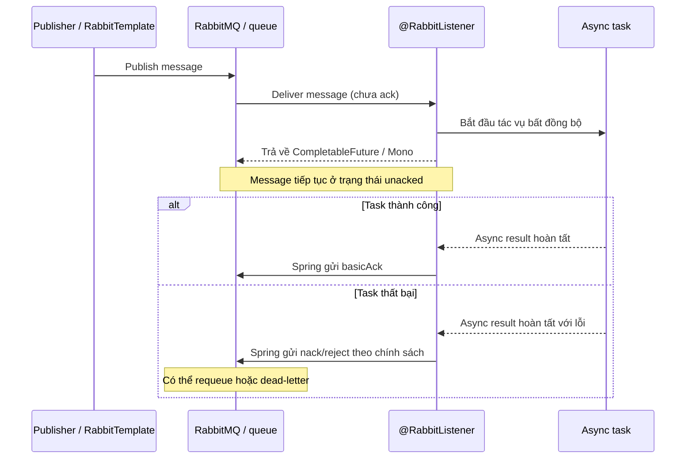

# Tự chọn MANUAL ack theo loại trả về và phiên bản hỗ trợ

## 1. Vấn đề: Listener đã trả về nhưng công việc vẫn đang chạy

Trong **Spring AMQP**, `@RabbitListener` thường xử lý một message trên luồng do listener container quản lý. Với phương thức đồng bộ, container biết khá rõ khi nào việc xử lý kết thúc: method trả về bình thường hoặc ném exception. Tuy nhiên, khi method **trả về một kết quả bất đồng bộ** như `CompletableFuture<?>` hay `Mono<?>`, việc method trả về chỉ có nghĩa là *đã bàn giao công việc*, chưa có nghĩa là công việc đã thành công.

Ví dụ: hệ thống nhận yêu cầu lập hóa đơn từ queue `invoice.jobs`. Listener chuyển yêu cầu sang một executor và trả về `CompletableFuture<Void>` ngay. Tác vụ thực tế có thể mất vài giây để gọi dịch vụ khác và lưu cơ sở dữ liệu. Nếu message được xác nhận (ack) ngay lúc method trả về, một lỗi xảy ra sau đó có thể làm mất cơ hội xử lý lại.

Spring AMQP giải quyết tình huống này bằng cơ chế **xác nhận message khi kết quả bất đồng bộ hoàn tất**. Các bản phát hành có hỗ trợ nhận biết kiểu trả về có thể **tự chọn `AcknowledgeMode.MANUAL`** cho listener bất đồng bộ.

> Phân biệt: đây là **Spring AMQP tự quản lý ack/nack sau khi async result hoàn tất**, dù tên mode là `MANUAL`. Ứng dụng thông thường **không tự gọi `Channel.basicAck()`** trong listener trả về `CompletableFuture` hoặc `Mono` đã được Spring hỗ trợ.

### Phạm vi bài học

Nội dung thuộc chương **Xử lý bất đồng bộ** của module **SPRING_AMQP**: tích hợp RabbitMQ qua `RabbitTemplate`, `@RabbitListener`, exchange, queue, binding và cách xử lý lỗi, retry, dead-letter, quan sát hệ thống để xây dựng quy trình bất đồng bộ đáng tin cậy. Trọng tâm của bài là quan hệ giữa **kiểu trả về của listener, thời điểm ack và phiên bản Spring AMQP**.

## 2. Ba chế độ acknowledgment và thời điểm hoàn tất

Đừng nhầm `AcknowledgeMode.AUTO` của Spring với *auto-ack* trong giao thức RabbitMQ.

| Chế độ Spring AMQP | Ai quyết định ack? | Thời điểm và lưu ý |
| --- | --- | --- |
| `AUTO` | Listener container | Với listener **đồng bộ**, container ack khi xử lý hoàn tất bình thường; nếu lỗi, container quyết định reject/nack theo cấu hình. Đây thường là mặc định. |
| `MANUAL` | Listener hoặc hạ tầng async của Spring | Với listener `void`/đồng bộ đặt MANUAL, ứng dụng phải tự ack/nack. Với **async return được hỗ trợ**, Spring ack/nack khi kết quả async hoàn tất. |
| `NONE` | RabbitMQ coi message đã được nhận (auto-ack ở giao thức) | Không có ack từ consumer để broker chờ; không thích hợp khi muốn khôi phục công việc lỗi dựa trên unacked message. |

Một message ở trạng thái **unacked** là message broker đã chuyển tới consumer nhưng chưa nhận xác nhận cuối cùng. Với listener async, message có thể ở trạng thái này trong suốt thời gian `Future`/`Mono` đang thực hiện. Nếu kết nối bị mất trước ack, RabbitMQ thường có thể phân phối lại message chưa ack khi consumer phục hồi; vì thế tác vụ phải hỗ trợ **idempotency** (xử lý lặp không gây tác dụng sai).

### Vòng đời của một listener async



Sơ đồ diễn tả hành vi **của hạ tầng Spring AMQP với kiểu trả về async được hỗ trợ**. Nó không có nghĩa method ứng dụng phải tự gọi `basicAck` sau khi `Future` hoàn tất.

## 3. Spring AMQP tự chọn MANUAL từ phiên bản nào?

**Mốc phiên bản cần nhớ:** tính năng tự chuyển acknowledgment mode sang `MANUAL` khi phát hiện kiểu trả về async được bổ sung ở **2.2.21, 2.3.13 và 2.4.1**, tương ứng với ba nhánh bảo trì. Các bản 3.x/4.x cũng có cơ chế này. Các mốc không phải là ba điều kiện phải cùng thỏa mãn: chỉ cần bản đang chạy thuộc một nhánh **từ mốc hỗ trợ của chính nhánh đó trở lên**.

| Phiên bản Spring AMQP | Kiểu trả về async đáng chú ý | Có tự chọn `MANUAL`? | Cách dùng |
| --- | --- | --- | --- |
| Trước 2.1 | Chưa có cơ chế async return `@RabbitListener` nêu trong bài | Không | Dùng listener đồng bộ hoặc tự quản lý ack với `Channel`. |
| 2.1.x | `ListenableFuture<?>`, `Mono<?>` | **Không** | Cấu hình `AcknowledgeMode.MANUAL` rõ ràng tại listener container factory. |
| 2.2.0–2.2.20 | `ListenableFuture<?>`, `Mono<?>` | **Không** | Cấu hình `MANUAL` rõ ràng. |
| 2.2.21+ | Các kiểu async được nhánh 2.2 hỗ trợ | **Có** | Spring nhận diện kiểu trả về để đặt `MANUAL`. |
| 2.3.0–2.3.12 | `ListenableFuture<?>`, `Mono<?>` | **Không** | Cấu hình `MANUAL` rõ ràng. |
| 2.3.13+ | Các kiểu async được nhánh 2.3 hỗ trợ | **Có** | Tự chuyển sang `MANUAL` khi phát hiện. |
| 2.4.0 | `ListenableFuture<?>`, `Mono<?>` | **Không** | Cấu hình `MANUAL` rõ ràng. |
| 2.4.1–2.4.6 | `ListenableFuture<?>`, `Mono<?>` | **Có** | Tự chọn `MANUAL`, nhưng chưa hỗ trợ `CompletableFuture<?>` như async return. |
| 2.4.7+ | Bổ sung `CompletableFuture<?>` | **Có** | Ưu tiên `CompletableFuture` trên Java mới. |
| 2.4.16+ | Bổ sung Kotlin `suspend` trên nhánh 2.4 | **Có** | Cần dependency coroutine phù hợp. |
| 3.0.0–3.0.4 | `CompletableFuture<?>`, `Mono<?>`; bỏ `ListenableFuture<?>` | **Có** | Chưa có hỗ trợ Kotlin `suspend` như các bản 3.0.5+. |
| 3.0.5+ và 4.x | `CompletableFuture<?>`, `Mono<?>`, Kotlin `suspend` | **Có** | Dùng kết quả async; Spring quản lý ack/nack sau khi hoàn tất. |

Các chi tiết phiên bản cần chú ý:

- `ListenableFuture<?>` bắt đầu được hỗ trợ cùng `Mono<?>` trong Spring AMQP **2.1**, đã được thông báo loại bỏ từ 3.0; với mã mới nên chọn `CompletableFuture<?>` nếu phiên bản cho phép.
- `CompletableFuture<?>` được bổ sung từ **2.4.7**. Vì vậy, **2.4.1 đã tự chọn MANUAL nhưng chưa có hỗ trợ async return cho `CompletableFuture`**: đây là hai mốc tính năng khác nhau.
- Kotlin `suspend` được hỗ trợ từ **3.0.5** và được backport vào nhánh **2.4.16**. Spring AMQP yêu cầu có `org.jetbrains.kotlinx:kotlinx-coroutines-reactor` trên classpath để gọi suspend listener.
- Thuộc tính `@RabbitListener(ackMode = "MANUAL")` được thêm từ **2.2**. Với **2.1.x**, muốn khai báo MANUAL cần dùng listener container factory (hoặc cấu hình container tương đương).
- Việc nhận diện dựa trên **kiểu trả về method được Spring hỗ trợ**, không phải mọi thứ chạy trong một thread khác đều kích hoạt tự chuyển MANUAL. Đừng khai báo `Object` hoặc `void` rồi trả/khởi chạy một `Future` bên trong và mong container tự chờ.

> Khi vận hành dự án, kiểm tra **phiên bản `spring-rabbit` thực tế** trong dependency tree. Phiên bản Spring Boot quyết định cách quản lý dependency, nhưng không đủ để suy ra chính xác các mốc ở bảng nếu có override hoặc BOM tùy chỉnh.

## 4. Ví dụ Spring AMQP: `CompletableFuture` và ack sau khi hoàn tất

Ví dụ sử dụng **Java 17+** và Spring AMQP **2.4.7+** (phù hợp với Spring AMQP 3.x/4.x). Để đơn giản, message chứa một `String` là mã hóa đơn.

### 4.1. Khai báo exchange, queue, binding

```java
import org.springframework.amqp.core.Binding;
import org.springframework.amqp.core.BindingBuilder;
import org.springframework.amqp.core.DirectExchange;
import org.springframework.amqp.core.Queue;
import org.springframework.amqp.core.QueueBuilder;
import org.springframework.context.annotation.Bean;
import org.springframework.context.annotation.Configuration;

@Configuration
class InvoiceMessagingConfig {

    @Bean
    DirectExchange invoiceExchange() {
        return new DirectExchange("invoice.x", true, false);
    }

    @Bean
    Queue invoiceJobsQueue() {
        return QueueBuilder.durable("invoice.jobs").build();
    }

    @Bean
    Binding invoiceJobsBinding(Queue invoiceJobsQueue,
                               DirectExchange invoiceExchange) {
        return BindingBuilder.bind(invoiceJobsQueue)
                .to(invoiceExchange)
                .with("invoice.generate");
    }
}
```

Queue durable giữ *định nghĩa queue* qua restart broker; muốn bảo đảm message cũng được lưu bền vững, producer cần publish message persistent theo cấu hình phù hợp. Phần xác nhận consumer là một cơ chế khác.

### 4.2. Gửi message bằng `RabbitTemplate`

```java
import org.springframework.amqp.rabbit.core.RabbitTemplate;
import org.springframework.stereotype.Service;

@Service
class InvoicePublisher {
    private final RabbitTemplate rabbitTemplate;

    InvoicePublisher(RabbitTemplate rabbitTemplate) {
        this.rabbitTemplate = rabbitTemplate;
    }

    void requestInvoice(String invoiceId) {
        rabbitTemplate.convertAndSend(
                "invoice.x",
                "invoice.generate",
                invoiceId
        );
    }
}
```

### 4.3. Listener trả về `CompletableFuture<Void>`

Giả sử `InvoiceService.generateAsync(id)` trả về một `CompletableFuture<Void>` chỉ hoàn tất sau khi nghiệp vụ lập hóa đơn đã xử lý xong hoặc thất bại. Service này tự quản lý executor, timeout phụ thuộc bên ngoài và idempotency theo mã yêu cầu.

```java
import java.util.Objects;
import java.util.concurrent.CompletableFuture;

import org.springframework.amqp.rabbit.annotation.RabbitListener;
import org.springframework.stereotype.Component;

@Component
class InvoiceJobListener {
    private final InvoiceService invoiceService;

    InvoiceJobListener(InvoiceService invoiceService) {
        this.invoiceService = invoiceService;
    }

    @RabbitListener(queues = "invoice.jobs")
    public CompletableFuture<Void> generate(String invoiceId) {
        try {
            return Objects.requireNonNull(
                    invoiceService.generateAsync(invoiceId),
                    "InvoiceService must return a non-null future"
            );
        } catch (Exception ex) {
            // Lỗi ngay khi tạo async task cũng phải có kết quả lỗi
            // để cơ chế async ack/nack của Spring xử lý.
            return CompletableFuture.failedFuture(ex);
        }
    }
}
```

Trong dự án thực tế, `InvoiceService` là service riêng trả về future từ executor hoặc API bất đồng bộ; ví dụ chỉ tập trung vào cách listener giao lại kết quả đó cho Spring AMQP.

**Diễn biến:**

1. `RabbitTemplate` publish message `INV-1001`, RabbitMQ chuyển tới `invoice.jobs`.
2. Listener gọi `generateAsync("INV-1001")`, nhận về một future chưa hoàn tất và trả về future đó.
3. Trên phiên bản có tự phát hiện, Spring AMQP chọn `MANUAL` cho listener này; message vẫn **unacked** khi task đang chạy.
4. Future hoàn tất bình thường → Spring AMQP gửi **ack** cho message.
5. Future hoàn tất với lỗi → Spring AMQP thực hiện **nack/reject** theo loại lỗi và chính sách container; message có thể quay lại queue hoặc chuyển DLQ.

**Không thêm** `channel.basicAck(...)` vào listener async phía trên: ack đã được Spring xử lý theo kết quả bất đồng bộ. Nếu tự ack nữa, có thể phát sinh lỗi double acknowledgment và đóng channel.

### 4.4. Khi dùng `Mono<?>`

`Mono<?>` là một kiểu kết quả async được hỗ trợ từ Spring AMQP 2.1. Trên phiên bản mới, listener có thể trả trực tiếp pipeline thay vì tự `subscribe()`:

```java
import org.springframework.amqp.rabbit.annotation.RabbitListener;
import reactor.core.publisher.Mono;

@RabbitListener(queues = "invoice.jobs")
public Mono<String> lookup(String invoiceId) {
    return invoiceReactiveService.lookupInvoiceStatus(invoiceId);
}
```

Trong ví dụ này, `invoiceReactiveService.lookupInvoiceStatus(id)` trả về `Mono<String>` và pipeline chỉ báo thành công khi kết quả đã sẵn sàng. Để Spring AMQP quản lý hoàn tất và ack/nack, **trả về chính `Mono`**; không nên gọi `subscribe()` thủ công rồi trả về `void`. Một `Mono` dùng API blocking mà không bố trí scheduler thích hợp vẫn có thể chặn luồng consumer.

Nếu request có `replyTo`, cơ chế async return còn cho phép Spring gửi **reply** sau khi kết quả hoàn tất. Nếu xử lý message một chiều, mục tiêu chủ yếu là **thời điểm acknowledgment**; không nhất thiết có reply.

## 5. Cấu hình MANUAL rõ ràng ở phiên bản cũ hoặc khi muốn kiểm soát

Với các phiên bản **chưa hỗ trợ tự phát hiện MANUAL** (như 2.1.x, 2.2.20, 2.3.12, 2.4.0), phải chủ động cấu hình listener container. Nếu không, container chạy theo `AUTO` có thể xác nhận message trước khi công việc async thực sự kết thúc.

```java
import org.springframework.amqp.core.AcknowledgeMode;
import org.springframework.amqp.rabbit.config.SimpleRabbitListenerContainerFactory;
import org.springframework.amqp.rabbit.connection.ConnectionFactory;
import org.springframework.context.annotation.Bean;
import org.springframework.context.annotation.Configuration;

@Configuration
class ManualAsyncListenerConfig {

    @Bean
    SimpleRabbitListenerContainerFactory manualAsyncFactory(
            ConnectionFactory connectionFactory) {
        SimpleRabbitListenerContainerFactory factory =
                new SimpleRabbitListenerContainerFactory();
        factory.setConnectionFactory(connectionFactory);
        factory.setAcknowledgeMode(AcknowledgeMode.MANUAL);
        factory.setPrefetchCount(10);
        factory.setConcurrentConsumers(2);
        return factory;
    }
}
```

Gắn factory cho listener:

```java
@RabbitListener(queues = "invoice.jobs", containerFactory = "manualAsyncFactory")
public Mono<Void> generateLegacy(String invoiceId) {
    return invoiceReactiveService.generateInvoice(invoiceId);
}
```

Ở ví dụ trên, `invoiceReactiveService.generateInvoice(id)` trả về `Mono<Void>`. Với nhánh 2.1, việc đặt MANUAL tại factory là lựa chọn tương thích. Ở nhánh 2.2 trở lên, có thể đặt `ackMode = "MANUAL"` trên `@RabbitListener` khi cần ghi đè cấu hình factory, nhưng **không nên tùy tiện đặt `AUTO`** cho method trả về async.

Trong dự án Spring Boot dùng factory mặc định, cấu hình bằng property có thể có dạng:

```yaml
spring:
  rabbitmq:
    listener:
      simple:
        acknowledge-mode: manual
        prefetch: 10
```

**Lưu ý:** property trên ảnh hưởng các listener sử dụng simple listener container factory được Boot tự cấu hình. Nếu trong cùng ứng dụng có listener đồng bộ trả về `void`, bật `manual` toàn cục có thể khiến chúng cần **tự gọi `basicAck/basicNack`**, nếu không sẽ tồn tại message unacked. Vì vậy, với ứng dụng hỗn hợp, **factory riêng cho listener async** thường dễ kiểm soát hơn.

### Phân biệt listener `void` đặt MANUAL

```java
import com.rabbitmq.client.Channel;
import java.io.IOException;
import org.springframework.amqp.rabbit.annotation.RabbitListener;
import org.springframework.amqp.support.AmqpHeaders;
import org.springframework.messaging.handler.annotation.Header;

@RabbitListener(queues = "invoice.jobs", ackMode = "MANUAL")
public void processSync(String invoiceId,
                        Channel channel,
                        @Header(AmqpHeaders.DELIVERY_TAG) long deliveryTag)
        throws IOException {
    try {
        invoiceService.processSynchronously(invoiceId);
        channel.basicAck(deliveryTag, false);
    } catch (Exception ex) {
        channel.basicNack(deliveryTag, false, false);
    }
}
```

Đây là **manual ack do ứng dụng tự thực hiện** cho listener đồng bộ: không giống cơ chế Spring tự ack/nack khi nhận `CompletableFuture` hay `Mono`. Ví dụ dùng tham số `multiple = false` để chỉ xác nhận hoặc từ chối **một delivery tag**, giảm rủi ro ack nhầm các message khác trên cùng channel. Không nên sử dụng mẫu này cho listener trả về async đã được Spring quản lý.

## 6. Điều gì xảy ra khi tác vụ async lỗi?

Kết quả bất đồng bộ có hai hướng: **hoàn tất thành công → ack**; **hoàn tất ngoại lệ → reject/nack**. Quyết định có requeue hay không phụ thuộc loại exception, cấu hình container và error handler.

| Kết quả xử lý | Hành vi thường thấy |
| --- | --- |
| `CompletableFuture`/`Mono` hoàn tất thành công | Spring ack message. |
| Async result thất bại với exception thông thường | Mặc định `defaultRequeueRejected = true` → message có thể được requeue. |
| Async result thất bại với `AmqpRejectAndDontRequeueException` | Không requeue; có thể chuyển DLX/DLQ nếu queue được cấu hình. |
| `defaultRequeueRejected = false` và async result báo `ImmediateRequeueException` | Có thể yêu cầu requeue dù mặc định container đang không requeue. |
| Exception xảy ra trước khi tạo/return async result | Cần bắt lỗi và trả về async result lỗi; không để thiếu kết quả mà Spring cần để quyết định ack/nack. |

Ví dụ xử lý dữ liệu đầu vào không hợp lệ, muốn đẩy vào dead-letter route đã cấu hình:

```java
import java.util.concurrent.CompletableFuture;
import org.springframework.amqp.AmqpRejectAndDontRequeueException;

@RabbitListener(queues = "invoice.jobs")
public CompletableFuture<Void> generateValidated(String invoiceId) {
    if (invoiceId == null || invoiceId.isBlank()) {
        return CompletableFuture.failedFuture(
                new AmqpRejectAndDontRequeueException("Invalid invoice ID")
        );
    }
    try {
        return invoiceService.generateAsync(invoiceId);
    } catch (RuntimeException ex) {
        return CompletableFuture.failedFuture(ex);
    }
}
```

Ví dụ code này minh họa **logic exception**; trong một ứng dụng chỉ nên đăng ký **một listener chịu trách nhiệm cho cùng loại công việc** trên queue nếu không có chủ đích cạnh tranh consumer. Không chạy đồng thời `generate` và `generateValidated` trên cùng queue rồi kỳ vọng mỗi message đi qua cả hai.

Điểm cần phân biệt về retry và dead-letter:

- **Requeue** không có nghĩa là có số lần thử tối đa. Nếu lỗi luôn tái hiện, có thể tạo **vòng lặp redelivery** với tốc độ cao.
- **DLX/DLQ** chỉ hoạt động khi broker có cấu hình dead-letter thích hợp và message bị reject/nack với `requeue = false` (hoặc các điều kiện dead-letter khác). Tự chuyển sang MANUAL không tự tạo DLQ.
- **Spring Retry** cho listener đồng bộ không nên được mặc định xem là sẽ thử lại toàn bộ exception sinh ra *sau khi future hoàn tất*. Cần kiểm chứng cách tích hợp retry cho async result theo phiên bản, hoặc thiết kế retry nghiệp vụ, backoff và DLQ chủ động.
- **Publisher confirm** xác nhận broker nhận việc publish, khác với **consumer ack** của request. Không dùng confirm như bằng chứng rằng nghiệp vụ đã chạy xong.
- Nếu service đã cập nhật database nhưng mất kết nối trước ack, message có thể được giao lại. Dùng `requestId`/`invoiceId` làm khóa idempotency hoặc có cơ chế chống tạo hóa đơn trùng.

### Vì sao phải bắt exception trước khi trả về future?

Thời điểm tạo async task cũng có thể lỗi: executor từ chối công việc (`RejectedExecutionException`), validate đầu vào thất bại, hoặc service ném exception ngay lập tức. Khi listener bất đồng bộ được cấu hình ở `MANUAL`, Spring cần **một kết quả async hợp lệ** để biết khi nào ack/nack. Bởi vậy nên chuyển lỗi sớm thành `CompletableFuture.failedFuture(ex)` hoặc `Mono.error(ex)` để hạ tầng async xử lý nhất quán.

## 7. Tác động đến hiệu năng và vận hành

MANUAL ack theo async result cải thiện độ đúng của thời điểm xác nhận, **không khiến hệ thống có thông lượng vô hạn**:

- Khi future chạy lâu, message nằm trong nhóm **unacked** và tiếp tục chiếm hạn mức **prefetch**. Nếu một consumer được cấp prefetch 10, có thể có nhiều message đang chờ xác nhận mà chưa thể phát thêm.
- Số consumer, prefetch và khả năng xử lý thực tế của executor phải cân đối. Prefetch quá cao cộng với nhiều tác vụ dài dễ làm tăng RAM và số công việc đang chạy; quá thấp có thể giới hạn throughput.
- Với tác vụ xử lý nhiều bước, timeout của API ngoài và shutdown của executor cần được quản lý; một future không bao giờ hoàn tất có thể khiến message unacked lâu.
- Tăng concurrency có thể thay đổi thứ tự hoàn tất của message. Nếu yêu cầu thứ tự nghiêm ngặt, cần xem xét chiến lược tiêu thụ và idempotency.
- Với RabbitMQ Management hoặc metrics, theo dõi `messages_unacknowledged`, tốc độ ack, redelivery, độ sâu queue và DLQ; trong ứng dụng theo dõi thời gian hoàn tất future, tỷ lệ lỗi và thời gian đợi executor.

### Kịch bản kiểm thử đáng thực hiện

| Thử nghiệm | Kỳ vọng |
| --- | --- |
| Future chỉ hoàn tất sau 2 giây | Message vẫn unacked trong thời gian đó, rồi ack khi future thành công. |
| Future hoàn tất ngoại lệ | Thấy requeue hoặc dead-letter đúng chính sách đã cấu hình. |
| Lỗi xuất hiện trước khi tạo future | Listener trả một failed future, không làm message bị treo chỉ vì không có kết quả async. |
| Dừng worker khi task chưa ack | Sau khi channel/connection đóng, message chưa ack có thể được giao lại; nghiệp vụ không bị xử lý trùng sai. |
| Dùng Spring AMQP 2.4.0 với factory `AUTO` | Không dựa vào auto-detection; thử nghiệm và cấu hình `MANUAL` rõ ràng. |
| Dùng Spring AMQP 2.4.7+ với `CompletableFuture` | Auto-detection đặt MANUAL và ack/nack theo completion. |

Đây là **các kịch bản đề xuất để chạy kiểm thử**, không phải khẳng định kết quả đã được chạy trong môi trường hiện tại.

## 8. Cách chọn trong dự án thực tế

1. **Xác định phiên bản thực tế** của `spring-rabbit` và kiểu trả về sẽ sử dụng.
2. Nếu là `CompletableFuture<?>`, bảo đảm phiên bản **2.4.7+**. Nếu là `Mono<?>`, cần **2.1+**. Nếu là Kotlin `suspend`, xem các mốc **2.4.16+** (nhánh 2.4) hoặc **3.0.5+**.
3. Với nhánh **2.2.21+**, **2.3.13+**, **2.4.1+**, dựa vào khả năng tự phát hiện MANUAL **cho các kiểu async mà chính bản đó hỗ trợ**. Với bản cũ hơn, khai báo MANUAL tại container factory.
4. Đối với **listener đồng bộ** dùng MANUAL, tự ack/nack đầy đủ. Đối với **listener async được Spring hỗ trợ**, để Spring xử lý ack/nack theo completion; tránh ack lần thứ hai.
5. Thiết kế **timeout, retry có backoff, dead-letter, idempotency và metrics** trước khi đưa vào production.

Đặc điểm nổi bật của tính năng là **Spring AMQP xác nhận message dựa trên trạng thái hoàn tất thực sự của lời gọi bất đồng bộ**. Việc *tự chọn MANUAL* giúp loại bỏ một lỗi cấu hình phổ biến, nhưng không thay thế thiết kế độ tin cậy cho toàn bộ luồng xử lý.

## Tài liệu tham khảo

- [Spring AMQP Reference — Asynchronous `@RabbitListener` Return Types](https://docs.spring.io/spring-amqp/reference/amqp/receiving-messages/async-returns.html): cơ chế ack/nack, mốc auto-MANUAL, Kotlin `suspend`.
- [Spring AMQP 2.4 Reference, mục Asynchronous `@RabbitListener` Return Types](https://docs.spring.io/spring-amqp/docs/2.4.17/reference/html/): lịch sử `ListenableFuture`, `Mono`, `CompletableFuture` (từ 2.4.7) và Kotlin `suspend` (từ 2.4.16).
- [Spring AMQP — Enable Listener Endpoint Annotations](https://docs.spring.io/spring-amqp/reference/amqp/receiving-messages/async-annotation-driven/enable.html): thuộc tính `ackMode` trên `@RabbitListener` (từ 2.2), cấu hình listener container factory.
- [Spring AMQP — Listener Container Configuration](https://docs.spring.io/spring-amqp/reference/amqp/containerAttributes.html): ý nghĩa `AUTO`, `MANUAL`, `NONE`, prefetch và các tùy chọn container.
