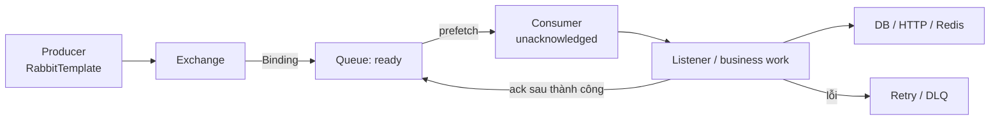

# Quản lý executor, số công việc đang chạy và giới hạn tài nguyên

> **Chương:** Xử lý bất đồng bộ. **Ngữ cảnh:** ứng dụng dùng **Spring AMQP** để gửi message bằng `RabbitTemplate` và nhận message qua `@RabbitListener` từ RabbitMQ. Bài tập trung vào cách kiểm soát **luồng thực thi, số message đang xử lý, số message chưa xác nhận và tài nguyên phía sau consumer**, nhằm tránh hệ thống sụp đổ khi lượng việc tăng đột biến.

## 1. Vì sao một hệ thống xử lý bất đồng bộ vẫn có thể quá tải?

Giả sử dịch vụ xử lý đơn hàng nhận các sự kiện `order.created` qua exchange, binding và queue. Mỗi sự kiện cần gọi API thanh toán rồi ghi cơ sở dữ liệu, mất trung bình 200 ms. Trong điều kiện bình thường, listener xử lý tốt. Khi chiến dịch giảm giá bắt đầu, producer gửi 1.000 message/giây; nếu consumer xử lý không kịp, message tồn đọng.

Điều nguy hiểm không chỉ là queue dài hơn:

- Quá nhiều **consumer/thread** có thể làm CPU chuyển ngữ cảnh liên tục và khiến pool kết nối DB cạn.
- **Prefetch lớn** giữ nhiều message ở trạng thái *unacknowledged* (chưa ack), chiếm bộ nhớ phía ứng dụng và có thể giảm độ công bằng giữa các consumer.
- Tự tạo thread hoặc `CompletableFuture` không giới hạn khiến số tác vụ đang chờ tăng nhanh, dù số tác vụ chạy thực sự rất ít.
- Nếu `@RabbitListener` đưa tác vụ sang executor khác rồi **trả về ngay** ở chế độ ack tự động, broker có thể coi message là thành công trước khi nghiệp vụ hoàn tất.
- Nếu lỗi được requeue tức thời liên tục, hệ thống có thể tạo vòng lặp retry nóng.

**Mục tiêu của quản lý tài nguyên:** chọn lượng công việc mà mỗi instance có thể hoàn thành an toàn, giữ lượng việc vượt khả năng đó trong RabbitMQ (hoặc ở lớp tiếp nhận đã được kiểm soát), và duy trì ngữ nghĩa ack/retry chính xác.



## 2. Phân biệt bốn mức đồng thời

| Thành phần | Điều gì được giới hạn? | Công cụ cấu hình |
| --- | --- | --- |
| **RabbitMQ consumers** | Số consumer đang nhận message từ một queue/nhóm queue | `concurrentConsumers`, `maxConcurrentConsumers`, `@RabbitListener(concurrency = ...)` hoặc `consumersPerQueue` |
| **Prefetch / unacked** | Số message broker đã giao nhưng chưa nhận ack trên **mỗi consumer** | `prefetchCount` / QoS |
| **Listener executor** | Luồng dùng để chạy cơ chế consumer/listener, tùy loại container | `taskExecutor` trên listener container factory |
| **Business executor** (nếu offload) | Tác vụ nghiệp vụ chạy song song và chờ trong hàng đợi nội bộ | `ThreadPoolTaskExecutor` / giới hạn explicit như `Semaphore` |

Ba giá trị *consumers*, *prefetch* và *pool size* có liên quan nhưng **không đồng nghĩa**. Tăng số thread trong executor không tự tăng số consumer; tăng prefetch cũng không làm một listener đồng bộ xử lý nhiều message hơn trong cùng một thời điểm.

### Hai kiểu container và tác động đến executor

Spring AMQP cung cấp hai container phổ biến cho AMQP 0-9-1:

| Đặc tính | `SimpleMessageListenerContainer` (SMLC) | `DirectMessageListenerContainer` (DMLC) |
| --- | --- | --- |
| Nơi listener được gọi | Trên thread của **consumer invoker**, do `taskExecutor` chạy | **Trực tiếp trên thread của RabbitMQ Java client** |
| Cấu hình concurrency | `concurrentConsumers`, `maxConcurrentConsumers`; có thể tăng/giảm động | `consumersPerQueue`; không dùng cơ chế auto-scale như SMLC |
| `taskExecutor` trong container | Cung cấp thread cho các consumer invoker, thường chạy lâu | Chủ yếu dùng tác vụ giám sát container; không phải pool thực thi listener |
| Điều cần bảo đảm | Pool đủ thread để chạy số consumer mong muốn | Pool dispatcher của **connection factory/RabbitMQ client** đủ thread cho concurrency thực tế |

Với SMLC, một consumer cần một luồng invoker dành riêng. Nếu cấu hình `maxConcurrentConsumers=8` mà executor chỉ có tối đa 4 thread và đang bị chiếm bởi consumer khác, container có thể không khởi chạy đủ consumer, có log quá thời gian chờ startup. Với DMLC, việc tăng pool của `container.setTaskExecutor(...)` **không làm tăng** số thread thực thi listener.

Ngoài listener executor, `CachingConnectionFactory` còn có executor của **RabbitMQ Java client** để dispatch delivery. Không nên dùng một pool rất nhỏ cho tất cả container hoặc tất cả kết nối mà không tính số consumer đang hoạt động.

> Trong bài này, cấu hình chính dùng **SMLC** vì dễ minh họa mối quan hệ giữa thread, consumer và prefetch. Cần kiểm tra kiểu container đang dùng trước khi áp dụng các con số.

## 3. Tính giới hạn công việc bằng concurrency và prefetch

Đặt:

- `C` = số consumer đang hoạt động trên **một instance** đối với listener đang xét.
- `P` = prefetch trên mỗi consumer.
- `R` = số replica ứng dụng đang nhận từ queue đó.
- `T` = thời gian xử lý trung bình một message, tính bằng giây.

Khi dùng xác nhận giao nhận (ack), xấp xỉ:

```text
Số message unacked tối đa của listener trên một instance ≈ C × P
Số message unacked tối đa trên R replica            ≈ R × C × P

Thông lượng xử lý đồng bộ lý tưởng/instance         ≈ C / T  (message/giây)
```

Đây là **ước lượng để đặt giới hạn**, không phải cam kết thông lượng: bộ nhớ, kích thước message, nghẽn DB/API, độ lệch thời gian xử lý, retry và phân phối giữa các consumer đều có thể làm kết quả thực tế thấp hơn. Với listener đồng bộ chạy theo từng consumer, thường có **tối đa khoảng `C` lệnh nghiệp vụ đang thực thi** cùng lúc, dù broker đã giao tối đa `C × P` message.

Ví dụ một instance có `C=4`, `P=8`, `T=0,2 giây`:

| Đại lượng | Kết quả | Ý nghĩa |
| --- | ---: | --- |
| Business work thực thi đồng thời (listener đồng bộ) | Tối đa khoảng 4 | Thường 1 message đang xử lý/consumer |
| Message đang unacked tối đa | Khoảng 32 | Gồm message đang xử lý và đã prefetch, còn chờ |
| Thông lượng lý tưởng một instance | 20 message/giây | `4 / 0,2`, chưa trừ overhead |
| Ba replica | 12 consumer; tối đa khoảng 96 unacked | Quy mô tăng theo số instance |

Nếu nhận ổn định 35 message/giây nhưng chỉ xử lý được 20 message/giây, độ sâu queue có xu hướng tăng khoảng **15 message/giây** (khi chưa có consumer khác). Việc tăng `P` từ 8 lên 250 không biến 4 luồng xử lý thành 250 luồng.

**Ước lượng bộ nhớ:** 4 consumer × prefetch 250 = 1.000 message chưa ack. Nếu mỗi message có payload ~200 KiB, chỉ riêng dữ liệu payload tương đương khoảng 195 MiB, **chưa kể** object, buffer và overhead giải mã. Đây là lý do phải giảm prefetch khi message lớn hoặc thời gian xử lý dài.

Spring AMQP đặt prefetch mặc định là **250 từ phiên bản 2.0**, nên hãy cấu hình một giá trị có chủ đích thay vì mặc định rằng mỗi consumer chỉ nhận một message.

## 4. Thiết kế một consumer đồng bộ được giới hạn

### 4.1. Chọn ngân sách tài nguyên

Giả sử instance phục vụ cả API HTTP lẫn xử lý message, với DB connection pool tối đa 12 kết nối. Ta có thể bắt đầu bằng **4 consumer** cho đơn hàng, dành các kết nối còn lại cho lưu lượng HTTP, job nền và thao tác quản trị. Chọn `prefetch=8` để có đủ message chờ giao nhưng không tích trữ quá nhiều message trong JVM.

Trong mô hình đồng bộ, xử lý nghiệp vụ diễn ra ngay bên trong listener. **Không cần** tạo thêm business executor nếu hàm xử lý vốn đã chạy trên thread consumer. Dành một `ThreadPoolTaskExecutor` riêng cho SMLC để dễ quản lý thread và không cạnh tranh với pool chạy tác vụ khác.

### 4.2. Cấu hình Java cho SMLC

```java
import org.springframework.amqp.core.AcknowledgeMode;
import org.springframework.amqp.rabbit.config.SimpleRabbitListenerContainerFactory;
import org.springframework.amqp.rabbit.connection.ConnectionFactory;
import org.springframework.beans.factory.annotation.Qualifier;
import org.springframework.context.annotation.Bean;
import org.springframework.context.annotation.Configuration;
import org.springframework.scheduling.concurrent.ThreadPoolTaskExecutor;

@Configuration(proxyBeanMethods = false)
public class OrdersConsumerConfiguration {

    @Bean("ordersConsumerExecutor")
    ThreadPoolTaskExecutor ordersConsumerExecutor() {
        ThreadPoolTaskExecutor executor = new ThreadPoolTaskExecutor();
        executor.setCorePoolSize(4);
        executor.setMaxPoolSize(4);
        // Consumer invokers là các tác vụ chạy lâu:
        // không tích lũy thêm consumer invokers chờ trong queue executor.
        executor.setQueueCapacity(0);
        executor.setThreadNamePrefix("rabbit-orders-");
        return executor; // Spring quản lý initialize/shutdown của bean.
    }

    @Bean("ordersListenerContainerFactory")
    SimpleRabbitListenerContainerFactory ordersListenerContainerFactory(
            ConnectionFactory connectionFactory,
            @Qualifier("ordersConsumerExecutor")
            ThreadPoolTaskExecutor executor) {

        SimpleRabbitListenerContainerFactory factory =
            new SimpleRabbitListenerContainerFactory();
        factory.setConnectionFactory(connectionFactory);
        factory.setTaskExecutor(executor);
        factory.setConcurrentConsumers(4);
        factory.setMaxConcurrentConsumers(4);
        factory.setPrefetchCount(8);
        factory.setAcknowledgeMode(AcknowledgeMode.AUTO);
        // Nếu có DLX, lỗi không được xử lý sẽ đi vào DLQ;
        // tránh requeue ngay lập tức gây vòng lặp nóng.
        factory.setDefaultRequeueRejected(false);
        return factory;
    }
}
```

Lưu ý: `queueCapacity=0` ở **executor** nghĩa là không có hàng đợi tác vụ nội bộ của executor; nó **không** giới hạn độ sâu queue RabbitMQ. Với SMLC, bốn consumer invoker chiếm bốn thread lâu dài, nên cấu hình này phù hợp khi executor chuyên dụng cho đúng listener này. Nếu còn listener/container khác dùng chung executor, phải tính **tổng số consumer invoker**; nếu không, tác vụ khởi chạy consumer có thể bị từ chối.

Tại sao `corePoolSize=maxPoolSize=4`? Với SMLC, bốn tác vụ consumer là tác vụ dài hạn. Giữ pool cố định khiến số thread dễ dự đoán. Nếu cần co giãn theo tải, có thể tăng `maxConcurrentConsumers` và phải tăng giới hạn thread tương ứng; riêng việc tăng `maxPoolSize` của executor không làm container tự động sinh thêm consumer.

### 4.3. Topology tối thiểu và listener

Trong ví dụ, `orders.events` là direct exchange, routing key `created` trỏ tới queue `orders.jobs`; DLX `orders.dlx` trỏ message thất bại tới `orders.failed`.

```java
import org.springframework.amqp.core.*;
import org.springframework.beans.factory.annotation.Qualifier;
import org.springframework.context.annotation.Bean;
import org.springframework.context.annotation.Configuration;

@Configuration(proxyBeanMethods = false)
class OrdersTopology {
    @Bean
    DirectExchange ordersEvents() {
        return new DirectExchange("orders.events");
    }

    @Bean
    DirectExchange ordersDlx() {
        return new DirectExchange("orders.dlx");
    }

    @Bean
    Queue ordersJobs() {
        return QueueBuilder.durable("orders.jobs")
            .deadLetterExchange("orders.dlx")
            .deadLetterRoutingKey("orders.failed")
            .build();
    }

    @Bean
    Queue ordersFailed() {
        return QueueBuilder.durable("orders.failed").build();
    }

    @Bean
    Binding ordersBinding(
            @Qualifier("ordersJobs") Queue jobs,
            @Qualifier("ordersEvents") DirectExchange events) {
        return BindingBuilder.bind(jobs).to(events).with("created");
    }

    @Bean
    Binding failedBinding(
            @Qualifier("ordersFailed") Queue failed,
            @Qualifier("ordersDlx") DirectExchange dlx) {
        return BindingBuilder.bind(failed).to(dlx).with("orders.failed");
    }
}
```

```java
import org.springframework.amqp.rabbit.annotation.RabbitListener;
import org.springframework.amqp.rabbit.core.RabbitTemplate;
import org.springframework.stereotype.Component;
import org.springframework.stereotype.Service;

@Component
class OrdersListener {
    private final OrderService orderService;

    OrdersListener(OrderService orderService) {
        this.orderService = orderService;
    }

    @RabbitListener(
        id = "ordersListener",
        queues = "orders.jobs",
        containerFactory = "ordersListenerContainerFactory")
    public void onOrder(String orderId) {
        // Chạy trên consumer invoker thread của SMLC.
        // Chỉ trở về sau khi nghiệp vụ đã xử lý xong.
        orderService.process(orderId);
    }
}

@Service
class OrdersPublisher {
    private final RabbitTemplate rabbitTemplate;

    OrdersPublisher(RabbitTemplate rabbitTemplate) {
        this.rabbitTemplate = rabbitTemplate;
    }

    public void publish(String orderId) {
        rabbitTemplate.convertAndSend("orders.events", "created", orderId);
    }
}
```

`OrderService` là interface/class nghiệp vụ do ứng dụng tự cung cấp. Với `AcknowledgeMode.AUTO`, container **ack sau khi listener xử lý thành công**. Nếu listener ném exception, container áp dụng quy tắc reject/requeue đã cấu hình: ở đây `defaultRequeueRejected=false`, broker dead-letter vào `orders.failed` **nếu topology DLX tồn tại và hợp lệ**; không có DLX thì message có thể bị loại. Trong sản xuất, dùng chính sách retry hữu hạn cho lỗi tạm thời, cùng DLQ cho lỗi không thể phục hồi; không dùng một quy tắc requeue tức thời vô hạn.

Các bean topology trên dành cho queue mới hoặc queue có cấu hình tương thích; không khai báo đè argument khác với queue đang tồn tại trên broker. Độ bền và xác nhận publish từ `RabbitTemplate` (publisher confirms) là phần riêng với ack của consumer.

## 5. Khi thật sự cần business executor riêng

`@RabbitListener` đã là cách nhận message bất đồng bộ: broker chủ động đẩy message tới consumer, không cần `@Async` chỉ để “biến nó thành async”. Tuy nhiên, một số tác vụ nghiệp vụ dài có thể được chạy trên **pool khác**, chẳng hạn vừa xử lý việc I/O vừa cần giải phóng thread consumer sớm. Khi offload, phải bảo toàn mối quan hệ giữa **hoàn thành nghiệp vụ và ack**.

### Sai lầm: fire-and-forget làm ack quá sớm

```java
// VÍ DỤ SAI khi container dùng AcknowledgeMode.AUTO
@RabbitListener(queues = "orders.jobs")
public void onOrder(String orderId) {
    businessExecutor.execute(() -> orderService.process(orderId));
    // Method kết thúc: container có thể ack ngay,
    // trong khi process(orderId) vẫn chưa chạy xong.
}
```

Nếu JVM sập sau khi listener trả về nhưng trước khi task hoàn thành, message có thể đã bị ack và **không được giao lại**. Tương tự, exception phát sinh trong task không tự quay về listener để quyết định ack/retry.

### Cách phù hợp: trả về `CompletableFuture` để ack khi hoàn tất

Spring AMQP hỗ trợ listener trả về `CompletableFuture<?>` hoặc `Mono<?>`. Với dạng này, phải sử dụng ngữ nghĩa `AcknowledgeMode.MANUAL`; framework sẽ **settle khi kết quả async hoàn tất**. Các phiên bản Spring AMQP hiện đại có cơ chế tự nhận diện async return type và đặt MANUAL, nhưng nên đặt tường minh khi cấu hình ví dụ để dễ đọc.

Khi chuyển **từ listener đồng bộ ở mục 4** sang mẫu async, chỉ chạy **một** trong hai listener trên cùng queue. Trong bean factory, chỉnh `factory.setConcurrentConsumers(2)`, `factory.setMaxConcurrentConsumers(2)`, `factory.setPrefetchCount(8)` và `factory.setAcknowledgeMode(AcknowledgeMode.MANUAL)`. Hai consumer invoker của SMLC vẫn dùng executor `ordersConsumerExecutor` đã khai báo.

Tạo business executor **khác** với executor của consumer, có queue tác vụ hữu hạn:

```java
import org.springframework.context.annotation.Bean;
import org.springframework.context.annotation.Configuration;
import org.springframework.scheduling.concurrent.ThreadPoolTaskExecutor;
import java.util.concurrent.ThreadPoolExecutor;

@Configuration(proxyBeanMethods = false)
class BusinessExecutorConfiguration {
    @Bean("ordersBusinessExecutor")
    ThreadPoolTaskExecutor ordersBusinessExecutor() {
        ThreadPoolTaskExecutor executor = new ThreadPoolTaskExecutor();
        executor.setCorePoolSize(4);
        executor.setMaxPoolSize(4);
        executor.setQueueCapacity(12);
        executor.setThreadNamePrefix("orders-work-");
        executor.setRejectedExecutionHandler(
            new ThreadPoolExecutor.AbortPolicy());
        return executor;
    }
}
```

Và đổi listener:

```java
import java.util.concurrent.CompletableFuture;
import java.util.concurrent.RejectedExecutionException;
import org.springframework.amqp.AmqpRejectAndDontRequeueException;
import org.springframework.amqp.rabbit.annotation.RabbitListener;
import org.springframework.beans.factory.annotation.Qualifier;
import org.springframework.scheduling.concurrent.ThreadPoolTaskExecutor;
import org.springframework.stereotype.Component;

@Component
class AsyncOrdersListener {
    private final OrderService orderService;
    private final ThreadPoolTaskExecutor businessExecutor;

    AsyncOrdersListener(
            OrderService orderService,
            @Qualifier("ordersBusinessExecutor")
            ThreadPoolTaskExecutor businessExecutor) {
        this.orderService = orderService;
        this.businessExecutor = businessExecutor;
    }

    @RabbitListener(
        id = "asyncOrdersListener",
        queues = "orders.jobs",
        containerFactory = "ordersListenerContainerFactory")
    public CompletableFuture<Void> onOrder(String orderId) {
        try {
            // Future chỉ hoàn thành sau khi nghiệp vụ kết thúc.
            return CompletableFuture.runAsync(
                () -> orderService.process(orderId),
                businessExecutor);
        } catch (RejectedExecutionException saturated) {
            // Phải trả một Future thất bại ngay cả khi không thể schedule.
            // Ví dụ này chuyển quá tải vào DLQ để xử lý/replay có kiểm soát.
            return CompletableFuture.failedFuture(
                new AmqpRejectAndDontRequeueException(
                    "Business executor is saturated", saturated));
        }
    }
}
```

Ở ví dụ này:

1. SMLC có **2 consumer**, `prefetch=8` ⇒ khoảng **16 message unacked tối đa** trên instance cho listener này.
2. Business executor có **4 thread chạy** và **12 vị trí hàng đợi task** ⇒ tối đa khoảng **16 task đã nhận** từ listener, khi pool không được dùng chung cho tác vụ khác.
3. Future thành công ⇒ framework ack; Future thất bại ⇒ framework reject/nack theo loại exception, thiết lập requeue và error handler. `AmqpRejectAndDontRequeueException` được chọn để minh họa **DLQ khi executor đầy**; cần có DLX/DLQ và quy trình replay tương ứng.

Việc chuyển lỗi quá tải vào DLQ ở đây là **một chính sách cụ thể để tránh mất khả năng kiểm soát tải**, không phải đáp án mặc định cho mọi hệ thống. Một ứng dụng khác có thể tạm dừng consumer, dùng delayed retry hữu hạn, hoặc giảm tốc độ producer. Nếu chọn requeue, phải tránh tạo vòng lặp tức thời khi downstream vẫn quá tải.

**Không nên gọi `basicAck` trực tiếp từ task chạy trên worker thread tùy ý** rồi đồng thời để framework tự xử lý ack Future. Channel AMQP và delivery tag có ràng buộc riêng; việc tự settle trên nhiều luồng không có phối hợp dễ dẫn đến double ack, race condition, mất message hoặc đóng channel. Trong mẫu `CompletableFuture`, để Spring AMQP sở hữu quá trình ack/nack.

### Executor queue hữu hạn: hiểu `core/max/queueCapacity`

Với `ThreadPoolTaskExecutor`, quy tắc điển hình là: trước hết tạo thread đến `corePoolSize`; sau đó **đưa task vào queue**; chỉ khi queue đầy mới mở rộng đến `maxPoolSize`; nếu cả pool lẫn queue đầy thì từ chối task. Bởi vậy:

| Cấu hình | Hệ quả |
| --- | --- |
| `core=4, max=12, queue=10000` | Có thể xếp hàng rất nhiều task trước khi tăng lên hơn 4 thread, tăng thời gian chờ và bộ nhớ |
| `core=4, max=4, queue=12` | Giới hạn rõ: khoảng 4 task chạy, 12 task chờ; từ chối khi đầy |
| `core=4, max=8, queue=0` | Không giữ queue tác vụ; khi 4 thread bận, có thể tăng đến 8 rồi từ chối |
| Queue không giới hạn | Dễ làm heap tăng mạnh khi downstream chậm |

Với tác vụ xử lý message, hãy đặt **giới hạn thực tế** và xác định hành vi khi vượt ngưỡng. Không dùng `CallerRunsPolicy` một cách vô thức: nó có thể khiến callback consumer tự chạy công việc ngay trong thread tiếp nhận, thay đổi latency và cách hệ thống backpressure; đôi khi có ích, nhưng phải kiểm thử với container và quy tắc ack.

## 6. Cần giới hạn những tài nguyên nào ngoài thread?

Tăng số consumer không thể khắc phục một DB hoặc HTTP service đã chạm công suất. Nên coi mỗi tầng là một **ngân sách hữu hạn**:

| Tài nguyên | Rủi ro khi vượt giới hạn | Biện pháp |
| --- | --- | --- |
| CPU | Chuyển ngữ cảnh, GC, latency tăng | Giới hạn worker theo số core và đo độ bão hòa |
| Heap / message buffer | OOM vì prefetch lớn hoặc executor queue quá dài | Prefetch nhỏ, queue hữu hạn, giới hạn kích thước payload |
| JDBC connection pool | Thread chờ connection, timeout dây chuyền | Giữ số tác vụ dùng DB đồng thời dưới phần ngân sách được cấp |
| HTTP client / downstream | Rate limit, connection exhaustion | Timeout, connection pool, bulkhead/semaphore, circuit breaker, backoff |
| RabbitMQ connections/channels | Nhiều consumer/channel, áp lực broker | Tính tổng consumer trên các listener và replica; tái sử dụng connection factory |
| Broker queue storage | Backlog tăng liên tục khi producer nhanh hơn consumer | Alert queue depth/age, giới hạn tốc độ producer, quota/max length theo yêu cầu |
| Retry và DLQ | Retry storm, poison message chiếm worker | Retry hữu hạn, khoảng trễ, delivery limit/DLQ, giám sát và replay có kiểm soát |

**Quy tắc thực dụng:** nếu một instance có JDBC pool tối đa 12 mà API HTTP thường dùng 6–8 kết nối lúc cao điểm, không nên bật 20 consumer đồng thời đều cần DB. Khởi điểm 3–4 consumer có thể an toàn hơn; cần đo thực tế trước khi mở rộng.

Trong hệ thống nhiều replica, một `Semaphore(4)` chỉ giới hạn **từng instance**, không giới hạn tổng số lệnh đến một downstream trên toàn cluster. Nếu phải bảo đảm trần toàn hệ thống, cần thêm rate limiting/bulkhead dùng chung hoặc cơ chế điều phối ở tầng upstream.

## 7. Điều khiển tải khi hệ thống bắt đầu nghẽn

Một số tín hiệu thường gặp:

| Triệu chứng | Nguyên nhân có thể | Điều chỉnh trước tiên |
| --- | --- | --- |
| `messages_ready` tăng, CPU thấp, DB chưa quá tải | Consumer quá ít, giới hạn bên ngoài hoặc chưa xử lý được queue | Kiểm tra consumer/thread, tăng concurrency **có kiểm soát** |
| `messages_unacknowledged` cao, heap tăng | Prefetch quá lớn, xử lý chậm, async task xếp hàng | Giảm prefetch, giới hạn business executor queue |
| DB connection timeout tăng | Quá nhiều tác vụ dùng DB song song | Giảm worker/consumer, đặt bulkhead, tối ưu query |
| Executor queue luôn đầy hoặc `RejectedExecutionException` | Tải lớn hơn khả năng xử lý thực tế | Kiểm tra downstream; giảm tiếp nhận và định nghĩa overflow/retry |
| `redelivered` và `requeue` tăng vọt | Retry nóng, timeout/ack lỗi hoặc poison message | Tách lỗi, thêm backoff và DLQ; kiểm tra ack |
| Queue ready ít nhưng độ trễ cuối cao | Message đã được prefetch/giữ trong JVM hoặc task chờ nội bộ | Đo unacked, task queue, thời gian end-to-end; giảm prefetch |

Để giảm lượng việc mới, có thể **giảm concurrency động**, tạm **stop container có chủ đích**, hoặc điều tiết producer. Khi stop, cần hiểu thời gian graceful shutdown, message đang xử lý, timeout và khả năng được giao lại nếu chưa ack. Đừng chỉ tăng số worker trong một vòng lặp auto-scale khi downstream đang suy giảm: như vậy có thể làm hệ thống lỗi nhanh hơn.

Khi backlog xuất hiện, phân biệt ba thước đo:

- **Throughput:** message hoàn tất/giây.
- **Latency end-to-end:** từ lúc producer tạo message đến lúc xử lý thành công, gồm cả thời gian nằm trong queue và executor.
- **In-flight/unacked:** message broker đã giao nhưng vẫn chờ ack, gồm đang chạy và chưa chạy (đã prefetch).

Tăng prefetch đôi khi giúp thông lượng cho tác vụ rất ngắn bằng cách giảm khoảng trống giữa các lần nhận, nhưng với công việc lâu hoặc payload lớn, việc tăng đó chủ yếu làm tăng in-flight và bộ nhớ.

## 8. Đo lường: broker, container và executor

Sử dụng RabbitMQ Management UI, các chỉ số Spring AMQP/Micrometer và log có định danh trace/message hợp lý:

| Nơi đo | Chỉ số nên quan sát | Cách diễn giải |
| --- | --- | --- |
| RabbitMQ queue | Ready, unacked, tổng consumer, publish/ack/deliver/requeue rate | Broker có đang tồn đọng? Message có bị giao lại liên tục? |
| Spring AMQP listener | Thời gian thực thi, số lỗi, active observation, container đang chạy | Có bottleneck hoặc lỗi ở listener? |
| `ThreadPoolTaskExecutor` | `getActiveCount()`, `getPoolSize()`, độ dài `getThreadPoolExecutor().getQueue()`, rejection | Pool có bão hòa hay giữ task quá lâu? |
| JVM | CPU, heap, GC, số thread | Tăng consumer có gây chi phí hệ thống quá lớn? |
| DB/HTTP downstream | Active/idle connections, timeout, rate-limit, p95/p99 | Nơi xử lý thực sự có đủ công suất? |
| DLQ | Số message mới, tuổi message, loại lỗi | Có poison message hoặc chính sách overflow sai? |

Ví dụ có thể bật observation trên listener factory:

```java
factory.setObservationEnabled(true);
```

Khi có Micrometer/Actuator và registry phù hợp, Spring AMQP cung cấp observation như `spring.rabbit.listener` và `spring.rabbit.listener.active`; metric có sẵn và tên phát ra còn tùy cấu hình giám sát/version. Đối với executor, nếu cần dashboard, đăng ký metrics thread pool qua Spring Boot Actuator hoặc Micrometer; các getter trực tiếp phù hợp để debug cục bộ nhưng không thay thế giám sát liên tục.

Đặt thread name prefix (như `rabbit-orders-`, `orders-work-`) và log thời gian bắt đầu/kết thúc xử lý. Tránh đưa `messageId` hoặc `orderId` làm **tag metric** có cardinality quá cao; dùng chúng trong log/tracing khi cần truy vết.

## 9. Bài thực hành: tìm điểm bão hòa và xác minh ack

### Kịch bản

Tạo 200 message đơn hàng, mỗi message giả lập công việc mất 200 ms; sử dụng cấu hình đồng bộ ở mục 4. Sau đó thử mẫu async ở mục 5 (không chạy đồng thời hai listener trên một queue). Môi trường thực hành cần RabbitMQ, Spring Boot với `spring-boot-starter-amqp`, và một `OrderService` giả lập; số đo thực tế có thể lệch do máy và broker.

```java
import java.util.concurrent.TimeUnit;
import org.springframework.stereotype.Service;

@Service
class OrderService {
    void process(String orderId) {
        try {
            TimeUnit.MILLISECONDS.sleep(200); // Chỉ mô phỏng I/O.
        } catch (InterruptedException ex) {
            Thread.currentThread().interrupt();
            throw new IllegalStateException("Interrupted", ex);
        }
    }
}
```

| Thử nghiệm | Thay đổi | Điều cần đo/kiểm tra |
| --- | --- | --- |
| A — Baseline | `C=4`, `P=8`, xử lý 200 ms | Active work ~4, unacked có thể đến ~32; throughput thực tế gần nhưng thường dưới 20 msg/s |
| B — Tăng prefetch | Giữ `C=4`, đổi `P=250` | Thông lượng không nhất thiết tăng; số unacked và bộ nhớ có thể tăng rõ |
| C — Downstream chậm | Tăng xử lý lên 2 giây | Ready tăng, throughput giảm; không tự tăng pool vô hạn |
| D — Tăng concurrency | `C=8`, executor SMLC đủ ≥8 thread | Đo cả throughput lẫn DB/CPU để xác nhận tăng concurrency có lợi thật |
| E — Ack quá sớm | Tạm thử mẫu fire-and-forget trong môi trường cô lập | Quan sát listener trả về trước khi task hoàn thành; giải thích rủi ro mất message |
| F — Future và quá tải | Dùng business executor `4 thread + 12 queue`; giới hạn prefetch | Quan sát ack khi Future hoàn tất; kiểm tra DLQ/overflow khi executor từ chối task |
| G — Failure | Làm `OrderService` ném exception | Message không bị ack thành công; tuân theo DLX/requeue đã cấu hình |

Khi thay `C` từ 4 lên 8 trong thử nghiệm D, **phải đồng thời thay pool dedicated cho SMLC**. Nếu chỉ tăng consumer count mà pool vẫn 4, kết quả sẽ gây hiểu lầm.

**Câu hỏi tự kiểm tra:**

1. Nếu một instance có 6 consumer, `prefetch=20`, ba replica, giới hạn unacked lý thuyết là bao nhiêu? Có phải tất cả 360 message đều đang được chạy bởi business code không?
2. Vì sao với `ThreadPoolTaskExecutor(core=4, max=20, queue=5000)`, nhiều lúc hệ thống chỉ dùng 4 worker dù backlog lớn?
3. Vì sao gọi `businessExecutor.execute(...)` trong listener `void` rồi trả về ngay có thể làm mất message khi JVM dừng?
4. Cần thay đổi gì khi chuyển từ SMLC sang DMLC để kiểm soát concurrency thật sự?
5. Khi số message ready tiếp tục tăng và DB connection pool đã cạn, tăng consumer từ 4 lên 16 có giải quyết vấn đề không?

## 10. Gợi ý triển khai thực tế

1. **Bắt đầu với xử lý đồng bộ trong listener** khi đủ nhanh và dễ quản lý; hãy để SMLC kiểm soát concurrency và container xử lý ack.
2. **Đặt concurrency, prefetch và executor size có chủ đích.** Tính theo **từng queue, từng listener, từng replica**, không chỉ một giá trị toàn cục.
3. **Chỉ offload khi có lợi ích rõ ràng** và dùng completion signal (`CompletableFuture`/`Mono`) để ack đúng lúc. Business executor phải hữu hạn và có chính sách khi từ chối task.
4. **Bảo vệ downstream** bằng timeout, connection pool, giới hạn song song và retry với backoff; tách DLQ cho các trường hợp thất bại cuối.
5. **Đo tải thực tế** (ready, unacked, active threads, executor queue, độ trễ, lỗi DB) rồi điều chỉnh; không đánh giá hiệu năng bằng số consumer đơn lẻ.

Đây là một thiết kế **at-least-once**: consumer có thể xử lý xong tác động nghiệp vụ rồi mất kết nối trước khi broker nhận ack. Vì vậy cần idempotency (ví dụ mã sự kiện/đơn hàng duy nhất và thao tác ghi chống trùng) ngay cả khi concurrency và executor đã được cấu hình tốt.

## 11. Tài liệu tham khảo chính thức

- [Spring AMQP — Threading and Asynchronous Consumers](https://docs.spring.io/spring-amqp/reference/amqp/receiving-messages/threading.html): executor của SMLC, DMLC và RabbitMQ Java client.
- [Spring AMQP — Listener Concurrency](https://docs.spring.io/spring-amqp/reference/amqp/listener-concurrency.html): consumer động, `concurrentConsumers`, `consumersPerQueue`.
- [Spring AMQP — Message Listener Container Configuration](https://docs.spring.io/spring-amqp/reference/amqp/containerAttributes.html): `prefetchCount`, `taskExecutor`, `shutdownTimeout` và các cấu hình liên quan.
- [Spring AMQP — Asynchronous `@RabbitListener` Return Types](https://docs.spring.io/spring-amqp/reference/amqp/receiving-messages/async-returns.html): `CompletableFuture`, `Mono` và ack sau khi Future hoàn tất.
- [Spring AMQP — Choosing a Container](https://docs.spring.io/spring-amqp/reference/amqp/receiving-messages/choose-container.html): khác biệt SMLC/DMLC.
- [Spring Framework — Task Execution and Scheduling](https://docs.spring.io/spring-framework/reference/integration/scheduling.html): cấu hình `ThreadPoolTaskExecutor`.
- [RabbitMQ — Consumer Prefetch](https://www.rabbitmq.com/docs/consumer-prefetch): giới hạn unacked per-consumer.
- [Spring AMQP — Micrometer Observation](https://docs.spring.io/spring-amqp/reference/amqp/receiving-messages/micrometer-observation.html): quan sát listener.

**Điểm cốt lõi:** `@RabbitListener` đã nhận message bất đồng bộ từ RabbitMQ. Chất lượng vận hành nằm ở việc **giới hạn công việc đang chạy (concurrency + executor), giới hạn message đã cấp nhưng chưa ack (prefetch), bảo vệ downstream và xác nhận message đúng thời điểm**.
