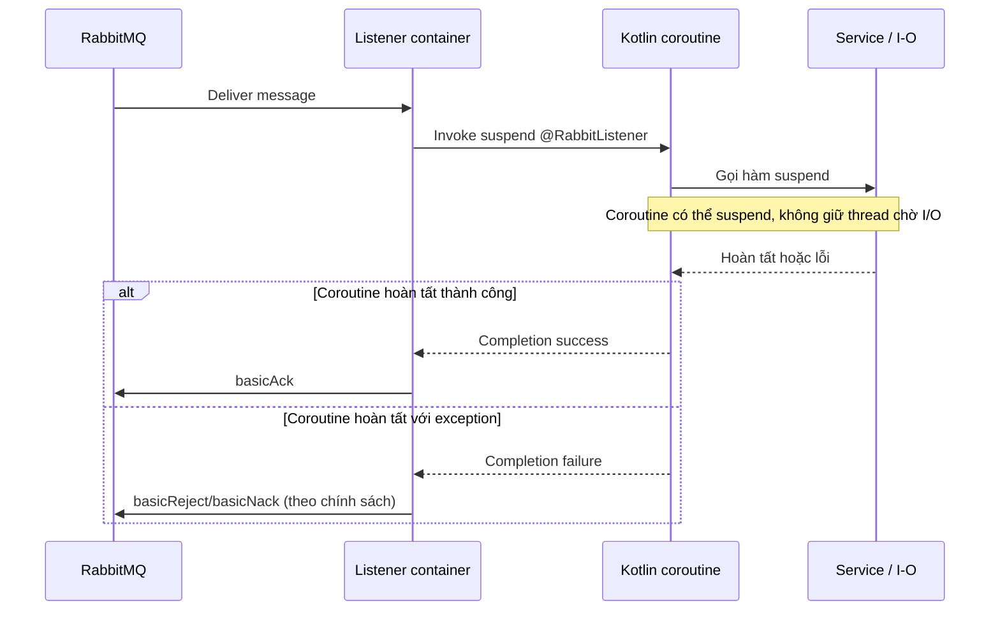
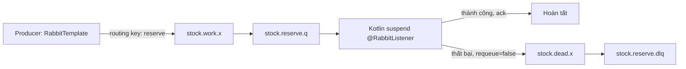

# Kotlin suspend listener khi dự án sử dụng Kotlin

> **Chương:** Xử lý bất đồng bộ  
> **Module:** SPRING_AMQP — tích hợp RabbitMQ với Spring AMQP qua `RabbitTemplate`, `@RabbitListener`, exchange, queue và binding; kiểm soát giao nhận, retry, dead-letter, giao dịch và khả năng quan sát.  
> **Phạm vi:** Ứng dụng dùng Kotlin và Spring AMQP **AMQP 0.9.1** với RabbitMQ. Bài này tập trung vào vòng đời `suspend @RabbitListener`, không nhầm với việc gửi message bất đồng bộ từ producer.

## 1. Học xong bài này, bạn làm được gì?

1. Xác định khi nào nên khai báo `suspend fun` cho `@RabbitListener` và kiểm tra phiên bản, dependency cần thiết.
2. Giải thích được broker delivery, coroutine suspension/resumption, `MANUAL` acknowledgment và thời điểm Spring AMQP gửi ack/nack.
3. Cấu hình exchange, queue, dead-letter và một Kotlin listener minh họa xử lý I/O bất đồng bộ.
4. Phân loại lỗi để tránh vòng lặp requeue, bảo toàn idempotency và kiểm soát prefetch/concurrency.
5. Nhận diện các lỗi dễ gặp khi kết hợp coroutine với `RabbitTemplate`, thư viện blocking, `@Transactional`, timeout và tiến trình shutdown.
6. Kiểm thử được tình huống thành công, thất bại, redelivery, DLQ, duplicate và xử lý lâu.

### Tình huống thực tế

Một dịch vụ Kotlin nhận `ReserveStock` khi người dùng đặt hàng. Để hoàn tất, consumer cần kiểm tra tồn kho qua API nội bộ và cập nhật dữ liệu. Nếu dùng lời gọi I/O bất đồng bộ kiểu coroutine, một listener dạng:

```kotlin
@RabbitListener(queues = ["stock.reserve.q"], ackMode = "MANUAL")
suspend fun onReserve(message: Message) {
    val request = decodeAndValidate(message)
    reservationService.reserve(request)  // suspend trong lúc chờ I/O
} // hoàn tất bình thường -> adapter xử lý ack
```

có thể chờ I/O mà không giữ một thread bị khóa trong toàn bộ thời gian chờ. Tuy nhiên, **suspension không thay thế RabbitMQ acknowledgment, retry hay khả năng chống xử lý trùng**. Các cơ chế đó vẫn cần được thiết kế.

## 2. Phân biệt “message bất đồng bộ” và “suspend listener”

RabbitMQ vốn phân phối message bất đồng bộ giữa các dịch vụ. Spring AMQP lại có hai cách xử lý ở tầng ứng dụng:

| Khía cạnh | `fun onMessage(...)` thông thường | `suspend fun onMessage(...)` |
|---|---|---|
| Cách định nghĩa | Hàm Kotlin đồng bộ | Hàm Kotlin có thể tạm dừng rồi tiếp tục |
| Chờ I/O | Lời gọi blocking thường giữ thread | Lời gọi **suspending thực sự** có thể nhường thread |
| Khi kết thúc delivery | Container xử lý theo `AUTO`/`MANUAL` đã cấu hình | Với async listener, Spring AMQP xử lý kết quả coroutine và ack/nack khi hoàn tất |
| Exception | Ném trực tiếp từ lời gọi handler | Có thể xuất hiện sau điểm `suspend` và được truyền qua kết quả bất đồng bộ |
| Thứ tự message | Phụ thuộc queue, consumer, prefetch và xử lý | Vẫn phụ thuộc các yếu tố đó; `suspend` không bảo đảm FIFO |
| Truyền ngữ cảnh | Thread-local có thể phù hợp với luồng đồng bộ | Coroutine có thể resume trên thread khác; cần quản lý context rõ ràng |

`suspend` là khả năng của **hàm Kotlin**. Nó không làm cho một lời gọi JDBC, `RabbitTemplate.convertAndSend()` hoặc `Thread.sleep()` tự động trở thành non-blocking. Chỉ những API hỗ trợ suspension/non-blocking thực sự (hoặc đoạn blocking được offload phù hợp) mới mang lại lợi ích tiết kiệm thread.

### 2.1. Vòng đời của một delivery



Đây là luồng **do adapter/container Spring AMQP quản lý** đối với listener bất đồng bộ. Bạn không cần tự gọi `channel.basicAck()` trong một `suspend @RabbitListener` theo mô hình này. Nếu vừa tự ack, vừa để framework ack khi coroutine hoàn tất, có nguy cơ **ack trùng delivery tag** và làm channel bị đóng.

**Hai mốc phải tách riêng:** Spring AMQP hoàn tất consumer handler và gửi ack tới broker; broker có nhận ack hay không còn chịu ảnh hưởng của kết nối. Nếu cập nhật DB đã commit nhưng kết nối mất trước ack, RabbitMQ có thể giao lại cùng message. Vì thế luôn cần idempotency.

## 3. Kiểm tra phiên bản và dependency trước khi viết `suspend`

Theo tài liệu Spring AMQP, hỗ trợ Kotlin `suspend` trên `@RabbitListener`/`@RabbitHandler` có từ **Spring AMQP 3.0.5** trên nhánh 3.x; nhánh bảo trì 2.4.x đã bổ sung từ **2.4.16**. Với các nhánh hiện đại hơn, kiểm tra tài liệu tương ứng và bảo đảm đủ dependency.

| Thành phần | Điều kiện / mục đích |
|---|---|
| Kotlin compiler và coroutine library | Để khai báo/chạy hàm `suspend`, `delay`, `coroutineScope`, v.v. |
| Spring AMQP hỗ trợ suspend listener | Ví dụ Spring AMQP 3.0.5+ trên nhánh 3.0, hoặc 2.4.16+ trên nhánh 2.4. |
| `org.jetbrains.kotlinx:kotlinx-coroutines-reactor` | **Bắt buộc có trên classpath** cho cơ chế gọi Kotlin suspend listener của Spring AMQP. |
| `spring-rabbit` và container `@RabbitListener` | Tích hợp RabbitMQ qua AMQP 0.9.1. |
| Message converter | Chọn cách xử lý String, raw `Message` hoặc chuyển JSON thành DTO; không mặc định converter nào cũng đọc được kiểu Kotlin. |

Ví dụ dependency cho **Spring Boot 3.x** với Gradle Kotlin DSL; các phiên bản cụ thể do Spring Boot BOM/plugin của dự án quản lý:

```kotlin
// build.gradle.kts — trích phần dependencies
dependencies {
    implementation("org.springframework.boot:spring-boot-starter-amqp")
    implementation("org.jetbrains.kotlin:kotlin-reflect")
    implementation("org.jetbrains.kotlinx:kotlinx-coroutines-reactor")

    // Ví dụ bên dưới tự giải mã JSON bằng Jackson.
    implementation("com.fasterxml.jackson.module:jackson-module-kotlin")

    testImplementation("org.springframework.boot:spring-boot-starter-test")
    testImplementation("org.springframework.amqp:spring-rabbit-test")
}
```

Nếu dùng **Spring Boot 4.x**, cần chú ý bộ starter đã được phân chia: tích hợp RabbitMQ AMQP 0.9.1 sử dụng `spring-boot-starter-rabbitmq` theo tài liệu Boot 4.x; `spring-boot-starter-amqp` lúc đó phục vụ AMQP 1.0 tổng quát. Đừng trộn dependency và API của hai giao thức. Các ví dụ mã trong bài này theo API Spring AMQP/RabbitMQ 0.9.1.

**Dấu hiệu thiếu dependency:** Ứng dụng có thể khởi tạo listener thất bại hoặc báo không thể gọi đúng dạng hàm Kotlin suspend. Khi điều tra, kiểm tra dependency tree và đúng phiên bản `spring-rabbit` đang chạy; chỉ thêm `kotlinx-coroutines-core` chưa thay thế được yêu cầu `kotlinx-coroutines-reactor`.

## 4. Ví dụ xuyên suốt: queue nhận yêu cầu giữ hàng

Chúng ta xây luồng:



### 4.1. Khai báo exchange, queue và binding

```kotlin
import org.springframework.amqp.core.BindingBuilder
import org.springframework.amqp.core.Declarables
import org.springframework.amqp.core.DirectExchange
import org.springframework.amqp.core.QueueBuilder
import org.springframework.context.annotation.Bean
import org.springframework.context.annotation.Configuration

object StockAmqp {
    const val WORK_EXCHANGE = "stock.work.x"
    const val WORK_QUEUE = "stock.reserve.q"
    const val WORK_KEY = "reserve"
    const val DEAD_EXCHANGE = "stock.dead.x"
    const val DEAD_QUEUE = "stock.reserve.dlq"
    const val DEAD_KEY = "failed"
}

@Configuration
class StockRabbitConfiguration {
    @Bean
    fun stockTopology(): Declarables {
        val workX = DirectExchange(StockAmqp.WORK_EXCHANGE, true, false)
        val deadX = DirectExchange(StockAmqp.DEAD_EXCHANGE, true, false)
        val workQ = QueueBuilder.durable(StockAmqp.WORK_QUEUE)
            .deadLetterExchange(StockAmqp.DEAD_EXCHANGE)
            .deadLetterRoutingKey(StockAmqp.DEAD_KEY)
            .build()
        val deadQ = QueueBuilder.durable(StockAmqp.DEAD_QUEUE).build()

        return Declarables(
            workX,
            deadX,
            workQ,
            deadQ,
            BindingBuilder.bind(workQ).to(workX).with(StockAmqp.WORK_KEY),
            BindingBuilder.bind(deadQ).to(deadX).with(StockAmqp.DEAD_KEY)
        )
    }
}
```

Ở đây, khi RabbitMQ nhận reject/nack với `requeue=false` từ queue nguồn, broker có thể đưa message tới DLX và định tuyến sang DLQ theo binding. Để bảo đảm đường đi đúng, kiểm tra cả **queue arguments, exchange lẫn binding**. Thực tế có thể dùng RabbitMQ policy để quản lý DLX thay vì hardcode queue arguments; policy dễ điều chỉnh hơn khi vận hành.

### 4.2. Cấu hình listener và retry policy cơ bản

```yaml
# application.yml — Spring Boot 3.x, container kiểu simple
spring:
  rabbitmq:
    host: localhost
    port: 5672
    listener:
      simple:
        concurrency: 2
        prefetch: 8
        default-requeue-rejected: false
```

- `concurrency: 2`: có hai consumer đồng thời ở container simple trong ví dụ.
- `prefetch: 8`: giới hạn số delivery chưa ack mà mỗi consumer được cấp theo cách RabbitMQ áp dụng prefetch. Giá trị này giúp kiểm soát lượng tác vụ đang chờ I/O; tùy workload mà hiệu chỉnh.
- `default-requeue-rejected: false`: khi handler thất bại và không có ngoại lệ ép requeue, container từ chối message mà không requeue ngay. DLQ đã cấu hình sẽ nhận message lỗi thay vì lặp nóng.
- `ackMode = "MANUAL"` đặt ngay trên annotation bên dưới để làm rõ quy tắc của **async return type**. Ở các phiên bản được hỗ trợ, Spring AMQP cũng phát hiện async handler và tự chuyển acknowledgment mode phù hợp; khai báo tường minh giúp người đọc nhận ra yêu cầu.

Đây là chính sách tối giản cho bài học: không tự retry trực tiếp. Trong production, áp dụng retry có giới hạn và backoff, sau đó đưa tới DLQ hoặc quarantine. Nếu hệ thống dùng `DirectRabbitListenerContainerFactory` hoặc factory do ứng dụng tự định nghĩa, các thuộc tính cấu hình cần đặt trên đúng factory.

### 4.3. Message và service Kotlin có thể suspend

Payload minh họa:

```json
{
  "eventId": "evt-reserve-1001",
  "orderId": "order-1001",
  "sku": "SKU-42",
  "quantity": 2
}
```

```kotlin
// ReserveStock.kt
data class ReserveStock(
    val eventId: String,
    val orderId: String,
    val sku: String,
    val quantity: Int
)
```

```kotlin
// ReservationService.kt — chỉ mô phỏng I/O bất đồng bộ để thử listener
import kotlinx.coroutines.delay
import org.springframework.stereotype.Service

@Service
class ReservationService {
    suspend fun reserve(event: ReserveStock) {
        delay(150) // Mô phỏng chờ I/O mà không khóa thread.
        println("DEMO reserved sku=${event.sku} order=${event.orderId}")
    }
}
```

**Quan trọng:** `delay(150)` chỉ để quan sát coroutine; đoạn demo **chưa thực sự đặt giữ tồn kho**, chưa có transaction/idempotency. Khi thay bằng API hoặc DB thật, chỉ coi message là xử lý thành công sau khi thay đổi nghiệp vụ cần thiết đã được xác nhận.

### 4.4. Listener Kotlin dùng raw `Message` và tự giải mã JSON

```kotlin
// ReserveStockListener.kt
import com.fasterxml.jackson.core.JsonProcessingException
import com.fasterxml.jackson.databind.ObjectMapper
import org.springframework.amqp.core.Message
import org.springframework.amqp.rabbit.annotation.RabbitListener
import org.springframework.amqp.rabbit.support.AmqpRejectAndDontRequeueException
import org.springframework.stereotype.Component

@Component
class ReserveStockListener(
    private val mapper: ObjectMapper,
    private val reservationService: ReservationService
) {
    @RabbitListener(
        queues = [StockAmqp.WORK_QUEUE],
        ackMode = "MANUAL"
    )
    suspend fun onReserve(raw: Message) {
        val event = try {
            mapper.readValue(raw.body, ReserveStock::class.java)
        } catch (ex: JsonProcessingException) {
            throw AmqpRejectAndDontRequeueException(
                "Invalid ReserveStock JSON", ex
            )
        }

        if (event.eventId.isBlank() || event.orderId.isBlank() ||
            event.sku.isBlank() || event.quantity <= 0) {
            throw AmqpRejectAndDontRequeueException(
                "Invalid ReserveStock business fields"
            )
        }

        // Đợi service hoàn tất; exception được để lan tới container.
        reservationService.reserve(event)
    }
}
```

Giải thích:

1. `raw: Message` là message của **Spring AMQP** (`org.springframework.amqp.core.Message`); người viết không phụ thuộc vào việc container cấu hình JSON converter nào.
2. `mapper.readValue(...)` chạy đồng bộ và phù hợp cho JSON nhỏ; nếu payload lớn hoặc cần thao tác blocking lâu, phải xem xét tài nguyên xử lý.
3. Validation lỗi ném `AmqpRejectAndDontRequeueException` để không requeue các bản tin hỏng. Với DLX đã khai báo, RabbitMQ có thể đưa chúng vào DLQ.
4. `reservationService.reserve(event)` là hàm `suspend`; khi kết thúc bình thường, adapter thực hiện ack. Nếu ném exception, adapter/container hoàn tất thất bại và xử lý nack/reject theo chính sách.
5. Không có `Channel.basicAck()`, `Channel.basicNack()` hay `runBlocking {}` bên trong listener. Nếu chọn cách tự quản lý ack qua RabbitMQ channel, cần thiết kế một cơ chế riêng, tránh để cả framework lẫn ứng dụng cùng ack một delivery.

**Lưu ý về JSON converter:** Nếu bạn đổi tham số từ `Message` thành `ReserveStock`, cần cấu hình `MessageConverter` phù hợp (ví dụ Jackson JSON converter) và bảo đảm producer đặt content type/type metadata đúng. Việc gắn `suspend` không tự sửa lỗi chuyển đổi payload.

### 4.5. Producer: gửi message bằng `RabbitTemplate`

```kotlin
// ReserveStockProducer.kt
import com.fasterxml.jackson.databind.ObjectMapper
import org.springframework.amqp.rabbit.core.RabbitTemplate
import org.springframework.stereotype.Component

@Component
class ReserveStockProducer(
    private val rabbitTemplate: RabbitTemplate,
    private val mapper: ObjectMapper
) {
    fun publish(event: ReserveStock) {
        val json = mapper.writeValueAsString(event)
        rabbitTemplate.convertAndSend(
            StockAmqp.WORK_EXCHANGE,
            StockAmqp.WORK_KEY,
            json
        )
    }
}
```

`convertAndSend` ở đây là API **đồng bộ** của `RabbitTemplate`, dù message được RabbitMQ giao tới consumer vào thời điểm khác. Gọi nó từ một `suspend fun` cũng không làm thao tác publish tự biến thành non-blocking. Trong production, producer cần publisher confirm/return, đánh giá độ bền của message và thiết kế outbox nếu cần nhất quán với transaction DB.

### 4.6. Chạy và quan sát

Để chạy ví dụ, cần RabbitMQ đang hoạt động trên `localhost:5672`, ứng dụng Spring Boot đã cấu hình Kotlin/Jackson, có bean `ObjectMapper` và đã tạo topology như trên. Khi ứng dụng khởi động, dùng producer gửi một `ReserveStock` hợp lệ.

1. Kiểm tra Management UI xem exchange `stock.work.x` được binding tới `stock.reserve.q` bằng routing key `reserve`.
2. Gửi payload đúng và xem dòng `DEMO reserved...`. Message sẽ không ở trạng thái unacked lâu sau khi coroutine hoàn thành và Spring AMQP gửi ack.
3. Gửi JSON hỏng hoặc `quantity=-1`; quan sát `stock.reserve.dlq` tăng nếu DLX/binding hoạt động.
4. Thay `delay(150)` bằng `delay(5_000)` trong môi trường thử nghiệm và kiểm tra chỉ số unacked trong lúc coroutine chưa kết thúc.
5. Khi kết nối RabbitMQ bị ngắt giữa xử lý, có thể xuất hiện redelivery; tránh đánh giá chỉ dựa vào số lần in log.

## 5. Ai gửi ack khi listener là `suspend fun`?

Spring AMQP xem Kotlin suspend listener như một handler bất đồng bộ: kết quả thực thi được nối với thời điểm hoàn tất coroutine. Phần tài liệu chính thức về *Asynchronous @RabbitListener Return Types* yêu cầu cơ chế `AcknowledgeMode.MANUAL` cho async handler để container không ack trước khi công việc hoàn tất.

**Điều dễ gây hiểu nhầm:** `MANUAL` trong ngữ cảnh **async annotated listener** là chế độ acknowledgment của container. Framework quản lý ack/nack dựa trên kết quả async; bạn không cần tự gọi RabbitMQ `Channel.basicAck()` ở cuối `suspend fun`. Với listener thủ công đồng bộ không đi qua async completion adapter, `MANUAL` thường có nghĩa ứng dụng phải tự ack.

| Kết quả listener | Cách container xử lý khi đã nhận completion | Cần kiểm tra thêm |
|---|---|---|
| Hoàn thành bình thường | Ack delivery | Đã commit hiệu ứng nghiệp vụ cần thiết trước completion chưa? |
| Ném `AmqpRejectAndDontRequeueException` | Reject/nack không requeue | Queue có DLX/binding đúng không? |
| Ném exception thường, `defaultRequeueRejected=false` | Reject/nack không requeue | Có dẫn tới DLQ; có cần retry với backoff trước đó không? |
| Ném exception thường, `defaultRequeueRejected=true` (mặc định) | Có thể requeue | Có nguy cơ message độc hại được giao lặp liên tục. |
| Ném `ImmediateRequeueException` | Ép requeue, kể cả khi mặc định false | Chỉ dùng khi thực sự muốn requeue; cần cơ chế tránh vòng lặp nóng. |
| Bị cancel, tắt ứng dụng hoặc mất channel trước ack | Có thể bị redeliver khi broker biết delivery chưa được ack | Consumer phải idempotent; không dựa vào số lần xử lý là một. |

**Không nuốt exception để “ghi log rồi bỏ qua”**:

```kotlin
// SAI nếu mục tiêu là DLQ hoặc retry khi nghiệp vụ thất bại:
@RabbitListener(queues = ["stock.reserve.q"], ackMode = "MANUAL")
suspend fun wrongListener(raw: Message) {
    try {
        callExternalService(raw)
    } catch (ex: Exception) {
        logger.error("Failed", ex)
        // Trả về bình thường -> framework có thể ack message lỗi!
    }
}
```

Các hàm `callExternalService` và `logger` trong đoạn trên chỉ để minh họa lỗi lập trình. Nếu muốn lỗi được xử lý bởi container, **ném lại exception**, hoặc chuyển thành exception có ý nghĩa nghiệp vụ. Đặc biệt không bắt `CancellationException` rồi âm thầm trả về thành công; cancellation là tín hiệu dừng coroutine và cần được truyền tiếp.

### 5.1. Vì sao không tự gọi `basicAck` sau điểm `suspend`?

RabbitMQ `Channel` và delivery tag có ràng buộc với connection/channel nhận message. Coroutine có thể resume trên thread khác; thao tác channel thủ công sai thời điểm hoặc cùng lúc với callback adapter dễ gây race, trùng ack và lỗi protocol. Cách an toàn cho bài này là để Spring AMQP kiểm soát acknowledgment theo completion. Nếu yêu cầu tự ack thật sự cần thiết, hãy lựa chọn một mô hình xử lý/callback được thiết kế riêng, xác minh phiên bản và loại container, không trộn hai cách quản lý.

## 6. Coroutines đúng cách trong service

### 6.1. `delay` khác `Thread.sleep`

```kotlin
import kotlinx.coroutines.delay

suspend fun nonBlockingWait() {
    delay(1_000)        // suspend, có thể trả thread cho tác vụ khác
}

suspend fun blockingWait() {
    Thread.sleep(1_000) // giữ thread một giây, dù hàm có từ khóa suspend
}
```

Chỉ `suspend` ở khai báo không đủ. Hiệu quả phụ thuộc implementation của các lời gọi sâu bên trong. Ví dụ `WebClient` với coroutine extensions có thể đợi HTTP bất đồng bộ; `RestTemplate`, JDBC/JPA truyền thống thường blocking.

### 6.2. Dùng client hỗ trợ coroutine khi có thể

Nếu dự án dùng Spring WebFlux và coroutine extension, service có thể gọi API như sau:

```kotlin
import org.springframework.stereotype.Service
import org.springframework.web.reactive.function.client.WebClient
import org.springframework.web.reactive.function.client.awaitBody

data class StockResponse(val available: Boolean)

@Service
class StockGateway(private val webClient: WebClient) {
    suspend fun isAvailable(sku: String): Boolean {
        val response: StockResponse = webClient.get()
            .uri("/stock/{sku}", sku)
            .retrieve()
            .awaitBody()
        return response.available
    }
}
```

Ví dụ này cần `spring-boot-starter-webflux` (hoặc Spring WebFlux tương thích) và một `WebClient` bean có base URL được cấu hình; `awaitBody` sử dụng coroutine interop. Trong production, cần đặt timeout, xử lý HTTP status và giới hạn request đồng thời; **trả về `available=true` chỉ sau khi API xác nhận**. Không sử dụng ví dụ này như bảo đảm đặt giữ hàng nguyên tử.

### 6.3. Khi buộc phải dùng thư viện blocking

```kotlin
import kotlinx.coroutines.Dispatchers
import kotlinx.coroutines.withContext

suspend fun readLegacyRepository(orderId: String): OrderEntity =
    withContext(Dispatchers.IO) {
        legacyJpaRepository.findById(orderId)
            .orElseThrow { IllegalArgumentException("Unknown order") }
    }
```

`OrderEntity` và `legacyJpaRepository` là các kiểu giả định của hệ thống đang dùng JPA. `Dispatchers.IO` giúp đưa đoạn blocking ra khỏi thread đang chạy coroutine, **không biến JDBC thành non-blocking**. Bạn vẫn cần giới hạn pool connection, số tác vụ đồng thời và timeout. Dùng thread pool chuyên biệt/giới hạn nếu hệ thống có nhiều tác vụ blocking lâu.

Không nên giả định transaction dùng `ThreadLocal` của JDBC/JPA sẽ tự đi qua mọi lần chuyển dispatcher. Với transaction imperative, đặt các thao tác DB cần nguyên tử trong cùng service method giao dịch **đồng bộ** phù hợp; với reactive transaction, sử dụng đúng transaction manager/reactive context tương ứng. Đừng gắn `@Transactional` vào bất kỳ `suspend fun` nào rồi mặc nhiên cho rằng toàn bộ các HTTP call + JDBC operation đã thuộc một giao dịch phân tán.

### 6.4. Structured concurrency: chỉ ack sau khi các công việc con hoàn tất

```kotlin
import kotlinx.coroutines.async
import kotlinx.coroutines.coroutineScope

suspend fun validateBeforeReservation(
    event: ReserveStock,
    customerGateway: CustomerGateway,
    stockGateway: StockGateway
): Boolean = coroutineScope {
    val customerActive = async {
        customerGateway.isActive(event.orderId)
    }
    val stockAvailable = async {
        stockGateway.isAvailable(event.sku)
    }

    customerActive.await() && stockAvailable.await()
}
```

`CustomerGateway` là một interface giả định với hàm `suspend fun isActive(...): Boolean`. `coroutineScope` đợi các child coroutine hoàn tất; exception không được xử lý sẽ lan lên listener và dẫn tới ack/nack phù hợp. Chỉ chạy song song các tác vụ **độc lập**; nếu thứ tự nghiệp vụ quan trọng, giữ lời gọi tuần tự.

**Tránh detached coroutine**:

```kotlin
// SAI: listener trả về trước khi xử lý nghiệp vụ hoàn tất.
@RabbitListener(queues = ["stock.reserve.q"], ackMode = "MANUAL")
suspend fun detachedListener(raw: Message) {
    GlobalScope.launch {
        performReservation(raw) // có thể lỗi sau khi message đã ack
    }
}
```

`GlobalScope.launch` ở đây cố tình minh họa anti-pattern, không phải đề xuất sử dụng. Một coroutine chạy độc lập sẽ không được listener đợi, khiến kết quả completion không phản ánh kết quả xử lý. Nếu cần công việc kéo dài độc lập, nên dùng **job bền vững**: ghi nhận tác vụ theo transaction, ack message sau khi lưu yêu cầu thành công và để một worker khác xử lý kèm trạng thái, retry và idempotency.

## 7. Retry, dead-letter và timeout khi có suspend listener

### 7.1. Không requeue nóng khi downstream lỗi

Giả sử API tồn kho trả `503 Service Unavailable` trong 10 phút. Nếu listener ném exception và container mặc định `defaultRequeueRejected=true`, message có thể bị giao lại ngay, chiếm consumer và tạo hàng nghìn request lỗi. Có ba hướng:

| Loại lỗi | Xử lý gợi ý | Ví dụ |
|---|---|---|
| Payload bất hợp lệ, thiếu dữ liệu bắt buộc | `AmqpRejectAndDontRequeueException` để chuyển DLQ/quarantine | `quantity <= 0` |
| Lỗi tạm thời | Retry có giới hạn + backoff; hết ngưỡng thì DLQ | HTTP 503, connection timeout |
| Lỗi nghiệp vụ không còn hợp lệ | Không tự động replay | Đơn hàng đã hủy |

Có thể thiết kế retry queue sử dụng TTL + DLX để trì hoãn, có bộ đếm/budget, rồi quay về work exchange. Mỗi lần thử cần có giới hạn, audit và chính sách dừng. Không tạo vòng `work → retry → work` vô hạn.

**Lưu ý AOP/retry:** Các interceptor hoặc annotation retry đồng bộ có thể chỉ quan sát thời điểm gọi hàm trả về kết quả async chứ không chờ coroutine kết thúc; cần kiểm chứng rằng cơ chế retry được chọn **hỗ trợ async/suspend completion**. Không tự cho rằng `@Retryable` kiểu đồng bộ sẽ áp dụng đầy đủ cho exception ném sau `suspend`. Một giải pháp dễ quan sát là retry ở mức message/broker với trạng thái rõ ràng.

### 7.2. Timeout tác vụ

```kotlin
import kotlinx.coroutines.withTimeout

suspend fun reserveWithDeadline(
    service: ReservationService,
    event: ReserveStock
) {
    withTimeout(3_000) {
        service.reserve(event)
    }
}
```

`withTimeout` sẽ hủy coroutine theo cơ chế cooperative cancellation nếu vượt 3 giây; nó không bảo đảm ngắt được mọi lời gọi blocking không hỗ trợ cancellation. Timeout là **tín hiệu thất bại**, không đồng nghĩa các side effect phía hệ thống ngoài chưa xảy ra. Cần idempotency key và đối soát sau timeout.

Đồng thời phân biệt deadline của ứng dụng với **delivery acknowledgment timeout** phía RabbitMQ: nếu handler giữ message unacked quá lâu, broker có thể đóng channel; message có thể được giao lại. Với tác vụ thực sự kéo dài nhiều phút/giờ, cân nhắc kiến trúc lưu job bền vững rồi ack, thay vì giữ một delivery unacked suốt vòng đời công việc.

### 7.3. Spring AMQP error handler và suspend exception

Trong các phiên bản hỗ trợ, `RabbitListenerErrorHandler` có thể được cấu hình để nhận lỗi sau khi async/suspend handler thất bại. Cần phân biệt nó với container error handler, và hiểu thứ tự xử lý exception khi quyết định requeue. Không viết error handler luôn trả một giá trị thành công nếu yêu cầu là chuyển message lỗi sang DLQ; điều đó có thể biến thất bại thành completion thành công.

## 8. Idempotency, thứ tự và giao dịch

### 8.1. Vì sao suspend không giải quyết trùng message?

Trình tự có thể xảy ra:

1. Consumer gọi API và ghi trạng thái đặt giữ hàng thành công.
2. Coroutine hoàn tất, Spring AMQP chuẩn bị gửi `basicAck`.
3. Kết nối tới RabbitMQ đứt trước khi broker nhận ack.
4. RabbitMQ giao lại cùng message sau khi phát hiện delivery chưa được ack.

Nếu consumer trừ tồn kho lần nữa, trạng thái bị sai. Giải pháp là gắn `eventId` ổn định, xử lý idempotent và ghi nhận trạng thái trong cùng transaction khi có thể.

```sql
-- Mô hình tham khảo PostgreSQL, cần chạy cùng transaction nghiệp vụ.
CREATE TABLE consumed_events (
    event_id VARCHAR(128) PRIMARY KEY,
    processed_at TIMESTAMP NOT NULL DEFAULT CURRENT_TIMESTAMP
);

-- Trong transaction, thử ghi eventId trước khi cập nhật tồn kho:
INSERT INTO consumed_events(event_id)
VALUES (:eventId)
ON CONFLICT DO NOTHING;

-- Nếu insert tạo được 1 hàng: cập nhật tồn kho trong cùng transaction.
-- Nếu insert tạo 0 hàng: event đã được xử lý, không lặp side effect.
-- Chỉ ack RabbitMQ sau khi transaction commit thành công.
```

Mẫu trên áp dụng khi marker và thay đổi dữ liệu nghiệp vụ ở **cùng database**. Nếu phải gọi hệ thống bên ngoài, dùng idempotency key ở phía API nhận, outbox/inbox hoặc quy trình đối soát; transaction DB không thể bảo đảm nguyên tử với HTTP side effect.

### 8.2. Thứ tự message không tự được giữ

Với `concurrency: 2` và `prefetch: 8`, các message của cùng một đơn hàng có thể xử lý chồng lấn và hoàn tất theo thứ tự khác thứ tự vào queue. Coroutine suspension có thể làm thời gian xử lý khác nhau thêm rõ rệt.

Nếu nghiệp vụ yêu cầu xử lý tuần tự, cân nhắc một consumer/prefetch thấp, routing theo khóa aggregate sang các queue/partition phù hợp, hoặc optimistic locking/kiểm tra version ở DB. Chỉ đặt `concurrency: 1` không bảo đảm thứ tự tuyệt đối trong mọi tình huống redelivery, retry và nhiều producer.

### 8.3. Transaction và boundary của ack

Một lời gọi `suspend` có thể chuyển thread, còn transaction manager kiểu JDBC/JPA thường dựa vào ngữ cảnh thread. Cần kiểm tra tài liệu transaction của stack thực tế trước khi kết hợp `@Transactional` với suspending service; tránh giữ một JDBC transaction mở trong khi coroutine đợi remote API lâu.

Thiết kế phổ biến:

- Trong transaction DB ngắn, kiểm tra idempotency và cập nhật trạng thái; commit.
- Chỉ coi handler thành công sau khi transaction cần thiết đã hoàn thành.
- Đối với publish message mới khi thay đổi DB, cân nhắc **transactional outbox** để tránh cửa sổ “DB commit thành công nhưng publish thất bại”.
- Với API ngoài, dùng idempotency/compensation và theo dõi trạng thái; không giả định một transaction bao trùm RabbitMQ + HTTP + database.

## 9. Điều chỉnh tài nguyên và khả năng quan sát

### 9.1. Prefetch và concurrency vẫn có ý nghĩa

Với một listener chờ HTTP 300 ms, tăng số consumer có thể nâng throughput, nhưng số request đồng thời tới downstream cũng tăng. `suspend` giảm sự lãng phí thread khi đợi I/O, **không làm CPU, memory hay connection pool trở nên vô hạn**.

| Biến kiểm soát | Điều gì xảy ra khi tăng | Rủi ro cần theo dõi |
|---|---|---|
| `concurrency` | Có thêm consumer xử lý đồng thời | Tăng số kết nối, xử lý song song, đảo thứ tự |
| `prefetch` | Broker giao nhiều message chưa ack hơn | Nhiều việc tồn tại trong bộ nhớ, unacked tăng |
| Số HTTP request đồng thời | Tăng độ sử dụng downstream | HTTP 429/503, timeout, queueing |
| Dispatcher/connection pool | Cho phép nhiều tác vụ blocking hơn | Tăng pressure DB, chiếm thread/connection |
| Timeout và retry budget | Ảnh hưởng thời gian mỗi delivery | Retry storm hoặc giữ unacked quá lâu |

Không tối ưu chỉ theo throughput. Quan sát thêm p95/p99 xử lý, số message unacked, tốc độ nack/DLQ, retry rate và thời gian nằm trong queue.

### 9.2. Log và trace

Gắn `eventId`, `correlationId` và `orderId` vào log có cấu trúc (ẩn dữ liệu nhạy cảm). Với coroutine, không dựa hoàn toàn vào `ThreadLocal MDC` mà không có cơ chế truyền context thích hợp; khi cần dùng `MDCContext` của `kotlinx-coroutines-slf4j` hoặc tích hợp observability hỗ trợ propagation.

Các dấu hiệu cần dashboard:

- Queue depth: `messages_ready` và `messages_unacknowledged`.
- Tốc độ consumer ack/nack, redelivery, dead-letter và retry.
- Thời gian chạy handler (bao gồm thời gian suspend), tỉ lệ exception, timeout và cancellation.
- Số duplicate bị chặn qua idempotency.
- Tải downstream API và số connection pool đang sử dụng.

Kết nối quan sát Spring (Micrometer/Observation nếu dự án cấu hình) với RabbitMQ Management/Prometheus; tên metric cụ thể tùy phiên bản, không mặc định mọi metric trên đã tồn tại. Tránh dùng `eventId` làm metric label vì cardinality rất cao.

### 9.3. Shutdown và khả năng redelivery

Khi triển khai phiên bản mới, coroutine đang xử lý có thể bị cancel, listener container dừng hoặc channel bị đóng. Broker sẽ có cơ chế redeliver đối với message chưa ack. Chọn timeout dừng phù hợp, không nhận thêm quá nhiều việc vào cuối vòng đời tiến trình, và dựa vào idempotency khi khởi động lại. Không dùng cờ “đã bắt đầu xử lý” thay thế cho trạng thái transaction đã commit.

## 10. Những lỗi thường gặp khi triển khai

| Triệu chứng | Nguyên nhân khả dĩ | Cách kiểm tra/sửa |
|---|---|---|
| `suspend @RabbitListener` không được gọi đúng | Spring AMQP cũ hoặc thiếu `kotlinx-coroutines-reactor` | Kiểm tra phiên bản runtime và dependency tree |
| Message được ack trước khi API hoàn tất | Dùng `GlobalScope.launch`/`CompletableFuture` tách rời hoặc bắt exception rồi trả về | Giữ xử lý trong coroutine có cấu trúc, đợi hoàn tất |
| Delivery tag lỗi / channel bị đóng | Vừa tự `basicAck`, vừa để adapter ack | Chọn một cơ chế acknowledgment nhất quán |
| DLQ tăng không kiểm soát | Lỗi JSON, bug consumer hoặc dependency timeout | Phân loại reason, đối chiếu log và policy retry |
| Requeue nóng | Mặc định `defaultRequeueRejected=true` và thiếu backoff | Giới hạn retry, thêm delay queue/DLQ, tránh immediate requeue |
| CPU/thread vẫn cao | Thực thi JDBC/HTTP blocking hoặc `Thread.sleep` ngay trong `suspend` | Dùng client suspending hoặc offload có giới hạn |
| Message xử lý trùng | Mất ack sau commit, restart, replay | Dedupe theo `eventId` nghiệp vụ, transaction/outbox |
| Lỗi mất context log/transaction | Coroutine resume trên thread khác | Propagate context phù hợp, giữ boundary transaction rõ |
| Khả năng xử lý giảm dù có coroutine | Prefetch/consumer không cân bằng, downstream quá tải | Đo throughput, unacked, timeout và giới hạn concurrency |
| Phát sinh lỗi chỉ sau điểm suspend | Retry/error handler không theo dõi async completion | Kiểm tra hỗ trợ async/suspend ở phiên bản và cấu hình |

## 11. Thực hành và tự đánh giá

### Bài thực hành 1 — Xác minh ack đúng thời điểm

Tạo listener từ ví dụ ở mục 4, đổi `delay(150)` thành `delay(4_000)`; publish một message. Quan sát `messages_unacknowledged` trong lúc coroutine chưa hoàn tất. Sau khi delay kết thúc, kiểm tra message được ack và không tồn tại ở DLQ. Thực hiện với payload không hợp lệ, kiểm tra nó vào DLQ nhờ `AmqpRejectAndDontRequeueException` và binding đúng.

**Kỳ vọng:** Không có lần ack trước khi logic của listener hoàn tất; lỗi không bị che bằng một `catch` trả về bình thường.

### Bài thực hành 2 — Đánh giá lỗi timeout

Thay service bằng một client suspend gọi API mô phỏng `503`. Thử với `default-requeue-rejected=false` và so sánh khi bật lại `true` trong môi trường thử nghiệm. Quan sát redelivery rate, unacked, DLQ và tải API. Đề xuất một retry policy có tối đa số lần, backoff, ngưỡng dừng và quy tắc DLQ.

**Kỳ vọng:** Giải thích được tại sao `ImmediateRequeueException` hoặc requeue mặc định dễ tạo vòng lặp; không thiết kế retry vô hạn.

### Bài thực hành 3 — Xác minh idempotency

Cho consumer ghi nhận `eventId` vào database cùng transaction với xử lý tồn kho. Publish hai message có cùng `eventId`; có thể cho `messageId` RabbitMQ khác nhau. Kiểm tra hiệu ứng nghiệp vụ xảy ra đúng một lần. Mô phỏng kết nối RabbitMQ mất ngay trước ack và quan sát redelivery.

**Kỳ vọng:** Đếm delivery có thể lớn hơn một, nhưng hiệu ứng nghiệp vụ chỉ thực hiện một lần.

### Bộ kiểm thử gợi ý

| Kịch bản | Quan sát bắt buộc |
|---|---|
| JSON hợp lệ, service hoàn tất | Handler kết thúc, delivery ack |
| JSON hỏng / quantity âm | Message chuyển DLQ, không vòng lặp requeue |
| Service ném exception sau `delay` | Completion thất bại vẫn được container nhận và nack/reject |
| Service bị cancellation | Không bị nuốt cancellation và ack như thành công |
| Publish lặp cùng `eventId` | Idempotency chặn side effect lặp |
| API chậm hơn deadline | Timeout, chính sách xử lý nhất quán, không tưởng rằng side effect chưa xảy ra |
| Consumer restart trước ack | Message có thể redeliver; trạng thái nghiệp vụ nhất quán |
| Prefetch/concurrency thay đổi | Đo unacked, latency, throughput và sức khỏe downstream |

### Câu hỏi tự kiểm tra

1. Vì sao không thể nói “hàm có `suspend` nên toàn bộ I/O bên trong không blocking”?
2. Khi khai báo `ackMode = "MANUAL"` cho suspend listener, ai gửi `basicAck` sau khi coroutine hoàn tất?
3. Nếu exception bị bắt rồi chỉ ghi log, message sẽ ra sao?
4. Khi service đã commit DB nhưng RabbitMQ chưa nhận ack, hệ thống cần cơ chế gì?
5. `RabbitTemplate.convertAndSend()` có tự trở thành non-blocking nếu được gọi từ `suspend fun` không?
6. Tại sao không dùng `GlobalScope.launch` bên trong listener để tăng tốc mà không đợi?
7. Nếu consumer xử lý hàng trăm message cùng lúc nhưng API ngoài chỉ cho phép 20 kết nối, cần điều chỉnh những giới hạn nào?

## 12. Ghi nhớ và tài liệu tham khảo

`suspend @RabbitListener` là lựa chọn hữu ích khi dự án **đã dùng Kotlin** và có các lời gọi I/O hỗ trợ coroutine. Spring AMQP quản lý acknowledgment dựa trên kết quả bất đồng bộ; người triển khai cần chú ý dependency, `MANUAL` ack, exception propagation, prefetch và chính sách retry/DLQ. Hoàn tất coroutine chỉ phản ánh kết quả xử lý của handler; muốn hệ thống đáng tin cậy còn phải bảo đảm idempotency, kiểm soát transaction và theo dõi trạng thái nghiệp vụ.

Tài liệu chính thức:

- Spring AMQP — *Asynchronous @RabbitListener Return Types*: https://docs.spring.io/spring-amqp/reference/amqp/receiving-messages/async-returns.html
- Spring AMQP — *Annotation-driven Listener Endpoints*: https://docs.spring.io/spring-amqp/reference/amqp/receiving-messages/async-annotation-driven.html
- Spring AMQP — *Message Listener Container Configuration*: https://docs.spring.io/spring-amqp/reference/amqp/containerAttributes.html
- Spring Boot — *AMQP* (xem phần RabbitMQ AMQP 0.9.1 theo phiên bản Boot đang dùng): https://docs.spring.io/spring-boot/reference/messaging/amqp.html
- Kotlin — *Coroutines guide*: https://kotlinlang.org/docs/coroutines-guide.html
- RabbitMQ — *Consumer Acknowledgements and Publisher Confirms*: https://www.rabbitmq.com/docs/confirms
