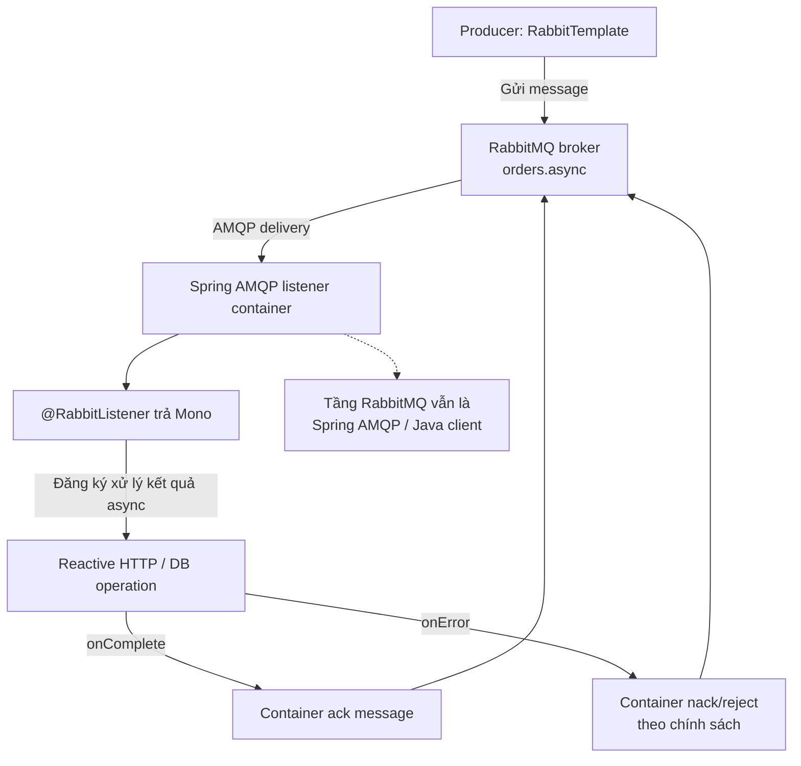
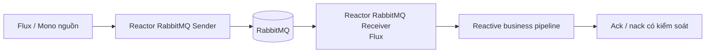

# Phân biệt listener trả `Mono` với toàn bộ RabbitMQ client không chặn

## 1. Vấn đề: một chữ “async” có nhiều nghĩa

Khi xây dựng hệ thống xử lý bất đồng bộ bằng **Spring AMQP** và RabbitMQ, lập trình viên có thể viết:

```java
@RabbitListener(queues = "orders.async")
public Mono<Void> handle(String orderId) {
    return reservationService.reserve(orderId);
}
```

Do phương thức trả về `Mono` của Project Reactor, rất dễ kết luận rằng **toàn bộ kết nối RabbitMQ và ứng dụng đã chuyển sang mô hình không chặn (non-blocking)**. Kết luận này **không đúng**. `Mono` nói lên cách biểu diễn **kết quả xử lý của listener**; nó không tự động đổi API, thread model hoặc cơ chế I/O của RabbitMQ client ở tầng dưới.

Mục tiêu bài học:

- Phân biệt **broker giao message bất đồng bộ**, **listener hoàn thành bất đồng bộ** và **client có API reactive/non-blocking**.
- Hiểu Spring AMQP xử lý `Mono<T>`/`Mono<Void>` trả về từ `@RabbitListener`, đặc biệt là **ack/nack, requeue và reply**.
- Nhận diện lời gọi blocking ẩn trong một chuỗi Reactor và biết cách phối hợp `WebClient` hoặc dịch vụ có API reactive.
- So sánh hướng dùng `RabbitTemplate`/listener container với **Reactor RabbitMQ** (`Sender`/`Receiver`) khi muốn reactive từ lớp tương tác với broker.
- Điều chỉnh prefetch, concurrency, retry và giám sát để bảo đảm hệ thống tin cậy.

Phạm vi ví dụ: dịch vụ nhận yêu cầu đặt hàng từ queue `orders.async`, gọi một HTTP service đặt chỗ và quyết định ack/nack sau khi xử lý. Đây là mô hình thực hành trong module **SPRING_AMQP**; các phần về DLX, retry và request/reply được nhắc ở mức cần thiết để hiểu vòng đời message.

## 2. Ba lớp cần phân biệt

| Lớp | Câu hỏi | Spring AMQP điển hình | Điều `Mono` thay đổi |
| --- | --- | --- | --- |
| **Broker → consumer** | Message đến ứng dụng như thế nào? | RabbitMQ push delivery tới consumer, listener container điều phối callback/thread. | **Không** thay giao thức hay cơ chế nhận message. |
| **Xử lý listener** | Khi nào một message được xem là xử lý xong? | `@RabbitListener` trả `void` hoặc kết quả đồng bộ; container xử lý ack theo cấu hình. | Framework có thể chờ **terminal signal** từ `Mono` để ack/nack và gửi reply. |
| **API tương tác RabbitMQ** | Publish/consume/ack được biểu diễn bằng API nào? | `RabbitTemplate`, `AsyncRabbitTemplate`, listener container dựa trên RabbitMQ Java client. | **Không** biến `RabbitTemplate` thành reactive client; muốn Flux/Mono trực tiếp ở lớp broker cần chọn API thích hợp. |

Một hệ thống có thể bất đồng bộ theo nghĩa **producer và consumer được tách qua queue**, nhưng vẫn có đoạn code blocking trong producer hoặc consumer. Ngược lại, một listener trả `Mono` có thể thực hiện I/O nghiệp vụ bằng `WebClient` không chặn, trong khi tầng nhận message vẫn do Spring AMQP listener container quản lý.

### Sơ đồ đường đi của message



Điểm thay đổi thực chất là **thời điểm hoàn tất message** và **khả năng không giữ thread listener trong lúc chờ tác vụ downstream**. Không thể từ chữ `Mono` trong chữ ký phương thức suy ra tất cả các thao tác mạng của ứng dụng không chặn.

## 3. Spring AMQP xử lý listener trả `Mono` như thế nào?

Spring AMQP hỗ trợ kiểu trả về bất đồng bộ như `CompletableFuture<?>` và `Mono<?>` trong `@RabbitListener`. Vòng đời điển hình:

1. RabbitMQ giao một message tới listener container (ví dụ `SimpleMessageListenerContainer` hoặc `DirectMessageListenerContainer`).
2. Container gọi phương thức `@RabbitListener` và nhận một đối tượng `Mono` đại diện cho công việc chưa chắc đã kết thúc.
3. Framework theo dõi kết quả bất đồng bộ. **Message chưa được ack ngay chỉ vì phương thức đã trả về `Mono`**.
4. Khi `Mono` **hoàn thành thành công** (bao gồm `Mono<Void>` hoàn thành rỗng), Spring AMQP ack message; nếu có giá trị kết quả và giao thức request/reply phù hợp, framework có thể gửi reply.
5. Khi `Mono` **kết thúc bằng lỗi**, framework nack/reject theo exception, cấu hình container và error handler. Message có thể requeue hoặc đi vào dead-letter flow khi broker được cấu hình.

Với **async return**, acknowledgment cần được xử lý ở chế độ `AcknowledgeMode.MANUAL` để tránh ack sớm trên consumer thread. Từ Spring AMQP **2.2.21, 2.3.13 và 2.4.1**, framework có thể tự nhận diện async return để chuyển sang MANUAL. Khi cần diễn đạt ý định rõ ràng và để dễ kiểm tra, ví dụ sau đặt `ackMode = "MANUAL"` ngay trên annotation.

**Lưu ý:** `MANUAL` ở đây **không có nghĩa bạn phải tự gọi** `Channel.basicAck(...)` trong phương thức trả `Mono`. Với cơ chế async return chuẩn, **Spring AMQP điều phối ack/nack theo kết quả bất đồng bộ**. Chỉ tự ack/nack khi bạn đang triển khai một chiến lược acknowledgment thủ công riêng và hiểu cách tránh double ack.

### So sánh ba trạng thái

| Reactive signal của listener | Hành động thông thường | Tác động |
| --- | --- | --- |
| `onComplete` với `Mono<Void>` | Ack khi công việc hoàn tất. | Broker có thể loại message khỏi danh sách chưa ack. |
| `onNext` rồi `onComplete` với `Mono<Result>` | Hoàn tất xử lý, gửi reply nếu có đích reply phù hợp, và ack theo luồng async. | Hữu ích cho request/reply; giá trị trả về **không tự gửi về producer** nếu không thiết lập reply. |
| `onError` | Nack/reject theo chính sách. | Có thể requeue, dead-letter hoặc loại bỏ tùy cấu hình. |
| `Mono.never()` | Không có terminal signal. | Message có thể tiếp tục ở trạng thái **unacked**; đây là lỗi cần giám sát/timeout. |

Mặc định, `defaultRequeueRejected` của listener container thường là `true`. Với lỗi không thể phục hồi, có thể phát `AmqpRejectAndDontRequeueException`; khi async result kết thúc bằng lỗi này, message sẽ không requeue. Nếu queue có DLX hợp lệ, broker có thể chuyển message sang DLQ.

## 4. Ví dụ hoàn chỉnh về listener trả `Mono<Void>`

Giả sử ứng dụng Spring Boot kết nối RabbitMQ và có HTTP service nhận yêu cầu đặt chỗ tại `http://localhost:8081`. Phần phụ thuộc cần thiết:

```xml
<!-- Version do Spring Boot dependency management quản lý. -->
<dependency>
    <groupId>org.springframework.boot</groupId>
    <artifactId>spring-boot-starter-amqp</artifactId>
</dependency>
<dependency>
    <groupId>org.springframework.boot</groupId>
    <artifactId>spring-boot-starter-webflux</artifactId>
</dependency>
```

`spring-boot-starter-amqp` cung cấp Spring AMQP, RabbitMQ connection/listener và `RabbitTemplate`. `spring-boot-starter-webflux` cung cấp `WebClient`/Reactor; ứng dụng **không bắt buộc phải đổi toàn bộ HTTP server sang WebFlux** chỉ để dùng `WebClient`.

### 4.1. Khai báo queue

```java
import org.springframework.amqp.core.Queue;
import org.springframework.amqp.core.QueueBuilder;
import org.springframework.context.annotation.Bean;
import org.springframework.context.annotation.Configuration;

@Configuration
public class RabbitTopology {

    @Bean
    public Queue ordersAsync() {
        return QueueBuilder.durable("orders.async").build();
    }
}
```

Queue sẽ được khai báo khi có `RabbitAdmin`/cơ chế auto-declaration phù hợp; với Spring Boot AMQP starter, đây là cấu hình phổ biến. Ví dụ dùng **default exchange** của RabbitMQ, có routing key chính là tên queue `orders.async`, nên không cần tự tạo thêm exchange/binding.

### 4.2. HTTP client reactive

```java
import org.springframework.stereotype.Service;
import org.springframework.web.reactive.function.client.WebClient;
import reactor.core.publisher.Mono;

@Service
public class ReservationClient {
    private final WebClient webClient;

    public ReservationClient(WebClient.Builder builder) {
        this.webClient = builder
                .baseUrl("http://localhost:8081")
                .build();
    }

    public Mono<Void> reserve(String orderId) {
        return webClient.post()
                .uri("/reservations/{orderId}", orderId)
                .retrieve()
                .bodyToMono(Void.class);
    }
}
```

`WebClient` có API reactive. Khi chưa subscribe, phần lớn thao tác I/O trong chain này **chưa được thực hiện**. HTTP 4xx/5xx sẽ phát lỗi từ `retrieve()` theo xử lý mặc định; trong hệ thống thực tế cần phân loại lỗi nghiệp vụ cụ thể hơn.

### 4.3. Listener chỉ hoàn tất khi HTTP call hoàn tất

```java
import org.springframework.amqp.AmqpRejectAndDontRequeueException;
import org.springframework.amqp.rabbit.annotation.RabbitListener;
import org.springframework.stereotype.Component;
import org.springframework.web.reactive.function.client.WebClientResponseException;
import reactor.core.publisher.Mono;

@Component
public class OrderListener {
    private final ReservationClient reservationClient;

    public OrderListener(ReservationClient reservationClient) {
        this.reservationClient = reservationClient;
    }

    @RabbitListener(queues = "orders.async", ackMode = "MANUAL")
    public Mono<Void> handle(String orderId) {
        // Tạo tác vụ theo kiểu deferred, để lỗi đồng bộ trong lúc tạo
        // publisher (nếu có) được chuyển thành error signal.
        return Mono.defer(() -> reservationClient.reserve(orderId))
                .onErrorMap(
                        WebClientResponseException.BadRequest.class,
                        ex -> new AmqpRejectAndDontRequeueException(
                                "Dữ liệu đặt chỗ không hợp lệ: " + orderId, ex)
                );
    }
}
```

Hành vi:

- **HTTP 2xx**: publisher hoàn thành; listener container ack message.
- **HTTP 400**: chuyển lỗi thành `AmqpRejectAndDontRequeueException`; broker sẽ không requeue. Nếu có DLX/binding, message có thể tới DLQ.
- **Lỗi HTTP 5xx, timeout hoặc mất mạng**: lỗi còn lại đi theo chính sách container; nếu dùng mặc định requeue, message có thể được giao lại nhiều lần. Production cần thiết kế **retry có giới hạn** trước khi đưa vào DLQ.

Không gọi `subscribe()` bên trong `handle`, cũng không trả `Mono.empty()` trước khi công việc thật xong:

```java
// SAI: fire-and-forget; framework có thể ack sớm.
@RabbitListener(queues = "orders.async", ackMode = "MANUAL")
public Mono<Void> incorrect(String orderId) {
    reservationClient.reserve(orderId).subscribe();
    return Mono.empty();
}
```

Đoạn `incorrect` chỉ minh họa lỗi thiết kế, **không đăng ký cùng lúc** với listener `handle` trong ví dụ chạy thật. Việc tự `subscribe()` làm công việc tách khỏi kết quả listener: lỗi có thể xảy ra **sau khi message đã ack**, phá vỡ đảm bảo xử lý thành công rồi mới ack.

### 4.4. Producer vẫn có thể dùng `RabbitTemplate`

```java
import org.springframework.amqp.rabbit.core.RabbitTemplate;

// Được inject vào service/command runner để gửi một đơn hàng.
rabbitTemplate.convertAndSend("", "orders.async", "ORDER-1001");
```

Với default exchange `""`, routing key `orders.async` đưa message vào queue cùng tên. **Dù consumer trả `Mono`, API producer ở đây vẫn là `RabbitTemplate.convertAndSend(...)`**. Nó không tự trở thành một `Mono<Void>` hoặc cơ chế producer reactive; nếu cần bảo đảm message được broker nhận/route, cấu hình thêm **publisher confirms/returns** phù hợp.

## 5. Vì sao trả `Mono` chưa bảo đảm không chặn?

`Mono` là một kiểu Publisher mô tả việc phát tối đa một giá trị rồi hoàn thành/lỗi. Bản thân kiểu trả về **không xác nhận mã bên trong đang dùng non-blocking I/O**.

### 5.1. Cách viết có blocking ẩn

```java
public Mono<String> bad(String orderId) {
    // findByIdBlocking chạy NGAY khi gọi phương thức, trước khi trả Mono.
    String data = jdbcRepository.findByIdBlocking(orderId);
    return Mono.just(data);
}
```

`Mono.just(...)` không làm đoạn JDBC ở trước nó trở nên bất đồng bộ. Tương tự, đoạn sau vẫn **block** thread gọi listener:

```java
public Mono<Void> alsoBad(String orderId) {
    reservationClient.reserve(orderId).block(); // chờ đồng bộ
    return Mono.empty();
}
```

Điều này có thể giữ thread listener không cần thiết, làm giảm throughput và tăng nguy cơ nghẽn khi nhiều message đến cùng lúc.

### 5.2. Cách tương thích với một thư viện blocking cũ

Khi chưa thể đổi JDBC/thư viện blocking, có thể chuyển đoạn đó sang một scheduler chuyên dụng có giới hạn:

```java
import reactor.core.publisher.Mono;
import reactor.core.scheduler.Schedulers;

public Mono<Void> reserveWithLegacyClient(String orderId) {
    return Mono.fromRunnable(() -> legacyService.reserveBlocking(orderId))
            .subscribeOn(Schedulers.boundedElastic())
            .then();
}
```

Lúc này callback của listener có thể trả `Mono` sớm hơn, và blocking call được thực hiện trên pool khác. **Phần I/O bên trong `reserveBlocking` vẫn blocking**; chỉ có thread thực thi được di chuyển. Cần giới hạn số tác vụ in-flight, timeout và tài nguyên pool. Không dùng `Schedulers.parallel()` để chạy I/O blocking lâu.

### 5.3. Sự khác nhau giữa ba kiểu publish/reply

| API | Giao diện gọi | Có làm toàn bộ RabbitMQ client reactive không? |
| --- | --- | --- |
| `RabbitTemplate.convertAndSend(...)` | Phương thức Java thông thường; không trả `Mono`. | Không. |
| `RabbitTemplate.convertSendAndReceive(...)` | Request/reply đồng bộ; thread gọi chờ kết quả hoặc timeout. | Không. |
| `AsyncRabbitTemplate` | Trả future cho request/reply bất đồng bộ. | Không tự chuyển listener container/client sang Reactive Streams. |
| `Reactor RabbitMQ Sender/Receiver` | Publish/consume bằng `Mono`/`Flux` ở lớp tích hợp broker. | Cung cấp API reactive và khả năng phối hợp backpressure; vẫn dựa trên RabbitMQ Java client ở tầng thấp. |

**Không nên gộp “trả future/Mono” với “mọi thao tác I/O đều non-blocking”**: đây là hai tiêu chí kỹ thuật khác nhau.

## 6. Khi cần API reactive ngay tại lớp RabbitMQ

**Reactor RabbitMQ** là một lựa chọn riêng với Spring AMQP, cung cấp `Sender` và `Receiver` dựa trên Project Reactor. Mô hình cơ bản:



Ví dụ đọc message dưới dạng `Flux` (cần dependency `io.projectreactor.rabbitmq:reactor-rabbitmq`, broker/queue đã tồn tại và phương thức `processReactive(String)` của ứng dụng):

```java
import java.nio.charset.StandardCharsets;
import reactor.core.Disposable;
import reactor.core.publisher.Mono;
import reactor.rabbitmq.RabbitFlux;
import reactor.rabbitmq.Receiver;

Receiver receiver = RabbitFlux.createReceiver();

Disposable subscription = receiver.consumeManualAck("orders.async")
        .flatMap(delivery -> {
            String orderId = new String(
                    delivery.getBody(), StandardCharsets.UTF_8);

            return processReactive(orderId)
                    // Chỉ ack khi nghiệp vụ hoàn tất thành công.
                    .then(Mono.fromRunnable(delivery::ack))
                    // Minh họa nack không requeue khi xử lý lỗi.
                    .onErrorResume(error ->
                            Mono.fromRunnable(() -> delivery.nack(false)));
        }, 8) // Giới hạn tối đa 8 tác vụ inner đang xử lý.
        .subscribe();

// Khi ứng dụng dừng: subscription.dispose(); receiver.close();
```

Đoạn này cho thấy **bạn tự quản lý ack/nack** bằng `AcknowledgableDelivery`; `nack(false)` có thể kích hoạt DLX nếu queue đã cấu hình. Trong ứng dụng thật, cần phân loại lỗi tạm thời với lỗi không thể phục hồi, log/cảnh báo failure, đóng `Receiver` theo lifecycle và có chiến lược cho các trường hợp ack/nack hoặc kết nối broker thất bại.

Ở chiều gửi, `Sender` nhận luồng các `OutboundMessage`:

```java
import java.nio.charset.StandardCharsets;
import reactor.core.publisher.Mono;
import reactor.rabbitmq.OutboundMessage;
import reactor.rabbitmq.RabbitFlux;
import reactor.rabbitmq.Sender;

Sender sender = RabbitFlux.createSender();

Mono<Void> publishing = sender.send(Mono.just(
        new OutboundMessage(
                "", "orders.async",
                "ORDER-1002".getBytes(StandardCharsets.UTF_8))
));

// Tích hợp publishing vào lifecycle reactive để thực sự subscribe;
// nhớ đóng sender khi ứng dụng dừng.
```

`send(...)` trả Publisher và chỉ bắt đầu khi được subscribe. **Hoàn tất luồng gửi không đồng nghĩa message đã được broker xác nhận lưu/định tuyến thành công**; nếu cần đảm bảo cao hơn, sử dụng API publisher confirms như `sendWithPublishConfirms(...)` và theo dõi kết quả.

Reactor RabbitMQ phù hợp khi bạn chủ động thiết kế pipeline reactive ở **cả chiều gửi lẫn nhận** và các dependency downstream cũng hỗ trợ non-blocking. Nó không phải điều kiện bắt buộc để sử dụng `Mono` ở một listener Spring AMQP; lựa chọn phụ thuộc kiến trúc, kỹ năng vận hành và mức độ hỗ trợ của các thư viện đang dùng.

## 7. Backpressure, prefetch và concurrency: ba khái niệm khác nhau

Việc `@RabbitListener` trả `Mono` làm giảm nhu cầu giữ thread trong lúc chờ công việc downstream, nhưng **không tự biến độ trễ xử lý thành khả năng xử lý vô hạn**.

- **Prefetch** (`basic.qos`): RabbitMQ giới hạn số message được giao nhưng còn **unacked** cho consumer. Với listener trả `Mono` đang chạy, message vẫn chiếm một slot unacked đến khi hoàn tất.
- **Concurrency của listener container**: số consumer hoạt động đồng thời. Tăng consumer có thể tăng throughput nhưng cũng làm tăng tải HTTP/DB và số message đang xử lý.
- **Reactive backpressure**: cơ chế điều tiết demand trong `Flux`/`Mono`. `Flux.request(n)` không tự động thay thế mọi giới hạn prefetch tại RabbitMQ broker; phải hiểu cầu nối của thư viện nhận message, bộ đệm và cách ack.

Ví dụ cấu hình Spring Boot cho `SimpleRabbitListenerContainer`:

```yaml
spring:
  rabbitmq:
    listener:
      simple:
        prefetch: 16
        concurrency: 2
        max-concurrency: 4
```

Các giá trị là **ví dụ để thử tải**, không phải khuyến nghị phổ quát. Prefetch 16 với 2 consumer có thể cho phép khoảng 32 message chưa ack cùng lúc ở trạng thái vận hành 2 consumer; khi scale đến 4 consumer, giới hạn này có thể tăng. Cần cân bằng latency downstream, bộ nhớ, số kết nối, timeout và nhu cầu ordering.

Với Reactor RabbitMQ, API nhận có `ConsumeOptions.qos` để điều chỉnh prefetch; các operator như `flatMap(..., concurrency)` hạn chế tác vụ nghiệp vụ đồng thời. Muốn kiểm soát thực sự phải phối hợp **prefetch + concurrency + khả năng downstream + ack**.

## 8. Đảm bảo tin cậy khi listener xử lý bất đồng bộ

RabbitMQ có thể giao lại message nếu consumer/kết nối dừng trước khi broker nhận được ack. Vì vậy, dù dùng `Mono`, vẫn cần thiết kế **at-least-once processing**:

1. **Ack sau thành công**: trả chính `Mono` đại diện cho toàn bộ công việc. Nếu nghiệp vụ gồm ghi DB và gọi HTTP, chỉ hoàn thành khi các bước cần thiết hoàn tất.
2. **Idempotency**: dùng message ID/business key để tránh tạo hai đơn hàng, hai khoản thanh toán... khi bị redelivery.
3. **Retry phân loại**: lỗi hạ tầng tạm thời có thể retry giới hạn; lỗi dữ liệu không hợp lệ nên được reject không requeue và chuyển DLQ nếu đã thiết lập DLX.
4. **Timeout**: tránh `Mono.never()` hoặc HTTP call treo vô hạn, vì message giữ trạng thái unacked và làm cạn prefetch.
5. **Quan sát**: theo dõi `messages_unacknowledged`, message ready, consumer count, tốc độ ack/nack, latency xử lý, số retry và DLQ depth.
6. **Kết quả reply**: với listener trả `Mono<T>` trong luồng request/reply, kiểm tra reply-to, correlation ID và timeout phía caller; **reply thành công** không phải là bằng chứng một transaction xuyên HTTP/DB/RabbitMQ đã atomic.

Một đoạn reactive có retry/timeout có thể viết ở lớp nghiệp vụ như sau:

```java
import java.time.Duration;
import reactor.core.publisher.Mono;
import reactor.util.retry.Retry;

Mono<Void> processing = reservationClient.reserve(orderId)
        .timeout(Duration.ofSeconds(3))
        .retryWhen(Retry.backoff(2, Duration.ofMillis(200))
                .filter(this::isTransientError));
```

`isTransientError` là logic ứng dụng cần cài đặt để xác định lỗi thực sự tạm thời; **không retry vô điều kiện** mọi lỗi, đặc biệt là lỗi dữ liệu 4xx. Nếu một bước có tác dụng phụ đã thành công rồi lỗi xảy ra ở bước sau, retry có thể lặp tác dụng phụ — cần idempotency/transactional outbox hoặc chiến lược nhất quán phù hợp.

## 9. Các hiểu lầm và hướng xử lý

| Nhận định hoặc hiện tượng | Giải thích và cách xử lý |
| --- | --- |
| “Method trả `Mono` thì `RabbitTemplate` cũng non-blocking.” | Sai. `RabbitTemplate` vẫn có API truyền thống; cần xem từng thao tác publish/request-reply. |
| “Listener trả về đối tượng `Mono` là message đã xử lý xong.” | Sai. Với async return, **terminal signal** mới quyết định hoàn tất ack/nack. |
| “`Mono.just(blockingCall())` đã đưa I/O vào background.” | Sai. `blockingCall()` được thực hiện trước khi tạo `Mono`. Chuyển sang API reactive hoặc offload bằng `fromCallable`/`fromRunnable` và scheduler phù hợp. |
| “Tự `subscribe()` rồi trả `Mono.empty()` là fire-and-forget an toàn.” | Sai. Framework có thể ack trước khi tác vụ thật hoàn thành; hãy **return chain**. |
| “`ackMode=MANUAL` nghĩa là luôn gọi `basicAck` bằng tay trong listener `Mono`.” | Không đúng với cơ chế async return chuẩn của Spring AMQP; framework xử lý kết quả để ack/nack. |
| “Tăng prefetch sẽ luôn tăng throughput.” | Không chắc. Prefetch cao làm tăng unacked/in-flight và có thể gây quá tải downstream. |
| “Lỗi trong `Mono` mặc định sẽ tới DLQ.” | Không chắc. Mặc định có thể requeue; DLQ cần DLX và routing hợp lệ, cùng chính sách reject thích hợp. |
| “Reactor RabbitMQ làm mọi thư viện bên trong thành non-blocking.” | Sai. Nếu pipeline gọi JDBC/HTTP client blocking, đoạn đó vẫn blocking. |

## 10. Thực hành và câu hỏi tự đánh giá

### Bài thực hành

1. Khai báo `orders.async` và chạy listener `handle` ở mục 4.
2. Gửi `ORDER-1001` bằng `RabbitTemplate`; dùng một HTTP service trả **200/204 sau khoảng 500 ms**. Quan sát message ở trạng thái **unacked trong lúc chờ** và được ack khi HTTP hoàn tất.
3. Thay service trả **400**. Nếu muốn lưu message lỗi, hãy cấu hình DLX/DLQ cho queue trước; xác minh xử lý `AmqpRejectAndDontRequeueException`.
4. Giả lập service **timeout/500**. Quan sát sự khác biệt giữa requeue mặc định và retry giới hạn. Không lặp vô hạn trên broker đang phục vụ dữ liệu thật.
5. Thay phần HTTP không chặn bằng hàm dùng `Thread.sleep(...)` hoặc `block()` để thấy listener thread có thể bị giữ lại. Thử `boundedElastic`, so sánh thời gian hoàn thành và số tác vụ in-flight.
6. Xem RabbitMQ Management UI để đối chiếu `messages_ready`, `messages_unacknowledged`, tốc độ ack, concurrency và prefetch.

### Câu hỏi nhanh

**Câu 1.** Một listener trả `Mono<Void>` nhưng bên trong gọi `Thread.sleep(5000)` trước khi return. Thread listener có bị chặn không?

**Câu 2.** Tại sao không nên gọi `reserve(...).subscribe()` rồi trả `Mono.empty()`?

**Câu 3.** `Mono` kết thúc bằng `AmqpRejectAndDontRequeueException`. Điều kiện nào cần có để message vào DLQ?

**Câu 4.** Sự khác nhau về API giữa `@RabbitListener` trả `Mono` và `Receiver.consumeManualAck(...)` là gì?

**Câu 5.** Khi thấy `messages_unacknowledged` tăng liên tục, nên kiểm tra những thành phần nào?

**Đáp án gợi ý:** (1) Có, blocking xảy ra trước khi trả publisher; (2) vì ack có thể xảy ra sớm và lỗi thật không được phản ánh vào kết quả listener; (3) queue nguồn phải cấu hình DLX, exchange/binding/queue đích phải route hợp lệ; (4) cái đầu vẫn dùng Spring AMQP listener container, cái sau trả `Flux` tại API tích hợp RabbitMQ và bạn chủ động ack; (5) timeout/kẹt `Mono`, prefetch, concurrency, độ trễ dịch vụ downstream, retry và kết nối.

## 11. Kết luận

**Listener trả `Mono` là bất đồng bộ ở ranh giới xử lý message:** Spring AMQP có thể đợi tác vụ hoàn tất rồi ack/nack hoặc gửi reply. **Toàn bộ RabbitMQ client không tự trở thành non-blocking chỉ vì một listener trả `Mono`.** Muốn xây pipeline reactive ở tầng broker, cần xem xét API như Reactor RabbitMQ; muốn non-blocking từ đầu đến cuối, phải kiểm tra mọi đoạn I/O và phối hợp giới hạn tải, ack/retry, DLQ và quan sát hệ thống.

## Tài liệu tham khảo

- [Spring AMQP — Asynchronous @RabbitListener Return Types](https://docs.spring.io/spring-amqp/reference/amqp/receiving-messages/async-returns.html): `Mono`/`CompletableFuture`, async ack/nack, requeue và các mốc hỗ trợ.
- [Spring AMQP — Annotation-driven Listener Endpoints](https://docs.spring.io/spring-amqp/reference/amqp/receiving-messages/async-annotation-driven.html): listener container và cơ chế `@RabbitListener`.
- [Spring AMQP — Message Listener Container Configuration](https://docs.spring.io/spring-amqp/reference/amqp/containerAttributes.html): acknowledge mode, prefetch, concurrency, requeue và container.
- [Reactor RabbitMQ — Reference Guide](https://projectreactor.io/docs/rabbitmq/milestone/reference/): `Sender`/`Receiver`, manual ack, reactive API và backpressure.
