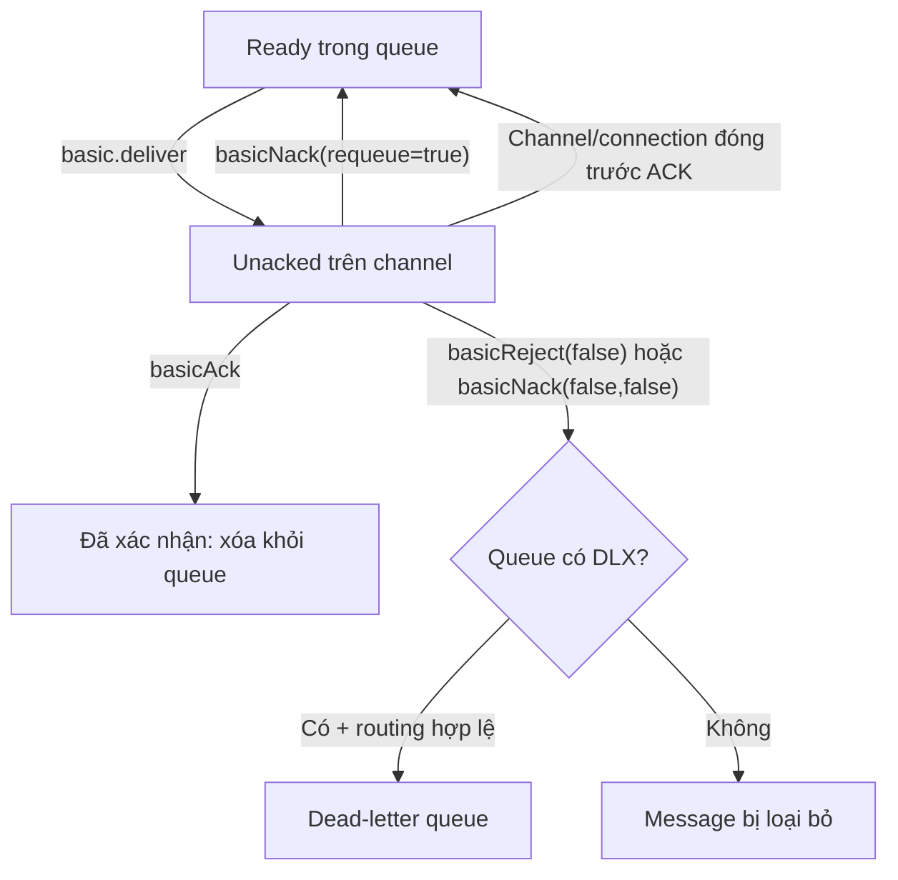

# Hủy tác vụ, dừng ứng dụng và xử lý delivery chưa hoàn tất

## 1. Bài toán trong hệ thống xử lý bất đồng bộ

Ứng dụng sử dụng **Spring AMQP** và **RabbitMQ** thường nhận công việc qua `@RabbitListener`, xử lý ở tầng service rồi xác nhận message. Chẳng hạn, một hệ thống tạo báo cáo nhận yêu cầu `report-42` từ queue `reports.work.q`; việc tạo báo cáo có thể mất 30 giây. Trong lúc xử lý, có ba tình huống:

- Người dùng bấm **Hủy báo cáo**.
- Hệ thống chuẩn bị **deploy phiên bản mới**, cần dừng ứng dụng một cách có kiểm soát.
- Pod/container bị dừng đột ngột khi một delivery đang xử lý nhưng **chưa ACK**.

Các tình huống này liên quan với nhau nhưng không đồng nghĩa. *Hủy tác vụ nghiệp vụ* là quyết định báo cáo đó có được tiếp tục tạo hay không. *Dừng listener* là ngừng nhận công việc mới từ RabbitMQ. *ACK/NACK một delivery* là thông báo cho broker phải làm gì với message đã giao.

Mục tiêu của bài thuộc chương **Xử lý bất đồng bộ** trong module `SPRING_AMQP` là hiểu đúng vòng đời message, quyết định xử lý công việc chưa hoàn thành khi shutdown, cấu hình listener và xây dựng quy tắc an toàn trước lỗi lặp, retry hoặc mất kết nối.

> Phạm vi: Ví dụ áp dụng Spring AMQP với `RabbitTemplate`, `@RabbitListener`, queue, exchange, binding và acknowledgement; các API minh họa phù hợp Spring AMQP 3.x và các phiên bản mới hơn hỗ trợ `forceStop`. Một số tên API/cơ chế lifecycle thay đổi theo phiên bản, vì vậy cần đối chiếu phiên bản đang chạy khi tích hợp.

## 2. Phân biệt ba cấp độ hủy

| Hành động | Phạm vi | Điều gì xảy ra với message? | Điều cần lưu ý |
| --- | --- | --- | --- |
| Hủy một job nghiệp vụ | Một `jobId`, ví dụ `report-42` | Tùy thiết kế: đã ghi trạng thái `CANCELLED` thì có thể ACK; muốn xử lý lại thì không ACK hoặc NACK có kiểm soát | Cần lưu trạng thái hủy bền vững; không chỉ hủy một `Future` |
| Hủy một `CompletableFuture`/task Java | Một tác vụ trong executor | RabbitMQ không tự biết thao tác Java này; nếu framework theo dõi kết quả async thì trạng thái hoàn tất lỗi có thể dẫn đến NACK | `cancel(true)` không bảo đảm công việc phía dưới ngừng ngay |
| Dừng consumer/listener container | Một hoặc nhiều consumer | Không nhận delivery mới; những delivery đã nhận/prefetch được xử lý hoặc trả lại tùy cấu hình shutdown | `stop()` không mang ý nghĩa hủy các thay đổi nghiệp vụ đã xảy ra |
| Đóng channel/connection khi có unacked | Những delivery chưa xác nhận trên channel đó | Broker sẽ đưa các message chưa ACK trở lại trạng thái có thể giao lại | Có thể redeliver; cần idempotency |

Điểm quan trọng: **RabbitMQ quản lý vòng đời delivery, còn ứng dụng quản lý vòng đời nghiệp vụ**. Cần liên kết hai vòng đời bằng quy tắc: chỉ gửi ACK sau khi công việc đã hoàn tất **và trạng thái cần lưu đã được ghi thành công**.

## 3. Vòng đời một delivery: Ready → Unacked → kết thúc

Khi một message ở trạng thái `Ready` trong queue, broker chưa giao nó cho consumer. Khi broker giao với acknowledgement bật, message chuyển thành `Unacked` (đang chờ consumer xác nhận).



**ACK** ở đây là *consumer acknowledgement*. Nó khác với **publisher confirm** (broker xác nhận một lần publish). ACK một delivery chỉ giải quyết message đó; không tự bảo đảm transaction với database, API bên ngoài hay một message mới được publish qua `RabbitTemplate`.

### Các chế độ acknowledgement trong Spring AMQP

| Chế độ | Ai xác nhận delivery? | Rủi ro khi xử lý bất đồng bộ |
| --- | --- | --- |
| `AcknowledgeMode.NONE` | Broker coi message được xác nhận ngay khi giao | Ứng dụng chết sau khi nhận có thể mất việc; không phù hợp cho job cần retry đáng tin cậy |
| `AcknowledgeMode.AUTO` | Listener container ACK khi lời gọi listener hoàn tất thành công; xử lý lỗi theo chính sách container | Nếu listener chỉ `executor.submit(...)` rồi return ngay, container có thể ACK **trước khi job thực sự hoàn thành** |
| `AcknowledgeMode.MANUAL` | Ứng dụng gọi `Channel.basicAck`, `basicNack`, `basicReject`; hoặc framework quản lý khi listener trả kết quả async hỗ trợ | Kiểm soát chính xác hơn nhưng phải bảo đảm mỗi delivery được xác nhận đúng một lần |

Không gọi `basicAck()` và `basicNack()` hai lần cho cùng một delivery. `deliveryTag` chỉ có ý nghĩa **trên channel nhận delivery đó**, không phải ID toàn hệ thống. Cần giữ `multiple=false` khi xác nhận một message riêng lẻ, đặc biệt lúc có nhiều công việc song song.

## 4. Chọn điều gì xảy ra khi người dùng hủy job

Hãy thiết kế hủy theo **kết quả nghiệp vụ mong muốn**, không bắt đầu từ API `Future.cancel()`:

| Ý định | Trạng thái nghiệp vụ | ACK/NACK phù hợp |
| --- | --- | --- |
| Người dùng thực sự hủy báo cáo và không muốn chạy nữa | Ghi bền vững `CANCEL_REQUESTED` → `CANCELLED`, giải phóng tài nguyên theo chính sách | Sau khi lưu `CANCELLED`, ACK để bỏ message |
| Tạm dừng xử lý để deploy, cần làm lại sau | Job vẫn `PENDING`/`RETRYABLE`; kết quả dở dang được kiểm soát | NACK với `requeue=true` hoặc để broker redeliver khi channel đóng; cần tránh vòng lặp nóng |
| Lỗi dữ liệu vĩnh viễn | Ghi lỗi và chuyển quy trình xử lý thủ công | Reject/NACK với `requeue=false`; DLX đưa vào DLQ nếu queue có cấu hình |
| Lỗi tạm thời của phụ thuộc | Ghi nhận số lần lỗi; lên lịch thử lại | Ưu tiên retry có delay, giới hạn số lần, DLQ sau khi hết retry |
| Tác vụ đã ghi kết quả thành công nhưng ACK chưa gửi | Trạng thái hoàn thành đã lưu | Khi message được giao lại, nhận biết kết quả đã có và ACK mà không chạy lại side effect |

Hủy một công việc không có nghĩa luôn cần `basicNack(requeue=true)`. Nếu job đã được hủy **vĩnh viễn**, requeue có thể khiến consumer chạy lại nó vô hạn. Ngược lại, ACK trước khi lưu quyết định hủy có thể làm mất khả năng khôi phục công việc khi ứng dụng chết.

### Hủy hợp tác (cooperative cancellation)

Java không có cách an toàn để buộc một thread đang gọi API bất kỳ dừng và rollback mọi tác động. Cách thiết kế thông dụng:

1. API nhận yêu cầu hủy, ghi `CANCEL_REQUESTED` trong database bằng `jobId`.
2. Worker kiểm tra trạng thái hủy ở **những checkpoint có thể dừng an toàn**: trước khi bắt đầu một bước, trước khi ghi side effect hoặc giữa các chunk.
3. Nếu đã hủy, worker dừng ở ranh giới cho phép, ghi `CANCELLED` và ACK message sau commit.
4. Nếu một bước không thể hoàn tác đã hoàn thành, worker phải ghi rõ kết quả đó, rồi thực hiện bù trừ (compensation) nếu nghiệp vụ yêu cầu.

Không phụ thuộc vào `AtomicBoolean` trong bộ nhớ để ghi nhận yêu cầu hủy lâu dài: khi ứng dụng khởi động lại, cờ đó mất. Dùng database hoặc một kho trạng thái bền vững; khóa tra cứu nên là `jobId`/business key, không phải `deliveryTag`.

## 5. Ví dụ cấu hình listener cho xử lý dài

Giả sử ứng dụng đã có dependency `spring-boot-starter-amqp`, RabbitMQ broker và queue `reports.work.q` (được khai báo/bind ở cấu hình AMQP của ứng dụng).

Tạo một listener factory để cấu hình acknowledgement, prefetch và thời gian chờ khi dừng. Ví dụ sau sử dụng **`SimpleRabbitListenerContainerFactory`**:

```java
import org.springframework.amqp.core.AcknowledgeMode;
import org.springframework.amqp.rabbit.config.SimpleRabbitListenerContainerFactory;
import org.springframework.amqp.rabbit.connection.ConnectionFactory;
import org.springframework.context.annotation.Bean;
import org.springframework.context.annotation.Configuration;

@Configuration
public class ReportListenerConfiguration {

    @Bean("reportListenerFactory")
    public SimpleRabbitListenerContainerFactory reportListenerFactory(
            ConnectionFactory connectionFactory) {

        SimpleRabbitListenerContainerFactory factory =
                new SimpleRabbitListenerContainerFactory();
        factory.setConnectionFactory(connectionFactory);
        factory.setAcknowledgeMode(AcknowledgeMode.MANUAL);
        factory.setConcurrentConsumers(2);
        factory.setPrefetchCount(3);

        // Tùy chỉnh thuộc tính của container sau khi factory tạo nó.
        factory.setContainerCustomizer(container -> {
            container.setShutdownTimeout(30_000L);
            container.setForceCloseChannel(true);

            // Dừng sau message đang xử lý; prefetched chưa xử lý được requeue.
            // Cần Spring AMQP >= 2.4.14 hoặc >= 3.0.6.
            container.setForceStop(true);
        });
        return factory;
    }
}
```

**Giải thích các giá trị:**

- `MANUAL` cho phép kiểm soát thời điểm ACK/NACK.
- `concurrentConsumers(2)` chạy hai consumer song song. Mỗi consumer có channel riêng.
- `prefetchCount(3)` giới hạn số delivery chưa ACK broker cấp cho mỗi consumer trong ví dụ; tối đa có thể có khoảng sáu delivery `unacked` do hai consumer nắm giữ.
- `shutdownTimeout(30_000)` cho container tối đa 30 giây để chờ công việc đang xử lý khi stop (không phải timeout của từng bước nghiệp vụ).
- `forceCloseChannel(true)` cho phép đóng channel khi shutdown vượt timeout; delivery chưa ACK sẽ được broker requeue.
- `forceStop(true)` cho phép dừng sau công việc hiện tại và requeue những delivery đã prefetch nhưng chưa chạy, thay vì cố xử lý hết prefetch trước khi dừng.

Nếu muốn consumer **drain hết các message đã prefetch**, để `forceStop(false)` (mặc định). Chọn theo mục tiêu của hệ thống: giảm độ trễ shutdown hay cố hoàn thành backlog được nhận trước đó.

### Cấu hình thời gian shutdown của Spring Boot

Container shutdown timeout phải được xem cùng với thời gian kết thúc lifecycle của Spring, thời gian stop do trình điều phối cấp và thời gian các tác vụ thực sự cần:

```yaml
spring:
  lifecycle:
    timeout-per-shutdown-phase: 45s
```

Đây là **giới hạn chờ cho một lifecycle phase**, không phải lời hứa rằng mọi job sẽ kết thúc trong 45 giây. Trong Kubernetes hoặc môi trường có supervisor, thời gian grace period khi gửi SIGTERM cũng phải đủ để Spring đóng context và listener dừng có kiểm soát. Nếu tiến trình bị kết thúc cưỡng bức (ví dụ SIGKILL), cleanup Java không được bảo đảm chạy.

## 6. Ví dụ consumer: hoàn thành hoặc hủy rồi ACK

Ta giả định `reportId` là nội dung message. `ReportJobService` lưu trạng thái job vào database và triển khai nghiệp vụ ở nhiều bước. Phương thức `executeWithCheckpoints(...)` **phải lưu kết quả cuối cùng trước khi trả về**; lúc xử lý, nó kiểm tra yêu cầu hủy tại các checkpoint an toàn.

```java
public enum ReportOutcome {
    COMPLETED,
    CANCELLED
}

public interface ReportJobService {

    // Quy ước:
    // - Bước đã làm phải idempotent theo reportId.
    // - Kiểm tra CANCEL_REQUESTED ở các checkpoint.
    // - Lưu bền vững COMPLETED hoặc CANCELLED trước khi return.
    ReportOutcome executeWithCheckpoints(String reportId)
            throws InterruptedException;
}
```

Sau đó listener xử lý từng delivery:

```java
import java.io.IOException;
import java.nio.charset.StandardCharsets;

import com.rabbitmq.client.Channel;
import org.springframework.amqp.core.Message;
import org.springframework.amqp.rabbit.annotation.RabbitListener;
import org.springframework.stereotype.Component;

@Component
public class ReportJobListener {
    private final ReportJobService jobs;

    public ReportJobListener(ReportJobService jobs) {
        this.jobs = jobs;
    }

    @RabbitListener(
            id = "reportJobWorker",
            queues = "reports.work.q",
            containerFactory = "reportListenerFactory")
    public void receive(Message message, Channel channel) throws IOException {
        long tag = message.getMessageProperties().getDeliveryTag();
        String reportId =
                new String(message.getBody(), StandardCharsets.UTF_8);

        try {
            ReportOutcome outcome =
                    jobs.executeWithCheckpoints(reportId);

            // Cả COMPLETED và CANCELLED đều đã được lưu bền vững.
            // Trường hợp DONE/CANCELLED nhận lại thì service trả nhanh,
            // không tạo tác động nghiệp vụ trùng.
            channel.basicAck(tag, false);
        } catch (InterruptedException interrupted) {
            Thread.currentThread().interrupt();

            // Tác vụ còn có thể tiếp tục sau restart.
            // Nếu channel đã đóng, broker vẫn sẽ requeue delivery chưa ACK.
            channel.basicNack(tag, false, true);
        } catch (InvalidReportRequest nonRetryable) {
            // Ví dụ exception nghiệp vụ tự định nghĩa.
            // Queue có DLX thì message sẽ đi tới dead-letter.
            channel.basicReject(tag, false);
        } catch (TemporaryReportFailure retryable) {
            // Chỉ là fallback đơn giản; tránh requeue nóng khi lỗi kéo dài.
            // Production nên publish sang retry queue có TTL/DLX và confirm.
            channel.basicNack(tag, false, true);
        }
    }

    static class InvalidReportRequest extends RuntimeException {}
    static class TemporaryReportFailure extends RuntimeException {}
}
```

Ví dụ minh họa một **hợp đồng nghiệp vụ** chứ không cài đặt database. `ReportJobService` và nơi phát lệnh hủy phải được hiện thực trong ứng dụng. Tầng service nên thực hiện các thao tác kiểu:

```text
1. Đọc reportId, trạng thái job và yêu cầu hủy trong database.
2. Nếu COMPLETED/CANCELLED: trả về trạng thái cuối, không chạy lại.
3. Nếu CANCEL_REQUESTED:
   - dừng trước side effect tiếp theo;
   - cập nhật CANCELLED trong transaction;
   - trả về CANCELLED.
4. Nếu được xử lý:
   - chạy một bước có khóa idempotency (reportId + step);
   - lưu checkpoint hoàn tất của bước;
   - kiểm tra lại CANCEL_REQUESTED;
   - khi mọi bước hoàn tất, lưu COMPLETED;
   - trả về COMPLETED.
5. Sau kết quả trên, listener mới ACK delivery.
```

**Lưu ý:** `Thread.interrupt()` không biến một API không hỗ trợ hủy thành thao tác có thể rollback. Ngoài ra, channel có thể đóng đồng thời với lệnh NACK/ACK khi ứng dụng shutdown; nếu `basicNack` không gửi được, delivery vẫn chưa ACK trên broker và sẽ được requeue khi channel/connection bị đóng. Không cố tạo channel mới để ACK bằng delivery tag cũ.

Đoạn `basicNack(tag, false, true)` trong nhánh lỗi tạm thời nhằm minh họa cơ chế broker. Nếu service đang lỗi trong thời gian dài, phải sử dụng retry có delay, giới hạn lượt thử và DLQ để tránh consumer liên tục nhận lại cùng message; việc **publish sang retry queue rồi ACK bản gốc** cần publisher confirm và xử lý idempotent vì hai thao tác không nguyên tử.

## 7. Dừng listener có kiểm soát bằng `RabbitListenerEndpointRegistry`

Listener khai báo bằng `@RabbitListener` có thể được truy cập qua **`RabbitListenerEndpointRegistry`** bằng `id`. Spring cũng gọi lifecycle stop khi đóng application context. Nếu muốn chủ động dừng một nhóm worker trước khi bảo trì, có thể tạo service điều khiển:

```java
import org.springframework.amqp.rabbit.listener.MessageListenerContainer;
import org.springframework.amqp.rabbit.listener.RabbitListenerEndpointRegistry;
import org.springframework.stereotype.Service;

@Service
public class ReportListenerControl {
    private final RabbitListenerEndpointRegistry registry;

    public ReportListenerControl(RabbitListenerEndpointRegistry registry) {
        this.registry = registry;
    }

    public void pauseConsumption() {
        MessageListenerContainer container =
                registry.getListenerContainer("reportJobWorker");
        if (container == null) {
            throw new IllegalStateException("Listener not registered");
        }
        container.stop();
    }

    public void resumeConsumption() {
        MessageListenerContainer container =
                registry.getListenerContainer("reportJobWorker");
        if (container == null) {
            throw new IllegalStateException("Listener not registered");
        }
        container.start();
    }
}
```

`pauseConsumption()` **dừng nhận message**; nó không xóa queue, không đặt trạng thái `CANCELLED` cho các job và không gọi một API hủy nghiệp vụ thay người dùng. Các message `Ready` vẫn ở broker. Phương thức `resumeConsumption()` chỉ phù hợp khi ứng dụng đang chạy và đã sẵn sàng xử lý trở lại.

Khi container dừng bình thường, nó hủy consumer với broker rồi chờ những delivery đã nhận xử lý theo cấu hình. `forceStop(true)` chọn dừng sau record đang xử lý, còn `shutdownTimeout` giới hạn thời gian chờ. Nếu hết timeout và `forceCloseChannel(true)`, broker sẽ có cơ hội giao lại các delivery chưa được xác nhận.

### Quy trình graceful shutdown

```mermaid
sequenceDiagram
    participant O as Orchestrator (SIGTERM)
    participant S as Spring Application
    participant L as Listener Container
    participant B as RabbitMQ
    participant W as Job Service
    O->>S: Yêu cầu dừng
    S->>L: stop()
    L->>B: Hủy consumer; ngừng nhận mới
    Note over L,W: Chờ job đang xử lý theo shutdownTimeout
    alt Job hoàn tất trong hạn
        W->>L: COMPLETED hoặc CANCELLED đã lưu
        L->>B: basicAck
    else Job không hoàn tất khi channel bị đóng
        L--xB: Đóng channel/connection
        B->>B: Requeue delivery chưa ACK
    end
    L-->>S: Đã stop
    S-->>O: Process kết thúc
```

Nếu deploy trên nhiều instance, instance mới có thể nhận message được requeue từ instance cũ. Điều này là bình thường đối với mô hình xử lý **at least once**. Vì vậy, trạng thái và checkpoint phải lưu ở một kho chia sẻ, không chỉ ở RAM instance cũ.

## 8. Listener trả về `CompletableFuture`: ai ACK?

Một nhầm lẫn phổ biến là viết:

```java
@RabbitListener(queues = "reports.work.q")
public void wrong(String reportId) {
    executor.execute(() -> doWork(reportId));
    // Method đã return dù doWork() còn chạy!
}
```

Trong chế độ `AUTO`, container có thể ACK khi `wrong(...)` return thành công. Nếu process chết sau đó, công việc chưa hoàn tất nhưng message đã bị xóa khỏi queue.

Spring AMQP hỗ trợ listener **trả về `CompletableFuture<?>` hoặc `Mono<?>`** để framework biết quá trình xử lý chưa hoàn tất. Khi dùng async return, listener container phải ở **`AcknowledgeMode.MANUAL`**; framework sẽ ACK/NACK khi kết quả async hoàn thành, thay vì ACK ngay khi lời gọi Java trả về. Các nhánh Spring AMQP mới có cơ chế tự đặt MANUAL khi phát hiện async return, nhưng cấu hình tường minh vẫn giúp dễ đọc và kiểm soát.

```java
import java.util.concurrent.CompletableFuture;
import java.util.concurrent.Executor;

import org.springframework.amqp.rabbit.annotation.RabbitListener;
import org.springframework.beans.factory.annotation.Qualifier;
import org.springframework.stereotype.Component;

@Component
public class AsyncReportListener {
    private final Executor executor;
    private final ReportJobService jobs;

    public AsyncReportListener(
            @Qualifier("reportWorkExecutor") Executor executor,
            ReportJobService jobs) {
        this.executor = executor;
        this.jobs = jobs;
    }

    @RabbitListener(
            id = "asyncReportWorker",
            queues = "reports.async.q",
            containerFactory = "reportListenerFactory")
    public CompletableFuture<Void> receive(String reportId) {
        try {
            return CompletableFuture.runAsync(() -> {
                try {
                    jobs.executeWithCheckpoints(reportId);
                } catch (InterruptedException interrupted) {
                    Thread.currentThread().interrupt();
                    throw new IllegalStateException(
                            "Report processing interrupted", interrupted);
                }
            }, executor);
        } catch (RuntimeException schedulingFailure) {
            // Ngay cả lỗi tạo tác vụ cũng cần được báo qua Future:
            // framework sẽ quyết định NACK, tránh ACK sớm.
            return CompletableFuture.failedFuture(schedulingFailure);
        }
    }
}
```

Ví dụ này cần một `Executor` bean tên `reportWorkExecutor` có giới hạn số thread và số task chờ. Khi ứng dụng thật dùng executor chung, nên quản lý lifecycle của executor và không để số Future chạy vô hạn. Không chạy **đồng thời** `ReportJobListener` (mục 6) và `AsyncReportListener` trên cùng queue; ví dụ này sử dụng queue riêng `reports.async.q` để minh họa một cách quản lý acknowledgement khác.

Với async return:

- Future **hoàn tất thành công** → framework ACK; nếu listener trả về một giá trị thì có thể gửi reply theo cấu hình request/reply.
- Future **hoàn tất lỗi** → framework xử lý NACK/requeue theo exception, `defaultRequeueRejected` và error handler. Mặc định lỗi thông thường có thể bị **requeue**; `AmqpRejectAndDontRequeueException` giúp chọn không requeue để đưa về DLQ nếu queue có DLX.
- Nếu lỗi xảy ra **trước khi Future được trả về**, cần bắt lỗi và trả một Future hoàn tất lỗi phù hợp; tránh làm lẫn lộn vòng đời async với lifecycle của lời gọi listener.
- **Không tự `channel.basicAck()`** trong listener dạng này khi framework đã quản lý completion; nếu trộn hai cách có thể gửi ACK trùng.

`CompletableFuture.cancel(true)` chuyển Future sang trạng thái bị hủy nhưng theo semantics của `CompletableFuture`, tham số `mayInterruptIfRunning` **không bảo đảm ngắt công việc nền**. Một tác vụ có thể tiếp tục gọi database hay API mặc dù Future đã hoàn tất lỗi/hủy, đồng thời framework có thể cho phép broker giao lại message. Khi đó dễ xảy ra **hai worker cùng thực thi cùng job**. Vì vậy, thiết kế hủy nghiệp vụ qua trạng thái bền vững và checkpoint vẫn cần thiết cả khi dùng Future.

### Chọn mô hình nào?

| Mô hình | Ưu điểm | Trách nhiệm |
| --- | --- | --- |
| `@RabbitListener` đồng bộ, `AUTO` | Đơn giản, framework xác nhận sau khi method kết thúc | Không fire-and-forget sang executor |
| `@RabbitListener` đồng bộ, `MANUAL` | Kiểm soát ACK, reject và retry | Tự ACK/NACK chính xác một lần, giữ channel đúng phạm vi |
| `@RabbitListener` trả `CompletableFuture`/`Mono` | Theo dõi kết quả thật sự hoàn tất sau khi method return | Cấu hình MANUAL, quản lý executor, lỗi async, cancellation và idempotency |

## 9. Tác vụ chưa hoàn tất khi ứng dụng chết: tình huống thực tế

Giả sử `report-42` đã nhận và đang `Unacked`. Worker tạo file rồi cập nhật database, nhưng container bị kill vào các thời điểm khác nhau:

| Thời điểm chết | Broker thấy gì? | Khi chạy lại cần làm gì? |
| --- | --- | --- |
| Trước khi nhận delivery | Message vẫn `Ready` | Consumer khác nhận bình thường |
| Ngay sau `basic.deliver`, trước khi làm việc | Delivery chưa ACK; khi channel mất sẽ requeue | Worker mới bắt đầu xử lý |
| Đã tạo file nhưng chưa lưu trạng thái | Delivery chưa ACK, có thể requeue | Kiểm tra file/khóa nghiệp vụ và tiếp tục an toàn, không tạo bản trùng |
| Đã lưu `COMPLETED` nhưng chưa ACK thành công | Có thể redeliver | Đọc trạng thái `COMPLETED`, bỏ qua side effect và ACK |
| ACK đã được broker nhận | Message được loại khỏi queue | Không được kỳ vọng broker giao lại; nghiệp vụ phải bền vững trước ACK |
| Người dùng yêu cầu hủy, trạng thái mới ở RAM | Trạng thái RAM mất khi process chết | Không thể kết luận đã hủy; cần lưu cancel request vào kho bền vững |

Đây là lý do nói **at least once**: message có thể được giao lại và side effect nghiệp vụ cần chống trùng. `redelivered` flag từ broker có thể gợi ý message từng được giao, nhưng không thay thế khóa idempotency và kiểm tra trạng thái bền vững.

### Chiến lược idempotency và checkpoint

Một thiết kế tối thiểu với bảng `report_jobs`:

```text
report_jobs(
  report_id PRIMARY KEY,
  state: PENDING | RUNNING | CANCEL_REQUESTED | CANCELLED | COMPLETED | FAILED,
  completed_step,
  version,
  updated_at
)
```

Khi `report-42` bị redeliver, worker kiểm tra `state`:

- `COMPLETED` hoặc `CANCELLED`: ACK ngay sau khi xác minh trạng thái đã commit.
- `PENDING`, `RUNNING`, `CANCEL_REQUESTED`: kiểm tra checkpoint và tiếp tục hoặc kết thúc theo yêu cầu hủy.
- `FAILED` cuối cùng: xử lý theo chính sách DLQ/đối soát.

Khi có nhiều instance, cần **cơ chế claim/lock có giới hạn thời gian** hoặc cập nhật có điều kiện theo `version`, để hai worker không chạy cùng bước quan trọng song song. Việc chỉ nhìn `state=RUNNING` không đủ nếu một instance cũ đã chết và để lại state đó.

Nếu tạo file bên ngoài hoặc gọi API không hỗ trợ transaction chung với database, dùng tên file ổn định, idempotency key hoặc bước bù trừ. Khi cần publish thêm message sau khi cập nhật database, hãy cân nhắc transactional outbox và publisher confirms; ACK của RabbitMQ không tự tham gia cùng một transaction phân tán.

## 10. Kịch bản thực hành và cách quan sát

Tạo queue `reports.work.q` durable, producer gửi message persistent với body `report-42`. Có thể gửi thử bằng `RabbitTemplate`:

```java
rabbitTemplate.convertAndSend("", "reports.work.q", "report-42");
```

Để minh họa, đoạn trên dùng **default exchange** và routing key trùng tên queue; queue phải được khai báo trước. Với message quan trọng, bật publisher confirms và đặt delivery mode persistent.

Thực hiện các kịch bản sau bằng log hoặc RabbitMQ Management UI:

1. **Hoàn tất bình thường:** service lưu `COMPLETED`, listener ACK; số `Unacked` giảm, message không còn trong queue.
2. **Hủy nghiệp vụ:** ghi `CANCEL_REQUESTED` khi job còn chạy; service bắt gặp ở checkpoint, ghi `CANCELLED` rồi listener ACK. Không thấy message lặp vô hạn.
3. **Dừng container có `forceStop(true)`:** gọi `pauseConsumption()` khi có backlog; message đang xử lý được hoàn tất nếu kịp, các message prefetch chưa xử lý được trả về queue.
4. **Dừng ứng dụng giữa xử lý:** kết thúc process khi message chưa ACK; sau khi broker phát hiện connection đóng, message có thể trở về `Ready` và consumer khác nhận. Không khẳng định thời điểm redelivery là tức thì.
5. **ACK đã hoàn tất nhưng process chết sau đó:** message không quay lại; trạng thái nghiệp vụ phải đã được lưu trước ACK.
6. **Lỗi tạm thời nhiều lần:** quan sát `basicNack(requeue=true)` có thể tạo vòng lặp nhận lại nhanh; thay bằng retry queue có TTL/DLX và giới hạn retry.

Các chỉ số nên theo dõi: `messages_ready`, `messages_unacknowledged`, số consumer, tốc độ ACK/NACK, tỷ lệ redelivery, thời gian xử lý theo job, thời gian shutdown, số job ở `RUNNING` quá lâu và số message trong DLQ. Log nên có `jobId`, `messageId` (nếu có), `redelivered`, tên queue và kết quả commit trạng thái. Không dùng `deliveryTag` làm khóa theo dõi toàn hệ thống vì tag chỉ có phạm vi channel.

## 11. Các sai lầm thường gặp

| Sai lầm | Hậu quả | Cách sửa |
| --- | --- | --- |
| Listener `AUTO` gọi `executor.submit(...)` rồi return | ACK trước khi tác vụ thực sự hoàn tất; crash có thể mất việc | Đợi trong listener hoặc trả async type để framework quản lý ACK sau completion |
| `CompletableFuture.cancel(true)` rồi cho rằng broker sẽ bỏ message | Task có thể vẫn chạy; Future lỗi khiến message requeue | Tách hủy nghiệp vụ và trạng thái delivery; kiểm tra checkpoint bền vững |
| ACK ngay khi nhận message | Không còn redelivery nếu xử lý thất bại sau đó | Chỉ ACK sau commit thành công hoặc cancel đã lưu |
| Dùng `basicNack(requeue=true)` vô hạn | Retry nóng, CPU tăng, phụ thuộc quá tải | Delay retry, giới hạn lần thử, DLQ |
| Chỉ lưu cờ hủy trong RAM | Restart làm mất yêu cầu hủy | Lưu trạng thái hủy theo `jobId` vào database |
| Giả định stop container hủy mọi job đang chạy | Side effect vẫn có thể tiếp tục hoặc worker cũ chưa dừng | Chọn `shutdownTimeout`, `forceStop`, timeout nghiệp vụ và khóa idempotency |
| Tạo một channel khác để ACK delivery cũ | Delivery tag không thuộc channel mới; ACK sai gây lỗi channel | ACK/NACK trên channel nhận delivery hoặc để broker requeue khi channel đóng |
| Đóng channel xong vẫn cố ACK từ callback async | ACK không đến broker, callback báo lỗi | Framework quản lý ACK theo async completion; đảm bảo task lifecycle và shutdown có giới hạn |
| Chỉ dựa vào RabbitMQ để rollback database | Broker không biết transaction nghiệp vụ đã commit hay chưa | Checkpoint, deduplication, outbox/compensation khi cần |

## 12. Câu hỏi tự kiểm tra

1. Khi người dùng hủy một job vĩnh viễn, vì sao sau khi lưu `CANCELLED` thường nên ACK thay vì `basicNack(requeue=true)`?
2. Trường hợp `@RabbitListener` `void` gửi việc sang executor rồi return, vì sao `AUTO` ACK có thể khiến hệ thống mất công việc?
3. Khi một channel đóng lúc còn delivery `Unacked`, broker sẽ làm gì? Điều này có bảo đảm công việc nghiệp vụ chưa chạy không?
4. `forceStop(true)` và `shutdownTimeout` tác động tới **những delivery đã prefetch** như thế nào?
5. Vì sao `CompletableFuture.cancel(true)` không phải hợp đồng hủy an toàn đối với nghiệp vụ có side effect?
6. Khi database đã lưu `COMPLETED` nhưng ACK bị mất, consumer mới cần làm gì để tránh tạo hai báo cáo?
7. Trong thời gian deploy, khác nhau thế nào giữa dừng container và xóa queue?
8. Hãy thiết kế một luồng dừng ứng dụng với giới hạn 30 giây, có 2 consumer, prefetch 3 và một job mất 90 giây: có thể xảy ra redelivery và xử lý song song ở những điểm nào?

**Ghi nhớ:** Hủy job là **quyết định nghiệp vụ có trạng thái bền vững**; dừng ứng dụng là **điều phối lifecycle của listener**; ACK/NACK là **quy tắc với delivery của RabbitMQ**. Khi job chưa ACK mà channel đóng, broker có thể giao lại message, nên hệ thống đáng tin cậy phải đặt ACK sau khi lưu kết quả, hỗ trợ cancellation theo checkpoint và xử lý idempotent.

### Tài liệu tham khảo

- [Spring AMQP — Container Management](https://docs.spring.io/spring-amqp/reference/amqp/receiving-messages/async-annotation-driven/container-management.html): quản lý listener container, `RabbitListenerEndpointRegistry`, `forceStop`.
- [Spring AMQP — Message Listener Container Configuration](https://docs.spring.io/spring-amqp/reference/amqp/containerAttributes.html): `acknowledgeMode`, `prefetchCount`, `shutdownTimeout`, `forceCloseChannel`.
- [Spring AMQP — Asynchronous `@RabbitListener` Return Types](https://docs.spring.io/spring-amqp/reference/amqp/receiving-messages/async-returns.html): `CompletableFuture`, `Mono`, async acknowledgement và hành vi khi completion lỗi.
