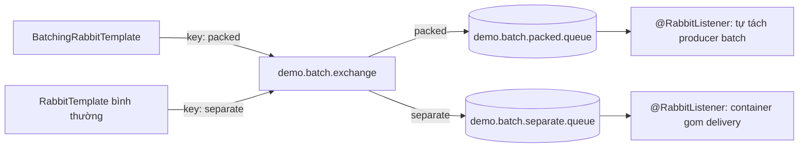

# Phân biệt lô do producer tạo với lô gom từ các delivery riêng

> **Chương:** Xử lý theo lô  
> **Công nghệ:** Spring AMQP, RabbitMQ  
> **Trọng tâm:** Phân biệt việc **đóng gói nhiều thông điệp thành một message trước khi publish** với việc **gom nhiều AMQP delivery độc lập thành một lần gọi listener**.

## 1. Vì sao cùng gọi là “batch” nhưng lại khác nhau?

Một hệ thống xử lý đơn hàng cần gửi hàng nghìn sự kiện `order-created` mỗi giây đến RabbitMQ. Dịch vụ tiêu thụ muốn ghi nhiều sự kiện vào database theo lô để tiết kiệm chi phí mở giao dịch. Với **Spring AMQP**, cả bên gửi dùng `RabbitTemplate` và bên nhận dùng `@RabbitListener` đều có khả năng xử lý theo lô. Tuy nhiên, **lô do producer tạo (producer-created batch)** và **lô do consumer gom (consumer-created batch)** có ranh giới hoàn toàn khác nhau.

Điểm cần nhớ ngay từ đầu:

- **Producer-created batch:** ứng dụng gửi gom nhiều payload thành **một message AMQP vật lý** trước khi RabbitMQ nhận. Broker nhìn thấy một message; Spring AMQP có thể tách nó lại thành các phần tử logic khi tiêu thụ.
- **Consumer-created batch:** producer publish **từng message AMQP riêng biệt**. RabbitMQ lưu trữ, định tuyến và giao từng message độc lập; listener container ở phía nhận gom nhiều delivery thành **một `List` đưa vào listener**.

Hai cách có thể cho cùng một kết quả hiển thị ở mã Java là `List<Message>` hoặc `List<String>`. **Kiểu tham số listener không cho biết broker thực sự đã nhận bao nhiêu message.** Phân biệt này tác động trực tiếp đến publisher confirms, routing, TTL, dead-letter, retry, acknowledgment, tính toán throughput và mức độ mất dữ liệu có thể chấp nhận.

### Mục tiêu học tập

Sau bài này, bạn có thể giải thích hai lớp “batch” ở phía producer và phía consumer; cấu hình chúng với `BatchingRabbitTemplate`, `SimpleBatchingStrategy`, `SimpleRabbitListenerContainerFactory` và `@RabbitListener`; nhận diện sự khác nhau về ack/requeue; quyết định chọn phương án phù hợp với nghiệp vụ và vận hành hệ thống bất đồng bộ đáng tin cậy.

## 2. Hai luồng đi qua RabbitMQ

### 2.1. Producer đóng gói trước khi publish

Giả sử producer cần gửi bốn sự kiện: `E1`, `E2`, `E3`, `E4`.

```text
Producer                                  RabbitMQ                 Consumer

E1 --+ 
E2 --+--> BatchingRabbitTemplate --> [ E1 | E2 | E3 | E4 ] --> Queue --> de-batch
E3 --+         giữ/đóng gói          1 AMQP message       (1)        |
E4 --+                                                              +--> E1
                                                                    +--> E2
                                                                    +--> E3
                                                                    +--> E4
```

`BatchingRabbitTemplate` giữ các message trong bộ nhớ để chờ đủ điều kiện phát lô. `SimpleBatchingStrategy` mã hóa từng phần tử bằng một trường độ dài nhị phân **4 byte** trước phần body và đánh dấu message ngoài cùng bằng thuộc tính `springBatchFormat=lengthHeader4`. Đây là **định dạng batch riêng của Spring AMQP**, không phải một tính năng RabbitMQ tự động gom message.

Khi batch được gửi, RabbitMQ nhận **một publish**, route qua exchange và binding đến queue, lưu trữ và giao **một AMQP message**. Listener container hiểu `springBatchFormat` có thể tách nội dung thành E1–E4. Dù có thể thấy bốn lần gọi listener sau de-batching, broker vẫn xử lý **một message gốc**.

### 2.2. Consumer gom các delivery riêng sau khi nhận

```text
Producer                        RabbitMQ                    Consumer

E1 --> 1 AMQP publish ------> +------+                   +-------------------+
E2 --> 1 AMQP publish ------> |  E1  | -- delivery 1 --+  | listener container|
E3 --> 1 AMQP publish ------> |  E2  | -- delivery 2 --+->| gom thành List    |--> @RabbitListener
E4 --> 1 AMQP publish ------> |  E3  | -- delivery 3 --+  | [E1, E2, E3, E4] |    nhận một lần
                              |  E4  | -- delivery 4 --+  +-------------------+
                              +------+ 
                              4 AMQP messages
```

Producer vẫn dùng `RabbitTemplate` bình thường. Broker nhận **bốn publish**, có thể định tuyến và dead-letter chúng riêng. `SimpleMessageListenerContainer` ở phía consumer, khi bật `consumerBatchEnabled`, thu thập các delivery sẵn có rồi gọi listener với một `List`. Việc gom diễn ra **sau khi RabbitMQ đã giao các message độc lập**.

Như vậy, câu hỏi chuẩn để phân biệt là: **RabbitMQ đã nhận một message có nhiều phần tử bên trong hay nhận nhiều message riêng?**

## 3. Bảng so sánh quan trọng

| Tiêu chí | Producer-created batch | Consumer-created batch |
| --- | --- | --- |
| Nơi hình thành lô | Bên gửi, trước khi publish tới broker. | Listener container, sau khi nhận từ broker. |
| Số message vật lý khi có 4 phần tử logic | **1** message AMQP chứa 4 phần tử. | **4** message AMQP độc lập. |
| Công cụ Spring AMQP | `BatchingRabbitTemplate` + `BatchingStrategy`, thường là `SimpleBatchingStrategy`. | `SimpleRabbitListenerContainerFactory`/`SimpleMessageListenerContainer` với `consumerBatchEnabled=true`. |
| Cách nhìn của broker | Một body tổng hợp, một tập message properties bên ngoài. | Mỗi message có body và properties riêng. |
| Exchange/routing key | Các phần tử trong cùng batch chia sẻ một đích publish; `SimpleBatchingStrategy` xử lý một exchange/routing key tại một thời điểm. | Mỗi message được route riêng trước khi consumer gom. |
| TTL, priority, dead-letter | Áp dụng cho **message vật lý đã đóng gói**; không tự áp dụng riêng cho từng phần tử bên trong. | Broker áp dụng theo **từng message**. |
| Publisher confirm | Liên quan lần publish **message tổng hợp**; không phải một confirm riêng cho từng phần tử. | Có thể theo dõi confirm cho **từng publish** nếu producer cấu hình và gán correlation phù hợp. |
| Delivery tag / ack | Các phần tử được de-batch bắt nguồn từ **cùng một delivery**; không thể `basicAck` một phần tử và `basicNack` một phần tử khác như hai message broker riêng. | Các delivery có tag độc lập trên cùng channel; có khả năng xử lý ack riêng theo thiết kế listener/ack mode. |
| Khi listener gặp lỗi | Reject một phần tử của producer batch có thể làm **toàn bộ message vật lý** bị reject/requeue. | Broker vẫn có các message riêng; song listener nhận `List` và các chế độ AUTO/retry có thể xử lý lỗi ở cấp batch. |
| Chỉ số độ sâu queue | Thường đếm **1 message** cho cả batch vật lý. | Đếm **4 message** trước khi consumer nhận. |
| Chi phí/rủi ro | Giảm số publish nhưng có bộ đệm trước broker; crash trước flush có thể mất message chưa gửi. | Giữ độc lập ở broker; tăng chi phí publish/delivery nhưng linh hoạt về routing và phục hồi. |

**Không đánh đồng `batchSize` trong hai trường hợp:** `SimpleBatchingStrategy(batchSize=4, ...)` có nghĩa producer cố gắng gửi bốn phần tử trong một publish; `consumerBatchEnabled=true` và `batchSize=4` có nghĩa container gom tối đa bốn **delivery vật lý** để gọi listener (trừ trường hợp nhận message đã được producer đóng gói và de-batch).

## 4. Ví dụ chung: exchange, queue và binding

Ta tạo hai đường xử lý độc lập để so sánh. Cả hai dùng `DirectExchange` nhưng routing key và queue khác nhau, giúp quan sát rõ lượng message vật lý:



Ứng dụng Spring Boot có dependency `spring-boot-starter-amqp` và kết nối RabbitMQ. Cấu hình Java sau khai báo đầy đủ exchange, queue, binding và hai template gửi:

```java
import org.springframework.amqp.core.Binding;
import org.springframework.amqp.core.BindingBuilder;
import org.springframework.amqp.core.DirectExchange;
import org.springframework.amqp.core.Queue;
import org.springframework.amqp.core.QueueBuilder;
import org.springframework.amqp.rabbit.annotation.EnableRabbit;
import org.springframework.amqp.rabbit.batch.SimpleBatchingStrategy;
import org.springframework.amqp.rabbit.config.SimpleRabbitListenerContainerFactory;
import org.springframework.amqp.rabbit.connection.ConnectionFactory;
import org.springframework.amqp.rabbit.core.BatchingRabbitTemplate;
import org.springframework.amqp.rabbit.core.RabbitTemplate;
import org.springframework.context.annotation.Bean;
import org.springframework.context.annotation.Configuration;
import org.springframework.beans.factory.annotation.Qualifier;
import org.springframework.scheduling.TaskScheduler;
import org.springframework.scheduling.concurrent.ThreadPoolTaskScheduler;

@Configuration
@EnableRabbit
public class BatchDemoConfig {
    public static final String EXCHANGE = "demo.batch.exchange";
    public static final String PACKED_QUEUE = "demo.batch.packed.queue";
    public static final String SEPARATE_QUEUE = "demo.batch.separate.queue";

    @Bean
    DirectExchange batchExchange() {
        return new DirectExchange(EXCHANGE);
    }

    @Bean
    Queue packedQueue() {
        return QueueBuilder.durable(PACKED_QUEUE).build();
    }

    @Bean
    Queue separateQueue() {
        return QueueBuilder.durable(SEPARATE_QUEUE).build();
    }

    @Bean
    Binding packedBinding() {
        return BindingBuilder.bind(packedQueue())
                .to(batchExchange()).with("packed");
    }

    @Bean
    Binding separateBinding() {
        return BindingBuilder.bind(separateQueue())
                .to(batchExchange()).with("separate");
    }

    @Bean("producerBatchScheduler")
    TaskScheduler producerBatchScheduler() {
        ThreadPoolTaskScheduler scheduler = new ThreadPoolTaskScheduler();
        scheduler.setPoolSize(1);
        scheduler.setThreadNamePrefix("amqp-batch-flush-");
        return scheduler;
    }

    @Bean("packedTemplate")
    BatchingRabbitTemplate packedTemplate(
            ConnectionFactory connectionFactory,
            @Qualifier("producerBatchScheduler") TaskScheduler scheduler) {
        // Tối đa 4 phần tử; 64 KiB; flush phần còn lại sau 2 giây.
        SimpleBatchingStrategy strategy =
                new SimpleBatchingStrategy(4, 64 * 1024, 2_000L);
        return new BatchingRabbitTemplate(connectionFactory, strategy, scheduler);
    }

    @Bean("separateTemplate")
    RabbitTemplate separateTemplate(ConnectionFactory connectionFactory) {
        return new RabbitTemplate(connectionFactory);
    }

    @Bean("consumerBatchFactory")
    SimpleRabbitListenerContainerFactory consumerBatchFactory(
            ConnectionFactory connectionFactory) {
        SimpleRabbitListenerContainerFactory factory =
                new SimpleRabbitListenerContainerFactory();
        factory.setConnectionFactory(connectionFactory);
        factory.setBatchListener(true);
        factory.setConsumerBatchEnabled(true);
        factory.setBatchSize(4);
        factory.setReceiveTimeout(1_500L);
        return factory;
    }
}
```

Đặt tên hai `RabbitTemplate` và tiêm bằng `@Qualifier` trong ví dụ để không nhập nhằng template có batching với template gửi từng message. `SimpleRabbitListenerContainerFactory` dùng trong ví dụ tạo **SimpleMessageListenerContainer**, là container hỗ trợ gom các delivery thành consumer batch. Không dùng `DirectMessageListenerContainer` khi mục đích là gom các delivery riêng bằng `consumerBatchEnabled`.

## 5. Thực hành A: batch hình thành ở producer

### 5.1. Gửi bốn sự kiện bằng `BatchingRabbitTemplate`

```java
import org.springframework.amqp.rabbit.core.BatchingRabbitTemplate;
import org.springframework.beans.factory.annotation.Qualifier;
import org.springframework.stereotype.Component;

@Component
public class PackedPublisher {
    private final BatchingRabbitTemplate template;

    public PackedPublisher(@Qualifier("packedTemplate") BatchingRabbitTemplate template) {
        this.template = template;
    }

    public void publishFour() {
        for (int i = 1; i <= 4; i++) {
            template.convertAndSend(
                    BatchDemoConfig.EXCHANGE,
                    "packed",
                    "P-" + i
            );
        }
    }
}
```

Bốn lời gọi `convertAndSend` **không nhất thiết tương ứng bốn lần broker nhận message**. `BatchingRabbitTemplate` giữ nội dung trong bộ đệm; khi đủ `batchSize=4`, nó đóng gói thành một message AMQP và publish. Nếu chỉ gửi hai phần tử, bộ hẹn giờ `timeout=2.000 ms` có thể phát batch chưa đủ bốn. Nếu tổng kích thước vượt `bufferLimit`, strategy cũng có thể phát batch ngắn để tránh giữ quá nhiều byte.

**Giới hạn quan trọng:** `SimpleBatchingStrategy` xử lý các phần tử cùng exchange/routing key trong một batch; message properties của **phần tử đầu tiên** được dùng để tạo properties cho message tổng hợp. Vì thế, không nên trông đợi broker áp dụng TTL, priority, routing hay các header khác một cách độc lập cho E1–E4 bên trong cùng một message vật lý. Nội dung batch được giữ **trong RAM của producer** trước lúc phát; producer dừng đột ngột có thể làm mất những phần tử chưa flush. Phải cân nhắc cơ chế outbox hoặc lưu bền vững trước khi gom nếu nghiệp vụ đòi hỏi không mất dữ liệu.

### 5.2. Listener thông thường tự nhận từng phần tử logic

```java
import org.springframework.amqp.rabbit.annotation.RabbitListener;
import org.springframework.stereotype.Component;

@Component
public class PackedBatchListener {
    @RabbitListener(queues = BatchDemoConfig.PACKED_QUEUE)
    public void onFragment(String payload) {
        System.out.println("Producer batch fragment: " + payload);
    }
}
```

Với de-batching mặc định, listener container nhận **một message vật lý** có header `springBatchFormat=lengthHeader4`, tách phần body và có thể gọi listener **bốn lần** với `P-1` đến `P-4`. Những lời gọi Java độc lập đó **không tạo ra bốn delivery tag độc lập ở RabbitMQ**. Nếu muốn nhận `List` trong **một** lần gọi thay vì từng phần tử, có thể cấu hình `SimpleRabbitListenerContainerFactory` riêng với `setBatchListener(true)`; thao tác đó thay đổi adapter/listener, **không biến message vật lý thành nhiều message broker**.

Khi một fragment thất bại, hãy xem batch vật lý là đơn vị tối thiểu để broker reject/requeue/dead-letter; việc chỉ muốn retry `P-3` cần ứng dụng tự tách và gửi lại thành message mới hoặc thực hiện cơ chế bù có kiểm soát.

## 6. Thực hành B: nhiều delivery riêng được gom ở consumer

### 6.1. Gửi bình thường từng message

```java
import org.springframework.amqp.rabbit.core.RabbitTemplate;
import org.springframework.beans.factory.annotation.Qualifier;
import org.springframework.stereotype.Component;

@Component
public class SeparatePublisher {
    private final RabbitTemplate template;

    public SeparatePublisher(@Qualifier("separateTemplate") RabbitTemplate template) {
        this.template = template;
    }

    public void publishFour() {
        for (int i = 1; i <= 4; i++) {
            template.convertAndSend(
                    BatchDemoConfig.EXCHANGE,
                    "separate",
                    "C-" + i
            );
        }
    }
}
```

Mỗi lần `convertAndSend` là một publish thông thường. Broker nhận bốn message AMQP; từng message có lifecycle, thuộc tính và delivery tag (khi giao trên channel) riêng. Producer không biết listener phía nhận có gom chúng hay không.

### 6.2. Gom delivery trong container rồi đưa vào `@RabbitListener`

```java
import java.util.List;
import org.springframework.amqp.rabbit.annotation.RabbitListener;
import org.springframework.stereotype.Component;

@Component
public class SeparateBatchListener {
    @RabbitListener(
            queues = BatchDemoConfig.SEPARATE_QUEUE,
            containerFactory = "consumerBatchFactory")
    public void onBatch(List<String> payloads) {
        System.out.println("Consumer batch size: " + payloads.size());
        for (String payload : payloads) {
            System.out.println("  Processing: " + payload);
        }
    }
}
```

`consumerBatchEnabled=true` yêu cầu container có khả năng **de-batch** producer-created batch, vì một delivery vật lý có thể chứa nhiều fragment logic. Factory ở trên đáp ứng điều này tự động; ta cũng bật `batchListener=true` để adapter chuyển toàn bộ batch cho phương thức nhận `List<String>`.

Khi bốn message riêng đến đủ nhanh, container thường gọi listener một lần với `[C-1, C-2, C-3, C-4]`. Nếu chưa gom đủ và `receiveTimeout` xảy ra, container có thể phát lô nhỏ hơn: một lần gọi có thể chứa 1, 2 hoặc 3 phần tử. `batchSize` là **giới hạn gom**, không phải cam kết listener luôn nhận đúng bốn phần tử.

Nếu cần đọc metadata, thay `List<String>` bằng `List<org.springframework.amqp.core.Message>`; nếu cần ack thủ công, thêm tham số `com.rabbitmq.client.Channel`, dùng `AcknowledgeMode.MANUAL` và tính toán ack theo từng delivery vật lý. Không nên dùng `List<String>` để quyết định ack riêng bởi nó không mang delivery tag. Ví dụ này dùng cơ chế ack tự động mặc định, phù hợp để học cách gom delivery.

### 6.3. Vì sao `setBatchListener(true)` chưa đủ?

Hai cấu hình sau không đồng nghĩa:

```java
factory.setBatchListener(true);          // Listener nhận một List khi adapter có batch.

factory.setConsumerBatchEnabled(true);   // Container chủ động gom delivery độc lập.
factory.setBatchSize(4);                 // Số delivery vật lý mục tiêu.
```

Chỉ bật `batchListener` giúp listener nhận **producer-created batch** dưới dạng `List`, nhưng **không tự gom** bốn message mà producer đã publish riêng. Muốn gom delivery riêng phải bật thêm `consumerBatchEnabled`. Từ Spring AMQP 3.0, bật `consumerBatchEnabled` trên factory cũng thiết lập `batchListener`, nhưng việc khai báo tường minh cả hai làm ý đồ ví dụ rõ ràng hơn.

Đừng nhầm `batchSize` của container khi **không** bật `consumerBatchEnabled`: khi đó nó còn điều khiển tần suất ack/giao dịch của `SimpleMessageListenerContainer`, không đồng nghĩa một `List` bốn phần tử được chuyển tới listener.

## 7. Khi hai kỹ thuật cùng được bật

Hệ thống thực tế có thể **đồng thời** nhận producer-created batch và bật consumer batching. Ví dụ producer gửi:

```text
Publish A: [A1 | A2 | A3]  --> 1 AMQP delivery
Publish B: [B1 | B2]       --> 1 AMQP delivery
Publish C: C1              --> 1 AMQP delivery
```

Container đặt `batchSize=3` có thể nhận ba **delivery vật lý**, de-batch chúng rồi chuyển **sáu phần tử logic** `[A1, A2, A3, B1, B2, C1]` vào một lần gọi listener. Bởi vậy:

> `batchSize` của consumer container là mục tiêu theo **số message nhận từ broker**; số phần tử trong `List` có thể **lớn hơn** khi có producer batch được tách.

Hệ quả: không được giả định `payloads.size() <= batchSize` khi vừa bật producer batching vừa bật consumer batching. Việc xử lý theo lô trong database phải có giới hạn riêng về số bản ghi/byte và chính sách chunk nội bộ để tránh tràn bộ nhớ hoặc giao dịch quá lớn.

## 8. Acknowledgment, retry và dead-letter: đơn vị nào thực sự thất bại?

Một sự cố khi xử lý `E3` làm lộ khác biệt quan trọng nhất giữa hai mô hình.

### 8.1. Producer-created batch: một message vật lý

```text
RabbitMQ delivery #17
└── [E1, E2, E3, E4] (đã được Spring de-batch)

E1 thành công, E2 thành công, E3 lỗi.
Broker vẫn quản lý delivery #17 như một đơn vị.
```

`basicAck(17, ...)` xác nhận **toàn bộ message vật lý**. Nếu reject/requeue hoặc dead-letter delivery đó, broker xử lý **cả batch đã đóng gói**, không thể chỉ đưa E3 vào DLQ bằng `basicNack` trên một fragment. Nếu nghiệp vụ xử lý E1 và E2 xong trước khi lỗi ở E3, việc redelivery batch có nguy cơ chạy lại E1/E2. Cần thiết kế idempotency theo **ID từng phần tử logic** và có thể tách một fragment lỗi thành thông điệp mới trước khi ack batch gốc.

### 8.2. Consumer-created batch: nhiều delivery vật lý

```text
RabbitMQ delivery #31 --> E1
RabbitMQ delivery #32 --> E2
RabbitMQ delivery #33 --> E3 (lỗi)
RabbitMQ delivery #34 --> E4

Container gom [E1, E2, E3, E4] cho một lần gọi listener.
```

Ở cấp broker, mỗi delivery có thể được xác nhận hoặc từ chối riêng khi ứng dụng sử dụng **manual acknowledgments** và quản lý đúng delivery tag/channel. Tuy nhiên, một `@RabbitListener` nhận `List` ở chế độ AUTO thường biểu diễn **một lần xử lý batch**; nếu ném exception giữa vòng lặp, không được mặc định cho rằng Spring sẽ tự phát hiện chính xác E3 và chỉ retry E3. Để kiểm soát riêng, cần lưu trạng thái từng message và thiết kế ack/nack/retry phù hợp; nếu vẫn muốn tận dụng consumer batching cho ghi database, có thể xử lý idempotent toàn bộ batch và xác nhận khi giao dịch hoàn tất.

**Lưu ý về retry interceptor:** Spring AMQP không khuyến nghị tự động retry một batch listener gom từ nhiều delivery riêng khi cần recovery chính xác theo message, vì framework không luôn xác định được phần tử nào gây lỗi. Với producer-created batch, recovery được thực hiện theo một message vật lý duy nhất (toàn batch). Khi cần recovery ở mức batch listener, phải xem xét `MessageBatchRecoverer` và thiết kế nghiệp vụ tương ứng.

**Cảnh báo vận hành:** batch listener không phù hợp với mô hình request/reply đồng bộ trả một response cho mỗi request, vì một batch có nhiều correlation/reply destination khác nhau. Hãy dùng listener xử lý từng message hoặc thiết kế giao thức phản hồi riêng nếu cần RPC.

## 9. Quan sát và kiểm thử hành vi

Để quan sát trực tiếp, tạo ứng dụng Spring Boot với các bean trên rồi gọi lần lượt `PackedPublisher.publishFour()` và `SeparatePublisher.publishFour()`. Có thể gọi trong một `CommandLineRunner` thử nghiệm (chỉ dùng ở môi trường demo):

```java
import org.springframework.boot.CommandLineRunner;
import org.springframework.context.annotation.Bean;
import org.springframework.context.annotation.Configuration;

@Configuration
public class BatchDemoRunner {
    @Bean
    CommandLineRunner sendSamples(PackedPublisher packed, SeparatePublisher separate) {
        return args -> {
            packed.publishFour();
            separate.publishFour();
        };
    }
}
```

Để đo **số message trong queue** trước khi consumer lấy, cần tạm dừng listeners hoặc chạy sender và receiver thành các ứng dụng riêng. Nếu consumer đang chạy, queue có thể trống ngay nên không thể suy ra số lần broker nhận chỉ từ ảnh chụp queue hiện tại.

| Điều cần quan sát | Packed queue | Separate queue |
| --- | --- | --- |
| Số message vật lý sau khi publish bốn phần tử, trước khi consume | Dự kiến **1** | Dự kiến **4** |
| Log của listener minh họa | Bốn lần gọi `onFragment(String)` nhờ de-batching mặc định. | Một lần gọi `onBatch(List<String>)` nếu gom đủ nhanh. |
| Header/properties đặc trưng | Message vật lý có `springBatchFormat=lengthHeader4`. | Không có header batch của producer theo mặc định. |
| Ack/reject từ góc nhìn broker | Một message tổng hợp. | Bốn message riêng (dù listener có thể xử lý cùng lúc). |

Các kết quả về số lần gọi listener phụ thuộc cấu hình và tải. `receiveTimeout` có thể tạo consumer batch chưa đủ bốn; nếu chạy nhiều consumer song song, mỗi consumer có thể gom phần message của mình. Có thể tạm đặt concurrency = 1 trong thí nghiệm để dễ quan sát.

### Chỉ số nên theo dõi khi vận hành

- **Producer:** số phần tử logic tạo ra, số lần publish vật lý, kích thước batch, thời gian nằm trong buffer, số batch bị flush do timeout/bufferLimit, publisher confirms/returns và lỗi publish.
- **Broker:** `messages_ready`, `messages_unacknowledged`, publish/deliver/ack rate, DLX, kích thước message, memory/disk pressure. Với producer batching, độ sâu queue đếm message vật lý nên không thể thay thế bộ đếm phần tử logic.
- **Consumer:** số delivery vật lý, số phần tử logic được de-batch, số lần gọi listener, kích thước `List`, thời gian xử lý batch, độ trễ đầu-cuối, số phần tử lỗi/retry.

**Đừng tối ưu chỉ theo throughput.** Tăng `batchSize` có thể cải thiện chi phí publish/ghi database nhưng cũng tăng độ trễ chờ đủ batch, bộ nhớ tạm và phạm vi phải xử lý lại khi lỗi. Với producer batching, giới hạn `bufferLimit` và timeout cần thiết để tránh giữ dữ liệu quá lâu trong RAM. Với consumer batching, cân nhắc `prefetchCount`, mức concurrency và thời gian xử lý để giới hạn số delivery đang unacked. Các phiên bản Spring AMQP mới cũng có `batchReceiveTimeout` để giới hạn tổng thời gian gom batch, ngoài `receiveTimeout` giữa các lần nhận.

## 10. Những nhầm lẫn thường gặp

| Nhầm lẫn | Cách hiểu đúng |
| --- | --- |
| “`List<String>` trong `@RabbitListener` nghĩa là producer đã gửi một AMQP batch.” | `List` có thể đến từ producer batching, consumer batching hoặc cả hai. Phải kiểm tra cấu hình container và số publish vật lý. |
| “Bốn `convertAndSend` bằng `BatchingRabbitTemplate` là bốn message trong queue.” | Khi batch đủ điều kiện flush, strategy thường đóng gói chúng thành **một message vật lý**. |
| “`setBatchListener(true)` sẽ gom mọi delivery riêng.” | Chưa đủ; cần `consumerBatchEnabled=true` để container chủ động gom message độc lập. |
| “`batchSize=4` đảm bảo listener luôn nhận đúng bốn item.” | Có thể nhận batch nhỏ khi timeout, hoặc **lớn hơn bốn item logic** nếu nhận producer-created batch chứa nhiều fragment. |
| “Mỗi fragment được de-batch đều có delivery tag để ack độc lập.” | Các fragment của một producer batch vẫn chung message vật lý và ranh giới ack của broker. |
| “Consumer batch làm RabbitMQ định tuyến/TTL cả lô như một message.” | Broker đã định tuyến, áp TTL, dead-letter **riêng** trước khi consumer gom delivery. |
| “Producer batch đã publish an toàn ngay sau khi gọi `convertAndSend`.” | Batch có thể vẫn ở RAM, chờ đạt ngưỡng hoặc timeout trước khi được publish. |
| “Chỉ cần bật retry interceptor để tự retry đúng item lỗi trong `List`.” | Với consumer batch, xác định item lỗi và recovery chính xác cần xử lý nghiệp vụ rõ ràng; không được mặc định framework biết item nào lỗi. |

## 11. Chọn kỹ thuật nào?

| Mục tiêu thực tế | Hướng phù hợp | Điều phải thiết kế kèm theo |
| --- | --- | --- |
| Giảm số publish AMQP khi có rất nhiều thông điệp nhỏ cùng tuyến | **Producer-created batching** | Chính sách flush, dung lượng buffer, publisher confirms cho message tổng hợp, bảo đảm không mất phần tử chưa publish. |
| Vẫn cần routing/TTL/DLQ độc lập nhưng muốn ghi database theo `INSERT`/transaction lô | **Consumer-created batching** | Batch size, receive timeout, ack/retry/idempotency cho từng delivery, kiểm soát số message unacked. |
| Muốn tối ưu cả network và xử lý theo lô tại consumer | **Kết hợp cả hai** nếu chấp nhận độ phức tạp | Phân biệt số delivery vật lý với số phần tử logic; giới hạn batch nội bộ, đánh dấu ID mỗi phần tử và kiểm soát lỗi toàn batch. |
| Mỗi thông điệp cần transaction, TTL hoặc phản hồi RPC riêng với ranh giới tin cậy rõ ràng | **Gửi/nhận độc lập** là lựa chọn dễ kiểm soát | Chỉ bật batching ở lớp xử lý dữ liệu khi vẫn giữ được semantics cần thiết. |

## 12. Tổng kết

Trong chương **Xử lý theo lô** của **Spring AMQP**, cần phân biệt hai tầng: **batch trước broker** và **batch sau broker**. `BatchingRabbitTemplate` gộp nhiều phần tử logic thành **một message AMQP**, vì vậy RabbitMQ chỉ thấy một đơn vị routing, TTL, confirm, ack, dead-letter; listener có thể de-batch để xử lý từng phần tử. `consumerBatchEnabled` ở `SimpleMessageListenerContainer` lại thu thập **nhiều AMQP delivery độc lập** thành một lần gọi `@RabbitListener`, giúp tối ưu xử lý mà vẫn giữ message riêng ở broker. Sự khác nhau này quyết định cách thiết kế retry, idempotency, quan sát và bảo đảm giao nhận trong hệ thống bất đồng bộ.

### Tài liệu tham khảo

- [Spring AMQP — Sending Messages, Batching](https://docs.spring.io/spring-amqp/reference/amqp/sending-messages.html): `BatchingRabbitTemplate`, `SimpleBatchingStrategy`, `springBatchFormat` và cơ chế flush.
- [Spring AMQP — Batched Messages](https://docs.spring.io/spring-amqp/reference/amqp/receiving-messages/de-batching.html): tự động de-batching và ranh giới reject của producer batch.
- [Spring AMQP — `@RabbitListener` with Batching](https://docs.spring.io/spring-amqp/reference/amqp/receiving-messages/batch.html): `batchListener`, `consumerBatchEnabled`, các loại tham số `List` và giới hạn khi gom delivery.
- [Spring AMQP — Message Listener Container Configuration](https://docs.spring.io/spring-amqp/reference/amqp/containerAttributes.html): `batchSize`, `receiveTimeout`, prefetch và acknowledgment.
- [Spring AMQP — Resilience: Retry with Batch Listeners](https://docs.spring.io/spring-amqp/reference/amqp/resilience-recovering-from-errors-and-broker-failures.html): giới hạn recovery khi batch gồm nhiều delivery riêng.
