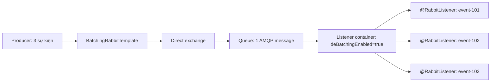
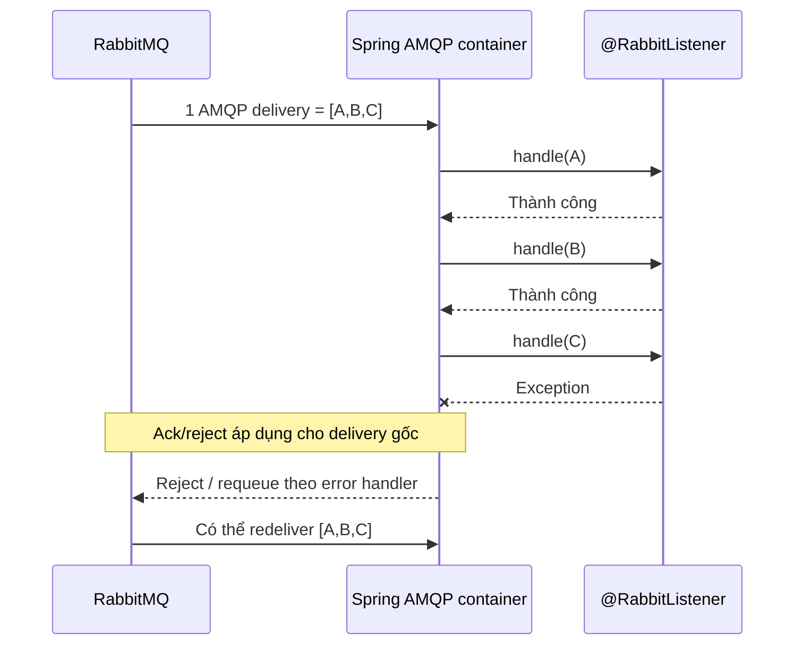

# Giải lô tự động và thuộc tính deBatchingEnabled

## 1. Bài toán: một lần giao nhận từ RabbitMQ, nhiều bản ghi cần xử lý

Trong **Spring AMQP**, producer có thể dùng `BatchingRabbitTemplate` để gom nhiều message nhỏ thành một message gửi qua RabbitMQ. Việc gom lô giảm số lần publish và một phần chi phí mạng/broker, nhưng consumer vẫn có thể muốn xử lý **từng bản ghi riêng** bằng `@RabbitListener`.

Ví dụ: hệ thống thống kê nhận các sự kiện `page-view`. Producer gom 3 sự kiện vào một gói; phía consumer muốn kiểm tra, ghi nhận và định danh riêng từng sự kiện. **De-batching (giải lô)** chính là quá trình tách gói được producer tạo thành các message logic trước khi gọi listener.

Thuộc tính `deBatchingEnabled` quyết định **listener container có tự giải các batch do producer tạo hay không**. Khi bật và listener xử lý từng message, ứng dụng có thể tiếp tục viết `@RabbitListener` nhận một `String` hay một DTO giống như khi producer gửi message thông thường.

Sau bài học, bạn có thể:

- Phân biệt **producer batching**, **de-batching** và **consumer-side batching**.
- Giải thích header `springBatchFormat` và cách `SimpleBatchingStrategy` đóng gói `lengthHeader4`.
- Cấu hình `SimpleRabbitListenerContainerFactory.setDeBatchingEnabled(true)` và kiểm chứng listener được gọi nhiều lần cho một AMQP delivery.
- Hiểu quan hệ giữa `deBatchingEnabled`, `batchListener` và `consumerBatchEnabled`.
- Đánh giá tác động tới ack, retry, dead-letter, idempotency, memory và độ trễ để vận hành xử lý bất đồng bộ đáng tin cậy.

## 2. Phân biệt ba khái niệm dễ nhầm

| Cơ chế | Ai gom hoặc tách? | Dữ liệu trên broker | Hình dạng listener thường thấy |
|---|---|---|---|
| **Producer batching** | Producer gom nhiều payload bằng `BatchingRabbitTemplate` | Một message AMQP chứa nhiều phần tử logic | Chưa quyết định; phụ thuộc consumer |
| **Producer de-batching** | Listener container hoặc listener adapter tách gói producer | Broker vẫn chỉ giao một message AMQP gốc | `@RabbitListener` nhận **một phần tử mỗi lần** hoặc nhận `List<?>` nếu bật batch listener |
| **Consumer-side batching** | `SimpleMessageListenerContainer` gom các message **đã nhận từ broker** | Có thể gồm nhiều message AMQP độc lập | `@RabbitListener` nhận `List<?>` khi cấu hình listener theo lô |

**Điểm phân biệt quan trọng:** Giải lô không tạo thêm message trong RabbitMQ. Một message vật lý nhận từ queue chỉ được **chia thành nhiều phần tử trong ứng dụng**. Do đó số lần chạy code trong listener có thể lớn hơn số lần broker giao message.

### 2.1. Ví dụ một message vật lý chứa ba phần tử

Giả sử producer gửi lần lượt:

```text
event-101
event-102
event-103
```

Với `batchSize = 3` và không vượt giới hạn bộ đệm, producer phát **một** message AMQP có body dạng:

```text
[4 byte chiều dài][event-101]
[4 byte chiều dài][event-102]
[4 byte chiều dài][event-103]
```

Trong message gốc, Spring AMQP đặt header `springBatchFormat = lengthHeader4`. Ở phía nhận, `SimpleDebatchingStrategy` mặc định nhận biết kiểu đóng gói này, đọc các độ dài và tách thành ba fragment.



Sơ đồ cho thấy **ba lần gọi listener** nhưng **một message broker**. Không suy ra rằng broker đã phát ba delivery tag hoặc có thể ack riêng ba fragment.

### 2.2. Cơ chế nhận diện lô

`SimpleBatchingStrategy` của Spring AMQP gói mỗi phần tử bằng một tiền tố độ dài 4 byte và đánh dấu kiểu lô trong header `springBatchFormat`. Khi `deBatchingEnabled=true`, container dùng chiến lược giải lô phù hợp để tạo từng fragment.

Các hệ thống tự viết producer **không thể chỉ thêm header rồi ghép chuỗi bằng dấu phẩy**: body phải tuân thủ đúng định dạng bộ giải lô hiểu được. Nếu khác công nghệ hoặc khác format, hãy thống nhất hợp đồng wire format hoặc tạo `BatchingStrategy`/converter thích hợp. Nội dung bản ghi nên có mã định danh để xử lý trùng và đối soát.

Với `SimpleBatchingStrategy`, metadata của message batch chủ yếu lấy từ message đầu tiên. Đừng mặc định mọi thuộc tính AMQP riêng của từng phần tử (ví dụ message ID, header tùy biến, correlation) đều được giữ lại như các message broker độc lập. Nếu cần, hãy đưa dữ liệu định danh vào payload từng bản ghi.

## 3. Thuộc tính deBatchingEnabled hoạt động ở đâu?

`deBatchingEnabled` là thuộc tính của **listener container**; với `@RabbitListener`, bạn thường cấu hình nó qua `SimpleRabbitListenerContainerFactory` hoặc `DirectRabbitListenerContainerFactory` phù hợp. Giá trị mặc định của cơ chế giải lô do producer tạo là **`true`** trong các container Spring AMQP thông dụng.

| Thiết lập | Kết quả với batch do producer tạo |
|---|---|
| `deBatchingEnabled = true`, listener nhận một phần tử | Container tự tách; mỗi fragment được gọi qua listener riêng. |
| `deBatchingEnabled = false`, listener nhận một phần tử | Container không tách; listener có thể nhận body đã đóng gói và không thể coi đó là payload thông thường. |
| `batchListener = true`, `consumerBatchEnabled = false` | Container factory thường chuyển việc giải lô sang listener adapter, đưa các fragment vào `List<?>` để listener xử lý cùng một lần gọi. |
| `consumerBatchEnabled = true` | Container gom thêm các message nhận từ broker; **`deBatchingEnabled` phải là `true`** và listener phải hỗ trợ nhận lô. |

### Vì sao bật batchListener lại có thể tắt deBatchingEnabled ở container?

Điều này **không có nghĩa dữ liệu ngừng được giải lô**. Khi `setBatchListener(true)` và không bật consumer-side batching, Spring AMQP có thể đặt `deBatchingEnabled=false` ở container để **listener adapter** nhận message gốc, tách fragment rồi tạo `List<?>` cho phương thức được chú thích `@RabbitListener`.

Có hai cách gọi listener hợp lệ:

```text
Container tự giải lô:
  1 message broker -> container tách -> listen(item1), listen(item2), listen(item3)

Batch listener:
  1 message broker -> adapter tách -> listen(List.of(item1, item2, item3))
```

Nếu đang học thuộc tính `deBatchingEnabled`, hãy **bắt đầu với listener nhận một phần tử**, vì kết quả dễ quan sát nhất. Khi cần xử lý nhiều fragment trong một phương thức, mới chuyển sang `batchListener` và nghiên cứu chính sách ack/retry của toàn lô.

## 4. Ví dụ Spring Boot: gửi lô và tự động tách thành từng callback

Ví dụ dưới đây dùng **Spring AMQP với RabbitMQ**, xây đủ exchange, queue, binding, producer gửi lô qua `RabbitTemplate` chuyên dụng và consumer nhận bằng `@RabbitListener`.

Thêm starter do Spring Boot BOM quản lý phiên bản:

```xml
<dependency>
    <groupId>org.springframework.boot</groupId>
    <artifactId>spring-boot-starter-amqp</artifactId>
</dependency>
```

Ví dụ cấu hình broker trong môi trường phát triển:

```yaml
spring:
  rabbitmq:
    host: localhost
    port: 5672
    username: guest
    password: guest
```

Tài khoản `guest` chỉ dùng cho thử nghiệm tại local theo cấu hình mặc định của RabbitMQ. Production cần tài khoản, virtual host, quyền và bảo vệ kết nối phù hợp.

### 4.1. Topology: direct exchange, queue, binding

```java
import org.springframework.amqp.core.Binding;
import org.springframework.amqp.core.BindingBuilder;
import org.springframework.amqp.core.DirectExchange;
import org.springframework.amqp.core.Queue;
import org.springframework.amqp.core.QueueBuilder;
import org.springframework.context.annotation.Bean;
import org.springframework.context.annotation.Configuration;

@Configuration
public class EventBatchTopology {
    public static final String EXCHANGE = "events.batch.exchange";
    public static final String QUEUE = "events.batch.queue";
    public static final String ROUTING_KEY = "events.batch";

    @Bean
    DirectExchange eventBatchExchange() {
        return new DirectExchange(EXCHANGE, true, false);
    }

    @Bean
    Queue eventBatchQueue() {
        return QueueBuilder.durable(QUEUE).build();
    }

    @Bean
    Binding eventBatchBinding(Queue eventBatchQueue,
                              DirectExchange eventBatchExchange) {
        return BindingBuilder.bind(eventBatchQueue)
                .to(eventBatchExchange).with(ROUTING_KEY);
    }
}
```

Exchange kiểu `direct` định tuyến message theo routing key khớp binding. `QueueBuilder.durable(...)` giữ định nghĩa queue qua restart broker, nhưng **không bảo đảm mọi message đã publish được lưu bền**: còn phụ thuộc delivery mode, confirms và cấu hình broker.

### 4.2. Producer: Batch 3 message, phát khi đủ số lượng hoặc đến timeout

```java
import org.springframework.amqp.rabbit.batch.SimpleBatchingStrategy;
import org.springframework.amqp.rabbit.connection.ConnectionFactory;
import org.springframework.amqp.rabbit.core.BatchingRabbitTemplate;
import org.springframework.context.annotation.Bean;
import org.springframework.context.annotation.Configuration;
import org.springframework.scheduling.concurrent.ThreadPoolTaskScheduler;

@Configuration
public class EventBatchProducerConfig {
    @Bean
    ThreadPoolTaskScheduler eventBatchScheduler() {
        ThreadPoolTaskScheduler scheduler = new ThreadPoolTaskScheduler();
        scheduler.setPoolSize(1);
        scheduler.setThreadNamePrefix("event-batch-");
        return scheduler;
    }

    @Bean
    BatchingRabbitTemplate eventBatchingRabbitTemplate(
            ConnectionFactory connectionFactory,
            ThreadPoolTaskScheduler eventBatchScheduler) {

        int batchSize = 3;
        int bufferLimit = 64 * 1024; // byte, lô lớn hơn có thể phát sớm
        long timeoutMs = 500L;      // phát lô chưa đủ sau khoảng chờ

        SimpleBatchingStrategy strategy =
                new SimpleBatchingStrategy(batchSize, bufferLimit, timeoutMs);

        return new BatchingRabbitTemplate(
                connectionFactory, strategy, eventBatchScheduler);
    }
}
```

`BatchingRabbitTemplate` mở rộng `RabbitTemplate` và gom payload trước khi publish. Nó không tự bật lên chỉ vì queue/consumer đang dùng Spring AMQP; cần tạo template dùng `BatchingStrategy` và sử dụng template đó để gửi.

```java
import java.nio.charset.StandardCharsets;
import org.springframework.amqp.core.Message;
import org.springframework.amqp.core.MessageBuilder;
import org.springframework.amqp.core.MessageProperties;
import org.springframework.amqp.rabbit.core.BatchingRabbitTemplate;
import org.springframework.stereotype.Service;

@Service
public class EventBatchPublisher {
    private final BatchingRabbitTemplate template;

    public EventBatchPublisher(BatchingRabbitTemplate template) {
        this.template = template;
    }

    public void publish(String eventId) {
        Message message = MessageBuilder
                .withBody(eventId.getBytes(StandardCharsets.UTF_8))
                .setContentType(MessageProperties.CONTENT_TYPE_TEXT_PLAIN)
                .build();

        template.send(EventBatchTopology.EXCHANGE,
                EventBatchTopology.ROUTING_KEY, message);
    }

    public void publishThree() {
        publish("event-101");
        publish("event-102");
        publish("event-103"); // đủ 3 phần tử: chiến lược phát một lô
    }
}
```

Ba tham số của `SimpleBatchingStrategy` có tác động khác nhau:

- **`batchSize`:** ngưỡng số phần tử để phát lô.
- **`bufferLimit`:** ngưỡng kích thước lô; khi sắp vượt giới hạn, chiến lược có thể phát **lô chưa đủ phần tử**. Giới hạn này không nhất thiết chặn một payload đơn lẻ quá lớn.
- **`timeout`:** giới hạn thời gian giữ lô chưa đủ; tối ưu throughput nhưng thêm độ trễ đợi gom lô.

**Lưu ý mất dữ liệu:** Những phần tử chưa được phát vẫn nằm trong bộ nhớ producer. Nếu tiến trình chết trước khi flush/publish, phần tử đang chờ có thể mất. Với công việc quan trọng, cần thiết kế outbox, persistence và xác nhận publish; không coi `send(...)` vào template đang gom lô là đã được RabbitMQ nhận.

### 4.3. Consumer: bật deBatchingEnabled, xử lý một event mỗi lần

```java
import org.springframework.amqp.rabbit.config.SimpleRabbitListenerContainerFactory;
import org.springframework.amqp.rabbit.connection.ConnectionFactory;
import org.springframework.context.annotation.Bean;
import org.springframework.context.annotation.Configuration;

@Configuration
public class EventBatchConsumerConfig {

    @Bean
    SimpleRabbitListenerContainerFactory debatchingFactory(
            ConnectionFactory connectionFactory) {
        SimpleRabbitListenerContainerFactory factory =
                new SimpleRabbitListenerContainerFactory();
        factory.setConnectionFactory(connectionFactory);
        factory.setDeBatchingEnabled(true);
        factory.setBatchListener(false);  // listener nhận từng phần tử
        return factory;
    }
}
```

Trong Spring Boot, hỗ trợ `@RabbitListener` thường được auto-configure; nếu cấu hình Spring AMQP thủ công và annotation chưa được kích hoạt, thêm `@EnableRabbit` ở lớp cấu hình phù hợp.

```java
import org.springframework.amqp.rabbit.annotation.RabbitListener;
import org.springframework.amqp.support.AmqpHeaders;
import org.springframework.messaging.handler.annotation.Header;
import org.springframework.stereotype.Component;

@Component
public class SingleEventListener {

    @RabbitListener(
            queues = EventBatchTopology.QUEUE,
            containerFactory = "debatchingFactory")
    public void handle(String eventId,
            @Header(AmqpHeaders.BATCH_SIZE) Integer batchSize,
            @Header(AmqpHeaders.LAST_IN_BATCH) boolean lastInBatch) {

        System.out.printf("event=%s, batchSize=%d, last=%s%n",
                eventId, batchSize, lastInBatch);
        // Ở sản phẩm thật: ghi eventId vào DB theo cách idempotent.
    }
}
```

Với các phiên bản Spring AMQP hiện hành, fragment của producer batch được gắn thêm metadata:

- `AmqpHeaders.BATCH_SIZE`: kích thước của producer batch.
- `AmqpHeaders.LAST_IN_BATCH`: `true` khi đây là phần tử cuối batch, các phần tử trước có `false`.

**Kết quả kỳ vọng** khi gọi `publishThree()` và chỉ có listener này đang consume queue:

```text
event=event-101, batchSize=3, last=false
event=event-102, batchSize=3, last=false
event=event-103, batchSize=3, last=true
```

Các dòng trên là log minh họa; thời điểm xuất hiện phụ thuộc scheduler, broker, số consumer và cấu hình runtime. Nếu kiểm thử nhiều lô cùng lúc với nhiều consumer, thứ tự tổng thể giữa các lô không nhất thiết được giữ nguyên.

## 5. Điều gì xảy ra nếu tắt deBatchingEnabled?

Khi đặt `factory.setDeBatchingEnabled(false)` mà **không** cấu hình batch listener, container không giải body của producer batch trước khi gọi listener. Thay vì ba payload riêng, listener có thể nhìn thấy **body gộp theo định dạng nhị phân** cùng header `springBatchFormat`.

Để quan sát mà không giải mã nhầm thành chuỗi UTF-8:

```java
import org.springframework.amqp.core.Message;
import org.springframework.amqp.rabbit.annotation.RabbitListener;

// Minh họa: dùng factory khác đặt deBatchingEnabled=false;
// không chạy listener này đồng thời với SingleEventListener trên cùng queue.
public class RawBatchListener {
    @RabbitListener(
            queues = EventBatchTopology.QUEUE,
            containerFactory = "rawBatchFactory")
    public void handle(Message envelope) {
        byte[] rawBody = envelope.getBody();
        Object format = envelope.getMessageProperties()
                .getHeaders().get("springBatchFormat");
        System.out.printf("rawBytes=%d, batchFormat=%s%n",
                rawBody.length, format);
    }
}
```

Ở đây `rawBatchFactory` là tên **factory minh họa** cần tự khai báo với `setDeBatchingEnabled(false)` nếu thực sự muốn chạy trường hợp này. Không bật đồng thời hai listener trên **cùng queue** để so sánh output, vì chúng trở thành các consumer cạnh tranh và mỗi message chỉ được giao cho một consumer.

Tắt thuộc tính không phải cách tối ưu performance mặc định. Nếu cần toàn bộ danh sách payload, thường nên dùng **batch listener** được Spring AMQP hỗ trợ, thay vì tự phân tích byte stream và xử lý header ở cấp ứng dụng.

## 6. Muốn nhận List<?> thì dùng batchListener, không chỉ deBatchingEnabled

Trong chế độ batch listener, một invocation nhận nhiều phần tử:

```java
import org.springframework.amqp.rabbit.config.SimpleRabbitListenerContainerFactory;
import org.springframework.amqp.rabbit.connection.ConnectionFactory;
import org.springframework.context.annotation.Bean;

@Bean
SimpleRabbitListenerContainerFactory producerBatchListFactory(
        ConnectionFactory connectionFactory) {
    SimpleRabbitListenerContainerFactory factory =
            new SimpleRabbitListenerContainerFactory();
    factory.setConnectionFactory(connectionFactory);
    factory.setBatchListener(true);
    return factory;
}
```

```java
import java.util.List;
import org.springframework.amqp.rabbit.annotation.RabbitListener;

@RabbitListener(
        queues = EventBatchTopology.QUEUE,
        containerFactory = "producerBatchListFactory")
public void handleBatch(List<String> events) {
    for (String eventId : events) {
        // Xử lý từng event bên trong một invocation.
    }
}
```

Hai đoạn code là **phương án thay thế** cho listener một phần tử ở mục 4, không phải các bean/method đem dán vào cùng vị trí chạy đồng thời. Với `batchListener=true` và chưa bật `consumerBatchEnabled`, việc giải lô producer thường diễn ra trong listener adapter; danh sách được tạo từ các fragment của một producer batch. Nếu broker nhận các message thường, `batchListener` **một mình không tạo cơ chế gom nhiều delivery độc lập** thành một lô lớn.

Để **consumer tự gom các message broker độc lập**, dùng `SimpleRabbitListenerContainerFactory`:

```java
@Bean
SimpleRabbitListenerContainerFactory consumerBatchFactory(
        ConnectionFactory connectionFactory) {
    SimpleRabbitListenerContainerFactory factory =
            new SimpleRabbitListenerContainerFactory();
    factory.setConnectionFactory(connectionFactory);
    factory.setBatchListener(true);
    factory.setConsumerBatchEnabled(true);
    factory.setDeBatchingEnabled(true); // bắt buộc cho consumer-side batch
    factory.setBatchSize(10);
    factory.setReceiveTimeout(1_000L);
    return factory;
}
```

Ở đây container gom tối đa khoảng 10 **delivery từ broker** trước khi gọi batch listener; khi hết thời gian chờ có thể đưa một batch chưa đủ phần tử cho listener. Nếu một delivery lại là **producer batch** chứa 20 fragment, `List<?>` cuối cùng có thể **lớn hơn `batchSize=10`** vì số đếm ở container là số message từ broker, không phải số fragment sau giải lô.

Trong các phiên bản Spring AMQP trước/sau có khác biệt nhỏ ở cách tự động thiết lập batch listener: từ Spring AMQP 3.0, `consumerBatchEnabled=true` trên factory tự đặt `batchListener=true`. Viết rõ cả hai thuộc tính giúp chủ đích của ví dụ dễ hiểu và thuận tiện khi đọc tài liệu các phiên bản.

### Bảng chọn cấu hình

| Mục tiêu | Thiết lập trọng tâm | Phương thức listener |
|---|---|---|
| Xử lý từng fragment của producer batch | `deBatchingEnabled=true`, `batchListener=false` | `handle(String event)` |
| Xử lý toàn bộ producer batch trong một invocation | `batchListener=true`, không bật consumer-side batching | `handle(List<String> events)` |
| Gom message broker độc lập thành lô để xử lý | `consumerBatchEnabled=true`, `deBatchingEnabled=true`, `batchListener=true` | `handle(List<String> events)` |
| Kiểm tra nguyên body nhị phân đã đóng gói | `deBatchingEnabled=false`, listener nhận raw `Message` | `handle(Message envelope)` |

## 7. Ack, reject, retry và DLQ: ranh giới vẫn là message vật lý

Đây là hệ quả quan trọng nhất khi xây hệ thống bất đồng bộ đáng tin cậy: **giải một delivery thành ba callback không biến chúng thành ba đơn vị ack độc lập ở RabbitMQ**.

Giả sử một producer batch gồm `A`, `B`, `C`. Listener xử lý `A` và `B` thành công nhưng ném exception khi xử lý `C`:



Nếu cấu hình requeue/redelivery, **A và B có thể được chạy lại** mặc dù đã xử lý thành công ở lần trước. Nếu cấu hình reject không requeue và có dead-letter exchange, thông thường **toàn bộ message gốc** sẽ đi tới DLQ, không phải chỉ fragment `C`.

Các điều cần ghi nhớ:

- `AcknowledgeMode.AUTO` mặc định để container ack khi xử lý thành công; khi listener ném exception, hành vi nack/requeue/reject phụ thuộc chính sách lỗi, retry và cấu hình. Không suy ra rằng mỗi fragment được ack riêng.
- `AcknowledgeMode.MANUAL` cần thao tác với **delivery tag của message broker**, không phải “delivery tag riêng cho fragment” do Spring tạo. Không gọi `basicAck` lặp lại cho từng fragment cùng delivery tag; xác nhận trùng có thể khiến channel lỗi.
- **Retry tại listener** có thể làm fragment/khối logic bị chạy lại; **broker redelivery** có thể phát lại toàn bộ message vật lý. Phân biệt hai lớp retry khi đo số lần xử lý.
- **DLQ** giúp cách ly message thất bại, nhưng để xử lý độc lập từng fragment hỏng, ứng dụng phải thiết kế riêng quy trình tách, ghi lại hoặc phát từng record với định danh ổn định.
- **Idempotency** là lớp bảo vệ thực tế: mỗi record có `eventId`; database dùng unique constraint hoặc bảng inbox để bỏ qua record đã commit, kể cả khi toàn bộ batch bị phát lại.

### Ví dụ idempotent khi replay

Giả sử listener ghi bảng sự kiện:

```sql
CREATE TABLE processed_events (
    event_id VARCHAR(100) PRIMARY KEY,
    processed_at TIMESTAMPTZ NOT NULL DEFAULT NOW()
);
```

Worker cần gắn việc **ghi hiệu ứng nghiệp vụ** và **ghi dấu eventId đã xử lý** trong cùng transaction thích hợp. Đơn giản chỉ kiểm tra `exists(eventId)` rồi mới insert dễ xảy ra race condition khi có nhiều consumer. Dùng unique constraint và transaction để bảo vệ khỏi hai lần ghi cạnh tranh. Nếu tác dụng phụ ở hệ thống ngoài database (HTTP, thanh toán, email), cần cơ chế idempotency/outbox/đối soát của hệ thống đó; transaction nội bộ không bao trùm tác dụng phụ bên ngoài.

## 8. Ảnh hưởng đến throughput, memory và quan sát hệ thống

Giải lô giảm số lượng **delivery từ broker**, nhưng không loại bỏ chi phí **xử lý từng bản ghi** trong ứng dụng. Chi phí de-batching cũng tiêu thụ CPU và bộ nhớ để đọc byte stream, tạo fragment, chuyển đổi payload và gọi listener.

Ví dụ minh họa: producer có 30.000 sự kiện nhỏ; nếu gom 100 phần tử thành một gói thì về lý thuyết có khoảng **300 delivery broker**, trong khi listener theo kiểu từng phần tử vẫn thực thi **30.000 lần**. Con số thực tế có thể khác do `bufferLimit`, timeout và lô chưa đầy.

| Tham số hoặc chỉ số | Nếu đặt quá thấp | Nếu đặt quá cao |
|---|---|---|
| `batchSize` ở producer | Ít hiệu quả giảm overhead | Lô lớn, tác động lỗi rộng, tăng latency trước khi publish |
| `bufferLimit` | Gửi nhiều lô ngắn | Message lớn, tăng memory/bandwidth và chi phí retry |
| `timeout` của producer | Lô chưa đủ phát sớm, throughput kém | Message nằm lâu trong memory, chậm phản hồi, tăng rủi ro mất trước publish |
| `prefetch` của consumer | Có thể thiếu message để xử lý liên tục | Nhiều message chưa ack, tốn memory và tăng lượng cần redelivery khi lỗi |
| `consumer concurrency` | Dễ backlog khi tải tăng | Cạnh tranh CPU/DB; khó giữ thứ tự giữa lô |

Nên quan sát cả **chỉ số broker** (publish/deliver/ack, queue ready/unacked, redelivery, DLQ, byte/message size) lẫn **chỉ số nghiệp vụ** (fragment đã xử lý, lỗi/fragment, duplicate `eventId`, thời gian xử lý và lag). Nếu chỉ nhìn số message broker, bạn có thể kết luận hệ thống đang xử lý 300 “việc” dù thực tế đã chạy 30.000 bản ghi.

Tối thiểu nên ghi log tại mức nghiệp vụ có `eventId`, `batchId` nếu tự định nghĩa và thời gian xử lý; không ghi toàn bộ payload nhạy cảm. Với tracing, một AMQP delivery có thể tạo nhiều span xử lý item: hệ thống quan sát cần phân biệt **envelope** và **fragment**.

## 9. Những lỗi thường gặp và cách chẩn đoán

| Hiện tượng | Nguyên nhân thường gặp | Cách kiểm tra |
|---|---|---|
| Listener chỉ nhận một chuỗi nhị phân khó đọc | `deBatchingEnabled=false` hoặc dữ liệu batch không được giải | Kiểm tra factory được chọn, header `springBatchFormat`, định dạng body |
| Listener được gọi một lần thay vì ba | Producer không thực sự đóng gói ba phần tử, hoặc đang dùng batch listener | Kiểm tra `BatchingRabbitTemplate`, `batchSize`, `setBatchListener(true)` |
| Listener nhận `List<?>` nhưng mỗi lần chỉ có một item | Chỉ bật `batchListener`; producer gửi message độc lập; chưa bật `consumerBatchEnabled` | Phân biệt producer batch và consumer-side batching |
| Consumer báo lỗi khi bật `consumerBatchEnabled` mà tắt `deBatchingEnabled` | Hai thiết lập không tương thích | Bật de-batching và dùng batch listener đúng loại |
| Một item hỏng làm những item đã xử lý chạy lại | Nack/requeue áp dụng cho message broker gốc | Kiểm tra retry và ack; thêm idempotency theo eventId |
| Queue broker có ít delivery nhưng log listener rất nhiều | Container đang de-batch | So sánh số envelope với số fragment từ header/metric |
| Event mất khi producer chết trước khi gửi | Batch chưa đủ, vẫn đang nằm trong bộ nhớ | Xem chiến lược persist/outbox, flush, confirms, timeout |
| DLQ chứa cả batch thay vì một record lỗi | Broker dead-letter message vật lý | Quyết định cần cơ chế replay/tách bản ghi riêng hay không |

## 10. Bài tập thực hành

1. Cấu hình `SimpleBatchingStrategy(3, 64 * 1024, 500)`, gửi ba sự kiện với `publishThree()`. Quan sát số lần gọi `@RabbitListener`, giá trị `BATCH_SIZE` và `LAST_IN_BATCH`. Giải thích tại sao có thể chỉ có một message broker.
2. Gửi hai sự kiện rồi dừng gửi. Dự đoán khi nào producer phát lô chưa đầy. Đo latency nếu tăng timeout từ 500 ms lên 5.000 ms.
3. Tạm đổi consumer sang `deBatchingEnabled=false` và nhận raw `Message`. Nêu vì sao không nên gọi `new String(rawBody)` để xem đó là hai/ba event độc lập.
4. Thử chuyển listener sang `batchListener=true`. So sánh một callback nhận `List<String>` với nhiều callback nhận `String`. Nêu phần trách nhiệm nào đã chuyển từ container sang adapter.
5. Cho callback thứ ba ném exception, cấu hình requeue có giới hạn. Kiểm tra khả năng lặp lại item một và hai; đề xuất bảng `processed_events` và cách commit idempotent.
6. Bật `consumerBatchEnabled=true`, đặt `batchSize=2` và gửi một producer batch có ba fragment. Giải thích vì sao số fragment trong `List<?>` có thể vượt `batchSize`.
7. Đề xuất cách xử lý một record lỗi không hợp lệ để nó không làm cả batch lặp vô hạn, và cách giữ đầy đủ thông tin khi gửi tới DLQ hoặc một kênh ghi lỗi riêng.

## 11. Tài liệu tham khảo

- [Spring AMQP Reference — Batched Messages](https://docs.spring.io/spring-amqp/reference/amqp/receiving-messages/de-batching.html): tự động de-batch, ranh giới từ chối message và consumer-side batching.
- [Spring AMQP Reference — @RabbitListener with Batching](https://docs.spring.io/spring-amqp/reference/amqp/receiving-messages/batch.html): batch listener, `LAST_IN_BATCH`, `BATCH_SIZE` và quan hệ giữa các thuộc tính.
- [Spring AMQP Reference — Sending Messages, mục Batching](https://docs.spring.io/spring-amqp/reference/amqp/sending-messages.html): `BatchingRabbitTemplate`, `SimpleBatchingStrategy`, định dạng `lengthHeader4`.
- [Spring AMQP API — SimpleBatchingStrategy](https://docs.spring.io/spring-amqp/docs/3.2.x/api/org/springframework/amqp/rabbit/batch/SimpleBatchingStrategy.html): ý nghĩa constructor, giới hạn bộ đệm và chiến lược đóng gói.

**Ghi nhớ:** `deBatchingEnabled=true` cho phép listener container tự tách một **producer-created batch** thành các fragment để `@RabbitListener` xử lý thuận tiện. Nhưng mỗi lô vẫn xuất phát từ một hoặc nhiều **delivery vật lý**; khi xử lý lỗi, ack/reject và redelivery phải được đánh giá ở ranh giới message của RabbitMQ. Kết hợp batch đúng cách với idempotency, retry có giới hạn, dead-letter và metric riêng cho envelope/fragment là nền tảng để xử lý bất đồng bộ đáng tin cậy.
