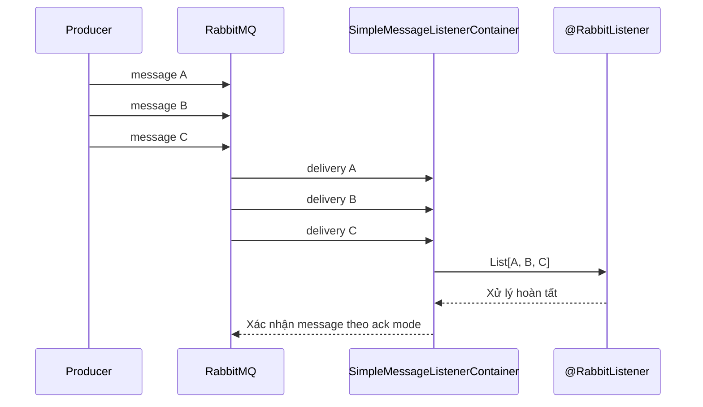

# `consumerBatchEnabled`, `batchListener` và kiểu tham số listener trong Spring AMQP

Trong Spring AMQP, `@RabbitListener` thông thường nhận **một message mỗi lần gọi**. Khi lưu nhật ký, đồng bộ dữ liệu, tính toán thống kê hoặc ghi nhiều bản ghi xuống cơ sở dữ liệu, xử lý từng message riêng lẻ có thể làm tăng số lần gọi dịch vụ và chi phí giao dịch. **Batch listener** cho phép gom các message thành một danh sách và xử lý chúng trong một lần gọi method.

Hai cấu hình dễ nhầm nhất là `consumerBatchEnabled` và `batchListener`. Chúng liên quan với nhau nhưng giải quyết **hai việc khác nhau**:

- `consumerBatchEnabled`: yêu cầu **consumer container chủ động gom** nhiều message nhận từ RabbitMQ thành một batch.
- `batchListener`: thông báo cho **listener adapter** rằng method `@RabbitListener` nhận một batch, điển hình là `List<...>`, thay vì một payload đơn lẻ.

Chương **Xử lý theo lô** của **SPRING_AMQP** tập trung vào ý nghĩa của hai tùy chọn, cách khai báo các kiểu tham số listener, tác động tới ack/retry/dead-letter và cách kiểm tra bằng RabbitMQ thực tế.

## 1. Có những loại batch nào?

RabbitMQ thông thường vẫn truyền các delivery riêng lẻ. Việc ứng dụng nhận một `List` không có nghĩa broker tự biến một nhóm message thành một message giao dịch duy nhất.

| Cơ chế | Ai tạo batch? | Điều gì được gửi qua broker? | Vai trò của listener |
|---|---|---|---|
| Tiêu thụ thông thường | Không có batch | Các message riêng lẻ | Method nhận từng payload/message |
| **Producer-side batching** | Producer, ví dụ `BatchingRabbitTemplate` | Một AMQP message có thể chứa nhiều message logic đã đóng gói | Container có thể tách batch (de-batching); batch listener có thể nhận danh sách |
| **Consumer-side batching** | `SimpleMessageListenerContainer` | Các AMQP message riêng lẻ | Container gom các delivery nhận được rồi gọi listener với danh sách |
| Kết hợp producer + consumer batch | Hai phía | Có cả AMQP message đã đóng gói lẫn message riêng lẻ | Danh sách sau khi de-batch có thể có nhiều phần tử hơn kích thước mục tiêu |

Ví dụ consumer-side batching với `batchSize = 3`:



Batch là đơn vị **gọi method ở phía consumer**. Mỗi delivery vẫn chịu các quy tắc về prefetch, xác nhận giao nhận (ack), redelivery và dead-letter của RabbitMQ.

## 2. `consumerBatchEnabled`: bật gom batch ở consumer

`consumerBatchEnabled` là cấu hình của **`SimpleRabbitListenerContainerFactory` / `SimpleMessageListenerContainer`**. Khi bật, container cố gắng gom nhiều message trước khi gọi listener; **không dùng `DirectMessageListenerContainer`** cho tính năng gom batch phía consumer này.

Các thuộc tính liên quan:

| Thuộc tính | Chức năng | Lưu ý |
|---|---|---|
| `consumerBatchEnabled = true` | Bật gom message phía consumer | Đồng thời kích hoạt `batchListener` |
| `batchSize` | Số message mục tiêu mỗi batch ở consumer | Là mục tiêu, không cam kết mọi batch đều đủ phần tử |
| `receiveTimeout` | Giới hạn thời gian chờ nhận message tại một lần receive | Khi thiếu message, batch có thể được giao với kích thước nhỏ hơn |
| `batchReceiveTimeout` | Giới hạn tổng thời gian gom batch ở các phiên bản có hỗ trợ thuộc tính này | Kiểm tra phiên bản Spring AMQP đang dùng |
| `prefetchCount` | Số delivery chưa ack mà broker có thể đẩy tới một consumer | Nên bảo đảm ít nhất bằng `batchSize` khi dùng consumer batching |
| `concurrentConsumers` | Số consumer chạy song song | Mỗi consumer tạo các batch riêng; không có một batch toàn cục cho mọi consumer |

Ví dụ: đặt `batchSize = 10` nhưng queue chỉ có 4 message. Container có thể gọi listener với danh sách 4 phần tử sau thời gian chờ, thay vì chờ mãi tới khi đủ 10. Batch có thể nhỏ hơn vì timeout, queue ít dữ liệu hoặc quá trình tiêu thụ bị gián đoạn.

**Phân biệt `batchSize` và `prefetchCount`:** `batchSize` liên quan đến việc gom và chính sách xác nhận của container; `prefetchCount` kiểm soát số message broker cấp mà chưa được ack. Đặt `prefetchCount` quá thấp so với `batchSize` có thể ảnh hưởng khả năng gom batch hiệu quả.

## 3. `batchListener`: xác định hợp đồng của method `@RabbitListener`

`batchListener = true` cho phép listener adapter gọi method bằng **danh sách phần tử**. Một cấu hình batch listener có thể xử lý các batch được producer đóng gói (sau khi container de-batch), ngay cả khi chưa bật việc gom nhiều delivery đơn lẻ ở consumer.

Điểm quan trọng:

1. Chỉ đặt `batchListener = true` **không đồng nghĩa** container sẽ chủ động đợi gom nhiều delivery độc lập cho một lời gọi.
2. Đặt `consumerBatchEnabled = true` trên `SimpleRabbitListenerContainerFactory` sẽ **tự bật `batchListener`**; không cần lặp lại setter còn lại.
3. Method listener phải có chữ ký phù hợp với cách framework chuyển đổi batch, ví dụ `List<String>`, `List<OrderEvent>` hoặc `List<org.springframework.amqp.core.Message>`.
4. Không nên dùng cùng một factory batch cho mọi `@RabbitListener` trong ứng dụng nếu các listener khác vẫn viết để nhận từng message.

Ví dụ cấu hình chỉ dành cho một nhóm listener:

```java
@RabbitListener(
        queues = BatchAmqpConfig.QUEUE,
        containerFactory = "consumerBatchFactory")
public void onBatch(List<String> events) {
    // events là danh sách payload của batch
}
```

Nếu không bật batching và vẫn để method nhận `String`, container sẽ gọi method cho từng message, không tạo `List` như ví dụ trên.

## 4. Ví dụ Spring Boot hoàn chỉnh: gom sự kiện để xử lý theo lô

Ví dụ dùng exchange kiểu direct, queue `demo.audit.events`, routing key `audit.created`. Producer gửi 12 String độc lập; listener nhận chúng theo những batch có kích thước mục tiêu 5.

### 4.1. Dependency và kết nối

Gradle:

```groovy
dependencies {
    implementation 'org.springframework.boot:spring-boot-starter-amqp'
}
```

Ví dụ `application.yml` cho RabbitMQ chạy cục bộ:

```yaml
spring:
  rabbitmq:
    host: localhost
    port: 5672
    username: guest
    password: guest
```

Thông tin `guest/guest` chỉ phù hợp cho môi trường phát triển cục bộ theo cấu hình broker mặc định; môi trường triển khai thực tế cần quản lý riêng credential và kết nối.

### 4.2. Khai báo topology và factory

```java
import org.springframework.amqp.core.Binding;
import org.springframework.amqp.core.BindingBuilder;
import org.springframework.amqp.core.DirectExchange;
import org.springframework.amqp.core.Queue;
import org.springframework.amqp.core.QueueBuilder;
import org.springframework.amqp.rabbit.annotation.EnableRabbit;
import org.springframework.amqp.rabbit.config.SimpleRabbitListenerContainerFactory;
import org.springframework.amqp.rabbit.connection.ConnectionFactory;
import org.springframework.beans.factory.annotation.Qualifier;
import org.springframework.boot.autoconfigure.amqp.SimpleRabbitListenerContainerFactoryConfigurer;
import org.springframework.context.annotation.Bean;
import org.springframework.context.annotation.Configuration;

@Configuration
@EnableRabbit
public class BatchAmqpConfig {
    public static final String EXCHANGE = "demo.audit.exchange";
    public static final String QUEUE = "demo.audit.events";
    public static final String ROUTING_KEY = "audit.created";

    @Bean
    public DirectExchange auditExchange() {
        return new DirectExchange(EXCHANGE);
    }

    @Bean
    public Queue auditQueue() {
        return QueueBuilder.durable(QUEUE).build();
    }

    @Bean
    public Binding auditBinding(
            @Qualifier("auditQueue") Queue queue,
            @Qualifier("auditExchange") DirectExchange exchange) {
        return BindingBuilder.bind(queue).to(exchange).with(ROUTING_KEY);
    }

    @Bean("consumerBatchFactory")
    public SimpleRabbitListenerContainerFactory consumerBatchFactory(
            ConnectionFactory connectionFactory,
            SimpleRabbitListenerContainerFactoryConfigurer configurer) {
        SimpleRabbitListenerContainerFactory factory =
                new SimpleRabbitListenerContainerFactory();
        configurer.configure(factory, connectionFactory);
        factory.setConsumerBatchEnabled(true); // Tự bật batchListener
        factory.setBatchSize(5);               // Số phần tử mục tiêu
        factory.setReceiveTimeout(1_000L);     // Chờ khi batch chưa đủ
        factory.setPrefetchCount(10);          // Đủ chỗ cho nhiều message in-flight
        factory.setConcurrentConsumers(1);     // Dễ quan sát trong ví dụ
        return factory;
    }
}
```

Ở đây `configurer.configure(...)` giúp factory sử dụng cấu hình RabbitMQ được Spring Boot quản lý. `consumerBatchFactory` có tên riêng để chỉ gắn vào listener cần nhận batch.

Nếu thử nghiệm với `batchSize = 5` và phát 12 message liên tiếp, có thể quan sát các batch như 5, 5 và 2 phần tử. Đó **không phải một phân hoạch được bảo đảm**: thời điểm consumer nhận, khoảng trống giữa các message, timeout và concurrency đều ảnh hưởng đến kích thước thực tế.

### 4.3. Producer gửi các message riêng lẻ

```java
import org.springframework.amqp.rabbit.core.RabbitTemplate;
import org.springframework.stereotype.Service;

@Service
public class AuditPublisher {
    private final RabbitTemplate rabbitTemplate;

    public AuditPublisher(RabbitTemplate rabbitTemplate) {
        this.rabbitTemplate = rabbitTemplate;
    }

    public void publishSample() {
        for (int i = 1; i <= 12; i++) {
            rabbitTemplate.convertAndSend(
                    BatchAmqpConfig.EXCHANGE,
                    BatchAmqpConfig.ROUTING_KEY,
                    "created-" + i
            );
        }
    }
}
```

Mỗi lần gọi `convertAndSend()` ở đây gửi **một** message. Chúng không được đóng gói thành producer-side batch. Consumer container mới là bên gom các delivery thành danh sách.

### 4.4. Listener nhận `List<String>`

```java
import java.util.List;
import org.springframework.amqp.rabbit.annotation.RabbitListener;
import org.springframework.stereotype.Component;

@Component
public class AuditBatchListener {

    @RabbitListener(
            queues = BatchAmqpConfig.QUEUE,
            containerFactory = "consumerBatchFactory")
    public void handle(List<String> events) {
        System.out.println("Batch size = " + events.size());

        for (String event : events) {
            if (event == null || event.isBlank()) {
                throw new IllegalArgumentException("Event rỗng");
            }
            System.out.println("Processing " + event);
        }
    }
}
```

Với payload String và `SimpleMessageConverter` mặc định, Spring AMQP có thể chuyển đổi từng payload thành String khi adapter tạo danh sách. Ví dụ sử dụng `System.out` để dễ quan sát; trong hệ thống thật, thay vòng lặp bằng thao tác lưu batch và logging có cấu trúc.

**Một lần gọi listener nhận một batch; điều đó không tự biến thao tác trong vòng lặp thành giao dịch nguyên tử.** Nếu đã ghi thành công bốn bản ghi rồi bản ghi thứ năm lỗi, việc xử lý lại cần chống trùng.

## 5. Ba kiểu tham số listener cần biết

Các kiểu phổ biến dưới đây thường được sử dụng khi `batchListener` bật. Chọn kiểu dựa trên nhu cầu kiểm soát metadata và cấu hình message converter.

### 5.1. `List<org.springframework.amqp.core.Message>` — message AMQP nguyên bản

Khi cần đọc `byte[]`, content type, message ID hoặc headers AMQP, nhận message thô:

```java
import java.nio.charset.StandardCharsets;
import java.util.List;
import org.springframework.amqp.core.Message;
import org.springframework.amqp.rabbit.annotation.RabbitListener;

@RabbitListener(
        queues = BatchAmqpConfig.QUEUE,
        containerFactory = "consumerBatchFactory")
public void handleRaw(List<Message> messages) {
    for (Message message : messages) {
        String body = new String(
                message.getBody(), StandardCharsets.UTF_8);
        Object source = message.getMessageProperties()
                .getHeaders().get("source");
        System.out.println(body + ", source=" + source);
    }
}
```

Đây là **phương án thay thế** method `handle(List<String>)` bên trên, không phải listener thứ hai cần gắn đồng thời vào cùng queue của ví dụ. Nếu đăng ký cả hai, RabbitMQ sẽ phân phối cạnh tranh giữa hai consumer; mỗi consumer chỉ nhận một phần message.

Ưu điểm của `List<Message>` là không mất quyền truy cập vào AMQP properties. Đổi lại, người viết code phải giải mã body theo đúng `contentType`, `contentEncoding` và giao thức payload đã thống nhất; không nên mặc định tất cả bytes đều là UTF-8 nếu ứng dụng có nhiều định dạng.

### 5.2. `List<org.springframework.messaging.Message<?>>` — payload kèm headers đã ánh xạ

`org.springframework.messaging.Message<?>` thuộc abstraction của Spring Messaging, khác với `org.springframework.amqp.core.Message`:

```java
import java.util.List;
import org.springframework.amqp.rabbit.annotation.RabbitListener;
import org.springframework.messaging.Message;

@RabbitListener(
        queues = BatchAmqpConfig.QUEUE,
        containerFactory = "consumerBatchFactory")
public void handleSpringMessages(List<Message<?>> messages) {
    for (Message<?> message : messages) {
        Object payload = message.getPayload();
        Object source = message.getHeaders().get("source");
        System.out.println(payload + ", source=" + source);
    }
}
```

Đây cũng là **phương án chữ ký thay thế**, chỉ chọn một listener trên queue khi chạy ví dụ. Kiểu Spring Messaging thuận tiện khi muốn làm việc với payload đã được converter xử lý **và** headers của từng message. Các headers AMQP được ánh xạ vào Spring Messaging theo khả năng của header mapper; không nên mặc định mọi metadata giữ nguyên y hệt.

### 5.3. `List<T>` — chỉ nhận payload nghiệp vụ

`List<String>` như ví dụ chính là dạng `List<T>`. Khi dùng DTO:

```java
public record AuditEvent(String eventId, String action) {}

@RabbitListener(
        queues = "demo.audit.dto.events",
        containerFactory = "consumerBatchFactory")
public void handleDtos(List<AuditEvent> events) {
    for (AuditEvent event : events) {
        auditService.storeIfAbsent(event.eventId(), event.action());
    }
}
```

Ví dụ DTO **giả định** bạn đã khai báo queue `demo.audit.dto.events`, bean `auditService` và converter JSON phù hợp. `SimpleMessageConverter` mặc định **không tự chuyển một JSON body thành DTO bất kỳ** chỉ vì method viết `List<AuditEvent>`. Để chạy thực tế, producer phải gửi JSON và client/listener phải thống nhất `MessageConverter`, content type, mapping type và phiên bản schema. Với các phiên bản Spring AMQP khác nhau, tên class converter JSON có thể thay đổi; hãy dùng API phù hợp dependency của dự án.

**So sánh nhanh:**

| Method parameter | Nội dung có thể truy cập | Khi nên chọn |
|---|---|---|
| `List<org.springframework.amqp.core.Message>` | Bytes và AMQP properties của từng message | Cần metadata AMQP nguyên bản, payload nhiều định dạng |
| `List<org.springframework.messaging.Message<?>>` | Payload đã chuyển đổi và Spring Messaging headers | Cần cả payload lẫn headers theo abstraction Spring |
| `List<String>` hoặc `List<AuditEvent>` | Payload nghiệp vụ sau chuyển đổi | Muốn tập trung xử lý business logic, đã cấu hình converter đúng |

Không nhầm hai class có tên `Message`. Nếu cần dùng cả hai trong cùng một file Java, hãy sử dụng tên đầy đủ để tránh xung đột import.

## 6. Producer batch và consumer batch có thể kết hợp

Giả sử producer dùng `BatchingRabbitTemplate` gửi một **AMQP message vật lý chứa 8 logical messages**. Nếu container bật de-batching và consumer batching, khi đọc AMQP message này, container có thể tách ra thành 8 phần tử logic rồi đưa vào danh sách listener.

Hệ quả là:

- `batchSize` là số lượng **delivery/message mục tiêu khi gom** ở phía consumer, không nhất thiết là giới hạn tuyệt đối cho số phần tử sau de-batching.
- Một listener có thể nhận danh sách **lớn hơn `batchSize`** nếu producer batching và consumer batching cùng được bật.
- Các phần tử logic trong một producer batch có thể chia sẻ cùng một delivery ở cấp broker; không thể suy từ số phần tử `List` ra số lượng delivery tag độc lập.
- Nếu cần ước tính bộ nhớ, số bản ghi mỗi lần ghi DB hoặc giới hạn kích thước yêu cầu downstream, phải tính đến cả số lượng phần tử **và tổng dung lượng bytes**.

Để không nhầm khi debug, hãy phân biệt số AMQP message broker giao, số logical messages sau de-batching và số phần tử `List` thực tế listener nhận.

## 7. Ack, retry, transaction và dead-letter khi xử lý theo lô

### 7.1. Thành công một batch không có nghĩa từng phần tử được ack riêng

Với `AcknowledgeMode.AUTO` thông thường, container chịu trách nhiệm xác nhận message sau khi listener hoàn tất thành công. Khi listener xử lý batch, không nên suy rằng framework tự phân tích kết quả từng phần tử và chỉ ack những phần tử hợp lệ.

Giả sử:

```text
Batch: [A, B, C, D, E]

Lưu A thành công
Lưu B thành công
Lưu C -> lỗi
D và E chưa chạy
```

Nếu listener ném exception, policy lỗi của container có thể dẫn tới requeue/redelivery các message trong batch. Khi xử lý lại, **A và B có thể xuất hiện lần nữa**, dù thao tác nghiệp vụ của chúng đã thành công. Vì vậy, code lưu DB nên có idempotency, ví dụ unique key theo `eventId` hoặc thao tác upsert phù hợp.

Trong một số phiên bản Spring AMQP, `BatchListenerFailedException` hỗ trợ chỉ rõ message/index gây lỗi cho một số đường xử lý batch; không nên mặc định mọi kiểu listener, batch nguồn producer và acknowledge mode đều có cùng hành vi xử lý phần còn lại. Kiểm tra tài liệu phiên bản và integration test trước khi dựa vào cơ chế ack/reject từng phần tử.

### 7.2. Cẩn thận với `AcknowledgeMode.MANUAL`

Khi chọn manual ack, ứng dụng chịu trách nhiệm sử dụng `Channel` và delivery tag đúng cách. Ack/nack của RabbitMQ là cơ chế **theo delivery tag trên channel**, khác với vị trí phần tử trong một `List` sau chuyển đổi hoặc de-batching.

Tránh tự động dùng:

```java
channel.basicAck(lastDeliveryTag, true);
```

nếu chưa chứng minh chắc chắn những delivery nào đang nằm trên cùng channel và thuộc phạm vi cần xác nhận. Tham số `multiple = true` xác nhận mọi delivery chưa ack **đến** delivery tag đó trên channel, có thể ảnh hưởng ngoài phần đang xử lý nếu dùng sai.

Với mục đích học batch listener cơ bản, hãy bắt đầu từ `AUTO` và logic idempotent. Chỉ dùng `MANUAL` khi đã có yêu cầu rõ về ack/nack và đã kiểm tra hành vi khi batch lỗi một phần.

### 7.3. Retry và dead-letter

- Retry tại listener có thể làm **cả batch hoặc một phần batch** được xử lý lại, tùy cơ chế retry và cách báo lỗi. Code nghiệp vụ phải chịu được việc phát lại message.
- Với message không thể xử lý sau số lần thử cho phép, cấu hình dead-letter exchange/queue (DLX/DLQ) để cách ly và điều tra. Một exception thông thường không tự tạo DLQ; broker cần topology và điều kiện dead-letter phù hợp.
- Không dùng vòng requeue vô hạn cho poison message. Thiết kế giới hạn số lần thử, backoff và cách phục hồi riêng.
- Một batch gồm nhiều tác vụ ghi DB không tự nằm trong một transaction chỉ vì listener nhận `List`. Nếu cần tính nguyên tử, phải thiết kế ranh giới transaction ở cơ sở dữ liệu, hiểu độ độc lập giữa transaction DB và ack AMQP, đồng thời chấp nhận khả năng redelivery.

### 7.4. Khi một phần batch thất bại

Có ba hướng thiết kế thường gặp:

1. **Toàn batch thành công hoặc thất bại:** chỉ báo thành công khi mọi phần tử hợp lệ; có idempotency để tránh nhân đôi phần tử đã xử lý sau retry.
2. **Ghi nhận lỗi theo từng phần tử:** lưu riêng các bản ghi lỗi và trạng thái thành công; chỉ hoàn tất batch khi đã xác định rõ xử lý/chuyển giao lỗi, tránh âm thầm bỏ message.
3. **Chia thành batch nhỏ hơn:** giảm tác động khi lỗi và thời gian giữ unacked, đổi lại tăng số lần gọi xuống hệ thống lưu trữ.

Trong mọi cách, **không nuốt exception rồi trả về bình thường** nếu vẫn còn message bắt buộc xử lý mà chưa được lưu hoặc chuyển sang cơ chế phục hồi đáng tin cậy; điều đó có thể khiến container ack những delivery chưa xử lý xong.

## 8. Điều chỉnh hiệu năng và quan sát

Batch giúp giảm overhead khi thao tác downstream có hỗ trợ xử lý nhiều bản ghi cùng lúc, ví dụ bulk insert. Tuy nhiên, gom batch quá lớn làm tăng latency, bộ nhớ và phạm vi xử lý lại khi lỗi.

| Khi điều chỉnh | Tác động thường gặp | Cần quan sát |
|---|---|---|
| Tăng `batchSize` | Có thể cải thiện throughput khi downstream hỗ trợ bulk | Độ trễ phần tử chờ đủ batch, RAM, thời gian gọi DB |
| Giảm `receiveTimeout` | Batch nhỏ được giao nhanh hơn khi tải thấp | Số phần tử trung bình mỗi batch, số lần gọi DB |
| Tăng `prefetchCount` | Broker có thể cấp nhiều delivery đang chờ ack hơn | Unacked, độ công bằng giữa consumer, bộ nhớ |
| Tăng `concurrentConsumers` | Nhiều consumer xử lý song song | Áp lực lên DB, ordering, số connection/thread |
| Bật producer batching cùng consumer batching | Giảm chi phí publish trong một số trường hợp | Kích thước `List` vượt mục tiêu, bytes mỗi batch |

Độ trễ và throughput phải đo bằng workload thật. Nếu một batch có 100 phần tử nhưng downstream vẫn gọi 100 request đơn lẻ, lợi ích có thể nhỏ trong khi độ phức tạp retry tăng lên.

Các metric nên thu thập: `batch.size` thực tế, thời gian gom và xử lý batch, throughput theo message, số delivery unacked, queue depth, số lỗi batch, retry/redelivery, dead-letter và độ trễ của downstream. Gắn correlation/message ID phù hợp để lần ra lỗi của một phần tử; tránh log thông tin nhạy cảm.

Lưu ý thứ tự: nhiều consumer có thể nhận và hoàn tất batch khác nhau không theo đúng thứ tự gửi. Nếu business bắt buộc thứ tự theo khóa, cần chiến lược partition/routing và concurrency riêng; `batchListener` không tự bảo đảm thứ tự toàn cục.

## 9. Kiểm thử cần làm với RabbitMQ thật

Viết unit test gọi trực tiếp `handle(List<String>)` chỉ kiểm tra logic vòng lặp. Nó **không kiểm chứng** container có gom message, timeout, prefetch, ack/requeue hay de-batching đúng mong đợi.

| Trường hợp | Kết quả cần kiểm tra |
|---|---|
| Gửi nhiều message riêng lẻ liên tiếp | Listener nhận `List`, không nhận từng String đơn lẻ |
| Gửi ít hơn `batchSize` rồi dừng | Sau thời gian chờ, listener vẫn nhận batch nhỏ hơn mục tiêu |
| Dùng producer-side batch và consumer batching | Kích thước `List` có thể vượt `batchSize`, và nội dung vẫn đúng |
| Chọn `List<Message>` | Đọc được AMQP headers và body cho từng phần tử |
| Chọn `List<AuditEvent>` | Converter JSON trả DTO đúng kiểu; sai content type được phát hiện |
| Lỗi ở phần tử giữa batch | Quan sát ack/requeue/redelivery; không ghi trùng phần tử đã xử lý |
| DLQ đã cấu hình | Message vượt chính sách retry được chuyển đến nơi xử lý lỗi |
| Tăng số consumer | Không giả định có một batch gom chung giữa mọi consumer |

Nên chạy riêng từng kiểu listener trên queue thử nghiệm, hoặc thay thế method khi so sánh chữ ký. Nếu nhiều method cùng lắng nghe một queue, RabbitMQ xem chúng là **competing consumers**, không phát nguyên cùng một message cho mọi method.

## 10. Gợi ý lựa chọn cấu hình

- Muốn consumer gom các message RabbitMQ nhận được: dùng **`SimpleRabbitListenerContainerFactory` với `consumerBatchEnabled(true)`**; chỉnh `batchSize`, `receiveTimeout` và `prefetchCount` theo tải thực tế.
- Muốn listener xử lý batch do producer đã đóng gói, không nhất thiết gom các delivery độc lập: cấu hình **`batchListener(true)`** theo mô hình batch tương ứng.
- Muốn xử lý bytes và metadata AMQP: chọn **`List<org.springframework.amqp.core.Message>`**.
- Muốn nhận từng payload kèm Spring Messaging headers: chọn **`List<org.springframework.messaging.Message<?>>`**.
- Muốn tập trung nghiệp vụ: chọn **`List<String>` hoặc `List<DTO>`** và kiểm soát `MessageConverter`.

### Câu hỏi tự kiểm tra

1. Vì sao bật `batchListener` chưa chắc làm container gom các message gửi riêng lẻ?
2. Khi bật `consumerBatchEnabled`, có cần tiếp tục gọi `setBatchListener(true)` không?
3. `List<org.springframework.amqp.core.Message>` khác `List<org.springframework.messaging.Message<?>>` ở điểm nào?
4. Tại sao `batchSize = 5` không bảo đảm mỗi lần listener luôn nhận đúng 5 phần tử?
5. Nếu xử lý phần tử thứ ba thất bại sau khi ghi hai phần tử đầu, cần thiết kế gì để tránh trùng dữ liệu khi redelivery?

**Ghi nhớ:** `consumerBatchEnabled` quyết định **container có chủ động gom delivery thành batch hay không**; `batchListener` quyết định **listener nhận dữ liệu theo hợp đồng batch**. Kiểu `List<...>` quyết định mức truy cập payload/headers. Muốn batch processing đáng tin cậy phải thiết kế cùng với converter, prefetch, xác nhận giao nhận, retry, dead-letter và idempotency.
