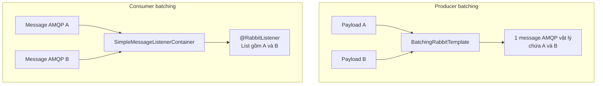

# batchSize, receiveTimeout và các tùy chọn gom lô theo phiên bản

Trong **Spring AMQP**, việc nhận từng message rồi ghi một bản ghi cơ sở dữ liệu cho mỗi lần gọi `@RabbitListener` dễ hiểu nhưng có thể tốn nhiều lần tương tác I/O. Khi ứng dụng cần tổng hợp log, telemetry hoặc ghi dữ liệu theo lô, ta có thể gom message để xử lý nhiều phần tử trong một lần gọi listener. Tuy nhiên, **`batchSize=10` không có nghĩa listener tự nhận `List<Message>` gồm 10 phần tử**: ý nghĩa của cấu hình phụ thuộc cơ chế batching, loại listener container và phiên bản Spring AMQP.

Bài học thuộc chương **Xử lý theo lô** trong module **SPRING_AMQP**, sử dụng kiến thức về `RabbitTemplate`, `@RabbitListener`, exchange, queue, binding, ACK/NACK, retry và dead-letter để thiết kế consumer batch có kiểm soát độ trễ, thông lượng và xử lý lỗi.

## 1. Mục tiêu học tập

Sau bài này, bạn có thể:

1. Phân biệt **producer batching**, **consumer batching** và **batch ACK/transaction**.
2. Giải thích các vai trò của `batchSize` trên `SimpleMessageListenerContainer`.
3. Phân biệt `receiveTimeout` với `batchReceiveTimeout` khi quyết định lúc gửi lô chưa đầy tới listener.
4. Cấu hình `SimpleRabbitListenerContainerFactory` để `@RabbitListener` nhận `List<Message>` của nhiều message độc lập.
5. Xác định chính xác mốc phiên bản **2.2**, **3.0**, **3.1.2** và **4.2** cho các tính năng liên quan.
6. Nhận biết rủi ro trong ACK/NACK, retry, dead-letter, transaction và xử lý một phần batch.

## 2. Từ "batch" có ba ý nghĩa khác nhau

| Cơ chế | Gom ở đâu? | Message vật lý trên broker | Listener nhận gì? |
| --- | --- | --- | --- |
| **Producer-created batch** | `BatchingRabbitTemplate` gom payload ở phía gửi. | Có thể là **một** message vật lý chứa nhiều payload logic. | Container thường de-batch thành message logic; có thể gọi listener từng phần hoặc cả danh sách. |
| **Consumer-created batch** | `SimpleMessageListenerContainer` (SMLC) gom các delivery đã nhận. | Nhiều message vật lý độc lập. | Một lần gọi `@RabbitListener` với `List<?>` khi cấu hình đầy đủ. |
| **Batch ACK / transaction** | SMLC gom việc xác nhận/commit trên channel. | Nhiều message vật lý độc lập. | **Vẫn có thể** gọi listener từng message; không mặc nhiên nhận `List<?>`. |



**Điểm quyết định:** khi bật `consumerBatchEnabled`, SMLC có thể gom những message mà producer gửi riêng lẻ. Việc này khác với `BatchingRabbitTemplate` đóng gói nhiều payload thành một message vật lý. Cả hai loại có thể xuất hiện cùng lúc, nên kích thước danh sách đưa tới listener không phải lúc nào cũng bằng `batchSize`.

## 3. `batchSize` ảnh hưởng nhiều hơn kích thước `List`

Đối với **SMLC**, `batchSize` có những ý nghĩa chính:

- Khi `consumerBatchEnabled=true`, là số **message vật lý** mục tiêu mà container gom trước khi gọi batch listener.
- Khi `acknowledgeMode=AUTO`, ảnh hưởng tần suất container gửi ACK, tức có thể xử lý nhiều message trước một lần xác nhận.
- Khi `channelTransacted=true`, ảnh hưởng số message được xử lý trước một lần commit channel.
- Nếu `prefetchCount` nhỏ hơn `batchSize`, SMLC có thể tăng prefetch để phục vụ cơ chế batching/ACK.

Giá trị mặc định của `batchSize` là **1**. Đặt `batchSize=20` **mà không bật** `consumerBatchEnabled` vẫn có thể thay đổi hành vi ACK/transaction, nhưng **không biến** `public void consume(String event)` thành `public void consume(List<String> events)`.

| Trường hợp | Listener | Điều quan sát được |
| --- | --- | --- |
| `batchSize=5`, `consumerBatchEnabled=false` | `consume(String event)` | Với 5 message gửi riêng, listener thường được gọi **5 lần**. |
| `batchSize=5`, `consumerBatchEnabled=true` và batch adapter | `consume(List<String> events)` | Nếu đủ message nhanh, listener được gọi **1 lần**, danh sách 5 phần tử. |
| `batchSize=5` và batching bật nhưng chỉ có 2 message rồi dừng | `consume(List<String> events)` | Có thể nhận **partial batch** gồm 2 phần tử khi timeout. |

Tác động thực tế còn phụ thuộc phân phối message giữa consumer, prefetch, thời gian nhận và việc message đã được đóng gói bởi producer hay chưa. `batchSize` là mục tiêu vận hành, không phải hợp đồng bắt buộc mỗi danh sách luôn đủ N phần tử.

## 4. `receiveTimeout`: đợi message tiếp theo

Trên SMLC, `receiveTimeout` tính bằng **mili giây**; mặc định thường là **1.000 ms**. Nó giới hạn **khoảng đợi cho một lần nhận message**, không phải luôn là tổng thời gian gom tính từ message đầu tiên.

Khi consumer batching đang bật, nếu lô chưa đạt `batchSize` nhưng không có message mới trong thời gian chờ nhận tiếp theo, container có thể giao **partial batch** đến listener.

Ví dụ:

```java
factory.setConsumerBatchEnabled(true);
factory.setBatchListener(true);
factory.setBatchSize(5);
factory.setReceiveTimeout(500L); // đơn vị: mili giây
```

Giả sử broker lần lượt gửi A, B, C:

```text
t=0 ms       nhận A
t=80 ms      nhận B
t=120 ms     nhận C
t=120..620   không có message mới
sau timeout  listener có thể nhận [A, B, C]
```

Đây là timeline **minh họa**, không phải độ chính xác thời gian theo miligiây. Lịch chạy consumer, buffer và broker delivery có thể khiến thời điểm quan sát khác đi.

Điểm dễ nhầm: nếu message cứ đến cách nhau 400 ms thì mỗi lượt nhận vẫn trước hạn `receiveTimeout=500ms`. Container có thể tiếp tục gom cho đến khi đạt `batchSize`, dù tổng thời gian chờ đã dài hơn 500 ms. Muốn giới hạn **tổng thời gian gom**, cần tính năng `batchReceiveTimeout` ở các phiên bản hỗ trợ.

**Không nhầm với `RabbitTemplate.receiveTimeout`:** đây là timeout của lời gọi polling qua template, có phạm vi khác với `setReceiveTimeout` trên listener container bất đồng bộ.

## 5. `batchReceiveTimeout`: chặn tổng thời gian gom lô

Từ **Spring AMQP 3.1.2**, SMLC/factory có thuộc tính `batchReceiveTimeout`, tính bằng mili giây. Mặc định **0** nghĩa là không thêm hạn tổng thời gian; `receiveTimeout` vẫn có thể khiến lô chưa đầy được giao.

| Tham số | Đo lường | Khi nào tác động? |
| --- | --- | --- |
| `receiveTimeout` | Thời gian tối đa đợi **một message tiếp theo**. | Không có message mới, nên phát partial batch. |
| `batchReceiveTimeout` | Thời gian **cả quá trình gom** để đủ `batchSize`. | Dù message vẫn đến đều, tổng thời gian đã chạm hạn nên có thể phát partial batch. |

```java
factory.setBatchSize(10);
factory.setReceiveTimeout(500L);        // hạn đợi lượt nhận kế tiếp
factory.setBatchReceiveTimeout(2_000L); // từ 3.1.2, hạn gom cả lô
```

Giả sử một message đến mỗi 400 ms: khoảng cách 400 ms nhỏ hơn `receiveTimeout=500ms`, nhưng quá trình gom 10 message có thể kéo dài hơn 2 giây. Với `batchReceiveTimeout=2_000ms`, container có thể chuyển **lô chưa đủ 10 phần tử** cho listener khi chạm hạn tổng.

Các timeout là **cơ chế vận hành**, không phải cam kết thời gian trả kết quả chính xác đến từng mili giây. `batchReceiveTimeout=0` **không** có nghĩa giao lô ngay lập tức.

## 6. Ví dụ Spring AMQP: gom các message độc lập

Ta thiết kế ứng dụng nhận các sự kiện metric. Publisher dùng `RabbitTemplate` để gửi từng message; broker định tuyến qua exchange và binding; SMLC gom các message đã nhận để ghi thành một lô.

### 6.1 Topology

```java
import org.springframework.amqp.core.Binding;
import org.springframework.amqp.core.BindingBuilder;
import org.springframework.amqp.core.DirectExchange;
import org.springframework.amqp.core.Queue;
import org.springframework.amqp.core.QueueBuilder;
import org.springframework.context.annotation.Bean;
import org.springframework.context.annotation.Configuration;

@Configuration
public class MetricTopology {
    public static final String EXCHANGE = "metrics.events.x";
    public static final String QUEUE = "metrics.events.q";
    public static final String ROUTING_KEY = "metrics.event";

    @Bean
    DirectExchange metricExchange() {
        return new DirectExchange(EXCHANGE);
    }

    @Bean
    Queue metricQueue() {
        return QueueBuilder.durable(QUEUE).build();
    }

    @Bean
    Binding metricBinding(DirectExchange metricExchange, Queue metricQueue) {
        return BindingBuilder.bind(metricQueue)
                .to(metricExchange)
                .with(ROUTING_KEY);
    }
}
```

### 6.2 Factory xử lý theo lô

Ví dụ dưới đây dùng API của **Spring AMQP 3.1.2 trở lên**, có `setBatchReceiveTimeout(...)`:

```java
import org.springframework.amqp.core.AcknowledgeMode;
import org.springframework.amqp.rabbit.config.SimpleRabbitListenerContainerFactory;
import org.springframework.amqp.rabbit.connection.ConnectionFactory;
import org.springframework.context.annotation.Bean;
import org.springframework.context.annotation.Configuration;

@Configuration
public class MetricConsumerConfig {

    @Bean
    SimpleRabbitListenerContainerFactory metricBatchFactory(
            ConnectionFactory connectionFactory) {

        SimpleRabbitListenerContainerFactory factory =
                new SimpleRabbitListenerContainerFactory();
        factory.setConnectionFactory(connectionFactory);

        factory.setBatchListener(true);
        factory.setConsumerBatchEnabled(true);

        factory.setBatchSize(10);
        factory.setReceiveTimeout(500L);
        factory.setBatchReceiveTimeout(2_000L);

        factory.setPrefetchCount(20);
        factory.setConcurrentConsumers(1);
        factory.setAcknowledgeMode(AcknowledgeMode.AUTO);
        return factory;
    }
}
```

Cần phân biệt các dòng:

- `setBatchListener(true)` cấu hình **listener adapter** để `@RabbitListener` nhận `List<?>`.
- `setConsumerBatchEnabled(true)` cấu hình SMLC **gom nhiều delivery độc lập**. Chế độ này yêu cầu de-batching phù hợp; factory bảo đảm yêu cầu `deBatchingEnabled=true` khi consumer batching bật.
- `setBatchSize(10)` là mục tiêu **10 message vật lý cho mỗi consumer**.
- `setReceiveTimeout(500L)` là thời gian chờ lần nhận tiếp theo; `setBatchReceiveTimeout(2_000L)` giới hạn tổng thời gian gom.
- `setPrefetchCount(20)` tăng số message broker có thể giao mà chưa ACK, **không** làm danh sách có 20 phần tử.
- `setConcurrentConsumers(1)` giúp quan sát trong bài thực hành; tăng số consumer có thể tạo nhiều lô nhỏ vì chia tải.

Spring Boot có thể quản lý một số tham số bằng properties, nhưng **không** nên suy luận rằng cấu hình `batchSize` trên Boot tự bật `batchListener`. Bean factory Java tường minh ở trên làm rõ từng cơ chế.

### 6.3 Listener nhận `List<Message>`

```java
import java.nio.charset.StandardCharsets;
import java.util.ArrayList;
import java.util.List;
import org.springframework.amqp.core.Message;
import org.springframework.amqp.rabbit.annotation.RabbitListener;
import org.springframework.stereotype.Component;

@Component
public class MetricBatchListener {
    private final MetricStore metricStore;

    public MetricBatchListener(MetricStore metricStore) {
        this.metricStore = metricStore;
    }

    @RabbitListener(
            queues = MetricTopology.QUEUE,
            containerFactory = "metricBatchFactory")
    public void onBatch(List<Message> messages) {
        List<String> metrics = new ArrayList<>(messages.size());
        for (Message message : messages) {
            metrics.add(new String(
                    message.getBody(), StandardCharsets.UTF_8));
        }

        // MetricStore là thành phần nghiệp vụ do ứng dụng triển khai.
        // Chỉ trả về bình thường nếu batch đã được xử lý thành công.
        metricStore.saveAll(metrics);

        System.out.println("Received batch size=" + messages.size());
    }
}
```

Ví dụ dùng `List<org.springframework.amqp.core.Message>` để giữ nguyên body và metadata. Nếu dùng một message converter phù hợp, bạn có thể thay bằng `List<MyMetric>` hoặc `List<org.springframework.messaging.Message<MyMetric>>`.

| Kiểu tham số | Dữ liệu được cung cấp |
| --- | --- |
| `List<org.springframework.amqp.core.Message>` | Body và `MessageProperties` AMQP gốc của từng phần tử. |
| `List<org.springframework.messaging.Message<MyMetric>>` | Payload đã chuyển kiểu và headers tương ứng. |
| `List<MyMetric>` | Chỉ payload nghiệp vụ đã chuyển kiểu; đơn giản hơn nhưng thiếu metadata từng message. |

Lưu ý `MetricStore.saveAll(...)` là phương thức tự triển khai. Nếu nó ghi thành công một phần rồi ném lỗi, message có thể bị giao lại; phải dùng transaction ở tầng lưu trữ và/hoặc idempotency theo `eventId` để tránh insert trùng.

### 6.4 Publisher dùng `RabbitTemplate` như bình thường

```java
import org.springframework.amqp.rabbit.core.RabbitTemplate;
import org.springframework.stereotype.Service;

@Service
public class MetricPublisher {
    private final RabbitTemplate rabbitTemplate;

    public MetricPublisher(RabbitTemplate rabbitTemplate) {
        this.rabbitTemplate = rabbitTemplate;
    }

    public void send(String metric) {
        rabbitTemplate.convertAndSend(
                MetricTopology.EXCHANGE,
                MetricTopology.ROUTING_KEY,
                metric);
    }
}
```

Mỗi `convertAndSend` ở trên publish một message độc lập. Việc gom diễn ra ở **consumer**, nên không cần `BatchingRabbitTemplate` cho ví dụ này.

## 7. Vì sao có partial batch và batch lớn hơn mong đợi?

Giả sử một consumer, `batchSize=5`, `receiveTimeout=500ms` và `batchReceiveTimeout=2_000ms`.

| Message tới | Listener có thể nhận | Giải thích |
| --- | --- | --- |
| 5 message nhanh trong 100 ms | Lô 5 phần tử. | Đã đủ batch size. |
| 2 message rồi im lặng >500 ms | Lô 2 phần tử. | Hết receive timeout giữa các lượt nhận. |
| 1 message mỗi 400 ms, batch size đặt rất lớn | Lô chưa đầy sau giới hạn tổng thời gian. | Batch receive timeout ngắt việc gom quá lâu. |
| Không có message nào | Không gọi listener với lô rỗng chỉ vì timeout. | Không có delivery để gom. |
| Nhiều consumer chia sẻ queue | Nhiều lô nhỏ hơn. | Mỗi consumer gom riêng. |
| 1 producer-created batch vật lý gồm 8 payload logic | Danh sách có thể có 8 phần tử dù batchSize=5. | Một message vật lý đã được **de-batch** thành nhiều phần tử logic. |

**Cỡ lô đếm message vật lý** mà container nhận để gom, không giới hạn tuyệt đối tổng số payload sau khi đã tách producer-created batch. RabbitMQ Management UI thấy số message vật lý; ứng dụng có thể thấy số payload logic khác.

## 8. Các tùy chọn thường đi cùng batching

| Thuộc tính | Vai trò | Chú ý |
| --- | --- | --- |
| `batchListener` | Đổi adapter listener để nhận danh sách. | Không bật gom các message broker gửi rời rạc. |
| `consumerBatchEnabled` | Bật consumer-created batching trên SMLC. | Phải có listener hỗ trợ batch; `deBatchingEnabled` phải phù hợp. |
| `deBatchingEnabled` | Tách producer-created batch thành các phần tử logic. | Consumer batching cần bật; factory tự xử lý ràng buộc này. |
| `batchSize` | Mục tiêu số physical delivery; còn ảnh hưởng ACK/transaction ở SMLC. | Không bảo đảm mọi lần gọi listener có đúng N phần tử. |
| `receiveTimeout` | Đợi mỗi lần nhận message. | Có thể phát partial batch khi không có message mới. |
| `batchReceiveTimeout` | Giới hạn tổng thời gian gom (3.1.2+). | 0 nghĩa là không có hạn bổ sung. |
| `prefetchCount` | Số message in flight chưa ACK tối đa theo cấu hình QoS. | Quá cao tăng memory/unacked; quá thấp hạn chế khả năng gom. |
| `concurrentConsumers` | Số consumer chạy song song. | Mỗi consumer gom riêng; nhiều consumer có thể làm lô nhỏ hơn. |
| `acknowledgeMode` | Quy tắc ACK/NACK của container. | AUTO, MANUAL và NONE có trách nhiệm rất khác nhau. |
| `channelTransacted` | Giao dịch AMQP channel. | Không thay thế transaction cơ sở dữ liệu. |

### SMLC so với DMLC

**`SimpleMessageListenerContainer`** có cơ chế gom các message nhận độc lập khi bật `consumerBatchEnabled`. **`DirectMessageListenerContainer`** có cơ chế nhận khác, không hỗ trợ đầy đủ các tham số gom delivery độc lập như SMLC.

Từ Spring AMQP **2.2.7**, cả SMLC và DMLC có thể nhận producer-created batch đã được de-batch thành danh sách khi cấu hình tương ứng. **Không suy ra** rằng DMLC hỗ trợ gom N message vật lý độc lập chỉ vì nó hỗ trợ `List<Message>` với producer batch.

Đối với yêu cầu "gom 10 message bình thường mà producer gửi riêng", chọn **SMLC** trong ví dụ là phù hợp.

## 9. Bảng thay đổi theo phiên bản Spring AMQP

Những mốc sau là **phiên bản Spring AMQP/Spring Rabbit**, không phải phiên bản RabbitMQ broker. Hãy kiểm tra phiên bản thực tế do Spring Boot dependency management quản lý.

| Phiên bản | Tính năng đáng chú ý | Cần chú ý khi cấu hình |
| --- | --- | --- |
| **1.4.2+** | `BatchingRabbitTemplate` có thể đóng gói các payload lúc publish. | Đây là **producer batching**, bộ đếm và timeout của producer strategy khác với SMLC. |
| **2.2+** | Có batch listener và `consumerBatchEnabled` của SMLC. | Trên các nhánh trước 3.0, nên khai báo tường minh `setBatchListener(true)` cùng `setConsumerBatchEnabled(true)`. |
| **2.2.7+** | SMLC và DMLC hỗ trợ de-batch producer-created batch thành `List<Message>`. | Không đồng nghĩa cả hai container đều gom message độc lập. |
| **3.0+** | `@RabbitListener(batch = "true")` ghi đè kiểu adapter ở mức listener; `consumerBatchEnabled=true` trên factory tự bật `batchListener`. | `batch = "true"` **không tự bật** consumer-created batching. |
| **3.1.2+** | `setBatchReceiveTimeout(...)` giới hạn tổng thời gian gom trên SMLC/factory. | Phiên bản cũ hơn không có API này; dùng `receiveTimeout` hoặc nâng cấp. |
| **4.2+** | `@RabbitListener` thêm `batchSize` và `batchReceiveTimeout` để ghi đè theo từng listener. | Chỉ thay giá trị, **không tự kích hoạt** `consumerBatchEnabled`. |

### 9.1 Mẫu cho Spring AMQP 2.2 đến trước 3.1.2

```java
SimpleRabbitListenerContainerFactory factory =
        new SimpleRabbitListenerContainerFactory();
factory.setConnectionFactory(connectionFactory);
factory.setBatchListener(true);
factory.setConsumerBatchEnabled(true);
factory.setBatchSize(10);
factory.setReceiveTimeout(500L);
// Không gọi setBatchReceiveTimeout(...) nếu phiên bản < 3.1.2.
```

Cấu hình trên có hai switch riêng vì batch adapter và cơ chế gom message độc lập là hai điều kiện khác nhau. Ở các bản không có `batchReceiveTimeout`, cần chọn `batchSize` và `receiveTimeout` phù hợp để tránh độ trễ gom quá lâu.

### 9.2 Spring AMQP 3.0+: `@RabbitListener(batch = "true")`

```java
@RabbitListener(
        queues = "metrics.events.q",
        containerFactory = "metricBatchFactory",
        batch = "true")
public void onMetrics(List<String> events) {
    // Method được cấu hình theo kiểu batch listener.
}
```

`batch = "true"` chỉ chọn batch listener adapter. Để gom các message vật lý được gửi riêng, factory vẫn phải bật `consumerBatchEnabled=true`. Nếu factory chưa bật điều đó, chỉ thêm annotation không tự tạo ra các batch từ nhiều delivery độc lập.

### 9.3 Spring AMQP 4.2+: ghi đè theo từng listener

```java
// Chỉ biên dịch với Spring AMQP 4.2 trở lên.
@RabbitListener(
        queues = "metrics.events.q",
        containerFactory = "metricBatchFactory",
        batchSize = "25",
        batchReceiveTimeout = "1500")
public void onMetrics(List<String> events) {
    // Kích thước và timeout ghi đè cho listener này.
}
```

Ở Spring AMQP 4.2+, hai thuộc tính trên cũng hỗ trợ SpEL và property placeholder. Cấu hình minh họa sử dụng số trực tiếp để dễ theo dõi. Cần lưu ý:

- Các attribute **chỉ ghi đè giá trị của factory**, không tự bật consumer batching.
- Nếu dùng factory không có các thuộc tính này, ví dụ `DirectRabbitListenerContainerFactory`, override bị bỏ qua.
- `batchListener` xử lý nhiều message nên không phù hợp với request–reply thông thường khi một kết quả không thể tương quan rõ ràng với từng request trong batch.
- Trong hệ AMQP 1.0 của Spring AMQP 4.2 có `RabbitAmqpListenerContainerFactory` và quy tắc batch riêng; không sao chép máy móc cấu hình SMLC AMQP 0-9-1 sang container đó.

Nếu ứng dụng đang ở **3.2**, **4.0** hoặc **4.1**, đặt `batchSize`/`batchReceiveTimeout` trên factory/container; các annotation attribute này chưa có.

## 10. ACK, retry và lỗi một phần batch

Batching thường khiến các rủi ro xử lý lỗi trở nên rõ hơn. Giả sử listener nhận lô `[A, B, C]`:

```text
save(A) -> thành công
save(B) -> thành công
save(C) -> exception
listener ném exception
container áp dụng retry/requeue/reject tùy policy
```

Nếu A và B đã ghi bền vững rồi message được giao lại, hai bản ghi ấy có thể bị xử lý lại. Vì vậy, phải định nghĩa chính sách lỗi của toàn lô:

- **Idempotency:** gắn `eventId` duy nhất, dùng unique constraint/upsert để xử lý lặp an toàn.
- **Transaction cơ sở dữ liệu:** nếu cần all-or-nothing khi ghi, dùng transaction ở tầng DB. Giao dịch AMQP channel không tự động làm DB và broker atomic với nhau.
- **Retry/DLQ:** phân loại lỗi tạm thời và lỗi vĩnh viễn; tránh requeue mãi một lô chứa message lỗi.
- **Quan sát:** ghi log mã lô, danh sách event ID, số phần tử đã xử lý và loại lỗi.

### ACK theo batch khác ACK từng message

Với `AcknowledgeMode.AUTO`, container quyết định ACK/NACK dựa trên kết quả listener và cấu hình batching. `batchSize` có thể ảnh hưởng thời điểm ACK, không phải sau mỗi dòng xử lý thành công sẽ ACK một message.

Nếu dùng `AcknowledgeMode.MANUAL`, người viết listener phải xử lý đúng delivery tag và channel. `basicAck(deliveryTag, true)` xác nhận **tất cả các delivery chưa ACK đến tag đó trên cùng channel**, có thể ACK nhầm những message còn lỗi nếu áp dụng tùy tiện. Không lấy tag cuối của lô rồi ACK cả loạt trừ khi đã xác định rõ ranh giới delivery và trạng thái xử lý.

**Producer-created batch** càng cần cẩn trọng: broker chỉ quản lý **một message vật lý** cho nhiều payload logic; reject một phần tử có thể khiến **toàn bộ batch vật lý** bị reject. Consumer-created batch gom các message vật lý riêng rẽ, nhưng listener và container vẫn có quy tắc ACK/retry ở mức lô phải được kiểm chứng theo mode và error handler thực tế.

### Prefetch và concurrency

Với `prefetchCount` thấp hơn `batchSize`, SMLC có thể nâng prefetch. Prefetch quá cao làm tăng số message chưa ACK giữ tại consumer và gây redelivery nhiều khi consumer dừng. Concurrency quá cao ở tải nhẹ làm message bị chia giữa nhiều consumer, khiến mỗi consumer ít có cơ hội gom đủ batch.

Đừng chọn `batchSize`, `prefetchCount` và `concurrentConsumers` độc lập; chúng quyết định throughput, memory, fairness và độ trễ cùng nhau.

## 11. Đo lường khi chọn tham số

Bắt đầu bằng cấu hình có thể quan sát:

```text
batchListener        = true
consumerBatchEnabled = true
batchSize            = 10
receiveTimeout       = 500 ms
batchReceiveTimeout  = 2000 ms  (Spring AMQP 3.1.2+)
prefetchCount        = 20
concurrentConsumers  = 1
```

Theo dõi:

| Chỉ số | Dùng để hiểu gì? |
| --- | --- |
| Message/giây được nhận và xử lý | Thông lượng thực tế. |
| Batch size thực tế (p50, p95, max) | Có thường đầy lô không, có producer batch làm danh sách vượt mục tiêu không? |
| Thời gian gom lô và thời gian xử lý lô | Phân biệt thời gian chờ với thời gian I/O nghiệp vụ. |
| End-to-end latency p95/p99 | Batch có làm người dùng hoặc downstream chờ lâu hơn không? |
| Queue depth, unacked, redelivery, DLQ | Phát hiện backlog, retry loop và lỗi lô. |
| CPU, heap, số consumer | Đánh đổi tài nguyên khi tăng batch/concurrency. |

Cách tinh chỉnh: đo baseline không batching; bật batching với `batchSize=10`; tăng dần batch size nếu tải đủ cao; điều chỉnh `receiveTimeout` và `batchReceiveTimeout` theo ngân sách độ trễ; sau đó mới tăng concurrency/prefetch. Mỗi lần đổi nên chỉ thay một nhóm tham số để có thể đánh giá nguyên nhân.

## 12. Bài thực hành tự kiểm chứng

### Thí nghiệm 1 — `batchSize` không tự tạo `List`

Để `consumerBatchEnabled=false`, `batchSize=5` và listener nhận `String`. Gửi 10 message riêng qua `RabbitTemplate`. Quan sát số lần gọi listener. Giải thích vì sao dù có batch size, listener vẫn thường chạy từng message.

### Thí nghiệm 2 — bật consumer batching

Bật `batchListener=true` và `consumerBatchEnabled=true`, chọn `batchSize=5`, giữ một consumer. Gửi 5 message gần như đồng thời. Quan sát một lời gọi `List<Message>` với khoảng 5 phần tử.

### Thí nghiệm 3 — `receiveTimeout` phát partial batch

Đặt `batchSize=5`, `receiveTimeout=500ms`. Gửi 2 message rồi không gửi thêm. Quan sát danh sách 2 phần tử khi hết lượt đợi tiếp theo.

### Thí nghiệm 4 — `batchReceiveTimeout` giới hạn tổng gom

Trên Spring AMQP **3.1.2+**, đặt `batchSize=20`, `receiveTimeout=500ms`, `batchReceiveTimeout=2000ms`. Gửi message cách nhau khoảng 400 ms trong vài giây; so sánh với `batchReceiveTimeout=0`. Giải thích vì sao khoảng cách giữa các message vẫn dưới 500 ms nhưng tổng quá trình gom đã đến hạn.

### Thí nghiệm 5 — tăng concurrency

Giữ số lượng message và `batchSize`, nâng từ 1 lên 3 consumer. Xem phân phối message qua các consumer và kích thước lô. Vì sao không thể mặc định mỗi consumer nhận lô đầy?

### Thí nghiệm 6 — lỗi ở phần tử cuối

Cho `MetricStore.saveAll` ném exception sau khi một phần dữ liệu đã được ghi. Quan sát redelivery, bổ sung unique `eventId` và idempotency, cấu hình giới hạn retry/DLQ. Xác nhận không có dữ liệu nghiệp vụ bị nhân đôi sau retry.

Thực hiện các thí nghiệm lỗi trên broker hoặc virtual host thử nghiệm; đặt giới hạn retry để không gây vòng lặp vô hạn.

### Câu hỏi ôn tập

1. Khác biệt quan trọng nhất giữa `batchListener=true` và `consumerBatchEnabled=true` là gì?
2. Vì sao một danh sách listener có thể chứa hơn `batchSize` payload?
3. Vì sao `receiveTimeout=500ms` không bảo đảm mỗi lô sẽ được giao sau tối đa 500 ms tính từ message đầu?
4. Có thể cấu hình `batchReceiveTimeout` từ Spring AMQP phiên bản nào?
5. Mốc nào cho phép `@RabbitListener(batchSize="...")` và điều này có tự bật consumer batching không?
6. Với nhiều consumer cạnh tranh, vì sao kích thước lô thường giảm ở tải thấp?
7. Khi một phần lô đã ghi DB và listener ném exception, ứng dụng cần bảo đảm điều gì trước khi thử lại?

## 13. Ghi nhớ

- **`batchSize` không tự bật batching.** Muốn SMLC gom các message độc lập, bật `consumerBatchEnabled` cùng batch listener adapter.
- **`receiveTimeout`** áp dụng cho một lượt đợi message tiếp theo; **`batchReceiveTimeout`** (từ **3.1.2**) giới hạn tổng thời gian gom.
- Producer-created batch và consumer-created batch là hai cơ chế khác nhau. Sau de-batching, danh sách listener có thể chứa **nhiều payload logic hơn `batchSize`**.
- Từ **4.2**, `@RabbitListener` có `batchSize` và `batchReceiveTimeout` để ghi đè theo method; hai giá trị này **không tự bật `consumerBatchEnabled`**.
- Tăng batch size cần đi cùng chiến lược ACK, prefetch, retry, dead-letter, transaction và **idempotency** để tránh lặp dữ liệu.

## Tài liệu tham khảo

- [Spring AMQP — @RabbitListener with Batching](https://docs.spring.io/spring-amqp/reference/amqp/receiving-messages/batch.html): batch listener, `consumerBatchEnabled`, `List<?>` và các tùy chọn theo phiên bản.
- [Spring AMQP — Message Listener Container Configuration](https://docs.spring.io/spring-amqp/reference/amqp/containerAttributes.html): `batchSize`, `receiveTimeout`, `batchReceiveTimeout`, ACK, QoS và concurrency.
- [Spring AMQP — Batched Messages](https://docs.spring.io/spring-amqp/reference/amqp/receiving-messages/de-batching.html): producer de-batching và consumer batching.
- [Spring AMQP — Sending Messages: Batching](https://docs.spring.io/spring-amqp/reference/amqp/sending-messages.html#batching): `BatchingRabbitTemplate`, `SimpleBatchingStrategy` và rủi ro lưu batch chưa publish trong bộ nhớ.
- [Spring AMQP 3.2 API — SimpleMessageListenerContainer](https://docs.spring.io/spring-amqp/docs/3.2.5/api/org/springframework/amqp/rabbit/listener/SimpleMessageListenerContainer.html): Java API và mốc bổ sung `setBatchReceiveTimeout`.
