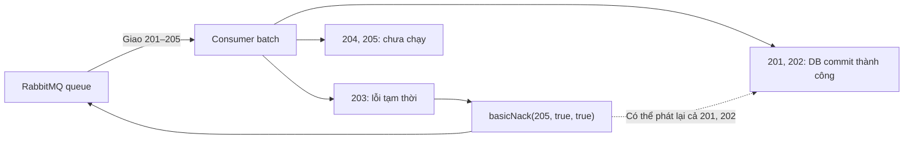
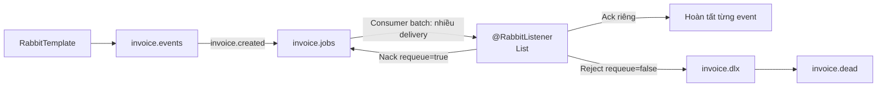
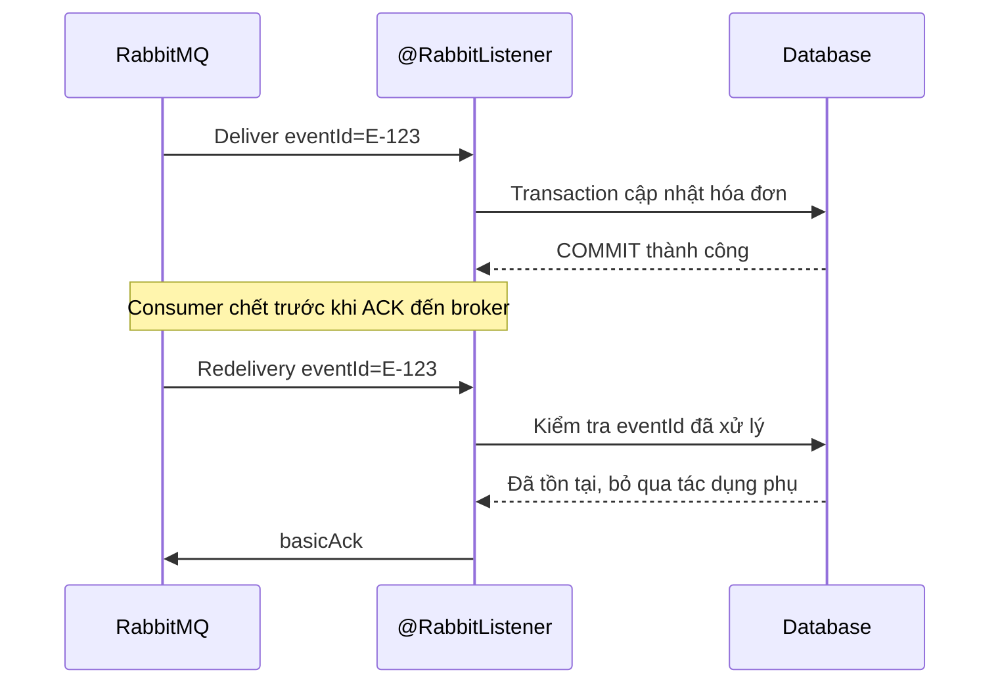

# Ack theo lô, lỗi một phần và nguy cơ phát lại nhiều thông điệp

Trong một hệ thống **Spring AMQP** dùng `RabbitTemplate` để publish sự kiện và `@RabbitListener` để xử lý, gom nhiều thông điệp thành một lô (batch) có thể giảm chi phí gọi listener, giảm số lần trao đổi với broker và tăng thông lượng. Tuy nhiên, khi message thứ 8 trong lô 20 message thất bại, hệ thống phải trả lời chính xác: **7 message trước đó đã được xác nhận chưa, 12 message phía sau có được xử lý chưa, và broker sẽ phát lại những message nào?**

Chọn sai cách **acknowledgement (ack)** có thể khiến những message đã ghi thành công vào database bị xử lý lại, hoặc nghiêm trọng hơn, khiến message lỗi bị xác nhận nhầm và biến mất khỏi queue. Điều này đặc biệt quan trọng trong các luồng tạo hóa đơn, cập nhật tồn kho, đối soát giao dịch và đồng bộ dữ liệu.

Bài thuộc chương **Xử lý theo lô** của module `SPRING_AMQP`. Trọng tâm là **ack theo lô, lỗi một phần và nguy cơ phát lại nhiều thông điệp**, kết hợp RabbitMQ queue, exchange, binding, retry và dead-letter để thiết kế xử lý bất đồng bộ đáng tin cậy.

Sau bài học, bạn có thể:

- Phân biệt **consumer batch**, **producer-created batch** và **ack gộp**; biết loại nào thực sự chứa nhiều AMQP delivery độc lập.
- Hiểu chính xác `basicAck(deliveryTag, multiple)`, `basicNack(deliveryTag, multiple, requeue)` và `basicReject`.
- Dự đoán message nào được ack, phát lại hoặc gửi dead-letter khi lô xử lý thất bại một phần.
- Thiết lập `@RabbitListener` nhận batch và xác nhận từng delivery bằng `MANUAL` ack.
- Kết hợp idempotency, transaction, retry có giới hạn và giám sát để hạn chế tác động của phát lại.

## 1. Ack xác nhận delivery với broker, không phải xác nhận một dòng code

RabbitMQ gửi từng **AMQP delivery** đến consumer. Mỗi delivery có một `deliveryTag` tăng dần, có hiệu lực **trong phạm vi channel** mà nó được giao. Consumer chịu trách nhiệm xác nhận kết quả bằng một trong các thao tác:

| Thao tác | Ý nghĩa trên channel | Hệ quả |
| --- | --- | --- |
| `basicAck(tag, false)` | Xác nhận đúng một delivery | Broker loại delivery đó khỏi tập đang chờ ack |
| `basicAck(tag, true)` | Xác nhận **mọi delivery còn chờ ack** có tag `≤ tag` trên cùng channel | Nhanh hơn khi một dãy delivery đều đã thành công, nhưng dễ ack nhầm |
| `basicNack(tag, false, true)` | Từ chối **một** delivery, yêu cầu requeue | Broker có thể giao lại message; thứ tự xử lý không được bảo đảm |
| `basicNack(tag, true, true)` | Từ chối **tất cả delivery còn chờ ack** có tag `≤ tag`, yêu cầu requeue | Có thể phát lại cả một phần lớn lô, kể cả message nghiệp vụ đã xử lý xong |
| `basicNack(tag, false, false)` | Từ chối một delivery, không requeue | Dead-letter nếu queue có DLX; nếu không, message bị loại |
| `basicReject(tag, false)` | Từ chối đúng một delivery, không requeue | Tương đương nhánh từ chối một message để dead-letter/loại bỏ |

`multiple=true` là cờ **chọn phạm vi delivery theo tag**, không phải tham số chỉ “số message trong lô”. Ví dụ `basicAck(107, true)` nghĩa là ack mọi delivery **chưa được xác nhận** có tag đến 107 **trên channel đó**, không phải ack 107 message và cũng không giới hạn trong `List<Message>` hiện tại.

**Hai nguyên tắc giao thức cần nhớ:**

1. Không dùng tag lấy từ channel này để ack trên channel khác. RabbitMQ có thể đóng channel với lỗi `PRECONDITION_FAILED - unknown delivery tag`.
2. Không ack cùng delivery hai lần. Nếu dùng `multiple=true` sau khi đã ack riêng các delivery trước đó, cần hiểu rõ còn những delivery nào đang chờ trên channel để tránh xác nhận trùng hoặc xác nhận sai phạm vi.

Ack không tạo giao dịch nguyên tử giữa RabbitMQ và database. Nếu cập nhật dữ liệu thành công rồi tiến trình chết **trước khi ack đến broker**, message có thể bị giao lại. Nếu ack **trước khi commit database**, lỗi database có thể làm mất tác vụ cần xử lý.

## 2. “Batch” trong Spring AMQP có nhiều nghĩa

Đừng coi mỗi phần tử của `List<Message>` đều có thể ack riêng trước khi biết cách batch được tạo ra.

| Cơ chế | Điều được gom | Số AMQP delivery tại broker | Phạm vi ack thực tế |
| --- | --- | --- | --- |
| **Consumer batch** (`consumerBatchEnabled=true`) | Container gom các delivery đã nhận thành một lần gọi listener | **Nhiều delivery độc lập**, mỗi delivery có tag riêng | Có thể ack/nack từng delivery, nếu dùng MANUAL |
| **Producer-created batch** (ví dụ `BatchingRabbitTemplate`) | Producer đóng gói nhiều bản ghi logic vào **một AMQP message** | Có thể chỉ **một delivery** chứa nhiều bản ghi | Ack/nack tác động tới **toàn bộ delivery**, không thể ack riêng bản ghi trong payload |
| **Ack gộp của container** (ví dụ `messagesPerAck` trong AUTO mode) | Container trì hoãn/gom việc gửi ack tới broker | Nhiều delivery độc lập | Container tự quyết thời điểm ack, ứng dụng không tự gọi `basicAck` |
| **Prefetch** | Broker cho phép nhiều delivery chưa ack đang ở phía consumer | Nhiều delivery chưa ack | Không tạo batch nghiệp vụ; chỉ tăng số delivery có thể bị phát lại nếu consumer mất kết nối |

**Consumer batch** không yêu cầu producer phát một message chứa nhiều bản ghi: producer vẫn có thể gửi từng event qua `RabbitTemplate`, broker cấp từng delivery tag, còn listener container tạo một `List<Message>` để xử lý.

**Producer-created batch** có ranh giới rất khác. Ví dụ producer gom 10 hóa đơn thành một AMQP message; dù Spring AMQP có thể tách và trình bày 10 bản ghi logic cho listener, broker vẫn có thể chỉ có **một delivery tag** chung. Khi hóa đơn thứ ba lỗi, `basicNack` trên tag đó có thể phát lại **toàn bộ 10 hóa đơn**. Không gọi `basicAck` 10 lần chỉ vì listener nhìn thấy 10 phần tử.

Trong các ví dụ manual ack dưới đây, ta **giả định mỗi event được publish thành một AMQP message riêng**, không dùng `BatchingRabbitTemplate` hoặc payload batch tự đóng gói. Đây là điều kiện để mỗi phần tử trong consumer batch có thể được xử lý bằng delivery tag độc lập.

## 3. Ví dụ: một lỗi có thể khiến cả lô bị phát lại

Giả sử RabbitMQ giao năm event bằng một channel:

| Delivery tag | Event | Kết quả nghiệp vụ ban đầu |
| --- | --- | --- |
| 201 | `invoice-A` | Cập nhật database thành công |
| 202 | `invoice-B` | Cập nhật database thành công |
| 203 | `invoice-C` | Lỗi tạm thời khi gọi dịch vụ khác |
| 204 | `invoice-D` | Chưa xử lý |
| 205 | `invoice-E` | Chưa xử lý |

### 3.1. Khi chưa ack phần nào và trả lại toàn bộ

```java
// Nguy hiểm nếu 201 và 202 đã commit nghiệp vụ:
channel.basicNack(205L, true, true);
```

Broker được yêu cầu requeue **mọi delivery chưa ack đến tag 205 trên channel**, trong ví dụ là 201–205. `invoice-A` và `invoice-B` sẽ được giao lại mặc dù database đã cập nhật; nếu nghiệp vụ không idempotent, số dư, tồn kho hoặc trạng thái có thể bị thay đổi hai lần.



`requeue=true` có nghĩa message có thể được giao lại, **không cam kết về vị trí chính xác trong queue hoặc thứ tự so với consumer khác**. Với nhiều consumer hoặc prefetch lớn, các bản ghi phát lại có thể xen vào những bản ghi mới.

### 3.2. Khi ack những delivery thành công trước

Nếu đã **commit** 201 và 202, rồi gửi:

```java
channel.basicAck(201L, false);
channel.basicAck(202L, false);
channel.basicNack(203L, false, true);
// 204 và 205 vẫn phải được xử lý hoặc xử trí rõ ràng.
```

Trong tình huống giả định này, chỉ 203 được yêu cầu requeue; 201–202 đã được broker nhận ack. Các delivery 204–205 vẫn chưa ack và **không tự biến mất**. Listener có thể tiếp tục xử lý chúng (nếu độc lập) hoặc quyết định nack/requeue chúng có chủ đích.

Cách này giảm **phạm vi phát lại**, nhưng không loại bỏ hoàn toàn duplicate: nếu database đã commit cho 202 mà ứng dụng chết ngay **trước khi broker nhận ack 202**, bản ghi này vẫn có thể được giao lại.

### 3.3. Khi ack gộp nhầm thông điệp chưa xử lý

Ví dụ sau là lỗi nghiêm trọng:

```java
// Mới xử lý xong 201, 202 nhưng lại ack theo tag CUỐI của batch:
channel.basicAck(205L, true); // SAI: cả 203, 204, 205 bị ack
```

Sau thao tác này, RabbitMQ xem tất cả delivery còn chờ ack đến 205 là đã xử lý. Nếu 203 thất bại và 204–205 chưa hề chạy, chúng vẫn có thể bị xóa khỏi queue. **Đây là mất dữ liệu ở cấp xử lý**, không phải chỉ là phát lại.

Muốn ack gộp một dải thành công, chỉ dùng `multiple=true` khi **toàn bộ delivery còn chờ ack đến tag đó** đã xử lý và được phép xác nhận. Ví dụ `basicAck(202, true)` có thể phù hợp sau khi 201–202 thành công, với điều kiện không còn delivery trước 202 nào chưa xử lý trên cùng channel.

## 4. Lỗi giữa batch: AUTO, MANUAL và quyền quyết định thuộc ai?

Spring AMQP hỗ trợ nhiều chế độ xác nhận ở listener container:

| Ack mode | Ai gửi ack/nack? | Khi batch bị lỗi một phần |
| --- | --- | --- |
| `AUTO` | Listener container tự ack khi xử lý thành công; khi lỗi, container áp dụng cách reject/requeue của nó | Một exception có thể khiến nhiều delivery **chưa ack** được xử lý lại, tùy loại batch, container, error handler và cấu hình |
| `MANUAL` | Ứng dụng tự gọi `Channel.basicAck/basicNack/basicReject` | Có thể xác nhận từng delivery thành công, xử trí từng lỗi, nhưng phải cẩn thận không bỏ sót hoặc ack trùng |
| `NONE` | Broker coi delivery đã được xác nhận ngay khi gửi đến consumer (auto-ack ở giao thức) | Không có khả năng phát lại theo ack khi listener thất bại; nguy cơ mất việc nếu tiến trình chết |

**AUTO không có nghĩa RabbitMQ tự hiểu từng dòng trong danh sách đã thành công.** Nếu listener nhận `List<Message>`, ghi 12 bản ghi rồi ném exception ở bản ghi thứ 13, container không thể suy ra chính xác 12 bản ghi nào đã commit ở database nếu ứng dụng không cung cấp thông tin phù hợp. Những delivery còn unacked có thể bị phát lại theo chính sách lỗi của listener.

Spring AMQP có cơ chế như `BatchListenerFailedException` để biểu đạt vị trí message lỗi trong một số kiểu batch listener. Tuy nhiên, phạm vi xác nhận trước/sau phần tử lỗi phụ thuộc phiên bản, chế độ batch và container. Với nghiệp vụ cần **tự quyết định từng delivery**, ví dụ phần tiếp theo dùng `MANUAL` cho các **consumer batch** gồm delivery độc lập.

Đừng gọi thủ công `basicAck` khi listener container vẫn vận hành theo AUTO ack, trừ khi đang dùng mẫu đặc biệt được framework hỗ trợ rõ ràng. Container có thể gửi ack thêm một lần và gây lỗi channel.

## 5. Cấu hình Spring AMQP nhận consumer batch với MANUAL ack

Ví dụ xử lý các sự kiện tạo hóa đơn. Producer publish từng message tới `invoice.events` với routing key `invoice.created`. Broker định tuyến vào `invoice.jobs`; khi một event hỏng vĩnh viễn, consumer có thể từ chối nó để đi qua `invoice.dlx` sang `invoice.dead`.



### 5.1. Khai báo topology và listener container

```java
import org.springframework.amqp.core.AcknowledgeMode;
import org.springframework.amqp.core.Binding;
import org.springframework.amqp.core.BindingBuilder;
import org.springframework.amqp.core.DirectExchange;
import org.springframework.amqp.core.Queue;
import org.springframework.amqp.core.QueueBuilder;
import org.springframework.amqp.rabbit.config.SimpleRabbitListenerContainerFactory;
import org.springframework.amqp.rabbit.connection.ConnectionFactory;
import org.springframework.context.annotation.Bean;
import org.springframework.context.annotation.Configuration;

@Configuration
public class InvoiceBatchConfig {

    @Bean
    DirectExchange invoiceEvents() {
        return new DirectExchange("invoice.events", true, false);
    }

    @Bean
    DirectExchange invoiceDlx() {
        return new DirectExchange("invoice.dlx", true, false);
    }

    @Bean
    Queue invoiceJobs() {
        return QueueBuilder.durable("invoice.jobs").build();
    }

    @Bean
    Queue invoiceDead() {
        return QueueBuilder.durable("invoice.dead").build();
    }

    @Bean
    Binding invoiceJobsBinding(Queue invoiceJobs,
                               DirectExchange invoiceEvents) {
        return BindingBuilder.bind(invoiceJobs)
                .to(invoiceEvents)
                .with("invoice.created");
    }

    @Bean
    Binding invoiceDeadBinding(Queue invoiceDead,
                               DirectExchange invoiceDlx) {
        return BindingBuilder.bind(invoiceDead)
                .to(invoiceDlx)
                .with("invoice.dead");
    }

    @Bean("invoiceBatchFactory")
    SimpleRabbitListenerContainerFactory invoiceBatchFactory(
            ConnectionFactory connectionFactory) {
        SimpleRabbitListenerContainerFactory factory =
                new SimpleRabbitListenerContainerFactory();
        factory.setConnectionFactory(connectionFactory);
        factory.setBatchListener(true);
        factory.setConsumerBatchEnabled(true);
        factory.setBatchSize(20);
        factory.setPrefetchCount(40);
        factory.setAcknowledgeMode(AcknowledgeMode.MANUAL);
        return factory;
    }
}
```

Ý nghĩa cấu hình:

- `setConsumerBatchEnabled(true)` cho phép container gom những **delivery từ consumer** để gọi một lần listener với `List<Message>`; `setBatchListener(true)` nói rõ listener được thiết kế để nhận batch.
- `setBatchSize(20)` đặt kích thước mục tiêu/tối đa cho lô thu thập; listener **có thể nhận ít hơn 20 message** khi hết thời gian chờ hoặc broker chưa giao đủ.
- `setPrefetchCount(40)` cho phép broker chuyển trước nhiều delivery đang chờ ack; **prefetch không phải kích thước batch**. Khi nhiều consumer cùng chạy, tổng số delivery đang chờ ack có thể cao hơn nhiều.
- `AcknowledgeMode.MANUAL` yêu cầu listener xác nhận hoặc từ chối từng delivery.

Để message không xử lý được đi vào dead-letter queue, có thể đặt policy trên RabbitMQ thay vì nhúng cố định các tham số `x-dead-letter-*` vào lúc khai báo queue. Ví dụ lệnh quản trị (điều chỉnh vhost/quyền theo môi trường):

```bash
rabbitmqctl set_policy invoice-jobs-dlx '^invoice\.jobs$' \
  '{"dead-letter-exchange":"invoice.dlx",
    "dead-letter-routing-key":"invoice.dead"}' \
  --apply-to queues
```

Nếu queue nguồn không có DLX, `basicReject(tag, false)` hoặc `basicNack(tag, false, false)` sẽ loại bỏ message thay vì chuyển sang `invoice.dead`. Policy chỉ giải quyết đường **dead-letter sau từ chối**, không tự quyết định chiến lược retry.

### 5.2. Producer phát message độc lập, có định danh nghiệp vụ ổn định

```java
import org.springframework.amqp.core.MessageDeliveryMode;
import org.springframework.amqp.rabbit.core.RabbitTemplate;

public class InvoicePublisher {
    private final RabbitTemplate rabbitTemplate;

    public InvoicePublisher(RabbitTemplate rabbitTemplate) {
        this.rabbitTemplate = rabbitTemplate;
    }

    public void publish(String eventId, String payload) {
        rabbitTemplate.convertAndSend(
                "invoice.events",
                "invoice.created",
                payload,
                message -> {
                    message.getMessageProperties().setMessageId(eventId);
                    message.getMessageProperties()
                           .setDeliveryMode(MessageDeliveryMode.PERSISTENT);
                    return message;
                });
    }
}
```

Trong ví dụ này, **mỗi lần `convertAndSend` tạo một AMQP message riêng**. `eventId` phải đại diện cho **sự kiện nghiệp vụ**, giữ nguyên khi retry/publish lại cùng một sự kiện. Không dùng `deliveryTag` làm khóa nghiệp vụ: tag thay đổi theo channel và mỗi lần giao.

Lưu ý `convertAndSend` trả về không đồng nghĩa broker chắc chắn đã nhận message. Với yêu cầu giao nhận đáng tin cậy ở chặng producer → queue, cần thêm **publisher confirms/returns** và, khi cần gắn với transaction database, mẫu **outbox**.

## 6. Listener manual ack: xử lý lỗi một phần ở cấp từng delivery

Ví dụ này phân loại:

- **Thành công**: dịch vụ `InvoiceHandler` đã xử lý idempotent và hoàn tất transaction trước khi ack.
- **Lỗi dữ liệu vĩnh viễn**: message không hợp lệ, từ chối với `requeue=false` để đưa vào DLQ.
- **Lỗi tạm thời**: từ chối đúng message đó với `requeue=true`. Đây là cách minh họa cơ chế; trong production cần retry có giới hạn và backoff.

```java
import java.io.IOException;
import java.nio.charset.StandardCharsets;
import java.util.List;

import com.rabbitmq.client.Channel;
import org.springframework.amqp.core.Message;
import org.springframework.amqp.rabbit.annotation.RabbitListener;
import org.springframework.dao.TransientDataAccessException;
import org.springframework.stereotype.Component;

@Component
public class InvoiceBatchListener {
    private final InvoiceHandler handler;

    public InvoiceBatchListener(InvoiceHandler handler) {
        this.handler = handler;
    }

    @RabbitListener(
            queues = "invoice.jobs",
            containerFactory = "invoiceBatchFactory")
    public void handle(List<Message> batch, Channel channel)
            throws IOException {
        for (Message message : batch) {
            long tag = message.getMessageProperties().getDeliveryTag();
            String eventId = message.getMessageProperties().getMessageId();
            String payload = new String(
                    message.getBody(), StandardCharsets.UTF_8);

            try {
                if (eventId == null || eventId.isBlank()
                        || !payload.startsWith("invoice:")) {
                    channel.basicReject(tag, false); // DLQ nếu đã có DLX
                    continue;
                }

                handler.processOnce(eventId, payload); // Commit rồi mới return
                channel.basicAck(tag, false);           // Chỉ ACK event này

            } catch (TransientDataAccessException ex) {
                channel.basicNack(tag, false, true);    // Chỉ requeue event này

            } catch (IllegalArgumentException ex) {
                channel.basicReject(tag, false);       // Dữ liệu lỗi vĩnh viễn
            }
        }
    }
}
```

`InvoiceHandler.processOnce` là API nghiệp vụ **cần được triển khai** trong ứng dụng: nó phải thực hiện kiểm tra duplicate và cập nhật dữ liệu bằng **một transaction database**, chỉ trả về thành công sau khi transaction hoàn tất. Ví dụ:

```java
public interface InvoiceHandler {
    void processOnce(String eventId, String payload);
}
```

Mẫu trên **không tự chạy production** chỉ với hai class; bạn cần triển khai `InvoiceHandler` và định nghĩa rõ ngoại lệ tạm thời/vĩnh viễn cho nghiệp vụ của mình. `TransientDataAccessException` là một ví dụ lỗi kỹ thuật có thể retry; không phải mọi lỗi hệ thống đều thuộc lớp ngoại lệ này.

**Vì sao không dùng `basicAck(tag, true)` trong vòng lặp?** Vì `multiple=true` có thể xác nhận thêm các delivery còn unacked khác trên cùng channel. Ở ví dụ tối ưu tính chính xác và khả năng kiểm soát bằng `false` cho từng event; overhead ack tăng lên nhưng phạm vi tác động của lỗi rõ ràng.

**Vì sao vẫn xử lý các phần tử tiếp theo sau lỗi?** Ví dụ giả định các event **độc lập** với nhau. Nếu có quan hệ thứ tự (cập nhật số dư liên tiếp của cùng tài khoản, aggregate version, v.v.), không nên tiếp tục xử lý 204 sau khi 203 thất bại. Khi đó cần thiết kế partitioning theo khóa, thứ tự, dừng batch và xử trí rõ những delivery chưa ack.

Nếu `channel.basicAck/basicNack/basicReject` ném `IOException` hoặc kết nối đứt, không thể biết chắc broker đã nhận thao tác nào. Để exception thoát ra và cho container xử lý lại channel/delivery theo giao thức; cơ chế idempotency là lớp bảo vệ bắt buộc trong khoảng không chắc chắn này.

## 7. Tại sao idempotency quan trọng hơn kích thước batch?

Ngay cả khi ack từng message, vẫn tồn tại khoảng thời gian giữa **commit database** và **broker nhận ack**:



Chỉ dùng một cờ `redelivered` cũng không đủ: cờ này cho biết broker đánh dấu là giao lại, không xác định nghiệp vụ **đã commit hay chưa**. Với consumer song song, hai lần giao cùng event có thể đến hai tiến trình khác nhau. Cách phù hợp là áp dụng khóa idempotency bền vững:

1. Chọn khóa sự kiện ổn định, ví dụ `eventId` sinh khi tạo event; có thể ghép `consumerName + eventId` nếu các nhóm consumer xử lý cùng event theo nghĩa riêng.
2. Tạo bảng `processed_events(consumer_name, event_id, processed_at)` với **unique constraint** trên `(consumer_name, event_id)`.
3. Trong **cùng transaction database**, thử chèn khóa nếu chưa tồn tại rồi thực hiện thay đổi nghiệp vụ. Nếu khóa đã có, trả về thành công mà không lặp lại tác dụng phụ.
4. Sau khi transaction thành công mới gửi ack. Nếu transaction rollback, marker dedup phải rollback theo.

Ví dụ PostgreSQL minh họa điều kiện chèn an toàn dưới cạnh tranh (đây là một bước trong transaction, không phải toàn bộ triển khai repository):

```sql
INSERT INTO processed_events (consumer_name, event_id, processed_at)
VALUES ('invoice-consumer', :eventId, NOW())
ON CONFLICT (consumer_name, event_id) DO NOTHING
RETURNING event_id;
```

Nếu câu lệnh không trả hàng nào, event đã được ghi nhận trước đó; bỏ qua thao tác nghiệp vụ **trong cùng phạm vi consumer**. Nếu chèn được hàng, tiếp tục cập nhật hóa đơn trong transaction đó; commit cả hai cùng lúc. Không chỉ gọi `existsById` rồi `insert` ở hai bước không được bảo vệ bởi unique constraint, vì có thể xuất hiện race condition giữa nhiều consumer.

**Trường hợp có gọi API bên ngoài:** transaction database không tự bao trùm việc gửi email, trừ tiền qua dịch vụ khác hoặc publish một event mới. Hãy dùng idempotency key của API đích, transactional outbox hoặc mô hình trạng thái có thể phục hồi; nếu không, retry message có thể lặp tác dụng phụ bên ngoài dù database của bạn có bảng dedup.

## 8. Retry, dead-letter và giới hạn vòng lặp requeue

Lời gọi `basicNack(tag, false, true)` cho một event lỗi tạm thời thường khiến broker **giao lại nhanh**. Khi database ngừng hoạt động 5 phút, consumer có thể nhận cùng event liên tục, chiếm CPU và gây áp lực log/network. Vì vậy nên áp dụng retry có **giới hạn và giãn cách**, ví dụ:

| Loại lỗi | Hành động hợp lý | Lưu ý khi batch |
| --- | --- | --- |
| Payload thiếu trường bắt buộc | `basicReject(tag, false)` → DLQ | Chỉ ảnh hưởng event lỗi, nếu mỗi event là một AMQP delivery riêng |
| Database timeout tạm thời | Retry có backoff; sau ngưỡng thì DLQ/để xử lý lại | Tránh requeue tức thì vô hạn |
| Phụ thuộc bên ngoài trả mã throttling | Giới hạn concurrency, backoff theo tốc độ hệ thống đích | Không để hàng trăm delivery pending chỉ vì prefetch cao |
| Message phụ thuộc message trước đó | Giữ thứ tự theo key; dừng và xử trí phần còn lại có chủ đích | Xử lý tiếp các event sau có thể làm sai state |
| Đã commit nhưng ack bị mất | Broker có thể giao lại | Dedup nghiệp vụ phải ngăn tác dụng phụ lần hai |

Đối với classic/quorum queue, có thể kết hợp **dead-letter exchange (DLX)** với retry queue có TTL và đường quay lại queue chính, hoặc dùng các cơ chế trì hoãn/retry phù hợp với phiên bản RabbitMQ và Spring AMQP. Phải có **giới hạn số lần thử**, theo dõi số lần lỗi và một DLQ cuối cùng để điều tra.

`x-death` phản ánh lịch sử **dead-letter** qua queue; nó **không tăng đơn giản cho mọi lần `basicNack(..., requeue=true)`**. Quorum queue có cơ chế `delivery-limit` và bộ đếm lần giao không thành công, nhưng semantics của `basic.reject`/`basic.nack` và giới hạn phụ thuộc phiên bản RabbitMQ. Hãy kiểm thử bằng đúng phiên bản broker triển khai, đừng dựa vào `x-death.count` như bộ đếm retry chung.

**DLQ không thay thế idempotency.** Một message có thể được replay thủ công từ DLQ, từ retry queue hoặc sau sự cố consumer. Khi đó vẫn phải dùng cùng `eventId` để quyết định thao tác nghiệp vụ đã thực hiện hay chưa.

## 9. Prefetch, concurrency và rủi ro phát lại hàng loạt

Giả sử cấu hình:

- `batchSize=20`: listener thường nhận tối đa 20 delivery mỗi lượt thu thập.
- `prefetchCount=40`: một consumer có thể giữ nhiều delivery chưa ack.
- `concurrentConsumers=4` (nếu tăng concurrency): có thể có tới khoảng **160 delivery outstanding** cho bốn consumer ở thời điểm đạt prefetch.

Khi một connection/channel bị đóng, broker có thể requeue **toàn bộ delivery chưa ack thuộc channel đó**, kể cả những event mà database đã cập nhật thành công nhưng listener chưa gửi hoặc broker chưa nhận ack. Nếu bốn consumer cùng chết trước khi ack, phạm vi phát lại có thể rất lớn. Kích thước batch 20 **không tự giới hạn** số delivery có thể được phát lại ở mức 20.

| Tham số | Khi tăng | Rủi ro cần đo |
| --- | --- | --- |
| `batchSize` | Giảm số lần gọi listener, hữu ích cho thao tác DB theo lô | Độ trễ trước khi bắt đầu xử lý; một exception có thể liên quan nhiều message |
| `prefetchCount` | Tận dụng băng thông, giảm thời gian chờ broker | Nhiều delivery outstanding hơn, tăng bộ nhớ và phạm vi redelivery khi consumer chết |
| Concurrency | Tăng throughput khi dữ liệu độc lập | Tranh chấp khóa, mất thứ tự liên consumer, tăng lượng message đang xử lý |
| Ack từng delivery | Rõ trạng thái và giới hạn phạm vi phát lại | Tăng số thao tác ack/protocol |
| Ack gộp có kiểm soát | Giảm số thao tác ack | Cần chứng minh **mọi delivery tới tag** đã thành công, dễ nhầm khi lỗi một phần |

Nên chọn tham số theo **thời gian xử lý p95/p99**, dung lượng database, tốc độ producer, độ sâu queue và khả năng chịu phát lại của nghiệp vụ. Một batch lớn giúp nhanh hơn trong điều kiện lý tưởng nhưng có thể làm quá trình phục hồi sau lỗi tốn kém hơn.

## 10. Phân biệt ack gộp thủ công với transaction hàng loạt

Có ba ranh giới độc lập:

```text
RabbitTemplate publish -> RabbitMQ lưu message
                           |
                           v
@RabbitListener xử lý batch -> Database commit
                           |
                           v
Consumer ACK -> RabbitMQ xóa delivery đã xác nhận
```

**Transaction của database:** có thể commit từng event hoặc commit cả lô. Nếu commit cả lô rồi mới ack, một lỗi có thể rollback cả lô; nếu commit một phần rồi lỗi, phải biết chính xác phần đã commit để ack phù hợp.

**Transaction của channel AMQP:** Spring AMQP có thể dùng channel transaction, nhưng giao dịch AMQP **không mặc nhiên tạo một transaction phân tán nguyên tử** với database. Không suy ra “database commit + RabbitMQ ack” là exactly-once chỉ vì đã bật `channelTransacted`.

**Publisher confirm:** xác nhận gửi message từ producer tới broker. Đây là cơ chế tách biệt với **consumer ack** trong batch listener, và cũng tách biệt với publisher confirm khi ứng dụng phát một event mới sau khi xử lý.

Với nhiều tác vụ độc lập, một mẫu thực dụng là **transaction cho từng event + idempotency + manual ack từng delivery**. Nếu nghiệp vụ yêu cầu all-or-nothing cho cả lô, hãy định nghĩa đơn vị giao dịch rõ ràng: rollback cả lô và để broker redeliver có thể phù hợp, nhưng phải chấp nhận chi phí và thiết kế không có tác dụng phụ ngoài transaction.

## 11. Phân tích tình huống thường gặp

| Sự cố | Trạng thái có thể xảy ra ở broker | Nguy cơ | Hướng xử lý |
| --- | --- | --- | --- |
| Listener AUTO batch ném exception sau khi đã commit vài record | Nhiều delivery còn unacked có thể bị reject/requeue theo cấu hình | Xử lý trùng các record đã commit | Dùng transaction và idempotency; kiểm thử chiến lược xử lý exception |
| Gọi `basicAck(lastTag, true)` dù có record chưa xử lý | Các delivery chưa ack đến tag đó bị xác nhận | **Mất message chưa xử lý** | Chỉ ack dải đã thành công hoàn toàn hoặc ack riêng từng tag |
| Gọi `basicNack(lastTag, true, true)` | Requeue toàn bộ delivery chưa ack đến lastTag | Phát lại diện rộng | Xác định đúng phạm vi, chọn `multiple=false` khi chỉ một event lỗi |
| Database commit xong, tiến trình chết trước ack | Delivery chưa ack được requeue khi channel đóng | Duplicate nghiệp vụ | Khóa idempotency trong database |
| Đã ack rồi database rollback | Delivery đã bị broker loại khỏi queue | **Mất tác vụ** | Chỉ ack sau transaction thành công |
| Lỗi vĩnh viễn nhưng `requeue=true` liên tục | Message quay về queue | Hot loop/poison message | DLX, retry có giới hạn, cảnh báo |
| Producer-created batch chứa một record lỗi | Ack/nack ở cấp một AMQP delivery | Cả payload batch có thể phát lại | Chia nhỏ batch, lưu tiến độ record hoặc tạo thông điệp con |
| Prefetch cao và consumer mất kết nối | Tất cả delivery unacked trên channel có thể được requeue | Phát lại nhiều event, vượt tải khi phục hồi | Điều chỉnh prefetch, concurrency và idempotency |

## 12. Kịch bản thực hành kiểm chứng

Hãy thử trên RabbitMQ và database **môi trường phát triển**, với queue `invoice.jobs` và DLQ `invoice.dead` đã được cấu hình đúng. Ghi log `eventId`, `deliveryTag`, `redelivered`, thời điểm commit và thao tác ack/nack.

1. **Batch thành công:** publish 5 event khác nhau. Listener xử lý và ack từng delivery; queue rỗng, database có đúng 5 kết quả.
2. **Lỗi vĩnh viễn ở vị trí giữa:** event thứ ba thiếu dữ liệu, bốn event còn lại hợp lệ. Kỳ vọng 4 event được xử lý/ack, event lỗi đi tới DLQ (nếu có DLX), không có vòng lặp vô hạn.
3. **Lỗi tạm thời ở event thứ ba:** tạo lỗi database tạm thời. Kỳ vọng chỉ delivery bị nack với `multiple=false` được requeue; các event thành công không bị cố ý requeue bởi thao tác nack này.
4. **Crash sau commit trước ack:** đặt điểm dừng trong code ở giữa commit và `basicAck`, cho consumer ngừng đột ngột, sau đó chạy lại. Message có thể redeliver, nhưng bảng idempotency phải ngăn áp dụng nghiệp vụ hai lần.
5. **So sánh `multiple=true`:** trên queue thử nghiệm riêng, cho một message lỗi ở giữa lô rồi quan sát `basicNack(lastTag, true, true)`. Xác nhận rằng **mọi delivery chưa ack đến tag đó** nằm trong phạm vi tác động.
6. **Tăng prefetch và concurrency:** đo `messages_unacknowledged`, throughput, thời gian xử lý và số message phát lại khi dừng một consumer. So sánh với cấu hình prefetch thấp hơn.
7. **Thử producer-created batch:** gửi nhiều bản ghi đóng gói trong một AMQP message và đối chiếu delivery tag. Kiểm tra rằng ack tác động ở cấp AMQP delivery, không tự chia thành ack riêng cho từng bản ghi logic.

Chỉ báo cần quan sát:

- `messages_ready`, `messages_unacknowledged`, tốc độ deliver/ack/redeliver, độ sâu DLQ.
- Số event xử lý thành công, thất bại tạm thời, thất bại vĩnh viễn; số lần duplicate bị idempotency chặn.
- Thời gian xử lý từng event, thời gian xử lý batch, độ trễ giữa commit và ack, số lỗi channel/connection.
- Tỷ lệ retry, thời gian message nằm ở retry queue/DLQ, số lần replay thủ công.

**Diễn giải số liệu:** `messages_unacknowledged` tăng liên tục có thể là xử lý chậm, prefetch quá lớn, thiếu ack hoặc channel đang bị kẹt. Không kết luận nguyên nhân chỉ dựa vào một metric; kết hợp log theo `eventId` và delivery tag để điều tra.

## 13. Checklist khi thiết kế batch listener

| Câu hỏi cần trả lời | Quyết định mong đợi |
| --- | --- |
| Một phần tử trong `List<Message>` có tương ứng một AMQP delivery riêng? | Phân biệt consumer batch với producer-created batch trước khi manual ack |
| Bản ghi trong batch có độc lập? | Nếu có phụ thuộc thứ tự, không tiếp tục mù quáng sau lỗi |
| Transaction commit ở cấp record hay cấp batch? | Quy định điểm ack sau commit và hành vi rollback |
| Dùng `multiple=true` trong trường hợp nào? | Chỉ khi toàn bộ delivery chưa ack tới tag đã đủ điều kiện xác nhận |
| Khi message lỗi một phần, phạm vi nack là gì? | Ưu tiên `multiple=false` khi chỉ một delivery cần xử trí |
| Định danh chống duplicate là gì? | Event ID nghiệp vụ ổn định + unique constraint + transaction |
| Retry có thể tạo hot loop không? | Có backoff, giới hạn lần thử, DLQ và cảnh báo |
| Prefetch/concurrency ảnh hưởng khối lượng phát lại ra sao? | Đo outstanding deliveries và thử crash recovery |
| Khi producer mất kết nối hoặc consumer chết giữa commit và ack? | Có publisher confirms/outbox ở phía gửi; idempotency ở phía nhận |

Một nguyên tắc dễ áp dụng là: **chỉ ack một AMQP delivery sau khi mọi tác dụng phụ cần thiết của delivery đó đã được ghi nhận an toàn**. Nếu muốn tối ưu bằng ack gộp, trước hết phải chứng minh rằng **không có delivery chưa xử lý nằm trong phạm vi `multiple=true`**; nếu muốn tăng batch size, trước hết phải biết hệ thống sẽ xử lý **lỗi một phần, requeue và duplicate** thế nào.

## 14. Câu hỏi tự kiểm tra

1. Container giao batch gồm các tag 301–310. Sau khi xử lý thành công 301–304, event 305 lỗi. Điều gì xảy ra nếu gọi `basicAck(310, true)`?
2. Phân biệt ảnh hưởng của `basicNack(305, false, true)` và `basicNack(310, true, true)` khi các tag 301–310 đều chưa ack.
3. Vì sao một event vẫn có thể bị giao lại dù ứng dụng đã commit database thành công và chuẩn bị gửi ack?
4. Vì sao một `List<Message>` gồm 10 bản ghi không nhất thiết tương ứng 10 delivery tag khác nhau?
5. `batchSize=20`, `prefetchCount=40` và 4 consumer: số delivery đang chờ ack có thể lớn hơn batch size như thế nào?
6. Khi nào `basicReject(tag, false)` đưa message tới DLQ, và khi nào nó làm message bị loại hẳn?
7. Muốn retry event bị lỗi sau 30 giây, vì sao chỉ gọi `basicNack(tag, false, true)` thường chưa đủ?

## Tài liệu tham khảo

- [RabbitMQ — Consumer Acknowledgements and Publisher Confirms](https://www.rabbitmq.com/docs/confirms): delivery tag, `basic.ack`, `basic.nack`, `multiple`, phạm vi consumer acknowledgement.
- [RabbitMQ — Consumer Prefetch](https://www.rabbitmq.com/docs/consumer-prefetch): ảnh hưởng của prefetch và số delivery chưa ack.
- [RabbitMQ — Dead Letter Exchanges](https://www.rabbitmq.com/docs/dlx): reject/nack với `requeue=false`, DLX và định tuyến message lỗi.
- [RabbitMQ — Quorum Queues](https://www.rabbitmq.com/docs/quorum-queues): delivery limit và các hành vi redelivery phụ thuộc chính sách/phiên bản.
- [Spring AMQP — Receiving Messages, Batch Listeners](https://docs.spring.io/spring-amqp/reference/amqp/receiving-messages/batch.html): consumer batch, producer-created batch và listener nhận `List<Message>`.
- [Spring AMQP — Listener Container Configuration](https://docs.spring.io/spring-amqp/reference/amqp/containerAttributes.html): acknowledgement mode, batch size, prefetch, xử lý exception và các thuộc tính container.
