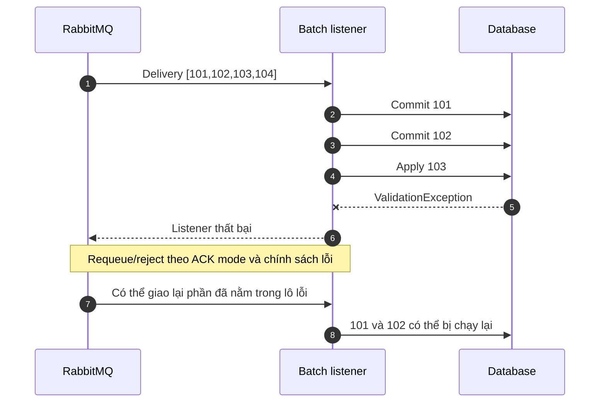
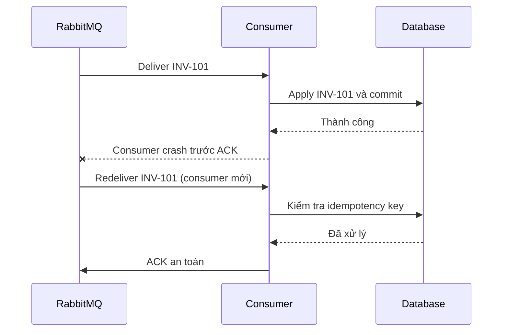

# Retry, recoverer và thông điệp lỗi trong một lô

## 1. Bài toán: một phần tử lỗi có thể ảnh hưởng cả lô

Trong Spring AMQP, xử lý theo lô (batch processing) giúp gom nhiều message để giảm số lần gọi database hoặc dịch vụ ngoài. Ví dụ, một hệ thống hóa đơn nhận các yêu cầu cập nhật công nợ:

```text
Lô nhận được: [INV-101, INV-102, INV-103, INV-104, INV-105]

INV-101 -> xử lý thành công
INV-102 -> xử lý thành công
INV-103 -> lỗi dữ liệu: số tiền âm
INV-104 -> chưa xử lý
INV-105 -> chưa xử lý
```

Nếu listener ném exception ở `INV-103`, ứng dụng phải quyết định:

1. Retry **toàn bộ lô**, chỉ `INV-103`, hay những phần tử chưa hoàn tất?
2. Hai phần tử đã thành công có được thực thi lại không?
3. Khi retry hết lượt, **recoverer** sẽ nhận được dữ liệu gì và xử lý phần tử lỗi thế nào?
4. Cần gửi thông tin lỗi vào dead-letter queue (DLQ), một error exchange, hay bảng lưu kết quả?
5. Khi nào có thể ACK/NACK message mà không làm mất công việc hoặc xử lý trùng?

**Không có một câu trả lời đúng cho mọi lô.** Cơ chế retry và phục hồi phụ thuộc trước hết vào việc lô được tạo ở **producer** hay ở **consumer**. Đây là điểm quyết định cách Spring AMQP nhìn thấy message trong RabbitMQ.

Bài học thuộc chủ đề **Xử lý theo lô** của module **SPRING_AMQP**: kết hợp `RabbitTemplate`, `@RabbitListener`, exchange, queue, binding, acknowledgment, retry, dead-letter và quan sát hệ thống để xử lý bất đồng bộ đáng tin cậy.

## 2. Hai loại batch phải phân biệt trước khi cấu hình retry

### 2.1. Consumer-created batch: nhiều message RabbitMQ độc lập

Producer gửi từng message riêng: `INV-101`, `INV-102`, `INV-103`. Listener container nhận các delivery rồi gom thành một `List<Message>` cho phương thức `@RabbitListener`.

Ví dụ:

```text
RabbitMQ queue
    ├── delivery A: INV-101
    ├── delivery B: INV-102
    └── delivery C: INV-103
                      │
                      ▼
@RabbitListener(List<Message>) nhận [A, B, C]
```

Ba phần tử tương ứng **ba delivery của broker**, có delivery tag và trạng thái ACK riêng ở tầng RabbitMQ. Nhưng khi lập trình một callback nhận `List<Message>`, framework không tự hiểu rằng tác vụ nghiệp vụ ở index 2 mới là phần tử duy nhất lỗi.

### 2.2. Producer-created batch: một message RabbitMQ chứa nhiều phần tử

Producer dùng batching của Spring AMQP để gom nhiều payload thành **một bản ghi vật lý được gửi qua RabbitMQ**, thường sử dụng header `springBatchFormat`. Consumer có thể de-batch bản ghi thành nhiều phần tử Java để xử lý.

```text
RabbitMQ queue
    └── một delivery vật lý, chứa [INV-101, INV-102, INV-103]
                                   │
                                   ▼
@RabbitListener(List<Message>) nhận [A, B, C]
```

Trong trường hợp này, broker nhìn thấy **một delivery**, nên reject hoặc dead-letter theo broker tác động đến **toàn bộ batch vật lý**. Không thể yêu cầu broker NACK riêng phần tử `INV-103` bên trong payload đã được đóng gói thành một message vật lý.

### 2.3. Bảng so sánh

| Tiêu chí | Consumer-created batch | Producer-created batch |
|---|---|---|
| Ở broker | Nhiều message/delivery độc lập | Một message vật lý chứa nhiều phần tử |
| Cách gom | `consumerBatchEnabled=true` trên `SimpleMessageListenerContainer` | Producer sử dụng cơ chế batching; consumer nhận rồi de-batch |
| Số phần tử vào listener | Tối đa theo `batchSize` và thời gian thu gom, có ngoại lệ khi trộn producer batches | Số phần tử trong message batch của producer |
| ACK/NACK của broker | Có các delivery tag riêng, nhưng callback batch không mặc định tách riêng lỗi nghiệp vụ | Broker xác nhận hoặc từ chối message vật lý |
| Retry/recoverer mặc định | **Không khuyến nghị** gắn retry interceptor cho batch listener để mong tự cô lập phần tử lỗi | Có thể retry/recover cả batch vật lý; recoverer phải hỗ trợ batch |
| Rủi ro khi lô xử lý dở | Phần đã ghi DB có thể bị chạy lại | Các phần tử trong cùng message có thể bị xử lý lại |

**Quy tắc của Spring AMQP:** tài liệu chính thức không khuyến nghị cấu hình retry cho **consumer-created batch** vì sau khi retry hết lượt, framework không có đủ thông tin để tự động recover chính xác message gây lỗi. Với **producer-created batch**, có thể recover cả message vật lý; recoverer của batch listener phải triển khai giao diện `MessageBatchRecoverer`.

Ngoài ra, `batchSize` dùng để điều khiển gom message ở container không đồng nghĩa với việc producer đã tạo một message batch vật lý. Trộn lẫn hai khái niệm dễ dẫn tới cấu hình retry sai.

## 3. Điều gì xảy ra khi một phần tử gây exception?

Giả sử listener làm tuần tự:

```java
for (Message message : messages) {
    invoiceService.apply(message); // ném lỗi ở phần tử thứ ba
}
```

Nếu `INV-101` và `INV-102` đã commit DB riêng trước khi `INV-103` lỗi, việc callback bị retry hoặc toàn bộ lô được giao lại có thể làm hai phần tử đầu chạy thêm lần nữa.



**Retry không rollback các side effect đã commit**. Muốn có tính nguyên tử cho toàn bộ lô, các thay đổi phải nằm trong một transaction thực sự có cùng phạm vi và bảo đảm rollback, hoặc ứng dụng phải có cơ chế bù trừ. RabbitMQ acknowledgment và transaction DB không tự động tạo một giao dịch phân tán nguyên tử.

Mỗi cách xử lý lỗi sẽ có đánh đổi:

| Lựa chọn | Điều đạt được | Rủi ro cần kiểm soát |
|---|---|---|
| Ném exception để retry lô | Giữ xử lý “tất cả hoặc thất bại” ở tầng callback | Chạy lặp các phần tử đã có side effect; lô mắc kẹt vì một poison message |
| Tiếp tục xử lý phần tử khác rồi ACK lô | Tránh để phần tử lỗi chặn tất cả | Phải lưu bền vững lỗi/chờ retry trước khi ACK; nếu chỉ log rồi bỏ qua sẽ mất dữ liệu |
| Tách thành listener xử lý từng message | Retry/recoverer và DLQ có ranh giới từng delivery | Đổi cách tối ưu throughput; có thể batch ở tầng DB phía sau |
| Định nghĩa cả lô là một đơn vị nghiệp vụ | Có thể retry/reject cả producer batch | Không thể broker NACK chỉ một phần tử bên trong message vật lý |

## 4. Minh họa consumer-created batch và giới hạn của xử lý lỗi

### 4.1. Cấu hình listener nhận danh sách

Ví dụ dùng Spring Boot với `spring-boot-starter-amqp`, kết nối RabbitMQ hợp lệ và một queue `invoice.batch.in` có sẵn. `SimpleRabbitListenerContainerFactory` dưới đây gom tối đa 10 delivery trước khi gọi listener (lô có thể nhỏ hơn nếu timeout).

```java
import org.springframework.amqp.core.AcknowledgeMode;
import org.springframework.amqp.rabbit.config.SimpleRabbitListenerContainerFactory;
import org.springframework.amqp.rabbit.connection.ConnectionFactory;
import org.springframework.context.annotation.Bean;
import org.springframework.context.annotation.Configuration;

@Configuration
public class ConsumerBatchConfig {

    @Bean("consumerBatchFactory")
    SimpleRabbitListenerContainerFactory consumerBatchFactory(
            ConnectionFactory connectionFactory) {

        SimpleRabbitListenerContainerFactory factory =
                new SimpleRabbitListenerContainerFactory();
        factory.setConnectionFactory(connectionFactory);
        factory.setBatchListener(true);
        factory.setConsumerBatchEnabled(true);
        factory.setBatchSize(10);
        factory.setReceiveTimeout(1_000L);
        factory.setAcknowledgeMode(AcknowledgeMode.AUTO);

        // Chỉ chọn requeue=false khi queue có DLX và chính sách lỗi thích hợp.
        // Ví dụ này giữ hành vi mặc định của container để quan sát rủi ro.
        return factory;
    }
}
```

Trong `AcknowledgeMode.AUTO` của Spring, container ACK sau khi listener thành công hoặc xử lý exception theo chính sách lỗi. Đây không phải `AcknowledgeMode.NONE` (RabbitMQ auto-ack). Với callback batch, việc ACK/NACK thực tế có thể bao gồm nhiều delivery, phụ thuộc container và cấu hình.

Từ Spring AMQP 3.x, bật `consumerBatchEnabled` trên factory cũng bật `batchListener`; ví dụ đặt cả hai để ý định rõ ràng và dễ đọc. `consumerBatchEnabled` yêu cầu chế độ de-batching phù hợp; factory quản lý ràng buộc này.

### 4.2. Một listener rất dễ tạo lỗi trùng

```java
import java.nio.charset.StandardCharsets;
import java.util.List;
import org.springframework.amqp.core.Message;
import org.springframework.amqp.rabbit.annotation.RabbitListener;
import org.springframework.stereotype.Component;

@Component
public class InvoiceBatchListener {

    private final InvoiceService invoiceService;

    public InvoiceBatchListener(InvoiceService invoiceService) {
        this.invoiceService = invoiceService;
    }

    @RabbitListener(
        queues = "invoice.batch.in",
        containerFactory = "consumerBatchFactory"
    )
    public void onBatch(List<Message> batch) {
        for (Message message : batch) {
            String invoiceId = new String(
                message.getBody(), StandardCharsets.UTF_8
            );
            invoiceService.apply(invoiceId);
        }
    }
}
```

Ví dụ `InvoiceService` là service nghiệp vụ cần tự triển khai; nếu có transaction, hãy xác định rõ phạm vi commit. Nếu `apply` của hai phần tử đầu đã commit và phần tử thứ ba ném exception, callback dừng tại đó. Việc message nào được giao lại, reject hoặc dead-letter tùy ACK mode, container và chính sách lỗi.

**Không** thêm một `RetryInterceptorBuilder.stateless()` vào factory consumer batch này với kỳ vọng framework biết `INV-103` là phần tử lỗi để riêng mình nó được đưa vào DLQ. Tài liệu Spring AMQP cảnh báo không thể thực hiện phục hồi chính xác như vậy theo cách mặc định.

Đặc biệt, trong các tình huống cần bảo đảm tránh xử lý trùng, chỉ việc ghi log index lỗi rồi ném exception **không đủ** để broker tự phân tách trạng thái từng phần tử. Muốn retry từng bản ghi, hãy tổ chức lại ranh giới xử lý.

## 5. Cách khuyến nghị khi mỗi message có số phận riêng: retry từng delivery

Nếu các hóa đơn độc lập, thiết kế đơn giản và an toàn hơn là **mỗi RabbitMQ message được xử lý trong một callback riêng**. Có thể gom nhiều ghi DB trong tầng lưu trữ khi cần, nhưng lỗi và recovery trên đường nhận message phải có ranh giới rõ.

### 5.1. Exchange, queue, dead-letter binding

```java
import org.springframework.amqp.core.Binding;
import org.springframework.amqp.core.BindingBuilder;
import org.springframework.amqp.core.DirectExchange;
import org.springframework.amqp.core.Queue;
import org.springframework.amqp.core.QueueBuilder;
import org.springframework.beans.factory.annotation.Qualifier;
import org.springframework.context.annotation.Bean;
import org.springframework.context.annotation.Configuration;

@Configuration
public class InvoiceTopology {
    static final String IN = "invoice.batch.in";
    static final String DLX = "invoice.batch.dlx";
    static final String ERROR_QUEUE = "invoice.batch.error";
    static final String ERROR_KEY = "invoice.failed";

    @Bean("invoiceInbound")
    Queue invoiceInbound() {
        return QueueBuilder.durable(IN)
                .deadLetterExchange(DLX)
                .deadLetterRoutingKey(ERROR_KEY)
                .build();
    }

    @Bean("invoiceDeadLetterExchange")
    DirectExchange invoiceDeadLetterExchange() {
        return new DirectExchange(DLX);
    }

    @Bean("invoiceErrorQueue")
    Queue invoiceErrorQueue() {
        return QueueBuilder.durable(ERROR_QUEUE).build();
    }

    @Bean
    Binding invoiceErrorBinding(
        @Qualifier("invoiceErrorQueue") Queue errorQueue,
        @Qualifier("invoiceDeadLetterExchange") DirectExchange dlx) {
        return BindingBuilder.bind(errorQueue)
                .to(dlx)
                .with(ERROR_KEY);
    }
}
```

Ví dụ này tạo queue nguồn và queue lỗi. Có thể gửi message vào queue nguồn bằng default exchange, với routing key là `invoice.batch.in`:

```java
rabbitTemplate.convertAndSend("", "invoice.batch.in", "INV-103");
```

Khi một message bị **reject không requeue**, RabbitMQ dead-letter về exchange và routing key đã khai báo. Nếu không có DLX/binding đích phù hợp thì không thể kết luận rằng message lỗi luôn còn trong một DLQ.

### 5.2. Cấu hình retry có giới hạn và recoverer

Ví dụ sau dành cho nhánh Spring AMQP 3.x. Nó dùng **stateless retry**: container thử gọi listener tối đa ba lần trong cùng chu trình xử lý; nếu vẫn thất bại, recoverer ném exception yêu cầu reject không requeue.

```java
import org.springframework.amqp.rabbit.config.RetryInterceptorBuilder;
import org.springframework.amqp.rabbit.config.SimpleRabbitListenerContainerFactory;
import org.springframework.amqp.rabbit.connection.ConnectionFactory;
import org.springframework.amqp.rabbit.retry.RejectAndDontRequeueRecoverer;
import org.springframework.context.annotation.Bean;
import org.springframework.context.annotation.Configuration;

@Configuration
public class InvoiceSingleMessageRetryConfig {

    @Bean("singleMessageRetryFactory")
    SimpleRabbitListenerContainerFactory singleMessageRetryFactory(
            ConnectionFactory connectionFactory) {

        SimpleRabbitListenerContainerFactory factory =
                new SimpleRabbitListenerContainerFactory();
        factory.setConnectionFactory(connectionFactory);

        factory.setAdviceChain(
            RetryInterceptorBuilder.stateless()
                .maxAttempts(3)
                .backOffOptions(250, 2.0, 2_000)
                .recoverer(new RejectAndDontRequeueRecoverer())
                .build()
        );

        return factory;
    }
}
```

Để chạy ví dụ, dự án cần các thư viện Spring AMQP và Spring Retry tương thích; tên API cấu hình retry có thể thay đổi giữa các nhánh phiên bản, vì vậy cần kiểm tra phiên bản đang dùng.

Ý nghĩa cấu hình:

- `maxAttempts(3)`: tối đa ba lần gọi listener, **bao gồm lần đầu tiên**; không phải ba lần retry cộng thêm lần đầu.
- `backOffOptions(250, 2.0, 2_000)`: khoảng chờ tăng dần, đơn vị mili giây, có giới hạn.
- `RejectAndDontRequeueRecoverer`: khi hết lượt, ném `AmqpRejectAndDontRequeueException` để container từ chối message không requeue; với DLX phù hợp, broker chuyển message sang DLQ.
- Không dùng `consumerBatchEnabled=true` ở factory này; mục tiêu là quyết định retry/recover độc lập cho từng delivery.

**Lưu ý:** cấu hình mẫu retry exception theo cách đơn giản. Ở production cần phân loại lỗi: sai dữ liệu vĩnh viễn nên đến nơi xử lý lỗi sớm, lỗi hạ tầng tạm thời mới đáng retry. Cũng cần giới hạn tổng thời gian, giám sát backoff và cân nhắc tránh chặn thread consumer quá lâu.

### 5.3. Listener xử lý từng message

```java
import java.nio.charset.StandardCharsets;
import org.springframework.amqp.core.Message;
import org.springframework.amqp.rabbit.annotation.RabbitListener;
import org.springframework.stereotype.Component;

@Component
public class InvoiceSingleMessageListener {
    private final InvoiceService invoiceService;

    public InvoiceSingleMessageListener(InvoiceService invoiceService) {
        this.invoiceService = invoiceService;
    }

    @RabbitListener(
        queues = InvoiceTopology.IN,
        containerFactory = "singleMessageRetryFactory"
    )
    public void handle(Message message) {
        String invoiceId = new String(
            message.getBody(), StandardCharsets.UTF_8
        );
        invoiceService.applyIdempotently(invoiceId);
    }
}
```

`applyIdempotently` là phương thức nghiệp vụ mẫu: cần implement thao tác DB với **ID duy nhất** và ràng buộc chống xử lý trùng. Với một hóa đơn không hợp lệ, chính delivery đó trải qua retry và cuối cùng có thể vào DLQ; các hóa đơn khác không phải tự động bị gắn chung số phận với nó.

**Hai listener ở mục 4 và mục 5 là hai phương án thay thế trên cùng queue.** Khi thực hành, chỉ bật một phương án tại một thời điểm, tránh việc RabbitMQ chia delivery giữa hai consumer có cách xử lý khác nhau.

## 6. Recoverer: điều gì diễn ra sau khi retry đã hết?

Trong Spring AMQP, retry interceptor thực hiện gọi lại listener theo chính sách. Khi số lần thử tối đa đã hết, **MessageRecoverer** quyết định cách kết thúc với message đang lỗi.

| Cách recover | Ý nghĩa | Quan hệ với ACK/DLQ |
|---|---|---|
| Recoverer mặc định của retry interceptor | Ghi cảnh báo rồi coi message đã được recover | Nếu recoverer trả về bình thường, message có thể được ACK; không tự đi qua DLX của broker |
| `RejectAndDontRequeueRecoverer` | Ném exception không requeue | Broker reject; nếu queue có DLX thì có thể dead-letter |
| `RepublishMessageRecoverer` | Publish message lỗi tới exchange/routing key đã chọn, kèm metadata exception | Khi publish recover được coi thành công, bản gốc được ACK; đây là **application republish**, không phải broker DLX |
| `RepublishMessageRecovererWithConfirms` | Bản republish có theo dõi confirm từ broker | Giảm nguy cơ coi là recover thành công khi publish lỗi, nhưng vẫn cần xét ACK, returns và đường định tuyến |
| `MessageBatchRecoverer` | Giao diện dành cho batch listener | Nhận `List<Message>` và cause; phục hồi cả lô theo logic ứng dụng |

### 6.1. Default recoverer có thể khiến lỗi “biến mất” khỏi queue

Giả sử retry interceptor thử ba lần rồi gọi recoverer **ghi log và trả về bình thường**. Container có thể ACK message như đã recover, trong khi không có bản ghi lỗi bền vững để xử lý lại. Vì vậy **không dùng recoverer chỉ log** nếu hợp đồng nghiệp vụ yêu cầu mọi message hỏng phải được lưu vào DLQ hoặc kho lỗi.

Để broker dead-letter bản gốc, recoverer cần phát tín hiệu từ chối thích hợp (ví dụ `RejectAndDontRequeueRecoverer`) và queue phải có DLX.

### 6.2. RepublishMessageRecoverer là một nhánh khác

Ví dụ minh họa cho **single-message listener**:

```java
import org.springframework.amqp.rabbit.config.RetryInterceptorBuilder;
import org.springframework.amqp.rabbit.retry.RepublishMessageRecoverer;

// Dùng thay thế phần recoverer trong advice chain, không dùng đồng thời
// với RejectAndDontRequeueRecoverer trên cùng interceptor.
var republishRecoverer = new RepublishMessageRecoverer(
        rabbitTemplate,
        "invoice.error.exchange",
        "invoice.error"
);

var advice = RetryInterceptorBuilder.stateless()
        .maxAttempts(3)
        .recoverer(republishRecoverer)
        .build();
```

Exchange/routing key trên phải được khai báo và kiểm tra trước khi dùng; đoạn mã chỉ minh họa sự thay thế trong cấu hình, không tự tạo topology. Recoverer này có thể bổ sung những header như `x-exception-message`, `x-exception-stacktrace`, `x-original-exchange` và `x-original-routingKey` để phục vụ chẩn đoán.

Cần phân biệt rõ:

- **Broker DLX:** broker chuyển bản gốc đi khi bị reject, hết hạn hoặc đạt điều kiện dead-letter khác.
- **Application republish:** ứng dụng chủ động gửi một message khác tới exchange lỗi; nếu recovery được coi thành công, original delivery có thể được ACK.

Nếu yêu cầu không được mất bản ghi lỗi khi đường publish trục trặc, cần cấu hình publisher confirms/returns và xử lý thất bại. `RepublishMessageRecovererWithConfirms` hỗ trợ chờ xác nhận, nhưng **confirm không thay thế hoàn toàn việc xác minh binding/routing, ACK bản gốc và idempotency**.

## 7. Retry và MessageBatchRecoverer với producer-created batch

Với **producer-created batch**, broker chỉ thấy một delivery vật lý; retry cả lô có ý nghĩa khi các phần tử trong đó được coi là một đơn vị công việc, hoặc khi tất cả thao tác đều idempotent.

Spring AMQP quy định recoverer cho batch listener phải triển khai `org.springframework.amqp.rabbit.retry.MessageBatchRecoverer`, với callback:

```java
void recover(List<Message> messages, Throwable cause);
```

Ví dụ dưới đây minh họa **một cấu hình khác**, dành riêng cho producer-created batch. Khi hết lượt, nó ghi nhận kích thước lô rồi từ chối bản ghi vật lý để RabbitMQ dead-letter **toàn bộ** batch. Giả định producer đã dùng định dạng batching mà Spring AMQP hỗ trợ và queue nguồn có DLX.

```java
import org.slf4j.Logger;
import org.slf4j.LoggerFactory;
import org.springframework.amqp.AmqpRejectAndDontRequeueException;
import org.springframework.amqp.rabbit.config.RetryInterceptorBuilder;
import org.springframework.amqp.rabbit.config.SimpleRabbitListenerContainerFactory;
import org.springframework.amqp.rabbit.connection.ConnectionFactory;
import org.springframework.amqp.rabbit.retry.MessageBatchRecoverer;
import org.springframework.context.annotation.Bean;
import org.springframework.context.annotation.Configuration;

@Configuration
public class ProducerBatchRetryConfig {
    private static final Logger log =
            LoggerFactory.getLogger(ProducerBatchRetryConfig.class);

    @Bean("producerBatchRetryFactory")
    SimpleRabbitListenerContainerFactory producerBatchRetryFactory(
            ConnectionFactory connectionFactory) {

        SimpleRabbitListenerContainerFactory factory =
                new SimpleRabbitListenerContainerFactory();
        factory.setConnectionFactory(connectionFactory);
        factory.setBatchListener(true);
        // Không bật consumerBatchEnabled: lô do producer tạo.

        MessageBatchRecoverer recoverer = (messages, cause) -> {
            log.error("Producer batch thất bại, size={}",
                    messages.size(), cause);
            throw new AmqpRejectAndDontRequeueException(
                    "Producer batch không thể xử lý", cause);
        };

        factory.setAdviceChain(
            RetryInterceptorBuilder.stateless()
                .maxAttempts(3)
                .backOffOptions(200, 2.0, 2_000)
                .recoverer(recoverer)
                .build()
        );
        return factory;
    }
}
```

Listener tương ứng:

```java
import java.nio.charset.StandardCharsets;
import java.util.List;
import org.springframework.amqp.core.Message;
import org.springframework.amqp.rabbit.annotation.RabbitListener;
import org.springframework.stereotype.Component;

@Component
public class ProducerBatchInvoiceListener {
    private final InvoiceService invoiceService;

    public ProducerBatchInvoiceListener(InvoiceService invoiceService) {
        this.invoiceService = invoiceService;
    }

    @RabbitListener(
        queues = "invoice.batch.in",
        containerFactory = "producerBatchRetryFactory"
    )
    public void handle(List<Message> batch) {
        for (int i = 0; i < batch.size(); i++) {
            String id = new String(
                batch.get(i).getBody(), StandardCharsets.UTF_8
            );
            invoiceService.applyIdempotently(id);
        }
    }
}
```

**Ý nghĩa giới hạn:** Ví dụ trên không đưa riêng index lỗi vào DLQ. Toàn bộ message vật lý bị từ chối; producer batch cần được lưu hoặc tái xử lý như một đơn vị. Nếu chỉ muốn phục hồi phần tử thứ ba, bạn phải thiết kế thêm cơ chế tách, ghi trạng thái và phát message riêng theo bảo đảm giao nhận cần thiết.

Một cách tốt để ghi vị trí lỗi là ném **exception nghiệp vụ của chính ứng dụng** mang `index`, `recordId` và `batchId`. Recoverer đọc thông tin đó trong exception chain để ghi log hoặc tạo error report. Dữ liệu `index` phục vụ **chẩn đoán và recovery logic**; nó không làm RabbitMQ có khả năng NACK một phần tử bên trong delivery vật lý.

Không dùng nhầm `BatchListenerFailedException`/`DefaultErrorHandler` của **Spring Kafka** để suy diễn hành vi của Spring AMQP: hai nền tảng có mô hình nhận và xác nhận khác nhau.

## 8. Thiết kế “thông điệp lỗi trong một lô”

Một log dạng `Batch failed` thường không đủ: khi lô có 500 phần tử, người vận hành cần biết phần tử nào hỏng, đã thử mấy lần và cần xử lý lại ra sao.

Nên phân biệt ba loại dữ liệu:

1. **Message lỗi gốc:** payload và headers nhận từ RabbitMQ; giữ lại để khôi phục hoặc tái phát an toàn.
2. **Error report:** mô tả lỗi nghiệp vụ đã chuẩn hóa, có `batchId`, `recordId`, `index`, `errorCode`, thời gian và khả năng retry.
3. **Trạng thái từng phần tử:** thành công/chờ retry/lỗi vĩnh viễn; phải lưu bền vững nếu consumer định ACK cả batch dù còn phần tử lỗi.

### Ví dụ JSON error report

```json
{
  "schemaVersion": 1,
  "batchId": "batch-20261126-001",
  "recordId": "INV-103",
  "index": 2,
  "sourceQueue": "invoice.batch.in",
  "errorCode": "INVALID_AMOUNT",
  "errorType": "VALIDATION",
  "retriable": false,
  "attempt": 3,
  "message": "Invoice amount must be non-negative",
  "occurredAt": "2026-11-26T03:00:00Z",
  "traceId": "trace-019d"
}
```

Đây là **schema ví dụ do ứng dụng định nghĩa**, không phải JSON mà Spring AMQP tự sinh. `index` trong ví dụ là chỉ số bắt đầu từ 0 trong danh sách callback. `attempt` phải đến từ chính sách retry hoặc nguồn dữ liệu đáng tin cậy; **cờ `redelivered` của RabbitMQ không phải bộ đếm số lần retry**.

Bản ghi lỗi có thể bổ sung: lỗi có thể sửa hay không, message ID, đường trao đổi ban đầu, routing key, consumer instance và thời gian xử lý. Giới hạn dữ liệu cá nhân, token, full stack trace và payload nhạy cảm trong error event; chi tiết kỹ thuật có thể được lưu an toàn ở hệ thống quan sát.

### Phân biệt các header lỗi

| Nguồn | Dữ liệu cần biết | Lưu ý |
|---|---|---|
| RabbitMQ dead-letter | `x-death` và metadata liên quan tới lý do/tuyến dead-letter | Chỉ có khi broker thực hiện dead-letter tương ứng; không mặc nhiên tồn tại nếu ứng dụng republish |
| `RepublishMessageRecoverer` | `x-exception-message`, `x-exception-stacktrace`, `x-original-exchange`, `x-original-routingKey` | Dấu vết do Spring AMQP bổ sung khi republish; có giới hạn kích thước header |
| Ứng dụng | `batchId`, `recordId`, `index`, mã lỗi nghiệp vụ, số lần retry, trạng thái | Phải định nghĩa và đảm bảo nhất quán khi gửi/ghi nhận |

Tránh dựa vào `deliveryTag` như ID toàn cục: delivery tag chỉ có ý nghĩa trên channel đang nhận, sẽ thay đổi khi delivery được giao lại.

### Nếu muốn “bỏ qua phần tử lỗi để chạy tiếp”

Có thể xử lý từng phần tử trong `try/catch` và tạo danh sách các phần tử lỗi:

```java
List<Failure> failures = new ArrayList<>();

for (int i = 0; i < batch.size(); i++) {
    try {
        process(batch.get(i));
    } catch (PermanentBusinessException ex) {
        failures.add(Failure.from(batch.get(i), i, ex));
    }
}

// CẢNH BÁO: return thành công ở đây khiến container có thể ACK cả batch.
// Chỉ an toàn khi mọi Failure đã được ghi nhận bền vững và có đường
// phục hồi độc lập trước khi callback kết thúc thành công.
```

Đoạn này **chỉ minh họa logic điều khiển**, các kiểu `Failure`, `PermanentBusinessException` và `process` do ứng dụng định nghĩa. Nếu chỉ gom lỗi trong bộ nhớ rồi return thành công, message lỗi sẽ bị ACK và không tự đến DLQ. Muốn tiếp tục xử lý mà không mất việc, phải lưu lỗi/chờ retry vào một kho bền vững; cần xét crash giữa bước lưu lỗi và ACK cùng khả năng ghi lặp. Transactional outbox, một inbox idempotent, hoặc xử lý từng message sẽ giúp thiết kế rõ ràng hơn.

## 9. Chọn chiến lược retry theo loại lỗi

| Nhóm lỗi | Ví dụ | Chiến lược |
|---|---|---|
| Lỗi dữ liệu cố định | Thiếu trường bắt buộc, JSON sai schema, giá trị không hợp lệ | Không retry vô hạn; chuyển đến DLQ/error store, có cơ chế sửa rồi phát lại |
| Lỗi hạ tầng tạm thời | DB timeout, mạng gián đoạn, HTTP 503 | Retry có giới hạn và backoff; sau ngưỡng chuyển sang luồng phục hồi |
| Lỗi do hạn mức | HTTP 429, connection pool quá tải | Điều tiết tải, backoff/jitter, điều chỉnh concurrency/prefetch |
| Lỗi xung đột có thể lặp | Optimistic locking, lock timeout | Retry ngắn có kiểm soát, idempotency |
| Lỗi có side effect không chắc chắn | API thanh toán trả timeout sau khi có thể đã trừ tiền | Kiểm tra trạng thái bằng ID nghiệp vụ trước khi retry |
| Lỗi do code/config | Converter sai, bean chưa cấu hình, binding không tồn tại | Dừng/alert, sửa cấu hình; retry mù quáng làm lặp sự cố |

**Ba cấp độ cần phân biệt:**

- **Listener retry:** gọi lại method xử lý trong cùng chu trình nhận, theo `RetryOperationsInterceptor`/Spring Retry.
- **Broker redelivery:** broker giao lại message khi reject với requeue hoặc consumer mất kết nối trước ACK.
- **Delayed retry:** message được chuyển qua một topology delay/TTL/DLX hoặc cơ chế lập lịch riêng.

Số lần thử ở các cấp độ có thể cộng dồn. Đặt `maxAttempts=3` cho listener **không** ngăn broker giao lại nhiều lần nếu sau đó vẫn requeue. Thiết kế phải có giới hạn cuối cùng, tránh poison message chiếm tài nguyên vô hạn.

## 10. ACK, NACK và vòng đời của lô

Một số hiểu nhầm cần tránh:

- `AcknowledgeMode.AUTO` trong Spring AMQP nghĩa là **container quản lý consumer ACK** theo kết quả listener, không phải RabbitMQ auto-ack (ứng với `NONE`).
- `basicAck(tag, true)` trong RabbitMQ xác nhận **nhiều delivery trên cùng channel** tới tag đã chỉ định. Không dùng tùy tiện khi các phần tử/lô đang hoàn tất ở thời điểm khác nhau.
- Với **producer-created batch**, tất cả phần tử nằm trong một delivery broker; reject một phần của batch vật lý không có sẵn ở broker.
- Với **consumer-created batch**, delivery có tag riêng, nhưng callback batch và retry/recoverer của framework không tự biến index lỗi thành cơ chế rollback/ACK per-record.
- NACK với `requeue=false` chỉ dẫn đến DLQ khi queue có dead-letter configuration và message định tuyến được; nếu thiếu, message có thể bị loại.
- ACK sau khi DB đã commit không ngăn được hoàn toàn xử lý trùng: consumer có thể crash **giữa DB commit và broker ACK**.

### Dòng thời gian redelivery và idempotency



Một `recordId` ổn định, unique constraint trong DB và thao tác idempotent là nền tảng. Không dùng vị trí `index` trong một lô làm định danh nghiệp vụ vì thứ tự có thể thay đổi khi lô được gom lại.

## 11. Quan sát hệ thống và xử lý sự cố

Khi một lô có phần tử lỗi, log nên ghi **batch ID, số phần tử, phần tử lỗi, mã lỗi, loại batch, số lần thử, kết quả của recoverer, exchange/routing key và consumer instance**. Với consumer-created batch, cần nhớ một callback có thể gắn với nhiều delivery; thống kê số batch thất bại không phản ánh chính xác số message đã hỏng.

| Hiện tượng | Nguyên nhân có thể | Điều cần kiểm tra |
|---|---|---|
| Cả lô chạy lại vì một hóa đơn lỗi | Retry/requeue ở phạm vi lô | Producer batch hay consumer batch? Side effect đã commit? |
| Một phần tử sai nhưng không thấy trong DLQ | Listener nuốt exception, recoverer chỉ log, hoặc thiếu DLX | Mã xử lý lỗi, recoverer, queue arguments/policy |
| Sau khi bật retry, hóa đơn bị ghi trùng | Commit từng phần tử trước khi lô thất bại | Idempotency key, DB transaction, số lần delivery |
| Lô cứ quay lại với cùng lỗi | Requeue mặc định hoặc retry không giới hạn ở cấp broker | `defaultRequeueRejected`, `x-death`, policy retry |
| DLQ nhận một blob thay vì phần tử lỗi | Producer-created batch là một message vật lý | Header `springBatchFormat`, cách producer đóng gói |
| Recoverer không nhận đúng kiểu dữ liệu | Dùng `MessageRecoverer` một message cho batch listener | `MessageBatchRecoverer` và phạm vi retry |
| Error message không có lý do nghiệp vụ | Chỉ lưu payload gốc, không lưu error report | Schema `batchId/recordId/errorCode`, correlation |
| Sau khi deploy thêm consumer xuất hiện lỗi khó tái hiện | Prefetch, concurrency, batch grouping làm thay đổi thứ tự | Số consumer, batch size, thứ tự nhận và commit |

Các chỉ số nên theo dõi: `messages_ready`, `messages_unacknowledged`, throughput, độ trễ xử lý batch, số phần tử thành công/thất bại, tỉ lệ retry, số lần gọi recoverer, độ lớn DLQ, thời gian nằm trong DLQ và số lần replay thành công.

Cần đặt ngưỡng cảnh báo khi queue lỗi tăng liên tục hoặc một `recordId` gặp nhiều lần lỗi giống nhau. Không tự động đưa message từ DLQ trở lại queue nguồn vô hạn mà không sửa nguyên nhân hoặc giới hạn replay.

## 12. Bài thực hành

### Bài 1 — Nhìn thấy retry toàn lô

Dùng `consumerBatchFactory` nhận năm message `INV-101` đến `INV-105`. Giả lập `INV-103` ném lỗi dữ liệu. Ghi số lần gọi `apply` theo `recordId`. Quan sát ảnh hưởng của requeue/lần xử lý lại lên các message đã thành công, rồi giải thích vì sao cần idempotency.

### Bài 2 — Chuyển sang single-message retry

Tắt consumer batch listener, bật `singleMessageRetryFactory` ở mục 5. Gửi lại các hóa đơn, trong đó `INV-103` luôn thất bại. Xác minh mỗi listener invocation chỉ xử lý một delivery và lỗi cuối cùng chuyển vào `invoice.batch.error` khi DLX hoạt động.

### Bài 3 — Recoverer mặc định và recoverer reject

Trong môi trường thử nghiệm, thay `RejectAndDontRequeueRecoverer` bằng recoverer chỉ ghi log rồi trả về bình thường. Quan sát message sau khi hết lượt retry. Đối chiếu với hành vi khi recoverer ném exception không requeue. Giải thích vì sao ghi log đơn thuần không thay thế lưu lỗi bền vững.

### Bài 4 — Producer-created batch

Dùng producer batching tạo một message vật lý chứa ba hóa đơn, cấu hình `producerBatchRetryFactory` rồi cho phần tử thứ hai thất bại. Quan sát retry tác động tới cả đơn vị message vật lý. Kiểm tra nội dung ở DLQ và giải thích vì sao không có thao tác NACK riêng một phần tử.

### Bài 5 — Error report có cấu trúc

Định nghĩa bản ghi lỗi có `batchId`, `recordId`, `index`, `errorCode`, `retriable`, `attempt` và `occurredAt`. Lưu một record lỗi bền vững; kiểm tra không ghi thông tin nhạy cảm và không dùng delivery tag như ID nghiệp vụ.

### Bài 6 — Crash sau commit

Mô phỏng `INV-101` đã commit DB nhưng consumer ngắt trước ACK. Cho RabbitMQ giao lại message, rồi dùng unique constraint/idempotency key để bảo đảm DB không ghi trùng. So sánh kết quả trước và sau khi bật chống trùng.

## 13. Câu hỏi tự kiểm tra

1. Vì sao hai callback đều nhận `List<Message>` nhưng một loại batch có nhiều delivery RabbitMQ, loại còn lại chỉ có một?
2. Tại sao Spring AMQP không khuyến nghị retry interceptor cho **consumer-created batch**?
3. Một recoverer chỉ log rồi trả về có chắc đưa message lỗi vào DLQ không?
4. `RejectAndDontRequeueRecoverer` và `RepublishMessageRecoverer` khác nhau ở đường đi của message lỗi như thế nào?
5. Nếu DB đã commit `INV-101` trước khi `INV-103` thất bại, retry cả lô cần bảo vệ gì?
6. `index` trong danh sách batch có thể thay thế `recordId` để chống trùng không?
7. Một message producer-created chứa 100 phần tử; khi reject ở broker có thể chỉ dead-letter phần tử thứ 57 không?
8. Cần ghi những trường nào để người vận hành tìm đúng phần tử hỏng và biết có nên retry lại?

## Ghi nhớ

- **Xác định loại batch trước khi chọn retry:** consumer-created batch có nhiều delivery; producer-created batch thường là một message broker chứa nhiều phần tử.
- Spring AMQP **không khuyến nghị** cấu hình retry cho consumer-created batch với kỳ vọng recoverer tự nhận ra phần tử lỗi. Batch listener dùng retry cần `MessageBatchRecoverer` và chiến lược riêng phù hợp với đơn vị batch.
- Nếu mỗi message cần retry/DLQ độc lập, ưu tiên **listener xử lý từng delivery**, kết hợp retry có giới hạn, recoverer ném reject không requeue và DLX.
- Error report nên chứa **batchId, recordId, index, errorCode, loại lỗi, số lần thử và timestamp**; ghi log không thay thế lưu lỗi bền vững.
- Đừng coi retry, ACK hay DLQ là bảo đảm exactly-once. Áp dụng idempotency, transaction, publisher confirms khi republish và quan sát đầy đủ để hệ thống Spring AMQP đáng tin cậy.

## Tài liệu tham khảo

- [Spring AMQP — Retry with Batch Listeners và MessageRecoverer](https://docs.spring.io/spring-amqp/reference/amqp/resilience-recovering-from-errors-and-broker-failures.html)
- [Spring AMQP — @RabbitListener with Batching](https://docs.spring.io/spring-amqp/reference/amqp/receiving-messages/batch.html)
- [Spring AMQP — Batched Messages](https://docs.spring.io/spring-amqp/reference/amqp/receiving-messages/de-batching.html)
- [Spring AMQP — Container Attributes](https://docs.spring.io/spring-amqp/reference/amqp/containerAttributes.html)
