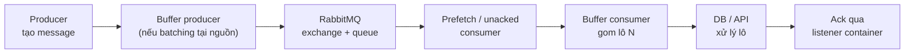

# Đo thông lượng so với độ trễ và bộ nhớ khi dùng batching

## 1. Vì sao batching cần được đo theo nhiều chiều?

Trong chương **Xử lý theo lô** của module **SPRING_AMQP**, chúng ta dùng RabbitMQ cùng `RabbitTemplate`, `@RabbitListener`, exchange, queue và binding để xử lý message bất đồng bộ. **Batching** giúp giảm số lần thực hiện thao tác có chi phí cố định, như gọi database, gửi frame qua mạng, nhận callback hoặc ghi log. Nhưng việc **chờ đủ một lô** và **giữ nhiều message trong bộ nhớ** có thể làm thời gian phản hồi tăng, thậm chí tạo áp lực GC, heap hoặc broker.

Ví dụ một hệ thống nhận sự kiện cập nhật điểm thưởng:

- Mỗi message chứa một sự kiện, thường 1–4 KiB.
- Nếu xử lý từng message, ứng dụng gọi database nhiều lần.
- Nếu gom 50 sự kiện rồi ghi một lệnh bulk insert, số lượt đi đến database giảm.
- Khi lượng sự kiện chỉ vài message mỗi giây, việc chờ 50 phần tử khiến sự kiện đầu tiên phải đợi lâu trước khi được xử lý.
- Khi producer gửi rất nhanh, consumer có thể giữ hàng trăm hoặc hàng nghìn message chưa ack, tăng mức sử dụng bộ nhớ.

Do đó **không thể chọn `batchSize` chỉ vì số message/giây tăng**. Cần đánh đổi ít nhất ba mục tiêu:

1. **Throughput (thông lượng):** xử lý được bao nhiêu message nghiệp vụ hoàn thành mỗi giây?
2. **Latency (độ trễ):** từng message phải chờ bao lâu từ lúc được tạo/gửi đến khi nghiệp vụ xử lý xong, đặc biệt p95 và p99?
3. **Memory (bộ nhớ):** cần bao nhiêu heap/RSS ở producer, consumer và RAM ở broker trong điều kiện ổn định hoặc quá tải?

Bài này đưa ra cách thiết lập benchmark **có thể lặp lại**, cách cấu hình Spring AMQP và cách đọc kết quả. Các con số minh họa được ghi rõ là **giả định**, không phải benchmark đã thực thi.

## 2. Hiểu đúng các kiểu batching trong Spring AMQP

Từ “batching” có thể chỉ các cơ chế rất khác nhau; trước khi benchmark phải ghi rõ đang dùng cơ chế nào.

| Cơ chế | Cách vận hành | Lợi ích tiềm năng | Chi phí / nguy cơ |
| --- | --- | --- | --- |
| **Producer batching** | `BatchingRabbitTemplate` gom nhiều message logic thành một message AMQP vật lý trước khi publish | Giảm số lần publish, chi phí protocol | Buffer trong bộ nhớ producer; batch chưa gửi có thể mất khi process lỗi; một physical message chứa nhiều phần tử |
| **Consumer-side batching** | `SimpleMessageListenerContainer` gom các delivery riêng lẻ thành `List<Message>` cho listener | Gọi database hoặc API downstream theo lô | Thêm thời gian gom batch; tồn tại nhiều message unacked; lỗi có thể ảnh hưởng cả lô |
| **Batch acknowledgment** | Container có thể gom việc gửi ack, hoặc commit transaction theo `batchSize` | Ít thao tác ack/transaction hơn | Ack chậm có thể giữ message in-flight; khác với gom payload thành `List` |
| **Business/DB batching** | Listener xử lý nhiều message bằng một thao tác bulk insert/update | Giảm overhead phía database | Transaction dài hơn, khóa DB lâu hơn, xử lý lỗi từng phần khó hơn |

**Lưu ý:** chỉ đặt `batchSize = 50` trong container **không có nghĩa** `@RabbitListener` sẽ tự nhận `List` gồm 50 phần tử. Với consumer-side batching, cần bật `consumerBatchEnabled` và cấu hình batch listener. Khi chỉ thay `batchSize` mà không bật gom message, tham số này còn liên quan đến tần suất ack/transaction trong `SimpleMessageListenerContainer`; đây là thí nghiệm khác.

### Luồng dữ liệu và nơi phát sinh độ trễ



Có thể phân rã độ trễ đầu-cuối thành:

\[
L_{e2e} \approx L_{producer\_buffer} + L_{publish/routing} +
L_{queue} + L_{consumer\_gather} + L_{business} + L_{ack}
\]

Đây là mô hình để phân tích nguyên nhân. Tổng từng thành phần chỉ chính xác khi dùng cùng ranh giới đo và tránh đo chồng nhau. Nếu chỉ ghi timestamp khi `@RabbitListener` bắt đầu, bạn đã **bỏ qua** thời gian chờ ở producer, broker và consumer batch buffer.

### Trường hợp kết hợp cả producer lẫn consumer batching

`BatchingRabbitTemplate` tạo batch vật lý bằng định dạng của Spring: mỗi payload được tiền tố bằng độ dài 4 byte; metadata `springBatchFormat=lengthHeader4` cho phép phía nhận *de-batch*. Khi `consumerBatchEnabled=true`, một delivery vật lý do producer gộp có thể được tách thành nhiều phần tử logic và thêm vào consumer batch. Vì vậy **số phần tử trong `List` mà listener nhận có thể lớn hơn `batchSize`**, vì `batchSize` đếm physical deliveries từ broker trong trường hợp này.

Để kết quả rõ nghĩa, trước tiên nên benchmark **consumer-side batching với producer publish từng message**, sau đó mới mở thêm thí nghiệm producer batching và tổ hợp hai phía.

## 3. Định nghĩa các chỉ số đo được

### 3.1. Throughput: đếm message nghiệp vụ đã xử lý, không chỉ đếm batch

Với một cửa sổ đo ổn định từ `t0` đến `t1`:

\[
T_{msg} = \frac{N_{completed\_logical\_messages}}{t_1 - t_0}
\quad \text{(messages/s)}
\]

Trong đó `N_completed_logical_messages` là **số message logic đã hoàn thành nghiệp vụ thành công**. Nếu một batch có 50 phần tử xử lý xong, đếm **50**, không phải **1**. Cần tách thêm:

- `T_publish`: message logic publisher gửi/hoàn tất gửi mỗi giây.
- `T_consume_success`: message logic hoàn tất nghiệp vụ mỗi giây.
- `T_batch`: số lần gọi batch listener hoặc thao tác DB theo lô mỗi giây.
- `T_physical`: số message AMQP vật lý được broker nhận/phân phối mỗi giây, có thể khác `T_msg` nếu producer batching.

Một hệ thống chỉ tăng tốc độ publish nhưng queue ngày càng dài **không phải** đã tăng năng lực xử lý. Đo tốc độ xử lý thực tế tại ranh giới business completion, cùng với độ sâu queue.

**Hệ số tăng throughput** so với baseline:

\[
\mathrm{Speedup} =
\frac{T_{\mathrm{batching}}}{T_{\mathrm{baseline}}}
\]

### 3.2. Latency: tối thiểu phải có p50, p95, p99

Đặt `sentAt` tại producer **trước khi đưa message vào pipeline** và `businessCompletedAt` sau khi cập nhật nghiệp vụ hoàn tất, rồi tính:

\[
L_i = t_{completed,i} - t_{sent,i}
\]

Từ tập các `L_i`, báo cáo ít nhất **p50, p95, p99 và max**. Average vẫn hữu ích, nhưng có thể che giấu một nhóm nhỏ message chịu độ trễ rất lớn khi phải chờ lấp đầy batch.

Các loại latency nên phân biệt:

| Chỉ số | Điểm bắt đầu → kết thúc | Dùng để trả lời |
| --- | --- | --- |
| `L_producer_buffer` | Tạo event → gọi publish thật ra broker | Producer batching có thêm bao nhiêu thời gian chờ? |
| `L_queue_and_delivery` | Publish/confirm → lần đầu listener nhận | Broker queue và sức ép prefetch có tạo backlog? |
| `L_consumer_gather` | Consumer nhận phần tử đầu → gọi batch listener | Mất bao lâu để đủ `batchSize` hoặc hết timeout? |
| `L_business` | Listener bắt đầu xử lý batch → commit/hoàn tất xử lý | Bulk operation có thực sự nhanh hơn xử lý đơn lẻ? |
| `L_e2e` | Tạo/gửi event → hoàn tất nghiệp vụ | Người dùng/downstream phải chờ bao lâu? |

**Không gọi thời điểm method `@RabbitListener` kết thúc là “thời điểm broker xác nhận ack”**: Spring thường thực hiện ack sau khi listener return theo cấu hình. Nếu cần đo latency *đến chính xác broker ack*, cần bổ sung instrumentation phù hợp ở tầng container/channel hoặc tracing; metric business completion chỉ gần với thời điểm đó.

Trong phép đo qua nhiều máy, timestamp dạng `System.currentTimeMillis()` yêu cầu **đồng bộ đồng hồ** (NTP hoặc dịch vụ tương đương). Dùng `System.nanoTime()` để đo **duration trong cùng JVM**, không so sánh timestamp nanoTime giữa các host.

### 3.3. Memory: phân biệt bộ nhớ đỉnh, bộ nhớ ổn định và lượng đang treo

Nên theo dõi đồng thời:

- **Producer JVM:** heap used/committed, GC pause, số byte chờ trong buffer của `BatchingRabbitTemplate`; process RSS.
- **Consumer JVM:** heap used, heap after GC, RSS, allocation rate, GC count/pause, kích thước batch thực tế, số delivery unacked.
- **RabbitMQ node:** memory used, queue ready/unacked, disk activity hoặc memory alarm, flow control.
- **Backend:** connection pool sử dụng, số transaction/giây, heap/cache của database nếu có.

Số đo `used heap` tại một thời điểm dễ phụ thuộc chu kỳ GC. Nên báo cáo **đỉnh heap/RSS và xu hướng trong khoảng steady state**, cùng GC pause. “Heap chưa dùng hết” không bảo đảm không phát sinh OOM ngoài heap (native buffers, threads, direct memory).

Ước tính thô bộ nhớ payload đang giữ ở consumer:

\[
M_{inflight,payload} \lesssim C \times P \times \bar{S}
\]

Ở đây `C` là số consumer, `P` là prefetch mỗi consumer, `\bar{S}` là kích thước payload bình quân; chưa tính object/header overhead, copies, batch list, decode buffers và dữ liệu đang xử lý. Công thức dùng để **ước lượng quy mô và cảnh báo rủi ro**, không phải cam kết upper bound cho tổng RAM.

Một cách nhìn bổ sung là **Little's Law** trong trạng thái ổn định:

\[
N_{inflight} \approx \lambda \times W
\]

Nếu tốc độ hoàn tất `\lambda=2{,}000` message/s và thời gian tồn tại trung bình trong hệ thống `W=0.2` s, số message đang ở trong hệ thống cỡ `400`. Chỉ áp dụng gần đúng khi xét đúng ranh giới hệ thống và hệ thống đạt steady state; không dùng để che giấu queue tăng vô hạn.

## 4. Thiết lập benchmark công bằng và có thể lặp lại

### 4.1. Chuẩn bị hệ thống

Sử dụng một topology cố định:

```text
[Load Generator] -- RabbitTemplate --> [direct exchange: bench.x]
                                             |
                                   routing key: bench.job
                                             |
                                          [bench.jobs]
                                             |
                 [@RabbitListener single] HOẶC [@RabbitListener batch]
                                             |
                                     [BenchStore / DB]
```

Chỉ bật **một chế độ listener trong từng lượt chạy**. Nếu hai listener cùng subscribe một queue, RabbitMQ sẽ phân phối cạnh tranh giữa chúng; kết quả không còn phản ánh chính xác chế độ single hay batch.

Giữ cố định phiên bản RabbitMQ/Spring AMQP, CPU, heap limit, GC, network, database và message payload. Với mỗi lượt đo, ghi cấu hình listener/container và số connection, consumer, executor threads.

### 4.2. Bộ workload

Nên có nhiều phân bố tốc độ phát để lộ tác dụng và nhược điểm của batching:

| Workload | Mô tả | Điều muốn thấy |
| --- | --- | --- |
| Tải thấp | Vài message/s, gián đoạn | Batch không đầy; timeout làm tăng latency |
| Tải ổn định vừa | Publisher phát đều gần công suất xử lý | Sự cân bằng throughput – p95 latency |
| Tải cao liên tục | Publisher phát nhanh hơn hoặc gần sát công suất xử lý | Batch có giúp tăng capacity và giữ queue ổn định? |
| Burst | Nhiều message dồn trong thời gian ngắn rồi nghỉ | Heap peak, p99, tốc độ drain queue |
| Payload lớn/không đều | P50 nhỏ nhưng một số message rất lớn | Buffer limit, allocation và GC |

Với payload chứa event thực, kiểm thử thêm tỉ lệ message lỗi, kích thước record và thao tác downstream (I/O, khóa DB, chỉ số index). Benchmark chỉ nhận message rồi tăng counter sẽ đo chủ yếu overhead container, không đại diện cho pipeline nghiệp vụ.

### 4.3. Ma trận cấu hình

Ví dụ một ma trận tối thiểu cho **consumer-side batching**:

| Run | batchSize | batchReceiveTimeout | concurrentConsumers | prefetch | Ghi chú |
| --- | ---: | ---: | ---: | ---: | --- |
| S1 | 1 | Không dùng | 4 | 200 | Baseline nhận từng message |
| B10 | 10 | 50 ms | 4 | 200 | Batch nhỏ |
| B50 | 50 | 50 ms | 4 | 200 | Batch trung bình |
| B100 | 100 | 50 ms | 4 | 200 | Batch lớn |
| B100-T | 100 | 200 ms | 4 | 200 | Cô lập tác động timeout |
| B100-P | 100 | 50 ms | 4 | 400 | Cô lập tác động prefetch |

Các giá trị là **tham số thử nghiệm đề xuất**, không phải cấu hình mặc định hay thông số tối ưu cho mọi hệ thống. Với `batchSize` lớn hơn prefetch, container có thể điều chỉnh prefetch để phù hợp; benchmark cần ghi **prefetch thực tế**, không chỉ giá trị đã khai báo.

Phải tránh thay đổi đồng thời `batchSize`, `concurrency`, `prefetch` và backend: nếu nhiều biến cùng đổi, sẽ không xác định được yếu tố nào tạo ra chênh lệch. Với benchmarking chính thức, mỗi cấu hình nên lặp lại nhiều lần và trình bày trung vị/khoảng dao động thay vì dựa vào một lượt.

### 4.4. Quy trình chạy từng lượt

1. **Warm-up** JIT, connection pool, cache, database; bỏ qua metric trong giai đoạn này.
2. Đảm bảo queue và DLQ sạch theo quy trình thử nghiệm, hoặc dùng queue riêng cho mỗi run; không đo đè backlog từ run trước.
3. Gửi tải theo cùng kịch bản **arrival rate** và payload; ghi throughput publish.
4. Đo steady state trong cửa sổ cố định; chụp throughput completion, p50/p95/p99, RSS/heap/GC, queue ready/unacked.
5. Sau khi dừng phát, tiếp tục đo đến khi hệ thống **drain** hết message; ghi drain time và kết quả lỗi/requeue.
6. Lặp lại và so sánh kết quả theo cả **tải cố định** (fixed arrival rate) và **khả năng chịu tải tối đa** (tăng tải cho tới khi backlog hoặc latency vi phạm ngưỡng).

Nếu đo throughput bằng “thời gian để xử lý N message”, nhớ tính cả **thời gian drain**. Nếu không, cấu hình có buffer lớn có thể trông nhanh hơn vì số message chưa xử lý bị loại khỏi mẫu.

## 5. Cấu hình Spring AMQP để đo consumer batching

Ví dụ minh họa dùng Spring Boot + `spring-boot-starter-amqp`, Spring AMQP **3.1.2+** để có `setBatchReceiveTimeout` trên `SimpleRabbitListenerContainerFactory`. Thêm `spring-boot-starter-actuator` và registry Micrometer/Prometheus nếu thu thập metrics qua Prometheus.

### 5.1. Khai báo routing

```java
import org.springframework.amqp.core.Binding;
import org.springframework.amqp.core.BindingBuilder;
import org.springframework.amqp.core.DirectExchange;
import org.springframework.amqp.core.Queue;
import org.springframework.amqp.core.QueueBuilder;
import org.springframework.context.annotation.Bean;
import org.springframework.context.annotation.Configuration;

@Configuration
class BenchRabbitTopology {
    @Bean
    DirectExchange benchExchange() {
        return new DirectExchange("bench.x", true, false);
    }

    @Bean
    Queue benchJobsQueue() {
        return QueueBuilder.durable("bench.jobs").build();
    }

    @Bean
    Binding benchBinding(Queue benchJobsQueue, DirectExchange benchExchange) {
        return BindingBuilder.bind(benchJobsQueue)
                .to(benchExchange).with("bench.job");
    }
}
```

Queue durable và message persistent giúp hạn chế mất message do broker restart; không làm cho việc xử lý nghiệp vụ trở thành exactly-once. Để kiểm thử công bằng, nên cấu hình publisher confirms/returns giống nhau giữa các run.

### 5.2. Hai container factory, hai chế độ đo

```java
import org.springframework.amqp.core.AcknowledgeMode;
import org.springframework.amqp.rabbit.config.SimpleRabbitListenerContainerFactory;
import org.springframework.amqp.rabbit.connection.ConnectionFactory;
import org.springframework.context.annotation.Bean;
import org.springframework.context.annotation.Configuration;

@Configuration
class BenchListenerFactories {

    private SimpleRabbitListenerContainerFactory common(ConnectionFactory cf) {
        var factory = new SimpleRabbitListenerContainerFactory();
        factory.setConnectionFactory(cf);
        factory.setConcurrentConsumers(4);
        factory.setPrefetchCount(200);
        factory.setAcknowledgeMode(AcknowledgeMode.AUTO);
        return factory;
    }

    @Bean("benchSingleFactory")
    SimpleRabbitListenerContainerFactory singleFactory(ConnectionFactory cf) {
        var factory = common(cf);
        factory.setBatchSize(1);
        return factory;
    }

    @Bean("benchBatchFactory")
    SimpleRabbitListenerContainerFactory batchFactory(ConnectionFactory cf) {
        var factory = common(cf);
        factory.setBatchListener(true);
        factory.setConsumerBatchEnabled(true);
        factory.setBatchSize(50);
        factory.setReceiveTimeout(100L);
        factory.setBatchReceiveTimeout(50L); // Spring AMQP 3.1.2+
        return factory;
    }
}
```

**Ý nghĩa từng tham số:**

- `setBatchListener(true)`: truyền `List` cho listener thay vì gọi mỗi message một lần.
- `setConsumerBatchEnabled(true)`: container chủ động gom **các delivery rời rạc** thành lô; đồng thời yêu cầu `deBatchingEnabled=true`, factory bảo đảm điều này.
- `setBatchSize(50)`: hướng đến 50 physical deliveries trước khi gọi listener.
- `setReceiveTimeout(100L)`: timeout chờ nhận message; khi không đủ batch, có thể phát lô chưa đầy.
- `setBatchReceiveTimeout(50L)`: giới hạn thời gian gom lô; được thêm từ **Spring AMQP 3.1.2**, mặc định `0` là không đặt giới hạn riêng. Trên phiên bản cũ, bỏ dòng này và đo ảnh hưởng của `receiveTimeout`.
- `setPrefetchCount(200)`: giới hạn số delivery unacked mỗi consumer (được broker điều phối); tăng prefetch thường làm nhiều message nằm trong bộ nhớ client hơn.

**Chú ý theo phiên bản:** consumer-side batching của `SimpleMessageListenerContainer` xuất hiện từ Spring AMQP **2.2**. Trên bản 3.x, `consumerBatchEnabled=true` ở factory cũng có thể tự bật batch listener; ví dụ vẫn đặt cả hai để ý đồ rõ ràng và tương thích hơn.

### 5.3. Gửi từng message kèm timestamp

```java
import org.springframework.amqp.rabbit.core.RabbitTemplate;
import org.springframework.stereotype.Service;

@Service
class BenchPublisher {
    private final RabbitTemplate template;

    BenchPublisher(RabbitTemplate template) {
        this.template = template;
    }

    public void publish(String eventId) {
        template.convertAndSend(
                "bench.x",
                "bench.job",
                eventId,
                message -> {
                    message.getMessageProperties()
                            .setHeader("bench.sentAtEpochMs",
                                       System.currentTimeMillis());
                    return message;
                }
        );
    }
}
```

Timestamp trước publish này cho phép đo gần đúng **producer → business completion** đối với **consumer-side batching**, khi đồng hồ producer/consumer được đồng bộ. Nếu muốn tính cả thời gian tạo event trước khi gọi `publish()`, timestamp phải được tạo ở thời điểm đó.

### 5.4. Listener nhận lô và đo kích thước lô thực tế

```java
import io.micrometer.core.instrument.DistributionSummary;
import io.micrometer.core.instrument.MeterRegistry;
import io.micrometer.core.instrument.Timer;
import java.nio.charset.StandardCharsets;
import java.util.ArrayList;
import java.util.List;
import java.util.concurrent.TimeUnit;
import org.springframework.amqp.core.Message;
import org.springframework.amqp.rabbit.annotation.RabbitListener;
import org.springframework.context.annotation.Profile;
import org.springframework.stereotype.Component;

interface BenchStore {
    void saveOne(String eventId);
    void saveBatch(List<String> eventIds);
}

// Kích hoạt profile "batch" trong lượt chạy batching.
// BenchStore là adapter tới DB/API thật, được cài đặt theo workload.
@Component
@Profile("batch")
class BatchBenchListener {
    private final BenchStore store;
    private final Timer e2e;
    private final Timer business;
    private final DistributionSummary batchSize;

    BatchBenchListener(BenchStore store, MeterRegistry registry) {
        this.store = store;
        this.e2e = Timer.builder("bench.message.e2e")
                .publishPercentileHistogram()
                .register(registry);
        this.business = Timer.builder("bench.batch.business")
                .publishPercentileHistogram()
                .register(registry);
        this.batchSize = DistributionSummary.builder("bench.batch.actual.size")
                .register(registry);
    }

    @RabbitListener(queues = "bench.jobs",
                    containerFactory = "benchBatchFactory")
    public void handle(List<Message> messages) {
        List<String> ids = new ArrayList<>(messages.size());
        for (Message message : messages) {
            ids.add(new String(message.getBody(), StandardCharsets.UTF_8));
        }

        long start = System.nanoTime();
        store.saveBatch(ids); // Chỉ return sau khi thao tác nghiệp vụ hoàn tất
        business.record(System.nanoTime() - start, TimeUnit.NANOSECONDS);

        batchSize.record(messages.size()); // Kích thước lô thực, có thể < 50
        long completedAtMs = System.currentTimeMillis();
        for (Message message : messages) {
            Object header = message.getMessageProperties()
                    .getHeaders().get("bench.sentAtEpochMs");
            if (header instanceof Number sentAtMs) {
                e2e.record(Math.max(0,
                        completedAtMs - sentAtMs.longValue()),
                        TimeUnit.MILLISECONDS);
            }
        }
    }
}
```

Giải thích cách đo trong ví dụ:

- `business` ghi **thời gian xử lý batch** cho một lần gọi business, không phải độ trễ của từng message.
- `batchSize` ghi **số phần tử thực sự** được listener nhận; có thể khác 50 khi hết timeout hoặc kết hợp producer batching.
- `e2e` ghi **một quan sát cho mỗi message logic** sau khi `BenchStore.saveBatch` hoàn tất.
- Khi `BenchStore.saveBatch` ném exception, listener thất bại, Spring container xử lý lỗi theo chính sách ack/requeue. Những message không thành công **không được đưa vào throughput thành công**. Phải đo lỗi/redelivery riêng, tránh chỉ đọc histogram của nhóm đã thành công rồi bỏ qua message bị kẹt.
- Ví dụ coi một lần `saveBatch` thành công là thành công cho toàn bộ phần tử. Trong hệ thống cho phép thành công một phần, phải xác định trạng thái riêng của từng item và chiến lược retry/idempotency phù hợp.

Để tránh sai lệch, bố trí logic tương đương cho chế độ single:

```java
import java.nio.charset.StandardCharsets;
import org.springframework.amqp.core.Message;
import org.springframework.amqp.rabbit.annotation.RabbitListener;
import org.springframework.context.annotation.Profile;
import org.springframework.stereotype.Component;

@Component
@Profile("single")
class SingleBenchListener {
    private final BenchStore store;
    private final BenchMetrics metrics; // Cùng cách đo như batch listener

    SingleBenchListener(BenchStore store, BenchMetrics metrics) {
        this.store = store;
        this.metrics = metrics;
    }

    @RabbitListener(queues = "bench.jobs",
                    containerFactory = "benchSingleFactory")
    public void handle(Message message) {
        String id = new String(message.getBody(), StandardCharsets.UTF_8);
        store.saveOne(id);
        metrics.recordBusinessCompletion(message);
    }
}
```

`BenchMetrics` ở đây là **service đo lường dùng chung do dự án tự triển khai**, với phương thức `recordBusinessCompletion(Message)` tương đương logic ghi `e2e` phía trên. Không nên thay `saveOne` bằng `saveBatch(List.of(id))` nếu mục tiêu là so sánh tác dụng của bulk call tại database; nhưng phải ghi rõ sự khác biệt này trong báo cáo.

> **Nguyên tắc chạy:** profile `single` và `batch` là **hai lượt benchmark riêng biệt**, cùng queue topology và cùng workload; không bật cả hai listener cạnh tranh trên `bench.jobs`. Khi chạy lại, phải đảm bảo queue không chứa message tồn từ lượt cũ.

## 6. Nếu muốn benchmark producer batching

Đây là **một thí nghiệm riêng**, vì cơ chế vật lý khác với consumer-side batching.

Spring AMQP cung cấp `BatchingRabbitTemplate` và `SimpleBatchingStrategy`. Ví dụ:

```java
import org.springframework.amqp.rabbit.batch.SimpleBatchingStrategy;
import org.springframework.amqp.rabbit.connection.ConnectionFactory;
import org.springframework.amqp.rabbit.core.BatchingRabbitTemplate;
import org.springframework.context.annotation.Bean;
import org.springframework.context.annotation.Configuration;
import org.springframework.scheduling.TaskScheduler;
import org.springframework.scheduling.concurrent.ThreadPoolTaskScheduler;

@Configuration
class ProducerBatchConfig {

    @Bean
    TaskScheduler producerBatchScheduler() {
        var scheduler = new ThreadPoolTaskScheduler();
        scheduler.setPoolSize(1);
        scheduler.setThreadNamePrefix("rabbit-producer-batch-");
        return scheduler;
    }

    @Bean
    BatchingRabbitTemplate producerBatchTemplate(
            ConnectionFactory connectionFactory,
            TaskScheduler producerBatchScheduler) {
        var strategy = new SimpleBatchingStrategy(
                50,          // tối đa 50 message logic
                256 * 1024,  // giới hạn buffer batch: 256 KiB
                50L          // flush batch chưa đầy sau timeout 50 ms
        );
        return new BatchingRabbitTemplate(
                connectionFactory, strategy, producerBatchScheduler);
    }
}
```

Dùng `producerBatchTemplate.convertAndSend("bench.x", "bench.job", payload)` sẽ đưa payload vào batch theo chiến lược; các batch chỉ được publish khi đến ngưỡng size/count/timeout. Có thể gọi `producerBatchTemplate.flush()` để yêu cầu gửi các batch đang chờ, ví dụ lúc kết thúc một lượt đo và cần drain.

**Hai rủi ro quan trọng:**

1. Batch chưa publish đang nằm **trong bộ nhớ producer**, nên có thể bị mất nếu process dừng đột ngột. Publisher confirm chỉ có ý nghĩa đối với message đã thực sự được publish; không coi `convertAndSend` vào buffer là đã được broker xác nhận.
2. `SimpleBatchingStrategy` dùng một bộ message properties cho batch vật lý, không bảo đảm giữ nguyên mọi header riêng của từng message logic sau de-batching. Nếu muốn đo `L_e2e` của từng message trong phép thử producer batching, hãy đặt **`eventId` + `sentAt` trong chính payload của từng event** hoặc có cơ chế tracing riêng; đừng mặc định header timestamp độc lập sẽ sống nguyên qua batch.

Ở phía consumer, Spring AMQP có thể tự de-batch message producer tạo dựa trên metadata `springBatchFormat`. Một lỗi/reject đối với fragment có thể làm **cả batch producer** bị reject; vì vậy chỉ tiêu “logical messages completed” và việc xử lý trùng lặp cần được quan sát chặt.

## 7. Đọc kết quả: tăng throughput đến mức nào là đáng giá?

### 7.1. Bảng kết quả mẫu (số liệu **giả lập**, chỉ minh họa cách phân tích)

Giả sử mỗi cấu hình xử lý cùng payload và tải tăng dần tới ngưỡng ổn định. Bảng dưới **không** phải kết quả chạy thực tế:

| Cấu hình | Throughput thành công (msg/s) | E2E p95 | E2E p99 | Consumer RSS peak | GC pause p99 |
| --- | ---: | ---: | ---: | ---: | ---: |
| Single, `batchSize=1` | 1.800 | 45 ms | 80 ms | 420 MiB | 8 ms |
| Batch 10, timeout 50 ms | 2.800 | 55 ms | 110 ms | 455 MiB | 9 ms |
| Batch 50, timeout 50 ms | 3.400 | 95 ms | 210 ms | 530 MiB | 15 ms |
| Batch 100, timeout 50 ms | 3.450 | 170 ms | 430 ms | 680 MiB | 32 ms |

Với **số giả định** ở trên:

- Batch 50 so với single: speedup `3400/1800 ≈ 1,89×`, nhưng p99 tăng từ 80 ms lên 210 ms.
- Batch 100 so với batch 50: throughput chỉ tăng khoảng **1,5%**, trong khi p99 hơn gấp đôi và RSS peak tăng mạnh.
- Nếu SLA yêu cầu **p99 ≤ 150 ms**, bảng này sẽ khiến batch 10 phù hợp hơn batch 50/100 dù không có throughput cao nhất.
- Nếu workload chủ yếu là batch ETL không tương tác người dùng và SLA cho phép chờ lâu, batch 50 có thể hợp lý hơn; quyết định phụ thuộc budget RAM và tốc độ drain khi burst.

**Không có một “batchSize tối ưu” độc lập với workload.** Chọn điểm **Pareto**: khó cải thiện throughput hơn mà không làm xấu latency, memory hoặc độ tin cậy.

### 7.2. Một mô hình đơn giản về lợi ích xử lý theo lô

Giả sử mỗi lần gọi database mất chi phí cố định `a` và mỗi phần tử tốn thêm `b`, thời gian xử lý batch có thể xấp xỉ:

\[
S(N) = a + N b
\]

Thời gian trung bình trên một phần tử:

\[
S_{item}(N) = \frac{a}{N} + b
\]

Khi `N` tăng, thành phần `a/N` giảm, nhưng phần thời gian phải chờ để có đủ `N` phần tử **không được tính trong công thức trên**. Ở tốc độ đến trung bình `\lambda` message/s và traffic tương đối đều, thời gian gom batch cho item đầu tiên có thể cỡ `(N-1)/\lambda` nếu không flush sớm. Đó chỉ là ước lượng trực giác; thực tế còn timeout, burst, concurrency và queue backlog.

Vì vậy phải đo **cả thời gian gom batch và toàn bộ E2E latency**, không chỉ thời gian chạy `saveBatch`.

### 7.3. Khi benchmark sai, kết luận sẽ sai

| Triệu chứng | Nguyên nhân thường gặp | Kiểm chứng |
| --- | --- | --- |
| Throughput publish tăng nhưng completed không tăng | Queue đang tích backlog | So sánh publish/completion rate, `messages_ready` |
| p99 bất thường khi tải thấp | Đợi đủ batch hoặc timeout quá dài | Theo dõi actual batch size và batch gather wait |
| Heap tăng khi tăng `prefetch` | Nhiều message unacked/buffered hơn | So `unacked`, heap, allocation rate |
| Throughput batch cao bất thường | Chỉ đếm một batch là một message hoặc không đợi drain | Đếm logical completed và đợi xử lý toàn bộ |
| p99 trông thấp bất thường | Chỉ đo thời gian DB, bỏ queue/wait | Đo từ producer timestamp |
| Có nhiều message được chạy lại | Reject cả batch, crash trước ack, retry không idempotent | Theo dõi redelivery, retry, khóa idempotency |
| Batch lớn hơn cấu hình `batchSize` | Producer-created batch được de-batch vào consumer batch | So physical deliveries và số logical items |
| Memory broker tăng dù consumer heap ổn | Producer nhanh hơn consumer hoặc publisher bị flow control | Queue depth, RabbitMQ memory/disk, connection blocked |

## 8. Độ tin cậy và tác động của ack/retry đến benchmark

Trong Spring AMQP, `AcknowledgeMode.AUTO` nghĩa là **listener container ack sau khi listener xử lý thành công**. Nó **không** phải RabbitMQ auto-ack (`NONE`). Với một listener nhận `List`, method xử lý một batch và container quyết định ack/nack theo kết quả invocation. Đây là một **ranh giới thất bại lớn hơn** so với xử lý từng message:

- Nếu một phần tử làm toàn bộ batch throw exception, container có thể reject/nack các delivery liên quan; một số item đã được ghi trước đó có thể bị xử lý lại.
- Với **producer-created batch**, reject một fragment có thể dẫn đến reject toàn bộ batch vật lý.
- Khi `defaultRequeueRejected=true`, lỗi lặp lại có thể tạo vòng requeue liên tục, làm throughput “gửi nhận” tăng giả tạo nhưng thành công nghiệp vụ không tăng.
- Muốn chuyển message lỗi vào DLQ, cần cấu hình dead-letter exchange/binding tương ứng và chính sách reject không requeue hoặc retry có giới hạn. Batch size không tự tạo DLQ.
- `@Transactional` ở database không đồng nghĩa database transaction và RabbitMQ ack có cùng transaction phân tán. Sau DB commit nhưng trước ack, consumer vẫn có thể crash và nhận lại message. Cần **idempotency**.
- Nếu dùng publisher confirms, phải thu thập confirmed/returned publishes để tránh coi message “đã vào buffer batch” là “đã vào broker”.

Trong benchmark, nên phân biệt `processed_attempts`, `successful_unique_events`, `redelivered_messages` và `dead_lettered_messages`. Chỉ số throughput chính nên phản ánh **unique business success** nếu nghiệp vụ đặt nặng tính đúng; đồng thời báo số lần xử lý lại vì chúng vẫn tiêu thụ CPU, RAM và băng thông.

### Pre-fetch và bộ nhớ có quan hệ trực tiếp

RabbitMQ giới hạn số delivery chưa ack mà consumer có thể giữ nhờ **prefetch**. Khi đạt ngưỡng, broker tạm ngưng phát thêm cho consumer đến khi nhận ack. Tăng prefetch thường giúp lấp đầy batch và giảm nhàn rỗi, nhưng đến một ngưỡng sẽ cho lợi ích giảm dần; tăng quá cao gây nhiều message giữ trong RAM và có thể làm p99 tệ hơn. Giá trị tốt cần đo theo **kích thước message, số consumer, thời gian xử lý và giới hạn RAM**.

### Chạy với tải ổn định trước khi kết luận

Dùng hai loại thử nghiệm:

- **Capacity test:** tăng tốc độ publish từng mức, tìm mức completion throughput tối đa mà queue không tăng mãi, không phát sinh memory pressure và các SLO vẫn được giữ.
- **Fixed-load test:** giữ arrival rate cố định (ví dụ 1.000 msg/s) cho các cấu hình, so sánh p95/p99, memory và resource efficiency.

Nếu chỉ đo capacity, batch lớn có thể thắng về msg/s nhưng thua ở workload thực tế vốn phát chậm và có yêu cầu độ trễ.

## 9. Checklist báo cáo và quyết định cấu hình

Sau mỗi lượt, nên lưu cùng một format báo cáo:

| Nhóm | Các trường cần có |
| --- | --- |
| Môi trường | Spring AMQP/RabbitMQ, Java, heap limit, CPU, GC, kiểu queue, node broker, network |
| Workload | Số event, payload p50/p99, arrival rate, thời lượng warm-up/steady/drain, lỗi giả lập |
| Batch | Producer batching bật/tắt, `batchSize`, `bufferLimit`, `timeout`, consumer batching bật/tắt, `batchReceiveTimeout`, `receiveTimeout` |
| Consumer | `concurrentConsumers`, `prefetch` thực tế, ack mode, retry/DLX/DLQ, số worker thread |
| Hiệu năng | Unique successful msg/s, physical deliveries/s, batch calls/s, actual batch size p50/p95 |
| Độ trễ | E2E p50/p95/p99/max, gather time, business time, drain time |
| Bộ nhớ | Producer/consumer heap peak, RSS peak, allocation, GC pause, broker RAM, `messages_ready`/`messages_unacknowledged` |
| Độ tin cậy | Failed attempts, retry/redelivery, DLQ, duplicate prevented, confirmed/returned publish |

Trình tự ra quyết định:

1. Đặt **ngưỡng tối thiểu** cho throughput và **ngưỡng tối đa** cho p95/p99 latency, bộ nhớ, thời gian drain và tỉ lệ lỗi.
2. Loại những cấu hình vi phạm các ngưỡng trên, ngay cả khi throughput lớn.
3. Trong tập còn lại, ưu tiên cấu hình đơn giản hơn hoặc có **khoảng dự phòng** tốt hơn khi burst, message lớn hay backend chậm.
4. Ghi lại cấu hình đã chọn và lặp lại benchmark sau khi thay version Spring AMQP, RabbitMQ, DB hoặc đặc điểm workload.

Batching thành công khi **tăng số message nghiệp vụ hoàn tất trên cùng tài nguyên mà vẫn giữ được giới hạn độ trễ, bộ nhớ và lỗi**. Đo song song ba chiều throughput – latency – memory mới cho biết chính xác lợi ích và chi phí của một lựa chọn `batchSize`.

## Tài liệu tham khảo

- [Spring AMQP — @RabbitListener with Batching](https://docs.spring.io/spring-amqp/reference/amqp/receiving-messages/batch.html): cách dùng `batchListener`, `consumerBatchEnabled`, nhận `List<Message>`, tương tác producer/consumer batching.
- [Spring AMQP — Sending Messages: Batching](https://docs.spring.io/spring-amqp/reference/amqp/sending-messages.html): `BatchingRabbitTemplate`, `SimpleBatchingStrategy`, `batchSize`, `bufferLimit`, `timeout` và buffer trong bộ nhớ.
- [Spring AMQP — Listener Container Attributes](https://docs.spring.io/spring-amqp/reference/amqp/containerAttributes.html): `batchSize`, `prefetchCount`, `receiveTimeout`, `batchReceiveTimeout`, acknowledgment và consumer concurrency.
- [Spring AMQP 3.2 — SimpleRabbitListenerContainerFactory API](https://docs.spring.io/spring-amqp/docs/3.2.3/api/org/springframework/amqp/rabbit/config/SimpleRabbitListenerContainerFactory.html): `setBatchReceiveTimeout` từ 3.1.2.
- [RabbitMQ — Consumer Acknowledgements and Publisher Confirms](https://www.rabbitmq.com/docs/confirms): prefetch, ack, redelivery và ảnh hưởng đến throughput/bộ nhớ.
