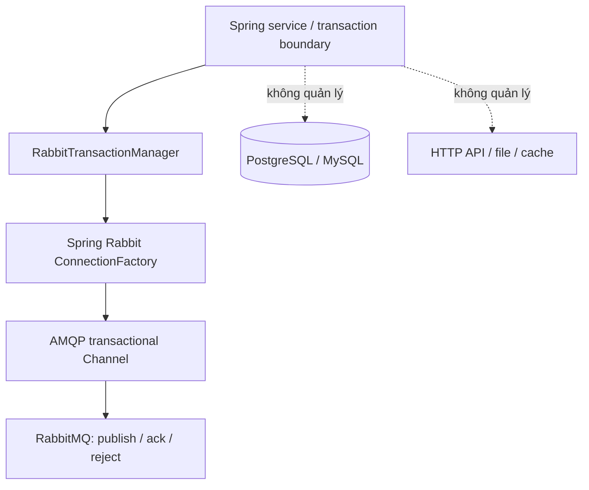
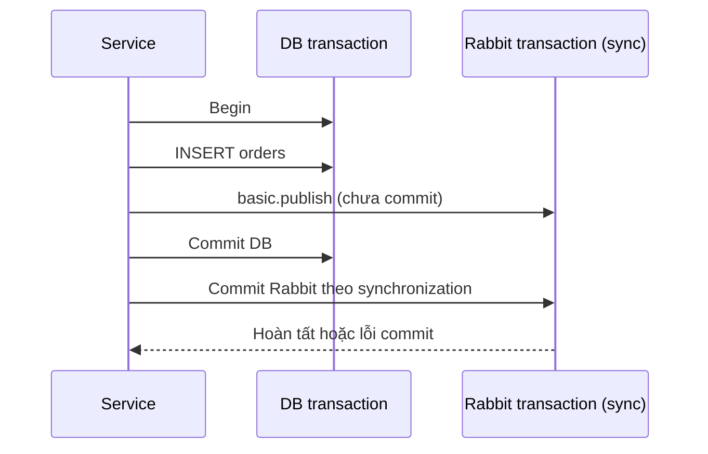
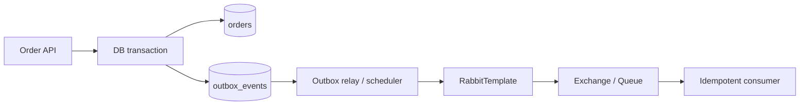

# RabbitTransactionManager và phạm vi tài nguyên quản lý

> **Chương:** Giao dịch. **Ngữ cảnh:** trong **SPRING_AMQP**, ứng dụng dùng `RabbitTemplate` gửi message, `@RabbitListener` nhận message và RabbitMQ định tuyến qua exchange, queue, binding. Bài này giải thích chính xác `RabbitTransactionManager` quản lý gì, commit/rollback tác động thế nào, và vì sao giao dịch RabbitMQ không đồng nghĩa với một giao dịch nguyên tử giữa message, database và dịch vụ bên ngoài.

## 1. Bài toán: gửi nhiều message như một đơn vị công việc

Một ứng dụng xử lý đơn hàng cần công bố hai sự kiện sau khi xác thực yêu cầu:

1. `order.accepted` để hệ thống kho dự trữ hàng.
2. `order.audit` để lưu dấu vết xử lý.

Nếu dùng `RabbitTemplate` thông thường, câu lệnh publish thứ nhất có thể đã được broker tiếp nhận trước khi câu lệnh thứ hai gặp lỗi. Phần gửi message cần một **ranh giới giao dịch (transaction boundary)** để lỗi trong quá trình xử lý có thể dẫn tới rollback những thao tác AMQP chưa commit.

`RabbitTransactionManager` là một cách điều khiển ranh giới đó theo mô hình giao dịch của Spring: `@Transactional`, `TransactionTemplate` và interface `PlatformTransactionManager`. Nó quản lý **RabbitMQ Channel có chế độ transaction** liên kết với luồng hiện tại qua một `ConnectionFactory`, cho phép `RabbitTemplate` tham gia vào giao dịch Rabbit đang mở.

Tuy nhiên, giả sử cùng lúc ứng dụng cập nhật bảng `orders` trong PostgreSQL: commit của RabbitMQ **không** commit PostgreSQL; commit PostgreSQL **không** bảo đảm commit RabbitMQ. Đó là ranh giới quan trọng nhất của bài.



## 2. Chính xác tài nguyên nào được RabbitTransactionManager quản lý?

`RabbitTransactionManager` nằm trong package `org.springframework.amqp.rabbit.transaction`, triển khai `PlatformTransactionManager` và được thiết kế cho **một Spring AMQP `ConnectionFactory`**. Khi transaction bắt đầu, Spring AMQP lấy tài nguyên Rabbit phù hợp, gắn `Channel` transactional vào ngữ cảnh thread; các thao tác dùng cùng factory trong cùng transaction có thể dùng lại channel đó.

| Tài nguyên/hành động | RabbitTransactionManager quản lý? | Giải thích |
| --- | --- | --- |
| Rabbit `Channel` của **ConnectionFactory được cấu hình** | **Có** | Khởi tạo/tham gia, commit/rollback tài nguyên AMQP gắn với thread |
| `RabbitTemplate` gửi message bằng cùng `ConnectionFactory` | **Có, khi cấu hình giao dịch phù hợp** | Phát hiện channel gắn với thread và tham gia vào transaction |
| `RabbitTemplate` nhận message (`receive`) và settlement tương ứng | **Có, ở mức ack/reject giao dịch** | Việc lấy/nhận message tự nó không được đảo ngược; ack/reject chịu quy tắc transaction |
| `@RabbitListener` trên container có `channelTransacted=true` và manager phù hợp | **Có** | Container điều khiển ranh giới xử lý/ack và rollback |
| JDBC/JPA transaction của PostgreSQL/MySQL | **Không** | Do `DataSourceTransactionManager`, `JpaTransactionManager` hoặc manager dữ liệu tương ứng |
| HTTP call, thanh toán bên thứ ba, gửi email, ghi file | **Không** | Side effect ngoài AMQP không thể rollback nhờ RabbitTransactionManager |
| Rabbit `ConnectionFactory` **khác**, channel tạo trực tiếp không tham gia | **Không tự động** | Transaction gắn với đúng factory/channel trong đúng ngữ cảnh |
| Exchange/queue/binding declare, delete, thay đổi topology | **Không** | AMQP transaction không bao trùm thao tác quản lý topology |
| Công việc chuyển sang thread mới bằng `@Async`/executor | **Không tự động** | Transaction context gắn theo thread; không truyền ngầm qua thread mới |

**Phân biệt ba đối tượng:**

- **Connection:** kết nối vật lý/logical tới broker; `CachingConnectionFactory` có thể tái sử dụng connection và cache channel.
- **Channel:** kênh AMQP thực hiện publish, ack, reject; transaction của RabbitMQ gắn với **channel**, không phải toàn bộ broker hay connection.
- **Transaction manager:** thành phần Spring tạo và hoàn tất transaction đối với tài nguyên channel đó; nó **không** biến mọi thao tác trong method thành một transaction phân tán.

Tài liệu API Spring AMQP khuyến nghị dùng `CachingConnectionFactory` để giảm chi phí tạo connection/channel. Nếu dùng API RabbitMQ trực tiếp và tạo channel mới theo cách riêng, đừng mặc định channel đó nằm trong giao dịch của `RabbitTransactionManager`; tích hợp ở mức thấp phải lấy tài nguyên qua `ConnectionFactoryUtils.getTransactionalResourceHolder(...)`.

## 3. Giao dịch AMQP thực sự bao gồm những thao tác nào?

RabbitMQ (AMQP 0-9-1) có các lệnh:

```text
tx.select    → đưa channel vào transaction mode
basic.publish / basic.ack / basic.reject → thao tác trên channel đó
tx.commit    → gửi yêu cầu commit giao dịch hiện tại
tx.rollback  → hủy các thao tác chưa commit thuộc giao dịch hiện tại
```

Về ngữ nghĩa:

| Thao tác | Khi commit | Khi rollback |
| --- | --- | --- |
| `basic.publish` | Broker xử lý các publish trong transaction, có thể định tuyến tới queue | Các publish chưa commit bị hủy |
| `basic.ack` | Ack có hiệu lực | Ack chưa commit bị hủy; delivery vẫn cần được xử lý/settle |
| `basic.reject` (RabbitMQ hỗ trợ transactional reject) | Reject có hiệu lực theo quy tắc broker | Reject chưa commit bị hủy |
| `basic.consume` / nhận một delivery | Delivery đã xảy ra | **Không** “quay ngược thời gian” để tự nhận lại delivery |
| `exchangeDeclare`, `queueDeclare`, `queueBind` | Không có ý nghĩa giao dịch ở đây | Không rollback topology |

**Điểm rất dễ nhầm:** riêng `tx.rollback` trên broker **không tự requeue message đã nhận**. Nó hủy các ack/reject chưa commit. Với listener container của Spring AMQP, khi listener thất bại, framework còn thực hiện **bước reject sau rollback**; message bị requeue hoặc dead-letter phụ thuộc cấu hình `defaultRequeueRejected` và loại exception. Đó là hành vi của **Spring listener container**, không phải bảo đảm nguyên thủy của `tx.rollback`.

RabbitMQ cũng ghi rõ các hạn chế: transaction không có mức nguyên tử ACID như database khi broker gặp lỗi, đặc biệt nếu liên quan nhiều queue; ngay cả một queue vẫn có trường hợp broker restart sau lỗi làm chỉ một phần publish xuất hiện. `tx.commit-ok` xác nhận broker đã nhận trách nhiệm theo semantics của giao thức, nhưng **không** bảo đảm chính xác một lần xử lý ở hệ thống nghiệp vụ.

## 4. `channelTransacted` và `RabbitTransactionManager` khác nhau thế nào?

Có hai cấp cấu hình bổ sung cho nhau:

1. **`channelTransacted=true`** trên `RabbitTemplate` hoặc listener container: yêu cầu dùng RabbitMQ transactional channel. Khi không có Spring transaction bên ngoài, mỗi thao tác hoặc ranh giới do container quản lý có thể được commit/rollback cục bộ.
2. **`RabbitTransactionManager`**: cung cấp ranh giới Spring transaction để **nhiều thao tác Rabbit** có thể cùng tham gia và được commit/rollback khi kết thúc một method/khối nghiệp vụ.

| Cấu hình | Hành vi cần hiểu |
| --- | --- |
| `RabbitTemplate` không transactional, không Spring transaction | Publish diễn ra ngoài AMQP transaction |
| `RabbitTemplate.setChannelTransacted(true)`, không có `@Transactional` | Template có thể mở/commit một local AMQP transaction cho mỗi lần gọi |
| `RabbitTemplate.setChannelTransacted(true)` + `@Transactional("rabbitTransactionManager")` | Nhiều thao tác qua template trong phạm vi Spring transaction có thể cùng commit/rollback |
| `@Transactional("dataSourceTransactionManager")` + template transactional | Rabbit transaction có thể đồng bộ theo giao dịch DB theo mô hình **Best Efforts 1 Phase Commit**, **không** XA |
| `@Transactional("rabbitTransactionManager")` nhưng code truy cập DB | Chỉ có transaction Rabbit được manager này quản lý; DB không tự được enlist |

**Vì sao đặt `channelTransacted=true` trong ví dụ?** Nó làm rõ ý định sử dụng AMQP transaction và giúp mã nhất quán ở cả lúc template có transaction hiện hành lẫn khi chạy độc lập. Chỉ đặt `@Transactional` mà chọn nhầm transaction manager hoặc không kiểm tra cấu hình template là nguồn lỗi khó phát hiện.

## 5. Cấu hình `RabbitTransactionManager` và `RabbitTemplate`

Đây là ví dụ Spring Boot có `spring-boot-starter-amqp` (và `spring-tx` do các starter Spring thường cung cấp). Ta tạo bean transaction manager cho Rabbit và template giao dịch dùng **cùng một** `ConnectionFactory`:

```java
import org.springframework.amqp.rabbit.connection.ConnectionFactory;
import org.springframework.amqp.rabbit.core.RabbitTemplate;
import org.springframework.amqp.rabbit.transaction.RabbitTransactionManager;
import org.springframework.context.annotation.Bean;
import org.springframework.context.annotation.Configuration;

@Configuration(proxyBeanMethods = false)
public class RabbitTransactionsConfig {

    @Bean("rabbitTransactionManager")
    RabbitTransactionManager rabbitTransactionManager(
            ConnectionFactory connectionFactory) {
        return new RabbitTransactionManager(connectionFactory);
    }

    @Bean("transactionalRabbitTemplate")
    RabbitTemplate transactionalRabbitTemplate(
            ConnectionFactory connectionFactory) {
        RabbitTemplate template = new RabbitTemplate(connectionFactory);
        template.setChannelTransacted(true);
        return template;
    }
}
```

Nên đặt tên bean rõ ràng nếu ứng dụng còn có `DataSourceTransactionManager` hoặc `JpaTransactionManager`: mỗi `@Transactional` cần chỉ ra **manager nào** được sử dụng. Bean Rabbit manager không tự giúp Spring Boot cấu hình một JDBC transaction manager thứ hai; nếu cần cả hai, hãy khai báo và chọn chúng tường minh.

### Topology minh họa: exchange, queue và binding

`orders.events` là direct exchange. Hai routing key `accepted` và `audit` cùng trỏ vào **một queue** `orders.tx.events` để có thể dễ quan sát publish trong bài thực hành. Queue lỗi được khai báo riêng cho thử nghiệm listener.

```java
import org.springframework.amqp.core.Binding;
import org.springframework.amqp.core.BindingBuilder;
import org.springframework.amqp.core.DirectExchange;
import org.springframework.amqp.core.Queue;
import org.springframework.amqp.core.QueueBuilder;
import org.springframework.context.annotation.Bean;
import org.springframework.context.annotation.Configuration;
import org.springframework.beans.factory.annotation.Qualifier;

@Configuration(proxyBeanMethods = false)
class RabbitTxTopology {
    @Bean
    DirectExchange ordersEvents() {
        return new DirectExchange("orders.events", true, false);
    }

    @Bean
    Queue ordersTxEvents() {
        return QueueBuilder.durable("orders.tx.events").build();
    }

    @Bean
    Binding acceptedBinding(
            @Qualifier("ordersTxEvents") Queue queue,
            @Qualifier("ordersEvents") DirectExchange exchange) {
        return BindingBuilder.bind(queue).to(exchange).with("accepted");
    }

    @Bean
    Binding auditBinding(
            @Qualifier("ordersTxEvents") Queue queue,
            @Qualifier("ordersEvents") DirectExchange exchange) {
        return BindingBuilder.bind(queue).to(exchange).with("audit");
    }
}
```

Việc khai báo exchange, queue và binding chỉ để tạo đường đi của message; **các thao tác khai báo này không thuộc AMQP transaction**. Trong môi trường đã có queue cùng tên, các thuộc tính phải tương thích; broker có thể từ chối việc khai báo lại khác cấu hình.

## 6. Ví dụ 1: hai lần publish trong một Rabbit transaction

`RabbitTemplate` nhận bằng qualifier để tránh vô tình dùng nhầm một template không bật transaction:

```java
import org.springframework.amqp.rabbit.core.RabbitTemplate;
import org.springframework.beans.factory.annotation.Qualifier;
import org.springframework.stereotype.Service;
import org.springframework.transaction.annotation.Transactional;

@Service
public class OrderEventService {
    private final RabbitTemplate rabbitTemplate;

    public OrderEventService(
            @Qualifier("transactionalRabbitTemplate")
            RabbitTemplate rabbitTemplate) {
        this.rabbitTemplate = rabbitTemplate;
    }

    @Transactional(transactionManager = "rabbitTransactionManager")
    public void publishTwoEvents(String orderId, boolean simulateFailure) {
        rabbitTemplate.convertAndSend("orders.events", "accepted",
                "accepted:" + orderId);
        rabbitTemplate.convertAndSend("orders.events", "audit",
                "audit:" + orderId);

        if (simulateFailure) {
            throw new IllegalStateException("Fail before Rabbit commit");
        }
    }
}
```

Với lời gọi qua **Spring proxy**:

- `publishTwoEvents("A01", false)`: hai publish cùng tham gia phạm vi giao dịch; khi method kết thúc bình thường, Spring yêu cầu commit Rabbit transaction.
- `publishTwoEvents("A02", true)`: exception chưa được xử lý làm Spring rollback; các publish chưa commit không được giữ lại theo semantics thông thường.
- Nếu kết nối lỗi trong lúc commit, kết quả có thể **không xác định hoàn toàn** từ góc nhìn client (đặc biệt khi có broker failure). Không khẳng định transaction tạo bảo đảm exactly once.

Ví dụ dùng `IllegalStateException` vì `@Transactional` mặc định rollback đối với `RuntimeException` và `Error`; đối với checked exception, cần xem `rollbackFor` hoặc quy tắc rollback đã cấu hình.

**Lưu ý proxy:** nếu trong chính `OrderEventService` gọi `this.publishTwoEvents(...)`, lời gọi nội bộ thường không đi qua Spring proxy nên `@Transactional` có thể không được áp dụng. Hãy gọi từ bean khác hoặc sử dụng `TransactionTemplate`.

### Biến thể điều khiển bằng `TransactionTemplate`

`TransactionTemplate` hữu ích khi muốn giao dịch bao quanh một khối mã cụ thể hoặc kiểm thử commit/rollback rõ ràng:

```java
import org.springframework.amqp.rabbit.core.RabbitTemplate;
import org.springframework.amqp.rabbit.transaction.RabbitTransactionManager;
import org.springframework.beans.factory.annotation.Qualifier;
import org.springframework.stereotype.Service;
import org.springframework.transaction.support.TransactionTemplate;

@Service
class BatchSender {
    private final RabbitTemplate rabbitTemplate;
    private final TransactionTemplate rabbitTransaction;

    BatchSender(
            @Qualifier("transactionalRabbitTemplate") RabbitTemplate template,
            @Qualifier("rabbitTransactionManager") RabbitTransactionManager manager) {
        this.rabbitTemplate = template;
        this.rabbitTransaction = new TransactionTemplate(manager);
    }

    void sendPair(String orderId) {
        rabbitTransaction.executeWithoutResult(status -> {
            rabbitTemplate.convertAndSend("orders.events",
                    "accepted", "accepted:" + orderId);
            rabbitTemplate.convertAndSend("orders.events",
                    "audit", "audit:" + orderId);
        });
    }
}
```

Hai mẫu `@Transactional` và `TransactionTemplate` là **hai cách thay thế để khai báo ranh giới**. Chọn một theo phong cách ứng dụng, không cần lồng chúng để đạt “giao dịch mạnh hơn”.

## 7. Ví dụ 2: phạm vi giao dịch với `@RabbitListener`

Consumer có thể cần thực hiện chuỗi: **nhận message → kiểm tra dữ liệu → publish message kết quả → xác nhận message đầu vào**. Với listener container dùng transactional channel, các thao tác publish/ack của quá trình này được đặt trong ranh giới giao dịch AMQP.

Ta bổ sung ba queue trong cùng phần topology:

```java
import org.springframework.amqp.core.*;
import org.springframework.beans.factory.annotation.Qualifier;
import org.springframework.context.annotation.Bean;
import org.springframework.context.annotation.Configuration;

@Configuration(proxyBeanMethods = false)
class ListenerTxTopology {
    @Bean
    Queue incomingQueue() {
        return QueueBuilder.durable("orders.tx.incoming")
            .deadLetterExchange("orders.tx.dlx")
            .deadLetterRoutingKey("failed")
            .build();
    }

    @Bean
    Queue processedQueue() {
        return QueueBuilder.durable("orders.tx.processed").build();
    }

    @Bean
    DirectExchange ordersTxDlx() {
        return new DirectExchange("orders.tx.dlx");
    }

    @Bean
    Queue failedQueue() {
        return QueueBuilder.durable("orders.tx.failed").build();
    }

    @Bean
    Binding failedBinding(
            @Qualifier("failedQueue") Queue failed,
            @Qualifier("ordersTxDlx") DirectExchange dlx) {
        return BindingBuilder.bind(failed).to(dlx).with("failed");
    }
}
```

Trong một `SimpleRabbitListenerContainerFactory`, chỉ rõ manager và transactional channel:

```java
import org.springframework.amqp.core.AcknowledgeMode;
import org.springframework.amqp.rabbit.config.SimpleRabbitListenerContainerFactory;
import org.springframework.amqp.rabbit.connection.ConnectionFactory;
import org.springframework.amqp.rabbit.transaction.RabbitTransactionManager;
import org.springframework.beans.factory.annotation.Qualifier;
import org.springframework.context.annotation.Bean;
import org.springframework.context.annotation.Configuration;

@Configuration(proxyBeanMethods = false)
class TransactionalListenerConfig {

    @Bean("rabbitTxListenerFactory")
    SimpleRabbitListenerContainerFactory rabbitTxListenerFactory(
            ConnectionFactory connectionFactory,
            @Qualifier("rabbitTransactionManager")
            RabbitTransactionManager rabbitTxManager) {
        var factory = new SimpleRabbitListenerContainerFactory();
        factory.setConnectionFactory(connectionFactory);
        factory.setTransactionManager(rabbitTxManager);
        factory.setChannelTransacted(true);
        factory.setAcknowledgeMode(AcknowledgeMode.AUTO);
        factory.setPrefetchCount(1);
        factory.setDefaultRequeueRejected(false);
        return factory;
    }
}
```

```java
import org.springframework.amqp.rabbit.annotation.RabbitListener;
import org.springframework.amqp.rabbit.core.RabbitTemplate;
import org.springframework.beans.factory.annotation.Qualifier;
import org.springframework.stereotype.Component;

@Component
class TransactionalOrderListener {
    private final RabbitTemplate rabbitTemplate;

    TransactionalOrderListener(
            @Qualifier("transactionalRabbitTemplate")
            RabbitTemplate rabbitTemplate) {
        this.rabbitTemplate = rabbitTemplate;
    }

    @RabbitListener(
        queues = "orders.tx.incoming",
        containerFactory = "rabbitTxListenerFactory")
    public void onMessage(String orderId) {
        if (orderId.startsWith("invalid-")) {
            throw new IllegalArgumentException("Invalid order " + orderId);
        }
        // Dùng routing key mặc định bằng đúng tên queue đích.
        rabbitTemplate.convertAndSend("", "orders.tx.processed",
                "processed:" + orderId);
        // Trả về thành công: container thực hiện settlement + commit.
    }
}
```

**Dòng chảy thành công:** broker giao `orders.tx.incoming` → listener xử lý → publish kết quả → container ack delivery và commit AMQP transaction. Nếu listener ném exception, container rollback những thao tác AMQP trong transaction và sau đó xử lý reject theo cấu hình. Ở đây `defaultRequeueRejected=false` nên message lỗi dự kiến đi qua DLX vào `orders.tx.failed`, nếu DLX/binding tồn tại và broker chấp nhận. Không xem việc commit một Rabbit transaction là bằng chứng code nghiệp vụ đã cập nhật database thành công.

**Không nhầm với ack mode:** `AcknowledgeMode.AUTO` ở Spring container nghĩa là container ack sau khi method xử lý thành công; nó **khác** `AcknowledgeMode.NONE` của RabbitMQ, nơi broker coi message đã được nhận mà không chờ ack. Transactional channel không tương thích với lựa chọn không ack. Nếu cần tự ack bằng `MANUAL`, phải thiết kế cẩn thận điểm settle và commit; ví dụ ở đây dùng `AUTO` để tránh double ack.

## 8. Điều gì xảy ra khi nghiệp vụ còn có database transaction?

Hai trường hợp thường bị lẫn với nhau:

| Cách tổ chức | Transaction manager thực sự chủ động | Bảo đảm |
| --- | --- | --- |
| `@Transactional("rabbitTransactionManager")`, trong method gọi `JdbcTemplate` | Rabbit manager | Rabbit operations chịu transaction Rabbit; database **không được tự mở DB transaction** vì annotation này |
| `@Transactional("dataSourceTransactionManager")`, gọi `RabbitTemplate` đã bật `channelTransacted=true` trên cùng thread | DB manager + Rabbit transaction đồng bộ theo transaction ngoài | **Best Efforts 1 Phase Commit (BE1PC)**; vẫn có cửa sổ lỗi khi DB đã commit nhưng Rabbit commit thất bại |
| Chạy hai Spring transaction managers độc lập trong các method lồng nhau | Hai local transaction | Không có atomic commit/rollback chung; thứ tự và phạm vi mỗi transaction cần xét riêng |
| Transactional outbox + publisher confirms | DB transaction bảo đảm dữ liệu nghiệp vụ + outbox; relay publish riêng | Có khả năng phục hồi tốt, nhưng message có thể lặp; cần idempotency |

### Mẫu DB transaction đồng bộ với Rabbit (BE1PC)

Ở ví dụ này, **DB transaction manager** là owner của transaction ngoài; `RabbitTemplate` dùng transactional channel và Spring AMQP đồng bộ việc commit Rabbit khi transaction DB hoàn tất.

```java
import javax.sql.DataSource;
import org.springframework.context.annotation.Bean;
import org.springframework.context.annotation.Configuration;
import org.springframework.jdbc.datasource.DataSourceTransactionManager;

@Configuration(proxyBeanMethods = false)
class DatabaseTransactionsConfig {
    @Bean("dataSourceTransactionManager")
    DataSourceTransactionManager dataSourceTransactionManager(
            DataSource dataSource) {
        return new DataSourceTransactionManager(dataSource);
    }
}
```

```java
import org.springframework.amqp.rabbit.core.RabbitTemplate;
import org.springframework.beans.factory.annotation.Qualifier;
import org.springframework.jdbc.core.JdbcTemplate;
import org.springframework.stereotype.Service;
import org.springframework.transaction.annotation.Transactional;

@Service
class OrderRegistrationService {
    private final JdbcTemplate jdbcTemplate;
    private final RabbitTemplate rabbitTemplate;

    OrderRegistrationService(
            JdbcTemplate jdbcTemplate,
            @Qualifier("transactionalRabbitTemplate")
            RabbitTemplate rabbitTemplate) {
        this.jdbcTemplate = jdbcTemplate;
        this.rabbitTemplate = rabbitTemplate;
    }

    @Transactional(transactionManager = "dataSourceTransactionManager")
    public void register(String orderId) {
        jdbcTemplate.update(
            "insert into orders (id, status) values (?, ?)",
            orderId, "CREATED");
        rabbitTemplate.convertAndSend("orders.events", "accepted",
            "accepted:" + orderId);
    }
}
```

**Điều kiện:** phương thức phải được gọi qua Spring proxy; `JdbcTemplate`/data source thực sự thuộc DB manager đang sử dụng; Rabbit template phải dùng transactional channel và **cùng thread** với giao dịch DB; không tạo `@Async` ở giữa.

Chuỗi điển hình khi thành công:



**Cửa sổ lỗi còn lại:** DB commit thành công, sau đó Rabbit transaction **không commit được** (ví dụ broker/kết nối sự cố). Lúc đó database đã chứa đơn hàng nhưng sự kiện có thể không có trên broker. Spring AMQP gọi đây là **Best Efforts 1 Phase Commit**, không phải two-phase commit/XA.

Một số lỗi Rabbit commit xảy ra trong `afterCompletion`; Spring transaction infrastructure có thể chỉ log lỗi, không ném exception về method gọi. Với Spring AMQP 2.3.10+, có thể bật capture qua `ConnectionFactoryUtils.enableAfterCompletionFailureCapture(true)`, rồi gọi `ConnectionFactoryUtils.checkAfterCompletion()` **trên chính thread** sau khi DB transaction đã kết thúc để kiểm tra lỗi được ghi nhận. Đây là cơ chế chẩn đoán/hồi phục **sau** commit, không loại bỏ khả năng DB và Rabbit lệch nhau. Nếu dùng, phải quản lý phạm vi và xử lý lỗi đúng cách thay vì coi capture là XA.

Ngược lại, khi transaction DB rollback vì lỗi trước commit, Rabbit transaction đồng bộ thường bị rollback theo. Vì vậy BE1PC cải thiện tính nhất quán trong luồng lỗi thông thường, nhưng không bảo đảm tính nguyên tử xuyên hệ thống trước mọi failure.

## 9. Khi cần độ tin cậy cao giữa DB và RabbitMQ: transactional outbox

Với nghiệp vụ quan trọng (tạo đơn hàng, thanh toán, trừ tồn kho), mẫu **transactional outbox** thường dễ phục hồi và kiểm soát hơn việc trông chờ hai local transaction commit liền nhau:



1. Trong **một DB transaction**, ghi đồng thời dữ liệu nghiệp vụ và bản ghi outbox (event ID, payload, trạng thái cần gửi).
2. Relay đọc outbox chưa hoàn tất và publish bằng `RabbitTemplate`. Sử dụng **publisher confirms** và, nếu cần, `mandatory returns` để phát hiện publish bị broker từ chối hoặc không route được.
3. Chỉ đánh dấu outbox đã gửi sau khi relay có đủ bằng chứng thành công. Nếu relay chết giữa publish và đánh dấu, nó có thể publish lại cùng event.
4. Consumer lưu/dùng **event ID để deduplicate** hoặc bảo đảm xử lý idempotent; hệ thống chấp nhận cơ chế at-least-once thay vì giả định exactly once.

Ví dụ cấu trúc bảng outbox:

```sql
create table outbox_events (
    event_id       varchar(64) primary key,
    aggregate_id   varchar(64) not null,
    event_type     varchar(100) not null,
    payload_json   text not null,
    published_at   timestamp null
);
```

Outbox không buộc publisher dùng `RabbitTransactionManager`. Với luồng throughput cao, publisher confirms thường phù hợp hơn AMQP transaction cho việc xác nhận publish. **Không thể bật `tx.select` và `confirm.select` đồng thời trên cùng một channel** theo RabbitMQ. Nếu một ứng dụng có cả hai nhu cầu, phải tách chiến lược và channel phù hợp.

## 10. Một số giới hạn dễ bị hiểu sai

### 10.1. “RabbitMQ transaction giống hệt SQL transaction”

**Không đúng.** Transaction của RabbitMQ chỉ bao quanh một tập thao tác AMQP như publish/ack/reject; không rollback việc tạo exchange/queue/binding, không rollback HTTP call và không tạo atomicity xuyên DB. Tài liệu *Broker Semantics* mô tả tính chất giao dịch RabbitMQ gần với batching hơn với ACID của database.

### 10.2. “Rollback của listener tự động đưa message về queue”

**Cần phân biệt.** `tx.rollback` trên channel chỉ hủy ack/reject chưa commit. Listener container của Spring AMQP sau rollback sẽ **reject** message đã nhận; `defaultRequeueRejected=true` (mặc định) thường requeue, còn `false` có thể dead-letter nếu queue có DLX. Requeue tức thì liên tục có thể tạo retry storm. Hãy dùng retry hữu hạn, backoff và DLQ.

### 10.3. “Có nhiều manager nghĩa là có distributed transaction”

**Không đúng.** Hai bean `PlatformTransactionManager` vẫn là hai manager của hai hệ tài nguyên. Gắn cả hai annotation hoặc gọi lồng nhau không tạo transaction coordinator chuẩn XA. Thứ tự commit, lỗi giữa hai lần commit và retry cần được thiết kế.

### 10.4. “`@Transactional` tự lan qua executor và async callback”

**Không đúng theo mặc định.** Spring transaction thông thường gắn theo thread. Không được làm như sau rồi giả định task phụ vẫn thuộc Rabbit transaction:

```java
@Transactional(transactionManager = "rabbitTransactionManager")
public void unsafePublish(String orderId) {
    executor.execute(() ->
        rabbitTemplate.convertAndSend("orders.events",
                "accepted", "accepted:" + orderId));
    // Method có thể commit trước khi worker chạy.
}
```

Đối với các bước async, dùng message/queue hoặc outbox làm điểm chuyển giao trách nhiệm và tạo transaction mới trong từng worker khi cần.

### 10.5. “Commit Rabbit transaction bảo đảm message không thể bị lặp”

**Không đúng.** Mất kết nối sau khi broker commit nhưng trước khi client biết kết quả có thể làm client thử lại, dẫn đến duplicate. Consumer đã ghi DB xong rồi mất kết nối trước ack cũng có thể nhận lại message. Cần message ID/event ID, idempotency và xử lý duplicate.

### 10.6. “AMQP transaction luôn là lựa chọn có hiệu năng tốt nhất”

Transaction thêm `tx.select`, `tx.commit`, trao đổi mạng và đồng bộ channel; với lượng publish lớn, publisher confirms thường cho thông lượng tốt hơn. Quyết định dùng transaction khi cần gộp các thao tác AMQP vào một ranh giới xử lý cụ thể, sau đó benchmark với workload thật.

## 11. Thực hành: xác định ranh giới commit/rollback

### Chuẩn bị

- Một ứng dụng Spring Boot có `spring-boot-starter-amqp`, RabbitMQ hoạt động, `RabbitTransactionsConfig` và `RabbitTxTopology` ở mục 5.
- Với bài kiểm tra listener, khai báo thêm `ListenerTxTopology` và `TransactionalListenerConfig` ở mục 7.
- Với bài kiểm tra database, chuẩn bị bảng `orders` và manager JDBC như mục 8. Không dùng data sản xuất.
- Theo dõi `messages_ready`, `messages_unacknowledged` và DLQ trong RabbitMQ Management UI; log lỗi listener và transaction ở ứng dụng.

| Bài thử | Các bước | Điều cần quan sát |
| --- | --- | --- |
| A — Publish thành công | Gọi `publishTwoEvents("A01", false)` | Hai message từ hai routing key xuất hiện ở `orders.tx.events` sau commit |
| B — Rollback publish | Gọi `publishTwoEvents("A02", true)`, bắt exception ở bên ngoài | Không có message “A02” được giữ lại do rollback khi xử lý trong điều kiện bình thường |
| C — Không có Spring transaction | Thực hiện hai lời gọi template riêng biệt, ép lỗi giữa hai lời gọi | Với mỗi lời gọi được commit cục bộ, publish đầu có thể đã tồn tại |
| D — Listener thành công | Gửi `A03` vào queue `orders.tx.incoming` | Message đầu vào được ack; message `processed:A03` tới `orders.tx.processed` |
| E — Listener thất bại | Gửi `invalid-A04` vào `orders.tx.incoming` | Rollback rồi reject theo policy; kiểm tra `orders.tx.failed` |
| F — Thao tác DB kèm publish | Đăng ký `A05` bằng DB manager và template transactional | Ghi DB + publish trong điều kiện thường; phân tích tình huống DB commit xong mà Rabbit commit lỗi |
| G — Async ngoài transaction | Cho worker publish sau khi method `@Transactional` đã trả về | Worker không tự tham gia transaction của thread gốc |

**Để kiểm chứng bài B:** dọn các message cũ khỏi queue **chỉ trong môi trường thử nghiệm**, gửi `A02` lần đầu và đối chiếu mã đơn hàng với hàng đợi. Không dùng tổng số message trong queue làm bằng chứng duy nhất nếu queue đồng thời có producer/consumer khác.

**Câu hỏi tự kiểm tra:**

1. `RabbitTransactionManager` có quản lý `JdbcTemplate.update(...)` hoặc `JpaRepository.save(...)` không? Vì sao?
2. Hai lời gọi `RabbitTemplate.convertAndSend(...)` cần điều kiện nào để cùng nằm trong một Spring-managed Rabbit transaction?
3. Tại sao `tx.rollback` nguyên thủy không đồng nghĩa với requeue message đã nhận, nhưng listener Spring có thể requeue sau lỗi?
4. Khi database commit thành công nhưng Rabbit commit thất bại trong BE1PC, trạng thái của đơn hàng và message có thể khác nhau ra sao?
5. Vì sao transactional outbox vẫn cần consumer idempotent và publisher confirms?
6. Transaction trên một channel có thể dùng publisher confirms cùng lúc không?

## 12. Checklist thiết kế

| Câu hỏi | Cần xác minh trước khi triển khai |
| --- | --- |
| Transaction owner là ai? | `rabbitTransactionManager` hay `dataSourceTransactionManager`/`jpaTransactionManager`? |
| RabbitTemplate sử dụng tài nguyên nào? | Đúng `ConnectionFactory` và `channelTransacted` phù hợp? |
| Listener xử lý thất bại ra sao? | `channelTransacted`, ack mode, `defaultRequeueRejected`, retry và DLQ rõ ràng? |
| Có tác động ngoài RabbitMQ không? | DB, HTTP, email/file cần giải pháp riêng: outbox, idempotency, compensation? |
| Xử lý trên thread nào? | Có tự tách thread làm mất transaction context không? |
| Chịu lỗi broker như thế nào? | Xử lý kết quả commit không xác định, duplicate, retry có giới hạn? |
| Cần hiệu năng bao nhiêu? | Dùng local AMQP tx hay publisher confirms, có đo thực nghiệm? |

## 13. Tài liệu tham khảo chính thức

- [Spring AMQP — Transactions](https://docs.spring.io/spring-amqp/reference/amqp/transactions.html): `channelTransacted`, `RabbitTransactionManager`, listener rollback, BE1PC và đồng bộ transaction.
- [Spring AMQP — RabbitTransactionManager API](https://docs.spring.io/spring-amqp/docs/3.1.x/api/org/springframework/amqp/rabbit/transaction/RabbitTransactionManager.html): channel gắn với thread và phạm vi một `ConnectionFactory`.
- [Spring AMQP — ConnectionFactoryUtils API](https://docs.spring.io/spring-amqp/docs/3.1.x/api/org/springframework/amqp/rabbit/connection/ConnectionFactoryUtils.html): tài nguyên Rabbit tham gia transaction và kiểm tra lỗi after completion.
- [RabbitMQ — Broker Semantics](https://www.rabbitmq.com/docs/semantics): phạm vi AMQP transaction, transactional ack/reject và các giới hạn atomicity.
- [RabbitMQ — Consumer Acknowledgements and Publisher Confirms](https://www.rabbitmq.com/docs/confirms): xác nhận message và giới hạn phối hợp publisher confirms/transaction.
- [Spring Framework — Transaction Management](https://docs.spring.io/spring-framework/reference/data-access/transaction.html): `PlatformTransactionManager`, `@Transactional` và phạm vi giao dịch Spring.

**Ghi nhớ:** `RabbitTransactionManager` là **local transaction manager cho RabbitMQ**. Nó quản lý transactional channel của một `ConnectionFactory`, không quản lý đồng thời database hay các side effect khác. Khi bài toán liên quan cả dữ liệu nghiệp vụ và message, phải thiết kế rõ rollback, commit order, outbox, idempotency và cách xử lý tình huống commit không chắc chắn.
