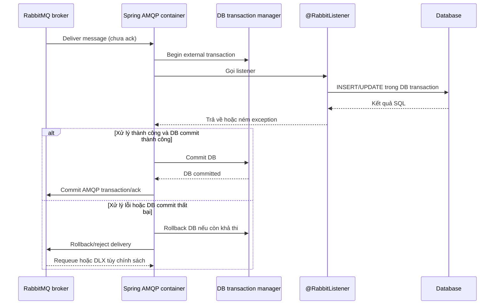
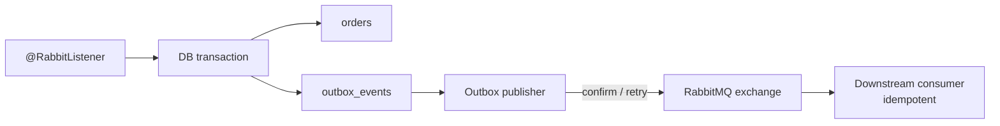

# `@Transactional` kết hợp `@RabbitListener` với giao dịch cơ sở dữ liệu trong Spring AMQP

## 1. Bài toán cần giải quyết

Trong hệ thống xử lý bất đồng bộ, một ứng dụng Spring AMQP có thể nhận sự kiện từ RabbitMQ rồi cập nhật cơ sở dữ liệu. Ví dụ, sau khi nhận sự kiện `OrderCreated`, consumer cập nhật trạng thái đơn hàng trong PostgreSQL và đánh dấu sự kiện đã được xử lý.

Vấn đề quan trọng: **khi ghi cơ sở dữ liệu thất bại, message đã được RabbitMQ ghi nhận là xử lý xong chưa?** Nếu database đã commit nhưng application bị dừng trước khi ack, liệu đơn hàng có bị xử lý hai lần?

`@Transactional` giúp quản lý transaction cơ sở dữ liệu, nhưng **bản thân annotation này không biến thao tác với RabbitMQ thành một giao dịch phân tán ACID**. Muốn hiểu và thiết kế đúng, phải phân biệt:

1. **Database transaction**: commit/rollback các thao tác SQL trong phạm vi `PlatformTransactionManager`.
2. **RabbitMQ consumer acknowledgment**: `basic.ack`, `basic.reject` hoặc `basic.nack` thông báo message đã xử lý hay cần giao lại.
3. **RabbitMQ channel transaction**: khi bật `channelTransacted`, các thao tác AMQP trên channel được commit/rollback thông qua `tx.commit`/`tx.rollback`.
4. **Transaction synchronization**: Spring AMQP có thể phối hợp transaction RabbitMQ với một transaction ngoài (chẳng hạn JDBC), theo mô hình **Best Efforts 1 Phase Commit**; đây **không phải XA/two-phase commit**.

Sau bài này, bạn sẽ biết cách cấu hình `@RabbitListener`, `@Transactional` và `channelTransacted`; xử lý ngoại lệ, retry, dead-letter; đồng thời bảo vệ nghiệp vụ trước khả năng redelivery. Nội dung nằm trong module **SPRING_AMQP**, nơi `RabbitTemplate`, listener, queue, binding, retry và quan sát được kết hợp để xây pipeline đáng tin cậy.

## 2. Phạm vi của `@Transactional`

Với Spring JDBC/JPA, một phương thức được gọi **qua Spring transaction proxy** và gắn `@Transactional` sẽ bắt đầu hoặc tham gia transaction do transaction manager tương ứng quản lý.

```java
@Service
public class OrderService {
    private final JdbcTemplate jdbc;

    public OrderService(JdbcTemplate jdbc) {
        this.jdbc = jdbc;
    }

    @Transactional
    public void confirmOrder(String orderId) {
        jdbc.update("UPDATE orders SET state = 'CONFIRMED' WHERE order_id = ?",
                    orderId);

        // Nếu ném RuntimeException tại đây, các câu SQL trong transaction
        // sẽ rollback theo cấu hình mặc định của Spring.
    }
}
```

Các đặc tính mặc định cần nhớ:

- `Propagation.REQUIRED`: tham gia transaction hiện tại nếu có, nếu không thì mở transaction mới.
- `RuntimeException` và `Error` thường kích hoạt rollback; **checked exception** mặc định **không** làm rollback, trừ khi đặt `rollbackFor` hoặc quy tắc phù hợp.
- Với `PlatformTransactionManager` thông thường (JDBC/JPA), ngữ cảnh transaction gắn với **thread** đang thực thi; gọi `@Async`, tự tạo thread hoặc trả `Mono` rồi chuyển sang luồng khác không tự mang transaction JDBC theo.
- Proxy Spring không chặn được lời gọi **self-invocation** (`this.confirmOrder(...)` từ một phương thức cùng bean). Đặt nghiệp vụ transaction trong **service bean riêng**, được listener inject và gọi qua proxy.

Đặt `@Transactional` ở service giúp bảo vệ các bước ghi DB cùng nhau. Tuy nhiên, Spring AMQP listener container vẫn quyết định khi nào ack/nack message theo **acknowledge mode và transaction configuration của container**. Do đó, cần nhìn toàn bộ ranh giới xử lý.

## 3. Kết hợp transaction DB và RabbitMQ: ba cấu hình

| Cấu hình | Transaction DB | RabbitMQ delivery/ack | Ý nghĩa |
| --- | --- | --- | --- |
| Listener gọi service `@Transactional`; container `AUTO` ack, `channelTransacted=false` | Service commit hoặc rollback SQL. | Container xử lý ack/reject theo kết quả listener, nhưng không dùng RabbitMQ channel transaction để đồng bộ với DB. | Dễ triển khai; vẫn có khoảng hở giữa DB commit và broker nhận ack. |
| Container gắn **DB `PlatformTransactionManager`** và `channelTransacted=true`; listener gọi service `@Transactional` | Container bao transaction DB quanh xử lý; service `REQUIRED` tham gia. | AMQP channel transaction được đồng bộ theo transaction ngoài; khi DB rollback, RabbitMQ rollback/reject theo cơ chế Spring AMQP. | **Best Efforts 1 Phase Commit**; hữu ích để phối hợp kết quả nhưng không atomic tuyệt đối qua hai hệ thống. |
| `RabbitTransactionManager` đơn lẻ | **Không** tự quản lý transaction SQL. | Quản lý transaction của RabbitMQ channel. | Không thay thế `DataSourceTransactionManager`/`JdbcTransactionManager`/`JpaTransactionManager` cho DB. |

Để kết hợp DB và RabbitMQ, cấu hình thường dùng ở đây là hàng thứ hai. Theo tài liệu Spring AMQP, nếu container sử dụng external transaction manager **nhưng không bật** `channelTransacted`, các thao tác messaging có thể được auto-ack độc lập, kể cả khi nghiệp vụ rollback; vì vậy không nên mặc định suy ra hai phần đã được phối hợp chỉ từ việc thấy transaction manager.

### Luồng xử lý có đồng bộ giao dịch



Sơ đồ mô tả thứ tự **khái niệm** của transaction synchronization, không phải lời hứa rằng hai hệ thống commit nguyên tử. Ví dụ, DB đã commit nhưng RabbitMQ commit/ack thất bại vẫn có thể khiến message được giao lại.

## 4. Thiết lập ví dụ Spring Boot, PostgreSQL và RabbitMQ

Ví dụ sau dùng Java 17+, Spring Boot có Spring AMQP + JDBC, PostgreSQL và một RabbitMQ broker. Giả sử queue nhận sự kiện có tên `orders.created.q`, queue dead-letter là `orders.failed.q`.

Dependency Maven (version được quản lý bởi BOM của Spring Boot):

```xml
<dependency>
    <groupId>org.springframework.boot</groupId>
    <artifactId>spring-boot-starter-amqp</artifactId>
</dependency>
<dependency>
    <groupId>org.springframework.boot</groupId>
    <artifactId>spring-boot-starter-jdbc</artifactId>
</dependency>
<dependency>
    <groupId>org.postgresql</groupId>
    <artifactId>postgresql</artifactId>
    <scope>runtime</scope>
</dependency>
```

Kết nối ứng dụng ở `application.yml` (thay địa chỉ và thông tin xác thực theo môi trường):

```yaml
spring:
  datasource:
    url: jdbc:postgresql://localhost:5432/orders_db
    username: orders_app
    password: replace_me
  rabbitmq:
    host: localhost
    port: 5672
    username: guest
    password: guest
```

Với PostgreSQL, tạo schema minh họa:

```sql
CREATE TABLE orders (
    order_id VARCHAR(64) PRIMARY KEY,
    state VARCHAR(20) NOT NULL
);

CREATE TABLE processed_messages (
    event_id VARCHAR(64) PRIMARY KEY,
    order_id VARCHAR(64) NOT NULL
);

INSERT INTO orders (order_id, state)
VALUES ('ORDER-1001', 'NEW'),
       ('ORDER-1002', 'NEW');
```

`processed_messages.event_id` có unique constraint qua primary key để ngăn xử lý lặp một message/sự kiện. Hai bảng này sẽ được cập nhật **trong cùng một DB transaction**, nên nếu cập nhật đơn hàng thất bại, dấu vết đã xử lý cũng phải rollback.

### 4.1. Khai báo topology và DLQ

```java
import org.springframework.amqp.core.BindingBuilder;
import org.springframework.amqp.core.Declarables;
import org.springframework.amqp.core.DirectExchange;
import org.springframework.amqp.core.Queue;
import org.springframework.amqp.core.QueueBuilder;
import org.springframework.context.annotation.Bean;
import org.springframework.context.annotation.Configuration;

@Configuration
public class OrderTopology {

    @Bean
    Declarables orderDeclarables() {
        Queue work = QueueBuilder.durable("orders.created.q")
                .deadLetterExchange("orders.dlx")
                .deadLetterRoutingKey("orders.failed")
                .build();

        DirectExchange dlx = new DirectExchange("orders.dlx", true, false);
        Queue dead = QueueBuilder.durable("orders.failed.q").build();

        return new Declarables(
                work,
                dlx,
                dead,
                BindingBuilder.bind(dead).to(dlx).with("orders.failed")
        );
    }
}
```

Queue nguồn nhận message qua default exchange `""` với routing key bằng tên queue `orders.created.q`. Khi message bị reject với `requeue=false`, broker định tuyến qua `orders.dlx` sang `orders.failed.q`. DLX chỉ là nơi chuyển tiếp message; **DLQ không tự được tạo bởi việc khai báo một mình DLX**.

Nếu queue đã tồn tại với một bộ x-arguments khác, việc redeclare có thể báo `PRECONDITION_FAILED - inequivalent arg`. Trong hệ thống đang chạy, cần lên phương án thay đổi topology trước khi thử cấu hình khác.

### 4.2. Cấu hình listener container với DB transaction manager

```java
import org.springframework.amqp.core.AcknowledgeMode;
import org.springframework.amqp.rabbit.config.SimpleRabbitListenerContainerFactory;
import org.springframework.amqp.rabbit.connection.ConnectionFactory;
import org.springframework.beans.factory.annotation.Qualifier;
import org.springframework.context.annotation.Bean;
import org.springframework.context.annotation.Configuration;
import org.springframework.transaction.PlatformTransactionManager;

@Configuration
public class RabbitListenerTxConfig {

    @Bean("dbRabbitListenerContainerFactory")
    SimpleRabbitListenerContainerFactory dbRabbitListenerContainerFactory(
            ConnectionFactory rabbitConnectionFactory,
            @Qualifier("transactionManager")
            PlatformTransactionManager dbTransactionManager) {

        SimpleRabbitListenerContainerFactory factory =
                new SimpleRabbitListenerContainerFactory();
        factory.setConnectionFactory(rabbitConnectionFactory);

        // DB manager: JdbcTransactionManager / DataSourceTransactionManager
        // hoặc JpaTransactionManager, tùy persistence layer của ứng dụng.
        factory.setTransactionManager(dbTransactionManager);

        // Cho phép channel AMQP tham gia cơ chế đồng bộ giao dịch.
        factory.setChannelTransacted(true);

        // Container tự ack/nack, không tự gọi basicAck trong listener.
        factory.setAcknowledgeMode(AcknowledgeMode.AUTO);
        factory.setPrefetchCount(10);
        factory.setConcurrentConsumers(2);

        // Chỉ dành cho demo: lỗi sau rollback sẽ được reject không requeue;
        // queue có DLX sẽ chuyển message sang DLQ.
        factory.setDefaultRequeueRejected(false);
        return factory;
    }
}
```

Ở ví dụ JDBC này, giả sử Spring Boot đã tạo DB `PlatformTransactionManager` tên `transactionManager` (điển hình khi chỉ có một transaction manager). Nếu ứng dụng có nhiều manager, hãy đặt tên/`@Qualifier` rõ ràng và bảo đảm cả container lẫn service chọn **cùng DB manager**. Không tiêm `RabbitTransactionManager` vào đây với kỳ vọng nó quản lý PostgreSQL.

`AcknowledgeMode.AUTO` nghĩa là **Spring AMQP container tự quyết định ack khi listener thành công và reject khi thất bại**; nó không đồng nghĩa với RabbitMQ `autoAck=true`. Chế độ `NONE` của Spring AMQP mới tương ứng broker autoack và không phù hợp với `channelTransacted=true`.

## 5. Service `@Transactional` và listener

### 5.1. Thao tác DB idempotent

```java
import org.springframework.jdbc.core.JdbcTemplate;
import org.springframework.stereotype.Service;
import org.springframework.transaction.annotation.Transactional;

@Service
public class OrderService {
    private final JdbcTemplate jdbc;

    public OrderService(JdbcTemplate jdbc) {
        this.jdbc = jdbc;
    }

    @Transactional(transactionManager = "transactionManager")
    public void confirmOrder(String eventId, String orderId) {
        // PostgreSQL: cùng event_id đã commit -> không xử lý lại.
        int inserted = jdbc.update("""
                INSERT INTO processed_messages(event_id, order_id)
                VALUES (?, ?)
                ON CONFLICT (event_id) DO NOTHING
                """, eventId, orderId);

        if (inserted == 0) {
            return; // Bản sao của sự kiện đã xử lý thành công trước đó.
        }

        int changed = jdbc.update("""
                UPDATE orders
                   SET state = 'CONFIRMED'
                 WHERE order_id = ?
                   AND state = 'NEW'
                """, orderId);

        if (changed != 1) {
            // RuntimeException làm rollback cả INSERT processed_messages.
            throw new IllegalStateException(
                    "Không thể chuyển trạng thái đơn hàng: " + orderId);
        }
    }
}
```

Điểm mấu chốt: `INSERT processed_messages` và `UPDATE orders` nằm trong **cùng transaction**. Nếu `UPDATE` thất bại, `INSERT` cũng rollback; message chưa bị coi là “đã xử lý” ở lần giao lại.

Ví dụ dùng cú pháp `ON CONFLICT` đặc thù **PostgreSQL**. Với MySQL, SQL Server hoặc JPA, cần thay bằng cơ chế insert idempotent tương ứng và bảo đảm ràng buộc unique ở **cơ sở dữ liệu**, không chỉ kiểm tra `SELECT` rồi mới `INSERT` (cách đó có race condition).

### 5.2. Listener gọi service qua Spring proxy

```java
import org.springframework.amqp.AmqpRejectAndDontRequeueException;
import org.springframework.amqp.rabbit.annotation.RabbitListener;
import org.springframework.stereotype.Component;

@Component
public class OrderCreatedListener {
    private final OrderService orderService;

    public OrderCreatedListener(OrderService orderService) {
        this.orderService = orderService;
    }

    @RabbitListener(
        queues = "orders.created.q",
        containerFactory = "dbRabbitListenerContainerFactory"
    )
    public void onMessage(String payload) {
        // Format demo: eventId|orderId. Production nên dùng JSON/Avro
        // với schema, version và message converter rõ ràng.
        String[] parts = payload.split("\\|", -1);
        if (parts.length != 2 || parts[0].isBlank() || parts[1].isBlank()) {
            throw new AmqpRejectAndDontRequeueException(
                    "Payload không hợp lệ: " + payload);
        }

        orderService.confirmOrder(parts[0], parts[1]);
    }
}
```

Trong cấu hình này, container mở DB transaction cho việc nhận/xử lý message, còn `OrderService.confirmOrder` mang `@Transactional(REQUIRED)` nên **tham gia transaction hiện tại**. Khi service ném exception, listener không nuốt lỗi; container quan sát được thất bại và tiến hành rollback/reject theo cấu hình.

Tại sao vẫn gắn `@Transactional` trên service nếu container đã có DB transaction manager? Vì method nghiệp vụ có thể được gọi từ entrypoint khác; annotation bảo vệ tính toàn vẹn SQL và làm rõ ranh giới trong service. Nhưng **cần container configuration** để phối hợp kết quả xử lý message với AMQP channel transaction. Hai trách nhiệm này liên quan nhưng không giống nhau.

### 5.3. Gửi message thử nghiệm

```java
import org.springframework.amqp.rabbit.core.RabbitTemplate;

// RabbitTemplate được Spring Boot inject vào service/test runner.
rabbitTemplate.convertAndSend(
        "", "orders.created.q", "EVT-0001|ORDER-1001");
```

Đảm bảo có sẵn dòng `orders(order_id='ORDER-1001', state='NEW')` trước khi gửi. Sau khi xử lý:

```sql
SELECT order_id, state
FROM orders WHERE order_id = 'ORDER-1001';

SELECT event_id, order_id
FROM processed_messages WHERE event_id = 'EVT-0001';
```

Kỳ vọng: `ORDER-1001` chuyển sang `CONFIRMED` và `EVT-0001` được ghi đúng một lần. Khi gửi lại **cùng** `EVT-0001|ORDER-1001`, câu `INSERT ... ON CONFLICT DO NOTHING` trả 0, phương thức kết thúc thành công và message trùng được ack mà không lặp nghiệp vụ.

## 6. Điều gì xảy ra khi thành công, lỗi SQL hoặc lỗi commit?

### 6.1. Thành công

1. Broker giao message cho consumer, message đang ở trạng thái **unacked**.
2. Container mở transaction ngoài bằng DB transaction manager và dùng AMQP channel transaction.
3. Service ghi `processed_messages` rồi cập nhật `orders`.
4. Listener hoàn tất, DB commit thành công.
5. Spring AMQP hoàn tất giao dịch AMQP theo transaction synchronization; broker ghi nhận ack.

Đây là luồng thuận lợi. Nó **không loại bỏ** khả năng ứng dụng bị dừng ở giữa bước 4 và 5.

### 6.2. Lỗi SQL trong lúc xử lý

Ví dụ gửi `EVT-0002|ORDER-NOT-FOUND`. Method sẽ chèn marker rồi cập nhật 0 dòng, ném `IllegalStateException`. Theo cấu hình ví dụ:

- Transaction DB rollback cả hai thao tác: marker `EVT-0002` **không** được lưu.
- RabbitMQ channel transaction bị rollback; Spring AMQP xử lý reject message sau rollback.
- Do `defaultRequeueRejected(false)`, broker sẽ dead-letter message vào `orders.failed.q` nếu DLX/binding hợp lệ.

Nếu thay bằng `defaultRequeueRejected(true)` (mặc định), message lỗi có thể được requeue và giao lại, dẫn tới **vòng lặp lỗi vô hạn**. Production nên phân loại lỗi tạm thời, retry có giới hạn, backoff và DLQ.

### 6.3. Database commit thành công nhưng RabbitMQ commit thất bại

Đây là failure window quan trọng của **Best Efforts 1 Phase Commit**:

```text
PostgreSQL COMMIT  -->  [tiến trình chết / mạng RabbitMQ đứt]
                                     |
                          broker chưa ghi nhận ack
                                     |
                           message có thể redeliver
                                     |
                 idempotency key giúp tránh xử lý lặp
```

Spring không thể rollback một DB transaction **đã commit thành công** chỉ vì RabbitMQ commit về sau thất bại. Do đó:

- Đừng hứa “exactly once” end-to-end chỉ vì dùng `@Transactional` và `channelTransacted=true`.
- Giả định **at-least-once delivery/processing attempts** và thiết kế consumer **idempotent**.
- Quan sát lỗi giao dịch RabbitMQ sau commit; tài liệu Spring AMQP mô tả `ConnectionFactoryUtils.enableAfterCompletionFailureCapture(true)` và `ConnectionUtils.checkAfterCompletion()` để lấy lỗi sau completion trên cùng thread ở các phiên bản hỗ trợ. Cơ chế capture này **không làm commit trở nên atomic**.

## 7. Những cách dùng dễ sai

### 7.1. Chỉ đặt `@Transactional` trên listener rồi mặc định “đủ an toàn”

```java
// Chỉ minh họa: DB transaction có thể hoạt động, nhưng cấu hình này
// chưa chứng minh RabbitMQ channel transaction được đồng bộ.
@RabbitListener(queues = "orders.created.q")
@Transactional
public void onMessage(String payload) {
    orderService.confirmOrder("EVT-0003", "ORDER-1002");
}
```

Nếu có đúng DB transaction manager, annotation có thể mở transaction DB quanh method listener thông qua proxy. Nhưng **nó không tự thay thế việc cấu hình transaction cho listener container và channel AMQP**. Khi cần phối hợp đầy đủ hơn, chỉ rõ `containerFactory` có `setTransactionManager(...)` và `setChannelTransacted(true)` như mục 4.

### 7.2. Nuốt exception làm transaction commit ngoài ý muốn

```java
// SAI: lỗi nghiệp vụ bị bỏ qua; listener nhìn như hoàn tất thành công.
@RabbitListener(queues = "orders.created.q")
public void incorrect(String payload) {
    try {
        orderService.confirmOrder("EVT-X", "ORDER-UNKNOWN");
    } catch (Exception ex) {
        log.warn("Lỗi nhưng tiếp tục", ex);
    }
}
```

Đoạn trên là **phản ví dụ**, không khai báo chạy cùng listener chính. Nếu exception bị bắt và không ném lại, container có thể ack message. Trong trường hợp service mở transaction riêng và rollback rồi nhưng listener trả về thành công, message vẫn có thể bị mất khỏi queue mà nghiệp vụ chưa đạt kết quả mong muốn.

Với lỗi cần rollback, hãy để exception nổi lên tới transaction interceptor/container hoặc chủ động đánh dấu rollback-only khi có chủ đích. **Ghi log không thay thế việc báo thất bại cho transaction manager.**

### 7.3. Gọi method `@Transactional` trong cùng bean

```java
@Component
public class WrongListener {

    @RabbitListener(queues = "orders.created.q")
    public void onMessage(String payload) {
        this.updateDatabase(); // Gọi nội bộ, bỏ qua transactional proxy.
    }

    @Transactional
    public void updateDatabase() {
        // Không chắc annotation có tạo transaction mới như mong đợi.
    }
}
```

Đây cũng là phản ví dụ; khi áp dụng bài thực hành, **chỉ giữ một listener tiêu thụ queue** để quan sát hành vi. Cách nên dùng là listener inject một `@Service` khác và gọi public method qua Spring proxy.

### 7.4. Không đồng bộ transaction khi chuyển thread

```java
// SAI đối với mục tiêu xử lý transaction đồng bộ ở đây:
@RabbitListener(queues = "orders.created.q")
public void fireAndForget(String payload) {
    CompletableFuture.runAsync(() -> orderService.confirmOrder("EVT-X", "ORDER-X"));
    // Listener trả về trước khi DB operation hoàn tất.
}
```

Container có thể ack trước khi tác vụ background chạy xong. Transaction DB ràng buộc với thread của tác vụ nếu service được gọi qua proxy ở thread mới, nhưng **transaction listener/container trước đó không tự kéo dài theo task**. Tương tự, listener trả `Mono` hoặc `CompletableFuture` theo hỗ trợ async return phải dùng mô hình ack bất đồng bộ riêng; không mặc định kết hợp trong cùng ví dụ transaction synchronous này.

### 7.5. Lẫn `RabbitTransactionManager` với DB transaction manager

`RabbitTransactionManager` chỉ quản lý RabbitMQ transaction với một Rabbit `ConnectionFactory`. Nó **không** commit/rollback PostgreSQL hoặc thay thế `JpaTransactionManager`. Dùng nhầm manager có thể khiến một phần nghiệp vụ chạy ngoài transaction dự kiến. Khi có nhiều manager, đặt tên tường minh và chọn bằng `@Qualifier`/`transactionManager` trong annotation.

### 7.6. Cho cả transaction DB bao quanh I/O chậm

Gọi HTTP bên ngoài khi đang giữ DB transaction lâu làm tăng lock contention, connection occupancy và độ trễ ack. Với bước HTTP/DB phức tạp, cân nhắc chia ranh giới nghiệp vụ, Saga, outbox hoặc các cơ chế bù trừ; không kéo dài transaction SQL vô hạn chỉ để chờ một hệ thống khác.

## 8. Khi xử lý message còn cần publish message mới

Giả sử sau khi cập nhật `orders`, hệ thống phải gửi sự kiện `OrderConfirmed` cho dịch vụ khác.

```java
@Transactional
public void confirmAndPublish(String eventId, String orderId) {
    // 1. Cập nhật đơn hàng trong DB.
    orderService.confirmOrder(eventId, orderId);

    // 2. Publish sự kiện mới.
    rabbitTemplate.convertAndSend("orders.events", "orders.confirmed", orderId);
}
```

Phương thức trên **không tự bảo đảm** DB commit và RabbitMQ publish luôn cùng thành công. Cấu hình `channelTransacted=true` cho các thao tác Spring AMQP trong transaction đang chạy cho phép chúng tham gia transaction RabbitMQ được đồng bộ với DB, nhưng vẫn là **Best Efforts 1 Phase Commit**. Khi có sự cố sau DB commit, event có thể không được publish thành công.

Đối với nghiệp vụ đòi hỏi tránh mất sự kiện, một giải pháp phổ biến là **Transactional Outbox**:

1. Trong **một DB transaction**, cập nhật bảng nghiệp vụ **và** chèn bản ghi vào bảng `outbox_events`.
2. Chỉ sau DB commit, một publisher riêng đọc outbox chưa gửi và publish sang RabbitMQ.
3. Dùng **publisher confirms**, retry và trạng thái outbox để biết message đã được broker chấp nhận; với routing quan trọng, kiểm tra thêm publisher returns/routing.
4. Publisher có thể gửi trùng sau sự cố giữa broker confirm và cập nhật trạng thái outbox, nên consumer vẫn cần idempotency.



**Outbox không làm RabbitMQ và database chia sẻ một XA transaction**; nó biến yêu cầu gửi message thành dữ liệu bền vững trong transaction DB và cho phép gửi lại có kiểm soát.

## 9. Phân loại lỗi, retry và DLQ

| Trường hợp | Hành động DB | Hành động messaging nên cân nhắc |
| --- | --- | --- |
| Xử lý thành công | Commit. | Ack. |
| Nhận lại cùng `event_id` đã xử lý | Không ghi trùng; trả về thành công. | Ack để bỏ bản sao. |
| Payload sai schema/thiếu dữ liệu | Không cập nhật, rollback nếu đã bắt đầu. | Reject không requeue → DLQ đã cấu hình. |
| DB timeout/mất kết nối tạm thời | Rollback. | Retry **có giới hạn và backoff**, rồi DLQ nếu hết cơ hội. |
| Ràng buộc nghiệp vụ không hợp lệ | Rollback. | Phân loại lỗi vĩnh viễn, đưa DLQ để điều tra. |
| DB commit xong nhưng ack broker thất bại | DB giữ dữ liệu đã commit. | Có thể redeliver; idempotency giúp trả về thành công khi nhận lại. |

Spring AMQP mặc định thường có `defaultRequeueRejected=true`. Trong **bài demo**, ta đặt `false` để lỗi đi thẳng DLQ; trong production, có thể dùng interceptor retry có state, recoverer, retry queue TTL và DLX để kiểm soát số lần thử. Không xử lý lỗi tạm thời bằng vòng lặp requeue vô hạn.

Khi consumer reject message và queue không có DLX hoặc route DLX không khớp, message có thể bị **discard**. Muốn dựa vào DLQ, cần giám sát exchange, binding, routing key, quyền truy cập và số message đã vào `orders.failed.q`.

Để tránh nhầm lẫn với transaction DB: RabbitMQ **ack** cho một delivery và **publisher confirm** cho một message được gửi là **hai cơ chế khác nhau**. RabbitMQ channel transaction (`tx.select`/`tx.commit`) cũng khác publisher confirm mode; chúng không được kích hoạt đồng thời trên cùng channel.

## 10. Kiểm thử kết hợp và quan sát vận hành

### Các ca kiểm thử nên có

1. **Đường thành công:** seed `ORDER-1001=NEW`, gửi `EVT-0001|ORDER-1001`; DB có trạng thái `CONFIRMED` và marker `EVT-0001`, message hết khỏi hàng đợi chính.
2. **Redelivery:** gửi lại cùng `EVT-0001|ORDER-1001`; không tạo thêm hiệu ứng DB, message được ack.
3. **Rollback DB:** gửi `EVT-0002|ORDER-NOT-FOUND`; không để lại marker `EVT-0002`, message chuyển DLQ với cấu hình demo.
4. **Payload lỗi:** gửi `INVALID`; listener ném `AmqpRejectAndDontRequeueException`, không có cập nhật DB, message đi DLQ.
5. **Ngắt kết nối RabbitMQ sau DB commit:** thử trong môi trường tích hợp kiểm soát được fault injection. Message có thể giao lại; xác minh logic idempotent hoạt động.
6. **Lỗi DB tạm thời:** mô phỏng DB unavailable và xác nhận chính sách retry/DLQ được thiết lập theo kỳ vọng, không tạo chu kỳ vô tận.

### Kiểm tra bằng SQL và RabbitMQ

```sql
SELECT * FROM orders ORDER BY order_id;
SELECT * FROM processed_messages ORDER BY event_id;
```

```bash
rabbitmqctl list_queues -p / name messages_ready messages_unacknowledged
```

Trong RabbitMQ Management UI, xem queue `orders.created.q` và `orders.failed.q`, số ready/unacked, tốc độ ack/nack, redelivery và thông tin header `x-death` trên message trong DLQ. Đồng thời theo dõi metrics transaction rollback của DB, connection pool, thời gian transaction và log lỗi commit sau completion.

**Dấu hiệu cần điều tra:** số `messages_unacknowledged` tăng kéo dài, DB lock/connection pool chạm giới hạn, message cứ quay lại nhiều lần, DLQ lớn dần hoặc có event được đánh dấu đã xử lý trong DB nhưng hệ thống downstream không thấy sự kiện tương ứng.

## 11. Câu hỏi tự kiểm tra

**Câu 1.** Service `@Transactional` cập nhật PostgreSQL thành công nhưng tiến trình chết trước khi RabbitMQ ghi nhận ack. Message có thể được gửi lại không? Vì sao?

**Câu 2.** Đặt `factory.setTransactionManager(dbManager)` nhưng bỏ `factory.setChannelTransacted(true)` có đồng bộ transaction RabbitMQ với DB như ví dụ không?

**Câu 3.** Vì sao dùng `RabbitTransactionManager` duy nhất không đủ để rollback SQL?

**Câu 4.** Nếu listener bắt exception từ service rồi chỉ ghi log, broker có thể hiểu message đã xử lý thành công không?

**Câu 5.** Khi cần cập nhật DB và phát thêm event RabbitMQ với yêu cầu tin cậy cao, pattern nào nên cân nhắc, và vì sao consumer vẫn cần idempotency?

**Gợi ý đáp án:** (1) Có; DB commit và broker ack không cùng một atomic commit. (2) Không; cần channel transacted để đồng bộ AMQP transaction với transaction ngoài. (3) Manager đó quản lý RabbitMQ channel, không quản lý JDBC/JPA. (4) Có; nếu listener trả về bình thường, container có thể ack. (5) Transactional Outbox; khi publisher retry sau khi đã gửi nhưng chưa kịp đánh dấu outbox, duplicate vẫn có thể xuất hiện.

## 12. Kết luận

`@Transactional` giữ cho các thao tác cơ sở dữ liệu trong Spring được commit hoặc rollback đúng ranh giới. Khi consumer Spring AMQP cũng phải quyết định ack/requeue, cần cấu hình và hiểu listener container: `AcknowledgeMode.AUTO`, **DB `PlatformTransactionManager`** và `channelTransacted=true` cho trường hợp muốn phối hợp AMQP transaction với DB transaction. Sự phối hợp này là **Best Efforts 1 Phase Commit**; nó giúp xử lý các lỗi thông thường nhưng **không bảo đảm exactly-once xuyên RabbitMQ và DB**.

Hệ thống đáng tin cậy cần thêm **unique event ID, idempotent consumer, retry giới hạn, DLQ, quan sát metrics** và **Transactional Outbox** nếu có luồng phát sự kiện sau khi ghi DB.

## Tài liệu tham khảo

- [Spring AMQP — Transactions](https://docs.spring.io/spring-amqp/reference/amqp/transactions.html): `channelTransacted`, external transaction manager, best-efforts one-phase commit, commit failure và rollback/requeue.
- [Spring AMQP — Message Listener Container Configuration](https://docs.spring.io/spring-amqp/reference/amqp/containerAttributes.html): `acknowledgeMode`, `transactionManager`, `defaultRequeueRejected` và các tham số container.
- [Spring AMQP — Resilience: Recovering from Errors and Broker Failures](https://docs.spring.io/spring-amqp/reference/amqp/resilience-recovering-from-errors-and-broker-failures.html): xử lý reject, retry và dead-letter.
- [Spring Framework — Using `@Transactional`](https://docs.spring.io/spring-framework/reference/data-access/transaction/declarative/annotations.html): proxy, propagation và rollback rules.
- [Spring Framework — Understanding Declarative Transaction Implementation](https://docs.spring.io/spring-framework/reference/data-access/transaction/declarative/tx-decl-explained.html): thread-bound transactions và reactive transactions.
- [RabbitMQ — Consumer Acknowledgements and Publisher Confirms](https://www.rabbitmq.com/docs/confirms): requeue, idempotent consumers, xác nhận publish và giới hạn cơ chế transaction.
