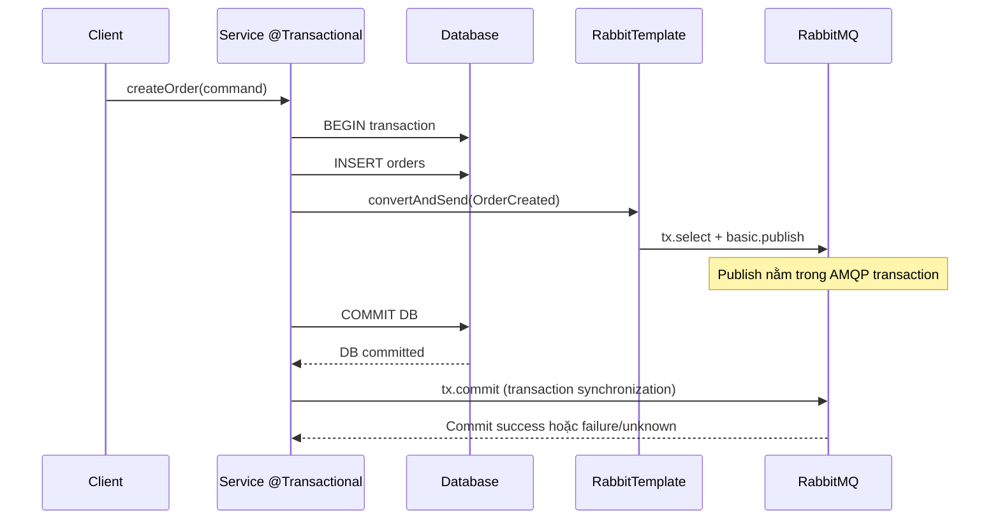
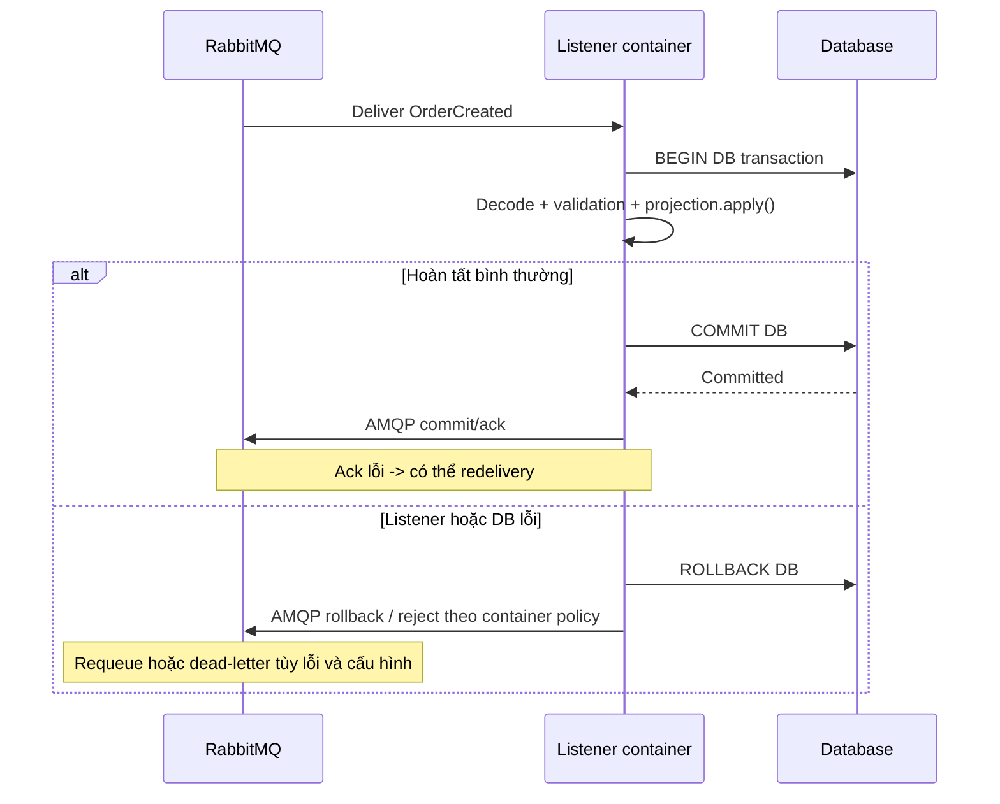
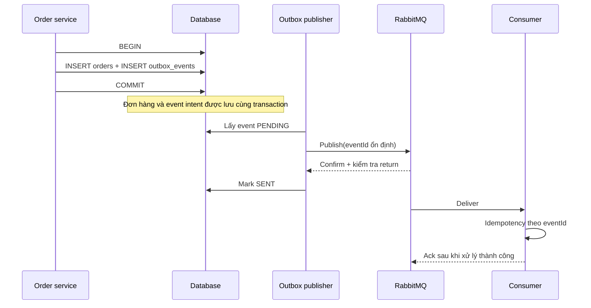

# Đồng bộ giao dịch cơ sở dữ liệu và AMQP theo best-efforts one-phase commit

> **Chương:** Giao dịch  
> **Module:** SPRING_AMQP — tích hợp RabbitMQ với Spring AMQP bằng `RabbitTemplate`, `@RabbitListener`, exchange, queue và binding; tìm hiểu xác nhận giao nhận, retry, dead-letter, giao dịch và quan sát để xây dựng xử lý bất đồng bộ đáng tin cậy.
>
> **Nội dung chính:** Phối hợp transaction của cơ sở dữ liệu với AMQP channel transaction bằng cơ chế **best-efforts one-phase commit (BE1PC)** của Spring AMQP, hiểu giới hạn nhất quán dữ liệu và lựa chọn giải pháp khôi phục phù hợp.

## 1. Mục tiêu học tập

Sau bài này, bạn có thể:

1. Phân biệt database transaction, AMQP channel transaction, Spring transaction synchronization và XA/two-phase commit.
2. Cấu hình `RabbitTemplate.channelTransacted=true` và `@Transactional` với database transaction manager để dùng cơ chế BE1PC khi publish.
3. Cấu hình `@RabbitListener`, listener container và transaction manager để cập nhật database rồi xác nhận message có kiểm soát.
4. Phân tích các cửa sổ lỗi, đặc biệt khi database đã commit nhưng RabbitMQ commit thất bại hoặc có kết quả không rõ ràng.
5. Dùng idempotency, retry, DLQ, audit và kiểm thử fault injection để giảm tác động của mất message hoặc delivery trùng.
6. So sánh BE1PC với transactional outbox/inbox để quyết định giải pháp cho nghiệp vụ quan trọng.

### Bối cảnh xuyên suốt

Dịch vụ đặt hàng ghi `Order` vào PostgreSQL và phát sự kiện `OrderCreated` tới RabbitMQ để dịch vụ báo cáo và tồn kho xử lý. Hai hành động này phải gắn kết với nhau: không nên phát sự kiện cho đơn hàng đã rollback, nhưng cũng không nên ghi đơn hàng thành công mà bỏ sót sự kiện.

Nếu code thực hiện `INSERT orders` rồi `rabbitTemplate.convertAndSend(...)` mà không có cơ chế phối hợp, database có thể rollback trong khi message đã ra broker. BE1PC giúp điều phối nhiều trường hợp rollback thông thường. Tuy nhiên **nó không tạo một giao dịch phân tán nguyên tử**: khi một hệ thống đã commit, hệ thống kia vẫn có thể thất bại.

## 2. Nắm vững các giao dịch trước khi cấu hình

| Cơ chế | Nó kiểm soát gì? | Ví dụ | Giới hạn |
|---|---|---|---|
| Database transaction | Các thao tác trên database được quản lý bởi một transaction manager | `@Transactional` với `DataSourceTransactionManager` | Không tự rollback hay commit RabbitMQ. |
| AMQP channel transaction | Các lệnh publish/ack trên một AMQP channel có giao dịch | `tx.select`, `tx.commit`, `tx.rollback` | Không bao gồm các thao tác JDBC. |
| Spring transaction synchronization | Cho phép tài nguyên tham gia vào vòng đời transaction Spring đang hoạt động | `RabbitTemplate` có `channelTransacted=true` trong DB transaction | Phối hợp commit theo best effort, không phải atomic commit. |
| Distributed/XA two-phase commit | Điều phối prepare rồi commit nhiều resource có hỗ trợ XA | XA coordinator và XA-capable resource manager | RabbitMQ AMQP 0.9.1 không cung cấp XA như một XA-capable database. |

### 2.1. “Best-efforts one-phase commit” nghĩa là gì?

**One-phase** ở đây nghĩa là không có pha chuẩn bị phân tán để tất cả tài nguyên đồng thời hứa rằng chúng đã sẵn sàng commit. Thay vào đó, mỗi tài nguyên được yêu cầu commit cục bộ. **Best-efforts** nghĩa là framework cố gắng phối hợp commit/rollback và báo lỗi; nhưng không thể hoàn tác một transaction đã commit ở tài nguyên khác.

Trong Spring AMQP, khi `RabbitTemplate` sử dụng transactional channel và có transaction Spring bên ngoài (ví dụ JDBC), phần giao dịch AMQP được đồng bộ với transaction chính. Luồng phối hợp thông thường sẽ **commit database trước, rồi commit AMQP tại giai đoạn hoàn tất transaction**.

Điều này tạo một khoảng thời gian ngắn nhưng quan trọng:

```text
DB COMMIT thành công  --->  [cửa sổ sự cố]  --->  AMQP COMMIT
                                                    ^
                 nếu mất kết nối ở đây, DB không thể tự rollback
```

Vì vậy, BE1PC phù hợp với hệ thống hiểu và chấp nhận rủi ro còn lại, có cách đối soát hoặc bù trừ. Nó không đồng nghĩa **exactly-once**, **atomic DB + RabbitMQ** hay **mất message là bất khả thi**.

### 2.2. Hai kiểu luồng cần đánh giá riêng

**Outbound:** Service ghi DB rồi publish message. Điểm rủi ro là **DB có dữ liệu nhưng event bị thiếu hoặc kết quả publish không chắc chắn**.

**Inbound:** Rabbit listener nhận message rồi ghi DB. Điểm rủi ro là **DB đã commit nhưng ack AMQP thất bại**, khiến RabbitMQ có thể redeliver và nghiệp vụ bị áp dụng hai lần nếu consumer không idempotent.

Hai trường hợp dùng cùng tư duy transaction synchronization, nhưng phương án khôi phục khác nhau: outbound thường cần outbox, inbound thường cần inbox/deduplication.

## 3. Đường đi khi publish trong một DB transaction



Nếu service ném unchecked exception trước lúc DB commit, Spring rollback transaction DB và yêu cầu rollback transaction AMQP tham gia. Ngược lại, nếu DB commit thành công nhưng AMQP commit xảy ra lỗi thì database không còn rollback được chỉ bằng `@Transactional`.

| Trường hợp | DB | AMQP | Nhận xét |
|---|---|---|---|
| Lỗi validation trước khi ghi/publish | Không đổi | Không publish | Không có trạng thái lệch. |
| Runtime exception trước DB commit | Rollback | Được yêu cầu rollback cùng transaction | Xử lý rollback phối hợp trong tình huống thông thường. |
| DB commit thất bại | Không commit hoặc phải đối chiếu trạng thái DB | Được yêu cầu rollback | Cần điều tra nguồn lỗi và trạng thái thực tế khi có mất kết nối. |
| DB commit thành công, AMQP commit thành công | Committed | Committed | Vẫn phải kiểm tra routing và thành công phía consumer. |
| DB commit thành công, AMQP commit thất bại | **Committed** | Có thể chưa commit | Cửa sổ không nhất quán của BE1PC. |
| DB commit thành công, phản hồi AMQP commit bị mất | **Committed** | **Unknown** | Publish lại có thể tạo duplicate nếu broker đã commit. |

**Quan trọng:** `RabbitTemplate.convertAndSend()` trả về thành công **không có nghĩa transaction AMQP đã commit xong**. AMQP commit diễn ra ở bước hoàn tất transaction; lỗi tại thời điểm đó có thể được ghi nhận qua transaction synchronization/after-completion, tùy phiên bản và cấu hình. Không coi một HTTP 200 hoặc việc `convertAndSend` không ném lỗi là bằng chứng event đã đến queue đích.

### AMQP transaction khác publisher confirms

RabbitMQ hỗ trợ cả giao dịch channel (`tx.select/commit/rollback`) và publisher confirms (`confirm.select`), nhưng **không sử dụng đồng thời hai chế độ trên cùng một channel**. Transaction commit xác nhận lệnh giao dịch trên broker; nó cũng không bảo đảm message được route tới queue mong muốn nếu exchange/binding/routing key sai.

Publisher confirms, mandatory returns, consumer acknowledgments và DLQ đáp ứng các câu hỏi khác nhau:

- **Publisher confirm:** broker đã xử lý publish ở cấp broker hay chưa; không có nghĩa consumer xử lý xong.
- **Mandatory return:** publish không route được về queue nào hay không; cần đối chiếu với confirm trong mô hình publish sử dụng confirms.
- **Consumer ack:** consumer đã xác nhận delivery sau khi hoàn tất trách nhiệm của nó.
- **DLQ:** nơi giữ message bị reject/expired hoặc gặp điều kiện dead-letter; không tự ngăn duplicate delivery.

Với BE1PC, nên coi AMQP transaction là cơ chế của chính luồng này; với outbox, publisher riêng thường chọn publisher confirms để kiểm soát từng event và throughput.

## 4. Các thiết lập Spring AMQP quyết định BE1PC

### 4.1. `channelTransacted` của RabbitTemplate

Theo mặc định, `RabbitTemplate` không dùng AMQP transactional channel. Nếu chỉ có `@Transactional` cho JDBC, RabbitMQ vẫn có thể nhận publish độc lập với database.

Khi gọi `template.setChannelTransacted(true)`:

1. Các thao tác trên template sử dụng AMQP channel transaction.
2. Nếu một Spring transaction bên ngoài đang hoạt động cùng luồng/ngữ cảnh, AMQP transaction được đăng ký đồng bộ với vòng đời transaction đó.
3. Nếu không có transaction bên ngoài, giao dịch AMQP vẫn chỉ là **giao dịch AMQP cục bộ** cho thao tác tương ứng; không tự tạo transaction database.

### 4.2. Transaction manager chính là của database

`@Transactional` phải thực sự đi qua Spring proxy, dùng đúng `PlatformTransactionManager` của database. Các lỗi cấu hình phổ biến gồm:

- Gắn `@Transactional` lên phương thức nhưng gọi nội bộ cùng object (**self-invocation**) nên transaction advice không chạy.
- Inject nhầm `RabbitTemplate` không bật channel transaction.
- Chạy publish trong `@Async`/executor/thread khác rồi mong nó nhìn thấy transaction JDBC của luồng gọi.
- Bắt exception, log rồi trả về bình thường, khiến database transaction được commit.
- Giả định mọi checked exception tự động làm rollback; mặc định Spring chủ yếu rollback cho unchecked exception, còn checked exception cần quy tắc `rollbackFor` nếu muốn.

`RabbitTransactionManager` là transaction manager cho RabbitMQ cục bộ, **không thể thay** JDBC transaction manager để cung cấp atomic DB + RabbitMQ. Dùng nó một mình không đồng bộ phần SQL vào transaction DB.

## 5. Ví dụ Spring Boot 3.x: ghi đơn và phát sự kiện

Ví dụ dùng Java 17+, Spring Boot 3.x, Spring AMQP 3.x tương thích và PostgreSQL. Các đoạn class đặt ở các file Java tương ứng trong một ứng dụng. Có thể điều chỉnh package/import, thông tin kết nối và migrations theo dự án.

### 5.1. Dependency và cấu hình

```xml
<!-- pom.xml — các phiên bản do Spring Boot dependency management quản lý -->
<dependencies>
    <dependency>
        <groupId>org.springframework.boot</groupId>
        <artifactId>spring-boot-starter-amqp</artifactId>
    </dependency>
    <dependency>
        <groupId>org.springframework.boot</groupId>
        <artifactId>spring-boot-starter-jdbc</artifactId>
    </dependency>
    <dependency>
        <groupId>org.springframework.boot</groupId>
        <artifactId>spring-boot-starter-json</artifactId>
    </dependency>
    <dependency>
        <groupId>org.postgresql</groupId>
        <artifactId>postgresql</artifactId>
        <scope>runtime</scope>
    </dependency>
</dependencies>
```

```yaml
# application.yml — ví dụ trong môi trường phát triển
spring:
  datasource:
    url: jdbc:postgresql://localhost:5432/shopdb
    username: shop_app
    password: "<db-password-from-secret-store>"
  rabbitmq:
    host: localhost
    port: 5672
    username: shop_app
    password: "<rabbit-password-from-secret-store>"
```

Ví dụ giả định database, RabbitMQ và tài khoản đã được chuẩn bị. Không hardcode mật khẩu thật vào repository; dùng secret manager hoặc biến môi trường trong dự án triển khai.

### 5.2. Schema dữ liệu

```sql
CREATE TABLE orders (
    order_id VARCHAR(64) PRIMARY KEY,
    state VARCHAR(32) NOT NULL,
    created_at TIMESTAMPTZ NOT NULL DEFAULT CURRENT_TIMESTAMP
);

CREATE TABLE processed_events (
    consumer_name VARCHAR(80) NOT NULL,
    event_id VARCHAR(128) NOT NULL,
    processed_at TIMESTAMPTZ NOT NULL DEFAULT CURRENT_TIMESTAMP,
    PRIMARY KEY (consumer_name, event_id)
);

CREATE TABLE order_read_model (
    order_id VARCHAR(64) PRIMARY KEY,
    state VARCHAR(32) NOT NULL,
    updated_at TIMESTAMPTZ NOT NULL DEFAULT CURRENT_TIMESTAMP
);
```

`orders` mô phỏng database phía producer; `processed_events` và `order_read_model` mô phỏng database của consumer. Một ứng dụng đơn có thể dùng chung database để thử; trong microservices thật chúng thường tách biệt.

### 5.3. Topology: exchange, queue, binding và DLQ

```java
import org.springframework.amqp.core.BindingBuilder;
import org.springframework.amqp.core.Declarables;
import org.springframework.amqp.core.DirectExchange;
import org.springframework.amqp.core.Queue;
import org.springframework.amqp.core.QueueBuilder;
import org.springframework.context.annotation.Bean;
import org.springframework.context.annotation.Configuration;

final class OrderAmqp {
    static final String EXCHANGE = "orders.events.x";
    static final String QUEUE = "orders.created.q";
    static final String ROUTING_KEY = "order.created";
    static final String DEAD_EXCHANGE = "orders.dead.x";
    static final String DEAD_QUEUE = "orders.created.dlq";
    static final String DEAD_KEY = "created.failed";
    private OrderAmqp() {}
}

@Configuration
class OrderTopology {
    @Bean
    Declarables orderBindings() {
        DirectExchange work = new DirectExchange(
            OrderAmqp.EXCHANGE, true, false
        );
        DirectExchange dead = new DirectExchange(
            OrderAmqp.DEAD_EXCHANGE, true, false
        );
        Queue workQueue = QueueBuilder.durable(OrderAmqp.QUEUE)
            .deadLetterExchange(OrderAmqp.DEAD_EXCHANGE)
            .deadLetterRoutingKey(OrderAmqp.DEAD_KEY)
            .build();
        Queue deadQueue = QueueBuilder.durable(OrderAmqp.DEAD_QUEUE).build();

        return new Declarables(
            work,
            dead,
            workQueue,
            deadQueue,
            BindingBuilder.bind(workQueue)
                .to(work).with(OrderAmqp.ROUTING_KEY),
            BindingBuilder.bind(deadQueue)
                .to(dead).with(OrderAmqp.DEAD_KEY)
        );
    }
}
```

Trong sản xuất, có thể quản lý DLX qua **RabbitMQ policy** để dễ thay đổi mà không phải khai báo lại queue có dữ liệu. Việc khai báo DLX không đủ; cần kiểm tra exchange, routing key và binding tới queue chết.

### 5.4. Transaction manager của DB và RabbitTemplate có transactional channel

```java
import javax.sql.DataSource;
import org.springframework.amqp.rabbit.connection.ConnectionFactory;
import org.springframework.amqp.rabbit.core.RabbitTemplate;
import org.springframework.context.annotation.Bean;
import org.springframework.context.annotation.Configuration;
import org.springframework.jdbc.datasource.DataSourceTransactionManager;
import org.springframework.transaction.PlatformTransactionManager;
import org.springframework.transaction.annotation.EnableTransactionManagement;

@Configuration
@EnableTransactionManagement
class TransactionConfig {
    @Bean("dbTransactionManager")
    PlatformTransactionManager dbTransactionManager(DataSource source) {
        return new DataSourceTransactionManager(source);
    }

    @Bean("transactionalRabbitTemplate")
    RabbitTemplate transactionalRabbitTemplate(ConnectionFactory factory) {
        RabbitTemplate template = new RabbitTemplate(factory);
        template.setChannelTransacted(true);
        return template;
    }
}
```

Trong ứng dụng Boot có thể đã tồn tại transaction manager tự cấu hình. Đoạn trên khai báo tên tường minh cho bài học; dự án thật cần kiểm tra để không tạo manager chồng chéo. `RabbitTemplate` được gắn tên riêng để chắc chắn service dùng đúng template giao dịch, không vô tình inject template mặc định.

### 5.5. Service vừa INSERT vừa publish

```java
// OrderCreated.java
public record OrderCreated(String eventId, String orderId) {}
```

```java
// OrderCommandService.java
import com.fasterxml.jackson.core.JsonProcessingException;
import com.fasterxml.jackson.databind.ObjectMapper;
import java.util.UUID;
import org.springframework.amqp.core.MessageDeliveryMode;
import org.springframework.amqp.core.MessageProperties;
import org.springframework.amqp.rabbit.core.RabbitTemplate;
import org.springframework.beans.factory.annotation.Qualifier;
import org.springframework.jdbc.core.JdbcTemplate;
import org.springframework.stereotype.Service;
import org.springframework.transaction.annotation.Transactional;

@Service
public class OrderCommandService {
    private final JdbcTemplate jdbc;
    private final RabbitTemplate rabbit;
    private final ObjectMapper mapper;

    public OrderCommandService(
        JdbcTemplate jdbc,
        @Qualifier("transactionalRabbitTemplate") RabbitTemplate rabbit,
        ObjectMapper mapper
    ) {
        this.jdbc = jdbc;
        this.rabbit = rabbit;
        this.mapper = mapper;
    }

    @Transactional(transactionManager = "dbTransactionManager")
    public void createOrder(String orderId) {
        String eventId = UUID.randomUUID().toString();
        jdbc.update(
            "INSERT INTO orders(order_id, state) VALUES (?, ?)",
            orderId, "CREATED"
        );

        String body;
        try {
            body = mapper.writeValueAsString(new OrderCreated(eventId, orderId));
        } catch (JsonProcessingException ex) {
            throw new IllegalStateException("Cannot serialize event", ex);
        }

        rabbit.convertAndSend(
            OrderAmqp.EXCHANGE,
            OrderAmqp.ROUTING_KEY,
            body,
            message -> {
                MessageProperties props = message.getMessageProperties();
                props.setContentType(MessageProperties.CONTENT_TYPE_JSON);
                props.setDeliveryMode(MessageDeliveryMode.PERSISTENT);
                props.setMessageId(eventId);
                props.setHeader("event-id", eventId);
                return message;
            }
        );
    }
}
```

Trong ví dụ:

1. Spring mở JDBC transaction khi gọi `createOrder()` qua service proxy.
2. `jdbc.update(...)` tham gia JDBC transaction.
3. `RabbitTemplate` có `channelTransacted=true` nên các lệnh publish tham gia AMQP transaction và được đồng bộ với vòng đời transaction Spring hiện hành.
4. Nếu service lỗi trước commit, Spring rollback JDBC và yêu cầu rollback AMQP.
5. Khi phương thức hoàn tất và JDBC commit thành công, Spring mới tiến hành hoàn tất AMQP transaction. **Nếu bước cuối này thất bại, không thể tự động xóa bản ghi đã commit trong DB**.

`eventId` minh họa được tạo mới cho mỗi yêu cầu `createOrder`. Trong thực tế, nếu API client retry cùng một thao tác, phải có khóa idempotency nghiệp vụ ổn định để tránh tạo event mới hoặc đơn hàng trùng. `MessageDeliveryMode.PERSISTENT` kết hợp queue durable có ích cho độ bền message, nhưng không thay thế publisher confirm, kiểm tra route hay thiết kế phục hồi.

## 6. Consumer: cập nhật database và xác nhận delivery

Đầu nhận `@RabbitListener` cần xử lý khi RabbitMQ redeliver do ack mất. Spring AMQP cho phép container dùng database transaction manager, AMQP transacted channel và automatic acknowledgment của container.

### 6.1. Container factory có transaction

```java
import org.springframework.amqp.rabbit.annotation.EnableRabbit;
import org.springframework.amqp.rabbit.config.SimpleRabbitListenerContainerFactory;
import org.springframework.amqp.rabbit.connection.ConnectionFactory;
import org.springframework.beans.factory.annotation.Qualifier;
import org.springframework.context.annotation.Bean;
import org.springframework.context.annotation.Configuration;
import org.springframework.transaction.PlatformTransactionManager;

@Configuration
@EnableRabbit
class ListenerTransactionConfig {
    @Bean("dbRabbitListenerContainerFactory")
    SimpleRabbitListenerContainerFactory listenerFactory(
        ConnectionFactory connectionFactory,
        @Qualifier("dbTransactionManager")
        PlatformTransactionManager dbTransactionManager
    ) {
        SimpleRabbitListenerContainerFactory factory =
            new SimpleRabbitListenerContainerFactory();
        factory.setConnectionFactory(connectionFactory);
        factory.setChannelTransacted(true);
        factory.setTransactionManager(dbTransactionManager);
        factory.setDefaultRequeueRejected(false);
        factory.setConcurrentConsumers(1);
        factory.setPrefetchCount(5);
        return factory;
    }
}
```

Container quản lý DB transaction bao quanh listener và AMQP transaction của delivery. Ví dụ dùng acknowledgment tự động do container điều khiển; **không tự gọi `basicAck` hoặc `basicNack` trong listener này**. Chế độ `defaultRequeueRejected(false)` giúp tránh requeue nóng cho message lỗi; broker cần DLX/binding hợp lệ để dead-letter thay vì bỏ mất dữ liệu. Production nên có retry/backoff giới hạn cho lỗi tạm thời trước khi chuyển DLQ.

### 6.2. Consumer idempotent bằng khóa sự kiện

```java
// OrderProjectionService.java
import org.springframework.jdbc.core.JdbcTemplate;
import org.springframework.stereotype.Service;
import org.springframework.transaction.annotation.Transactional;

@Service
public class OrderProjectionService {
    private final JdbcTemplate jdbc;

    public OrderProjectionService(JdbcTemplate jdbc) {
        this.jdbc = jdbc;
    }

    @Transactional(transactionManager = "dbTransactionManager")
    public void apply(OrderCreated event) {
        int inserted = jdbc.update(
            """
            INSERT INTO processed_events(consumer_name, event_id)
            VALUES (?, ?)
            ON CONFLICT DO NOTHING
            """,
            "order-read-model", event.eventId()
        );

        if (inserted == 0) {
            return; // eventId đã ghi nhận: không lặp side effect.
        }

        jdbc.update(
            """
            INSERT INTO order_read_model(order_id, state)
            VALUES (?, ?)
            ON CONFLICT (order_id)
            DO UPDATE SET state = EXCLUDED.state,
                          updated_at = CURRENT_TIMESTAMP
            """,
            event.orderId(), "CREATED"
        );
    }
}
```

```java
// OrderCreatedListener.java
import com.fasterxml.jackson.core.JsonProcessingException;
import com.fasterxml.jackson.databind.ObjectMapper;
import org.springframework.amqp.core.Message;
import org.springframework.amqp.rabbit.annotation.RabbitListener;
import org.springframework.amqp.rabbit.support.AmqpRejectAndDontRequeueException;
import org.springframework.stereotype.Component;

@Component
public class OrderCreatedListener {
    private final ObjectMapper mapper;
    private final OrderProjectionService projection;

    public OrderCreatedListener(
        ObjectMapper mapper,
        OrderProjectionService projection
    ) {
        this.mapper = mapper;
        this.projection = projection;
    }

    @RabbitListener(
        queues = OrderAmqp.QUEUE,
        containerFactory = "dbRabbitListenerContainerFactory"
    )
    public void onMessage(Message raw) {
        final OrderCreated event;
        try {
            event = mapper.readValue(raw.getBody(), OrderCreated.class);
        } catch (JsonProcessingException ex) {
            throw new AmqpRejectAndDontRequeueException(
                "Invalid OrderCreated payload", ex
            );
        }

        if (event.eventId() == null || event.eventId().isBlank()
            || event.orderId() == null || event.orderId().isBlank()) {
            throw new AmqpRejectAndDontRequeueException(
                "Missing required business key"
            );
        }

        projection.apply(event);
    }
}
```

Khi listener chạy trong transaction container, `projection.apply()` (mặc định propagation `REQUIRED`) tham gia database transaction hiện hành. Bản ghi trong `processed_events` và thay đổi `order_read_model` được commit/rollback **cùng nhau** nhờ cùng database transaction. Nếu RabbitMQ không nhận được ack sau database commit, message có thể đến lại; lần thứ hai chèn marker trả về 0 hàng và consumer bỏ qua tác dụng phụ đã thực hiện.

Không lấy `deliveryTag` của RabbitMQ làm khóa deduplication: delivery tag chỉ có ý nghĩa trong channel hiện tại. Sử dụng `eventId` nghiệp vụ ổn định giữa các lần redelivery/replay. Khi side effect nằm ở dịch vụ ngoài database (email, thanh toán, REST API), unique key trong database riêng không đủ: phía đích phải hỗ trợ idempotency key hoặc cần quy trình đối soát.

### 6.3. Luồng commit/rollback của consumer



Một consumer vẫn có thể nhận cùng message nhiều lần. `channelTransacted=true` giảm sai lệch trong các đường đi thông thường, nhưng **không thay thế idempotent consumer**.

## 7. Những rủi ro mà BE1PC không giải quyết được

### 7.1. Cửa sổ lỗi sau DB commit

```text
T0  BEGIN DB
T1  INSERT orders
T2  basic.publish trong AMQP transaction
T3  COMMIT DB                -> SUCCESS
T4  RabbitMQ restart / TCP connection lost
T5  AMQP tx.commit          -> FAILED hoặc UNKNOWN

Hệ quả: orders đã có dữ liệu, nhưng sự kiện có thể thiếu hoặc
        broker đã nhận mà producer không biết kết quả.
```

Không thể dùng một `ROLLBACK` mới để đảo ngược DB transaction đã hoàn tất. Một bản cập nhật bù trừ sau đó là **hành động nghiệp vụ khác**, cần lý do, audit và xử lý các side effect liên quan.

Khi kết quả AMQP là **unknown**, gửi lại “cho chắc” có thể tạo hai bản tin nếu broker đã commit lần đầu. Vì thế, cần vừa có cách tạo lại event còn thiếu, vừa có chống xử lý trùng ở consumer.

### 7.2. Unroutable publish

Ngay cả khi AMQP transaction commit thành công, nếu exchange không có binding phù hợp với routing key, message có thể không đến queue đích. Kết quả commit thành công chỉ là một phần của bằng chứng; cần kiểm tra topology, cơ chế return (nếu dùng `mandatory` trong kiến trúc tương thích), queue metrics và audit phía consumer.

### 7.3. Ack thất bại sau khi DB đã lưu hiệu ứng

Giả sử consumer cập nhật tồn kho và commit DB, nhưng connection RabbitMQ mất trước ack. RabbitMQ có thể redeliver. Nếu consumer gọi API trừ tiền lần hai, idempotency marker trong DB của nó không tự rollback được bên thanh toán. Cần idempotency key được dịch vụ thanh toán chấp nhận hoặc outbox/inbox kết hợp với trạng thái giao dịch nghiệp vụ.

### 7.4. Giao dịch không tự lan sang thread khác

Transaction synchronization với transaction imperative thường gắn vào execution context hiện hành. Nếu `@Transactional` gọi `@Async`, executor, detached coroutine hoặc callback đến sau khi transaction kết thúc, phần publish ở luồng khác có thể chỉ chạy trong AMQP transaction cục bộ, **không còn gắn với transaction JDBC ban đầu**. Kiểm tra boundary thực tế của ứng dụng trước khi kết luận phối hợp thành công.

### 7.5. Nuốt exception khiến transaction vẫn commit

```java
// Pseudocode: ví dụ anti-pattern, không phải class chạy độc lập.
@Transactional(transactionManager = "dbTransactionManager")
public void dangerous() {
    try {
        writeDbAndPublish();
    } catch (Exception ex) {
        logger.warn("Order event failed", ex);
        // Nếu trả về bình thường, transaction có thể commit!
    }
}
```

Nếu lỗi cần rollback, ném lại exception phù hợp hoặc đánh dấu transaction rollback-only. Lưu ý checked exception mặc định có thể không kích hoạt rollback; chủ động quy định `rollbackFor` khi thích hợp. Dù cách xử lý đúng, việc rollback này chỉ áp dụng cho transaction **chưa commit**.

## 8. BE1PC so với transactional outbox

Khi yêu cầu nghiệp vụ là “DB đã commit thì ý định phát event phải được lưu chắc chắn”, mẫu **transactional outbox** thường phù hợp hơn.

| Tiêu chí | BE1PC | Transactional outbox |
|---|---|---|
| Độ phức tạp khởi đầu | Ít thành phần; tận dụng Spring transaction synchronization | Cần bảng outbox, dispatcher, retry, audit |
| DB commit thành công, RabbitMQ lỗi | Có thể mất event hoặc kết quả không rõ | Event nằm trong outbox để gửi lại |
| Message trùng sau retry | Có thể xảy ra | Vẫn có thể xảy ra khi publish thành công nhưng chưa đánh dấu SENT |
| Consumer idempotent | Bắt buộc khi cần tránh side effect trùng | Vẫn bắt buộc |
| Cơ chế publish | AMQP transaction | Publisher riêng thường dùng confirms + returns |
| Khi nào chọn | Rủi ro residual chấp nhận được, có đối soát/bù trừ | Muốn bền vững ý định gửi sự kiện và phục hồi sau broker outage |

### 8.1. Quy trình outbox



```sql
CREATE TABLE outbox_events (
    event_id VARCHAR(128) PRIMARY KEY,
    aggregate_id VARCHAR(64) NOT NULL,
    event_type VARCHAR(80) NOT NULL,
    payload_json JSONB NOT NULL,
    state VARCHAR(16) NOT NULL DEFAULT 'PENDING',
    attempts INT NOT NULL DEFAULT 0,
    created_at TIMESTAMPTZ NOT NULL DEFAULT CURRENT_TIMESTAMP,
    published_at TIMESTAMPTZ
);
```

Đặt việc `INSERT orders` và `INSERT outbox_events` **trong một DB transaction**. Dispatcher xử lý `PENDING`: publish qua `RabbitTemplate` sử dụng publisher confirms, kiểm tra returned message khi `mandatory` phù hợp, rồi đánh dấu `SENT`. Nếu broker không sẵn sàng, event vẫn nằm trong bảng để retry có backoff.

Nếu dispatcher bị crash **sau khi broker đã nhận publish nhưng trước khi cập nhật SENT**, dispatcher có thể gửi lại event đó. **Outbox là at-least-once publish, không phải exactly-once end-to-end**. Consumer vẫn cần idempotency.

Khi nhiều dispatcher chạy đồng thời, dùng claim/lease hoặc row locking phù hợp, ví dụ `FOR UPDATE SKIP LOCKED` của PostgreSQL. Không giữ JDBC transaction mở quá lâu để đợi broker hay consumer; cân nhắc timeout, dead-letter nội bộ, số lần thử và audit.

### 8.2. Inbox/deduplication ở consumer

1. Sử dụng `eventId` ổn định qua các lần retry và redelivery.
2. Chèn marker với unique key trong cùng transaction với thay đổi DB.
3. Nếu marker đã tồn tại, bỏ qua side effect đã thực hiện và cho phép ack.
4. Nếu transaction DB rollback, marker cũng rollback để message có thể xử lý lại.
5. Nếu có HTTP/external side effect, cần idempotency key tại hệ thống nhận hoặc reconciliation/compensation độc lập.

## 9. Retry, dead-letter và quan sát

### 9.1. Xử lý lỗi khác nhau theo nguyên nhân

| Lỗi | Hành động gợi ý | Vì sao |
|---|---|---|
| Payload thiếu trường bắt buộc, schema hỏng | Reject không requeue, đưa DLQ | Retry vô hạn không làm dữ liệu tự đúng. |
| Database timeout hoặc RabbitMQ tạm thời không có | Retry giới hạn + backoff | Cho dependency thời gian hồi phục, tránh retry storm. |
| Logic code có bug | Sửa code và replay có kiểm soát | Không nên phát lại toàn DLQ trước khi kiểm chứng bản sửa. |
| Side effect đã commit nhưng mất ack | Dựa vào idempotency/inbox, đối soát | Redelivery có thể xảy ra sau commit thành công. |
| DB committed nhưng event không thấy | Điều tra, replay từ outbox nếu có | Không đủ cơ sở để rollback DB hoặc publish mù. |

Với container consumer, `defaultRequeueRejected=false` giảm nguy cơ vòng lặp requeue nóng. Có DLX/binding đúng mới có nơi giữ message lỗi. Theo dõi `x-death` để biết lý do dead-letter, nhưng `x-death.count` **không phải tổng số lần consumer đã thử xử lý**, đặc biệt khi có `requeue=true` hoặc publish lại message mới.

### 9.2. Tín hiệu cần quan sát

| Tín hiệu | Quyết định vận hành |
|---|---|
| DB transaction failure/rollback | Phân biệt validation, deadlock, connection timeout. |
| RabbitMQ channel/transaction failure | Điều tra tình huống AMQP commit không thành công. |
| Số đơn hàng mới so với số event đã phát/xử lý | Phát hiện chênh lệch giữa DB và downstream. |
| Publisher returns/unroutable | Phát hiện exchange/routing key/binding sai. |
| Consumer ack, nack, redelivery, unacked | Phát hiện requeue nóng, mất ack và xử lý trùng. |
| DLQ depth, tuổi message và dead-letter reason | Ưu tiên xử lý lỗi cần can thiệp. |
| Outbox `PENDING` quá hạn, retry attempts | Dispatcher kẹt hoặc broker đang sự cố. |
| Duplicate events bị chặn | Chứng minh cơ chế idempotency đang hoạt động. |

Tên các metric trong bảng là **tín hiệu cần thu thập**; tên thực tế tùy RabbitMQ Management/Prometheus, Micrometer và code ứng dụng. Không đưa `eventId` hay `orderId` làm label metric vì cardinality cao; dùng trace và structured log.

### 9.3. Khi nghi ngờ DB commit nhưng message chưa tới

1. Xác minh bản ghi DB, transaction time và business ID.
2. Tìm `eventId` trong producer log, broker route/queue metrics và audit consumer; queue trống hiện tại không chứng minh event chưa từng được nhận.
3. Kiểm tra lỗi AMQP commit/connection, exchange/binding/routing key quanh thời điểm tương ứng.
4. Nếu outcome không rõ, đối soát bên nhận trước khi publish lại.
5. Chỉ replay sự kiện được duyệt, giữ `eventId` ổn định và bảo đảm consumer idempotent.
6. Nếu sự cố có thể lặp lại với tác động cao, bổ sung outbox để lưu bền vững ý định phát event.

## 10. Kiểm thử BE1PC bằng fault injection

Đừng chỉ test happy path; điểm khác biệt của BE1PC nằm ở hành vi **trước** và **sau** thời điểm commit DB.

| Kịch bản | Cách tạo trong môi trường thử | Cần xác minh |
|---|---|---|
| Luồng thành công | Gọi `createOrder` với order ID mới | Có bản ghi DB, event được route và consumer có read model. |
| Rollback trước commit | Ném runtime exception sau `convertAndSend` nhưng trước khi phương thức hoàn tất | DB rollback; AMQP transaction cũng được yêu cầu rollback. |
| DB constraint violation | Gửi cùng order ID và gây unique constraint error | Không phát event được commit từ transaction lỗi. |
| Broker unavailable sớm | Dừng broker trước khi gọi method | Nếu publish ném lỗi trước DB commit, transaction DB rollback. |
| AMQP lỗi **sau** DB commit | Fault injection tại callback/đường commit AMQP | DB có thể đã commit dù event chưa tới/unknown; tái hiện đúng cửa sổ BE1PC. |
| Listener lỗi xử lý | Gây exception trong projection service | DB rollback; delivery được xử lý theo policy và DLQ. |
| Ack thất bại sau DB commit | Đóng channel sau DB commit tại test đã kiểm soát | Broker có thể redeliver; marker ngăn side effect trùng. |
| Publish unroutable | Sai binding/routing key trong môi trường thử | AMQP commit không đủ chứng minh message tới queue. |
| Publish hai bản có cùng eventId | Gửi duplicate business event | Consumer chỉ áp dụng thay đổi một lần. |

### Thử rollback trước commit

Trong môi trường test, tạm đặt đoạn sau ngay sau lời gọi `rabbit.convertAndSend` của `createOrder`:

```java
if ("FAIL_BEFORE_COMMIT".equals(orderId)) {
    throw new IllegalStateException("Injected failure before DB commit");
}
```

Khi `@Transactional` thực sự hoạt động và RabbitTemplate có `channelTransacted=true`, database rollback và phần AMQP transaction tham gia cũng phải rollback. Hãy kiểm tra cả DB lẫn queue đích; không chỉ dựa vào stack trace.

**Không dùng đoạn test trên để tuyên bố đã mô phỏng cửa sổ DB commit xong rồi AMQP commit lỗi.** Muốn kiểm chứng cửa sổ đó, fault injection phải đặt ở bước *after DB commit / during AMQP commit*, khi không còn khả năng rollback transaction DB. Nếu không điều khiển được thời điểm, báo cáo trung thực là chưa tái hiện.

### Checklist trước khi dùng trong ứng dụng thật

- Xác nhận transaction manager đang dùng thực sự quản lý database cần cập nhật.
- Xác nhận service được gọi qua Spring proxy và có active transaction khi publish.
- Xác nhận bean `RabbitTemplate` được inject đã bật `channelTransacted`.
- Xác nhận listener container được cấu hình transaction manager, `channelTransacted` và requeue policy đúng như dự kiến.
- Kiểm thử broker outage, database rollback, duplicated event, unroutable publish và restart consumer.
- Có alert, audit và kế hoạch đối soát khi DB/event không nhất quán.

## 11. Bài tập tổng hợp

Giả sử `OrderCommandService` đã chạy trong production. Trong 10.000 đơn hàng, giám sát phát hiện 8 đơn không có sự kiện tương ứng ở read model.

Hãy lập hướng xử lý:

1. Phân biệt sự kiện **chưa publish**, **đã publish nhưng routing sai**, **consumer chưa xử lý**, **đã xử lý nhưng audit thiếu** dựa trên `eventId`/business ID và log, queue, DLQ.
2. Xác định liệu việc publish lại có tạo tác dụng phụ trùng hay không. Thiết kế marker idempotency trên consumer.
3. Kiểm tra cấu hình `channelTransacted`, transaction manager, exchange và binding; thử lại với lỗi trước DB commit.
4. Đề xuất cách khắc phục lâu dài: thêm outbox table cùng transaction tạo đơn hàng; dispatcher dùng publisher confirms và retry.
5. Thiết kế dashboard cho độ tuổi event `PENDING`, tỷ lệ publish thất bại, duplicate bị chặn, DLQ và chênh lệch số order/event.

**Câu hỏi tự kiểm tra:**

- Vì sao hai local transaction “được đồng bộ” vẫn không trở thành một distributed transaction nguyên tử?
- Nếu `convertAndSend()` không ném lỗi, có thể khẳng định event đã tới queue đích chưa?
- Nếu DB commit xong rồi AMQP commit thất bại, `@Transactional` có rollback DB trở lại được không?
- `RabbitTransactionManager` có quản lý rollback một JDBC database transaction không?
- Vì sao cả BE1PC lẫn outbox đều cần idempotent consumer?
- Mất ack sau commit của consumer khác gì với mất publish sau commit của producer?

## 12. Ghi nhớ và tài liệu tham khảo

Trong Spring AMQP, đặt `RabbitTemplate.channelTransacted=true` và thực hiện publish trong transaction database do Spring quản lý cho phép phối hợp JDBC và AMQP theo **best-efforts one-phase commit**. Với inbound `@RabbitListener`, container có database transaction manager và transacted channel giúp phối hợp việc ghi DB và xác nhận delivery. Các cơ chế này hỗ trợ rollback cùng hướng khi lỗi xuất hiện trước commit, **nhưng vẫn có cửa sổ lỗi giữa hai commit độc lập**.

Để xây hệ thống bất đồng bộ đáng tin cậy, hãy kiểm tra topology, xây idempotency, có retry/DLQ và khả năng đối soát. Khi cần bảo đảm ý định publish không bị thất lạc sau DB commit, **transactional outbox** cùng một consumer idempotent là lựa chọn mạnh hơn BE1PC đơn thuần.

**Tham khảo chính thức:**

- Spring AMQP — Transactions: https://docs.spring.io/spring-amqp/reference/amqp/transactions.html
- Spring AMQP — Receiving Messages: https://docs.spring.io/spring-amqp/reference/amqp/receiving-messages.html
- Spring Framework — Declarative Transaction Management: https://docs.spring.io/spring-framework/reference/data-access/transaction/declarative.html
- RabbitMQ — Consumer Acknowledgements and Publisher Confirms: https://www.rabbitmq.com/docs/confirms
- RabbitMQ — Dead Letter Exchanges: https://www.rabbitmq.com/docs/dlx
