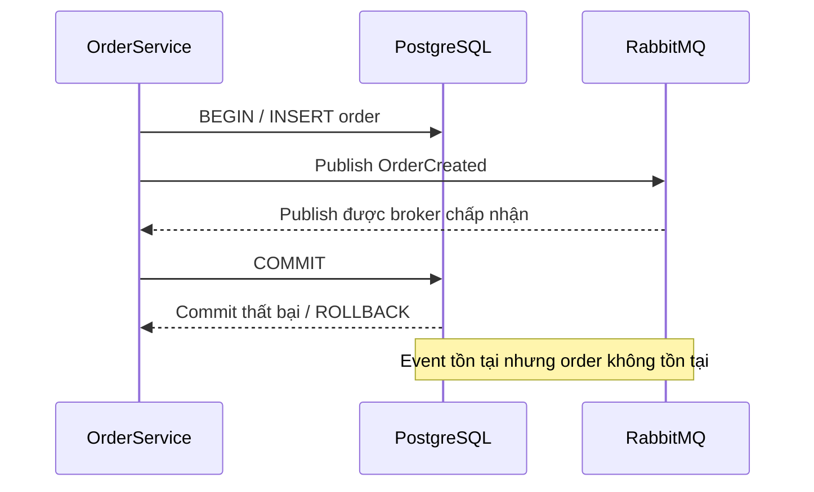
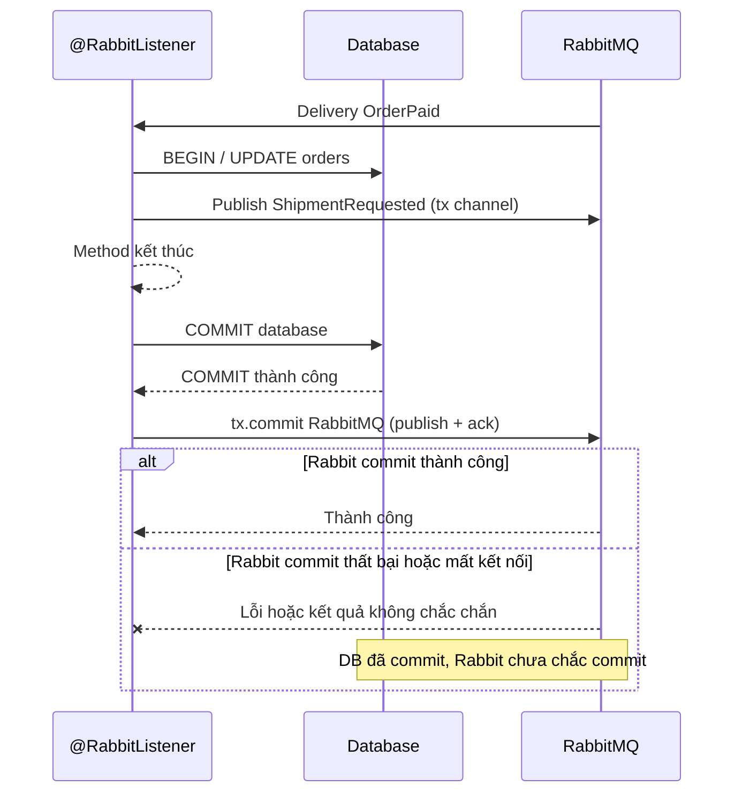
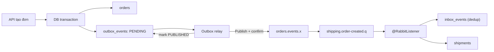

# Giới hạn tính nguyên tử khi commit hai hệ thống khác nhau

## 1. Một transaction cục bộ không biến hai hệ thống thành một

Trong ứng dụng dùng **Spring AMQP** và **RabbitMQ**, nhu cầu phổ biến là vừa thay đổi dữ liệu trong database, vừa gửi hoặc xác nhận message:

- Lưu đơn hàng vào PostgreSQL rồi phát sự kiện `OrderCreated` qua `RabbitTemplate`.
- Nhận `PaymentSucceeded` bằng `@RabbitListener`, cập nhật trạng thái thanh toán rồi ACK message.
- Ghi một bản ghi nghiệp vụ và publish yêu cầu cho dịch vụ vận chuyển.

Ta muốn hai thao tác cùng thành công hoặc cùng thất bại. Tuy nhiên, **database** và **RabbitMQ** là hai hệ thống quản lý transaction riêng. Mỗi bên có commit riêng, network riêng và khả năng lỗi riêng. `@Transactional` của Spring không tự tạo một commit nguyên tử xuyên suốt hai hệ thống.

Bài thuộc chương **Giao dịch** trong module `SPRING_AMQP` này giải thích chính xác giới hạn của local transaction, cách `channelTransacted` phối hợp với transaction Spring theo mô hình **Best Efforts 1 Phase Commit**, những khoảng lỗi có thể gây mất hoặc xử lý trùng message, và cách xây dựng **transactional outbox + idempotent consumer** cho các luồng bất đồng bộ đáng tin cậy.

Sau bài này, cần phân biệt được ba loại xác nhận:

| Cơ chế | Ai xác nhận điều gì? | Không bảo đảm điều gì? |
| --- | --- | --- |
| Database `COMMIT` | Database đã chấp nhận các thay đổi của transaction | RabbitMQ đã nhận hoặc lưu message |
| RabbitMQ `tx.commit` | Broker commit các thao tác AMQP thuộc transaction **trên channel đó** | Database cũng đã commit hoặc có thể rollback cùng broker |
| Publisher confirm (`basic.ack` cho publish) | Broker xác nhận đã xử lý publish theo semantics của queue | Consumer đã hoàn tất nghiệp vụ hoặc database bên gửi đã commit |
| Consumer ACK | Consumer thông báo delivery có thể được xóa khỏi queue | Side effect trong database chắc chắn đã commit nếu ứng dụng ACK sai thời điểm |

**Tính nguyên tử** ở đây có nghĩa: *không có trạng thái trung gian nhìn thấy được mà chỉ một trong hai hệ thống đã commit*. Đó là bảo đảm mạnh hơn việc hai lời gọi Java cùng nằm trong một phương thức có `@Transactional`.

## 2. Vì sao `@Transactional` chưa đủ?

Xem mã đơn giản dưới đây:

```java
@Service
public class OrderService {
    private final OrderRepository orders;
    private final RabbitTemplate rabbitTemplate;

    public OrderService(OrderRepository orders, RabbitTemplate rabbitTemplate) {
        this.orders = orders;
        this.rabbitTemplate = rabbitTemplate;
    }

    @Transactional
    public void createOrder(Order order) {
        orders.save(order); // Tham gia transaction database.
        rabbitTemplate.convertAndSend(
                "orders.events.x", "orders.created", order.getId());
    } // Transaction database thường commit khi method kết thúc.
}
```

Đây là **ví dụ chỉ ra rủi ro**, chưa phải phương án publish tin cậy.

Nếu `RabbitTemplate` không dùng channel transacted hoặc cơ chế trì hoãn phù hợp, lệnh publish có thể đã được broker chấp nhận trong khi database **chưa commit**. Database sau đó có thể rollback vì lỗi constraint, mất kết nối hoặc exception trong giai đoạn commit. Khi đó:



Đảo thứ tự thành **commit database trước rồi publish** cũng chưa đủ. Nếu process chết sau DB commit nhưng trước publish, đơn hàng tồn tại mà event không được gửi.

| Thứ tự hai thao tác | Điểm lỗi | Hậu quả |
| --- | --- | --- |
| Publish trước, DB commit sau | DB commit thất bại | **Phantom event**: consumer thấy sự kiện không tương ứng với bản ghi đã commit |
| DB commit trước, publish sau | Process chết hoặc broker không nhận publish | **Missing event**: DB đã thay đổi nhưng không có thông báo |
| Publish thành công nhưng chưa nhận confirm | Mất kết nối khi chờ phản hồi | Kết quả publish **không chắc chắn**; gửi lại có thể tạo duplicate |
| DB commit thành công nhưng consumer ACK chưa đến broker | Consumer bị kill/mất mạng | Message được giao lại; side effect có thể chạy **hai lần** |

Điều này không phải lỗi đặc biệt của Spring AMQP. Đây là hệ quả của việc hai tài nguyên có transaction độc lập mà không có một giao thức commit phân tán thực sự điều phối cả hai.

## 3. RabbitMQ transaction bảo đảm được gì?

AMQP 0-9-1 hỗ trợ một channel ở chế độ transaction (`tx.select`, `tx.commit`, `tx.rollback`). Trong Spring AMQP, `RabbitTemplate` và listener container có cấu hình `channelTransacted=true`.

```java
RabbitTemplate template = new RabbitTemplate(connectionFactory);
template.setChannelTransacted(true);

template.convertAndSend(
        "orders.events.x", "orders.created", "ORD-42");
```

Khi hoạt động ngoài một Spring transaction có sẵn, `RabbitTemplate` có thể tạo transaction AMQP, gửi và kết thúc bằng commit trên RabbitMQ channel. Nếu thao tác thất bại, transaction AMQP có thể rollback. Khi một Spring transaction đang hoạt động trên cùng thread, Spring AMQP có thể **defer commit/rollback của Rabbit transaction cho đến khi Spring transaction hoàn tất**.

Các giới hạn cần nhớ:

1. RabbitMQ transaction chỉ bao trùm các thao tác AMQP của **channel liên quan**; nó không điều khiển transaction JDBC.
2. `tx.commit` và `COMMIT` của database là hai lần commit riêng biệt.
3. Khi đã commit ở một bên, rollback bên còn lại **không thể thu hồi** side effect đã commit ở bên trước.
4. RabbitMQ transaction và publisher-confirm mode **không thể dùng đồng thời trên cùng một channel**. Chúng là hai cách xác nhận publish khác nhau.
5. Transaction RabbitMQ có chi phí lớn hơn cách publish với confirms, vì vậy không nên bật tràn lan mà chưa đo tải.

`RabbitTransactionManager` của Spring quản lý tài nguyên RabbitMQ trên một connection factory. Nó **không phải** một XA/JTA transaction manager và **không** biến RabbitMQ + PostgreSQL thành một transaction phân tán nguyên tử.

## 4. Best Efforts 1 Phase Commit trong Spring AMQP

Spring AMQP có thể phối hợp Rabbit transaction với một Spring `PlatformTransactionManager` của database. Khi listener container được cấu hình:

```java
factory.setTransactionManager(databaseTransactionManager);
factory.setChannelTransacted(true);
```

framework đưa các thao tác AMQP và xử lý database vào vòng đời transaction, thường theo hướng **database commit trước; RabbitMQ commit sau**. Nếu lỗi xảy ra *trước* bước commit database, cả hai có cơ hội rollback. Nhưng nếu database đã commit xong rồi Rabbit transaction commit thất bại, **không còn cách rollback database**. Bởi vậy mô hình được gọi là **Best Efforts 1 Phase Commit**, không phải distributed atomic commit.



Trong một số failure mode, Spring transaction synchronization chỉ **log lỗi Rabbit commit sau khi DB đã commit**, không tự ném exception lên phương thức nghiệp vụ. Spring AMQP hỗ trợ cơ chế `ConnectionFactoryUtils.enableAfterCompletionFailureCapture(true)` và `ConnectionFactoryUtils.checkAfterCompletion()` để phát hiện lỗi sau completion trên cùng thread, nhưng **phát hiện không đồng nghĩa với rollback được database**. Cần theo dõi phiên bản và gọi đúng thời điểm nếu chọn dùng API này.

### 4.1. Mẫu cấu hình listener container

Ví dụ sau giả định đã có `ConnectionFactory`, một `PlatformTransactionManager` của database (được đặt tên `transactionManager`), và queue `payments.received.q` tồn tại với binding hợp lệ.

```java
import org.springframework.amqp.core.AcknowledgeMode;
import org.springframework.amqp.rabbit.config.SimpleRabbitListenerContainerFactory;
import org.springframework.amqp.rabbit.connection.ConnectionFactory;
import org.springframework.amqp.rabbit.core.RabbitTemplate;
import org.springframework.beans.factory.annotation.Qualifier;
import org.springframework.context.annotation.Bean;
import org.springframework.context.annotation.Configuration;
import org.springframework.transaction.PlatformTransactionManager;

@Configuration
public class PaymentTransactionConfig {

    @Bean("paymentTxListenerFactory")
    public SimpleRabbitListenerContainerFactory paymentTxListenerFactory(
            ConnectionFactory connectionFactory,
            @Qualifier("transactionManager")
                    PlatformTransactionManager dbTxManager) {
        SimpleRabbitListenerContainerFactory factory =
                new SimpleRabbitListenerContainerFactory();
        factory.setConnectionFactory(connectionFactory);
        factory.setAcknowledgeMode(AcknowledgeMode.AUTO);
        factory.setChannelTransacted(true);
        factory.setTransactionManager(dbTxManager);
        factory.setPrefetchCount(5);
        return factory;
    }

    @Bean("txRabbitTemplate")
    public RabbitTemplate txRabbitTemplate(ConnectionFactory connectionFactory) {
        RabbitTemplate template = new RabbitTemplate(connectionFactory);
        template.setChannelTransacted(true);
        return template;
    }
}
```

Trong cấu hình này, **transaction manager được truyền là manager của database**, không phải `RabbitTransactionManager`. Spring AMQP phối hợp Rabbit channel transacted thông qua synchronization. Mẫu này nhằm giải thích cơ chế và vẫn cần kiểm tra thực tế trên version đang dùng.

Listener minh họa:

```java
import org.springframework.amqp.rabbit.annotation.RabbitListener;
import org.springframework.beans.factory.annotation.Qualifier;
import org.springframework.jdbc.core.JdbcTemplate;
import org.springframework.amqp.rabbit.core.RabbitTemplate;
import org.springframework.stereotype.Component;

@Component
public class PaymentListener {
    private final JdbcTemplate jdbc;
    private final RabbitTemplate txRabbitTemplate;

    public PaymentListener(
            JdbcTemplate jdbc,
            @Qualifier("txRabbitTemplate") RabbitTemplate txRabbitTemplate) {
        this.jdbc = jdbc;
        this.txRabbitTemplate = txRabbitTemplate;
    }

    @RabbitListener(
            queues = "payments.received.q",
            containerFactory = "paymentTxListenerFactory")
    public void onPayment(String orderId) {
        jdbc.update(
                "UPDATE orders SET status = ? WHERE id = ?",
                "PAID", orderId);

        txRabbitTemplate.convertAndSend(
                "shipping.commands.x",
                "shipping.request",
                orderId);

        // Không cần ACK thủ công:
        // AUTO + container transacted xử lý acknowledge/commit.
    }
}
```

Với ví dụ này, `jdbc.update` chạy trong DB transaction do container mở, và RabbitTemplate được cấu hình transactional để phối hợp thao tác AMQP. Khi listener ném exception, Spring AMQP có thể rollback database transaction, rollback Rabbit transaction và từ chối/requeue delivery theo chính sách. Nhưng **không có bảo đảm nguyên tử nếu bước commit sau thất bại**.

### 4.2. Rollback và requeue là hai quyết định khác nhau

AMQP transaction và quyết định **message có được giao lại hay không** không hoàn toàn là một thao tác:

- Trong `AUTO`, listener thành công thì container ACK theo chính sách; listener thất bại thì container thực hiện rollback/reject/nack tương ứng.
- `defaultRequeueRejected=true` thường khiến một delivery thất bại được requeue sau rollback; `AmqpRejectAndDontRequeueException` có thể yêu cầu không requeue, cho phép DLX chuyển đến DLQ nếu queue đã cấu hình.
- `defaultRequeueRejected=false` có thể áp dụng cho những lỗi không nên thử lại tức thì; cần kết hợp retry trì hoãn và giới hạn số lần thử.
- Khi transaction database commit **đã thành công** nhưng Rabbit commit thất bại, broker có thể giao lại message. Consumer phải phát hiện công việc đã xử lý để tránh thực thi side effect thêm lần nữa.

**Cẩn trọng với retry nóng:** rollback liên tục và requeue ngay trên RabbitMQ có thể gây loop nhanh. Nên phân loại lỗi tạm thời/vĩnh viễn, dùng retry có backoff và DLQ khi vượt giới hạn.

## 5. Lập bảng theo các cửa sổ lỗi

Giả sử một consumer đang xử lý `PaymentSucceeded`, cập nhật đơn hàng rồi ACK delivery. Bảng dưới tập trung vào thứ tự **DB commit → AMQP commit/ACK**:

| Cửa sổ lỗi | Trạng thái database | Trạng thái broker | Khi chạy lại |
| --- | --- | --- | --- |
| Lỗi trước DB commit | Chưa commit/rollback | Delivery có thể requeue | Xử lý lại từ đầu |
| DB commit thất bại | Rollback | Rabbit transaction chưa commit; delivery được trả về theo chính sách | Xử lý lại |
| DB đã commit, chưa gửi/hoàn tất AMQP commit | Đã thay đổi bền vững | Message có thể vẫn `unacked` hoặc kết quả chưa rõ | Có thể nhận lại; phải idempotent |
| Rabbit commit cũng đã thành công | Đã commit | ACK/publish trong tx được broker commit | Luồng thành công |
| Rabbit commit thành công nhưng response về client thất lạc | Đã commit | Broker có thể đã xóa delivery / nhận message mới | Không thể suy luận thất bại chỉ từ timeout; cần đối soát |

Nếu chiều xử lý là **HTTP → lưu DB → phát event**, transaction synchronization giảm một số cửa sổ lỗi nhưng vẫn còn tình huống DB đã commit mà event chưa xuất hiện. **Một commit sau không thể làm mất hiệu lực commit trước** chỉ bằng Java exception.

## 6. Publisher confirms không thay thế distributed transaction

Publisher confirms thường phù hợp hơn RabbitMQ transaction cho throughput xuất bản. Với Spring Boot, cấu hình phổ biến:

```yaml
spring:
  rabbitmq:
    publisher-confirm-type: correlated
    publisher-returns: true
    template:
      mandatory: true
```

Khi publish:

```java
import java.util.UUID;
import java.util.concurrent.TimeUnit;
import org.springframework.amqp.rabbit.connection.CorrelationData;

CorrelationData cd = new CorrelationData(UUID.randomUUID().toString());
rabbitTemplate.convertAndSend(
        "orders.events.x", "orders.created", "ORD-42", cd);

CorrelationData.Confirm confirm = cd.getFuture().get(10, TimeUnit.SECONDS);
if (!confirm.isAck() || cd.getReturned() != null) {
    throw new IllegalStateException("Message was not confirmed/routed");
}
```

**Phân biệt:**

- Publisher confirm ACK cho biết broker xác nhận publish; nó **không chứng minh consumer đã xử lý**.
- Một message không route được vẫn có thể nhận publisher confirm ACK; vì vậy khi cần bảo đảm routing phải bật `mandatory=true` và xử lý **returned message**, đồng thời đảm bảo exchange, queue, binding đúng.
- Confirm thất lạc có thể làm client **không biết** broker đã nhận message hay chưa. Retry có thể tạo duplicate.
- Confirm không tham gia vào `COMMIT` của PostgreSQL. Dù đã đợi confirm thành công, transaction database sau đó vẫn có thể rollback.
- **Không dùng `tx.select` và publisher confirms trên cùng Rabbit channel**; thiết kế outbox thường dùng channel publishing với confirms thay vì Rabbit transaction.

Publisher confirms giải quyết phần **publish đến broker**, còn transaction outbox giải quyết phần **ghi dữ liệu nghiệp vụ cùng ý định gửi event**.

## 7. Transactional outbox: commit dữ liệu và ý định gửi trong một database

Nếu yêu cầu là **mỗi đơn hàng đã tạo phải có event `OrderCreated` có thể phát lại sau crash**, có thể dùng **transactional outbox**.

Thay vì cố commit PostgreSQL và RabbitMQ cùng lúc, ứng dụng commit **hai bản ghi trong cùng PostgreSQL transaction**:

1. Bản ghi `orders`.
2. Bản ghi `outbox_events` mang ID event, payload và trạng thái `PENDING`.

Một **relay** độc lập đọc outbox đã commit, publish sang RabbitMQ với publisher confirms, rồi đánh dấu `PUBLISHED`. Nếu relay chết giữa bước publish và đánh dấu, event vẫn còn và sẽ được publish lại.



Ở đây không có distributed atomic commit. Ta **thu hẹp thao tác nguyên tử** vào một hệ thống (PostgreSQL) và dùng retry + idempotency cho đoạn giao tiếp với RabbitMQ.

### 7.1. Mô hình bảng minh họa (PostgreSQL)

```sql
CREATE TABLE orders (
    id           VARCHAR(64) PRIMARY KEY,
    status       VARCHAR(32) NOT NULL
);

CREATE TABLE outbox_events (
    event_id     UUID PRIMARY KEY,
    aggregate_id VARCHAR(64) NOT NULL,
    event_type   VARCHAR(80) NOT NULL,
    payload      TEXT NOT NULL,
    state        VARCHAR(16) NOT NULL DEFAULT 'PENDING',
    created_at   TIMESTAMPTZ NOT NULL DEFAULT now(),
    updated_at   TIMESTAMPTZ NOT NULL DEFAULT now()
);

CREATE INDEX idx_outbox_pending
    ON outbox_events (state, created_at);

-- Ở dịch vụ nhận, tạo inbox để chặn cùng event thực thi hai lần.
CREATE TABLE inbox_events (
    event_id UUID PRIMARY KEY,
    received_at TIMESTAMPTZ NOT NULL DEFAULT now()
);

CREATE TABLE shipments (
    order_id VARCHAR(64) PRIMARY KEY,
    status VARCHAR(32) NOT NULL
);
```

Trong triển khai thật, outbox cần thêm `attempt_count`, `next_attempt_at`, `claimed_by`, `lease_until`, `last_error` và chính sách dọn các event đã `PUBLISHED`. Những cột này cho phép relay chạy song song và tự khôi phục sau crash, nhưng không làm thay đổi nguyên tắc nguyên tử của transaction database.

### 7.2. Ghi order và outbox trong cùng `@Transactional`

```java
import java.util.UUID;
import org.springframework.jdbc.core.JdbcTemplate;
import org.springframework.stereotype.Service;
import org.springframework.transaction.annotation.Transactional;

@Service
public class PlaceOrderService {
    private final JdbcTemplate jdbc;

    public PlaceOrderService(JdbcTemplate jdbc) {
        this.jdbc = jdbc;
    }

    @Transactional
    public UUID placeOrder(String orderId) {
        UUID eventId = UUID.randomUUID();

        jdbc.update(
                "INSERT INTO orders(id, status) VALUES (?, ?)",
                orderId, "CREATED");

        jdbc.update("""
                INSERT INTO outbox_events
                    (event_id, aggregate_id, event_type, payload)
                VALUES (?, ?, ?, ?)
                """,
                eventId, orderId, "OrderCreated", orderId);

        return eventId;
    }
}
```

Ở phương thức này **không có `RabbitTemplate.convertAndSend(...)`**. Nếu INSERT order hoặc INSERT outbox thất bại, PostgreSQL rollback cả hai. Nếu transaction commit, ít nhất ứng dụng đã lưu được **ý định publish** để một relay phục hồi sau restart.

**Không ghi outbox bằng một transaction riêng** sau khi lưu order, vì khi đó lại xuất hiện khoảng lỗi giữa hai commit database. Cũng không xóa outbox trước khi broker xác nhận đã nhận publish.

### 7.3. Relay publish với confirms và retry

Ví dụ dưới đây cho thấy contract của relay; `OutboxStore` đại diện cho repository/DAO cần triển khai **claim atomically, có lease/lock** để tránh nhiều relay giữ cùng một event vô hạn. Ví dụ cố ý tập trung vào giới hạn commit và không bao gồm SQL claim cạnh tranh.

```java
import java.util.List;
import java.util.UUID;

record OutboxRecord(UUID eventId, String payload) {}

interface OutboxStore {
    // Claim batch đã commit; dùng lease/lock để nhiều relay không tranh nhau.
    List<OutboxRecord> claimBatch(int max);
    void markPublished(UUID eventId);
    void releaseForRetry(UUID eventId, String reason);
}
```

```java
import java.util.concurrent.TimeUnit;
import org.springframework.amqp.core.MessageDeliveryMode;
import org.springframework.amqp.rabbit.connection.CorrelationData;
import org.springframework.amqp.rabbit.core.RabbitTemplate;
import org.springframework.scheduling.annotation.Scheduled;
import org.springframework.stereotype.Component;

@Component
public class OutboxPublisher {
    private final RabbitTemplate rabbitTemplate;
    private final OutboxStore outbox;

    public OutboxPublisher(RabbitTemplate rabbitTemplate, OutboxStore outbox) {
        this.rabbitTemplate = rabbitTemplate;
        this.outbox = outbox;
    }

    @Scheduled(fixedDelayString = "${app.outbox.poll-ms:1000}")
    public void publishPending() {
        for (OutboxRecord event : outbox.claimBatch(20)) {
            try {
                CorrelationData cd =
                        new CorrelationData(event.eventId().toString());

                rabbitTemplate.convertAndSend(
                        "orders.events.x",
                        "orders.created",
                        event.payload(),
                        message -> {
                            message.getMessageProperties().setMessageId(
                                    event.eventId().toString());
                            message.getMessageProperties().setDeliveryMode(
                                    MessageDeliveryMode.PERSISTENT);
                            return message;
                        },
                        cd);

                CorrelationData.Confirm confirm =
                        cd.getFuture().get(10, TimeUnit.SECONDS);

                if (!confirm.isAck() || cd.getReturned() != null) {
                    throw new IllegalStateException(
                            "Event not confirmed or not routed");
                }

                // DB commit đánh dấu PUBLISHED là một thao tác khác.
                // Nếu crash trước đây, có thể publish lại cùng eventId.
                outbox.markPublished(event.eventId());
            } catch (InterruptedException e) {
                Thread.currentThread().interrupt();
                outbox.releaseForRetry(event.eventId(), "Interrupted");
                return;
            } catch (Exception e) {
                outbox.releaseForRetry(
                        event.eventId(), e.getClass().getSimpleName());
            }
        }
    }
}
```

Để chạy đoạn relay, cần bật scheduling bằng `@EnableScheduling`, dùng `RabbitTemplate` **không ở Rabbit transaction mode**, bật publisher confirms/returns như mục 6, và bảo đảm exchange/binding tồn tại. `OutboxStore` cần được hiện thực bằng transaction database ngắn cho từng lần claim và cập nhật trạng thái. Không giữ một DB transaction mở bao quanh network publish rồi ngộ nhận là đã có distributed commit.

**Điểm lỗi không tránh được:**

```text
1. Relay publish event_id=E1.
2. RabbitMQ lưu event và trả publisher confirm ACK.
3. Relay chết TRƯỚC khi markPublished(E1) commit trong PostgreSQL.
4. Relay khác thấy E1 vẫn cần publish và gửi lại.
5. Consumer nhận E1 hai lần → phải xử lý idempotent.
```

Đây là thiết kế **at-least-once publication** có thể phục hồi, không phải *exactly-once delivery*.

## 8. Idempotent consumer và inbox: xử lý duplicate ở đầu nhận

Khi nhận `OrderCreated`, dịch vụ vận chuyển cần tạo đúng một shipment cho `orderId`. Bên phát có thể gửi duplicate do confirm thất lạc; bên nhận cũng có thể bị giao lại nếu đã commit database nhưng chưa ACK message.

Một cách chống trùng là lưu `event_id` vào **inbox** trong cùng database transaction với thao tác tạo shipment. Ví dụ này dùng PostgreSQL `ON CONFLICT DO NOTHING` để INSERT event ID **nguyên tử**, thay vì `existsById()` rồi INSERT (có race khi hai consumer chạy đồng thời).

```java
import java.util.UUID;
import org.springframework.jdbc.core.JdbcTemplate;
import org.springframework.stereotype.Service;
import org.springframework.transaction.annotation.Transactional;

@Service
public class ShipmentCommandService {
    private final JdbcTemplate jdbc;

    public ShipmentCommandService(JdbcTemplate jdbc) {
        this.jdbc = jdbc;
    }

    @Transactional
    public void createShipmentOnce(UUID eventId, String orderId) {
        int inserted = jdbc.update(
                "INSERT INTO inbox_events(event_id) VALUES (?) " +
                "ON CONFLICT (event_id) DO NOTHING",
                eventId);

        if (inserted == 0) {
            return; // Đã commit event này ở một lần xử lý trước.
        }

        jdbc.update(
                "INSERT INTO shipments(order_id, status) VALUES (?, ?) " +
                "ON CONFLICT (order_id) DO NOTHING",
                orderId, "PENDING");

        // Nếu DB rollback, cả inbox lẫn shipments đều rollback.
    }
}
```

```java
import java.nio.charset.StandardCharsets;
import java.util.UUID;
import org.springframework.amqp.core.Message;
import org.springframework.amqp.rabbit.annotation.RabbitListener;
import org.springframework.stereotype.Component;

@Component
public class ShipmentEventListener {
    private final ShipmentCommandService shipmentService;

    public ShipmentEventListener(ShipmentCommandService shipmentService) {
        this.shipmentService = shipmentService;
    }

    @RabbitListener(queues = "shipping.order-created.q")
    public void onOrderCreated(Message message) {
        String rawEventId =
                message.getMessageProperties().getMessageId();
        if (rawEventId == null) {
            throw new IllegalArgumentException("Missing event ID");
        }

        UUID eventId = UUID.fromString(rawEventId);
        String orderId = new String(
                message.getBody(), StandardCharsets.UTF_8);

        shipmentService.createShipmentOnce(eventId, orderId);
        // Ở AUTO acknowledge, listener trả về sau khi service transaction
        // commit; container ACK. Nếu ACK thất lạc, lần giao lại được dedup.
    }
}
```

Đây là mẫu hướng dẫn: cần khai báo/bind `shipping.order-created.q`, cấu hình message converter phù hợp cho payload thực và đặt chính sách xử lý lỗi khi event thiếu ID hoặc schema không hợp lệ. Lỗi dữ liệu vĩnh viễn nên đưa vào DLQ theo chính sách, tránh requeue nóng. Những API ngoài database cũng cần khóa idempotency hoặc cơ chế bù trừ, vì inbox DB không tự rollback một HTTP request đã thành công.

**Vì sao có cả `eventId` và `orderId`?** `eventId` định danh *lần phát sinh sự kiện* để dedup delivery, còn `orderId` định danh *đối tượng nghiệp vụ*. Một order có thể có nhiều sự kiện khác nhau; không được gộp tất cả thành một event chỉ vì cùng `orderId`.

## 9. Chọn chiến lược theo yêu cầu độ tin cậy

| Cách thiết kế | Điểm mạnh | Giới hạn cần chấp nhận |
| --- | --- | --- |
| `@Transactional` database + publish trực tiếp | Ít thành phần, độ trễ thấp | Không nguyên tử xuyên DB/Rabbit; có thể phantom/missing event |
| `channelTransacted=true` + DB transaction manager | Phối hợp rollback/commit theo Best Efforts 1 Phase Commit; phù hợp một số listener giao dịch | Vẫn có khoảng lỗi sau DB commit trước Rabbit commit; Rabbit tx tốn chi phí |
| Rabbit publisher confirms, không có outbox | Biết broker đã xác nhận publish (hoặc nhận returned message) | Không nối nguyên tử với DB commit; kết quả có thể mơ hồ khi mất mạng |
| Transactional outbox + confirms | DB và ý định phát event commit cùng nhau; relay retry được sau crash | Publish có thể trùng; cần relay, monitoring, dedup |
| Transactional inbox + idempotent handler | Chống side effect DB trùng khi duplicate/redelivery | Không loại bỏ mọi tác động bên ngoài DB; cần idempotency riêng cho các hệ thống khác |
| CDC từ outbox | Relay đọc transaction log, giảm polling liên tục | Thêm hạ tầng và vận hành; vẫn cần xử lý duplicate/idempotency |

Không có một lựa chọn duy nhất cho mọi bài toán. Với event nghiệp vụ quan trọng phải phản ánh chính xác thay đổi dữ liệu sau khi commit, **outbox thường là lựa chọn nền tảng rõ ràng**. Với công việc nội bộ có thể xử lý lại bằng khóa nghiệp vụ, một listener có giao dịch cục bộ, ACK đúng thời điểm và idempotency có thể đã đủ.

### Vấn đề thứ tự sự kiện

Outbox đảm bảo đã lưu ý định publish, nhưng nếu có nhiều relay hoặc nhiều queue, **thứ tự event theo cùng aggregate** cần được thiết kế riêng. Ví dụ một order phát `OrderCreated` rồi `OrderCancelled`; nếu hai event đến ngược thứ tự, consumer phải dùng `version`/sequence cho aggregate và kiểm tra thứ tự hợp lệ. Không suy ra ordering toàn cục từ `created_at` hoặc một queue có nhiều consumer.

## 10. Kiểm thử các khoảng lỗi, không chỉ luồng thành công

Để đánh giá một thiết kế, hãy xây một bài thực hành với `orders`, `outbox_events`, một RabbitMQ broker, relay và `shipping.order-created.q`. Mỗi lần thực hành dùng một `orderId` và `eventId` riêng, ghi log đủ các mốc DB commit, publish, confirm, ACK và consumer transaction commit.

| Thử nghiệm | Điểm cố ý gây lỗi | Điều kỳ vọng |
| --- | --- | --- |
| A. DB rollback | Ném exception sau khi INSERT order + outbox nhưng trước commit | Không có order, không có outbox đã commit, relay không gửi event |
| B. Broker offline | Tạo order thành công rồi tắt RabbitMQ trước khi relay publish | Order và outbox `PENDING` vẫn tồn tại; relay retry khi broker khôi phục |
| C. Relay chết sau confirm | Tắt relay sau broker confirm, trước `markPublished` | Event có thể publish lại; cùng `eventId`; inbox chặn tạo shipment trùng |
| D. Consumer chết sau DB commit | Tắt consumer trước ACK | Broker có thể redeliver; DB đã có inbox/shipment; handler bỏ qua tác động trùng |
| E. Unroutable publish | Bỏ binding hoặc dùng routing key sai | `mandatory`/returned message phát hiện; outbox chưa `PUBLISHED` |
| F. DB commit thành công, Rabbit tx commit lỗi | Gây lỗi kết nối tại giai đoạn commit AMQP của Best Efforts | DB không tự rollback; phải đối soát, cho phép redelivery và xử lý idempotent |
| G. Duplicate đồng thời | Hai consumer cùng nhận lại một `eventId` | Unique key `inbox_events.event_id` và DB transaction ngăn tạo side effect DB hai lần |

**Quan sát hữu ích:** số outbox `PENDING`/`SENDING` quá hạn, độ trễ từ `created_at` đến confirm, tỷ lệ publisher nack/return, số lần relay retry, số lần consumer redelivery, số bản ghi inbox bị dedup và số event cần đối soát. Đặt cảnh báo khi outbox tích tụ bất thường; chỉ có DLQ chưa đủ để bảo đảm toàn bộ chuỗi giao hàng.

## 11. Những hiểu lầm cần tránh

1. **“`@Transactional` bao cả `RabbitTemplate` nên hai bên atomic.”** Không đúng. Transaction manager có phạm vi tài nguyên; không tự là 2PC.
2. **“`RabbitTransactionManager` là XA.”** Không đúng. Nó quản lý transaction RabbitMQ và không cung cấp XA giữa database với broker.
3. **“`channelTransacted=true` giải quyết hoàn toàn mất event.”** Không đúng. Commit có thể thất bại ở phía Rabbit sau khi database đã commit.
4. **“Publisher confirm ACK nghĩa là nghiệp vụ tiêu thụ xong.”** Không đúng. Confirm thuộc publish, consumer ACK thuộc xử lý delivery.
5. **“Nếu confirm timeout thì broker chắc chắn chưa nhận event.”** Không đúng. Kết quả có thể chưa xác định; publish lại cần ID ổn định và consumer idempotent.
6. **“Đánh dấu outbox PUBLISHED trước khi publish sẽ nhanh hơn.”** Có thể làm mất event vĩnh viễn nếu process chết ở giữa.
7. **“Sau khi nhận event chỉ cần kiểm tra `exists(eventId)` rồi INSERT.”** Hai consumer có thể cùng thấy chưa có; cần unique constraint và INSERT nguyên tử trong transaction.
8. **“Exactly-once là bật một tùy chọn của RabbitMQ.”** Không đúng đối với side effect tùy ý trên database, HTTP API và broker; cần thiết kế hiệu ứng đúng một lần bằng business key, idempotency hoặc cơ chế phối hợp thích hợp.

## 12. Câu hỏi tự kiểm tra

1. Nếu `RabbitTemplate.convertAndSend(...)` trả về thành công bên trong `@Transactional`, vì sao PostgreSQL vẫn có thể rollback mà event đã có ở broker?
2. Trong Best Efforts 1 Phase Commit, điểm lỗi nào làm database đã commit nhưng Rabbit transaction chưa chắc commit? Vì sao không thể rollback database sau đó?
3. `RabbitTransactionManager` khác `DataSourceTransactionManager` ở phạm vi tài nguyên nào? Có manager nào trong hai loại này tự tạo XA giữa RabbitMQ và database không?
4. Vì sao publisher confirm ACK phải được kiểm tra cùng `mandatory`/returns khi cần chắc message đã tới queue?
5. Outbox giữ nguyên được điều gì sau khi broker offline? Tại sao relay vẫn có thể gửi cùng event hai lần?
6. Trong consumer, vì sao INSERT `eventId` vào bảng inbox phải nằm cùng transaction với thao tác thay đổi nghiệp vụ?
7. Khi consumer nhận lại một message sau khi database đã commit nhưng broker chưa ACK, nên dựa vào thông tin nào để quyết định ACK mà không làm lại side effect?
8. Hãy thiết kế thêm `lease_until` và `attempt_count` cho outbox relay chạy trên ba instance. Cần tránh các race condition nào?
9. Nếu consumer gọi API thanh toán bên thứ ba mà API đó không hỗ trợ idempotency key, tại sao inbox transaction **chưa đủ** để đảm bảo không trừ tiền hai lần?

**Ghi nhớ:** **Commit trong một hệ thống không thể tự động rollback commit đã hoàn thành ở hệ thống khác.** Spring AMQP có transaction RabbitMQ và hỗ trợ Best Efforts 1 Phase Commit với database, nhưng vẫn tồn tại cửa sổ lỗi giữa hai commit. Với sự kiện quan trọng, hãy commit **dữ liệu và outbox trong cùng database transaction**, relay bằng publisher confirms, theo dõi retry và dùng idempotent consumer để xử lý duplicate.

### Tài liệu tham khảo

- [Spring AMQP — Transactions](https://docs.spring.io/spring-amqp/reference/amqp/transactions.html): `channelTransacted`, external transaction manager, Best Efforts 1 Phase Commit, rollback và failure capture.
- [Spring AMQP — AmqpTemplate](https://docs.spring.io/spring-amqp/reference/amqp/template.html): `RabbitTemplate`, publisher confirms, returned messages.
- [RabbitMQ — Consumer Acknowledgements and Publisher Confirms](https://www.rabbitmq.com/docs/confirms): sự khác nhau giữa ACK, publisher confirm và AMQP transaction.
