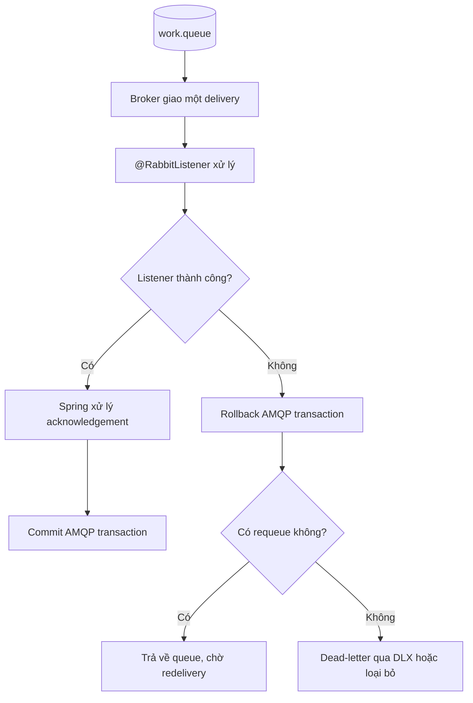
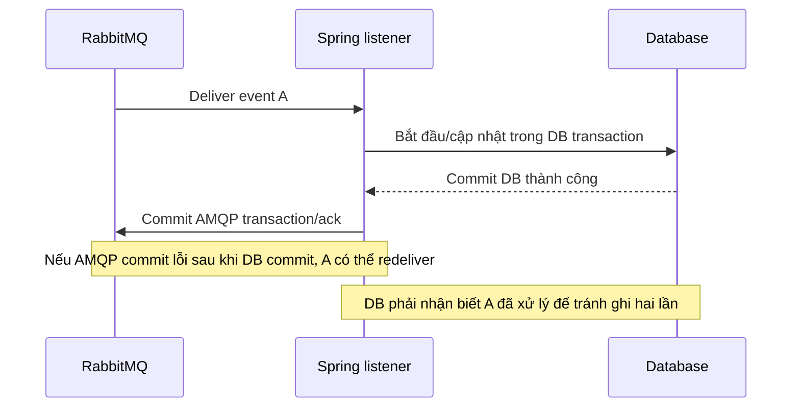

# Rollback, acknowledgement và xếp lại thông điệp

> **Chương:** Giao dịch  
> **Công nghệ:** Spring AMQP, RabbitMQ  
> **Trọng tâm:** Khi một listener thất bại, AMQP transaction được rollback ra sao, ai quyết định `ack`/`reject`, và thông điệp được **requeue** vào vị trí nào?

## 1. Bài toán: rollback rồi thông điệp sẽ đi đâu?

Một dịch vụ xử lý đơn hàng nhận các sự kiện từ RabbitMQ. Với mỗi sự kiện, listener ghi trạng thái đơn hàng vào cơ sở dữ liệu, có thể gửi thông điệp tiếp theo bằng `RabbitTemplate`, rồi xác nhận đã xử lý. Một lần cập nhật có thể thất bại giữa chừng. Hệ thống cần tránh xác nhận sớm, không bỏ mất yêu cầu chưa hoàn thành, và biết khi nào phải chuyển một yêu cầu lỗi sang dead-letter queue (DLQ).

Trong **Spring AMQP**, `@RabbitListener` có thể chạy trên channel hỗ trợ giao dịch AMQP. Nếu xử lý thành công, container xác nhận delivery và commit giao dịch. Nếu xử lý lỗi, container có thể rollback rồi **reject/requeue** hoặc **reject không requeue** theo cấu hình. Tuy nhiên, hai quyết định *"rollback"* và *"xếp lại vào queue"* **không phải một hành động duy nhất**.

Đây cũng là lý do cần hiểu sự khác nhau giữa **acknowledgement**, **transaction commit/rollback**, **requeue** và **redelivery**. Chúng ở những lớp khác nhau trong quá trình giao nhận bất đồng bộ.

Sau bài này, bạn có thể:

- Giải thích `channelTransacted`, `AcknowledgeMode.AUTO`, `MANUAL` và `NONE` trong Spring AMQP.
- Theo dõi hành vi `ack`, `rollback`, `reject`, `requeue`, `dead-letter` khi listener thành công hoặc ném exception.
- Dựng ví dụ có exchange, queue, binding, `RabbitTemplate`, `@RabbitListener` và DLX để quan sát một thông điệp được giao lại.
- Hiểu vì sao requeue **không bảo đảm thứ tự FIFO tuyệt đối** khi có nhiều consumer, prefetch, ưu tiên hoặc các thông điệp đang xử lý.
- Nhận diện giới hạn của transaction AMQP khi phối hợp với giao dịch database và thiết kế retry/idempotency an toàn.

## 2. Các thuật ngữ cần phân biệt

| Thuật ngữ | Diễn giải | Ai thực hiện/quyết định? |
| --- | --- | --- |
| **Delivery** | Một lần broker gửi message từ queue tới consumer; trên channel có `deliveryTag` riêng. | RabbitMQ phát, consumer nhận. |
| **`basicAck`** | Báo delivery đã xử lý; broker có thể loại thông điệp khỏi trạng thái chờ xác nhận. | Consumer hoặc Spring listener container. |
| **`basicReject` / `basicNack`** | Báo delivery không được xử lý thành công; cờ `requeue` quyết định có đưa trở lại queue hay không. | Consumer hoặc container. |
| **`tx.commit`** | Hoàn tất các thao tác AMQP trong transaction channel, gồm publish và ack nằm trong transaction. | Client/Spring AMQP gửi tới RabbitMQ. |
| **`tx.rollback`** | Hủy các thao tác AMQP chưa commit trên channel; riêng việc xác định số phận delivery còn liên quan quy trình reject của Spring. | Client/Spring AMQP. |
| **Requeue** | Đưa message chưa xử lý thành công trở lại hàng đợi có thể được giao tiếp. | Broker, theo yêu cầu nack/reject hoặc khi consumer mất kết nối mà chưa ack. |
| **Redelivery** | Broker giao lại một message đã từng được giao trước đó. Cờ `redelivered=true` là tín hiệu hữu ích, nhưng không phải bộ đếm retry. | RabbitMQ. |
| **Dead-letter** | Định tuyến message bị reject với `requeue=false`, hết TTL hoặc gặp điều kiện dead-letter khác qua DLX (nếu được cấu hình). | RabbitMQ. |

Ví dụ, một listener đã nhận `order-42` và bắt đầu ghi database. Nếu ứng dụng chết trước khi broker chấp nhận ack, message có thể được giao lại khi channel/connection đóng. Ngược lại, nếu đã ack thành công trước khi ghi database hoàn tất, broker có thể xem message đã xử lý dù thay đổi nghiệp vụ chưa thành công.

### 2.1. `AUTO` trong Spring không phải `autoAck` của RabbitMQ

`AcknowledgeMode.AUTO` là lựa chọn mặc định phổ biến của Spring listener container: **container gửi acknowledgement sau khi listener xử lý thành công**. Nó khác `AcknowledgeMode.NONE`, tương ứng chế độ broker tự coi delivery đã được xác nhận lúc gửi (*RabbitMQ automatic acknowledgement*).

| Spring AMQP mode | Hành vi với delivery | Kết hợp `channelTransacted=true` |
| --- | --- | --- |
| `AUTO` | Container ack khi listener thành công; nếu listener lỗi, container xử lý reject/requeue theo chính sách. | **Phù hợp**: ack cần commit AMQP transaction. |
| `MANUAL` | Mã listener phải gọi `Channel.basicAck` / `basicNack` đúng `deliveryTag` trên đúng channel. | Có thể dùng, nhưng ứng dụng chịu trách nhiệm ack và cần hiểu cả commit/rollback. |
| `NONE` | Broker xem delivery đã ack ngay khi gửi; listener không cần gửi ack. | **Không tương thích** với `channelTransacted=true`. |

Không nên dùng `NONE` trong luồng cần phục hồi sau lỗi xử lý, vì khi listener thất bại broker có thể đã xem thông điệp được giao xong.

## 3. `channelTransacted` thay đổi điều gì?

Trong AMQP 0-9-1, channel giao dịch dùng các lệnh `tx.select`, `tx.commit` và `tx.rollback`. Đặt `channelTransacted=true` yêu cầu Spring AMQP dùng transactional channel cho các thao tác gửi/nhận trên channel đó. Việc commit/rollback phụ thuộc kết quả của lời gọi hoặc transaction context hiện hành.



Sơ đồ mô tả **kết quả logic**. Ở mức thực thi, Spring phải phối hợp rollback với thao tác reject delivery, đặc biệt khi đang đồng bộ với một transaction của Spring. **Rollback AMQP không được hiểu là lời hứa RabbitMQ sẽ tự đặt lại message vào đúng vị trí ban đầu.**

Khi `channelTransacted=false` (mặc định), container vẫn có thể `ack` hoặc `reject` theo chế độ acknowledgement, nhưng **không có AMQP transaction** để rollback các thao tác publish/ack. Khi cấu hình một external `PlatformTransactionManager` (ví dụ JDBC) mà không bật `channelTransacted`, giao dịch cơ sở dữ liệu vẫn có thể rollback, trong khi các thao tác AMQP đã được xác nhận độc lập.

### 3.1. Transaction trên `RabbitTemplate`

```java
RabbitTemplate template = new RabbitTemplate(connectionFactory);
template.setChannelTransacted(true);
template.convertAndSend("demo.tx.exchange", "task", "order-42");
```

Nếu không có external Spring transaction đang hoạt động, `RabbitTemplate` thường hoàn tất một AMQP transaction cục bộ cho lời gọi gửi này. Khi phương thức gửi chạy trong một Spring transaction đã được đồng bộ và `channelTransacted=true`, Spring AMQP có thể trì hoãn việc commit/rollback của AMQP channel đến giai đoạn kết thúc transaction bao ngoài.

**Đừng nhầm transaction với publisher confirms:** Một channel AMQP đang ở transaction mode **không thể đồng thời ở confirm mode**. Transaction và publisher confirms là những cơ chế giao nhận khác nhau; không thể bật `tx.select` và `confirm.select` trên cùng channel.

## 4. Listener lỗi: rollback, reject và requeue là ba vấn đề

Giả sử message `A` được giao vào listener có `channelTransacted=true` và `AcknowledgeMode.AUTO`.

**Trường hợp thành công:** Listener trả về bình thường. Container hoàn tất acknowledgement cùng AMQP transaction, broker coi message đã xử lý và loại khỏi danh sách unacknowledged.

**Trường hợp lỗi:** Listener ném exception, AMQP transaction bị rollback. Để giải quyết delivery đã nhận, Spring còn phải thực hiện hành vi reject phù hợp. Mặc định `defaultRequeueRejected=true` nên lỗi nghiệp vụ thông thường có thể dẫn đến message được requeue và giao lại. Nếu không muốn requeue, cấu hình `defaultRequeueRejected=false` hoặc ném `AmqpRejectAndDontRequeueException`.

| Tình huống | Giao dịch/ack logic | Kết quả message |
| --- | --- | --- |
| Listener thành công | Ack và commit. | Được xem là xử lý xong. |
| Listener ném exception thông thường, `defaultRequeueRejected=true` | Rollback, reject với hành vi requeue. | Có thể redeliver liên tục nếu lỗi không biến mất. |
| Listener ném exception thông thường, `defaultRequeueRejected=false` | Rollback, reject không requeue. | Qua DLX nếu hợp lệ; không có DLX thì bị loại bỏ. |
| Listener ném `AmqpRejectAndDontRequeueException` | Yêu cầu không requeue, kể cả khi `defaultRequeueRejected=true`. | Dead-letter hoặc loại bỏ. |
| Listener ném `ImmediateRequeueAmqpException` | Yêu cầu requeue, kể cả khi cấu hình mặc định là không requeue. | Quay về queue và có thể được giao lại. |
| Channel đóng khi có delivery chưa ack | Broker phát hiện delivery chưa được xử lý hoàn tất. | Thường tự requeue những delivery chưa ack. |

Đối với lỗi chuyển đổi message xảy ra **trước khi** vào mã listener, `ConditionalRejectingErrorHandler` mặc định có thể xem lỗi là không thể phục hồi và reject không requeue, ngay cả khi `defaultRequeueRejected=true`. Vì thế cần phân biệt lỗi dữ liệu độc hại với lỗi tạm thời khi phân tích message “biến mất”.

Với external transaction manager, Spring AMQP hiện hành cũng áp dụng logic requeue thông thường khi transaction rollback. Thuộc tính tương thích `alwaysRequeueWithTxManagerRollback=true` có thể buộc requeue khi rollback với transaction manager; chỉ dùng nếu thực sự cần hành vi đó và hiểu nguy cơ retry vô hạn.

## 5. Thực hành: quan sát rollback và redelivery

Ví dụ dùng Spring Boot với `spring-boot-starter-amqp` và một RabbitMQ broker đang chạy. Cấu hình ba phần: exchange/queue/binding, listener container transactional, và publisher. Tất cả thuộc tính được đặt bằng Java Config để dễ quan sát; không cần tạo queue thủ công trên UI.

### 5.1. Topology: work queue và dead-letter queue

```java
import org.springframework.amqp.core.Binding;
import org.springframework.amqp.core.BindingBuilder;
import org.springframework.amqp.core.DirectExchange;
import org.springframework.amqp.core.Queue;
import org.springframework.amqp.core.QueueBuilder;
import org.springframework.amqp.rabbit.annotation.EnableRabbit;
import org.springframework.amqp.rabbit.config.SimpleRabbitListenerContainerFactory;
import org.springframework.amqp.core.AcknowledgeMode;
import org.springframework.amqp.rabbit.connection.ConnectionFactory;
import org.springframework.amqp.rabbit.core.RabbitTemplate;
import org.springframework.context.annotation.Bean;
import org.springframework.context.annotation.Configuration;

@Configuration
@EnableRabbit
public class TxDemoConfig {
    public static final String WORK_EXCHANGE = "demo.tx.exchange";
    public static final String WORK_QUEUE = "demo.tx.work";
    public static final String DEAD_EXCHANGE = "demo.tx.dead.exchange";
    public static final String DEAD_QUEUE = "demo.tx.dead";

    @Bean
    DirectExchange workExchange() {
        return new DirectExchange(WORK_EXCHANGE);
    }

    @Bean
    DirectExchange deadExchange() {
        return new DirectExchange(DEAD_EXCHANGE);
    }

    @Bean
    Queue workQueue() {
        return QueueBuilder.durable(WORK_QUEUE)
                .deadLetterExchange(DEAD_EXCHANGE)
                .deadLetterRoutingKey("dead")
                .build();
    }

    @Bean
    Queue deadQueue() {
        return QueueBuilder.durable(DEAD_QUEUE).build();
    }

    @Bean
    Binding workBinding() {
        return BindingBuilder.bind(workQueue())
                .to(workExchange()).with("task");
    }

    @Bean
    Binding deadBinding() {
        return BindingBuilder.bind(deadQueue())
                .to(deadExchange()).with("dead");
    }

    @Bean("txListenerFactory")
    SimpleRabbitListenerContainerFactory txListenerFactory(
            ConnectionFactory connectionFactory) {
        SimpleRabbitListenerContainerFactory factory =
                new SimpleRabbitListenerContainerFactory();
        factory.setConnectionFactory(connectionFactory);
        factory.setChannelTransacted(true);
        factory.setAcknowledgeMode(AcknowledgeMode.AUTO);
        factory.setDefaultRequeueRejected(true);
        factory.setConcurrentConsumers(1);
        factory.setPrefetchCount(1);
        factory.setBatchSize(1);
        return factory;
    }

    @Bean("txDemoTemplate")
    RabbitTemplate txDemoTemplate(ConnectionFactory connectionFactory) {
        RabbitTemplate template = new RabbitTemplate(connectionFactory);
        template.setChannelTransacted(true);
        return template;
    }
}
```

`setConcurrentConsumers(1)` và `setPrefetchCount(1)` giúp việc thử nghiệm dễ theo dõi vì mỗi lần chỉ một delivery được xử lý tại consumer demo. Chúng **không chứng minh** transaction luôn giữ nguyên thứ tự trong hệ thống nhiều consumer. `setBatchSize(1)` giữ một message mỗi chu kỳ commit trong `SimpleMessageListenerContainer`; tăng batch size có thể khiến nhiều acknowledgement/message cùng nằm trong một transaction và thay đổi phạm vi rollback.

Trong production, RabbitMQ khuyến nghị quản lý DLX qua policy khi cần thay đổi linh hoạt. Queue cùng tên đã tồn tại với arguments khác có thể bị broker từ chối khai báo lại; hãy thử trên các queue demo trống.

### 5.2. Một message lỗi lần đầu rồi thành công khi được giao lại

```java
import java.nio.charset.StandardCharsets;
import java.util.concurrent.atomic.AtomicInteger;
import org.springframework.amqp.core.Message;
import org.springframework.amqp.rabbit.annotation.RabbitListener;
import org.springframework.stereotype.Component;

@Component
public class TxDemoListener {
    private final AtomicInteger firstMessageAttempts = new AtomicInteger();

    @RabbitListener(
            queues = TxDemoConfig.WORK_QUEUE,
            containerFactory = "txListenerFactory")
    public void process(Message message) {
        String body = new String(message.getBody(), StandardCharsets.UTF_8);
        boolean redelivered = message.getMessageProperties().isRedelivered();

        System.out.printf("received=%s, redelivered=%s%n", body, redelivered);

        if ("A-FAIL-ONCE".equals(body)
                && firstMessageAttempts.getAndIncrement() == 0) {
            throw new IllegalStateException("Transient demo failure for A");
        }

        System.out.println("processed=" + body);
    }
}
```

`AtomicInteger` chỉ là công cụ mô phỏng lỗi một lần **trong một tiến trình**; reset khi ứng dụng khởi động lại, không phải cơ chế retry count bền vững. Ví dụ có tác dụng quan sát redelivery, không nhằm mô phỏng giao dịch database thật.

Với `defaultRequeueRejected=true`, lần nhận đầu của A có thể ghi `redelivered=false` rồi ném exception; container rollback AMQP, thực hiện reject/requeue. Ở lần nhận sau, broker thường gửi message với `redelivered=true`; listener xử lý thành công và container ack/commit. Nếu message chưa từng được giao trước đó thì cờ có thể là `false`. Cờ redelivered **không nói lần thứ mấy** và không chứng minh mọi tác dụng phụ trước đó đã rollback.

### 5.3. Gửi A, B, C để xem thứ tự

```java
import org.springframework.amqp.rabbit.core.RabbitTemplate;
import org.springframework.beans.factory.annotation.Qualifier;
import org.springframework.stereotype.Component;

@Component
public class TxDemoPublisher {
    private final RabbitTemplate template;

    public TxDemoPublisher(
            @Qualifier("txDemoTemplate") RabbitTemplate template) {
        this.template = template;
    }

    public void sendSample() {
        template.convertAndSend(TxDemoConfig.WORK_EXCHANGE, "task", "A-FAIL-ONCE");
        template.convertAndSend(TxDemoConfig.WORK_EXCHANGE, "task", "B");
        template.convertAndSend(TxDemoConfig.WORK_EXCHANGE, "task", "C");
    }
}
```

Để chạy, gọi `TxDemoPublisher.sendSample()` một lần bằng endpoint thử nghiệm, `CommandLineRunner` riêng, hoặc công cụ gọi bean trong môi trường demo. Với listener đang chạy, broker có thể giao A ngay khi publish, trước khi cả B/C đến queue. Muốn quan sát backlog rõ ràng, tạm dừng listener rồi publish A, B, C, sau đó bật listener.

Một log **có thể** xuất hiện với một consumer, prefetch 1:

```text
received=A-FAIL-ONCE, redelivered=false
... listener throws; transaction rolled back; message requeued ...
received=A-FAIL-ONCE, redelivered=true
processed=A-FAIL-ONCE
received=B, redelivered=false
processed=B
received=C, redelivered=false
processed=C
```

Thứ tự trên là kết quả **thường gặp**, không phải cam kết RabbitMQ sẽ luôn giao lại A trước B. Nếu thay `factory.setDefaultRequeueRejected(false)` rồi chạy lại trên queue trống, A thất bại sẽ được **reject không requeue** và có thể xuất hiện trong `demo.tx.dead` nhờ DLX; B/C tiếp tục được xử lý. Hãy dùng một thông điệp mới hoặc khởi động lại demo khi đổi chính sách để reset bộ đếm thử nghiệm.

## 6. “Xếp lại” có phải đưa message về cuối queue không?

**Không.** Khi một delivery bị `basicReject`/`basicNack` với `requeue=true`, RabbitMQ cố gắng đưa message về **vị trí ban đầu** trong queue nếu điều kiện cho phép. Khi có consumer khác nhận đồng thời, nhiều acknowledgement đang diễn ra hoặc cấu trúc queue đã thay đổi, message có thể được đặt ở một vị trí **gần đầu queue** thay vì đúng vị trí cũ.

```text
Ban đầu:                 A  B  C  D
                           (A được giao cho consumer 1)

Đang xử lý đồng thời:   Consumer 1: A (lỗi)
                        Consumer 2: B (thành công)
                        Consumer 3: C (đang xử lý)

Sau requeue(A):          A có thể gần đầu queue,
                        nhưng B đã được xử lý trước khi A thành công;
                        consumer khác có thể nhận D trong lúc A đang retry.
```

Điều này có các hệ quả:

1. **Rollback không khôi phục thứ tự xử lý đã diễn ra.** B có thể đã ghi database trước khi A thành công, dù A được publish trước B.
2. **Requeue có thể tạo vòng lặp nóng.** Một message lỗi vĩnh viễn được đưa lại gần đầu queue liên tục, chiếm tài nguyên và làm chậm message phía sau.
3. **Prefetch và concurrency thay đổi thứ tự quan sát.** Prefetch cao cho phép nhiều message chưa ack nằm trên các consumer; xử lý bất đồng bộ có thể hoàn thành lệch thứ tự nhận.
4. **TTL, queue priority và retry topology** còn có thể tác động tới message nào được giao tiếp; không nên lấy vị trí requeue làm hợp đồng FIFO xuyên suốt nghiệp vụ.

Muốn thứ tự chặt chẽ trong một luồng, giảm concurrency, cân nhắc `prefetch=1` và giới hạn nguồn dữ liệu cùng một queue; nhưng ngay cả vậy, khi có retry, crash hoặc DLX thì nên thiết kế business sequence/idempotency riêng. Với các sự kiện `order-v1`, `order-v2`, đừng để side effect phụ thuộc hoàn toàn thứ tự mà broker giao lại.

### 6.1. Phân biệt `requeue=true` với việc republish vào retry queue

| Cách làm | Hành vi | Tình huống phù hợp |
| --- | --- | --- |
| `basicNack(..., requeue=true)` hoặc reject/requeue của container | Trả message về queue gốc; có thể được giao lại gần như ngay. | Lỗi rất ngắn, có thể hết ngay; vẫn cần giới hạn lặp. |
| `requeue=false` với DLX | Broker đưa message sang dead-letter exchange theo routing; queue đích tùy binding. | Lỗi không thể phục hồi hoặc cần điều tra sau khi hết retry. |
| Retry qua queue có TTL rồi DLX quay lại work queue | Message đi qua queue chờ, được gửi lại sau khoảng thời gian cấu hình. | Backoff theo mốc cố định; phải kiểm soát số lần thử, TTL và vòng lặp DLX. |
| Republish message mới có `attempt`/`operationId` | Ứng dụng quyết định khi nào publish lại, theo ID nghiệp vụ. | Cần điều khiển retry linh hoạt, bổ sung metadata và idempotency. |

**Không kết hợp requeue ngay lập tức với một lỗi vĩnh viễn** như dữ liệu không hợp lệ: listener có thể được gọi lại hàng nghìn lần và không bao giờ tiến đến các message khác. Với dead-letter, queue phải được khai báo DLX và routing key hợp lệ; nếu không, `requeue=false` có thể loại bỏ message mà không lưu được ở DLQ.

## 7. Khi có database transaction: rollback có thật sự cùng lúc?

Một hiểu nhầm phổ biến là chỉ cần `@Transactional` trên listener thì database và RabbitMQ sẽ rollback **nguyên tử** cùng nhau. Thực tế:

- `channelTransacted=true` tạo transactional channel để commit/rollback các thao tác AMQP.
- `PlatformTransactionManager` như `DataSourceTransactionManager` quản lý transaction database.
- Spring AMQP có thể **đồng bộ** AMQP transaction với external Spring transaction: một lỗi DB làm rollback DB và AMQP; trường hợp điển hình gọi là *Best Efforts 1 Phase Commit*.
- Sự đồng bộ đó **không phải XA/two-phase commit** giữa RabbitMQ và database. Có khoảng hở nếu một bên commit thành công còn bên kia commit thất bại.



`RabbitTransactionManager` là transaction manager **chỉ cho RabbitMQ resources**; nó không tự tạo transaction phân tán cho JDBC. Dù dùng cơ chế đồng bộ transaction phù hợp, không nên hứa "exactly once" cho một thay đổi gồm DB + message broker.

**Thiết kế an toàn:** gán `messageId` hoặc `operationId`, lưu danh sách ID đã xử lý trong cùng transaction DB với thay đổi nghiệp vụ, và xử lý redelivery theo cách idempotent. Khi cần phát sự kiện sau khi ghi DB mà không mất sự kiện, đánh giá **transactional outbox**: ghi bản ghi outbox và dữ liệu nghiệp vụ trong một transaction DB, sau đó có publisher riêng gửi RabbitMQ và xử lý publisher confirms. Outbox cũng cần deduplication vì sự kiện có thể được publish lặp.

Một lỗi cần tránh: bắt exception trong listener rồi chỉ `log.error(...)` mà **không ném lại**. Khi phương thức trả về bình thường, container có thể xem đó là thành công và ack/commit, dù nghiệp vụ chưa hoàn tất.

## 8. Cách quan sát và chẩn đoán trên RabbitMQ

Với topology demo ở trên, quan sát RabbitMQ Management UI hoặc metrics:

| Dấu hiệu | Ý nghĩa có thể có | Cần kiểm tra thêm |
| --- | --- | --- |
| `messages_unacknowledged` tăng | Consumer đã nhận message nhưng chưa ack/commit. | Listener xử lý lâu, prefetch, transaction size, consumer bị kẹt. |
| `redelivered=true` | Broker đã giao message trước đó và đang giao lại. | Vì exception, nack/requeue, crash hay connection loss? Không phải attempt count. |
| Message xuất hiện ở DLQ với `x-death` reason `rejected` | Message đã được reject không requeue rồi dead-letter. | Cấu hình DLX, routing key, nguồn lỗi và số lần retry. |
| Publish rate cao nhưng ack rate thấp | Đầu vào tăng nhanh hơn tốc độ hoàn thành/commit. | Độ trễ DB, kích thước transaction, concurrency, throughput. |
| Cùng `operationId` được xử lý hai lần | Có thể có redelivery hoặc phát trùng từ producer. | Kiểm tra idempotency ledger, publisher retry và thời điểm commit. |

Trong log ứng dụng, ghi ít nhất `messageId`/`operationId`, queue, `redelivered`, thời điểm bắt đầu/kết thúc, kết quả DB và exception. Tránh chỉ dựa vào `redelivered` để đếm lần thử: với quorum queue, broker có thể cung cấp thêm metadata về số lần giao tùy loại queue và cấu hình, nhưng số lần thử nghiệp vụ vẫn nên do ứng dụng kiểm soát khi cần chính xác.

## 9. Lỗi thường gặp và cách sửa

| Nhận định sai | Cách hiểu đúng |
| --- | --- |
| "`@RabbitListener` chạy xong là RabbitMQ auto-ack ngay khi giao." | `AcknowledgeMode.AUTO` của Spring ack **sau khi listener hoàn thành**; `NONE` mới là broker autoAck. |
| "Rollback transaction nghĩa là message chắc chắn được đưa về cuối queue." | Requeue cố gắng trở lại vị trí cũ hoặc gần đầu queue; không có bảo đảm về cuối queue hay thứ tự xử lý. |
| "Bật `@Transactional` là RabbitMQ và JDBC cùng commit nguyên tử." | Cần cấu hình AMQP transaction và cơ chế đồng bộ; Best Efforts 1 Phase Commit không phải XA. |
| "Bất kỳ listener exception nào cũng đến DLQ." | Mặc định nhiều exception sẽ requeue; chỉ reject không requeue và có DLX phù hợp mới đưa tới DLQ. |
| "`defaultRequeueRejected=false` sẽ chuyển mọi message lỗi sang DLQ." | Nếu DLX không tồn tại hoặc binding sai, message có thể bị loại bỏ. |
| "`redelivered=false` chứng minh message chưa từng được xử lý." | Đây là metadata của delivery, không xác thực tình trạng side effect ở database. |
| "Bật publisher confirm trên transactional channel để tăng độ an toàn." | `confirm.select` và `tx.select` không dùng chung trên một channel. |
| "Có thể `basicAck` ở bất cứ thread/channel nào." | Delivery tag chỉ có giá trị trên **channel đã nhận**; ack sai channel có thể làm channel đóng vì lỗi giao thức. |

## 10. Quy tắc chọn cấu hình

| Nhu cầu | Hướng thiết kế | Lưu ý |
| --- | --- | --- |
| Rollback các thao tác AMQP trong một listener, tránh ack trước khi xử lý xong | `channelTransacted=true`, `AcknowledgeMode.AUTO`; xác định rõ `defaultRequeueRejected`. | Transaction có chi phí round-trip; đo throughput thực tế. |
| Lỗi nghiệp vụ vĩnh viễn | Reject không requeue, DLX + DLQ để điều tra. | Phải khai báo DLX/binding và tránh mất dữ liệu. |
| Lỗi tạm thời cần thử lại | Retry hữu hạn có backoff, sau đó dead-letter nếu hết lần thử. | Không để requeue nóng vô hạn hoặc làm nghẽn queue. |
| Đồng bộ DB + xử lý message | External DB transaction kết hợp cấu hình AMQP phù hợp; nghiệp vụ idempotent. | Không có XA; cần chấp nhận khả năng redelivery sau DB commit. |
| Đòi hỏi thứ tự nghiệp vụ | Giới hạn parallelism và thiết kế sequence theo khóa nghiệp vụ. | Rollback, requeue, DLX và nhiều consumer có thể làm thay đổi thứ tự thực thi. |

## 11. Tổng kết

Trong Spring AMQP, **rollback** hủy các thao tác AMQP chưa commit, **acknowledgement** xác nhận một delivery, còn **requeue** quyết định message lỗi có trở lại queue để được giao tiếp hay không. Với `@RabbitListener` và `channelTransacted=true`, lỗi có thể dẫn đến rollback và reject/requeue; `defaultRequeueRejected`, `AmqpRejectAndDontRequeueException` và `ImmediateRequeueAmqpException` điều khiển việc xếp lại. RabbitMQ cố gắng giữ message ở gần vị trí cũ khi requeue, nhưng **không bảo đảm thứ tự xử lý** trong hệ thống có concurrency hoặc redelivery. Khi phối hợp RabbitMQ với database, cần idempotency, retry hữu hạn, DLQ và quan sát transaction vì cơ chế đồng bộ transaction không phải commit phân tán nguyên tử.

### Tài liệu tham khảo

- [Spring AMQP — Transactions](https://docs.spring.io/spring-amqp/reference/amqp/transactions.html): `channelTransacted`, external transaction, rollback delivery, requeue và Best Efforts 1 Phase Commit.
- [Spring AMQP — Resilience: Recovering from Errors and Broker Failures](https://docs.spring.io/spring-amqp/reference/amqp/resilience-recovering-from-errors-and-broker-failures.html): `defaultRequeueRejected`, exceptions điều khiển requeue và retry/recoverer.
- [Spring AMQP — Message Listener Container Configuration](https://docs.spring.io/spring-amqp/reference/amqp/containerAttributes.html): `AcknowledgeMode`, `prefetchCount`, `batchSize`, concurrency.
- [RabbitMQ — Consumer Acknowledgements and Publisher Confirms](https://www.rabbitmq.com/docs/confirms): ack/nack, requeue, redelivery, transactional channel và publisher confirm.
- [RabbitMQ — Negative Acknowledgements](https://www.rabbitmq.com/docs/nack): khi requeue, message được đặt về vị trí ban đầu nếu có thể hoặc gần đầu queue.
