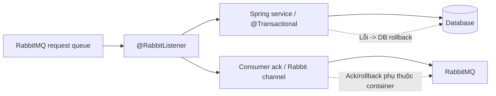
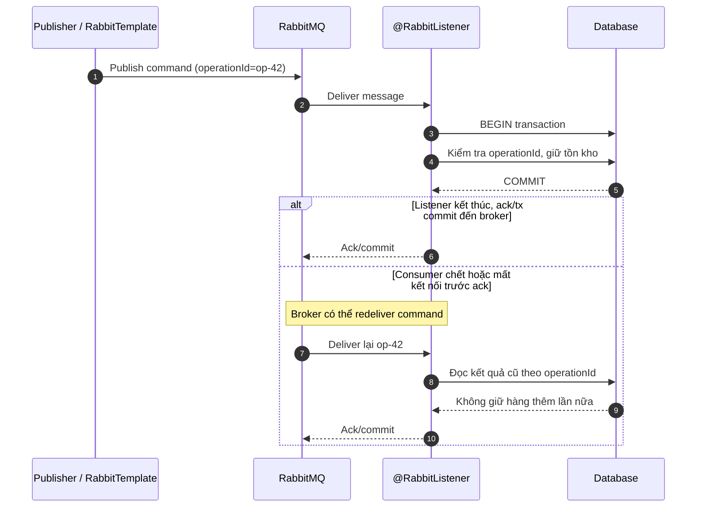
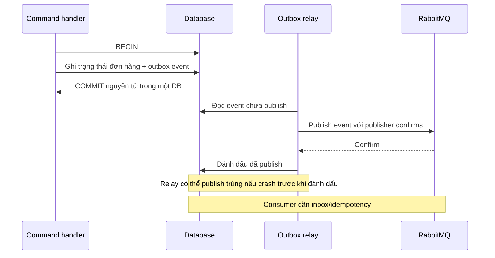

# Tương tác giữa giao dịch, retry và lỗi nghiệp vụ

## 1. Vì sao ba cơ chế này phải được thiết kế cùng nhau?

Trong chương **Giao dịch** của **Spring AMQP**, việc đưa message qua RabbitMQ thường gắn với thay đổi dữ liệu nghiệp vụ: giữ tồn kho, tạo hóa đơn, cập nhật trạng thái đơn hàng hoặc ghi kết quả thanh toán. Một message có thể đi qua **exchange → binding → queue**, được `@RabbitListener` xử lý, rồi phát sinh exception trước hoặc sau khi dữ liệu được commit.

Ba câu hỏi cần trả lời đồng thời:

1. **Giao dịch (transaction)** bảo vệ những thay đổi nào và rollback được những gì?
2. **Retry** xảy ra ở tầng nào, lúc nào và có chạy lại tác dụng phụ đã commit không?
3. **Lỗi nghiệp vụ** là kết quả cuối cùng có thể chấp nhận được, hay là sự cố cần rollback, retry hoặc dead-letter?

Nếu chỉ thêm `@Transactional` và bật retry mặc định, hệ thống vẫn có thể gây lỗi nghiêm trọng. Ví dụ, consumer đã trừ tồn kho rồi kết nối broker bị đứt trước khi ack: RabbitMQ có thể giao lại message và trừ kho lần nữa. Ngược lại, message có số lượng âm sẽ bị retry vô ích nếu ứng dụng xem mọi exception đều là lỗi tạm thời.

### Mục tiêu học tập

- Phân biệt transaction của **database**, AMQP **transactional channel** (`channelTransacted`), acknowledgement và publisher confirm.
- Dự đoán điều gì xảy ra khi listener thành công, ném exception, database rollback, AMQP rollback hoặc broker redelivery.
- Phân loại lỗi nghiệp vụ, payload không hợp lệ và lỗi hạ tầng để chọn **commit, retry, reject hoặc DLQ**.
- Chọn **stateless retry** hay **stateful retry** theo ranh giới transaction.
- Xây luồng xử lý idempotent dựa trên `operationId` và quan sát được số lần thử, trạng thái cuối cùng, message trùng.

## 2. Những loại giao dịch không đồng nghĩa với nhau

| Cơ chế | Bảo vệ phạm vi nào? | Không bảo đảm điều gì? |
|---|---|---|
| Database transaction, ví dụ `@Transactional` với `DataSourceTransactionManager` | Ghi/đọc dữ liệu trong cùng transaction database | Không tự đưa RabbitMQ ack, publish và hệ thống bên ngoài vào cùng commit nguyên tử |
| AMQP channel transaction (`channelTransacted=true`) | Publish và ack trên AMQP channel theo `tx.commit`/`tx.rollback` | Không rollback được SQL đã commit ở một database độc lập |
| External transaction manager gắn với listener container | Có thể điều phối việc kết thúc transaction database và AMQP theo cơ chế đồng bộ của Spring | Chỉ là **best-effort one-phase commit**, không phải XA/2PC nguyên tử |
| Consumer acknowledgement | Báo broker message đã được xử lý ở mức giao nhận | Không chứng minh nghiệp vụ thành công hay các hệ thống ngoài đã commit |
| Publisher confirm / return | Xác nhận broker nhận publish, hoặc phát hiện message không thể định tuyến nếu cấu hình phù hợp | Không chứng minh consumer đã xử lý nghiệp vụ |
| Retry | Gọi lại thao tác thất bại theo chính sách | Không tự ngăn trùng tác dụng phụ; có thể làm quá tải nặng hơn |

### 2.1. `channelTransacted` trong `RabbitTemplate` và listener container

Spring AMQP cho phép bật `channelTransacted` trên `RabbitTemplate` và container. Khi bật, các thao tác RabbitMQ thuộc AMQP transaction; ngoại lệ có thể khiến transaction rollback. Nếu đã có Spring transaction trên thread phù hợp, việc hoàn tất AMQP transaction có thể được đồng bộ đến cuối transaction đó.

**Không nên hiểu `@Transactional` là mặc nhiên đã bật AMQP transaction.** Một service có thể rollback database nhưng message đã được ack/publish ở tầng broker theo cấu hình độc lập.



### 2.2. Hai ví dụ về “thành công” cần tách biệt

- **Database commit đã thành công, nhưng broker chưa nhận ack:** khi channel/consumer chết, message có thể quay lại queue. Lần xử lý tiếp theo phải nhận ra thao tác cũ.
- **Broker xác nhận publish, nhưng người nhận chưa xử lý:** publisher confirm chỉ xác nhận tới broker, không đồng nghĩa downstream đã commit.

Vì vậy, mục tiêu thực tế thường là **at-least-once delivery + idempotent processing**. Một operation có `operationId` ổn định phải có khả năng chạy lại an toàn, kể cả khi người gửi và người nhận gặp sự cố ở ranh giới commit.

## 3. Timeline: transaction, exception, ack và retry tương tác thế nào?

Giả sử service Đơn hàng gửi message `RESERVE|op-42|SKU-7|2`. Worker mở transaction database, giảm tồn kho, lưu reservation và sau đó listener hoàn tất.



| Vị trí lỗi | Database | Broker có thể làm gì? | Ứng dụng cần làm gì? |
|---|---|---|---|
| Lỗi **trước** khi lưu thay đổi | Chưa commit; rollback nếu có transaction | Nack/requeue hoặc DLQ theo chính sách | Phân loại exception, retry có giới hạn |
| Lỗi **giữa** nhiều câu SQL cùng transaction | Rollback tất cả các câu SQL trong transaction | Có thể giao lại message | Đảm bảo thao tác không để lại trạng thái nửa chừng |
| Lỗi **sau DB commit, trước ack** | Dữ liệu đã thay đổi | Có thể giao lại message | Dùng unique `operationId` để tránh tác dụng phụ lần hai |
| Listener ném exception nhưng **đã bắt và nuốt lỗi** | Có thể vẫn commit nếu transaction không bị đánh dấu rollback-only | Container thấy method trở về bình thường và có thể ack | Chỉ bắt lỗi khi có quyết định rõ ràng: ghi kết quả nghiệp vụ hoặc rollback |
| Kết nối broker lỗi trong giai đoạn commit AMQP | DB có thể đã commit | Trạng thái ack/publish có thể chưa xác định | Đối soát, idempotency và metric; không giả định exactly-once |
| Message bị reject với `requeue=false` | Phụ thuộc xử lý trước đó | Dead-letter nếu queue cấu hình DLX, nếu không có thể bị loại bỏ | Xác định nơi theo dõi và xử lý lỗi cuối cùng |

> **Nguyên tắc:** Transaction quyết định điều gì được commit hoặc rollback. Retry quyết định thao tác nào được thử lại. Lỗi nghiệp vụ quyết định có nên thử lại hay kết thúc bằng một trạng thái thất bại hợp lệ.

## 4. Phân loại lỗi trước khi chọn retry

**Lỗi nghiệp vụ** là kết quả được định nghĩa trong domain: hết hàng, đơn đã hủy, hạn mức không đủ, mã giảm giá hết hiệu lực. Chúng thường **không tự hết** khi chạy lại ngay. Hãy lưu kết quả `REJECTED` hoặc phát event lỗi có cấu trúc, rồi kết thúc message thành công ở mức tiêu thụ.

**Lỗi dữ liệu/message vĩnh viễn** như payload sai schema, thiếu trường bắt buộc, không giải mã được có thể cần reject không requeue và gửi DLQ để điều tra. Dữ liệu không hợp lệ không nên tạo vòng lặp vô hạn trong queue.

**Lỗi hạ tầng tạm thời** như kết nối database đứt, HTTP downstream trả 503 hoặc throttling có thể retry với giới hạn, backoff và jitter. Chỉ retry khi thao tác an toàn để lặp lại hoặc đã có cơ chế idempotency.

| Nhóm lỗi | Ví dụ | Transaction | Phản ứng thường hợp lý |
|---|---|---|---|
| Thành công | Đã giữ kho, đã ghi event | Commit | Ack message |
| Kết quả nghiệp vụ cuối cùng | Hết hàng, đơn không đủ điều kiện | Commit trạng thái `REJECTED` nếu cần audit | Ack; gửi event `ReservationRejected` nếu hợp đồng yêu cầu |
| Payload không hợp lệ | Thiếu `operationId`, sai định dạng | Không thực thi nghiệp vụ | Reject không requeue, DLQ hoặc kênh quarantine |
| Lỗi tạm thời | Database unavailable, API phụ trợ 503 | Rollback các thay đổi chưa commit | Retry giới hạn, backoff; hết lần thì DLQ |
| Lỗi lập trình | `NullPointerException`, invariant bị phá vỡ | Rollback | Cách ly, cảnh báo, điều tra; không retry mù quáng |
| Trùng request đã hoàn thành | Broker redelivery hoặc producer retry | Không thực hiện tác dụng phụ mới; đọc kết quả cũ | Ack như một lần xử lý thành công |
| Cùng ID nhưng payload khác | Một `operationId` dùng cho hai thao tác khác | Không thực hiện thao tác thứ hai | Ghi nhận xung đột, chuyển sang luồng xử lý riêng |

### Tại sao không nên ném exception cho mọi business rejection?

Nếu `OutOfStockException` làm rollback transaction rồi broker requeue theo mặc định, **message hết hàng có thể lặp vô hạn** và chặn các message khác. Nếu domain cần ghi nhận “đơn 42 bị từ chối vì hết hàng”, đó là một **kết quả hợp lệ** cần commit rồi ack, không phải lỗi hạ tầng phải retry.

Ngược lại, nếu đã bắt `SQLException` rồi chỉ ghi log và trả về bình thường, database có thể rollback nhưng container vẫn cho rằng listener xử lý thành công. Cần **để exception đi ra ngoài** hoặc đánh dấu transaction rollback-only và đảm bảo xử lý lại message theo đúng chính sách.

## 5. Ví dụ Spring AMQP: transaction database đặt bên trong retry

Ví dụ dưới đây sử dụng chiến lược phổ biến cho một service xử lý event: **listener nhận và retry có giới hạn; mỗi lần thử gọi một service có transaction database riêng**. Điều này giúp dùng **stateless retry** hợp lý vì transaction database bắt đầu bên trong callback được retry. Phần AMQP transaction của container ở phương án này để mặc định; tính toàn vẹn end-to-end đến từ database transaction và idempotency.

### 5.1. Dependency và kết nối

```xml
<dependency>
    <groupId>org.springframework.boot</groupId>
    <artifactId>spring-boot-starter-amqp</artifactId>
</dependency>
<dependency>
    <groupId>org.springframework.boot</groupId>
    <artifactId>spring-boot-starter-jdbc</artifactId>
</dependency>
<dependency>
    <groupId>org.springframework.retry</groupId>
    <artifactId>spring-retry</artifactId>
</dependency>
```

Sử dụng BOM Spring Boot để quản lý phiên bản, thêm driver database phù hợp và cấu hình `DataSource` ở môi trường thực. Ví dụ phát triển:

```yaml
spring:
  rabbitmq:
    host: localhost
    port: 5672
    username: guest
    password: guest
```

Không sử dụng tài khoản `guest` hay mật khẩu mẫu cho production; tài khoản này thường chỉ được RabbitMQ cho phép kết nối từ local.

### 5.2. Exchange, queue, binding và dead-letter

```java
import org.springframework.amqp.core.Binding;
import org.springframework.amqp.core.BindingBuilder;
import org.springframework.amqp.core.DirectExchange;
import org.springframework.amqp.core.Queue;
import org.springframework.amqp.core.QueueBuilder;
import org.springframework.beans.factory.annotation.Qualifier;
import org.springframework.context.annotation.Bean;
import org.springframework.context.annotation.Configuration;

@Configuration
public class ReserveMessagingTopology {
    public static final String EXCHANGE = "stock.reserve.exchange";
    public static final String QUEUE = "stock.reserve.commands";
    public static final String KEY = "stock.reserve";
    public static final String DLX = "stock.reserve.dlx";
    public static final String DLQ = "stock.reserve.failed";
    public static final String DEAD_KEY = "stock.failed";

    @Bean
    DirectExchange reserveExchange() {
        return new DirectExchange(EXCHANGE, true, false);
    }

    @Bean
    DirectExchange reserveDlx() {
        return new DirectExchange(DLX, true, false);
    }

    @Bean
    Queue reserveQueue() {
        return QueueBuilder.durable(QUEUE)
                .deadLetterExchange(DLX)
                .deadLetterRoutingKey(DEAD_KEY)
                .build();
    }

    @Bean
    Queue reserveDlq() {
        return QueueBuilder.durable(DLQ).build();
    }

    @Bean
    Binding reserveBinding(
            @Qualifier("reserveQueue") Queue queue,
            @Qualifier("reserveExchange") DirectExchange exchange) {
        return BindingBuilder.bind(queue).to(exchange).with(KEY);
    }

    @Bean
    Binding reserveDeadBinding(
            @Qualifier("reserveDlq") Queue queue,
            @Qualifier("reserveDlx") DirectExchange dlx) {
        return BindingBuilder.bind(queue).to(dlx).with(DEAD_KEY);
    }
}
```

Trong hệ thống đã có queue từ trước, các thuộc tính `x-dead-letter-exchange` và `x-dead-letter-routing-key` cần nhất quán với queue broker đang tồn tại; nếu không, khai báo lại queue có thể thất bại vì bất đồng thuộc tính. Production thường quản lý chính sách DLX bằng RabbitMQ policy thay vì cố định mọi tham số trong code.

### 5.3. Listener: trả về bình thường khi nghiệp vụ đã có kết quả

```java
import org.springframework.amqp.AmqpRejectAndDontRequeueException;
import org.springframework.amqp.rabbit.annotation.RabbitListener;
import org.springframework.stereotype.Component;

record ReserveCommand(String operationId, String sku, int quantity) {
    static ReserveCommand parse(String payload) {
        String[] fields = payload.split("\\|", -1);
        if (fields.length != 3 ||
                fields[0].isBlank() || fields[1].isBlank()) {
            throw new IllegalArgumentException("INVALID_FORMAT");
        }
        try {
            return new ReserveCommand(
                    fields[0], fields[1], Integer.parseInt(fields[2]));
        } catch (NumberFormatException ex) {
            throw new IllegalArgumentException("INVALID_QUANTITY", ex);
        }
    }
}

@Component
public class ReserveCommandListener {
    private final ReserveUseCase useCase;

    public ReserveCommandListener(ReserveUseCase useCase) {
        this.useCase = useCase;
    }

    @RabbitListener(
            queues = ReserveMessagingTopology.QUEUE,
            containerFactory = "reserveListenerFactory")
    public void handle(String payload) {
        ReserveCommand command;
        try {
            command = ReserveCommand.parse(payload);
        } catch (IllegalArgumentException malformed) {
            // Không gửi lại mãi một message không thể parse.
            throw new AmqpRejectAndDontRequeueException(
                    "Malformed reserve command", malformed);
        }

        ReserveOutcome result = useCase.reserveOnce(command);
        // ACCEPTED, REJECTED và DUPLICATE đều là kết quả đã xác định.
        // Trở về bình thường để container có thể ack.
        System.out.printf("operation=%s status=%s%n",
                command.operationId(), result.status());
    }
}

record ReserveOutcome(String status, String reason) {}
```

Không dùng `System.out` làm logging production: ví dụ chỉ minh họa trạng thái. Thực tế hãy dùng logger/tracing có `operationId`, trạng thái cuối và thông tin lỗi đã được loại bỏ dữ liệu nhạy cảm. `ReserveUseCase` là một bean Spring riêng để proxy transaction của `@Transactional` được kích hoạt đúng khi listener gọi tới nó.

### 5.4. Service: một transaction database cho mỗi lần thử

```java
import org.springframework.stereotype.Service;
import org.springframework.transaction.annotation.Transactional;

@Service
public class ReserveUseCase {
    private final ReservationRepository repository;

    public ReserveUseCase(ReservationRepository repository) {
        this.repository = repository;
    }

    @Transactional
    public ReserveOutcome reserveOnce(ReserveCommand command) {
        // Repository triển khai dùng DB transaction, unique operation_id
        // và khóa/UPDATE có điều kiện để tránh 2 worker giữ hàng 2 lần.
        return repository.applyOnceAtomically(command);
    }
}

// Port mô tả hợp đồng repository; cần hiện thực bằng JDBC/JPA thực.
interface ReservationRepository {
    ReserveOutcome applyOnceAtomically(ReserveCommand command);
}
```

Hợp đồng của `applyOnceAtomically`:

1. Tạo hoặc khóa bản ghi theo `operation_id` trong transaction database.
2. Nếu có kết quả cũ với **cùng payload**, trả kết quả đó; không giảm tồn kho lần nữa.
3. Nếu `operation_id` đã tồn tại nhưng payload khác, trả lỗi xung đột có kiểm soát.
4. Nếu quantity không hợp lệ về mặt domain hoặc tồn kho không đủ, ghi kết quả `REJECTED` và commit.
5. Nếu hợp lệ, giảm tồn kho, tạo reservation, ghi kết quả `ACCEPTED` **trong cùng transaction** và commit.
6. Nếu database không thể truy cập, để exception tương ứng được nhận diện là lỗi tạm thời để transaction rollback và retry.

Ví dụ lược đồ dữ liệu và cập nhật tồn kho có điều kiện:

```sql
CREATE TABLE processed_commands (
    operation_id    VARCHAR(100) PRIMARY KEY,
    sku             VARCHAR(100) NOT NULL,
    quantity        INTEGER NOT NULL,
    status          VARCHAR(20) NOT NULL,
    reason          VARCHAR(200),
    reservation_id  VARCHAR(100),
    created_at      TIMESTAMPTZ NOT NULL DEFAULT NOW()
);

-- Sau khi giữ quyền xử lý operation_id trong cùng DB transaction:
UPDATE inventory
SET available = available - :quantity
WHERE sku = :sku
  AND available >= :quantity;

-- Nếu số hàng cập nhật = 0: lưu REJECTED/OUT_OF_STOCK.
-- Nếu số hàng cập nhật = 1: tạo reservation và lưu ACCEPTED.
-- Transaction phải cùng bao cả việc đổi inventory và ghi processed_commands.
```

**Lưu ý:** Lược đồ và SQL ở đây mô tả giao thức xử lý; phải triển khai khóa dòng, xử lý conflict khi insert `operation_id` và kiểm tra row count để tránh race giữa hai consumer. Chỉ gọi `exists(operationId)` rồi xử lý là không đủ. Cùng một `operationId` phải được giữ nguyên qua publisher retry, broker redelivery và replay từ DLQ.

### 5.5. Retry có phân loại lỗi; hết lần thì dead-letter

Ở phương án này, DB transaction bắt đầu **bên trong** lệnh gọi listener được retry. Chúng ta có thể dùng **stateless retry** với chính sách chỉ retry một loại exception tạm thời do ứng dụng quy định. Các lỗi format và lỗi domain không được retry.

```java
// Lỗi có thể retry mà tầng adapter repository phát sinh khi
// kết nối DB hoặc dependency tạm thời không sẵn sàng.
public class TransientReserveException extends RuntimeException {
    public TransientReserveException(String message, Throwable cause) {
        super(message, cause);
    }
}
```

```java
import java.util.Map;
import org.springframework.amqp.rabbit.config.RetryInterceptorBuilder;
import org.springframework.amqp.rabbit.config.SimpleRabbitListenerContainerFactory;
import org.springframework.amqp.rabbit.connection.ConnectionFactory;
import org.springframework.amqp.rabbit.retry.RejectAndDontRequeueRecoverer;
import org.springframework.context.annotation.Bean;
import org.springframework.context.annotation.Configuration;
import org.springframework.retry.backoff.ExponentialBackOffPolicy;
import org.springframework.retry.interceptor.RetryOperationsInterceptor;
import org.springframework.retry.policy.SimpleRetryPolicy;

@Configuration
public class ReserveConsumerConfiguration {

    @Bean
    RetryOperationsInterceptor reserveRetryAdvice() {
        SimpleRetryPolicy policy = new SimpleRetryPolicy(
                3,
                Map.of(TransientReserveException.class, true),
                true); // duyệt cause khi exception bị listener wrapper bọc

        ExponentialBackOffPolicy backoff = new ExponentialBackOffPolicy();
        backoff.setInitialInterval(250);
        backoff.setMultiplier(2.0);
        backoff.setMaxInterval(2_000);

        return RetryInterceptorBuilder.stateless()
                .retryPolicy(policy)
                .backOffPolicy(backoff)
                .recoverer(new RejectAndDontRequeueRecoverer())
                .build();
    }

    @Bean
    SimpleRabbitListenerContainerFactory reserveListenerFactory(
            ConnectionFactory connectionFactory,
            RetryOperationsInterceptor reserveRetryAdvice) {
        SimpleRabbitListenerContainerFactory factory =
                new SimpleRabbitListenerContainerFactory();
        factory.setConnectionFactory(connectionFactory);
        factory.setAcknowledgeMode(
                org.springframework.amqp.core.AcknowledgeMode.AUTO);
        factory.setDefaultRequeueRejected(false);
        factory.setAdviceChain(reserveRetryAdvice);
        return factory;
    }
}
```

Trong ví dụ:

- `maxAttempts=3` nghĩa là tối đa **3 lần thực thi** gồm lần đầu và hai lần retry.
- Lỗi `TransientReserveException` được nhận là retryable dù được bọc bởi `ListenerExecutionFailedException`.
- Exception khác đi tới recoverer mà không có retry không cần thiết. `RejectAndDontRequeueRecoverer` yêu cầu container reject với `requeue=false`.
- Nếu request queue có DLX đúng cấu hình, broker có thể chuyển message bị reject vào DLQ. Nếu không có đường dead-letter, message có thể bị loại bỏ.
- Không bật `channelTransacted` hoặc gắn external transaction manager trên factory này; transaction DB trong `ReserveUseCase` kết thúc theo từng attempt.

Việc chuyển lỗi database sang `TransientReserveException` cần làm ở tầng repository/service adapter theo loại lỗi thực tế, **không** bọc mọi exception vào loại transient. Trường hợp lỗi business trả `REJECTED` bình thường, worker không phải ném exception.

Nếu hệ thống yêu cầu transaction bắt đầu **trước retry advice** hoặc phải rollback AMQP channel cùng transaction bao ngoài, phương án stateless ở trên không còn là mặc định phù hợp; xem stateful retry ở mục sau.

## 6. Khi transaction nằm bên ngoài callback: stateful retry

Spring AMQP hỗ trợ cấu hình một `PlatformTransactionManager` cho listener container và đồng bộ với AMQP transaction (`channelTransacted=true`). Điều này hữu ích khi muốn lỗi commit database cũng tác động đến xử lý message. Tuy nhiên, vì transaction bao ngoài phải rollback ngay khi attempt ném exception, việc thử lại nhiều lần **bên trong cùng transaction đã lỗi** là không an toàn.

**Stateful retry** phù hợp hơn khi cần cho exception thoát về container, kích hoạt rollback, và ghi nhớ số lần retry qua các lần broker giao lại cùng message. Nó cần một **message identity** ổn định, thường lấy từ thuộc tính AMQP `messageId`.

Ví dụ cấu hình minh họa **thay thế hoàn toàn** cho factory mục 5:

```java
import org.springframework.amqp.rabbit.config.RetryInterceptorBuilder;
import org.springframework.amqp.rabbit.config.SimpleRabbitListenerContainerFactory;
import org.springframework.amqp.rabbit.connection.ConnectionFactory;
import org.springframework.amqp.rabbit.retry.RejectAndDontRequeueRecoverer;
import org.springframework.beans.factory.annotation.Qualifier;
import org.springframework.context.annotation.Bean;
import org.springframework.retry.interceptor.StatefulRetryOperationsInterceptor;
import org.springframework.transaction.PlatformTransactionManager;

@Bean
StatefulRetryOperationsInterceptor statefulReserveRetry() {
    return RetryInterceptorBuilder.stateful()
            .maxAttempts(3)
            .backOffOptions(250, 2.0, 2_000)
            .recoverer(new RejectAndDontRequeueRecoverer())
            .build();
}

@Bean
SimpleRabbitListenerContainerFactory transactionalReserveFactory(
        ConnectionFactory connectionFactory,
        @Qualifier("transactionManager")
        PlatformTransactionManager databaseTransactionManager,
        StatefulRetryOperationsInterceptor statefulReserveRetry) {

    SimpleRabbitListenerContainerFactory factory =
            new SimpleRabbitListenerContainerFactory();
    factory.setConnectionFactory(connectionFactory);
    factory.setTransactionManager(databaseTransactionManager);
    factory.setChannelTransacted(true);
    // Stateful retry cần broker giao lại các attempt chưa hết hạn;
    // recoverer sẽ chủ động reject không requeue khi hết số lần thử.
    factory.setDefaultRequeueRejected(true);
    factory.setAdviceChain(statefulReserveRetry);
    return factory;
}
```

**Không ghép hai factory vào cùng một listener.** Khi dùng phương án này, annotation phải trỏ đến `containerFactory = "transactionalReserveFactory"`. Bean `transactionManager` trong ví dụ là transaction manager **database** hiện có; đừng thay thế bằng `RabbitTransactionManager` rồi cho rằng nó quản lý được cả database.

Khi gửi message cho **stateful retry**, hãy gán `messageId` rõ ràng:

```java
import java.util.UUID;
import org.springframework.amqp.rabbit.core.RabbitTemplate;

void publish(RabbitTemplate template, String payload) {
    template.convertAndSend(
            ReserveMessagingTopology.EXCHANGE,
            ReserveMessagingTopology.KEY,
            payload,
            message -> {
                message.getMessageProperties()
                        .setMessageId(UUID.randomUUID().toString());
                return message;
            });
}
```

`messageId` đại diện cho **message AMQP để stateful retry nhận diện redelivery**. `operationId` đại diện cho **thao tác nghiệp vụ để idempotency nhận diện retry do producer hoặc các message mới**. Hai mã không thể thay thế nhau: lần publish lại có thể có `messageId` mới nhưng vẫn phải mang cùng `operationId`.

Stateful retry có các điều kiện vận hành cần thiết:

- Message thiếu `messageId` có thể bị coi là fatal theo cấu hình mặc định của interceptor/container. Nếu producer không kiểm soát được message ID, phải thiết kế `MessageKeyGenerator` phù hợp và cấu hình hành vi null ID cẩn thận.
- Vì mỗi lần lỗi có thể dẫn đến rollback và broker redelivery, backoff/retry khác với retry tuần tự hoàn toàn trong cùng một invocation. Cần đo redelivery và tránh phát sinh requeue liên tục.
- Với ví dụ stateful, `defaultRequeueRejected=true` cho phép broker redeliver trong khi còn lượt thử; khi hết lượt, `RejectAndDontRequeueRecoverer` ném `AmqpRejectAndDontRequeueException` để kết thúc bằng reject không requeue. Nếu đặt `defaultRequeueRejected=false` ngay từ đầu, message có thể đi vào DLQ sau lần rollback đầu tiên, trước khi stateful retry có cơ hội hoàn tất.
- Cần bảo đảm ứng dụng không dùng transaction manager ngoài callback rồi tự nuốt exception khiến container hiểu nhầm đã thành công.

### 6.1. Best-effort one-phase commit không phải XA

Khi container dùng external database transaction manager và `channelTransacted=true`, Spring AMQP cố gắng đồng bộ database và RabbitMQ. Nhưng hai commit không diễn ra trong cùng một distributed transaction nguyên tử. Ví dụ, **database commit thành công nhưng AMQP commit sau đó thất bại** vẫn có thể xảy ra.

Một số phiên bản Spring AMQP hỗ trợ chẩn đoán lỗi ở pha transaction synchronization bằng `ConnectionFactoryUtils.enableAfterCompletionFailureCapture(true)` và `ConnectionUtils.checkAfterCompletion()` theo tài liệu, nhưng việc quan sát được lỗi không tự rollback database đã commit. Đừng dùng một transaction manager cho nhiều tài nguyên mà bỏ qua outbox/inbox và idempotency.

### 6.2. `RabbitTransactionManager` chỉ quản lý tài nguyên Rabbit

`RabbitTransactionManager` quản lý AMQP transaction cho một RabbitMQ connection factory. Nó **không tự quản lý JDBC/JPA transaction**. Nếu workflow cần thay đổi database và gửi message có độ tin cậy cao, hãy cân nhắc **transactional outbox**:



Outbox giải quyết tình huống database đã commit mà message chưa được publish, đổi lại phải chấp nhận relay gửi trùng và consumer xử lý trùng an toàn. Publisher confirms hỗ trợ biết broker nhận publish nhưng không phải xác nhận nghiệp vụ đã hoàn tất.

## 7. Nguồn gốc của requeue và cách tránh retry vô hạn

Trong listener container, khi exception đi ra ngoài, quyết định requeue phụ thuộc `defaultRequeueRejected` (mặc định thường là `true`), các exception đặc biệt, retry advice và quy tắc error handler.

| Tình huống | Hành vi điển hình |
|---|---|
| Listener thành công và trả về bình thường | Container ack theo `AcknowledgeMode.AUTO` hoặc commit nếu dùng transactional channel |
| Listener lỗi; `defaultRequeueRejected=true` | Message có thể được requeue, tạo vòng lặp nếu lỗi không đổi |
| Listener lỗi; `defaultRequeueRejected=false` | Message được reject không requeue, có thể tới DLX/DLQ |
| Ném `AmqpRejectAndDontRequeueException` | Yêu cầu reject không requeue, kể cả khi cấu hình mặc định là requeue |
| Ném `ImmediateRequeueAmqpException` | Yêu cầu requeue theo chính sách Spring AMQP phù hợp |
| Retry advice hết số lần và `RejectAndDontRequeueRecoverer` | Reject không requeue để broker dead-letter nếu có DLX |
| Recoverer **nuốt lỗi và coi đã xử lý xong** | Message có thể được ack; broker không chuyển nó vào DLX theo đường reject |

Với lỗi conversion xảy ra **trước khi gọi listener**, Spring AMQP có `ConditionalRejectingErrorHandler` để phân loại một số lỗi không thể khôi phục; chính sách cụ thể phụ thuộc phiên bản/cấu hình. Không viết mã giả định tất cả lỗi parse sẽ đi qua handler nghiệp vụ.

**Ba tầng retry khác nhau:**

1. **Ứng dụng tự retry trong một method:** dễ kiểm soát nhưng phải đảm bảo transaction không đã bị đánh dấu rollback-only và thao tác lặp an toàn.
2. **Spring Retry advice trước listener:** stateless thử lại trong một chu kỳ gọi; stateful ghi nhớ lần thử theo message identity để hỗ trợ rollback/redelivery.
3. **Broker redelivery hoặc delayed retry queue:** message trở lại consumer sau nack/requeue hoặc cơ chế DLX/TTL; số lần và độ trễ phải có giới hạn, tránh vòng lặp nóng.

Để trì hoãn retry qua broker, có thể dùng retry queue với TTL và DLX định tuyến về queue chính hoặc hệ thống delay phù hợp. Thiết kế cần tránh tạo chu kỳ vô hạn với message dữ liệu sai; lưu dấu lần thử và chuyển hẳn sang **parking lot DLQ** sau giới hạn.

## 8. Sai lầm phổ biến khi kết hợp `@Transactional` và retry

### 8.1. Nuốt exception khiến message được ack

```java
@RabbitListener(queues = "stock.reserve.commands")
public void riskyHandler(String body) {
    try {
        businessService.reserve(body);
    } catch (Exception ex) {
        // Sai: log rồi trả về bình thường.
        // Consumer có thể ack dù không có kết quả nghiệp vụ hợp lệ.
    }
}
```

Nếu business operation thất bại chưa được giải quyết, để exception phù hợp đi ra ngoài và được retry/DLQ. Chỉ trả về bình thường khi đã ghi nhận **trạng thái cuối** đúng hợp đồng.

### 8.2. Giả định `@Transactional` rollback mọi exception

Mặc định transaction kiểu Spring AOP rollback với `RuntimeException` hoặc `Error`; các checked exception có thể cần quy tắc `rollbackFor` hoặc thiết kế transaction attribute phù hợp. Với container transaction advice, Spring AMQP có `ListenerFailedRuleBasedTransactionAttribute` để đọc **nguyên nhân gốc** bên trong `ListenerExecutionFailedException` khi cấu hình conditional rollback. Không chọn `noRollbackFor` chỉ để “message không retry”, vì có thể khiến dữ liệu trung gian bị commit.

### 8.3. Retry khi transaction đã hỏng

Giả sử transaction bên ngoài retry interceptor đã bị database đánh dấu rollback-only. Retry stateless trong cùng transaction đó nhiều lần thường vẫn thất bại, thậm chí trả về kết quả giả trước khi commit ném lỗi `UnexpectedRollbackException`. Hãy đưa transaction vào **mỗi attempt riêng** hoặc dùng **stateful retry** để container rollback qua từng delivery.

### 8.4. Đưa lỗi nghiệp vụ vào DLQ nhưng không lưu trạng thái

Nếu `OUT_OF_STOCK` là quyết định hợp lệ, dead-letter message mà không cập nhật đơn hàng sẽ để đơn tồn tại mãi ở trạng thái `PENDING`. Tốt hơn là commit `REJECTED` cùng reason và phát kết quả nghiệp vụ phù hợp. DLQ nên phục vụ lỗi **không thể xử lý theo hợp đồng hiện tại** hoặc lỗi tạm thời đã hết khả năng retry.

### 8.5. Tin rằng retry tự bảo đảm exactly-once

Một message có thể hoàn thành thao tác database nhưng bị giao lại vì ack bị mất. `@Transactional` chỉ bảo đảm atomic trong database mà nó quản lý; cần **unique operation ID + transaction + thao tác có điều kiện** để duplicate trở thành no-op hoặc trả kết quả đã lưu.

## 9. Idempotency, kiểm soát side effect và outbox

### 9.1. Phân biệt `messageId`, `correlationId` và `operationId`

- `messageId` là danh tính message AMQP, hữu ích cho stateful retry theo delivery.
- `correlationId` dùng để ghép request–reply nếu có RPC.
- `operationId` là danh tính thao tác nghiệp vụ ổn định qua retry/requeue/replay.

Trong ví dụ giữ kho, `op-42` phải luôn gắn với đúng SKU, số lượng và yêu cầu nguồn. Khi cùng ID xuất hiện lần hai, worker trả kết quả đã lưu. Khi cùng ID được dùng cho SKU hoặc số lượng khác, worker phải trả xung đột, tránh áp dụng thao tác ngoài ý muốn.

### 9.2. Khi có tác dụng phụ ngoài database

Gửi email, gọi cổng thanh toán hoặc HTTP downstream **không tự rollback** chỉ vì database transaction ném exception sau đó. Cần thiết kế idempotency key cho đối tác, outbox, inbox, trạng thái trung gian, đối soát hoặc bù trừ (saga) tùy nghiệp vụ. Đặt lệnh gọi mạng chậm bên trong transaction database còn có thể giữ khóa lâu, gây tăng độ trễ và deadlock.

### 9.3. Thời hạn giữ khóa deduplication

Thời gian lưu `operationId` phải lớn hơn tổng cửa sổ retry thực tế: retry của publisher, TTL queue, delayed retry, DLQ replay và thời gian đối soát thủ công. Xóa quá sớm khiến message cũ bị xem là message mới, làm phát sinh tác dụng phụ lặp lại.

## 10. Quan sát và kiểm thử lỗi có chủ đích

### Chỉ số nên đo

| Nguồn | Metric / log cần có |
|---|---|
| Publisher `RabbitTemplate` | Publish succeeded/failed, confirms, returns, routing key, `operationId` và `messageId` |
| RabbitMQ | `ready`, `unacked`, publish/deliver/ack rate, redelivery count, DLQ depth, số consumer |
| Spring Retry | Attempt number, lỗi được phân loại, backoff, exhausted/recoverer, tổng retry theo queue |
| Transaction database | Commit/rollback rate, deadlock, constraint conflict, latency p95/p99 |
| Nghiệp vụ | `ACCEPTED`/`REJECTED`/`DUPLICATE`, số thao tác duy nhất, side effect count, pending/unknown state |

### Kịch bản kiểm thử

1. **Business rejection:** gửi đơn số lượng vượt tồn kho; xác nhận kết quả `REJECTED` được lưu, listener ack và **không retry**.
2. **Lỗi database tạm thời:** giả lập lỗi kết nối từ repository, xác nhận các attempt rollback riêng, backoff và tối đa ba lần với cấu hình ở mục 5.
3. **Payload sai:** gửi thiếu trường; bảo đảm message không lặp vô hạn và đi tới DLQ nếu được cấu hình.
4. **Crash sau DB commit, trước ack:** dùng fault injection trong môi trường test; cho RabbitMQ redeliver, kiểm tra không giảm tồn kho lần hai.
5. **Duplicate cạnh tranh:** cho hai consumer nhận cùng `operationId` qua hai message; kiểm tra unique constraint/transaction khiến chỉ một reservation được tạo.
6. **Commit AMQP lỗi sau DB commit:** quan sát trạng thái chưa xác định và quy trình đối soát; tránh kết luận rollback database chỉ vì broker lỗi.
7. **Stateful retry:** kiểm tra `messageId` được gán, số attempt được giữ qua redelivery; thử message thiếu ID trong môi trường test để thấy chính sách xử lý.
8. **DLQ replay:** khôi phục lỗi hạ tầng và replay message giữ nguyên `operationId`; xác nhận không tạo tác dụng phụ trùng.

### Câu hỏi tự kiểm tra

1. Vì sao database rollback và AMQP rollback không mặc nhiên là một giao dịch nguyên tử?
2. Lỗi “hết hàng” nên ném exception để requeue hay ghi trạng thái `REJECTED`? Trong trường hợp nào có thể chọn cách khác?
3. Tại sao stateless retry thường không thích hợp khi transaction đã được mở **bao bên ngoài** retry callback?
4. Khi đã dùng `channelTransacted=true` và external transaction manager, vì sao vẫn cần idempotency?
5. Một `RejectAndDontRequeueRecoverer` khác gì recoverer chỉ log và bỏ qua lỗi đối với đường vào DLQ?
6. Nếu worker thành công rồi crash trước ack, thông tin nào phải được lưu để lần xử lý tiếp theo an toàn?

## 11. Tài liệu chính thức để đối chiếu khi triển khai

- [Spring AMQP Reference — Transactions](https://docs.spring.io/spring-amqp/reference/amqp/transactions.html): `channelTransacted`, transaction đồng bộ với database, conditional rollback, `RabbitTransactionManager` và best-effort one-phase commit.
- [Spring AMQP Reference — Resilience, Recovering from Errors and Broker Failures](https://docs.spring.io/spring-amqp/reference/amqp/resilience-recovering-from-errors-and-broker-failures.html): stateless/stateful retry, `RetryInterceptorBuilder`, `MessageRecoverer` và xử lý lỗi.
- [Spring AMQP Reference — Exception Handling](https://docs.spring.io/spring-amqp/reference/amqp/exception-handling.html): `ConditionalRejectingErrorHandler`, exception xảy ra trước listener và hành vi reject.
- [Spring AMQP Reference — Listener Container Configuration](https://docs.spring.io/spring-amqp/reference/amqp/containerAttributes.html): `acknowledgeMode`, `channelTransacted`, cấu hình requeue và container.

**Ghi nhớ:** Transaction quyết định **dữ liệu nào commit**, retry quyết định **thử lại điều gì**, còn chính sách lỗi nghiệp vụ quyết định **khi nào một message đã có kết quả cuối cùng**. Trong Spring AMQP, kết hợp `RabbitTemplate`, `@RabbitListener`, queue, binding, acknowledgement, retry và dead-letter chỉ đáng tin cậy khi người triển khai xác định đúng **ranh giới transaction**, tách lỗi không thể retry khỏi lỗi tạm thời và dùng **idempotency bền vững** để xử lý an toàn sau redelivery.
