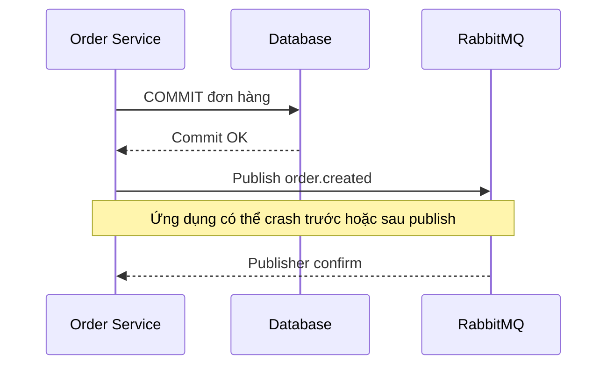
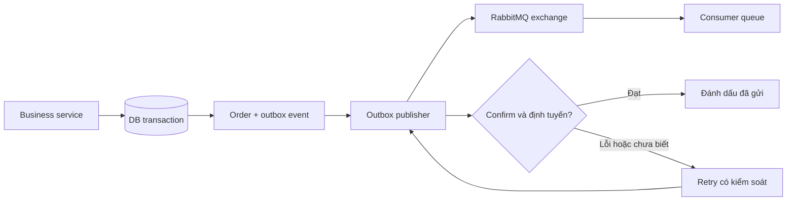

# Giới hạn kết hợp channel transaction với publisher confirm trong Spring AMQP

Khi gửi message bằng `RabbitTemplate`, ứng dụng có thể muốn biết broker đã nhận message hay chưa, hoặc muốn nhiều thao tác gửi message cùng thành công/thất bại. RabbitMQ cung cấp hai cơ chế dễ bị nhầm là **channel transaction** và **publisher confirm**. Cả hai liên quan đến độ tin cậy của publish, nhưng **không thể kích hoạt đồng thời trên cùng một AMQP channel**.

Đây là giới hạn quan trọng trong chương **Giao dịch** của **SPRING_AMQP**. Khi kết hợp `RabbitTemplate`, exchange, queue, binding, xử lý retry, dead-letter và quan sát hệ thống, cần chọn đúng cơ chế xác nhận, phân định rõ ranh giới giao dịch và tránh kỳ vọng sai về việc message đã được consumer xử lý.

## 1. Nắm vững ba mức bảo đảm khác nhau

Trước khi chọn API, hãy tách riêng ba câu hỏi:

1. **Broker có chấp nhận publish không?** Publisher confirm giúp producer nhận tín hiệu `ack` hoặc `nack` của broker cho các lần publish.
2. **Các thao tác AMQP có được commit/rollback cùng nhau không?** Channel transaction cho phép thực hiện `tx.select`, `tx.commit`, `tx.rollback` trên một channel.
3. **Consumer có xử lý nghiệp vụ thành công không?** Cần listener, consumer acknowledgement, trạng thái nghiệp vụ hoặc request–reply; publish confirm và channel commit không trả lời trực tiếp câu hỏi này.

| Cơ chế | Phạm vi chính | Tín hiệu thành công | Điều **không** bảo đảm |
|---|---|---|---|
| Channel transaction | Các thao tác AMQP được thực hiện trong transaction trên một channel | Broker xử lý `tx.commit` thành công | Transaction SQL cùng commit; consumer đã hoàn tất nghiệp vụ |
| Publisher confirm | Các lần publish trên một confirm channel | Broker gửi `basic.ack` cho publish; có thể gửi `basic.nack` | Message chắc chắn có consumer hoặc consumer đã xử lý |
| Consumer acknowledgement | Delivery đến consumer | Consumer xác nhận delivery theo policy | Producer đã biết nghiệp vụ thành công; giao dịch DB luôn atomic |
| RabbitMQ publisher return | Publish đến exchange nhưng không định tuyến được theo điều kiện mandatory | Message bị trả lại kèm routing metadata | Broker chưa nhận publish; return cũng không thay confirm |

Đặc biệt, **publisher confirm `ack` vẫn có thể xảy ra khi message không được định tuyến tới queue nào** nếu publish đã đến exchange hợp lệ. Để phát hiện tình huống không có binding phù hợp, cần cơ chế `mandatory` và xử lý returned message, hoặc cơ chế định tuyến tương đương theo thiết kế.

## 2. Tại sao transaction và confirm loại trừ nhau trên cùng channel?

Trong AMQP 0-9-1, channel là luồng giao tiếp logic bên trong một connection. RabbitMQ cung cấp hai chế độ:

- **Transactional channel:** client gọi `tx.select`, sau đó thực hiện các thao tác AMQP và gọi `tx.commit` hoặc `tx.rollback`.
- **Confirm channel:** client gọi `confirm.select`; broker gửi publisher acknowledgement cho các lần publish trên channel đó.

RabbitMQ **không hỗ trợ đồng thời hai chế độ này cho cùng một channel**. Không có API cấu hình nào của Spring AMQP biến một channel đã bật transaction thành confirm channel cùng lúc. Cố gắng bật cả hai có thể dẫn đến lỗi protocol/channel thay vì tạo ra cơ chế bảo đảm mạnh hơn.

```text
RabbitMQ connection
│
├── Channel A: tx.select
│   ├── basic.publish(message-1)
│   ├── basic.publish(message-2)
│   └── tx.commit / tx.rollback
│
└── Channel B: confirm.select
    ├── basic.publish(message-3)
    ├── basic.publish(message-4)
    └── basic.ack / basic.nack cho các publish

Không hợp lệ: cùng Channel A vừa tx.select vừa confirm.select.
```

**Giới hạn nằm ở channel, không phải toàn broker.** Cùng một RabbitMQ broker, thậm chí cùng một connection về mặt giao thức, có thể phục vụ các channel khác nhau theo những chế độ khác nhau. Trong ứng dụng Spring, cách dễ quản lý là **tách cấu hình và đường đi publish**, đặc biệt nếu sử dụng `CachingConnectionFactory` và nhiều `RabbitTemplate`.

### Không nhầm với xác nhận message ở consumer

`basic.ack` có hai ngữ cảnh khác nhau:

- Trong **publisher confirms**, broker xác nhận việc publish cho producer.
- Trong **consumer acknowledgements**, consumer xác nhận delivery đã xử lý với broker.

Chúng khác chiều giao tiếp, mục đích và ý nghĩa. Một confirm `ack` từ broker không phải `ack` của `@RabbitListener`.

## 3. Channel transaction với `RabbitTemplate`

Spring AMQP dùng `RabbitTemplate.setChannelTransacted(true)` để yêu cầu thao tác trên transactional channel. Với transaction do Spring quản lý, `RabbitTransactionManager` có thể gắn một channel vào transaction hiện hành; lúc đó nhiều thao tác `RabbitTemplate` trong cùng phạm vi transaction có thể commit/rollback như một đơn vị AMQP.

### Ví dụ: gửi hai message trong một transaction RabbitMQ

Giả sử một hệ thống tạo hai sự kiện kỹ thuật cần cùng commit về mặt AMQP. Cấu hình connection factory **chỉ dành cho transaction**, không bật publisher confirms:

```java
import org.springframework.amqp.rabbit.connection.CachingConnectionFactory;
import org.springframework.amqp.rabbit.connection.ConnectionFactory;
import org.springframework.amqp.rabbit.core.RabbitTemplate;
import org.springframework.amqp.rabbit.transaction.RabbitTransactionManager;
import org.springframework.beans.factory.annotation.Qualifier;
import org.springframework.context.annotation.Bean;
import org.springframework.context.annotation.Configuration;
import org.springframework.transaction.annotation.EnableTransactionManagement;

@Configuration
@EnableTransactionManagement
public class TransactionalAmqpConfig {

    @Bean("txConnectionFactory")
    public CachingConnectionFactory txConnectionFactory() {
        CachingConnectionFactory factory =
                new CachingConnectionFactory("localhost");
        factory.setPublisherConfirmType(
                CachingConnectionFactory.ConfirmType.NONE);
        return factory;
    }

    @Bean("txRabbitTemplate")
    public RabbitTemplate txRabbitTemplate(
            @Qualifier("txConnectionFactory") ConnectionFactory connectionFactory) {
        RabbitTemplate template = new RabbitTemplate(connectionFactory);
        template.setChannelTransacted(true);
        return template;
    }

    @Bean("rabbitTransactionManager")
    public RabbitTransactionManager rabbitTransactionManager(
            @Qualifier("txConnectionFactory") ConnectionFactory connectionFactory) {
        return new RabbitTransactionManager(connectionFactory);
    }
}
```

Đây là cấu hình minh họa dùng broker cục bộ. Trước khi gửi message, ứng dụng phải khai báo exchange, queue và binding hợp lệ, chẳng hạn exchange `order.events` cùng các routing key `order.created` và `order.audit`. Môi trường thực tế cần quản lý host, credentials, TLS và cấu hình connection pool phù hợp; nếu đã có bean `ConnectionFactory` do Spring Boot tạo, tránh khai báo bean trùng hoặc khiến autoconfiguration chọn nhầm factory.

Service gửi message:

```java
import org.springframework.amqp.rabbit.core.RabbitTemplate;
import org.springframework.beans.factory.annotation.Qualifier;
import org.springframework.stereotype.Service;
import org.springframework.transaction.annotation.Transactional;

@Service
public class TransactionalEventPublisher {

    private final RabbitTemplate txRabbitTemplate;

    public TransactionalEventPublisher(
            @Qualifier("txRabbitTemplate") RabbitTemplate txRabbitTemplate) {
        this.txRabbitTemplate = txRabbitTemplate;
    }

    @Transactional("rabbitTransactionManager")
    public void publishPair(String orderId) {
        txRabbitTemplate.convertAndSend(
                "order.events", "order.created", orderId);
        txRabbitTemplate.convertAndSend(
                "order.events", "order.audit", orderId);

        if (orderId.isBlank()) {
            throw new IllegalArgumentException("orderId trống");
        }
    }
}
```

Khi method được gọi **qua Spring proxy** trong một transaction đang hoạt động:

1. `RabbitTransactionManager` gắn tài nguyên AMQP vào transaction.
2. `RabbitTemplate` có `channelTransacted=true` thực hiện hai publish qua tài nguyên transactional tương ứng.
3. Nếu method hoàn tất thành công, Spring yêu cầu broker commit transaction AMQP.
4. Nếu exception khiến transaction bị rollback, Spring yêu cầu rollback các thao tác AMQP chưa commit.

Đừng kỳ vọng `@Transactional` luôn có tác dụng khi gọi nội bộ method cùng bean (`self-invocation`), khi dùng nhầm transaction manager hoặc khi publisher hoạt động ở thread khác không được truyền context.

**Giới hạn:** `RabbitTransactionManager` quản lý tài nguyên RabbitMQ; nó **không tạo giao dịch ACID phân tán** với cơ sở dữ liệu SQL. Ngay cả khi cả database và AMQP đều tham gia một luồng Spring transaction, vẫn có khoảng thời gian một bên commit thành công trong khi bên kia thất bại.

## 4. Publisher confirm với `RabbitTemplate`

Publisher confirm là lựa chọn phổ biến cho producer cần biết broker đã chấp nhận các message nào, đặc biệt trong luồng publish throughput cao. Khi dùng `CachingConnectionFactory`, có thể cấu hình `ConfirmType.CORRELATED` để liên kết kết quả xác nhận với từng publish.

### Ví dụ: cấu hình đường gửi sử dụng confirms

Ví dụ dưới đây dùng **connection factory khác** với đường transactional ở mục 3. Chỉ sử dụng `channelTransacted=false` cho template này.

```java
import org.springframework.amqp.rabbit.connection.CachingConnectionFactory;
import org.springframework.amqp.rabbit.connection.ConnectionFactory;
import org.springframework.amqp.rabbit.core.RabbitTemplate;
import org.springframework.beans.factory.annotation.Qualifier;
import org.springframework.context.annotation.Bean;
import org.springframework.context.annotation.Configuration;

@Configuration
public class ConfirmAmqpConfig {

    @Bean("confirmConnectionFactory")
    public CachingConnectionFactory confirmConnectionFactory() {
        CachingConnectionFactory factory =
                new CachingConnectionFactory("localhost");
        factory.setPublisherConfirmType(
                CachingConnectionFactory.ConfirmType.CORRELATED);
        factory.setPublisherReturns(true);
        return factory;
    }

    @Bean("confirmRabbitTemplate")
    public RabbitTemplate confirmRabbitTemplate(
            @Qualifier("confirmConnectionFactory") ConnectionFactory connectionFactory) {
        RabbitTemplate template = new RabbitTemplate(connectionFactory);
        template.setChannelTransacted(false);
        template.setMandatory(true);

        template.setConfirmCallback((correlationData, ack, cause) -> {
            String id = correlationData == null
                    ? "unknown" : correlationData.getId();
            if (ack) {
                System.out.println("Broker confirmed publish: " + id);
            } else {
                System.err.println(
                        "Broker nacked publish: " + id + ", cause=" + cause);
            }
        });

        template.setReturnsCallback(returned -> {
            System.err.println(
                    "Unroutable message: exchange=" + returned.getExchange()
                    + ", routingKey=" + returned.getRoutingKey()
                    + ", replyCode=" + returned.getReplyCode());
        });
        return template;
    }
}
```

Ở ví dụ trên:

- `ConfirmType.CORRELATED` bật khả năng nhận confirms và đối chiếu từng lần publish.
- `setMandatory(true)` cùng `setPublisherReturns(true)` và `ReturnsCallback` giúp phát hiện message không định tuyến đến queue thích hợp khi broker trả lại message.
- `ConfirmCallback` phân biệt broker `ack` / `nack`. Callback có thể chạy sau khi method gửi message đã return; không nên dựa vào thứ tự thực thi đồng bộ.
- Logging bằng `System.out` chỉ nhằm minh họa; môi trường thật nên ghi metric, log có cấu trúc và cập nhật trạng thái publish bền vững.

Ví dụ sử dụng đường confirm:

```java
import java.util.UUID;
import org.springframework.amqp.rabbit.connection.CorrelationData;
import org.springframework.amqp.rabbit.core.RabbitTemplate;
import org.springframework.beans.factory.annotation.Qualifier;
import org.springframework.stereotype.Service;

@Service
public class ConfirmEventPublisher {

    private final RabbitTemplate confirmRabbitTemplate;

    public ConfirmEventPublisher(
            @Qualifier("confirmRabbitTemplate") RabbitTemplate confirmRabbitTemplate) {
        this.confirmRabbitTemplate = confirmRabbitTemplate;
    }

    public String publish(String orderId) {
        String publishId = UUID.randomUUID().toString();
        CorrelationData correlationData = new CorrelationData(publishId);

        confirmRabbitTemplate.convertAndSend(
                "order.events",
                "order.created",
                orderId,
                correlationData);

        return publishId; // Chưa có nghĩa broker đã confirm tại thời điểm return
    }
}
```

`publishId` là ID để nối lần publish với kết quả confirm, log và metric. Nó **khác** ID nghiệp vụ cần dùng để chống xử lý trùng (ví dụ `orderId` hoặc `eventId` ổn định qua retry). Nếu cần bảo đảm đáng tin cậy hơn khi ứng dụng bị restart, phải lưu ý định danh và trạng thái publish vào một nơi bền vững.

Với publisher confirm, có thể gửi nhiều message liên tiếp trên confirm channel rồi nhận confirm bất đồng bộ, thay vì chờ broker phản hồi sau từng publish. Khi yêu cầu đồng bộ trong một phạm vi hẹp, `RabbitTemplate.invoke(...)` có thể dùng channel chuyên dụng và `waitForConfirms(...)` / `waitForConfirmsOrDie(...)` ở cấu hình confirm phù hợp; **đó vẫn là confirm mode, không phải channel transaction**.

## 5. Điều gì xảy ra khi bật cả hai trên cùng đường gửi?

Những tổ hợp dưới đây cần phân biệt:

| Cấu hình | Có phù hợp? | Giải thích |
|---|---|---|
| `channelTransacted=true`, connection factory chỉ dành cho transaction | Có | Publish được commit/rollback theo channel transaction |
| `channelTransacted=false`, confirm type `CORRELATED` | Có | Publish nhận broker confirms, có thể theo dõi theo `CorrelationData` |
| Một channel gọi cả `tx.select` và `confirm.select` | **Không** | Giao thức RabbitMQ không cho hai chế độ cùng tồn tại trên channel |
| Hai channel tách biệt, một transactional và một confirm | Có | Phân tách chế độ ở cấp channel; không có atomicity xuyên hai channel |
| Hai `RabbitTemplate` cùng trỏ tới một factory và hy vọng tự động cô lập mọi cấu hình | Cần kiểm tra | Channel cache và cấu hình factory ảnh hưởng loại channel được dùng; tên template khác nhau chưa phải bằng chứng hai chế độ được cô lập |
| Một giao dịch SQL và một confirm `ack` | Không tạo atomicity | Database commit và broker confirm là hai sự kiện độc lập |

Một cấu hình dễ gây nhầm:

```java
// Ví dụ cấu hình cần tránh khi chưa cô lập loại channel:
connectionFactory.setPublisherConfirmType(
        CachingConnectionFactory.ConfirmType.CORRELATED);

RabbitTemplate template = new RabbitTemplate(connectionFactory);
template.setChannelTransacted(true);
```

**Không lấy việc các setter trên biên dịch thành công làm chứng cứ rằng hai chế độ tương thích.** Cần hiểu Spring tạo channel như thế nào, cấu hình confirm của factory và phạm vi transaction của template. Khi mục tiêu là giảng dạy hoặc vận hành rõ ràng, tách hai factory/template như ví dụ giúp giảm nguy cơ cấu hình nhập nhằng. Trong ứng dụng đã có factory tùy biến, có thể tổ chức cô lập ở cấp channel theo cơ chế framework hỗ trợ, nhưng vẫn phải tuân thủ quy tắc *một channel chỉ một chế độ*.

### Vì sao không thể “transaction + confirm” để tăng gấp đôi độ an toàn?

Publisher confirm và channel transaction không phải hai xác nhận độc lập có thể chồng lên cùng một publish. Chúng là **hai cơ chế điều khiển channel thay thế nhau**. Dù tách thành hai channel, publish trên channel A không nằm trong transaction của channel B, và confirm nhận được trên B không xác nhận publish của A.

## 6. So sánh khi có lỗi

Ví dụ producer cần gửi `order.created` vào RabbitMQ. Các tình huống cần xử lý:

| Tình huống | Với channel transaction | Với publisher confirm |
|---|---|---|
| Gửi thành công, broker phản hồi bình thường | `tx.commit` hoàn tất | Có `ack` của broker cho publish |
| Lỗi trước khi commit | Có thể `tx.rollback` các thao tác chưa commit | Các publish trước đó có thể đã được broker nhận; phải theo dõi confirm từng publish |
| Broker `nack` một publish | Không sử dụng confirm trên transactional channel | Callback nhận `ack=false`; cần phân loại và retry |
| Exchange tồn tại nhưng routing key không tới queue | Giao dịch vẫn có thể commit; không tự có consumer | Confirm `ack` vẫn có thể xuất hiện; dùng `mandatory` + returns để phát hiện |
| Mất connection khi chờ kết quả | Có thể không biết broker đã commit hay chưa | Có thể không biết publish đã được broker nhận hay chưa |
| Consumer xử lý thất bại sau đó | AMQP commit không chứng minh nghiệp vụ consumer thành công | Publisher `ack` cũng không chứng minh nghiệp vụ consumer thành công |

Điểm chung nguy hiểm là **trạng thái không xác định sau lỗi mạng**. Ví dụ producer gửi xong, broker đã commit hoặc xác nhận, nhưng đường truyền bị cắt trước khi client nhận kết quả. Việc gửi lại có thể tạo message trùng.

Trong RabbitMQ, cơ chế publish tin cậy thường gắn với *at-least-once delivery* ở cấp ứng dụng khi có retry. Vì vậy, consumer nên xử lý idempotent, dựa trên `eventId` hoặc khóa nghiệp vụ ổn định, thay vì mặc định mỗi event chỉ được nhận đúng một lần.

## 7. Khi vừa ghi database vừa gửi RabbitMQ

Đây là chỗ dễ suy luận sai nhất. Ví dụ service muốn lưu đơn hàng trong PostgreSQL rồi phát `order.created`.



Nếu database commit thành công nhưng ứng dụng crash trước publish, đơn hàng đã có mà event chưa được gửi. Đổi sang channel transaction **không làm hai tài nguyên commit nguyên tử**. Nếu publish/confirm xảy ra trước DB commit, database rollback có thể để lại event về một đơn hàng chưa từng được lưu.

### Giới hạn của `@Transactional`

`@Transactional` với transaction manager của database không tự biến broker thành một phần của transaction SQL. Một số cơ chế đồng bộ transaction của Spring AMQP có thể trì hoãn AMQP commit cho đến lúc giao dịch ngoài hoàn tất, nhưng đó vẫn là **best-effort one-phase commit** với khả năng một bên commit thành công còn bên kia lỗi. `RabbitTransactionManager` cũng không triển khai XA hai pha bao trùm database và RabbitMQ.

Nếu nghiệp vụ cần chắc chắn “đơn hàng đã lưu thì event sẽ được gửi”, hãy cân nhắc **transactional outbox**:

1. Trong **cùng một database transaction**, lưu hàng `orders` và hàng `outbox_events` với `eventId` ổn định.
2. Một tiến trình publisher đọc outbox chưa gửi rồi publish lên RabbitMQ bằng confirm channel.
3. Khi nhận publisher confirm thích hợp và đã xử lý trường hợp returned/unroutable, cập nhật trạng thái gửi trong outbox.
4. Nếu publisher crash trước khi đánh dấu đã gửi, outbox vẫn còn để gửi lại; consumer dùng `eventId` để tránh tác động trùng.



Outbox không loại bỏ hoàn toàn message trùng; nó chuyển bài toán từ “có thể mất event” sang “có thể gửi lại event”, một tình huống có thể xử lý bằng idempotency và theo dõi trạng thái. Nếu yêu cầu nhất quán chỉ nằm trong các thao tác AMQP trên một channel, channel transaction có thể đủ; nếu nghiệp vụ trải qua database và broker, outbox thường là mô hình phù hợp hơn.

## 8. Chọn cơ chế theo yêu cầu thực tế

| Yêu cầu | Hướng lựa chọn | Lưu ý |
|---|---|---|
| Cần commit/rollback một nhóm thao tác AMQP trên cùng channel | `channelTransacted=true` và transaction manager phù hợp | Không bật confirms cùng channel; đánh giá chi phí commit |
| Gửi nhiều event độc lập, muốn biết broker nhận từng event | `ConfirmType.CORRELATED` + `CorrelationData` | Xử lý cả `nack`, timeout và kết quả không xác định |
| Cần phát hiện publish đến exchange nhưng không có queue nhận | `mandatory` + returned-message callback, cùng confirm khi phù hợp | Confirm `ack` tự nó không chứng minh routing thành công |
| Cần đảm bảo event gắn với transaction của SQL | Transactional outbox | Cần job retry, đánh dấu trạng thái và dedup phía consumer |
| Cần biết consumer đã xử lý thành công | ACK ở consumer kết hợp trạng thái nghiệp vụ hoặc reply | Publisher confirm không thay thế consumer ack |
| Cần throughput publish cao | Thường ưu tiên batched/asynchronous publisher confirms | Channel transaction từng message có thêm round trip và giảm throughput |

Một transaction AMQP riêng cho mỗi message thường tạo chi phí trao đổi thêm với broker. Confirms cho phép pipeline nhiều publish và nhận kết quả theo lô hoặc bất đồng bộ, phù hợp hơn với nhiều luồng gửi tải cao. Tuy nhiên, kết quả thực tế còn phụ thuộc queue type, persistence, độ trễ broker, kích thước message và cách ứng dụng đợi confirm.

## 9. Thiết kế retry, quan sát và vận hành

**Publisher retry:** Phân biệt lỗi có thể retry với lỗi cấu hình không thể tự lành, ví dụ exchange không tồn tại hoặc routing key sai. Khi kết quả publish **không xác định**, retry có thể sinh trùng; dùng ID ổn định và lưu trạng thái nếu cần chống mất event.

**Định tuyến:** Khai báo exchange, queue và binding bằng `RabbitAdmin` hoặc quản lý topology rõ ràng. Bật mandatory/returns khi cần phát hiện unroutable messages; kiểm tra return cùng confirm theo ngữ nghĩa ứng dụng.

**Consumer:** Cấu hình `@RabbitListener`, acknowledge mode, retry/backoff và dead-letter exchange/queue (DLX/DLQ) để xử lý message lỗi. Dù publisher đã nhận confirm, consumer vẫn có thể thất bại, bị redelivery hoặc bị chuyển DLQ.

**Chỉ số nên theo dõi:** số lần publish, số publisher `ack/nack`, số message returned, số lần AMQP commit/rollback và thời gian commit, tỷ lệ retry, outbox backlog, số event trùng, queue depth, số message unacked, tỷ lệ dead-letter và thời gian xử lý listener.

**Log:** Gắn `eventId` (định danh nghiệp vụ), `publishId` hoặc `CorrelationData.id` (định danh lần gửi) cùng tên exchange/routing key. Khi có tracing, liên kết trace của producer và consumer bằng metadata phù hợp. Không log payload chứa thông tin nhạy cảm.

**Shutdown:** Producer sử dụng confirm bất đồng bộ cần có quy trình chờ hoặc ghi nhận các publish chưa được xác nhận trước khi kết thúc ứng dụng; không nên tự giả định method `convertAndSend()` return là đã giao hàng thành công.

## 10. Những tình huống nên kiểm thử

Kiểm thử unit có thể chứng minh logic xử lý callback và trạng thái outbox, nhưng không đủ để xác nhận hành vi giao thức RabbitMQ. Với integration test dùng broker thật, cần kiểm tra:

| Tình huống | Điều cần quan sát |
|---|---|
| Một template transactional gửi hai message và method rollback | Hai publish chưa commit không được coi là đã thành công |
| Một template confirm gửi message đến exchange/queue hợp lệ | Nhận confirm `ack` tương ứng với `CorrelationData` |
| Routing key không khớp binding, mandatory bật | Nhận returned message; không đánh đồng confirm `ack` với định tuyến thành công |
| Thử bật transaction và confirm trên cùng channel | Thấy lỗi không tương thích; không được dựa vào kết quả giả định |
| Broker/ngắt mạng quanh thời điểm commit hoặc confirm | Xử lý được trạng thái không xác định và quy trình retry |
| Gửi trùng cùng `eventId` | Consumer không tạo side effect lặp |
| DB commit thành công nhưng publisher crash trước khi gửi | Outbox vẫn giữ event cho lần gửi sau |
| Consumer ném exception | Kiểm tra retry, requeue hoặc DLQ độc lập với kết quả publisher confirm |

Khi đo hiệu năng, so sánh publish đơn lẻ có transaction, confirms đồng bộ theo lô và confirms bất đồng bộ. Giữ cùng topology, persistence, mức tải và điều kiện broker để số liệu có ý nghĩa.

## 11. Các hiểu lầm cần tránh

**“`setChannelTransacted(true)` và `ConfirmType.CORRELATED` cùng bật sẽ an toàn hơn.”** Sai ở cấp channel: transaction và publisher confirm là hai chế độ loại trừ nhau.

**“Đã nhận publisher confirm `ack` thì consumer chắc chắn xử lý xong.”** Sai: đó là broker xác nhận publish; consumer acknowledgement và kết quả nghiệp vụ xảy ra sau, độc lập.

**“Chỉ cần bật `@Transactional` là SQL và RabbitMQ commit nguyên tử.”** Sai: không có transaction phân tán tự động. Thiết kế outbox hoặc cơ chế nhất quán phù hợp.

**“Publisher confirm `ack` có nghĩa message đã vào đúng queue.”** Chưa chắc: nếu không route được mà không dùng mandatory/returns phù hợp, publish vẫn có thể được confirm.

**“Retry publish sau mất kết nối chắc chắn không trùng.”** Sai: broker có thể đã nhận message trước khi client mất kết nối. Consumer phải có cơ chế idempotency.

### Câu hỏi tự kiểm tra

1. Vì sao `tx.select` và `confirm.select` không thể kích hoạt trên cùng AMQP channel?
2. Hai `RabbitTemplate` khác tên đã đủ bảo đảm transaction và confirm được cô lập chưa? Cần xem thêm cấu hình gì?
3. Tại sao publisher confirm `ack` không chứng minh đã có consumer xử lý message?
4. Trong trường hợp database commit rồi ứng dụng crash trước publish, channel transaction giải quyết được vấn đề không?
5. Vì sao transactional outbox vẫn cần `eventId` và consumer idempotent?

**Ghi nhớ:** **channel transaction và publisher confirm không thể kết hợp trên cùng channel**. Hãy chọn cơ chế phù hợp hoặc dùng channel/connection factory riêng, hiểu rằng cả hai chỉ xử lý một phần của độ tin cậy truyền message. Với luồng vừa ghi cơ sở dữ liệu vừa phát sự kiện RabbitMQ, cần thiết kế thêm outbox, retry, idempotency và khả năng quan sát để đảm bảo xử lý bất đồng bộ đáng tin cậy.
