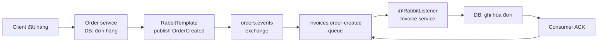
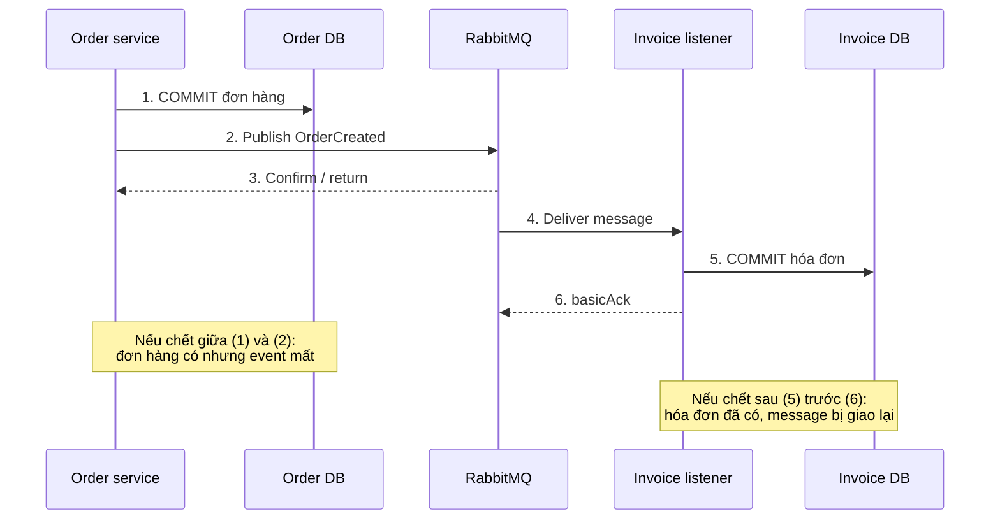
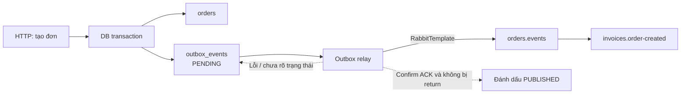
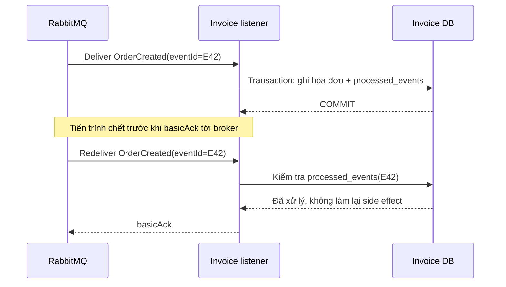

# Vì sao queue durable và message persistent chưa đủ bảo đảm hoàn tất nghiệp vụ

Trong RabbitMQ, nhiều ứng dụng bắt đầu bằng hai cấu hình quen thuộc: khai báo **queue durable** và gửi **message persistent**. Đây là nền tảng quan trọng để giảm mất dữ liệu khi broker khởi động lại, nhưng chưa đủ để khẳng định một đơn hàng đã được tạo hóa đơn, một khoản thanh toán đã được ghi nhận, hay một email đã được gửi thành công.

Để có **độ tin cậy đầu cuối** (end-to-end reliability), phải xét toàn bộ hành trình từ giao dịch tạo sự kiện, `RabbitTemplate` publish, exchange định tuyến vào queue, `@RabbitListener` xử lý, transaction nghiệp vụ commit, cho tới consumer acknowledgement và khả năng phục hồi sau sự cố. Mỗi chặng có một loại xác nhận và một khoảng lỗi riêng.

Bài học thuộc module **SPRING_AMQP**, tập trung vào việc tích hợp RabbitMQ với Spring AMQP qua exchange, queue, binding, publisher confirm/return, consumer ack, retry, dead-letter và transaction để xây hệ thống xử lý bất đồng bộ đáng tin cậy.

Sau bài học, bạn có thể:

- Nêu chính xác durable queue và persistent message bảo vệ điều gì, cũng như các việc chúng **không bảo vệ**.
- Phân biệt **broker nhận message**, **message được định tuyến**, **consumer nhận delivery**, **nghiệp vụ commit** và **client biết kết quả**.
- Chỉ ra những khoảng lỗi làm **mất message** hoặc khiến message được xử lý **nhiều lần**.
- Thiết kế luồng thực tế bằng **publisher confirms/returns, transactional outbox, manual ack, idempotent consumer, retry có giới hạn và DLQ**.
- Đưa ra tiêu chí kiểm chứng độ tin cậy bằng các kịch bản mô phỏng lỗi thay vì chỉ kiểm tra cấu hình queue.

## 1. Định nghĩa đúng: “Đã hoàn tất” nghĩa là gì?

Giả sử dịch vụ Order nhận một yêu cầu tạo đơn hàng. Nó lưu đơn hàng vào cơ sở dữ liệu và publish sự kiện `OrderCreated`. Dịch vụ Invoice đọc sự kiện để tạo hóa đơn. Người dùng chỉ xem quy trình thành công khi hóa đơn xuất hiện đúng một lần.



Điểm cần làm rõ: RabbitMQ chỉ biết đến **message/delivery**, không biết business rule rằng “mỗi đơn hàng phải có một hóa đơn hợp lệ”. Nếu message đã vào queue nhưng Invoice service lỗi mãi, broker có thể vẫn lưu message rất bền vững trong khi nghiệp vụ **chưa hoàn tất**.

Vì vậy, hãy tách thành ít nhất năm trạng thái:

| Trạng thái | Ai xác định? | Điều được khẳng định |
| --- | --- | --- |
| `ORDER_COMMITTED` | Transaction của Order DB | Đơn hàng được ghi bền vững |
| `EVENT_PUBLISHED` | Publisher confirm và kiểm tra return | Broker đã chấp nhận publish và request được định tuyến theo topology mong đợi |
| `DELIVERED_TO_CONSUMER` | RabbitMQ giao delivery | Consumer đã nhận một bản giao; có thể bị giao lại |
| `INVOICE_COMMITTED` | Transaction của Invoice DB | Hóa đơn đã được ghi và bất biến nghiệp vụ được đáp ứng |
| `PROCESSING_ACKED` | Consumer `basicAck` | Broker đã nhận yêu cầu xác nhận delivery; không đồng nghĩa kết quả nghiệp vụ đúng nếu code ack sai thời điểm |

**“Đã ACK” không phải là “đã hoàn tất nghiệp vụ”.** Ngược lại, **“đã commit nghiệp vụ” không đảm bảo broker đã nhận ACK**. Đây là nguyên nhân cốt lõi khiến các hệ thống xử lý qua message phải hỗ trợ phát lại an toàn.

## 2. Durable queue và persistent message thực sự bảo vệ điều gì?

### 2.1. Durable queue: định nghĩa queue tồn tại qua khởi động lại

Một queue với `durable=true` được khai báo theo cách để **định nghĩa queue** có thể được khôi phục sau khi broker restart. Nó không tự biến mọi message trong queue thành persistent, không đảm bảo có consumer khỏe mạnh, và không bảo vệ dữ liệu trước việc operator xóa queue hoặc thay đổi chính sách lưu giữ.

```java
import org.springframework.amqp.core.Queue;
import org.springframework.amqp.core.QueueBuilder;

Queue queue = QueueBuilder.durable("invoices.order-created").build();
```

Khai báo trên tạo một **durable classic queue** nếu không có cấu hình loại queue khác can thiệp. Nếu yêu cầu nâng khả năng chịu lỗi node, có thể chủ động lựa chọn quorum queue cho use case phù hợp; **durable không đồng nghĩa queue có nhiều replica**.

### 2.2. Persistent message: yêu cầu broker lưu message bền vững

AMQP 0-9-1 có thuộc tính `deliveryMode`. Đặt `PERSISTENT` (giá trị 2) yêu cầu message được lưu bền vững khi nằm trong queue phù hợp:

```java
import org.springframework.amqp.core.MessageDeliveryMode;
import org.springframework.amqp.rabbit.core.RabbitTemplate;

rabbitTemplate.convertAndSend(
    "orders.events",
    "order.created",
    orderCreatedPayload,
    message -> {
        message.getMessageProperties()
               .setDeliveryMode(MessageDeliveryMode.PERSISTENT);
        return message;
    }
);
```

Đoạn ví dụ giả định `rabbitTemplate` và `orderCreatedPayload` đã được ứng dụng tạo. Một persistent message trong durable queue có khả năng sống sót sau broker restart tốt hơn message transient, nhưng **không có nghĩa lời gọi `convertAndSend` đã chờ broker ghi an toàn**. Đó là vấn đề của **publisher confirm**.

Để message tồn tại sau restart, cần xét **cả tính bền vững của queue, tính bền vững của message và kết quả publish**. Ngoài ra, tính bền vững không đồng nghĩa tính sẵn sàng khi mất node: quorum queue dùng cơ chế sao chép/đa số khác với classic queue.

### 2.3. Hai cờ cấu hình chỉ bảo vệ một đoạn đường

| Thành phần | Có ích cho | Không đủ để bảo đảm |
| --- | --- | --- |
| `queue durable` | Queue vẫn được khai báo sau broker restart | Producer đã publish thành công; consumer đã xử lý; queue còn tồn tại nếu bị xóa thủ công |
| `message persistent` | Message đủ điều kiện được lưu bền vững | Exchange định tuyến đến queue đúng; message đã được xác nhận lưu; ứng dụng commit |
| `quorum queue` | Sao chép dữ liệu và duy trì queue khi còn quorum | Message chưa được publish, business transaction, idempotency |
| `publisher confirm` | Broker ACK/NACK lần publish | Consumer nhận/xử lý message; business commit; reply đã đến client |
| `publisher return` + `mandatory` | Phát hiện publish không định tuyến được tới queue theo routing thông thường | Queue có consumer, consumer thành công, mọi kiểu định tuyến fallback |
| `consumer ack` | Broker biết consumer đã xác nhận delivery | Database commit đúng, dịch vụ ngoài hoàn tất, downstream nhận message |
| `retry` + DLQ | Có đường xử lý lỗi và điều tra | Tự động đảm bảo cuối cùng thành công; hoàn toàn không có duplicate |

## 3. Bản đồ những khoảng lỗi trên hành trình sự kiện

Mỗi mũi tên trong sơ đồ đều là một **điểm có thể đứt gãy**:



| Thời điểm lỗi | Điều có thể xảy ra | Vì sao durable + persistent không giải quyết |
| --- | --- | --- |
| DB đã commit, producer chết **trước publish** | Đơn hàng tồn tại nhưng không có `OrderCreated` | Broker chưa từng thấy sự kiện |
| Producer publish nhưng mất kết nối **trước nhận confirm** | Không biết message đã được broker nhận hay chưa | Một lần gửi mơ hồ có thể cần retry và gây duplicate |
| Exchange tồn tại nhưng routing key/binding sai | Message không tới queue nghiệp vụ, có thể bị bỏ | Tính bền vững không tạo ra binding |
| Message ở queue, responder/consumer ngừng hoạt động | Nghiệp vụ đứng chờ vô hạn | Queue bền vững không tự chạy code xử lý |
| Message bị TTL/overflow/purge hoặc bị reject không có DLX | Message rời queue mà nghiệp vụ chưa xong | Cấu hình thời hạn/chính sách và consumer điều khiển vòng đời message |
| Consumer ack **trước khi DB commit**, sau đó DB lỗi | Broker đã loại message; nghiệp vụ chưa xong | Persistent không giúp phục hồi message đã được ack |
| DB commit, consumer chết **trước broker nhận ack** | Message được redeliver; xử lý có thể lặp | Broker không biết commit của DB |
| Consumer gọi dịch vụ thanh toán bên ngoài, rồi crash | Có thể tính tiền lại khi retry | Local DB transaction không tự bao trùm API bên ngoài |
| Message lỗi nhiều lần, vào DLQ | Message được cách ly nhưng nghiệp vụ vẫn chưa hoàn thành | DLQ là điểm xử lý lỗi, không phải tín hiệu thành công |

Nhận xét then chốt: **độ tin cậy của hệ thống không thể mạnh hơn chặng yếu nhất**. Một queue rất bền vững không cứu được transaction dữ liệu đã commit nhưng chưa có event, và cũng không cứu được consumer ack sai.

## 4. Nhầm lẫn phổ biến: producer gửi xong tức là broker đã nhận

`RabbitTemplate.convertAndSend(...)` thông thường thực hiện publish nhưng việc hàm trở về **không tự chứng minh** broker đã lưu message hoặc đã route đúng queue. Đặc biệt, mạng có thể đứt ở thời điểm nhạy cảm.

### 4.1. Publisher confirm và return giải quyết hai câu hỏi khác nhau

| Tín hiệu | Ý nghĩa | Ví dụ |
| --- | --- | --- |
| Confirm `ack=true` | Broker xác nhận đã chấp nhận lần publish theo loại queue/đích | Message persistent đã được xác nhận ở mức broker |
| Confirm `ack=false` | Broker không chấp nhận lần publish | Cần phân loại lỗi và thử lại theo chính sách |
| Không nhận confirm | **Trạng thái chưa biết** | Broker có thể đã nhận trước khi kết nối đứt |
| `basic.return` khi `mandatory=true` | Message không có queue đích theo routing thông thường | Sai routing key; exchange hiện hữu nhưng không có binding |
| Không có return | Không có lỗi `basic.return` được quan sát | Chưa chứng minh consumer đã xử lý, cần xét topology/alternate exchange |

Một request **không route** vẫn có thể có confirm `ack=true`; broker đã xử lý publish, nhưng chưa có queue nhận. Vì vậy cần phối hợp **correlated publisher confirms** và **publisher returns** khi cần biết trạng thái gửi.

Ứng dụng Spring Boot có thể cấu hình:

```yaml
spring:
  rabbitmq:
    host: localhost
    port: 5672
    publisher-confirm-type: correlated
    publisher-returns: true
```

Với một `RabbitTemplate` dành cho publish sự kiện một chiều, bật thêm `mandatory`:

```java
import org.springframework.amqp.rabbit.connection.ConnectionFactory;
import org.springframework.amqp.rabbit.core.RabbitTemplate;
import org.springframework.context.annotation.Bean;
import org.springframework.context.annotation.Configuration;

@Configuration
class EventPublisherConfig {
    @Bean("eventTemplate")
    RabbitTemplate eventTemplate(ConnectionFactory connectionFactory) {
        RabbitTemplate template = new RabbitTemplate(connectionFactory);
        template.setMandatory(true);
        return template;
    }
}
```

`publisher-confirm-type=correlated` cho phép sử dụng `CorrelationData` để ghép confirm với đúng lần publish. `publisher-returns=true` và `mandatory=true` giúp nhận returned message khi không tìm được queue nhận. **Hai loại xác nhận này vẫn không cho biết invoice đã được tạo.**

### 4.2. Confirm cũng không thay thế tính nhất quán giữa DB và broker

Giả sử code thực hiện:

```java
// Minh họa cách triển khai chưa an toàn:
orderRepository.save(order);           // Transaction database
rabbitTemplate.convertAndSend(         // Publish lên broker
        "orders.events", "order.created", payload);
```

Nếu database đã commit nhưng tiến trình chết trước lệnh publish, không có message nào để RabbitMQ lưu. Ngược lại, nếu publish trước khi database commit, consumer có thể nhìn thấy event của một đơn hàng cuối cùng bị rollback.

Ngay cả khi gọi publish trong một phương thức có `@Transactional`, **transaction database và transaction AMQP không mặc nhiên là một giao dịch nguyên tử phân tán**. Chỉ dùng `channelTransacted=true` cũng không loại bỏ hoàn toàn khoảng mất đồng bộ giữa hai hệ thống.

## 5. Cách bảo vệ chặng DB → RabbitMQ: transactional outbox

**Transactional outbox** thay đổi cách ghi nhận ý định gửi event: cùng một transaction database sẽ lưu cả thay đổi nghiệp vụ lẫn một bản ghi **outbox** chưa publish.



Nếu ứng dụng chết sau DB commit nhưng trước publish, bản ghi `PENDING` vẫn còn để relay gửi tiếp. Nếu broker nhận event nhưng relay chết trước khi đánh dấu `PUBLISHED`, relay có thể publish lại; vì vậy outbox giúp đạt **ít nhất một lần gửi có kiểm soát**, cần idempotent consumer để xử lý duplicate.

### 5.1. Cấu trúc dữ liệu minh họa (PostgreSQL)

```sql
CREATE TABLE orders (
    order_id UUID PRIMARY KEY,
    customer_id UUID NOT NULL,
    status VARCHAR(32) NOT NULL
);

CREATE TABLE outbox_events (
    event_id UUID PRIMARY KEY,
    aggregate_id UUID NOT NULL,
    event_type VARCHAR(120) NOT NULL,
    payload TEXT NOT NULL,
    state VARCHAR(20) NOT NULL DEFAULT 'PENDING',
    created_at TIMESTAMPTZ NOT NULL DEFAULT now(),
    published_at TIMESTAMPTZ
);

CREATE INDEX outbox_pending_idx
    ON outbox_events (created_at)
    WHERE state = 'PENDING';
```

Ví dụ service Spring sử dụng **cùng transaction manager của database** cho hai thao tác. `OrderRepository` và `OutboxRepository` là các interface/repository do ứng dụng triển khai:

```java
import java.util.UUID;
import org.springframework.stereotype.Service;
import org.springframework.transaction.annotation.Transactional;

@Service
public class OrderService {
    private final OrderRepository orders;
    private final OutboxRepository outbox;

    public OrderService(OrderRepository orders, OutboxRepository outbox) {
        this.orders = orders;
        this.outbox = outbox;
    }

    @Transactional
    public UUID createOrder(UUID customerId) {
        UUID orderId = UUID.randomUUID();
        UUID eventId = UUID.randomUUID();
        orders.insert(orderId, customerId, "CREATED");
        outbox.insertPending(
            eventId, orderId, "OrderCreated",
            "{\"orderId\":\"" + orderId + "\"}"
        );
        return orderId;
    }
}
```

Nếu một trong hai lệnh ghi database lỗi, **toàn bộ transaction rollback**. Đoạn trên chưa gửi message ngay; relay chịu trách nhiệm publish sau.

### 5.2. Relay publish và chỉ đánh dấu hoàn tất sau confirm hợp lệ

Đoạn dưới là ví dụ cơ chế **polling relay** được chạy bởi một worker nền có quản lý. Nó không phải HTTP handler và mỗi lần xử lý một bản ghi đã được chọn/khóa hợp lệ từ outbox:

```java
import java.util.concurrent.TimeUnit;
import org.springframework.amqp.core.MessageDeliveryMode;
import org.springframework.amqp.rabbit.connection.CorrelationData;
import org.springframework.amqp.rabbit.core.RabbitTemplate;
import org.springframework.beans.factory.annotation.Qualifier;
import org.springframework.stereotype.Component;

@Component
public class OutboxRelay {
    private final RabbitTemplate eventTemplate;
    private final OutboxRepository outbox;

    public OutboxRelay(
            @Qualifier("eventTemplate") RabbitTemplate eventTemplate,
            OutboxRepository outbox) {
        this.eventTemplate = eventTemplate;
        this.outbox = outbox;
    }

    // Gọi từ worker nền. OutboxEvent và OutboxRepository là
    // kiểu do ứng dụng cung cấp; không chạy trong transaction tạo đơn.
    public boolean publishOne(OutboxEvent event) {
        CorrelationData correlation =
                new CorrelationData(event.eventId().toString());
        try {
            eventTemplate.convertAndSend(
                "orders.events", "order.created", event.payload(),
                message -> {
                    message.getMessageProperties().setMessageId(
                            event.eventId().toString());
                    message.getMessageProperties().setDeliveryMode(
                            MessageDeliveryMode.PERSISTENT);
                    return message;
                },
                correlation);

            // Giới hạn thời gian đợi cho worker relay.
            CorrelationData.Confirm confirm =
                    correlation.getFuture().get(5, TimeUnit.SECONDS);

            if (confirm.isAck() && correlation.getReturn() == null) {
                outbox.markPublishedIfPending(event.eventId());
                return true;
            }
            return false; // NACK hoặc unroutable: vẫn phải retry sau
        } catch (InterruptedException ex) {
            Thread.currentThread().interrupt();
            return false;
        } catch (Exception ex) {
            // Publish lỗi/timeout: trạng thái gửi có thể chưa biết.
            // Giữ outbox PENDING, ghi log và retry có backoff.
            return false;
        }
    }
}
```

Giả định `spring.rabbitmq.publisher-confirm-type=correlated`, `publisher-returns=true` và `eventTemplate.setMandatory(true)` đã được bật. Khi broker trả unroutable message, returned message được liên kết với `CorrelationData`; consumer của relay **không được** chỉ kiểm tra `confirm.isAck()` rồi kết luận đã route.

**Những việc phải bổ sung khi triển khai relay thật:** một cách claim/lease bản ghi cho nhiều worker (ví dụ khóa hàng với `FOR UPDATE SKIP LOCKED`, lease timeout và recovery), giới hạn số bản ghi mỗi lượt, backoff, thống kê lỗi, dọn dẹp lịch sử và khả năng xử lý bản ghi bị kẹt. Không giữ một DB transaction mở trong lúc đợi network confirm nếu có thể tránh. Tình huống broker nhận message nhưng relay timeout **phải được phép retry với cùng `eventId`**.

Với nhu cầu lưu thứ tự sự kiện cho cùng `aggregateId`, cần thêm quy tắc phát theo thứ tự (aggregate sequence hoặc per-key ordering). Outbox tự nó không bảo đảm thứ tự khi nhiều relay xử lý song song.

## 6. Cách bảo vệ chặng RabbitMQ → nghiệp vụ: ack sau commit

Khi `@RabbitListener` nhận message, có hai thứ phải phối hợp:

1. **Kết quả transaction nghiệp vụ:** event đã tạo hóa đơn thành công trong database hay chưa?
2. **Consumer acknowledgement:** broker đã được phép xóa delivery khỏi queue hay chưa?

### 6.1. Ack sớm có thể làm mất tác vụ

```java
// Cách làm SAI:
channel.basicAck(tag, false);
invoiceService.createInvoice(orderId); // Nếu lỗi, broker không giao lại!
```

Nếu ack thành công rồi transaction tạo hóa đơn rollback, broker không còn delivery để phát lại. **Không có cấu hình durable/persistent nào khôi phục tự động một message đã bị ack**.

### 6.2. Ack sau commit có thể bị redelivery, nên phải idempotent



Đây là thực tế của **at-least-once delivery**: giữ an toàn trước mất dữ liệu bằng cách cho phép phát lại, sau đó kiểm soát duplicate ở tầng nghiệp vụ. Không nên dùng `redelivered` hoặc `deliveryTag` làm khóa idempotency; chúng không thay thế định danh event ổn định.

### 6.3. Mẫu inbox/processed-events và manual acknowledgement

Với PostgreSQL, tạo bảng đánh dấu event đã được xử lý **trong cùng transaction với thao tác tạo hóa đơn**:

```sql
CREATE TABLE processed_events (
    consumer_name VARCHAR(100) NOT NULL,
    event_id UUID NOT NULL,
    processed_at TIMESTAMPTZ NOT NULL DEFAULT now(),
    PRIMARY KEY (consumer_name, event_id)
);

CREATE TABLE invoices (
    invoice_id UUID PRIMARY KEY,
    order_id UUID NOT NULL UNIQUE,
    status VARCHAR(32) NOT NULL
);
```

Ý tưởng cốt lõi:

```sql
-- Trong CÙNG transaction PostgreSQL với thao tác tạo hóa đơn:
INSERT INTO processed_events (consumer_name, event_id)
VALUES ('invoice-consumer', :eventId)
ON CONFLICT (consumer_name, event_id) DO NOTHING
RETURNING event_id;

-- Chỉ khi INSERT trả về một hàng mới thì thực hiện:
INSERT INTO invoices (invoice_id, order_id, status)
VALUES (:invoiceId, :orderId, 'CREATED')
ON CONFLICT (order_id) DO NOTHING;
```

Nếu câu lệnh chèn `processed_events` không trả về hàng, event này đã được ghi nhận và nên bỏ qua side effect. Nếu transaction cập nhật hóa đơn thất bại, marker `processed_events` phải **rollback cùng transaction**; tuyệt đối không đánh dấu đã xử lý trong một transaction riêng, trước khi tạo hóa đơn.

Phần consumer minh họa:

```java
import java.io.IOException;
import java.util.UUID;
import com.rabbitmq.client.Channel;
import org.springframework.amqp.core.Message;
import org.springframework.amqp.rabbit.annotation.RabbitListener;
import org.springframework.dao.TransientDataAccessException;
import org.springframework.stereotype.Component;

@Component
public class OrderCreatedListener {
    private final InvoiceProcessor invoiceProcessor;

    public OrderCreatedListener(InvoiceProcessor invoiceProcessor) {
        this.invoiceProcessor = invoiceProcessor;
    }

    @RabbitListener(queues = "invoices.order-created",
                    ackMode = "MANUAL")
    public void onMessage(Message message, Channel channel)
            throws IOException {
        long tag = message.getMessageProperties().getDeliveryTag();
        String eventIdText = message.getMessageProperties().getMessageId();

        try {
            if (eventIdText == null) {
                channel.basicReject(tag, false);
                return;
            }

            UUID eventId = UUID.fromString(eventIdText);
            // processOnce nằm ở BEAN KHÁC và có @Transactional:
            // return bình thường chỉ sau khi transaction đã commit.
            invoiceProcessor.processOnce(eventId, message.getBody());
            channel.basicAck(tag, false);

        } catch (IllegalArgumentException ex) {
            // Payload/ID vĩnh viễn không hợp lệ -> dead-letter.
            channel.basicReject(tag, false);

        } catch (TransientDataAccessException ex) {
            // Ví dụ đơn giản cho lỗi tạm thời; production cần backoff.
            channel.basicNack(tag, false, true);
        }
    }
}
```

`InvoiceProcessor` là service do ứng dụng tự triển khai. Phương thức `processOnce` được đánh dấu `@Transactional`, kiểm tra/chèn unique `(consumer_name,event_id)` và tạo invoice trong **cùng database transaction**, chỉ trả về sau commit. Đoạn listener không phải sản phẩm copy-paste hoàn chỉnh: cần cấu hình JSON deserialization, lỗi nghiệp vụ riêng, quản lý retry, DLQ và cơ chế xử lý các exception không được catch. Khi `basicAck` không đến broker, redelivery vẫn phải an toàn.

**Chú ý phạm vi lỗi:** `IllegalArgumentException` trong ví dụ được coi là lỗi payload vĩnh viễn. Trong hệ thống thật, phân loại lỗi rõ ràng để không vô tình dead-letter một lỗi code cần sửa hoặc requeue một message mãi mãi. Với ack thủ công, không để listener nuốt exception mà quên ack/nack một delivery đang pending.

## 7. Retry và DLQ là quy trình xử lý lỗi, không phải bằng chứng hoàn tất

Một message persistent trong durable queue vẫn có thể không bao giờ đạt kết quả nghiệp vụ nếu consumer liên tục gặp lỗi. Vì vậy cần chính sách xử lý poison message và lỗi phụ thuộc:

| Loại lỗi | Ví dụ | Chính sách phù hợp |
| --- | --- | --- |
| Lỗi tạm thời | Database quá tải, HTTP 503 | Retry có backoff, jitter, giới hạn số lần và giám sát |
| Lỗi dữ liệu vĩnh viễn | Thiếu khóa đơn hàng, schema không hợp lệ | Reject `requeue=false`, chuyển DLQ để phân tích và sửa dữ liệu |
| Lỗi code/deployment | Consumer không hiểu schema mới | Cô lập, rollback/sửa code, replay sau khi sửa |
| Lỗi thứ tự | Sự kiện cập nhật đến trước sự kiện tạo | Retry theo khóa, phiên bản hoặc chờ phụ thuộc; tránh làm sai state |
| Lỗi tài nguyên kéo dài | Disk thấp, mất quorum | Backpressure, khôi phục hạ tầng, theo dõi backlog |

Với `basicNack(tag, false, true)`, message được yêu cầu requeue; nó có thể được giao lại **ngay**, gây vòng lặp nóng. Muốn delay hoặc giới hạn retry cần cơ chế bổ sung: retry queue + TTL/DLX, cơ chế retry phù hợp với phiên bản RabbitMQ, hoặc xử lý retry tại application theo ngân sách rõ ràng. Một DLQ cuối cùng nên có người/automation chịu trách nhiệm phân tích, sửa và replay.

Không phải mọi bước dead-letter đều có bảo đảm như nhau. Với classic queue và quorum queue mặc định, việc publish nội bộ sang DLX có thể là `at-most-once`. Quorum queue nguồn có thể cấu hình **at-least-once dead-lettering** khi thỏa điều kiện policy phù hợp, nhưng vẫn phải chấp nhận duplicate và theo dõi việc chuyển message đang chờ confirm.

**DLQ không đồng nghĩa “đã hoàn thành”.** Số message trong DLQ cần được coi là **nghĩa vụ nghiệp vụ chưa được giải quyết**. Replay từ DLQ cũng phải dùng cùng `eventId` để bộ lọc idempotency quyết định an toàn.

## 8. Cấu hình topology Spring AMQP mẫu

Ví dụ dùng exchange `orders.events`, routing key `order.created`, queue đích `invoices.order-created` và DLX `invoices.dlx`. Ở đây chọn **quorum queue** để minh họa khả năng sao chép ở phía broker; nếu dùng classic queue, phải điều chỉnh giả định chịu lỗi node.

```java
import org.springframework.amqp.core.Binding;
import org.springframework.amqp.core.BindingBuilder;
import org.springframework.amqp.core.DirectExchange;
import org.springframework.amqp.core.Queue;
import org.springframework.amqp.core.QueueBuilder;
import org.springframework.context.annotation.Bean;
import org.springframework.context.annotation.Configuration;

@Configuration
class InvoiceTopology {
    @Bean
    DirectExchange ordersEvents() {
        return new DirectExchange("orders.events", true, false);
    }

    @Bean
    DirectExchange invoicesDlx() {
        return new DirectExchange("invoices.dlx", true, false);
    }

    @Bean
    Queue invoicesOrderCreated() {
        return QueueBuilder.durable("invoices.order-created")
                .quorum().build();
    }

    @Bean
    Queue invoicesDead() {
        return QueueBuilder.durable("invoices.dead")
                .quorum().build();
    }

    @Bean
    Binding orderEventBinding(Queue invoicesOrderCreated,
                              DirectExchange ordersEvents) {
        return BindingBuilder.bind(invoicesOrderCreated)
                .to(ordersEvents)
                .with("order.created");
    }

    @Bean
    Binding invoiceDeadBinding(Queue invoicesDead,
                               DirectExchange invoicesDlx) {
        return BindingBuilder.bind(invoicesDead)
                .to(invoicesDlx)
                .with("invoice.failed");
    }
}
```

Cấu hình DLX của queue nguồn nên được quản lý bằng **broker policy** để có thể sửa vận hành mà không cần xóa/redeclare queue. Ví dụ môi trường thử nghiệm (quyền và vhost phù hợp):

```bash
rabbitmqctl set_policy invoices-dlx '^invoices\.order-created$' \
  '{"dead-letter-exchange":"invoices.dlx",
    "dead-letter-routing-key":"invoice.failed"}' \
  --apply-to queues
```

Ví dụ này đặt đường chuyển dead-letter nhưng **chưa bật at-least-once dead-lettering**. Nếu bài toán yêu cầu không mất message khi đích DLQ tạm thời không nhận, cần thêm policy đáng tin cậy đúng cho quorum queue nguồn và các điều kiện liên quan như `overflow=reject-publish`. Đồng thời phải xét publisher confirms, retry, idempotent consumer và kết quả nghiệp vụ: thay loại queue không tự giải quyết toàn bộ hành trình.

## 9. Một ma trận bảo đảm cần có trước khi đưa vào production

| Chặng | Điều cần bảo đảm | Cơ chế tiêu biểu | Khi lỗi, hệ thống biết điều gì? |
| --- | --- | --- | --- |
| HTTP/API → Order DB | Đơn hàng được commit đúng một lần theo khóa yêu cầu | Unique request ID, DB transaction | Đã commit hoặc chưa; nếu mất phản hồi API cần tra cứu idempotency key |
| Order DB → Event intent | Mọi đơn hàng hợp lệ đều có event pending | Transactional outbox | Relay có thể gửi lại event chưa hoàn tất |
| Relay → RabbitMQ | Publish được broker chấp nhận và route | Publisher confirms, returns, `mandatory` | ACK/NACK/unroutable/unknown được phân biệt |
| Queue → Consumer | Delivery có thể phục hồi khi consumer mất kết nối | Durable/persistent, quorum nếu phù hợp, manual ack | Delivery chưa ack có thể redeliver |
| Consumer → Invoice DB | Hóa đơn không bị tạo trùng khi redelivery | Transaction + unique key + inbox/processed-events | Event đã thực hiện hay cần xử lý |
| Consumer → Broker | Chỉ xác nhận sau khi DB commit | `basicAck` sau transaction thành công | Ack mất vẫn an toàn nhờ idempotency |
| Retry/DLQ → Kết quả cuối | Lỗi có chủ sở hữu và cách khôi phục | Backoff, DLQ, alert, replay procedure | Có backlog/pending chứ chưa phải thành công |
| Invoice DB → Người dùng | Biết trạng thái nghiệp vụ cuối cùng | API tra cứu trạng thái, webhook/event kết quả, SLA | Người dùng nhận `COMPLETED`, `FAILED` hoặc `PENDING` theo dữ liệu thực |

**At-least-once delivery + idempotent processing** thường là mục tiêu thực tiễn hơn việc tuyên bố toàn hệ thống `exactly-once`. Unique constraint giúp ngăn duplicate tại một database cụ thể; với side effect ngoài database, cần thêm cơ chế idempotency từ hệ thống đích, reconciliation hoặc saga.

## 10. Side effect ngoài database và vấn đề “đã tính tiền nhưng mất reply”

Giả sử listener:

1. Gọi Payment API và được phản hồi thanh toán thành công.
2. Tiến trình chết trước khi lưu kết quả vào database hoặc gửi `basicAck`.
3. RabbitMQ giao lại cùng `OrderCreated`.
4. Listener gọi Payment API lần nữa.

Không có cấu hình durable, persistent, quorum hay publisher confirm nào tự bảo vệ việc **tính tiền hai lần**. Cần gửi **idempotency key** ổn định cho Payment API (nếu API hỗ trợ), lưu transaction ID phía đối tác, tra cứu kết quả khi không rõ trạng thái, rồi mới hoàn tất local workflow.

Với tác vụ dài hoặc nhiều bước, mô hình **saga/state machine** giúp lưu rõ `PENDING_PAYMENT`, `PAYMENT_CONFIRMED`, `INVOICE_CREATED`, `FAILED_COMPENSATION_REQUIRED`... để các lần retry đi tiếp từ trạng thái đã biết. Cần có reconciliation nếu hệ thống bên ngoài trả kết quả không chắc chắn.

**Yêu cầu “client thấy kết quả chính xác một lần” lại là một bài toán khác.** Người dùng có thể mất kết nối HTTP ngay sau khi server commit, rồi gửi yêu cầu tạo đơn lần nữa. API cũng cần **idempotency key** và API tra cứu kết quả, tương tự consumer cần idempotency khi RabbitMQ redeliver.

## 11. Kiểm chứng độ tin cậy bằng lỗi có chủ đích

Chỉ nhìn một queue còn nguyên sau restart là **chưa đủ**. Hãy kiểm tra các ranh giới lỗi trong môi trường tích hợp, với kết quả kỳ vọng cụ thể.

| Kịch bản thử | Cách mô phỏng | Điều phải chứng minh |
| --- | --- | --- |
| Service Order chết sau DB commit trước publish | Dừng process giữa transaction outbox commit và relay | Đơn hàng và outbox pending vẫn tồn tại; relay publish khi chạy lại |
| Broker nhận nhưng relay không nhận confirm | Ngắt kết nối đúng lúc publish trong môi trường thử | Relay retry cùng event ID; Invoice DB vẫn không sinh hóa đơn trùng |
| Binding sai | Tạm tháo binding `order.created` | `mandatory` + returns phát hiện unroutable; outbox chưa được đánh dấu published |
| Consumer chết sau commit trước ack | Dừng listener ngay sau transaction invoice | Message redeliver; unique event ID ngăn tính lại nghiệp vụ |
| Ack trước commit (chỉ thử để chứng minh phản ví dụ) | Mô phỏng sai trình tự trong bản test cô lập | Message có thể mất dù queue durable/message persistent |
| Payload không hợp lệ | Gửi event sai schema | Message tới DLQ theo chính sách; hệ thống báo cần can thiệp, không báo business success |
| RabbitMQ mất một node | Trong cluster quorum thử nghiệm, dừng một replica | Kiểm tra điều kiện còn quorum và xác nhận lại luồng publish/consume |
| Phụ thuộc bên ngoài trả kết quả không chắc | Timeout Payment API sau khi đối tác đã xử lý | Idempotency key, tra cứu trạng thái và reconciliation ngăn lặp side effect |

Các chỉ báo cần theo dõi cùng lúc:

- **Ở producer:** số bản ghi outbox `PENDING`, tuổi bản ghi cũ nhất, publish confirm ACK/NACK, return `NO_ROUTE`, số lần retry và tỷ lệ trạng thái gửi `UNKNOWN`.
- **Ở broker:** `messages_ready`, `messages_unacknowledged`, tốc độ deliver/ack/redeliver, trạng thái quorum, backlog DLQ, TTL/overflow và tài nguyên disk.
- **Ở consumer:** số transaction thành công/thất bại, duplicate được chặn, số lần retry, thời gian xử lý p95/p99, số message mất khả năng xử lý và số exception khi ack.
- **Ở nghiệp vụ:** tỷ lệ đơn hàng đã tạo nhưng chưa có hóa đơn sau SLA, số đơn đang `PENDING` quá hạn, trạng thái thanh toán không rõ, số lần reconciliation tìm ra dữ liệu lệch.

Nên gắn một **event ID** cố định cho mỗi business event, một **business request ID** cho API và một trace/correlation ID cho đường đi hệ thống. Đừng dùng `deliveryTag` làm danh tính sự kiện vì tag chỉ tồn tại trong phạm vi channel và có thể thay đổi sau redelivery.

## 12. Các bất biến vận hành cần viết rõ

Một thiết kế đáng tin cậy có thể được đánh giá qua những **bất biến** sau:

1. **Không tạo đơn hàng mà thiếu ý định gửi event:** mỗi đơn đã commit phải có bản ghi outbox tương ứng trong cùng database transaction.
2. **Không đánh dấu outbox hoàn tất chỉ vì đã gọi `convertAndSend`:** phải có broker confirm hợp lệ và không có returned message khi yêu cầu route tới queue.
3. **Không ack trước khi trạng thái nghiệp vụ đã commit:** listener chỉ ack sau khi transaction của mình hoàn tất; rollback phải dẫn đến retry hoặc dead-letter.
4. **Không tạo side effect trùng khi broker redeliver:** consumer kiểm tra event ID qua unique constraint/transaction; API ngoài phải có idempotency hoặc bù trừ.
5. **Không coi DLQ là thành công:** message dead-letter còn được theo dõi, phân loại, sửa và replay có kiểm soát.
6. **Không tuyên bố hoàn thành chỉ nhờ một chỉ số broker:** trạng thái cuối được đo bằng dữ liệu nghiệp vụ thực và SLA.

Khi cân nhắc tối ưu hiệu năng, giữ nguyên các bất biến này trước rồi mới tăng prefetch, concurrency, batch size hoặc đổi chế độ ack. Những tối ưu đó có thể làm rộng phạm vi redelivery và tăng áp lực lên hệ thống nếu chưa có idempotency.

## 13. Câu hỏi tự kiểm tra

1. Vì sao `durable=true` chỉ bảo vệ sự tồn tại của queue mà chưa chứng minh một message đã vào queue?
2. Nếu message persistent được gửi vào durable queue nhưng publisher mất kết nối trước confirm, người gửi có thể kết luận message chắc chắn thất lạc không? Nếu retry, rủi ro gì xuất hiện?
3. Một Order service commit đơn hàng thành công rồi chết trước khi publish event. Publisher confirms hoặc quorum queue có cứu được sự kiện chưa được gửi không? Cơ chế nào phù hợp?
4. `@RabbitListener` tạo invoice thành công rồi mất kết nối trước `basicAck`. Lần redelivery tiếp theo phải xử lý thế nào để không tạo hai invoice?
5. Vì sao `basicAck` thành công trước khi transaction database commit có thể tạo mất nghiệp vụ vĩnh viễn?
6. Nếu message vào DLQ, có thể báo khách hàng rằng nghiệp vụ đã hoàn tất không? Nên thể hiện trạng thái nào và ai chịu trách nhiệm xử lý?
7. Nếu Payment API đã tính tiền nhưng trả về timeout, làm cách nào để retry message an toàn?
8. Phân biệt `publisher confirm`, `publisher return`, `consumer ack`, `database commit` và `business success` trong một câu cho mỗi loại.

## Tài liệu tham khảo

- [RabbitMQ — Reliability Guide](https://www.rabbitmq.com/docs/reliability): mô hình lỗi, khôi phục và xử lý message trùng.
- [RabbitMQ — Consumer Acknowledgements and Publisher Confirms](https://www.rabbitmq.com/docs/confirms): khác biệt giữa publisher confirm và consumer acknowledgement.
- [RabbitMQ — Queues](https://www.rabbitmq.com/docs/queues): queue durability, message persistence và quản lý queue.
- [RabbitMQ — Quorum Queues](https://www.rabbitmq.com/docs/quorum-queues): sao chép, mức bảo đảm queue và các giới hạn.
- [RabbitMQ — Dead Letter Exchanges](https://www.rabbitmq.com/docs/dlx): routing message lỗi và các mức bảo đảm khi dead-letter.
- [Spring AMQP — RabbitTemplate](https://docs.spring.io/spring-amqp/reference/amqp/template.html): publish, confirms, returns và `CorrelationData`.
- [Spring AMQP — Annotation-driven Listener Endpoints](https://docs.spring.io/spring-amqp/reference/amqp/receiving-messages/async-annotation-driven.html): `@RabbitListener` và consumer acknowledgement.
- [Transactional Outbox — Pattern](https://microservices.io/patterns/data/transactional-outbox.html): phối hợp giao dịch database và phát sự kiện.
- [Idempotent Consumer — Pattern](https://microservices.io/patterns/communication-style/idempotent-consumer.html): xử lý an toàn khi message được giao lại.
