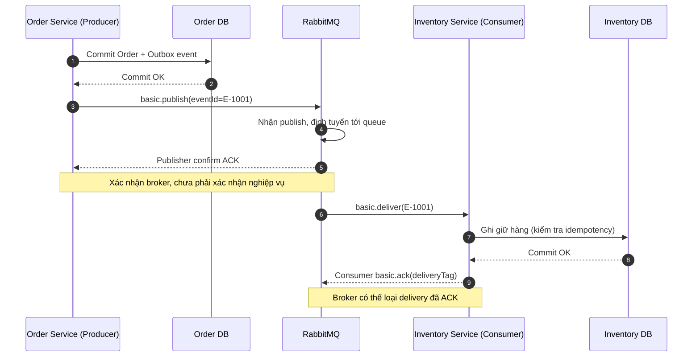
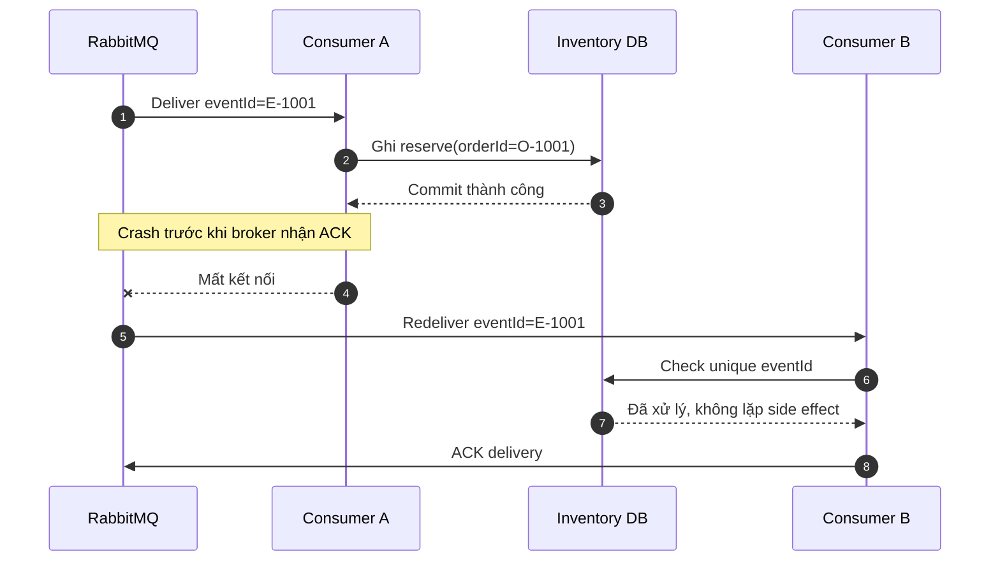
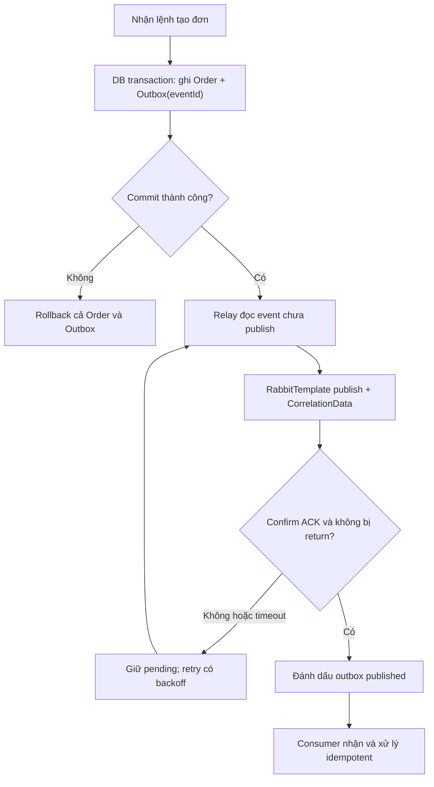

# Publisher confirm, consumer ack và trách nhiệm của mỗi bên

## 1. Độ tin cậy đầu cuối không nằm trong một tín hiệu ACK

Trong **Spring AMQP**, ứng dụng thường dùng `RabbitTemplate` để gửi message và `@RabbitListener` để tiêu thụ message từ RabbitMQ. Khi kết hợp exchange, queue, binding, xác nhận giao nhận, retry, dead-letter và giao dịch, ta xây dựng được luồng xử lý bất đồng bộ đáng tin cậy hơn. Nhưng **không có một ACK duy nhất xác nhận toàn bộ nghiệp vụ đã thành công**.

Xét tình huống dịch vụ Đơn hàng gửi sự kiện `OrderCreated` để dịch vụ Kho giữ hàng:

1. Order Service ghi đơn hàng vào database.
2. Order Service publish `OrderCreated(orderId=O-1001)` tới RabbitMQ.
3. RabbitMQ định tuyến event vào queue `inventory.order-created`.
4. Inventory Service đọc event, cập nhật kho trong database.
5. Consumer gửi ACK để RabbitMQ loại delivery đã xử lý.

Ở bước 2–3, **publisher confirm** trả lời câu hỏi: *broker có tiếp nhận publish theo cơ chế xác nhận của RabbitMQ không?* Ở bước 4–5, **consumer ACK** trả lời: *consumer có xác nhận delivery đã nhận chưa?*

Một positive publisher confirm **không xác nhận** inventory đã cập nhật. Một consumer ACK **không chứng minh** order và inventory đã commit cùng một giao dịch phân tán. Hai tín hiệu này bảo vệ **hai ranh giới khác nhau**.

### Mục tiêu của bài

- Phân biệt positive/negative publisher confirm, publisher return, consumer ACK và NACK/reject.
- Chỉ ra trách nhiệm của producer, RabbitMQ, consumer và database trong toàn bộ hành trình message.
- Cấu hình `publisher-confirm-type: correlated`, `publisher-returns` và `mandatory` khi dùng `RabbitTemplate`.
- Đặt consumer ACK sau khi nghiệp vụ đã hoàn tất đúng ranh giới, nhận diện khoảng trống giữa commit DB và ACK.
- Phối hợp publisher confirm, transactional outbox, idempotency, retry và dead-letter theo mức độ đảm bảo yêu cầu.

## 2. Một sơ đồ, nhiều ranh giới xác nhận



Trong sơ đồ, producer lưu event vào outbox trước khi publish để tránh mất event khi database commit thành công nhưng tiến trình chết trước khi gửi. Phần outbox được giải thích ở mục 8; bản thân publisher confirm và consumer ACK vẫn hoạt động ngay cả khi ứng dụng chưa dùng outbox.

| Tín hiệu/mốc | Ai phát ra? | Xác nhận điều gì? | Không xác nhận điều gì? |
|---|---|---|---|
| Commit transaction nghiệp vụ của producer | Database của producer | Dữ liệu nghiệp vụ đã được commit theo đảm bảo của DB | Event đã tới RabbitMQ |
| Publisher confirm ACK | RabbitMQ gửi về publisher | Broker đã chấp nhận việc publish theo quy tắc confirm và độ bền của topology | Message có consumer nhận; consumer xử lý xong; DB downstream đã commit |
| Publisher confirm NACK | RabbitMQ gửi về publisher | Broker không thể xác nhận publish thành công | Không tự mô tả đầy đủ tình trạng downstream |
| Publisher return (`basic.return`) | RabbitMQ gửi về publisher khi `mandatory` và không định tuyến được | Message publish không được định tuyến vào queue phù hợp theo điều kiện return | Không phải consumer NACK; confirm vẫn có thể ACK |
| Consumer ACK (`basic.ack`) | Consumer gửi về RabbitMQ | Consumer chấp nhận trách nhiệm cho delivery theo hợp đồng ứng dụng | Nghiệp vụ chắc chắn hoàn tất nếu code ACK quá sớm |
| Consumer NACK/reject | Consumer gửi về RabbitMQ | Delivery không được chấp nhận; yêu cầu requeue hoặc reject | Bảo đảm retry thành công; chắc chắn có DLQ |
| Commit transaction nghiệp vụ của consumer | Database của consumer | Thao tác ghi dữ liệu đã commit | Broker đã nhận ACK từ consumer |

Điểm cốt lõi là các tín hiệu ở những hệ thống khác nhau **không tạo thành một transaction nguyên tử duy nhất**. Một hệ thống tốt phải biết điều gì xảy ra khi crash nằm giữa hai mốc.

## 3. Publisher confirm: trách nhiệm từ producer tới RabbitMQ

### 3.1. Positive confirm và negative confirm

RabbitMQ có cơ chế **publisher confirms**: publisher bật confirm mode trên channel; broker phát ACK hoặc NACK bất đồng bộ cho các lệnh publish. Đây là luồng xác nhận **theo publisher channel**, khác hẳn consumer acknowledgments.

- **Positive confirm (ACK):** broker xác nhận publish đã được xử lý theo đảm bảo mà exchange/queue và loại queue cung cấp. Với message persistent gửi đến durable queue, điều kiện xác nhận liên quan đến việc ghi nhận bền vững theo cơ chế của loại queue; với quorum queue là quy tắc của quorum. Không suy rộng thành “mọi hệ thống downstream đã thành công”.
- **Negative confirm (NACK):** broker không thể xác nhận thành công publish. Producer cần ghi nhận lỗi và quyết định retry/đánh dấu trạng thái chưa rõ.
- **Không nhận confirm trước timeout:** producer **không biết chắc** broker đã nhận hay chưa. Mất kết nối sau khi broker nhận message nhưng trước khi confirm tới producer tạo trường hợp **kết quả không xác định**. Retry phải an toàn trước khả năng gửi trùng.

Không nên diễn giải confirm như consumer ACK: ngay cả khi queue hoàn toàn chưa có consumer nào, broker vẫn có thể trả publisher confirm ACK hợp lệ sau khi nhận message vào topology.

### 3.2. Confirm ACK không có nghĩa message đã tới queue

Giả sử producer publish vào exchange `orders.events` với routing key `order.created` nhưng chưa có binding nào khớp. Nếu exchange tồn tại, RabbitMQ có thể xử lý publish hợp lệ dù message không được chuyển vào queue.

Khi `mandatory=false`, một message không được định tuyến có thể bị loại bỏ mà publisher vẫn nhận **positive confirm**. Để phát hiện tình huống này với exchange thông thường, bật:

- `publisher-returns: true` trên connection factory để nhận publisher return.
- `mandatory: true` trên `RabbitTemplate` (hoặc `spring.rabbitmq.template.mandatory=true`).

Nếu message không thể định tuyến, RabbitMQ gửi `basic.return`, đồng thời publish vẫn có thể được **publisher confirm ACK** vì broker đã xử lý yêu cầu publish. Vì vậy cần kiểm tra **cả confirm lẫn return**.

Lưu ý: alternate exchange, topology định tuyến đặc biệt và chính sách broker có thể làm thay đổi điều kiện một message bị return. Return cho biết trạng thái định tuyến theo quy tắc RabbitMQ, không phải bằng chứng consumer đã nhận.

### 3.3. Bốn kết quả cần diễn giải

| Confirm | Return | Cách hiểu | Hành động gợi ý |
|---|---|---|---|
| ACK | Không | Broker xác nhận publish, message không bị return là unroutable theo cấu hình | Đánh dấu broker-accepted; tiếp tục theo dõi xử lý nghiệp vụ riêng |
| ACK | Có | Exchange nhận publish nhưng message không được định tuyến và bị return | Kiểm tra exchange, routing key, binding; chưa coi là giao thành công |
| NACK | Có hoặc không | Broker không xác nhận publish thành công | Ghi trạng thái lỗi/chưa thành công và retry có kiểm soát |
| Timeout/mất kết nối | Chưa biết | Không có kết luận chắc chắn về lần publish đó | Giữ sự kiện trong outbox, retry với cùng event ID và consumer idempotent |

Trong tài liệu này, **broker-accepted** là trạng thái kỹ thuật ở đường publish; nó không được đặt tên là `PROCESSED` hoặc `DELIVERED_TO_BUSINESS`.

## 4. Cấu hình Spring Boot và RabbitMQ topology

Ví dụ sử dụng Spring Boot có dependency `spring-boot-starter-amqp`, RabbitMQ đang chạy và phiên bản Spring AMQP hỗ trợ correlated confirms qua `CorrelationData`. Cấu hình cho một publisher có thể viết:

```yaml
spring:
  rabbitmq:
    host: localhost
    port: 5672
    username: guest
    password: guest
    publisher-confirm-type: correlated
    publisher-returns: true
    template:
      mandatory: true
    listener:
      simple:
        acknowledge-mode: auto
```

Trong môi trường thật, không hard-code mật khẩu vào source và không dùng tài khoản `guest` để kết nối từ xa. Cấu hình credential qua secret manager hoặc biến môi trường. Cũng cần cơ chế reconnect và giám sát connection/channel.

### 4.1. Khai báo exchange, queue và binding

```java
import org.springframework.amqp.core.Binding;
import org.springframework.amqp.core.BindingBuilder;
import org.springframework.amqp.core.DirectExchange;
import org.springframework.amqp.core.Queue;
import org.springframework.amqp.core.QueueBuilder;
import org.springframework.beans.factory.annotation.Qualifier;
import org.springframework.context.annotation.Bean;
import org.springframework.context.annotation.Configuration;

@Configuration
public class OrderEventTopology {
    public static final String EXCHANGE = "orders.events";
    public static final String ROUTING_KEY = "order.created";
    public static final String QUEUE = "inventory.order-created";
    public static final String DLX = "inventory.dlx";
    public static final String DEAD_KEY = "inventory.failed";

    @Bean("orderEventsExchange")
    DirectExchange orderEventsExchange() {
        return new DirectExchange(EXCHANGE, true, false);
    }

    @Bean("inventoryOrderQueue")
    Queue inventoryOrderQueue() {
        return QueueBuilder.durable(QUEUE)
                .deadLetterExchange(DLX)
                .deadLetterRoutingKey(DEAD_KEY)
                .build();
    }

    @Bean
    Binding orderEventBinding(
            @Qualifier("inventoryOrderQueue") Queue queue,
            @Qualifier("orderEventsExchange") DirectExchange exchange) {
        return BindingBuilder.bind(queue)
                .to(exchange)
                .with(ROUTING_KEY);
    }

    @Bean("inventoryDeadLetterExchange")
    DirectExchange inventoryDeadLetterExchange() {
        return new DirectExchange(DLX, true, false);
    }

    @Bean("inventoryDeadQueue")
    Queue inventoryDeadQueue() {
        return QueueBuilder.durable("inventory.dead").build();
    }

    @Bean
    Binding inventoryDeadBinding(
            @Qualifier("inventoryDeadQueue") Queue queue,
            @Qualifier("inventoryDeadLetterExchange") DirectExchange dlx) {
        return BindingBuilder.bind(queue)
                .to(dlx)
                .with(DEAD_KEY);
    }
}
```

Một **durable exchange**, **durable queue** và **persistent message** phối hợp nâng mức an toàn dữ liệu khi broker restart. Các thuộc tính này không thay thế publisher confirm, cũng không bảo đảm mọi message sống sót trước mọi lỗi phần cứng hoặc cấu hình cluster. Cần chọn loại queue, chính sách replication, backup và vận hành theo yêu cầu thực tế.

Tại RabbitMQ, DLX định nghĩa đường đi của message bị dead-letter trong những điều kiện cụ thể (reject không requeue, TTL, queue limit... tùy loại queue). Có DLX không đồng nghĩa mọi lỗi ứng dụng đều tự vào DLQ; consumer phải phát tín hiệu phù hợp hoặc ứng dụng chủ động republish.

## 5. Gửi message với RabbitTemplate, CorrelationData và kiểm tra return

`CorrelationData` của Spring AMQP cho phép đối chiếu một lệnh publish với publisher confirm tương ứng. Nó **không phải** `correlationId` dùng để ghép request–reply, cũng không phải `deliveryTag` của consumer.

Để minh họa rõ, producer gửi payload chuỗi chứa `orderId` và sử dụng `eventId` làm `messageId`. Trong hệ thống thật, payload có thể là JSON schema có version; cần converter tương thích ở cả producer và consumer.

```java
import java.util.concurrent.ExecutionException;
import java.util.concurrent.TimeUnit;
import java.util.concurrent.TimeoutException;
import org.springframework.amqp.core.MessageDeliveryMode;
import org.springframework.amqp.core.ReturnedMessage;
import org.springframework.amqp.rabbit.connection.CorrelationData;
import org.springframework.amqp.rabbit.core.RabbitTemplate;
import org.springframework.stereotype.Service;

@Service
public class ConfirmedOrderPublisher {
    private final RabbitTemplate rabbitTemplate;

    public ConfirmedOrderPublisher(RabbitTemplate rabbitTemplate) {
        this.rabbitTemplate = rabbitTemplate;
    }

    public void publish(String eventId, String orderId) {
        CorrelationData correlation = new CorrelationData(eventId);

        rabbitTemplate.convertAndSend(
                OrderEventTopology.EXCHANGE,
                OrderEventTopology.ROUTING_KEY,
                orderId,
                message -> {
                    message.getMessageProperties().setMessageId(eventId);
                    message.getMessageProperties()
                            .setDeliveryMode(MessageDeliveryMode.PERSISTENT);
                    return message;
                },
                correlation
        );

        try {
            CorrelationData.Confirm confirm =
                    correlation.getFuture().get(10, TimeUnit.SECONDS);

            if (!confirm.isAck()) {
                throw new IllegalStateException(
                        "Broker NACK publish eventId=" + eventId
                        + "; reason=" + confirm.getReason());
            }

            ReturnedMessage returned = correlation.getReturned();
            if (returned != null) {
                throw new IllegalStateException(
                        "Message bị return: eventId=" + eventId
                        + ", replyCode=" + returned.getReplyCode()
                        + ", replyText=" + returned.getReplyText());
            }

            // Thành công ở RANH GIỚI PUBLISH: broker đã xác nhận,
            // message không bị return do unroutable.
        } catch (InterruptedException ex) {
            Thread.currentThread().interrupt();
            throw new IllegalStateException(
                    "Đang đợi publisher confirm thì bị interrupt", ex);
        } catch (ExecutionException | TimeoutException ex) {
            throw new IllegalStateException(
                    "Không xác định được kết quả publish eventId=" + eventId,
                    ex);
        }
    }
}
```

Đây là ví dụ **đợi confirm đồng bộ** để dễ thấy điều kiện thành công. Nó chỉ thích hợp cho đoạn publish hoặc outbox relay có kiểm soát số luồng và timeout; không nên dùng nguyên mẫu này để chặn hàng loạt request HTTP ở tải cao. Trong ứng dụng throughput lớn, có thể xử lý publisher confirm bất đồng bộ bằng callback hoặc `CompletableFuture`, vẫn phải giữ bảng trạng thái theo event ID.

Một số nguyên tắc khi áp dụng:

- `publisher-confirm-type: correlated` phải thực sự được áp dụng cho `ConnectionFactory` mà `RabbitTemplate` sử dụng; nếu tự tạo connection factory, phải cấu hình tương ứng.
- `publisher-returns: true` và `mandatory: true` phải cùng có hiệu lực để phát hiện unroutable messages bằng returns. `CorrelationData#getReturned()` cho phép kiểm tra returned message tương ứng; trong cơ chế Spring AMQP này, returned message được gắn vào correlation data trước khi future confirm hoàn tất.
- Trong trường hợp publish/confirm timeout, **không đánh dấu event là đã gửi thành công**. Vì RabbitMQ có thể đã nhận event, việc phát lại phải dùng cùng event ID và consumer idempotent.
- Mỗi lần publish cần `CorrelationData` riêng với ID ổn định có ý nghĩa theo dõi. ID của correlation data hỗ trợ xác nhận publish; `messageId` là dữ liệu trên message mà consumer có thể dùng chống trùng.
- `MessageDeliveryMode.PERSISTENT` nên kết hợp với queue durable. Message persistent gửi vào queue không bền vẫn không có đảm bảo bền vững mà ứng dụng thường mong đợi.

### 5.1. Publisher confirm callback dùng để làm gì?

Khi không muốn chờ từng lệnh publish, `RabbitTemplate` có thể sử dụng callback:

```java
rabbitTemplate.setConfirmCallback((correlation, ack, cause) -> {
    String eventId = correlation == null ? "unknown" : correlation.getId();

    if (ack) {
        // Ghi nhận broker confirm ACK theo eventId.
        // Vẫn phải kiểm tra publisher return khi bắt buộc định tuyến.
    } else {
        // Ghi nhận NACK và đưa event vào đường retry có kiểm soát.
    }
});

rabbitTemplate.setReturnsCallback(returned -> {
    // Ghi metric/alert cho message không thể định tuyến.
    // Lưu exchange, routingKey, replyCode, replyText và messageId.
});
```

Hai callback trên là **mẫu minh họa thay thế cách chờ future ở ví dụ trước**, không nên tự thiết kế hai đường cùng cập nhật trạng thái thành công rồi gây race. Callback đến sau lời gọi `convertAndSend`; phải lưu trạng thái publish đang chờ **trước khi** phụ thuộc callback. Không thực hiện nghiệp vụ chậm, blocking dài hoặc giao dịch lớn ngay trên thread xử lý confirm; nên chuyển việc cập nhật trạng thái cho worker thích hợp.

### 5.2. Khi publish không vào queue

Để tự kiểm tra return, tạm đổi routing key thành `order.unknown` mà không có binding phù hợp. Với exchange vẫn tồn tại, `mandatory=true` và returns được bật, producer có thể nhận **confirm ACK kèm returned message**. Cần ghi trạng thái “routing failed”; **không** được coi là inventory đã nhận event.

Nếu exchange không tồn tại, broker có thể đóng channel vì protocol exception thay vì trả một publisher return thông thường. Cách bắt lỗi phải tính cả channel/connection failure và timeout; không suy rằng mọi trường hợp gửi sai đều biểu hiện dưới dạng `ReturnedMessage`.

## 6. Consumer ACK: trách nhiệm từ RabbitMQ tới consumer

Consumer ACK là tín hiệu từ consumer gửi tới broker sau khi nhận delivery. Với `@RabbitListener`, Spring AMQP thường dùng `AcknowledgeMode.AUTO`: container tự xác nhận nếu listener **trả về thành công**; nếu listener thất bại, nó áp dụng chính sách xử lý exception, reject hoặc requeue.

| ACK mode của Spring | Hành vi cơ bản | Nguy cơ nếu dùng không đúng |
|---|---|---|
| `AUTO` | Spring listener container ACK sau khi callback xử lý thành công; exception đi qua error handling | Trả về sớm trong khi công việc nền còn chạy làm ACK quá sớm |
| `MANUAL` | Ứng dụng chủ động gọi `basicAck` hoặc `basicNack/basicReject` | Quên ACK, ACK nhầm tag/channel hoặc ACK trước commit |
| `NONE` | RabbitMQ auto-ack khi delivery được gửi | Broker không chờ kết quả xử lý; lỗi sau khi giao không được phục hồi bằng consumer ACK |

Đặc biệt, **`AcknowledgeMode.AUTO` không phải RabbitMQ auto-ack**. Trong Spring AUTO, consumer acknowledgments vẫn tồn tại và được Spring container điều khiển.

### 6.1. Ví dụ AUTO: ACK sau khi service đã commit

```java
import java.nio.charset.StandardCharsets;
import org.springframework.amqp.AmqpRejectAndDontRequeueException;
import org.springframework.amqp.core.Message;
import org.springframework.amqp.rabbit.annotation.RabbitListener;
import org.springframework.stereotype.Component;

@Component
public class InventoryOrderListener {
    private final InventoryService inventoryService;

    public InventoryOrderListener(InventoryService inventoryService) {
        this.inventoryService = inventoryService;
    }

    @RabbitListener(queues = OrderEventTopology.QUEUE)
    public void onMessage(Message message) {
        String eventId = message.getMessageProperties().getMessageId();

        if (eventId == null || eventId.isBlank()) {
            throw new AmqpRejectAndDontRequeueException(
                    "Thiếu messageId dùng để chống xử lý trùng");
        }

        String orderId = new String(
                message.getBody(), StandardCharsets.UTF_8);

        // Phương thức @Transactional trên service, gọi qua Spring proxy.
        // Phải hoàn tất/commit trước khi phương thức này trở về thành công.
        inventoryService.reserveOnce(eventId, orderId);
    }
}
```

Trong ví dụ này, `reserveOnce` phải dùng transaction DB và chống trùng. Vì lời gọi service kết thúc sau khi transaction đã commit (khi proxy giao dịch trả về), listener chỉ trả về thành công sau mốc commit, rồi container mới ACK. Nếu handler ném exception, Spring xử lý lỗi theo container configuration. **Không** nhầm câu này với bảo đảm đúng một lần: broker vẫn có thể giao lại message sau commit nhưng trước khi nhận ACK.

Nếu listener chỉ viết:

```java
@RabbitListener(queues = "inventory.order-created")
public void onMessage(Message message) {
    executor.execute(() -> inventoryService.reserve(...));
    // Trả về ngay: container có thể ACK khi job chưa xử lý xong.
}
```

thì lỗi của job nền không còn phản ánh vào kết quả callback. Khi cần bất đồng bộ thật sự, dùng kiểu trả về được Spring AMQP hỗ trợ (như `CompletableFuture<?>` trên phiên bản phù hợp) để container chờ kết quả, hoặc dùng `MANUAL` với quản lý channel đúng cách. Đừng gọi `basicAck` cho delivery mà framework đã quản lý ACK bằng cơ chế async return.

### 6.2. Ví dụ MANUAL: ACK thành công, reject lỗi

Ví dụ dưới đây là **phương án thay thế listener AUTO phía trên**. Khi thực hành, chỉ đăng ký **một** listener trên queue để dễ kiểm chứng.

```java
import com.rabbitmq.client.Channel;
import java.io.IOException;
import java.nio.charset.StandardCharsets;
import org.springframework.amqp.core.Message;
import org.springframework.amqp.rabbit.annotation.RabbitListener;
import org.springframework.stereotype.Component;

@Component
public class ManualInventoryListener {
    private final InventoryService inventoryService;

    public ManualInventoryListener(InventoryService inventoryService) {
        this.inventoryService = inventoryService;
    }

    @RabbitListener(
            queues = OrderEventTopology.QUEUE,
            ackMode = "MANUAL"
    )
    public void onMessage(Message message, Channel channel)
            throws IOException {

        long tag = message.getMessageProperties().getDeliveryTag();

        try {
            String eventId = message.getMessageProperties().getMessageId();
            if (eventId == null || eventId.isBlank()) {
                throw new IllegalArgumentException("Thiếu messageId");
            }

            String orderId = new String(
                    message.getBody(), StandardCharsets.UTF_8);
            inventoryService.reserveOnce(eventId, orderId);
        } catch (Exception failure) {
            // Ví dụ chọn reject và để DLQ đã cấu hình tiếp nhận.
            // Ở production cần phân loại lỗi vĩnh viễn/tạm thời.
            channel.basicNack(tag, false, false);
            return;
        }

        // Chỉ chạy khi service đã hoàn tất và commit thành công.
        channel.basicAck(tag, false);
    }
}
```

Tham số `multiple=false` đảm bảo ACK/NACK **một delivery tag**. Không chuyển delivery tag qua channel khác; tag có ý nghĩa trong phạm vi channel nhận. Nếu `basicAck` gặp lỗi kết nối, việc broker đã nhận ACK hay chưa có thể không rõ; **không** tự suy rằng gửi thêm NACK sẽ khắc phục. Khi channel/connection đóng với message chưa ACK, broker có thể giao lại, nên xử lý cần idempotent.

Trong code trên, `basicNack(tag, false, false)` yêu cầu **không requeue** và sẽ đưa message sang DLQ nếu DLX/routing còn phù hợp. Với lỗi tạm thời, có thể dùng retry hạn chế, delayed retry topology hoặc cơ chế có giới hạn khác. Không dùng `requeue=true` vô hạn cho lỗi lặp lại.

## 7. Mốc commit DB và ACK không nguyên tử

Thứ tự thường được chọn khi consumer ghi DB:

```text
receive -> validate -> begin DB transaction -> write -> commit DB -> ACK
```

Thứ tự này tránh ACK trước khi dữ liệu được ghi, nhưng vẫn có một khoảng trống:



Nếu consumer chỉ thực hiện `UPDATE inventory SET reserved = reserved + 1` mỗi lần đọc event mà không chống trùng, `O-1001` có thể bị giữ hàng hai lần. Điều kiện kết thúc đáng tin cậy là **at-least-once delivery + idempotent processing**, thay vì giả định exactly-once từ ACK.

### 7.1. Idempotency bằng khóa duy nhất trong database

Ví dụ dùng PostgreSQL để cho thấy cách xây bản ghi xử lý độc nhất:

```sql
CREATE TABLE processed_messages (
    consumer_name VARCHAR(80) NOT NULL,
    message_id VARCHAR(120) NOT NULL,
    processed_at TIMESTAMPTZ NOT NULL DEFAULT now(),
    PRIMARY KEY (consumer_name, message_id)
);
```

Trong cùng một database transaction, consumer ghi dấu vết xử lý rồi áp dụng thao tác nghiệp vụ. `ON CONFLICT DO NOTHING` là cú pháp PostgreSQL; với hệ quản trị khác, dùng cơ chế upsert/unique constraint tương ứng.

```java
import org.springframework.jdbc.core.JdbcTemplate;
import org.springframework.stereotype.Service;
import org.springframework.transaction.annotation.Transactional;

@Service
public class InventoryService {
    private final JdbcTemplate jdbc;

    public InventoryService(JdbcTemplate jdbc) {
        this.jdbc = jdbc;
    }

    @Transactional
    public void reserveOnce(String eventId, String orderId) {
        int inserted = jdbc.update("""
            INSERT INTO processed_messages(consumer_name, message_id)
            VALUES (?, ?)
            ON CONFLICT DO NOTHING
            """, "inventory-order-created", eventId);

        if (inserted == 0) {
            return; // Redelivery hoặc duplicate publish đã xử lý.
        }

        // Ví dụ nghiệp vụ: phải có bảng inventory_reservations tương ứng.
        // UNIQUE(order_id) là ràng buộc bổ sung phù hợp nghiệp vụ.
        jdbc.update("""
            INSERT INTO inventory_reservations(order_id, status)
            VALUES (?, 'RESERVED')
            ON CONFLICT (order_id) DO NOTHING
            """, orderId);
    }
}
```

Điểm cần giữ là **ghi processed_messages và business update trong cùng transaction**. Nếu transaction rollback, dấu vết đã xử lý cũng rollback, nên message có thể retry. Nếu commit thành công rồi ACK mất, lần sau phát hiện event ID cũ và không thực hiện side effect lần hai.

`eventId` phải ổn định trên các lần retry/publish lại. Không tạo ID mới cho cùng một event khi relay outbox thử gửi lại; nếu ID đổi, consumer không thể phân biệt duplicate bằng khóa cũ.

Ví dụ dùng lược đồ giả định `inventory_reservations(order_id, status)`, cần tạo bảng tương ứng trong bài thực hành. Nếu nghiệp vụ tạo nhiều bản ghi hoặc gọi API ngoài DB, phải thiết kế idempotency riêng cho từng side effect đó.

## 8. Trách nhiệm của producer: transactional outbox + confirm

Publisher confirm **không tự lấp được** khoảng trống giữa commit DB của producer và publish tới broker.

### 8.1. Hai cách gửi đơn giản và cửa sổ lỗi

**Ghi DB trước, rồi publish:**

```text
Order DB commit OK -> app crash -> RabbitMQ chưa nhận OrderCreated
```

Đơn hàng tồn tại nhưng không có event. Publisher confirm không giúp vì lệnh publish chưa xảy ra.

**Publish trước, rồi ghi DB:**

```text
RabbitMQ confirm ACK -> Order DB rollback/crash
```

Consumer có thể xử lý event cho đơn hàng chưa từng được commit. Vì DB và RabbitMQ độc lập, chỉ đảo thứ tự không loại được hai lỗi này.

### 8.2. Transactional outbox

**Transactional outbox** lưu trạng thái nghiệp vụ và một record event chưa gửi **trong cùng transaction database**. Worker đọc outbox và publish sau. Nó cập nhật record sau khi nhận kết quả confirm/return.



Lược đồ tối thiểu:

```sql
CREATE TABLE outbox_events (
    event_id VARCHAR(120) PRIMARY KEY,
    event_type VARCHAR(100) NOT NULL,
    payload TEXT NOT NULL,
    state VARCHAR(20) NOT NULL DEFAULT 'PENDING',
    created_at TIMESTAMPTZ NOT NULL DEFAULT now(),
    published_at TIMESTAMPTZ
);
```

Trong một transaction:

```java
@Transactional
public void createOrder(CreateOrderCommand command) {
    // Ghi Order trong DB.
    orderRepository.save(...);

    // Cùng transaction, insert outbox với eventId duy nhất,
    // ví dụ UUID sinh một lần cho sự kiện nghiệp vụ này.
    outboxRepository.insert(eventId, "OrderCreated", orderId);
}
```

Đây là **pseudocode ở mức nghiệp vụ**, trong đó `CreateOrderCommand`, repository và biến `eventId/orderId` phải được định nghĩa trong ứng dụng. Mục đích là chỉ rõ ranh giới transaction, không mô tả một chương trình Java hoàn chỉnh.

Một relay có thể thực hiện các bước:

1. Chọn event `PENDING` bằng cơ chế claim/lease để nhiều worker không xử lý trùng ngoài ý muốn.
2. Publish với `eventId` ổn định làm `CorrelationData.id` và `messageId`.
3. Chỉ khi confirm ACK **và không bị return**, đánh dấu `PUBLISHED` trong DB.
4. Nếu NACK, return, timeout hoặc relay crash, giữ trạng thái để thử lại với backoff, giới hạn và cảnh báo.
5. Chạy cơ chế đối soát cho các record pending quá lâu; không xóa bản ghi cho tới khi đạt chính sách lưu trữ.

**Vẫn có thể duplicate:** broker confirm ACK xong nhưng relay crash **trước khi** update outbox `PUBLISHED`. Khi chạy lại, relay publish cùng event một lần nữa. Consumer idempotent ở mục 7 giải quyết khoảng trống này.

Trong hệ thống thực, không nên để nhiều instance cùng quét record `PENDING` một cách không có khóa, cũng không nên giữ một DB transaction mở trong suốt thời gian chờ broker confirm. Dùng trạng thái, lease, quyền sở hữu hoặc cơ chế job queue nhất quán để giải quyết race, retry và khả năng phục hồi khi worker chết.

## 9. Trách nhiệm từng bên trong một pipeline đáng tin cậy

| Thành phần | Có trách nhiệm | Không được mặc định |
|---|---|---|
| Producer/Order Service | Sinh event ID ổn định; bảo đảm DB + outbox commit chung; gửi persistent message; đợi confirm và xử lý return; retry an toàn | Gọi `convertAndSend` xong nghĩa là broker đã lưu hoặc downstream đã xử lý |
| RabbitMQ broker | Định tuyến theo exchange/binding; giữ queue theo loại/độ bền cấu hình; phát publisher confirms; giao delivery; chờ consumer ACK khi dùng manual acknowledgments | Broker có transaction với database nghiệp vụ của hai dịch vụ |
| Consumer/Inventory Service | Xử lý nghiệp vụ; validate message; chống trùng; commit trước ACK; phân loại lỗi để retry/DLQ; quan sát tiến độ | Mỗi event chỉ được giao đúng một lần hoặc ACK đồng nghĩa DB đã commit |
| Database | Commit, rollback, unique constraint, idempotency, outbox/inbox | DB commit tự động gửi consumer ACK hoặc publisher confirm |
| Hệ thống vận hành | Theo dõi pending outbox, confirm NACK/timeout, publisher returns, queue backlog, unacked, DLQ và lỗi nghiệp vụ | Có đủ độ tin cậy chỉ vì một dashboard hiển thị “connected” |

### Bốn trạng thái ứng dụng nên phân biệt

Một event có thể mang các trạng thái riêng như:

- `BUSINESS_COMMITTED`: Order và bản ghi outbox đã commit.
- `BROKER_ACCEPTED`: Confirm ACK, không có return không định tuyến.
- `CONSUMER_APPLIED`: Consumer đã commit nghiệp vụ hoặc bản ghi kết quả bền vững.
- `CONSUMER_ACKED`: Consumer ACK delivery cho broker.

Hai trạng thái cuối có thể quan sát qua hệ thống consumer, nhưng **producer không tự biết** chỉ nhờ publisher confirm. Nếu upstream cần chắc chắn nghiệp vụ downstream đã xong, phải thiết kế thêm **business completion event**, status API, workflow/saga hoặc response channel thích hợp, với ID đối chiếu.

Không dùng `correlationId` request–reply, `CorrelationData` publisher confirm và `messageId` consumer idempotency như ba khái niệm đồng nghĩa:

| ID | Phạm vi chính | Ví dụ |
|---|---|---|
| `CorrelationData.id` | Ghép một lệnh publish với publisher confirm trong Spring | `E-1001` |
| `MessageProperties.messageId` | ID message/event ứng dụng trao cho consumer, hữu ích để deduplicate | `E-1001` |
| `MessageProperties.correlationId` | Đối chiếu request–reply hoặc tương quan nghiệp vụ theo hợp đồng | `REQ-203` |
| `deliveryTag` | Xác nhận một delivery trên một RabbitMQ channel | `42` |

Có thể chọn cùng chuỗi `eventId` cho hai ID đầu để thuận tiện đối soát, nhưng hai API đảm nhiệm **hai nhiệm vụ khác nhau**.

## 10. Phân tích lỗi theo vị trí xảy ra

| Điểm lỗi | Điều có thể xảy ra | Cách phục hồi |
|---|---|---|
| Producer DB commit trước khi publish, ứng dụng crash | Mất event nếu không lưu ý định gửi | Transactional outbox |
| Publish vào exchange đúng nhưng routing key không khớp | Confirm ACK dù message bị return hoặc bị bỏ | `mandatory` + publisher returns; kiểm tra topology |
| Broker trả NACK | Publish chưa được xác nhận thành công | Ghi NACK, giữ outbox, retry có kiểm soát |
| Publisher timeout trước confirm | Broker có thể đã nhận message hoặc chưa | Retry với cùng event ID; consumer idempotency |
| Publisher nhận confirm ACK, relay crash trước khi đánh dấu sent | Event có thể được publish lại | Outbox + idempotent consumer |
| Broker giao message nhưng consumer crash trước DB commit | Delivery chưa ACK có thể được giao lại | Transaction rollback + retry |
| Consumer DB commit xong nhưng crash trước ACK | Message được giao lại dù side effect đã hoàn tất | Inbox/processed_messages + unique constraint |
| Consumer ném lỗi dữ liệu vĩnh viễn | Retry liên tục thành poison message | Reject không requeue, DLQ/error record |
| Queue không có consumer đang chạy | Backlog tăng dù publisher confirm vẫn ACK | Theo dõi `messages_ready`, cảnh báo SLA |
| Consumer ACK trước khi job nền hoàn tất | Job thất bại nhưng broker đã xóa delivery | Đợi completion; async listener return hoặc MANUAL ACK đúng lúc |
| DLX không có binding đích | Message bị reject có thể không vào nơi lưu lỗi mong đợi | Kiểm tra DLX/routing/queue và cảnh báo |

### Tại sao không bật requeue=true vô hạn?

`basicNack(tag, false, true)` yêu cầu broker giao lại message nhưng **không tự thêm delay hoặc giới hạn số lần**. Nếu một message liên tục lỗi dữ liệu, hệ thống có thể tạo vòng lặp nóng, chiếm hết CPU và tài nguyên consumer.

Nên phân loại lỗi: sai schema/validation thường là lỗi vĩnh viễn, dùng reject không requeue tới DLQ; lỗi database tạm thời có thể retry có giới hạn và backoff rồi chuyển DLQ. Cơ chế retry trong listener (Spring Retry) và broker redelivery là **hai lớp khác nhau**, số lần có thể cộng dồn. Khi chọn recoverer, kiểm tra xem recoverer trả về bình thường (để container ACK), ném exception reject hay republish sang error exchange.

### Publisher confirms không tương đương RabbitMQ transaction

RabbitMQ hỗ trợ AMQP transactions và Spring AMQP có cách cấu hình transactional channel, nhưng commit broker transaction vẫn **không tự trở thành commit nguyên tử chung** với một database khác. Publisher confirms thường được dùng cho luồng publish có throughput cao và cơ chế xử lý bất đồng bộ; chọn transaction hay confirm theo ràng buộc cụ thể và tránh dùng cùng lúc trên một channel mà không hiểu tương tác. Với yêu cầu đồng bộ hóa DB và publish, transactional outbox thường diễn đạt ranh giới nhất quán rõ hơn.

## 11. Quan sát end-to-end

Đo từng chặng, không gộp toàn bộ thành một metric “message success”:

- **Producer:** số event outbox pending, thời gian chờ relay, thời gian tới confirm, số confirm NACK, timeout, returns, lỗi connection/channel và retry publish.
- **Broker:** `messages_ready`, `messages_unacknowledged`, tốc độ publish/deliver/ack, trạng thái queue, quorum health nếu dùng quorum queue và số message bị dead-letter.
- **Consumer:** độ trễ từ deliver tới xử lý/commit, tỷ lệ lỗi nghiệp vụ, số attempt, số duplicate phát hiện bằng inbox, thời gian trước ACK và lượng DLQ cần xử lý.
- **End-to-end:** từ `OrderCreated` đã commit tới `inventory reserved` đã commit, số event quá hạn SLA, số event cần reconciliation, tỷ lệ replay thành công.

Log có cấu trúc nên nối được theo `eventId`, `orderId`, `traceId`, exchange, routing key, queue, consumer instance, kết quả confirm và kết quả DB. Không ghi token, thông tin thanh toán nhạy cảm hoặc payload chứa dữ liệu cá nhân vào log.

Cần phân biệt `traceId` dùng cho quan sát phân tán với `messageId` để idempotency; mất thông tin tracing không nên làm consumer xử lý lại nghiệp vụ. Tương tự, message có `redelivered=true` là dấu hiệu delivery lặp, nhưng **không phải bộ đếm retry đáng tin cậy**.

## 12. Bài thực hành có kiểm chứng

### Bài 1 — Confirm ACK nhưng không có consumer

Tạo exchange, queue và binding ở mục 4, chưa bật Inventory Service. Gửi `E-1001` bằng publisher ở mục 5. Quan sát publisher confirm ACK dù message vẫn nằm ở `messages_ready`. Giải thích giới hạn của confirm.

### Bài 2 — Mandatory return khi sai routing key

Đổi `order.created` thành `order.unknown` để không có binding phù hợp. Giữ `mandatory=true` và `publisher-returns=true`. Quan sát `CorrelationData#getReturned()` khác `null` trong khi confirm có thể ACK. Chứng minh vì sao chỉ kiểm tra `confirm.isAck()` là thiếu.

### Bài 3 — Không nhận confirm trước timeout

Mô phỏng broker/connection gián đoạn vào thời điểm publish để thấy trường hợp không xác định kết quả. Thiết kế relay giữ bản ghi outbox `PENDING` và retry với cùng `eventId`. Kiểm tra consumer không áp dụng một sự kiện hai lần dù broker đã nhận cả hai lần gửi.

### Bài 4 — Crash sau consumer DB commit

Chèn điểm dừng/crash giữa khi `reserveOnce` commit và khi consumer ACK. Khởi động lại rồi cho RabbitMQ redeliver. So sánh số bản ghi reservation trước/sau và xác minh unique constraint ngăn duplicate.

### Bài 5 — NACK và dead-letter

Cho consumer gặp message thiếu `messageId` hoặc dữ liệu lỗi vĩnh viễn. Dùng `AmqpRejectAndDontRequeueException` trong AUTO hoặc `basicNack(tag,false,false)` trong MANUAL. Kiểm tra DLX và `inventory.dead` đã nhận message lỗi. Bỏ binding DLX trong môi trường thử nghiệm rồi giải thích tác động.

### Bài 6 — Outbox crash windows

Mô phỏng ba vị trí crash: (a) sau Order commit nhưng trước relay publish, (b) sau confirm ACK nhưng trước update outbox, (c) sau consumer commit nhưng trước ACK. Đối chiếu trạng thái outbox, queue và inbox/idempotency. Mục tiêu là **event không mất và side effect không bị áp dụng lặp** dù message có thể được gửi/giao nhiều lần.

### Bài 7 — Thiết kế bảng quan sát

Tạo dashboard với các chỉ số pending outbox, confirm timeout, publisher return, queue ready/unacked, consumer error, DLQ depth và end-to-end latency. Giả lập queue có backlog nhưng confirm vẫn ACK; giải thích tại sao chỉ số producer không đủ để kết luận SLA nghiệp vụ.

## 13. Câu hỏi tự kiểm tra

1. Publisher confirm ACK có chứng minh consumer đã lưu dữ liệu thành công không? Vì sao?
2. Vì sao một publish không được route vào queue vẫn có thể có publisher confirm ACK? Cần bật và kiểm tra thêm tín hiệu nào?
3. Nếu confirm timeout nhưng broker thực tế đã nhận message, retry của producer tạo rủi ro gì? ID nào nên giữ ổn định?
4. Nếu consumer commit DB xong rồi crash trước ACK, broker có thể làm gì? Cần cơ chế database nào để an toàn?
5. Vì sao không nên ACK khi listener mới chỉ đưa job vào `Executor`?
6. Đổi thứ tự “DB commit rồi publish” thành “publish rồi DB commit” có tạo tính nguyên tử không?
7. `basicNack(tag,false,false)` có đảm bảo message vào DLQ không? Những thành phần nào phải được cấu hình?
8. Nếu producer cần chắc chắn Inventory đã giữ hàng thành công, cơ chế bổ sung nào phải được thiết kế ngoài publisher confirm?
9. Nếu ứng dụng bật `AcknowledgeMode.AUTO`, ai chủ động gửi consumer acknowledgment? Nó có giống RabbitMQ auto-ack không?
10. Tại sao xử lý idempotent vẫn cần thiết dù đã có publisher confirms, consumer ACK và outbox?

## Ghi nhớ

- **Publisher confirm** trả lời “RabbitMQ đã xử lý publish theo bảo đảm broker chưa?”; **consumer ACK** trả lời “consumer đã xác nhận delivery chưa?”. Chúng không xác nhận thay database của nhau.
- **Confirm ACK + không có return** chỉ cho biết đường publish đã được broker chấp nhận theo cấu hình; không chứng minh consumer hoàn tất nghiệp vụ.
- Producer cần **outbox và event ID ổn định** để xử lý khoảng trống giữa DB commit và publish. Consumer cần **transaction và idempotency/inbox** để xử lý khoảng trống giữa DB commit và ACK.
- Timeout và lỗi kết nối có thể khiến kết quả gửi/nhận **không xác định**. Thiết kế retry phải chịu được message trùng; không mặc định exactly-once end-to-end.
- Kết hợp queue/exchange/binding đúng, persistent message, confirms/returns, ACK đúng thời điểm, retry có giới hạn, DLQ và quan sát để xây hệ thống Spring AMQP có thể phục hồi khi từng thành phần thất bại.

## Tài liệu tham khảo

- [RabbitMQ — Consumer Acknowledgements and Publisher Confirms](https://www.rabbitmq.com/docs/confirms)
- [RabbitMQ — Reliability Guide](https://www.rabbitmq.com/docs/reliability)
- [RabbitMQ — Dead Letter Exchanges](https://www.rabbitmq.com/docs/dlx)
- [Spring AMQP — RabbitTemplate](https://docs.spring.io/spring-amqp/reference/amqp/template.html)
- [Spring AMQP — Listener Container Attributes](https://docs.spring.io/spring-amqp/reference/amqp/containerAttributes.html)
