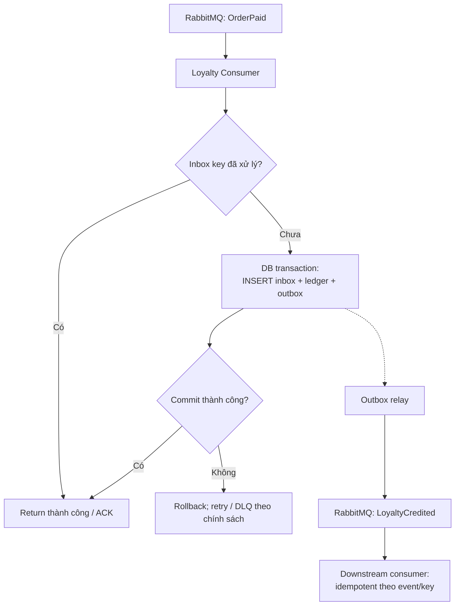

# Message ID, khóa nghiệp vụ và consumer có tính lặp an toàn (idempotency)

## 1. Vì sao nhận lại message là hành vi bình thường?

Trong module **SPRING_AMQP**, ta sử dụng RabbitMQ thông qua `RabbitTemplate`, `@RabbitListener`, exchange, queue và binding để tách các bước xử lý bất đồng bộ. Khi xây dựng **độ tin cậy đầu cuối**, một vấn đề quan trọng xuất hiện: **một sự kiện nghiệp vụ có thể được consumer nhìn thấy nhiều lần**, dù phía gửi chỉ mong muốn xử lý một lần.

Giả sử dịch vụ đơn hàng phát sự kiện `OrderPaid`. Dịch vụ điểm thưởng nhận sự kiện để cộng 100 điểm cho khách hàng. Một tình huống có thể xảy ra:

1. Consumer nhận message từ queue `loyalty.order-paid.q`.
2. Consumer ghi thành công 100 điểm vào cơ sở dữ liệu và commit transaction.
3. Consumer bị mất kết nối **trước khi RabbitMQ nhận consumer acknowledgment (ack)**.
4. RabbitMQ không biết tác vụ đã commit; delivery chưa ack có thể được đưa trở lại queue và giao lại.
5. Nếu consumer cộng thêm 100 điểm lần nữa, khách hàng nhận **200 điểm** cho một đơn hàng.

Đây không phải lỗi do RabbitMQ “gửi nhầm”. Với cách vận hành có ack và redelivery, broker ưu tiên khả năng **phát lại message chưa xác nhận**, còn nghiệp vụ phải kiểm soát những tác động lặp. Hệ thống thường hướng tới **at-least-once delivery**: có thể nhận lặp để tránh mất công việc chưa xác nhận, thay vì hứa rằng mỗi nghiệp vụ chỉ chạy đúng một lần.

**Idempotency (tính lặp an toàn)** là tính chất giúp lặp lại cùng một ý định xử lý mà **kết quả nghiệp vụ cuối cùng không bị nhân đôi**. Trong ví dụ, dù consumer nhận sự kiện thanh toán 1 lần, 2 lần hay 10 lần, sổ điểm thưởng chỉ có **một khoản cộng điểm** cho cùng một lần thanh toán.

> Mục tiêu không phải loại bỏ mọi delivery trùng, mà là **khi trùng xảy ra, không tạo thêm tác dụng nghiệp vụ sai**. Số lần xử lý mã nguồn có thể nhiều hơn một; tác dụng nghiệp vụ được kiểm soát bằng thiết kế dữ liệu và transaction.

## 2. Phân biệt Message ID và khóa nghiệp vụ

Có nhiều định danh cùng xuất hiện trong một luồng AMQP. Chúng phục vụ **mục đích khác nhau**:

| Trường / định danh | Nguồn tạo | Công dụng | Có phù hợp để chống trùng không? |
| --- | --- | --- | --- |
| **`messageId`** (AMQP message property) | Ứng dụng publisher tự đặt; RabbitMQ không bắt buộc tự tạo ID | Theo dõi một message logic, đối chiếu log, phân biệt các lần publish | Có, **nếu** nhà phát hành cấp ID ổn định, duy nhất cho cùng message logic qua retry |
| **`eventId`** / `commandId` trong payload | Hệ thống nghiệp vụ tạo khi phát sinh sự kiện/lệnh | Định danh một sự kiện hoặc yêu cầu; lưu cùng outbox | Rất hữu ích cho inbox/dedup theo từng sự kiện |
| **Khóa nghiệp vụ** (business key) | Suy ra từ ý định nghiệp vụ: `orderId` + loại thao tác, mã giao dịch ngoài... | Xác định **tác dụng nào chỉ được phép tạo một lần** | Thường là ranh giới an toàn mạnh hơn khi cùng ý định bị publish lại với ID mới |
| **`correlationId`** | Ứng dụng hoặc thư viện RPC đặt | Ghép request với reply; tracing | Không nên dùng làm khóa chống trùng nghiệp vụ mặc định |
| **`deliveryTag`** | RabbitMQ cấp trên channel khi giao message | Ack/nack một delivery trên đúng channel | **Không**: chỉ có ý nghĩa trong phạm vi channel; thay đổi qua redelivery |
| **`redelivered`** | RabbitMQ đặt trên delivery | Gợi ý message từng được giao lại | **Không**: `false` không chứng minh nghiệp vụ chưa từng xử lý, nhất là khi publisher gửi lại message |

### 2.1. `messageId` phải được thiết kế từ phía gửi

Một publisher có thể gửi message mà **không đặt `messageId`**; không nên giả định RabbitMQ sẽ tự bổ sung. Vì vậy, nếu một consumer dự định dùng `messageId` để khử trùng, cần quy định trong message contract:

- Mỗi sự kiện logic có **một ID ổn định**, ví dụ UUID hoặc ULID được tạo khi sự kiện được ghi nhận.
- Khi gửi lại cùng sự kiện do publisher timeout/không thấy confirm, **giữ nguyên ID**. Đừng tạo ID mới ở mỗi lần retry chỉ vì gọi lại `convertAndSend()`.
- Nếu event đi qua outbox, lưu ID cùng bản ghi outbox để các lần phát lại giữ nguyên.
- Kiểm tra giá trị null/rỗng và quy định rõ hành vi khi dữ liệu đầu vào không hợp lệ.

Ví dụ cùng một sự kiện `OrderPaid` có `eventId = EVT-123`. Lần publish đầu và lần retry sau khi mạng lỗi đều dùng `messageId = EVT-123`; consumer nhận hai delivery nhưng biết chúng là một event logic.

Tuy nhiên, **message ID một mình chưa giải quyết mọi trường hợp**. Nếu hai service độc lập cùng tạo sự kiện “đơn ORD-9 đã thanh toán” với `eventId` khác nhau, việc dedup chỉ theo event ID sẽ coi đây là hai sự kiện khác nhau, dẫn đến cộng điểm hai lần.

### 2.2. Khóa nghiệp vụ phải phản ánh “một lần” nghĩa là gì

Với nghiệp vụ **mỗi đơn đã thanh toán được cộng điểm đúng một lần**, khóa có thể là:

```text
consumer = loyalty-points
businessKey = order-paid:ORD-9
dedupeKey = (consumer, businessKey)
```

Một consumer khác (ví dụ xử lý tồn kho) vẫn được phép xử lý cùng `OrderPaid` vì phạm vi consumer khác.

Nếu một đơn có thể thực sự có **nhiều lần thu tiền hợp lệ**, khóa `orderId` không đủ: cần phân biệt `paymentTransactionId` hoặc mã lần thu tiền. Nếu nghiệp vụ có các loại tác động khác nhau, thêm `operation`, ví dụ:

```text
loyalty-credit:order:ORD-9
loyalty-refund:refund:R-17
loyalty-adjustment:adjustment:A-42
```

**Không dùng khóa quá rộng.** Ví dụ chỉ dùng `customerId` sẽ làm mất các lần cộng điểm hợp lệ cho những đơn hàng khác nhau. Cũng không dùng khóa quá hẹp như “timestamp lúc consumer chạy” vì mỗi lần redelivery sẽ có khóa mới.

### 2.3. Khi nào chọn loại khóa nào?

| Yêu cầu | Khóa chính để dedup | Lưu ý |
| --- | --- | --- |
| Một event chỉ được consumer đó áp dụng một lần | `(consumerName, eventId)` | Publisher phải giữ ổn định `eventId` qua retry |
| Một thao tác nghiệp vụ chỉ được thực hiện một lần bất kể số lần gửi lại | `(consumerName, operation, businessId)` | Xây khóa từ ngữ nghĩa nghiệp vụ; định nghĩa các điều chỉnh hợp lệ |
| Một API ngoài có hỗ trợ idempotency key | Cùng khóa ý định khi gọi API ngoài | Cần kiểm tra thời gian giữ khóa và contract phía API |
| Cùng entity có nhiều thay đổi hợp lệ | `(entityId, eventType, version)` hoặc mã thay đổi riêng | Idempotency **khác** kiểm soát thứ tự; cần xử lý out-of-order riêng |

Trong hệ thống thực, nên giữ **cả `eventId/messageId` và business key**: định danh message giúp trace/redelivery; khóa nghiệp vụ giúp bảo vệ kết quả. Nếu hai event ID khác nhau cùng trỏ đến một business key nhưng payload mâu thuẫn, nên ghi nhận cảnh báo để điều tra thay vì âm thầm coi mọi thứ là hợp lệ.

## 3. Mức bảo đảm: ack, publisher confirm, retry và transaction

RabbitMQ và cơ sở dữ liệu không cùng biết “nghiệp vụ đã hoàn tất” theo một transaction duy nhất.

```mermaid
sequenceDiagram
    participant P as Order Service
    participant B as RabbitMQ
    participant C as Loyalty Consumer
    participant D as PostgreSQL
    P->>B: Publish OrderPaid (eventId=EVT-123)
    B-->>P: Publisher confirm (broker đã nhận)
    B->>C: Deliver (chưa ack)
    C->>D: BEGIN; INSERT inbox + INSERT điểm
    D-->>C: COMMIT thành công
    Note over C,B: Consumer mất kết nối trước ack
    B->>C: Redeliver cùng event
    C->>D: INSERT inbox ON CONFLICT DO NOTHING
    D-->>C: Trùng khóa, không cộng điểm nữa
    C->>B: ACK sau khi xử lý hoàn tất
```

Phân biệt ba mốc:

1. **Publisher confirm** xác nhận RabbitMQ đã nhận trách nhiệm publish ở mức broker theo cơ chế confirm; chưa chứng minh consumer đã xử lý nghiệp vụ.
2. **Database commit** xác nhận dữ liệu nghiệp vụ và thông tin dedup đã được ghi cùng transaction.
3. **Consumer ack** báo với RabbitMQ rằng delivery được xử lý để broker có thể bỏ delivery khỏi hàng chờ.

Nếu DB commit thành công nhưng ack thất lạc, message có thể được nhận lại: inbox/business key sẽ ngăn tác dụng thứ hai. Nếu consumer ack trước khi DB commit rồi DB lỗi, RabbitMQ có thể coi delivery đã xử lý dù nghiệp vụ chưa thành công.

**Phương án an toàn cho listener đồng bộ:** để Spring AMQP dùng `AcknowledgeMode.AUTO`, và cho listener gọi service `@Transactional`. Service phải **commit xong trước khi return bình thường**; sau đó container mới ack theo cấu hình. Nếu transaction thất bại, để exception lan ra để container xử lý nack/requeue/retry.

Không nhầm `AcknowledgeMode.AUTO` của Spring với RabbitMQ **auto-ack** (`AcknowledgeMode.NONE`). Với `AUTO`, container quyết định ack sau khi listener xử lý thành công; với `NONE`, broker không chờ consumer ack, nên không có khả năng redelivery do thiếu ack theo cơ chế này.

## 4. Mẫu Inbox / Processed Messages: ghi dấu và làm nghiệp vụ trong một transaction

Một cách thực tế để xây consumer có tính lặp an toàn là dùng **inbox** hoặc bảng `processed_messages` với unique constraint.

Thuật toán:

1. Nhận message, xác thực payload, xác định `consumerName` và **idempotency key**.
2. Trong một **transaction cơ sở dữ liệu**, thử ghi khóa vào inbox bằng thao tác atomic.
3. Nếu khóa đã tồn tại do giao dịch hoàn tất trước đó: **không làm lại tác dụng nghiệp vụ**; trả về bình thường để ack delivery trùng.
4. Nếu ghi khóa mới thành công: thực hiện thay đổi nghiệp vụ trong **cùng transaction**.
5. Commit đồng thời dấu xử lý và thay đổi nghiệp vụ.
6. Chỉ sau đó để Spring container ack message. Nếu xảy ra lỗi ở bước 2–5, rollback cả hai để lần nhận lại có thể xử lý từ đầu.

### 4.1. Vì sao phải dùng unique constraint?

Đoạn code kiểm tra trước rồi ghi sau dễ bị race:

```text
Consumer A: SELECT chưa có key
Consumer B: SELECT chưa có key
Consumer A: cộng 100 điểm
Consumer B: cộng 100 điểm
Consumer A/B: cùng ghi dấu đã xử lý
```

Hai consumer có thể cùng thấy chưa tồn tại trước khi một bên commit. **`SELECT` rồi `INSERT` không đủ để chống trùng** trừ khi có cơ chế locking/serialization thích hợp.

Để database là nơi quyết định bằng **`PRIMARY KEY` hoặc `UNIQUE`** và một thao tác ghi có tính nguyên tử (ví dụ PostgreSQL `INSERT ... ON CONFLICT DO NOTHING`). Khi hai transaction đụng cùng khóa, ràng buộc unique đảm bảo không có hai dấu đã commit cho cùng khóa; một giao dịch có thể phải chờ kết quả của giao dịch kia.

### 4.2. Lược đồ PostgreSQL minh họa

Ví dụ nghiệp vụ: mỗi đơn thanh toán thành công được cộng điểm **một lần**.

```sql
CREATE TABLE consumer_inbox (
    consumer_name TEXT NOT NULL,
    dedupe_key TEXT NOT NULL,
    first_message_id TEXT NOT NULL,
    processed_at TIMESTAMPTZ NOT NULL DEFAULT now(),
    PRIMARY KEY (consumer_name, dedupe_key)
);

CREATE TABLE loyalty_ledger (
    id BIGSERIAL PRIMARY KEY,
    order_id TEXT NOT NULL,
    customer_id TEXT NOT NULL,
    points INTEGER NOT NULL CHECK (points > 0),
    event_type TEXT NOT NULL,
    created_at TIMESTAMPTZ NOT NULL DEFAULT now(),
    CONSTRAINT uq_loyalty_order_event UNIQUE (order_id, event_type)
);
```

Hai mức phòng vệ:

- `consumer_inbox` ngăn xử lý lại **khóa nghiệp vụ** theo phạm vi consumer.
- `loyalty_ledger` có unique theo `(order_id, event_type)` để chống cộng trùng ngay cả khi một luồng code khác bỏ qua inbox.

Bảng ledger ở đây lưu **phát sinh điểm**, không lưu tổng điểm trực tiếp. Một transaction có thể đồng thời cập nhật bảng tổng điểm nếu hệ thống có bảng đó; khi đó cả ledger, tổng điểm và inbox phải nằm trong cùng transaction.

Schema dùng PostgreSQL. Với MySQL/SQL Server hoặc database khác, hãy thay `ON CONFLICT` bằng cơ chế upsert/unique tương ứng và kiểm tra cách xử lý xung đột transaction của hệ quản trị đó.

## 5. Ví dụ Spring AMQP end-to-end

Ví dụ giả định **Spring Boot + spring-boot-starter-amqp**, Java 17+, PostgreSQL và `JdbcTemplate` qua `spring-boot-starter-jdbc`. Phần publish dùng JSON với Jackson `ObjectMapper`, nên consumer giải mã trực tiếp để nhìn rõ message property `messageId`. Trong ứng dụng thực tế, có thể cấu hình message converter chung cho cả hai phía.

### 5.1. Payload và quy ước ID

```java
public record OrderPaidEvent(
        String eventId,   // ổn định qua retry/republish cùng sự kiện
        String orderId,   // khóa nghiệp vụ: 1 lần cộng điểm / đơn
        String customerId,
        int points
) {}
```

Quy định contract:

- `eventId` được tạo khi nghiệp vụ ghi nhận “đã thanh toán”, **không** tạo mới mỗi lần gọi publish.
- `messageId` của RabbitMQ bằng `eventId` để trace nhất quán.
- `orderId` định danh một lần cộng điểm theo nghiệp vụ giả định. Nếu một đơn có thể phát sinh nhiều khoản cộng hợp lệ, phải dùng mã giao dịch/operation cụ thể thay thế.
- Payload bất biến cho cùng `eventId`. Nếu cần sửa điểm thưởng, phát một sự kiện điều chỉnh riêng với khóa riêng; đừng tái sử dụng cùng ID cho hai ý nghĩa khác nhau.

### 5.2. Exchange, queue, binding và DLQ

```java
import org.springframework.amqp.core.Binding;
import org.springframework.amqp.core.BindingBuilder;
import org.springframework.amqp.core.DirectExchange;
import org.springframework.amqp.core.Queue;
import org.springframework.amqp.core.QueueBuilder;
import org.springframework.beans.factory.annotation.Qualifier;
import org.springframework.context.annotation.Bean;
import org.springframework.context.annotation.Configuration;

@Configuration
class LoyaltyRabbitConfig {

    @Bean
    DirectExchange ordersExchange() {
        return new DirectExchange("orders.events", true, false);
    }

    @Bean
    DirectExchange ordersDlx() {
        return new DirectExchange("orders.dlx", true, false);
    }

    @Bean
    Queue loyaltyQueue() {
        return QueueBuilder.durable("loyalty.order-paid.q")
                .deadLetterExchange("orders.dlx")
                .deadLetterRoutingKey("order.paid.failed")
                .build();
    }

    @Bean
    Queue loyaltyDlq() {
        return QueueBuilder.durable("loyalty.order-paid.dlq").build();
    }

    @Bean
    Binding paidBinding(
            @Qualifier("loyaltyQueue") Queue queue,
            @Qualifier("ordersExchange") DirectExchange exchange) {
        return BindingBuilder.bind(queue).to(exchange).with("order.paid");
    }

    @Bean
    Binding failedBinding(
            @Qualifier("loyaltyDlq") Queue queue,
            @Qualifier("ordersDlx") DirectExchange dlx) {
        return BindingBuilder.bind(queue).to(dlx).with("order.paid.failed");
    }
}
```

DLQ dành cho các message **không thể xử lý bình thường** sau khi từ chối hoặc hết chính sách retry. DLQ không thay thế inbox; message bị đưa sang DLQ rồi phát lại về queue chính vẫn phải được consumer xử lý có tính lặp an toàn.

### 5.3. Publisher đặt `messageId` ổn định

```java
import com.fasterxml.jackson.core.JsonProcessingException;
import com.fasterxml.jackson.databind.ObjectMapper;
import org.springframework.amqp.core.Message;
import org.springframework.amqp.core.MessageDeliveryMode;
import org.springframework.amqp.core.MessageProperties;
import org.springframework.amqp.rabbit.core.RabbitTemplate;
import org.springframework.stereotype.Service;

@Service
class OrderPaidPublisher {
    private final RabbitTemplate template;
    private final ObjectMapper mapper;

    OrderPaidPublisher(RabbitTemplate template, ObjectMapper mapper) {
        this.template = template;
        this.mapper = mapper;
    }

    public void publish(OrderPaidEvent event)
            throws JsonProcessingException {
        if (event.eventId() == null || event.eventId().isBlank()) {
            throw new IllegalArgumentException("eventId is required");
        }

        var properties = new MessageProperties();
        properties.setContentType(MessageProperties.CONTENT_TYPE_JSON);
        properties.setMessageId(event.eventId());
        properties.setDeliveryMode(MessageDeliveryMode.PERSISTENT);

        byte[] body = mapper.writeValueAsBytes(event);
        template.send("orders.events", "order.paid",
                new Message(body, properties));
    }
}
```

Message persistent và queue durable là các thành phần của độ bền, nhưng **chưa đủ** cho bảo đảm đầu-cuối: producer còn cần xử lý publisher confirms, unroutable returns (khi cấu hình mandatory) và phát lại có kiểm soát. Nếu nguồn sự kiện đến từ transaction database của Order Service, hãy cân nhắc **transactional outbox** để không bỏ sót sự kiện giữa bước commit database và bước publish RabbitMQ.

### 5.4. Consumer: validate và ủy quyền transaction cho service

```java
import com.fasterxml.jackson.core.JsonProcessingException;
import com.fasterxml.jackson.databind.ObjectMapper;
import org.springframework.amqp.AmqpRejectAndDontRequeueException;
import org.springframework.amqp.core.Message;
import org.springframework.amqp.rabbit.annotation.RabbitListener;
import org.springframework.stereotype.Component;

@Component
class OrderPaidListener {
    private final ObjectMapper mapper;
    private final LoyaltyCreditService service;

    OrderPaidListener(ObjectMapper mapper, LoyaltyCreditService service) {
        this.mapper = mapper;
        this.service = service;
    }

    @RabbitListener(queues = "loyalty.order-paid.q")
    public void onMessage(Message message) {
        String messageId = message.getMessageProperties().getMessageId();

        if (messageId == null || messageId.isBlank()) {
            throw new AmqpRejectAndDontRequeueException(
                    "Missing messageId");
        }

        final OrderPaidEvent event;
        try {
            event = mapper.readValue(message.getBody(), OrderPaidEvent.class);
        } catch (JsonProcessingException ex) {
            throw new AmqpRejectAndDontRequeueException(
                    "Invalid OrderPaid JSON", ex);
        }

        if (event == null
                || event.eventId() == null
                || !messageId.equals(event.eventId())
                || event.orderId() == null || event.orderId().isBlank()
                || event.customerId() == null || event.customerId().isBlank()
                || event.points() <= 0) {
            throw new AmqpRejectAndDontRequeueException(
                    "Invalid OrderPaid event contract");
        }

        // Service sẽ commit DB trước khi listener return bình thường.
        service.creditOnce(event, messageId);
    }
}
```

Ứng dụng để listener dùng `AcknowledgeMode.AUTO` (mặc định của listener container nếu không cấu hình khác). Trường hợp dữ liệu sai định dạng là lỗi **không nên retry vô hạn**, nên ví dụ ném `AmqpRejectAndDontRequeueException` để broker đưa qua DLQ đã định tuyến.

Nếu database tạm thời không hoạt động, service bên dưới sẽ ném exception; hãy thiết kế chính sách retry có backoff/hạn mức hoặc dead-letter phù hợp. **Không bắt và nuốt exception** rồi return bình thường vì container có thể ack mặc dù nghiệp vụ chưa được ghi.

### 5.5. Service dùng transaction + unique insert

```java
import org.springframework.jdbc.core.JdbcTemplate;
import org.springframework.stereotype.Service;
import org.springframework.transaction.annotation.Transactional;

@Service
class LoyaltyCreditService {
    private static final String CONSUMER = "loyalty-points";
    private final JdbcTemplate jdbc;

    LoyaltyCreditService(JdbcTemplate jdbc) {
        this.jdbc = jdbc;
    }

    enum Outcome { APPLIED, DUPLICATE }

    @Transactional
    public Outcome creditOnce(OrderPaidEvent event, String messageId) {
        // Nghiệp vụ giả định: 1 khoản cộng điểm cho mỗi đơn đã thanh toán.
        String businessKey = "order-paid:" + event.orderId();

        int inserted = jdbc.update("""
                INSERT INTO consumer_inbox
                    (consumer_name, dedupe_key, first_message_id)
                VALUES (?, ?, ?)
                ON CONFLICT (consumer_name, dedupe_key) DO NOTHING
                """, CONSUMER, businessKey, messageId);

        if (inserted == 0) {
            return Outcome.DUPLICATE; // Trả về bình thường: ack delivery trùng
        }

        // Cùng transaction với dấu xử lý ở consumer_inbox.
        jdbc.update("""
                INSERT INTO loyalty_ledger
                    (order_id, customer_id, points, event_type)
                VALUES (?, ?, ?, ?)
                """,
                event.orderId(), event.customerId(),
                event.points(), "ORDER_PAID");

        return Outcome.APPLIED;
        // Transaction proxy commit trước khi onMessage() return.
    }
}
```

**Vì sao phương án này đúng với tình huống crash/redelivery?**

- Nếu insert inbox thành công nhưng insert ledger thất bại: **transaction rollback**, inbox cũng biến mất. Redelivery có thể thử lại.
- Nếu cả hai insert đã commit nhưng ack bị mất: redelivery gặp unique key, trả về `DUPLICATE`, **không cộng điểm nữa**.
- Nếu hai consumer nhận hai bản sao đồng thời: database unique constraint phân xử xung đột. Chỉ một transaction có thể trở thành lần áp dụng hợp lệ cho cùng `(consumerName, businessKey)`.
- Nếu inbox và ledger dùng **hai database độc lập** hoặc service cập nhật API ngoài, không thể suy ra tính nguyên tử từ một `@Transactional` thông thường. Phần 7 trình bày cách mở rộng.

Điều kiện để ví dụ giữ đúng đặc tính: **cả hai bảng cùng database và cùng transaction manager**, `creditOnce` được gọi qua Spring bean/proxy, và khi thao tác nghiệp vụ lỗi phải để transaction rollback. Mặc định Spring rollback với `RuntimeException`; nếu nghiệp vụ có checked exception, cần cấu hình rollback phù hợp.

### 5.6. Bật listener mode hợp lý

Với listener đồng bộ `void` phía trên, có thể sử dụng:

```yaml
spring:
  rabbitmq:
    listener:
      simple:
        acknowledge-mode: auto
        prefetch: 20
```

`AUTO` của Spring nghĩa là container gửi ack sau khi method thành công và xử lý lỗi theo cấu hình khi method ném exception. `prefetch` giới hạn số delivery chưa ack mà consumer có thể giữ.

**Không tự gọi `Channel.basicAck()` trong ví dụ trên** vì container đang quản lý ack. Nếu chọn `MANUAL` thật sự, phải gọi ack **sau khi DB commit**, xử lý nack đúng channel và delivery tag; tránh double ack hoặc ack trước commit.

## 6. Bảng lỗi: chuyện gì xảy ra tại từng thời điểm?

| Điểm hỏng | Trạng thái database | Khả năng RabbitMQ phát lại | Kết quả mong đợi nhờ inbox |
| --- | --- | --- | --- |
| Consumer lỗi trước khi bắt đầu transaction | Chưa đổi | Có thể phát lại delivery chưa ack | Lần sau xử lý từ đầu |
| Lỗi sau insert inbox nhưng trước insert ledger | Transaction rollback | Có thể phát lại | Không có dấu giả “đã xong”; được thử lại |
| Lỗi trong lúc ghi ledger | Transaction rollback cả hai | Có thể phát lại | Không cộng điểm dở dang |
| Commit DB xong, **chưa ack** đã crash | Inbox + ledger đã lưu | Có thể phát lại | Phát hiện duplicate và không cộng lần hai |
| Ack xong rồi consumer crash | Inbox + ledger đã lưu | Thường không phát lại delivery đã ack | Nghiệp vụ đã hoàn tất |
| Producer retry cùng event với **ID cũ** | Có thể đã xử lý | Có thể tạo thêm một delivery mới | ID/key đã lưu → bỏ qua |
| Producer tạo **ID mới** nhưng cùng đơn đã thanh toán | Có thể đã xử lý | Một message mới hợp lệ về mặt AMQP | Business key `order-paid:{orderId}` vẫn ngăn cộng trùng |
| Cùng một đơn có **sự kiện điều chỉnh thực sự mới** | Cần tạo thêm nghiệp vụ | Event mới được giao | Dùng operation/adjustment ID khác để **không bỏ sót** thay đổi hợp lệ |

Không thể chỉ nhìn `message.getMessageProperties().isRedelivered()` để suy ra lần đầu: message do publisher tự gửi lại sẽ là **delivery mới**, có thể có cờ redelivered `false` nhưng vẫn trùng về nghiệp vụ. Cờ này hữu ích cho metrics và chẩn đoán, không phải cơ chế dedup.

## 7. Khi hiệu ứng nằm ngoài cùng database

Mẫu transaction ở phần 5 chỉ bảo đảm dấu inbox và cập nhật ledger khi chúng nằm trong **cùng một transaction database**. Một consumer thực tế có thể còn:

- Gọi API thanh toán/đối tác.
- Gửi email hoặc SMS.
- Publish message sang exchange khác qua `RabbitTemplate`.
- Ghi sang database khác hoặc một dịch vụ ngoài.

Ví dụ nguy hiểm:

```text
BEGIN transaction DB
INSERT inbox (eventId)
HTTP POST /credit-points   -> phía ngoài đã cộng thành công
Consumer crash trước COMMIT
ROLLBACK inbox
RabbitMQ redeliver
HTTP POST /credit-points   -> cộng thêm lần thứ hai
```

Đưa HTTP call vào bên trong `@Transactional` **không làm API ngoài tham gia transaction**. Có ba hướng thường dùng:

1. **Idempotency key tại dịch vụ đích:** gửi khóa nghiệp vụ ổn định, ví dụ `loyalty-credit:ORD-9`; dịch vụ đích tự bảo đảm cùng khóa chỉ thực hiện một lần. Kiểm tra chính sách lưu khóa và xử lý request cùng khóa nhưng payload khác.
2. **Transactional outbox:** trong cùng transaction với inbox/ledger, ghi một bản ghi `outbox`. Worker riêng phát message từ outbox tới RabbitMQ. Nếu phát lại cùng outbox record, consumer kế tiếp cũng dedup theo ID/key.
3. **State machine / saga có trạng thái:** lưu tiến độ theo business key, có cơ chế reconcile, retry với backoff và bù trừ nếu hành động ngoài không thể nguyên tử.

### 7.1. Inbox và Outbox kết hợp



Mũi tên nét đứt từ transaction tới outbox relay biểu thị relay **chỉ đọc bản ghi đã commit**; publish sang RabbitMQ thực hiện ở một bước riêng. Relay có thể gửi lặp khi chưa kịp đánh dấu “đã gửi”; downstream consumer phải xử lý lặp an toàn. Outbox giải quyết **mất message giữa DB commit và publish**, nhưng không tự tạo bảo đảm exactly-once trên mọi hệ thống.

### 7.2. Redis SETNX có thay thế inbox database không?

`SETNX` / `SET key value NX EX ...` hữu ích để giảm tải hoặc ngăn nhiều worker xử lý trùng đồng thời, nhưng nếu **ghi dấu thành công trước khi tác dụng nghiệp vụ hoàn tất**, rồi tiến trình crash, sự kiện có thể bị bỏ qua sai trong thời gian khóa còn hiệu lực. Nếu khóa hết TTL, việc phát lại muộn có thể tạo tác dụng lần hai.

Có thể dùng Redis như **khóa tạm/fast path**, nhưng với nghiệp vụ tài chính, điểm thưởng hoặc tồn kho, nên đặt invariant cuối cùng ở **database/ledger có unique constraint**, hoặc tại service đích hỗ trợ idempotency bền vững. Cần phân biệt:

- **Lock “đang xử lý”**: có thời hạn và cần xử lý worker chết.
- **Marker “đã xử lý thành công”**: chỉ ghi khi tác dụng nghiệp vụ đã commit theo cùng giao thức an toàn.

## 8. Retry, dead-letter, thứ tự xử lý và giữ dấu đã xử lý

### 8.1. Retry không có nghĩa sẽ hết trùng

Consumer phải chấp nhận rằng ack có thể bị mất sau commit. Chính sách retry giúp phục hồi lỗi tạm thời, nhưng nếu retry vô hạn với một payload sai, RabbitMQ có thể tạo **vòng lặp redelivery**.

Nên phân loại:

| Loại lỗi | Ví dụ | Hướng xử lý |
| --- | --- | --- |
| Dữ liệu không hợp lệ, không thể tự sửa | Thiếu `eventId`, JSON hỏng, `points <= 0` | Reject không requeue và đưa DLQ để điều tra |
| Lỗi tạm thời | Database timeout, connection reset | Retry có giới hạn, backoff; nếu vượt ngưỡng, chuyển DLQ hoặc trạng thái cần can thiệp |
| Đã xử lý thành công | Trùng business key trong inbox | Return bình thường để ack; tăng metric duplicate |
| Mâu thuẫn dữ liệu | Cùng key, khác customer/points | Không cộng lại; cảnh báo/audit theo quy tắc nghiệp vụ |
| Lỗi không xác định sau HTTP call | Timeout nhưng đối tác có thể đã xử lý | Tra cứu trạng thái theo idempotency key; không gọi lại tùy tiện |

Trong Spring AMQP, `defaultRequeueRejected` của container ảnh hưởng việc requeue khi listener ném exception; mặc định thường là `true`. `AmqpRejectAndDontRequeueException` có thể yêu cầu không requeue. Nếu đã bật DLX/DLQ đúng tuyến, message bị reject với `requeue=false` có thể được dead-letter.

Thiết kế retry nên gắn với loại lỗi, giới hạn số lần và quan sát DLQ; idempotency vẫn phải hoạt động khi message được người vận hành đưa từ DLQ trở lại queue.

### 8.2. Retention: giữ dấu inbox trong bao lâu?

Một unique key chỉ có tác dụng khi dấu đã xử lý **còn tồn tại**. Xóa bản ghi inbox quá sớm có thể khiến message cũ được replay sau nhiều tuần lại cộng điểm lần nữa.

- Quyết định retention dựa trên **thời gian replay tối đa**, TTL của message/queue, thời gian giữ trong DLQ, thời gian retry của producer/outbox và chính sách replay thủ công.
- Với tác dụng nghiệp vụ “mỗi order chỉ được cộng điểm một lần”, **unique constraint tại ledger** có thể là bảo vệ dài hạn ngay cả khi dọn inbox để giảm dung lượng.
- Nếu nghiệp vụ cho phép thao tác hợp lệ lặp lại sau một giai đoạn, đưa **định danh lần thao tác** vào khóa thay vì xóa dấu và hy vọng message cũ không quay lại.
- Với inbox rất lớn, cân nhắc partition theo thời gian/tenant, index và chiến lược lưu trữ phù hợp; nhưng không làm suy yếu khoảng bảo vệ trùng theo yêu cầu nghiệp vụ.

### 8.3. Idempotency không giải quyết thứ tự event

Một message không bị xử lý trùng **vẫn có thể đến sai thứ tự**: `OrderShipped(v3)` có thể đến trước `OrderPaid(v2)` nếu có nhiều queue/consumer, retry hoặc requeue.

Để xử lý ordering, cần quy tắc riêng như:

- Lưu `lastProcessedVersion` theo aggregate và dùng optimistic locking/CAS khi update.
- Chỉ áp dụng version hợp lệ; đưa các event chưa đủ điều kiện vào cơ chế trì hoãn/reconcile.
- Khi dùng nhiều consumer song song, cân nhắc partition hoặc thiết kế workflow chịu được out-of-order.

**Không dùng `eventId` hoặc inbox để giả định rằng event luôn đến đúng thứ tự.**

## 9. Quan sát, cảnh báo và kiểm thử tính lặp an toàn

### 9.1. Các chỉ số cần theo dõi

Trong ứng dụng, gắn nhãn theo consumer và event type; tránh đặt toàn bộ messageId/orderId thành metric tag vì cardinality rất cao.

| Metric / log | Ý nghĩa |
| --- | --- |
| `consumer_events_applied_total` | Số sự kiện được áp dụng nghiệp vụ lần đầu |
| `consumer_events_duplicate_total` | Số delivery bị inbox/unique key bỏ qua do đã xử lý |
| `consumer_events_failed_total` | Lỗi transaction/validation/API ngoài |
| `consumer_redelivered_total` | Số delivery có cờ redelivered, phục vụ điều tra |
| `consumer_processing_duration` | Thời gian xử lý gồm DB transaction, p95/p99 |
| `consumer_inbox_conflict_rate` | Tỷ lệ trùng theo business key |
| `rabbitmq_queue_messages_ready/unacked` | Backlog và message chưa ack |
| `rabbitmq_dlq_depth` | Message cần điều tra hoặc replay có kiểm soát |

Ghi log có **`eventId`, `messageId`, `businessKey`, `consumerName`, `correlationId` nếu có**, kết quả `APPLIED/DUPLICATE/FAILED` và lỗi. Không ghi payload nhạy cảm hoặc khóa bí mật. Có thể so sánh event ID/payload hash khi cùng business key phát sinh nhiều lần để phát hiện mâu thuẫn nguồn.

### 9.2. Bộ kiểm thử nên có

| Kịch bản | Kỳ vọng |
| --- | --- |
| Gửi cùng message hai lần với cùng `messageId` | Inbox chỉ có một key; ledger chỉ có một khoản cộng điểm |
| Gửi lại cùng `orderId` nhưng `messageId` mới | Business key vẫn bảo vệ đúng một lần cộng điểm |
| Hai consumer cạnh tranh xử lý hai bản sao đồng thời | Unique constraint cho phép đúng một kết quả nghiệp vụ |
| Inject lỗi sau insert inbox, trước insert ledger | Rollback cả hai; lần sau vẫn xử lý được |
| Inject crash sau DB commit nhưng trước ack | Redelivery bị nhận diện trùng; không nhân đôi điểm |
| Dữ liệu JSON hỏng | Được reject/dead-letter theo chính sách; không “ack thành công” giả |
| Phát hai đơn khác nhau cùng `customerId` | Cả hai đều tạo khoản điểm riêng; không dedup nhầm |
| Phát event điều chỉnh điểm hợp lệ | Dùng key riêng; không bị khóa `OrderPaid` chặn |
| Replay lại sau thời gian giữ inbox | Vẫn được bảo vệ bởi invariant dài hạn hoặc chính sách replay phù hợp |

Với PostgreSQL, có thể kiểm tra nhanh bằng câu truy vấn sau khi test:

```sql
SELECT order_id, event_type, COUNT(*) AS records
FROM loyalty_ledger
GROUP BY order_id, event_type
HAVING COUNT(*) > 1;

SELECT consumer_name, dedupe_key, COUNT(*) AS records
FROM consumer_inbox
GROUP BY consumer_name, dedupe_key
HAVING COUNT(*) > 1;
```

Hai truy vấn phải trả về **0 dòng** đối với dữ liệu tuân theo các unique constraint đã mô tả. Tuy nhiên, kết quả 0 dòng chỉ xác minh ràng buộc không bị vi phạm; còn phải đối chiếu **giá trị tổng điểm và số lần event hợp lệ thực sự được áp dụng**.

Đặc biệt kiểm thử bằng cách **cố ý dừng consumer ở khoảng giữa DB commit và ack**; đó là thời điểm phơi bày rõ nhất sai lầm “chỉ xử lý một lần vì RabbitMQ có ack”.

## 10. Những lỗi thiết kế cần tránh

**Dùng cờ `redelivered` như điều kiện duy nhất để bỏ qua message.** Cờ này chỉ phản ánh lịch sử delivery mà broker biết, không phải lịch sử nghiệp vụ hoặc toàn bộ lần publish.

**Tạo UUID mới mỗi khi retry publish.** Việc này làm `messageId` mất tác dụng dedup theo sự kiện. Sinh ID khi tạo sự kiện và lưu cùng dữ liệu/outbox.

**Đánh dấu đã xử lý rồi commit riêng trước khi thực hiện nghiệp vụ.** Nếu worker chết giữa hai transaction, dấu thành công vẫn tồn tại dù nghiệp vụ chưa xảy ra. Dấu và tác dụng phải được commit nguyên tử hoặc có workflow trạng thái đáng tin cậy.

**Kiểm tra tồn tại bằng `SELECT` rồi mới ghi không có unique constraint.** Hai consumer đồng thời có thể đều vượt qua kiểm tra và tạo tác dụng trùng.

**Cho mọi lỗi vào nhánh “đã xử lý” và ack.** Dữ liệu sai nên có đường đi DLQ; lỗi tạm thời cần retry có giới hạn; trùng thật sự mới được ack bỏ qua.

**Dùng cùng business key cho các sự kiện khác nhau.** `orderId` chỉ đủ nếu nghiệp vụ định nghĩa một tác dụng cho mỗi order. Hoàn tiền, điều chỉnh và thanh toán nhiều đợt phải có operation/transaction ID phù hợp.

**Cho rằng transaction DB tự bao trùm RabbitMQ và HTTP.** Transaction nội bộ chỉ nguyên tử trong phạm vi tài nguyên được transaction manager quản lý. Với publish/side effect ngoài cần outbox, idempotency key ở đích hoặc cơ chế reconcile.

## 11. Checklist áp dụng trong dự án

Trước khi đưa consumer vào production, trả lời được các câu hỏi sau:

1. **“Một lần” nghĩa là gì?** Là một event ID, một đơn thanh toán, một giao dịch tiền hay một lần điều chỉnh?
2. **Ai tạo ID?** `eventId/messageId` có được giữ nguyên qua publisher retry, outbox replay và DLQ replay không?
3. **Khóa dedup đủ hẹp và đủ rộng chưa?** Có bỏ sót thao tác hợp lệ hoặc cho phép hai bản sao cùng tạo tác dụng không?
4. **Ai quyết định chống tranh chấp?** Có unique constraint/atomic insert hoặc idempotency contract tương đương ở storage đích không?
5. **Khi nào ack?** Transaction nghiệp vụ đã commit trước khi listener `AUTO` return chưa? Lỗi có được truyền tới container không?
6. **Nếu worker crash ở mọi điểm giữa commit và ack?** Kết quả cuối cùng có còn đúng không?
7. **Có tác dụng ngoài database?** Đã dùng outbox, idempotency key ở đích hoặc reconciliation chưa?
8. **Retry và DLQ có giới hạn?** Có đường đi cho poison message, cảnh báo, replay và điều tra không?
9. **Giữ dấu bao lâu?** Có còn chống replay sau khi DLQ/outbox được phát lại trễ không?
10. **Có kiểm thử đua tranh và crash thực tế?** Các phép thử có đo cả duplicate, applied, lỗi và invariant nghiệp vụ không?

**Thông điệp quan trọng:** `messageId` định danh một thông điệp, **business key** định danh một tác dụng nghiệp vụ cần kiểm soát, còn **idempotent consumer** dùng transaction và ràng buộc dữ liệu để việc nhận lại message không làm thay đổi kết quả sai. Khi kết hợp với publisher confirms, ack, retry, dead-letter, outbox và giám sát, đây là nền tảng để xây dựng xử lý bất đồng bộ đáng tin cậy trên Spring AMQP và RabbitMQ.

## Tài liệu tham khảo

- [RabbitMQ — Consumer Acknowledgements and Publisher Confirms](https://www.rabbitmq.com/docs/confirms): ack/nack, automatic requeue khi channel hoặc connection đóng, redelivered flag, publisher confirms và giới hạn của từng cơ chế.
- [Spring AMQP — Message Listener Container Configuration](https://docs.spring.io/spring-amqp/reference/amqp/containerAttributes.html): `AUTO`, `MANUAL`, `NONE`, `defaultRequeueRejected`, prefetch.
- [Spring AMQP — Exception Handling](https://docs.spring.io/spring-amqp/reference/amqp/exception-handling.html): cách lỗi của listener ảnh hưởng retry/reject và xử lý message không thể khôi phục.
- [RabbitMQ — Dead Letter Exchanges](https://www.rabbitmq.com/docs/dlx): routing message từ queue nguồn tới dead-letter exchange khi bị reject/nack không requeue hoặc các điều kiện dead-letter khác.
- [Spring Framework — Transaction Management](https://docs.spring.io/spring-framework/reference/data-access/transaction/declarative.html): cách áp dụng `@Transactional` và ranh giới của một transaction database.
