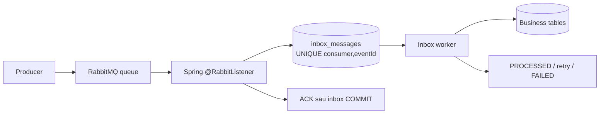

# Lưu dấu xử lý bằng ràng buộc duy nhất hoặc inbox

Trong **Spring AMQP**, gọi `@RabbitListener` thành công không đồng nghĩa một message sẽ chỉ được xử lý đúng một lần trong toàn bộ vòng đời của hệ thống. Ví dụ, một consumer đã ghi thay đổi vào PostgreSQL, nhưng tiến trình bị dừng trước khi RabbitMQ nhận ACK: broker có thể giao lại message, kể cả cho một instance khác. Nếu listener cứ chạy lại lệnh `UPDATE stock SET reserved = reserved + 1`, số lượng đã đặt sẽ tăng lần nữa dù chỉ có một yêu cầu nghiệp vụ.

Bài học thuộc chương **Độ tin cậy đầu cuối** của module **SPRING_AMQP**. Mục tiêu là xây dựng consumer *idempotent* bằng **ràng buộc duy nhất (unique constraint)** hoặc **inbox bền vững**, kết hợp `@RabbitListener`, ACK/NACK, retry, dead-letter, transaction và observability. Hai phương án có mức độ phức tạp khác nhau; phương án nào phù hợp phụ thuộc việc xử lý có thể hoàn tất ngay trong một transaction cơ sở dữ liệu hay cần tách bước nhận message khỏi bước xử lý nghiệp vụ dài hơn.

## 1. Mục tiêu học tập

Sau bài này, bạn có thể:

1. Giải thích vì sao message vẫn có thể được giao lại sau khi ghi dữ liệu thành công.
2. Chọn định danh **event ID nghiệp vụ ổn định**, phân biệt nó với `deliveryTag`, `redelivered` và `messageId`.
3. Dùng **unique constraint** ở bảng nghiệp vụ hoặc bảng `processed_messages` để ngăn tác động trùng, kể cả khi nhiều consumer chạy đồng thời.
4. Đặt thao tác **ghi dấu đã xử lý** và **thay đổi nghiệp vụ** trong **cùng một database transaction**.
5. Xây **inbox** lưu bền vững message trước khi ACK, rồi xử lý lại bằng worker có trạng thái, retry và lease.
6. Phân tích các điểm crash, xử lý lỗi một phần, side effect bên ngoài database và chính sách giữ/xóa dấu vết.
7. Kiểm chứng bằng bài thực hành có retry, concurrency và mô phỏng lỗi giữa commit và ACK.

## 2. Vấn đề: ACK của broker và COMMIT của database là hai bước

Giả sử producer gửi sự kiện `InventoryReservationRequested` với `eventId=evt-1042`. Consumer nhận message, tăng số đơn vị hàng được giữ trong bảng `inventory` rồi xác nhận ACK.

```mermaid
sequenceDiagram
    participant P as Producer
    participant Q as RabbitMQ
    participant C as Spring @RabbitListener
    participant D as Database
    P->>Q: Publish eventId=evt-1042
    Q->>C: Deliver event
    C->>D: BEGIN; UPDATE inventory; COMMIT
    D-->>C: COMMIT thành công
    Note over C,Q: Consumer mất kết nối trước khi ACK tới broker
    Q-->>C: Redelivery eventId=evt-1042
    C->>D: UPDATE lần nữa nếu không có idempotency
```

**Tại sao vẫn xảy ra?**

- RabbitMQ quản lý việc **giao message và consumer acknowledgement**; database quản lý **transaction của dữ liệu nghiệp vụ**.
- Broker không biết một `UPDATE` đã commit hay chưa. Nếu channel/connection đóng khi delivery chưa được xác nhận, RabbitMQ sẽ đưa message trở lại queue để có thể giao lại.
- Ngay cả publisher dùng **publisher confirms**, producer có thể phát lại message vì không nhận được confirm trong khi broker đã nhận message lần đầu.
- Cờ `redelivered=true` chỉ là gợi ý về lịch sử giao lại. Không thể dùng nó làm tiêu chuẩn loại bỏ message: một message giao lại vẫn có thể **chưa từng** được xử lý thành công.

Vì vậy, khi mô hình delivery cho phép redelivery, cần coi **một event có thể tới nhiều lần** và thiết kế thay đổi nghiệp vụ an toàn khi lặp lại.

### Bảng các thời điểm crash

| Thời điểm lỗi | Trạng thái broker | Trạng thái DB | Khi broker giao lại |
| --- | --- | --- | --- |
| Trước khi bắt đầu transaction DB | Chưa ACK | Chưa đổi | Consumer xử lý lại như lần đầu. |
| Sau khi ghi DB nhưng trước COMMIT | Chưa ACK | Transaction rollback nếu tiến trình mất kết nối | Có thể xử lý lại an toàn sau rollback. |
| **Sau COMMIT nhưng trước khi ACK được broker nhận** | Broker có thể chưa thấy ACK | **Đã đổi** | **Nguy cơ tác động trùng** nếu thiếu idempotency. |
| Sau khi ACK được broker nhận | Đã xác nhận delivery | Đã đổi | Broker không tự giao lại delivery ấy; publisher vẫn có thể gửi event trùng ở thời điểm khác. |

Hệ thống xử lý đúng cần giữ invariant: **mỗi event ID chỉ gây hiệu ứng nghiệp vụ đã định tối đa một lần**, trong phạm vi lưu dấu và giả định transaction được nêu rõ. Đây là *effectively-once business effect* trên tài nguyên được bảo vệ, **không phải** lời hứa RabbitMQ giao đúng một lần ở cấp transport.

## 3. Chọn khóa chống trùng: `eventId` phải ổn định

Khóa idempotency phải được tạo **trước khi publish** và giữ nguyên qua các lần retry/re-publish của **cùng sự kiện logic**.

Ví dụ payload:

```json
{
  "eventId": "evt-1042",
  "orderId": "order-907",
  "sku": "SKU-42",
  "units": 3
}
```

Trong đó `eventId` là định danh sự kiện, `orderId` là một thuộc tính nghiệp vụ, `sku` và `units` quyết định tác động. Nếu producer gặp timeout rồi phát lại **cùng yêu cầu**, nó phải dùng lại `eventId=evt-1042`; tự sinh ID mới ở mỗi lần retry sẽ vượt qua hàng rào chống trùng.

| Trường | Dùng làm khóa chống trùng? | Lưu ý |
| --- | --- | --- |
| `eventId`/`idempotencyKey` do nghiệp vụ tạo | **Nên dùng.** | Bắt buộc ổn định khi cùng event được gửi lại. |
| `MessageProperties.getMessageId()` | Chỉ dùng khi có hợp đồng rõ ràng. | Header có thể vắng mặt hoặc thay đổi khi client tạo message mới. |
| `deliveryTag` | **Không.** | Delivery tag chỉ có ý nghĩa trong phạm vi AMQP channel; không định danh nghiệp vụ. |
| `redelivered` | **Không.** | Cờ boolean, không chứng minh event đã được DB commit. |
| `correlationId` | Tùy giao thức. | Thường phục vụ ghép request–reply/trace; không mặc nhiên là khóa idempotency. |

### Phạm vi khóa chống trùng

Một event có thể được hai dịch vụ khác nhau xử lý hợp lệ, chẳng hạn `inventory-reserver` giữ hàng và `billing-ledger` ghi sổ. Không nên dùng một khóa `eventId` toàn cục khiến dịch vụ thứ hai nhầm event đã được xử lý.

Dùng khóa tổng hợp **`(consumer_name, event_id)`**, hoặc bảng/trường riêng cho từng projection/nghiệp vụ. `consumer_name` nên là định danh logic của chức năng xử lý, không phải ID instance/pod thay đổi mỗi lần deploy. Nếu cùng một luồng có phiên bản handler mới với semantics khác, chiến lược đổi namespace/rebuild projection cần được quy định rõ.

**Không được mặc định** hai payload mang cùng `eventId` nhưng nội dung khác nhau là hợp lệ. Nên kiểm tra các thuộc tính bất biến hoặc fingerprint chuẩn hóa; nếu trùng ID nhưng khác nội dung, ghi nhận **idempotency-key collision** để điều tra thay vì âm thầm ACK như một bản sao hợp lệ.

## 4. Phương án A — ràng buộc duy nhất ngay trên bảng nghiệp vụ

Nếu **một sự kiện tương ứng đúng một lần tạo bản ghi nghiệp vụ**, ràng buộc duy nhất trên bảng đó là cách đơn giản và hiệu quả.

Ví dụ một event xác nhận giao hàng tạo bản ghi shipment:

```sql
CREATE TABLE shipments (
    shipment_id       TEXT PRIMARY KEY,
    source_event_id   TEXT NOT NULL UNIQUE,
    order_id          TEXT NOT NULL,
    carrier           TEXT NOT NULL,
    created_at        TIMESTAMPTZ NOT NULL DEFAULT now()
);
```

Consumer có thể thực hiện:

```sql
INSERT INTO shipments (shipment_id, source_event_id, order_id, carrier)
VALUES (:shipmentId, :eventId, :orderId, :carrier)
ON CONFLICT (source_event_id) DO NOTHING;
```

Trong PostgreSQL, `ON CONFLICT ... DO NOTHING` cho phép xử lý event trùng mà không chèn thêm dòng. Ràng buộc `UNIQUE` do database thực thi **ngay cả khi hai consumer cùng INSERT đồng thời**, nên tốt hơn mẫu dễ race condition:

```text
if (!exists(eventId)) {   // Consumer A và B đều thấy "chưa có"
    insertShipment(...);  // Cả hai cùng cố tạo bản ghi
}
```

Mẫu `SELECT rồi INSERT` không có bảo vệ duy nhất hoặc khóa thích hợp **không an toàn dưới concurrency**. Cách đúng là đặt invariant ở database, không chỉ ở điều kiện `if` trong Java.

**Giới hạn của unique constraint ngay trên bảng nghiệp vụ:** khi một event phải chạy **nhiều thao tác** (ví dụ tăng số đã giữ, tạo lịch sử và cập nhật trạng thái đơn hàng), không phải lúc nào cũng có một bản ghi nghiệp vụ duy nhất để đại diện tất cả tác động. Khi đó, dùng **bảng dấu xử lý riêng**, vẫn dựa vào unique constraint và một DB transaction.

## 5. Bảng `processed_messages`: dấu xử lý và nghiệp vụ trong cùng transaction

Giả sử mỗi event giữ `units` đơn vị hàng. Gọi `UPDATE inventory SET reserved_units = reserved_units + 3` hai lần sẽ tăng gấp đôi. Ta tạo bảng bảo vệ:

```sql
CREATE TABLE processed_messages (
    consumer_name TEXT NOT NULL,
    event_id      TEXT NOT NULL,
    sku           TEXT NOT NULL,
    units         BIGINT NOT NULL CHECK (units > 0),
    processed_at  TIMESTAMPTZ NOT NULL DEFAULT now(),
    PRIMARY KEY (consumer_name, event_id)
);

CREATE TABLE inventory (
    sku            TEXT PRIMARY KEY,
    reserved_units BIGINT NOT NULL DEFAULT 0
);

INSERT INTO inventory (sku, reserved_units)
VALUES ('SKU-42', 0);
```

**Invariant:** chỉ transaction chèn thành công cặp `(consumer_name, event_id)` mới được thực hiện thay đổi `reserved_units`. Nếu thay đổi thất bại thì **cả marker lẫn business update rollback**. Không chèn marker rồi COMMIT trước khi thực hiện nghiệp vụ.

### 5.1 Ví dụ Spring Boot + JDBC + PostgreSQL

Giả định dùng **Java 17+**, Spring Boot có `spring-boot-starter-amqp`, `spring-boot-starter-jdbc`, Jackson và PostgreSQL JDBC driver. Trong hệ thống này, `@Transactional` điều khiển **database transaction** của `JdbcTemplate` qua transaction manager phù hợp với datasource.

Record diễn đạt contract của payload:

```java
public record ReservationRequested(
        String eventId,
        String sku,
        long units
) {}
```

Service bảo vệ nghiệp vụ bằng unique constraint:

```java
import java.util.Objects;
import org.springframework.jdbc.core.JdbcTemplate;
import org.springframework.stereotype.Service;
import org.springframework.transaction.annotation.Transactional;

@Service
public class InventoryReservationService {
    private static final String CONSUMER = "inventory-reserver";
    private final JdbcTemplate jdbc;

    public InventoryReservationService(JdbcTemplate jdbc) {
        this.jdbc = jdbc;
    }

    private record OriginalRequest(String sku, long units) {}

    @Transactional
    public void reserveOnce(ReservationRequested event) {
        if (event.eventId() == null || event.eventId().isBlank()
                || event.sku() == null || event.sku().isBlank()
                || event.units() <= 0) {
            throw new IllegalArgumentException("Invalid reservation event");
        }

        int claimed = jdbc.update(
            """
            INSERT INTO processed_messages (consumer_name, event_id, sku, units)
            VALUES (?, ?, ?, ?)
            ON CONFLICT (consumer_name, event_id) DO NOTHING
            """,
            CONSUMER, event.eventId(), event.sku(), event.units()
        );

        if (claimed == 0) {
            // Cùng ID phải mang cùng nội dung nghiệp vụ.
            OriginalRequest original = jdbc.queryForObject(
                """
                SELECT sku, units FROM processed_messages
                WHERE consumer_name = ? AND event_id = ?
                """,
                (rs, row) -> new OriginalRequest(
                    rs.getString("sku"),
                    rs.getLong("units")
                ),
                CONSUMER, event.eventId()
            );
            if (original == null
                    || !Objects.equals(original.sku(), event.sku())
                    || original.units() != event.units()) {
                throw new IllegalStateException(
                    "Event ID collision: " + event.eventId());
            }
            return; // Event đã được commit trước đó: không UPDATE nữa.
        }

        int updated = jdbc.update(
            """
            UPDATE inventory
            SET reserved_units = reserved_units + ?
            WHERE sku = ?
            """,
            event.units(), event.sku()
        );
        if (updated != 1) {
            // Exception khiến transaction rollback cả marker vừa INSERT.
            throw new IllegalStateException(
                "Inventory SKU not found: " + event.sku());
        }
    }
}
```

**Vì sao ví dụ này chịu được concurrency?** Cặp `(consumer_name,event_id)` là **PRIMARY KEY**. Nếu hai consumer tranh cùng khóa, database giải quyết bằng cơ chế unique index/transaction. Khi giao dịch thắng đã commit, giao dịch còn lại nhận `claimed=0` và bỏ qua business update; nếu giao dịch đầu rollback, giao dịch còn lại có thể chèn và xử lý. Code không tách bước "check đã tồn tại?" rồi mới "insert" thiếu bảo vệ.

**Vì sao phải dùng `@Transactional`?** Nếu lệnh `UPDATE inventory` lỗi, transaction rollback xóa cả marker vừa chèn. Lần giao lại còn cơ hội thực hiện đúng. Nếu ghi marker trong transaction riêng và commit trước, rồi nghiệp vụ lỗi, lần retry thấy marker và bỏ qua, gây **mất tác động nghiệp vụ**.

### 5.2 Listener chỉ ACK sau khi service commit

```java
import com.fasterxml.jackson.core.JsonProcessingException;
import com.fasterxml.jackson.databind.ObjectMapper;
import org.springframework.amqp.core.Message;
import org.springframework.amqp.rabbit.annotation.RabbitListener;
import org.springframework.stereotype.Component;

@Component
public class ReservationListener {
    private final ObjectMapper objectMapper;
    private final InventoryReservationService service;

    public ReservationListener(
            ObjectMapper objectMapper,
            InventoryReservationService service) {
        this.objectMapper = objectMapper;
        this.service = service;
    }

    @RabbitListener(queues = "inventory.reserve.q")
    public void onMessage(Message message)
            throws JsonProcessingException {
        ReservationRequested event = objectMapper.readValue(
            message.getBody(),
            ReservationRequested.class
        );
        service.reserveOnce(event);
        // Chỉ trả về bình thường khi transaction DB đã commit.
    }
}
```

Đoạn code giả định đã có queue `inventory.reserve.q`, binding và publisher gửi JSON đúng schema; tên exchange/routing key có thể được khai báo theo topology của hệ thống. Dùng `ObjectMapper` ở listener để tránh phụ thuộc cách converter mặc định diễn giải `contentType`. Bean `InventoryReservationService` riêng đảm bảo lời gọi `@Transactional` đi qua Spring proxy; **self-invocation** bên trong chính bean transaction có thể bỏ qua proxy nếu dùng cơ chế AOP mặc định.

Với listener container `AcknowledgeMode.AUTO` (mặc định phổ biến), container gửi ACK nếu phương thức listener hoàn tất bình thường; khi service ném exception, container xử lý reject/requeue theo cấu hình. Trong ví dụ, transaction DB commit trước khi phương thức listener trả về, rồi container mới xác nhận delivery. **ACK của RabbitMQ và COMMIT của PostgreSQL không tạo thành một distributed transaction**; cửa sổ mất ACK sau COMMIT vẫn tồn tại và được xử lý bằng marker unique.

Đừng dùng `AcknowledgeMode.NONE` cho bài toán này: broker coi message đã được ACK khi giao, nên consumer chết trước khi commit có thể mất dữ liệu. Nếu chuyển sang `MANUAL`, ứng dụng phải ACK **đúng delivery tag trên đúng channel sau commit**, và quản lý thất bại ACK/NACK; không trộn cả ACK thủ công lẫn AUTO.

### 5.3 Dự đoán dữ liệu khi nhận bản sao

```text
Trước khi nhận:
  inventory['SKU-42'].reserved_units = 0
  processed_messages: rỗng

Nhận evt-1042 (units=3):
  INSERT marker -> claimed=1
  UPDATE reserved_units += 3
  COMMIT -> reserved_units=3

Nhận lại evt-1042, cùng payload:
  INSERT marker -> claimed=0
  Kiểm tra nội dung trùng khớp
  Không UPDATE -> reserved_units vẫn = 3
  Listener trả về -> ACK bản sao
```

Nếu cùng `eventId=evt-1042` nhưng `units=7`, ví dụ **ném lỗi collision** để điều tra; hệ thống cần phân loại lỗi này là **không thể sửa bằng retry vô hạn**, có thể đưa vào DLQ/quarantine cùng bằng chứng gốc.

## 6. Phương án B — inbox bền vững để tách nhận message và thực thi

Với tác vụ ngắn, cập nhật một database, cách marker + unique constraint thường đủ. Nhưng có những công việc cần xử lý dài, giới hạn tốc độ hoặc làm việc qua nhiều giai đoạn. Khi đó có thể dùng **inbox pattern**: trước hết ghi toàn bộ yêu cầu vào database, **ACK message sau khi inbox COMMIT**, rồi một worker nội bộ lấy việc từ inbox để xử lý.



Khác biệt trọng tâm:

- Trong phương án **marker đồng bộ**, listener xử lý nghiệp vụ rồi mới được ACK; marker chứng minh **business effect đã hoàn tất** trong cùng transaction.
- Trong phương án **inbox**, listener ACK sau khi **yêu cầu được lưu bền vững**, dù nghiệp vụ **chưa hoàn tất**. Inbox chứng minh hệ thống đã **nhận trách nhiệm tiếp tục xử lý**. Worker phải được giám sát và có cơ chế retry/quarantine riêng.
- Inbox vẫn cần **unique constraint** để chống lưu trùng khi RabbitMQ redeliver. Nó không thay thế ràng buộc duy nhất; nó mở rộng thành một **quy trình xử lý bền vững có trạng thái**.

### 6.1 Thiết kế bảng inbox

Ví dụ PostgreSQL:

```sql
CREATE TABLE inbox_messages (
    consumer_name TEXT NOT NULL,
    event_id      TEXT NOT NULL,
    payload       JSONB NOT NULL,
    state         TEXT NOT NULL DEFAULT 'RECEIVED'
                  CHECK (state IN ('RECEIVED', 'PROCESSING',
                                  'PROCESSED', 'FAILED')),
    attempts      INTEGER NOT NULL DEFAULT 0,
    available_at  TIMESTAMPTZ NOT NULL DEFAULT now(),
    lease_until   TIMESTAMPTZ,
    created_at    TIMESTAMPTZ NOT NULL DEFAULT now(),
    processed_at  TIMESTAMPTZ,
    last_error    TEXT,
    PRIMARY KEY (consumer_name, event_id)
);

CREATE INDEX inbox_ready_idx
    ON inbox_messages (available_at, created_at)
    WHERE state IN ('RECEIVED', 'PROCESSING');
```

Ý nghĩa các cột:

| Cột | Mục đích |
| --- | --- |
| `consumer_name, event_id` | Khóa chống trùng ổn định cho consumer logic. |
| `payload` | Bản sao nội dung cần xử lý; worker không phải chờ RabbitMQ giao lại. |
| `state` | Trạng thái bền vững của công việc. |
| `attempts` | Số lần worker đã **claim** việc; **không phải** số lần broker redeliver. |
| `available_at` | Thời điểm sớm nhất được thử lại, giúp thực hiện backoff. |
| `lease_until` | Hạn một worker giữ quyền xử lý; giúp phát hiện worker chết. |
| `processed_at` | Mốc hoàn tất nghiệp vụ. |
| `last_error` | Lý do thất bại gần nhất; phải lọc thông tin nhạy cảm khi ghi. |

Nếu muốn xử lý lỗi không thể phục hồi, có thể đưa bản ghi sang `FAILED` hoặc một trạng thái `QUARANTINED` được định nghĩa rõ. Đừng để bản ghi bị kẹt `PROCESSING` mãi sau khi worker chết.

### 6.2 Listener chỉ lưu inbox và ACK sau COMMIT

Service ghi inbox bằng một database transaction:

```java
import java.util.Objects;
import org.springframework.jdbc.core.JdbcTemplate;
import org.springframework.stereotype.Service;
import org.springframework.transaction.annotation.Transactional;

@Service
public class InboxStore {
    private static final String CONSUMER = "inventory-reserver";
    private final JdbcTemplate jdbc;

    public InboxStore(JdbcTemplate jdbc) {
        this.jdbc = jdbc;
    }

    @Transactional
    public void accept(String eventId, String rawJson) {
        if (eventId == null || eventId.isBlank()) {
            throw new IllegalArgumentException("Missing eventId");
        }

        int inserted = jdbc.update(
            """
            INSERT INTO inbox_messages (consumer_name, event_id, payload)
            VALUES (?, ?, CAST(? AS jsonb))
            ON CONFLICT (consumer_name, event_id) DO NOTHING
            """,
            CONSUMER, eventId, rawJson
        );

        if (inserted == 0) {
            Boolean samePayload = jdbc.queryForObject(
                """
                SELECT payload = CAST(? AS jsonb)
                FROM inbox_messages
                WHERE consumer_name = ? AND event_id = ?
                """,
                Boolean.class,
                rawJson, CONSUMER, eventId
            );

            if (!Objects.equals(Boolean.TRUE, samePayload)) {
                throw new IllegalStateException(
                    "Inbox event ID collision: " + eventId);
            }
            // Cùng event đã lưu: không chèn thêm; vẫn ACK bản sao.
        }
    }
}
```

Listener phía RabbitMQ:

```java
import java.nio.charset.StandardCharsets;
import com.fasterxml.jackson.databind.JsonNode;
import com.fasterxml.jackson.databind.ObjectMapper;
import org.springframework.amqp.core.Message;
import org.springframework.amqp.rabbit.annotation.RabbitListener;
import org.springframework.stereotype.Component;

@Component
public class InboxReceiver {
    private final ObjectMapper mapper;
    private final InboxStore inboxStore;

    public InboxReceiver(ObjectMapper mapper, InboxStore inboxStore) {
        this.mapper = mapper;
        this.inboxStore = inboxStore;
    }

    @RabbitListener(queues = "inventory.reserve.q")
    public void onMessage(Message message) throws Exception {
        JsonNode root = mapper.readTree(message.getBody());
        String eventId = root.path("eventId").asText(null);
        String rawJson = new String(
            message.getBody(), StandardCharsets.UTF_8);

        inboxStore.accept(eventId, rawJson);
        // AUTO ACK chỉ sau khi accept() trả về (DB đã COMMIT).
    }
}
```

**Đây là phương án thay thế** `ReservationListener` ở mục 5.2. Không chạy đồng thời hai listener cùng queue khi mục tiêu là thử riêng một chiến lược, vì RabbitMQ sẽ phân phối message giữa các consumer cạnh tranh. Các ví dụ đều giả định listener container ở chế độ `AUTO`.

Lợi ích của transaction:

1. Nếu database lỗi hoặc INSERT rollback, listener ném exception, RabbitMQ có thể xử lý retry/redelivery theo chính sách queue.
2. Nếu INSERT COMMIT rồi tiến trình chết trước ACK, broker có thể redeliver; `PRIMARY KEY` khiến thao tác INSERT lần sau thành no-op, và listener ACK bản sao.
3. Nếu ACK thành công nhưng worker nghiệp vụ chưa chạy, bản ghi `RECEIVED` vẫn nằm bền vững trong database và sẵn sàng được worker tìm thấy.

**Không đánh dấu `PROCESSED` ngay ở listener** trong phương án inbox này: listener mới chỉ lưu request. Đánh dấu xong quá sớm có thể khiến hệ thống tuyên bố nghiệp vụ thành công trong khi worker chưa làm gì.

### 6.3 Worker claim công việc không đụng nhau

Khi có nhiều instance, cần tránh hai worker cùng lấy một hàng inbox. Trong PostgreSQL có thể dùng một lệnh **claim atomically** với `FOR UPDATE SKIP LOCKED`:

```sql
WITH candidate AS (
    SELECT consumer_name, event_id
    FROM inbox_messages
    WHERE consumer_name = 'inventory-reserver'
      AND (
           (state = 'RECEIVED' AND available_at <= now())
        OR (state = 'PROCESSING' AND lease_until < now())
      )
    ORDER BY created_at
    LIMIT 1
    FOR UPDATE SKIP LOCKED
)
UPDATE inbox_messages AS i
SET state = 'PROCESSING',
    attempts = i.attempts + 1,
    lease_until = now() + INTERVAL '60 seconds'
FROM candidate AS c
WHERE i.consumer_name = c.consumer_name
  AND i.event_id = c.event_id
RETURNING i.consumer_name, i.event_id, i.payload, i.attempts;
```

Worker chạy lệnh này **trong transaction ngắn**, COMMIT trạng thái claim, rồi mới thực hiện nghiệp vụ. `SKIP LOCKED` bỏ qua những hàng đang bị transaction khác khóa, thích hợp cho workload dạng queue trong database. Nếu không có dòng nào thỏa điều kiện, worker chờ đến lần polling tiếp theo. Đừng giữ transaction claim mở trong suốt một cuộc gọi HTTP kéo dài.

**Lease không tự bảo đảm chỉ có một worker thực thi mã.** Nếu worker A bị treo lâu hơn 60 giây, worker B có thể reclaim cùng event. Với **business effect trong chính database**, cần khóa row inbox lại và kiểm tra *claim token/fencing* (ví dụ `attempts` hoặc một `claim_version` tăng đơn điệu) trong **cùng transaction** với thay đổi nghiệp vụ:

```text
BEGIN;
SELECT state, attempts
  FROM inbox_messages
 WHERE consumer_name = ? AND event_id = ?
 FOR UPDATE;

Nếu state != PROCESSING hoặc attempts != claimedAttempt:
    ROLLBACK / bỏ qua (đã mất quyền xử lý).

Nếu hợp lệ:
    cập nhật bảng nghiệp vụ bằng logic idempotent;
    UPDATE inbox_messages
       SET state='PROCESSED', processed_at=now(), lease_until=NULL
     WHERE consumer_name=? AND event_id=?;
COMMIT;
```

Nếu dùng một update có điều kiện thay cho `SELECT FOR UPDATE`, phải bảo đảm điều kiện quyền sở hữu được đánh giá trong cùng transaction với hiệu ứng nghiệp vụ. **Không** đánh dấu `PROCESSED` trong transaction khác sau khi đã commit side effect mà không có bảo vệ idempotency bổ sung; crash ở khoảng trống đó có thể làm worker chạy lại side effect.

Khi nghiệp vụ chỉ thao tác trên cùng PostgreSQL, cách thực tế là giữ cả **kiểm tra quyền sở hữu**, **cập nhật dữ liệu** và **đánh dấu PROCESSED** trong một transaction. Nếu tiến trình chết trước COMMIT, các thay đổi rollback; nếu commit thành công nhưng worker mất kết nối ngay sau đó, bản ghi đã ở `PROCESSED` và không bị xử lý lại.

### 6.4 Retry, backoff và trạng thái lỗi

Khi worker xử lý thất bại:

- Lỗi tạm thời: rollback transaction nghiệp vụ, sau đó ghi lại `last_error` và đặt `state=RECEIVED`, `available_at` trong tương lai ở **transaction riêng** theo chính sách backoff; chỉ thực hiện cập nhật này nếu worker còn sở hữu claim hiện tại.
- Worker chết bất ngờ trước khi kịp ghi lỗi: hàng vẫn `PROCESSING`; lease hết hạn cho phép retry/reclaim.
- Quá số lần retry hoặc gặp lỗi dữ liệu cố định: chuyển sang `FAILED`/quarantine, thông báo người vận hành và lưu đủ metadata để xử lý.
- Khi nghiệp vụ thành công: trong cùng transaction với thay đổi dữ liệu, đặt `state=PROCESSED`, `processed_at=now()` và dọn lease.

**Không nhầm retry của inbox với retry của RabbitMQ:** khi listener đã ACK sau khi lưu inbox, broker không còn quản lý công việc nghiệp vụ phía worker. Vì vậy **DLQ RabbitMQ không tự nhận** các lỗi phát sinh sau ACK. Inbox cần lịch retry, ngưỡng thất bại và khu vực điều tra **riêng**. RabbitMQ DLQ vẫn hữu ích cho lỗi xảy ra **trước khi inbox COMMIT/ACK**, như message không hợp lệ hoặc lỗi lặp lại trong giai đoạn ingest.

## 7. So sánh hai chiến lược

| Tiêu chí | Unique constraint + xử lý đồng bộ | Inbox bền vững + worker |
| --- | --- | --- |
| Thời điểm RabbitMQ ACK | Sau khi business transaction hoàn tất. | Sau khi request được ghi bền vững vào inbox. |
| Bảng lưu dấu | Unique key tại bảng nghiệp vụ hoặc bảng `processed_messages`. | Bảng `inbox_messages` có payload, trạng thái và unique key. |
| Công việc thích hợp | Thao tác DB ngắn, có thể commit chung. | Công việc cần trì hoãn, polling, backoff, theo dõi tiến độ hoặc throughput khác nhịp broker. |
| Khi service chết sau DB COMMIT trước ACK | Broker redeliver; unique marker giúp no-op. | Broker redeliver; unique inbox giúp no-op. |
| Khi ACK xong rồi worker chết | Không có worker tách rời. | Inbox còn trạng thái và cơ chế reclaim. |
| Quan sát retry | Chủ yếu qua broker, listener log, DLQ. | Theo dõi `state`, `attempts`, `last_error`, tuổi hàng inbox, riêng với broker. |
| Độ phức tạp | Thấp hơn khi thao tác trong một DB. | Cao hơn: cần polling, lease, claim, fencing, cleanup, theo dõi hàng kẹt. |
| Side effect bên ngoài DB | Vẫn cần idempotency/outbox bên ngoài. | Vẫn cần idempotency/outbox bên ngoài; inbox không tự tạo exactly-once. |

**Quy tắc chọn:** nếu nghiệp vụ chỉ gồm cập nhật vài bảng **trong cùng datasource**, marker + unique constraint trong một transaction là điểm xuất phát đơn giản. Nếu nhận message cần nhanh và công việc xử lý có vòng đời độc lập, inbox giúp tách thời điểm **durably accepted** và **processed** một cách minh bạch.

## 8. Trường hợp khó: HTTP, thanh toán và publish message mới

Unique constraint/transaction của PostgreSQL chỉ bảo vệ được những thay đổi **nằm trong transaction PostgreSQL đó**. Ví dụ:

```text
BEGIN database transaction
INSERT processed_messages(eventId=evt-1042)
POST /charge tới payment provider      <-- side effect bên ngoài DB
COMMIT database
```

Nếu provider đã charge nhưng database rollback, lần retry có thể charge thêm lần nữa. Inbox không tự giải quyết được tình huống này: worker cũng có thể gọi provider xong rồi crash trước khi ghi `PROCESSED`.

Với side effect bên ngoài, cần một hoặc nhiều cơ chế sau:

1. **Idempotency key tại hệ thống đích:** truyền cùng `eventId` hoặc một mã nghiệp vụ được provider hỗ trợ, để yêu cầu lặp không tạo thêm hiệu ứng.
2. **Transactional outbox** khi cần phát message ra RabbitMQ từ một transaction DB: lưu một bản ghi outbound trong **cùng transaction** với thay đổi nghiệp vụ, rồi publisher riêng gửi theo retry/publisher confirms. Consumer downstream vẫn phải idempotent vì outbox publisher có thể gửi lại.
3. **Saga/compensation** nếu tác vụ liên quan nhiều dịch vụ với hiệu ứng không thể gói trong một transaction.
4. **Tra cứu trạng thái bằng operation ID** trước khi retry một tác vụ có kết quả không chắc chắn, nếu hệ thống đích hỗ trợ.

**Inbox và outbox giải quyết hai hướng khác nhau:** inbox lưu dấu **message đến**; outbox lưu ý định **message cần phát đi** sau khi transaction nghiệp vụ commit. Một hệ thống độ tin cậy cao có thể dùng cả hai cùng với unique constraints và idempotency keys.

## 9. Những lỗi dễ mắc khi triển khai

| Lỗi thiết kế | Hậu quả | Cách sửa |
| --- | --- | --- |
| `if (!exists(eventId)) update()` nhưng thiếu unique key | Hai consumer cùng thấy "chưa có" và cùng xử lý. | Đặt unique constraint tại DB và insert/claim atomically. |
| Commit marker trước business update | Business lỗi nhưng bản sao bị xem là đã xử lý. | Marker và business effect phải cùng transaction. |
| ACK trước khi database COMMIT | Consumer chết khiến message mất trong khi DB chưa lưu. | Dùng AUTO ACK sau khi service transaction hoàn tất hoặc MANUAL ACK sau commit. |
| Xóa marker quá sớm | Bản sao tới muộn vượt qua hàng rào chống trùng. | Chọn retention theo cửa sổ replay/retry và hợp đồng event ID. |
| Mỗi lần retry tự tạo `eventId` mới | Cùng nghiệp vụ bị xử lý nhiều lần. | Giữ event ID ổn định qua mọi lần phát lại. |
| Dùng `messageId` không có hợp đồng ổn định | Client republish tạo ID mới, dedup thất bại. | Dùng event ID nghiệp vụ tường minh. |
| Cùng `eventId` nhưng payload khác, âm thầm bỏ qua | Che giấu xung đột dữ liệu hoặc lỗi producer. | Kiểm tra signature/payload và đưa collision vào quarantine. |
| Inbox ACK rồi không có worker/retry | Inbox trở thành kho lưu công việc mãi không hoàn thành. | Có worker, health checks, lag metrics, retry và owner vận hành. |
| Lease hết hạn nhưng worker cũ vẫn ghi dữ liệu | Hai worker có thể tạo side effect trùng. | Kiểm tra claim token/fencing trong transaction, kết hợp idempotency. |
| Retry nóng vô hạn khi DB lỗi | Tăng CPU/network, làm queue nghẽn. | Backoff, giới hạn retry, DLQ hoặc trạng thái FAILED. |
| Cho rằng DB transaction bao trùm HTTP/RabbitTemplate publish | Có thể tạo hiệu ứng ngoài DB mà transaction rollback không khôi phục được. | Idempotency ở đích, outbox hoặc saga. |

### Lưu dấu bao lâu?

Không có TTL chung. Nếu message có thể bị phát lại theo lịch sử dài (replay, DLQ re-drive, migration, publisher retry kéo dài), xóa `processed_messages` ngay sau vài giờ có thể cho phép event cũ chạy lần hai. Có thể:

- Giữ marker ít nhất bằng **cửa sổ replay tối đa được hỗ trợ**, cộng biên an toàn.
- Dùng khóa nghiệp vụ vĩnh viễn (như unique `orderId` hoặc `paymentOperationId`) nếu bất biến đó phải tồn tại mãi.
- Partition/archive marker cũ theo chính sách, chỉ xóa khi có cơ chế khác ngăn event lịch sử chạy lại.
- Tránh lưu payload chứa dữ liệu nhạy cảm không cần thiết; cân nhắc mã hóa, giới hạn quyền đọc và chính sách retention.

## 10. Quan sát và đo lường

Một pipeline có marker/inbox cần biết **đã nhận**, **đã lưu**, **đã xử lý** và **đã ACK** là các mốc khác nhau.

Các metric/log hữu ích:

- `consumer_name`, `event_id`, `order_id`, `messageId`, correlation ID và queue nguồn.
- `dedup_hits_total`: số lần gặp event ID đã xử lý/lưu.
- `id_collision_total`: số event ID trùng nhưng payload khác.
- `business_processing_failed_total` và thời gian transaction DB.
- Với inbox: số hàng theo `state`, tuổi hàng `RECEIVED` cũ nhất, `attempts`, số lease hết hạn, thời gian từ nhận đến `PROCESSED`.
- Với RabbitMQ: queue depth, unacked, redeliveries, DLQ, consumer failures và tỷ lệ retry.

Các metric không thay thế invariant ở database. Đếm `redelivered=true` không đồng nghĩa đã xảy ra duplicate business effect. Nếu broker redelivery nhưng unique marker khiến tác động trở thành no-op, đó là **hành vi mong muốn**.

## 11. Bài thực hành: chứng minh tác động nghiệp vụ chỉ xảy ra một lần

Dùng RabbitMQ thử nghiệm, PostgreSQL và ứng dụng Spring Boot theo mục 5. Những bước này có thể thực hiện với một hoặc nhiều instance consumer.

### Phần A — unique marker

1. Tạo `inventory`, `processed_messages` và seed `SKU-42` với `reserved_units=0`.
2. Publish JSON có `eventId=evt-1042`, `sku=SKU-42`, `units=3` qua `RabbitTemplate` tới `inventory.reserve.q`.
3. Chờ listener hoàn tất, đọc lại bảng: `reserved_units=3`, tồn tại một marker `(inventory-reserver, evt-1042)`.
4. Publish **y hệt** event lần thứ hai, giữ nguyên `eventId`. Giá trị `reserved_units` phải **vẫn là 3**.
5. Publish `evt-1042` nhưng đổi `units=7`. Quan sát lỗi collision, không tăng `reserved_units`. Cấu hình giới hạn retry/DLQ để bản ghi dữ liệu sai không bị requeue nóng.
6. Publish `evt-1043` với `units=2`. Giá trị mới phải là `5` nếu không có thao tác nào khác.

Truy vấn kiểm chứng:

```sql
SELECT sku, reserved_units
FROM inventory
WHERE sku = 'SKU-42';

SELECT consumer_name, event_id, sku, units, processed_at
FROM processed_messages
ORDER BY processed_at;
```

### Phần B — thử concurrency

Chạy hai instance của cùng consumer logic, cùng nghe `inventory.reserve.q`. Publish nhiều bản sao của cùng một `eventId`, hoặc dùng công cụ test gọi hai transaction đồng thời. Kết quả mong muốn là **chỉ một transaction tạo marker và thực hiện business update**. Đừng chứng minh độ an toàn chỉ bằng cách thấy hai request "không trùng thời gian" trong log; thử tải đồng thời thực sự.

### Phần C — mô phỏng crash

Đặt điểm dừng thử nghiệm **sau khi service transaction đã commit nhưng trước khi delivery được ACK**, ví dụ dùng container MANUAL trong một bản thử nghiệm riêng để cố tình bỏ ACK rồi đóng connection. Khi broker giao lại message, unique marker phải khiến nghiệp vụ no-op. Không dùng mã bỏ ACK trong hệ thống production.

| Tình huống | Kết quả mong đợi |
| --- | --- |
| Crash trước COMMIT | Marker và business update rollback; redelivery thực hiện lại từ đầu. |
| Crash sau COMMIT trước ACK | Redelivery; marker đã tồn tại; **không cộng units lần nữa**. |
| Hai consumer chạy đồng thời | Unique constraint cho phép một tác động thành công. |
| Duplicate cùng payload | Không có tác động mới; listener có thể ACK. |
| Same ID khác payload | Báo collision; không thay đổi dữ liệu. |

### Phần D — inbox

Thay listener đồng bộ bằng `InboxReceiver` của mục 6. Publish một event, xác nhận đã có bản ghi `RECEIVED` **trước khi** chạy worker. Cho worker claim rồi xử lý cùng với việc cập nhật `PROCESSED` trong transaction. Thử tắt worker khi hàng đang `PROCESSING` và quan sát nó được reclaim sau `lease_until`. Thử gửi lại cùng event sau khi inbox đã commit: chỉ một hàng tồn tại, không tăng số lần tác động nghiệp vụ.

**Điều cần nộp khi tự học:** log có `eventId` và số lần delivery; ảnh chụp/truy vấn hai bảng; bảng mô tả các điểm crash; giải thích vì sao không cần broker đảm bảo exactly-once để business effect vẫn idempotent trong phạm vi DB.

## 12. Ghi nhớ cốt lõi

- RabbitMQ và database có hai cơ chế xác nhận riêng; **COMMIT rồi mất ACK** vẫn có thể dẫn đến redelivery.
- **Event ID ổn định + unique constraint** là hàng rào chống trùng cốt lõi; đừng dùng `deliveryTag` hoặc `redelivered` làm khóa idempotency.
- Với **marker đồng bộ**, ghi marker và thay đổi nghiệp vụ **trong cùng DB transaction**. Chỉ transaction insert marker thành công mới được phép tạo tác động.
- Với **inbox**, listener ACK sau khi bản ghi inbox **đã lưu bền vững**; một worker khác xử lý nghiệp vụ và cập nhật trạng thái với retry, lease, fencing và transaction phù hợp.
- **Inbox chưa xử lý xong không đồng nghĩa đã hoàn thành nghiệp vụ.** Phải giám sát các hàng tồn, hàng lỗi và quyền sở hữu worker.
- Unique constraint/inbox không làm side effect HTTP, thanh toán hay publish RabbitMQ trở thành atomic với DB; cần **idempotency ở đích**, **outbox** hoặc giao thức bù trừ tương ứng.

## Tài liệu tham khảo

- [RabbitMQ — Consumer Acknowledgements and Publisher Confirms](https://www.rabbitmq.com/docs/confirms): ACK, redelivery, publisher confirms và tình huống duplicate.
- [RabbitMQ — Reliability Guide](https://www.rabbitmq.com/docs/reliability): thiết kế consumer idempotent, publisher retry và ranh giới trách nhiệm.
- [Spring AMQP — Message Listener Container Configuration](https://docs.spring.io/spring-amqp/reference/amqp/containerAttributes.html): `AcknowledgeMode.AUTO`, `MANUAL`, `NONE` và hành vi container.
- [Spring AMQP — Transactions](https://docs.spring.io/spring-amqp/reference/amqp/transactions.html): transaction của RabbitMQ, database và giới hạn của việc đồng bộ transaction.
- [PostgreSQL — INSERT / ON CONFLICT](https://www.postgresql.org/docs/current/sql-insert.html): unique constraint và xử lý trùng atomically.
- [PostgreSQL — SELECT / FOR UPDATE SKIP LOCKED](https://www.postgresql.org/docs/current/sql-select.html): khóa hàng và mô hình claim công việc song song.
