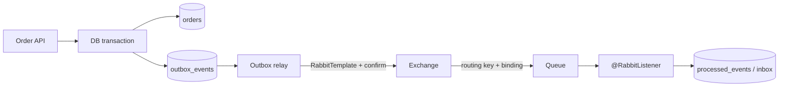
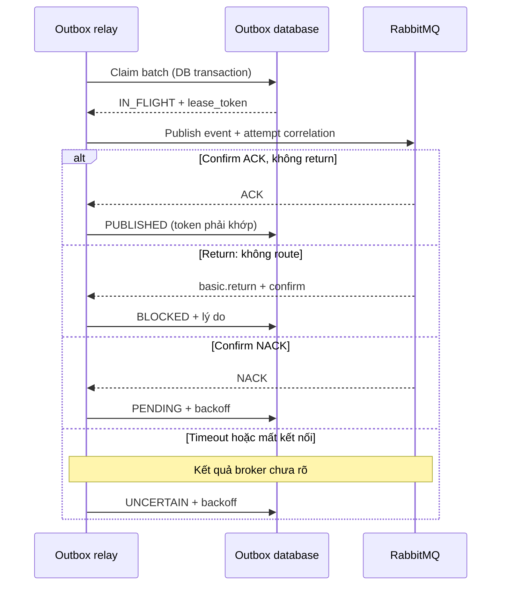
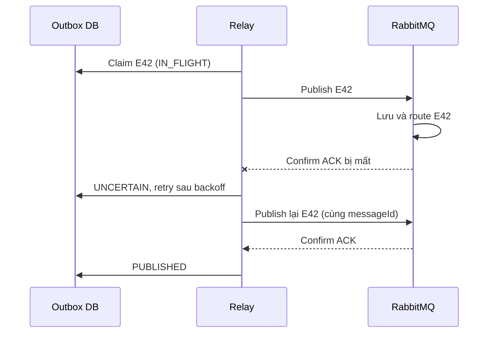

# Outbox relay với confirm và trạng thái publish chưa rõ

> **Chương:** Độ tin cậy đầu cuối. **Phạm vi:** trong **SPRING_AMQP**, ứng dụng dùng `RabbitTemplate` gửi message vào RabbitMQ qua exchange, routing key, queue và binding; phía nhận dùng `@RabbitListener`. Bài tập trung vào **transactional outbox relay**, **publisher confirms**, **mandatory returns**, kết quả publish **chưa rõ** khi timeout/mất kết nối, retry và idempotency.

## 1. Vì sao cần outbox relay?

Khi tạo đơn hàng, ứng dụng phải vừa ghi `orders` trong database, vừa phát sự kiện `OrderCreated` để các dịch vụ xử lý bất đồng bộ. Hai thao tác này thuộc **hai hệ tài nguyên độc lập**. Chỉ đặt `@Transactional` quanh method ghi DB và gửi bằng `RabbitTemplate` không làm chúng trở thành một transaction nguyên tử.

Ví dụ dễ mắc lỗi:

```java
@Transactional("dbTransactionManager")
public void createOrder(Order order) {
    orderRepository.save(order); // DB transaction
    rabbitTemplate.convertAndSend(
        "orders.events", "created", eventJson); // RabbitMQ
}
```

Nếu RabbitMQ đã nhận publish, sau đó database rollback, consumer có thể nhận một đơn hàng không tồn tại. Nếu database commit trước nhưng process chết trước publish, đơn hàng tồn tại mà không có event.

| Thời điểm sự cố | Database | Event trên RabbitMQ |
| --- | --- | --- |
| DB rollback sau khi publish tới broker | Đơn hàng không tồn tại | Có thể đã được nhận |
| DB commit rồi ứng dụng chết trước khi publish | Đơn hàng tồn tại | Chưa được gửi |
| Publish đến broker nhưng mất confirm ACK | Đơn hàng tồn tại | **Không biết** đã được broker nhận chưa |
| Nhận confirm ACK nhưng DB update kết quả outbox thất bại | Đơn hàng tồn tại | Đã được broker nhận, relay có thể gửi lại |

**Transactional outbox** đưa dữ liệu nghiệp vụ và bản ghi sự kiện vào **cùng một DB transaction**. Sau commit, một **relay** riêng đọc bản ghi outbox rồi publish tới RabbitMQ. Cách này loại bỏ khoảng trống “business row đã commit mà không có dấu vết cần gửi event”, nhưng relay vẫn phải chịu trường hợp mất kết quả publish.



**Mục tiêu tin cậy:** event đã commit trong outbox còn đó để gửi lại; message có thể bị gửi **ít nhất một lần (at-least-once)**; consumer dùng ID của event để chống tác động nghiệp vụ trùng. Không giả định publisher confirm đồng nghĩa consumer đã xử lý xong.

## 2. Bốn điểm xác nhận trong luồng end-to-end

| Mốc | Thành phần sở hữu | Bằng chứng quan sát được |
| --- | --- | --- |
| Business + outbox được ghi nguyên tử | Database | DB commit |
| Broker nhận trách nhiệm với publish | RabbitMQ | **Publisher confirm ACK** |
| Message được định tuyến | Exchange/binding/queue | Không có mandatory return, với topology đáp ứng hợp đồng |
| Consumer hoàn tất tác động nghiệp vụ | Consumer + database | Business DB commit và consumer ACK |

Phân biệt:

- **Publisher confirm (`basic.ack` của confirm channel):** broker xác nhận publish từ producer. Kết quả này được Spring AMQP tương quan với `CorrelationData` của lần gửi.
- **Consumer acknowledgement:** consumer xác nhận *delivery* nhận từ queue sau khi xử lý xong. Đây là một loại ACK khác, không được suy ra từ publisher confirm.
- **Mandatory return (`basic.return`):** broker có thể trả lại message không route được. **Confirm ACK vẫn có thể đến sau return** vì exchange đã xử lý publish nhưng không tìm được queue thích hợp.

Một message được confirm ACK chưa chứng minh listener đã chạy, và nếu bỏ qua mandatory return, producer có thể đánh dấu thành công cho message đi vào một exchange không có binding phù hợp.

## 3. Bảng outbox: phải lưu được trạng thái chưa rõ

Ví dụ sau dùng PostgreSQL. Mỗi event có `event_id` bất biến cho tất cả các lần retry, cùng routing key và payload đã định nghĩa tại thời điểm tạo event.

```sql
CREATE TABLE orders (
    order_id UUID PRIMARY KEY,
    status VARCHAR(30) NOT NULL
);

CREATE TABLE outbox_events (
    event_id        UUID PRIMARY KEY,
    aggregate_id    UUID NOT NULL,
    event_type      VARCHAR(100) NOT NULL,
    exchange_name   VARCHAR(255) NOT NULL,
    routing_key     VARCHAR(255) NOT NULL,
    payload_json    TEXT NOT NULL,
    status          VARCHAR(20) NOT NULL DEFAULT 'PENDING',
    attempt_count   INTEGER NOT NULL DEFAULT 0,
    next_attempt_at TIMESTAMPTZ NOT NULL DEFAULT now(),
    lease_token     UUID,
    lease_until     TIMESTAMPTZ,
    last_error      TEXT,
    created_at      TIMESTAMPTZ NOT NULL DEFAULT now(),
    published_at    TIMESTAMPTZ,
    CONSTRAINT outbox_status_check CHECK (
        status IN ('PENDING', 'IN_FLIGHT', 'UNCERTAIN',
                   'PUBLISHED', 'BLOCKED')
    )
);

CREATE INDEX outbox_due_idx
  ON outbox_events (next_attempt_at, created_at)
  WHERE status IN ('PENDING', 'UNCERTAIN');

CREATE INDEX outbox_expired_lease_idx
  ON outbox_events (lease_until)
  WHERE status = 'IN_FLIGHT';
```

| `status` | Ý nghĩa | Cách tiếp tục |
| --- | --- | --- |
| `PENDING` | Chưa có confirm thành công; chờ gửi lần đầu hoặc retry sau NACK | Claim khi đến `next_attempt_at` |
| `IN_FLIGHT` | Worker đã claim; publish/confirm chưa có kết quả được lưu | Có thể claim lại sau `lease_until` |
| `UNCERTAIN` | Đã cố publish nhưng mất kết quả/timeout; **broker có thể đã nhận** | Retry với cùng event ID và backoff |
| `PUBLISHED` | Đã thấy confirm ACK, không return, và ghi kết quả vào DB | Không retry |
| `BLOCKED` | Không route hoặc cấu hình cần can thiệp | Sửa topology rồi replay có chủ đích |

Không đặt `PUBLISHED` chỉ vì method `convertAndSend` trả về: đó chưa phải broker confirm. Không đặt `NOT_PUBLISHED` khi bị timeout: chưa nhận ACK **không chứng minh** broker chưa nhận message. `UNCERTAIN` là trạng thái nghiệp vụ quan trọng, không phải log phụ.

### Ghi đơn hàng + outbox trong cùng DB transaction

```java
import java.util.UUID;
import org.springframework.jdbc.core.JdbcTemplate;
import org.springframework.stereotype.Service;
import org.springframework.transaction.annotation.Transactional;

@Service
class OrderCreationService {
    private final JdbcTemplate jdbc;

    OrderCreationService(JdbcTemplate jdbc) {
        this.jdbc = jdbc;
    }

    @Transactional(transactionManager = "dbTransactionManager")
    public UUID create(UUID orderId, String eventJson) {
        UUID eventId = UUID.randomUUID();
        jdbc.update(
            "INSERT INTO orders (order_id, status) VALUES (?, ?)",
            orderId, "CREATED");
        jdbc.update("""
            INSERT INTO outbox_events
              (event_id, aggregate_id, event_type,
               exchange_name, routing_key, payload_json)
            VALUES (?, ?, ?, ?, ?, ?)
            """,
            eventId, orderId, "OrderCreated",
            "orders.events", "created", eventJson);
        return eventId;
    }
}
```

Ở đây `dbTransactionManager` phải quản lý đúng `DataSource` dùng bởi `JdbcTemplate`, và method phải được gọi qua Spring transaction proxy. Phần publish được để cho relay thực hiện **sau khi DB commit**. Nếu insert đơn hàng hoặc outbox thất bại, transaction rollback cả hai. Nếu process chết sau DB commit, event vẫn tồn tại để relay gửi lại.

## 4. Claim row và giới hạn sở hữu giữa nhiều relay

Nhiều replica có thể đồng thời chạy relay. Nếu cả ba cùng `SELECT` các row `PENDING` rồi publish, một event có thể bị gửi nhiều lần ngay cả khi không có lỗi mạng. Relay cần claim row trong **transaction ngắn**, trước khi publish:

```sql
-- PostgreSQL; :token là UUID mới cho mỗi lượt claim.
-- :batch_size phải có giới hạn.
WITH picked AS (
    SELECT event_id
    FROM outbox_events
    WHERE
      (status IN ('PENDING', 'UNCERTAIN')
       AND next_attempt_at <= now())
      OR
      (status = 'IN_FLIGHT' AND lease_until < now())
    ORDER BY created_at
    FOR UPDATE SKIP LOCKED
    LIMIT :batch_size
)
UPDATE outbox_events AS o
SET status        = 'IN_FLIGHT',
    lease_token   = :token,
    lease_until   = now() + INTERVAL '30 seconds',
    attempt_count = o.attempt_count + 1
FROM picked
WHERE o.event_id = picked.event_id
RETURNING o.event_id, o.event_type, o.exchange_name,
          o.routing_key, o.payload_json, o.attempt_count;
```

Sau câu lệnh này, **commit transaction claim ngay**. Đừng giữ DB row locks khi chờ network hoặc confirm. `FOR UPDATE SKIP LOCKED` giúp worker bỏ qua row đang được worker khác khóa trong cùng giai đoạn claim.

**Lease** là một bảo đảm có thời hạn: nếu worker chết, row `IN_FLIGHT` hết lease được claim lại. Nhưng worker cũ có thể đã publish thành công trước khi chết, vì vậy lease **không** bảo đảm đúng một lần.

**Fencing token** ngăn worker cũ ghi đè kết quả của lượt claim mới:

```sql
UPDATE outbox_events
SET status = 'PUBLISHED',
    published_at = now(),
    lease_token = NULL,
    lease_until = NULL,
    last_error = NULL
WHERE event_id = :event_id
  AND status = 'IN_FLIGHT'
  AND lease_token = :token;
```

Nếu update trả về **0 dòng**, worker phải coi như mình không còn sở hữu row và ghi log để điều tra; không ghi đè trạng thái của worker khác. Token chỉ *fence cập nhật database*, không ngăn hai lần publish đã tới broker.

Chọn lease dài hơn thời gian xử lý tệ nhất dự kiến, hoặc gia hạn lease khi chờ confirm lâu. Nếu batch 20 message, mỗi message đợi tối đa 10 giây tuần tự, tổng thời gian chờ có thể lên đến khoảng 200 giây: lease 30 giây ở SQL **chỉ là minh họa**, không đủ cho cấu hình tuần tự này. Phải giảm batch, tăng/gia hạn lease, hoặc chuyển sang confirm bất đồng bộ với giới hạn số in-flight.

## 5. Publisher confirms + mandatory returns: phải kiểm tra cả hai

Spring Boot hỗ trợ bật correlated confirms và returns:

```yaml
spring:
  rabbitmq:
    publisher-confirm-type: correlated
    publisher-returns: true
    template:
      mandatory: true
```

- `publisher-confirm-type: correlated` bật confirm và gắn kết quả với từng lần gửi.
- `publisher-returns: true` cho phép Spring nhận message bị broker trả lại khi không route được.
- `mandatory: true` yêu cầu broker trả về message không tìm được queue hợp lệ theo quy tắc routing.

Trong Spring AMQP hiện đại, `CorrelationData.getFuture()` trả về `CompletableFuture<CorrelationData.Confirm>`. Nếu có `basic.return`, Spring đặt thông tin ở `CorrelationData.getReturned()` **trước khi future confirm hoàn tất**. Hai cơ chế này bổ sung nhau; riêng `Confirm.isAck()==true` chưa đủ để đánh dấu event đến queue.

| Kết quả quan sát | Diễn giải chính xác | Trạng thái relay |
| --- | --- | --- |
| Confirm **ACK** và không có return | Broker đã chấp nhận message theo confirm, route được theo semantics mandatory | `PUBLISHED` khi DB update thành công |
| `basic.return`, thường sau đó có confirm ACK | Message không được route tới queue nào theo semantics mandatory | `BLOCKED` và cảnh báo topology |
| Confirm **NACK** | Broker báo không thể nhận trách nhiệm với publish | `PENDING` để retry có backoff |
| Timeout đợi confirm | **Chưa rõ** broker có nhận không | `UNCERTAIN` |
| Connection/channel error sau hoặc trong gửi | **Có thể chưa rõ** broker có nhận không | `UNCERTAIN` |
| Confirm ACK, nhưng DB update `PUBLISHED` thất bại | Broker đã nhận; outbox chưa ghi nhận thành công | Row có thể được gửi lại sau lease |

Một số topology sử dụng **alternate exchange** hoặc route tới queue khác dự kiến; khi đó “không có return” **không bảo đảm** message đến đúng queue nghiệp vụ. Cần quan sát topology, binding và hợp đồng định tuyến. Publisher confirm cũng **không** xác nhận consumer xử lý thành công.

> Ví dụ Java tiếp theo dùng `CorrelationData.getReturned()` của Spring AMQP 2.3.3+ và future dạng `CompletableFuture` của Spring AMQP 3.x/4.x. Một số bản 2.x cũ dùng loại future khác. Kiểm tra phiên bản thư viện thực tế trước khi sao chép.

## 6. Gửi qua `RabbitTemplate` và chờ confirm cho từng attempt

Đầu tiên định nghĩa thông tin lấy từ một row outbox. Lưu ý **`eventId` là ID ổn định của event**, còn một attempt publish sẽ có correlation ID riêng:

```java
import java.util.UUID;

public record OutboxEvent(
    UUID eventId,
    String eventType,
    String exchange,
    String routingKey,
    String payloadJson
) {}
```

```java
public enum PublishOutcome {
    CONFIRMED_ROUTED, UNROUTABLE, NACK, UNCERTAIN
}

public record PublishResult(PublishOutcome outcome, String detail) {}
```

Ví dụ publisher đợi confirm với timeout 10 giây; mỗi lần gọi chỉ phát một event. Import và class sau hướng tới Spring AMQP 3.x/4.x:

```java
import java.util.UUID;
import java.util.concurrent.ExecutionException;
import java.util.concurrent.TimeUnit;
import java.util.concurrent.TimeoutException;
import org.springframework.amqp.AmqpException;
import org.springframework.amqp.core.MessageDeliveryMode;
import org.springframework.amqp.core.MessageProperties;
import org.springframework.amqp.rabbit.connection.CorrelationData;
import org.springframework.amqp.rabbit.core.RabbitTemplate;
import org.springframework.stereotype.Component;

@Component
public class OutboxPublisher {
    private final RabbitTemplate rabbitTemplate;

    public OutboxPublisher(RabbitTemplate rabbitTemplate) {
        this.rabbitTemplate = rabbitTemplate;
    }

    public PublishResult publish(OutboxEvent event) {
        // Correlation ID duy nhất cho lần gửi NÀY, không phải event ID.
        CorrelationData correlation =
            new CorrelationData(UUID.randomUUID().toString());

        try {
            rabbitTemplate.convertAndSend(
                event.exchange(), event.routingKey(), event.payloadJson(),
                message -> {
                    MessageProperties props = message.getMessageProperties();
                    props.setMessageId(event.eventId().toString());
                    props.setContentType(MessageProperties.CONTENT_TYPE_JSON);
                    props.setDeliveryMode(MessageDeliveryMode.PERSISTENT);
                    props.setHeader("eventType", event.eventType());
                    return message;
                },
                correlation);

            CorrelationData.Confirm confirm =
                correlation.getFuture().get(10, TimeUnit.SECONDS);

            // Nếu có return, broker đã báo rằng message không được route.
            // Return có thể đến trước confirm ACK.
            if (correlation.getReturned() != null) {
                return new PublishResult(
                    PublishOutcome.UNROUTABLE,
                    correlation.getReturned().getReplyText());
            }

            if (confirm.isAck()) {
                return new PublishResult(
                    PublishOutcome.CONFIRMED_ROUTED, "Broker ACK");
            }
            return new PublishResult(
                PublishOutcome.NACK, String.valueOf(confirm.getReason()));

        } catch (InterruptedException ex) {
            Thread.currentThread().interrupt();
            return new PublishResult(
                PublishOutcome.UNCERTAIN, "Interrupted while waiting");
        } catch (TimeoutException | ExecutionException | AmqpException ex) {
            // Nếu mất confirm, không được suy ra broker chưa nhận message.
            return new PublishResult(
                PublishOutcome.UNCERTAIN, ex.toString());
        }
    }
}
```

Đoạn này cố ý dùng cách **chờ đồng bộ** để diễn đạt logic. Khi cần throughput lớn, sẽ gửi nhiều publish đang chờ và xử lý confirm bất đồng bộ (mục 10). Các điều kiện bắt buộc khi chạy thực tế là: cấu hình `publisher-confirm-type=correlated`, `publisher-returns=true`, `mandatory=true` áp dụng cho chính `RabbitTemplate` đó; RabbitMQ có exchange/routing phù hợp; payload thật sự là JSON hợp lệ.

**Hai loại ID không được đánh đồng:**

- `MessageProperties.messageId = event.eventId`: ID nghiệp vụ **không thay đổi** giữa các lần retry; consumer dùng để deduplicate.
- `CorrelationData.id`: ID tương quan cho **một publish attempt**, được tạo mới cho mỗi lần gửi; giúp Spring gán đúng ACK/return và không nhầm các lần retry với nhau.

Không bật `channelTransacted=true` trên chính channel publisher confirms. RabbitMQ không cho phép cùng một channel vừa ở transaction mode (`tx.select`) vừa ở confirm mode (`confirm.select`). Transactional outbox dùng **DB transaction** khi ghi row; relay dùng **publisher confirms** để xác nhận broker.

### Vì sao ACK confirm và return cần được xét cùng nhau?

Giả sử producer publish vào `orders.events` với routing key `created` nhưng queue `inventory.orders` không có binding. Khi `mandatory=true`, broker có thể phát `basic.return` kèm thông tin `NO_ROUTE`, **sau đó** phát publisher confirm ACK. Nếu code chỉ kiểm tra `confirm.isAck()`, relay có thể đánh dấu `PUBLISHED` dù event không đến queue nào.

Ngược lại, broker có thể confirm ACK trước khi có consumer thực sự đang chạy. ACK nói rằng broker **đã nhận trách nhiệm cho publish**, không phải “đã chạy xong nghiệp vụ”. Với persistent message route tới durable queue, thời điểm ACK phụ thuộc việc ghi dữ liệu bền vững; với quorum queue, broker chờ quorum replicas chấp nhận/confirm. Không quy đồng sự kiện này với HTTP 200 của consumer hay DB commit downstream.

## 7. Relay: claim ngắn, publish, rồi ghi kết quả trong transaction riêng



Một bộ khung điều phối relay có thể dùng `@Scheduled`; phần repository chỉ giữ transaction ngắn ở lúc claim và ghi kết quả:

```java
import java.util.List;
import java.util.UUID;
import org.springframework.scheduling.annotation.Scheduled;
import org.springframework.stereotype.Component;

@Component
public class OutboxRelay {
    private final OutboxStore store;
    private final OutboxPublisher publisher;

    public OutboxRelay(OutboxStore store, OutboxPublisher publisher) {
        this.store = store;
        this.publisher = publisher;
    }

    @Scheduled(fixedDelay = 1000)
    public void flush() {
        UUID leaseToken = UUID.randomUUID();
        List<OutboxEvent> events = store.claimBatch(leaseToken, 20);
        for (OutboxEvent event : events) {
            PublishResult result = publisher.publish(event);
            store.recordResult(event.eventId(), leaseToken, result);
        }
    }
}
```

```java
import java.util.List;
import java.util.UUID;

interface OutboxStore {
    // Một DB transaction ngắn để claim, dùng SQL ở mục 4.
    List<OutboxEvent> claimBatch(UUID leaseToken, int batchSize);

    // Một DB transaction ngắn để finalize, có điều kiện lease_token.
    void recordResult(
        UUID eventId, UUID leaseToken, PublishResult result);
}
```

**Đây là skeleton học thuật:** cần hiện thực `OutboxStore` với `JdbcTemplate`/JPA, cấu hình `@EnableScheduling`, `DataSource` và topology RabbitMQ để chạy độc lập. Nếu ứng dụng dùng DB transaction manager qua proxy, để transaction ở **phương thức public của bean repository/service**, không bao quanh toàn bộ `flush()`. Không giữ DB lock trong lúc chờ future confirm.

Kết quả được chuyển thành cập nhật DB với `WHERE event_id=:eventId AND status='IN_FLIGHT' AND lease_token=:leaseToken`:

| `PublishOutcome` | Hành động finalize |
| --- | --- |
| `CONFIRMED_ROUTED` | `status=PUBLISHED`, `published_at=now()`, clear lease/error |
| `UNROUTABLE` | `status=BLOCKED`, ghi lý do, cảnh báo và clear lease |
| `NACK` | `status=PENDING`, `next_attempt_at=now()+backoff` và clear lease |
| `UNCERTAIN` | `status=UNCERTAIN`, `next_attempt_at=now()+backoff` và clear lease |

Đếm số row được update: nếu **0**, lease đã hết hoặc worker khác đã claim; không được ghi đè trạng thái. Nếu update `PUBLISHED` lỗi sau khi broker đã confirm, row sẽ còn `IN_FLIGHT` và về sau được claim lại: **duplicate là hành vi có thể xảy ra**, cần giải quyết phía consumer.

### Backoff, lease và bounded retry

Tránh retry ngay và đồng loạt khi broker đang chậm:

```text
delay = min(maxDelay, baseDelay * 2^(attemptCount - 1)) + randomJitter
Ví dụ: baseDelay=2s, maxDelay=5m, jitter=0..1000ms.
```

Giới hạn số mũ để tránh integer overflow; lưu `next_attempt_at` bền vững trong DB. Khi event thử quá nhiều lần hoặc vượt SLA, bật cảnh báo và cho vào hàng điều tra/replay có chủ đích; không xóa event `UNCERTAIN` âm thầm. Giới hạn số publish in-flight, batch size, heap và executor. Graceful shutdown phải dừng claim mới, chờ những attempt đang xử lý trong một khoảng hợp lý; row còn `IN_FLIGHT` sẽ được claim lại sau lease.

**Cảnh báo về ví dụ:** với batch 20, chờ tuần tự tối đa 10 giây cho mỗi event có thể mất 200 giây; lease 30 giây ở mục 4 **không đủ**. Khi triển khai phải **giảm batch**, gia hạn hoặc tăng lease theo timeout xấu nhất, hoặc dùng publisher confirms bất đồng bộ với fencing token và giới hạn lượng việc. Không triển khai nguyên xi hai tham số này trong môi trường sản xuất.

## 8. Trạng thái publish chưa rõ và khả năng gửi trùng

Một trường hợp phổ biến: relay gửi `event_id=E42`, broker đã ghi nhận, nhưng đường truyền đứt trước khi ACK confirm về tới client.



Broker có thể giữ hai message với cùng `event_id=E42`. Không có API `RabbitTemplate` nào kiểm tra chắc chắn được “lần publish bị timeout chưa bao giờ đến broker”. Muốn giữ độ tin cậy, phải retry cùng event ID và chống trùng ở consumer.

| Cách phản ứng sau timeout | Hậu quả |
| --- | --- |
| Đánh dấu `PUBLISHED` vì đã gọi `send` | Có thể **mất event** nếu broker chưa nhận |
| Xóa outbox row vì nghĩ publish thất bại | Mất cơ hội retry khi broker chưa nhận |
| Tạo `eventId` mới mỗi lần retry | Biến một event logic thành nhiều event khác, phá dedup |
| **Lưu `UNCERTAIN`, retry cùng `eventId` với backoff** | Chấp nhận duplicate để tránh mất event |

Trường hợp đối xứng: broker đã ACK, relay định đánh dấu `PUBLISHED` nhưng DB lỗi trước khi commit. Sau khi lease hết hạn, row được gửi lại mặc dù broker đã nhận lần trước. Nếu application crash giữa claim và publish, relay cũng chỉ thấy `IN_FLIGHT` rồi hết lease, không biết attempt trước đã làm gì.

**Trạng thái `PUBLISHED` chỉ là mốc producer → broker.** Nó không chứng minh consumer đã áp dụng nghiệp vụ. Nếu cần xác nhận hoàn tất toàn chuỗi (ví dụ đã trừ tồn kho), phải có event phản hồi, workflow state, hoặc kết quả ở hệ thống nhận.

## 9. Consumer idempotent: cùng event ID chỉ tạo một side effect

Khi producer retry hoặc broker redeliver, `@RabbitListener` có thể nhận hai message cùng event ID. Đối với side effect trong database, tạo **inbox/dedup table** với khóa duy nhất:

```sql
CREATE TABLE processed_events (
    consumer_name VARCHAR(100) NOT NULL,
    event_id UUID NOT NULL,
    processed_at TIMESTAMPTZ NOT NULL DEFAULT now(),
    PRIMARY KEY (consumer_name, event_id)
);
```

Consumer xử lý inbox marker và nghiệp vụ trong **cùng DB transaction**:

```java
import java.util.UUID;
import org.springframework.amqp.rabbit.annotation.RabbitListener;
import org.springframework.amqp.support.AmqpHeaders;
import org.springframework.jdbc.core.JdbcTemplate;
import org.springframework.messaging.handler.annotation.Header;
import org.springframework.stereotype.Component;
import org.springframework.transaction.annotation.Transactional;

@Component
class InventoryEventConsumer {
    private final JdbcTemplate jdbc;

    InventoryEventConsumer(JdbcTemplate jdbc) {
        this.jdbc = jdbc;
    }

    @RabbitListener(queues = "inventory.orders")
    @Transactional(transactionManager = "dbTransactionManager")
    public void onOrderCreated(
            String payload,
            @Header(AmqpHeaders.MESSAGE_ID) String messageId) {
        UUID eventId = UUID.fromString(messageId);
        int inserted = jdbc.update("""
            INSERT INTO processed_events (consumer_name, event_id)
            VALUES (?, ?) ON CONFLICT DO NOTHING
            """, "inventory-service", eventId);

        if (inserted == 0) {
            return; // Đã xử lý; listener thành công, có thể ACK.
        }

        // Ví dụ: thao tác business phải dùng CÙNG datasource/transaction.
        // inventoryService.reserve(payload);
        // Nếu ném exception, cả business update và inbox marker rollback.
    }
}
```

Đoạn ví dụ cần bổ sung nghiệp vụ thật trong cùng transaction; nó không tự tạo side effect. `@Transactional` phải thực sự được kích hoạt trên bean listener, và listener container phải ACK **sau khi DB commit thành công**; không nuốt exception rồi trả về thành công. Nếu DB đã commit nhưng connection tới RabbitMQ lỗi trước ACK của consumer, lần delivery tiếp theo thấy event ID trùng và bỏ qua phần nghiệp vụ đã làm.

Nếu side effect là gọi HTTP thanh toán hoặc gửi email **ở hệ thống khác**, một DB transaction không rollback được side effect đó. Downstream cần hỗ trợ idempotency key theo event ID, hoặc phải thiết kế workflow/saga phù hợp. TTL ngắn của dedup key có thể không đủ nếu replay diễn ra sau nhiều ngày.

## 10. Mở rộng relay và quan sát hệ thống

Việc đợi `correlation.getFuture().get(...)` cho từng event dễ học nhưng có thể làm relay chậm. Khi cần throughput lớn:

- Gửi nhiều event **đang chờ confirm đồng thời** nhưng giữ một giới hạn cố định, không đổ vô hạn vào heap. Tạo `CorrelationData` riêng cho từng attempt và map từ attempt ID sang `eventId` + lease token.
- Dùng `CompletableFuture.whenComplete(...)` để nhận kết quả, sau đó đưa thao tác cập nhật DB sang **executor hữu hạn**; không làm JDBC/blocking work dài trực tiếp trên luồng callback của client.
- Không giả định thứ tự confirm giống thứ tự publish; broker có thể ACK các publish khác nhau không theo thứ tự.
- Điều chỉnh confirm timeout theo tải broker, RTT/heartbeat và SLA. Timeout quá ngắn tạo nhiều `UNCERTAIN` và duplicate không cần thiết.
- Nếu có nhiều replica, giới hạn batch claim, dùng lease renewal và fencing token; nếu lease hết hạn khi attempt còn chờ, chấp nhận khả năng duplicate và quan sát tần suất xảy ra.

Metrics cần có:

| Tín hiệu | Ý nghĩa vận hành |
| --- | --- |
| Count `PENDING`/`IN_FLIGHT`/`UNCERTAIN`/`BLOCKED` | Đang backlog, kẹt relay, mất confirm hay routing lỗi? |
| Tuổi event chưa `PUBLISHED` (max/p95) | Độ trễ phát sự kiện có vượt SLA không? |
| Confirm ACK/NACK/timeout và return rate | Phân biệt broker chấp nhận, từ chối, không route và chưa rõ |
| Số lượt attempt, lease expired, update 0 dòng | Có retry storm hoặc worker giữ lease quá ngắn? |
| RabbitMQ queue ready/unacked, consumer ACK, DLQ | Message đã gửi có tiếp tục được xử lý không? |
| Tỉ lệ duplicate phía consumer | Mức độ relay retry/redelivery trên toàn chuỗi |

Đặt alert khi `BLOCKED` khác 0, `UNCERTAIN` tăng đột biến, oldest outbox age vượt SLA hoặc retry tăng nhưng confirmed ACK không tăng. Ghi `eventId`/attempt correlation ID trong log và trace; tránh dùng ID duy nhất cho từng event làm tag metric cardinality cao.

## 11. Thực hành kiểm thử từng cửa sổ lỗi

Chuẩn bị PostgreSQL, RabbitMQ có exchange `orders.events`, binding từ routing key `created` đến queue `inventory.orders`, ứng dụng Spring Boot bật publisher confirms/returns/mandatory và listener có dedup table. Có thể dùng `RabbitAdmin` hoặc Spring beans `DirectExchange`, `Queue`, `Binding` để tạo topology. Với mọi thử nghiệm, chỉ thao tác trên môi trường **cô lập**, không xóa/bẻ binding của môi trường sản xuất.

| Thử nghiệm | Tình huống mô phỏng | Điều cần kiểm tra |
| --- | --- | --- |
| A — DB rollback | Throw exception sau insert order + outbox, trước commit | Không còn row đơn hàng lẫn row outbox |
| B — Relay crash sau claim | Claim row rồi dừng relay trước publish | Row còn `IN_FLIGHT`, hết lease được claim và gửi lại |
| C — Confirm ACK | Publish vào exchange/binding hợp lệ | Không return, có confirm ACK, sau finalize DB là `PUBLISHED` |
| D — Return dù ACK | Dùng routing key không có binding, giữ `mandatory=true` | `basic.return`, confirm có thể ACK, row `BLOCKED` |
| E — Broker NACK | Dùng mock/fault injection để giả lập confirm NACK | Row về `PENDING`, retry có backoff |
| F — Timeout không rõ | Inject timeout/làm mất đường confirm sau publish | Row `UNCERTAIN`; retry **cùng event ID** |
| G — ACK nhưng DB lỗi | Cho broker confirm ACK, rồi làm `recordResult` thất bại | Row có thể được claim lại; consumer chỉ thực hiện side effect một lần |
| H — Consumer crash trước ACK | Consumer commit DB nghiệp vụ rồi đứt kết nối trước ACK | Broker redelivery; inbox marker chặn xử lý trùng |
| I — Hai relay cùng claim | Chạy từ hai instance trên một bảng outbox | Không lấy cùng row khi lease hợp lệ; sau lease vẫn có thể publish trùng |
| J — Không có consumer | Giữ queue/binding, dừng listener | Producer vẫn có thể nhận confirm ACK; event còn chờ consumer xử lý |

Để đánh giá đúng bài G/H, **đếm side effect thực tế** (ví dụ một lần trừ tồn kho) thay vì chỉ đếm số message trên queue. Có hai message cùng ID nhưng một side effect là kết quả **đúng** của hệ thống at-least-once có idempotency.

Khi test NACK hoặc mất ACK thật, khó kiểm soát đúng thời điểm lỗi mạng; dùng fault injection hoặc test double tại lớp publisher giúp nhánh quyết định của relay được kiểm chứng một cách lặp lại.

### Câu hỏi tự kiểm tra

1. Vì sao `@Transactional("dbTransactionManager")` không thể đồng thời commit một publish RabbitMQ?
2. `Confirm.isAck()==true` nhưng `CorrelationData.getReturned()!=null` có được đánh dấu `PUBLISHED` không? Vì sao?
3. Timeout sau khi gọi `convertAndSend` có chứng minh broker chưa nhận event không?
4. Vì sao `eventId` phải ổn định nhưng `CorrelationData.id` nên khác nhau cho mỗi attempt?
5. `FOR UPDATE SKIP LOCKED` và lease token giúp giảm trùng ở trường hợp nào, và tại sao **vẫn** có thể publish trùng?
6. Relay đánh dấu `PUBLISHED` nhưng consumer chưa ACK: tầng nào đã hoàn tất, tầng nào còn dang dở?
7. Khi dùng alternate exchange, “không nhận return” có chứng minh event đến **đúng queue mục tiêu** không?
8. Consumer dùng dedup table nhưng gọi API thanh toán ngoài DB transaction thì còn rủi ro gì?

## 12. Checklist đưa outbox relay vào hệ thống thật

| Hạng mục | Cần xác minh |
| --- | --- |
| DB atomicity | Business record và outbox event cùng commit/rollback trong một DB transaction |
| Event identity | `event_id` bất biến, duy nhất, có schema version/routing contract rõ |
| Relay ownership | Claim transaction ngắn, lease, fencing token và chính sách hết lease |
| Publisher config | Correlated confirms, returns, mandatory, durable route/persistent message phù hợp |
| Phân loại kết quả | Phân biệt ACK + không return, return, NACK và timeout/connection failure |
| Trạng thái UNCERTAIN | Không suy đoán mất message, còn row để retry cùng event ID |
| Backoff và bounded load | Retry theo lịch DB, jitter, batch/lease/executor giới hạn |
| Ghi kết quả | Update có điều kiện token, transaction riêng, log khi 0 row hoặc DB lỗi |
| Consumer safety | Dedup cùng transaction với business side effect; ACK sau thành công |
| Khả năng khôi phục | Có alert, manual replay, audit trail, thử crash giữa các bước |

## 13. Tài liệu tham khảo chính thức

- [Spring AMQP — AmqpTemplate / RabbitTemplate: Correlated Publisher Confirms and Returns](https://docs.spring.io/spring-amqp/reference/amqp/template.html): `CorrelationData`, mandatory, confirm future và returned message.
- [Spring AMQP — CorrelationData API](https://docs.spring.io/spring-amqp/docs/3.1.0/api/org/springframework/amqp/rabbit/connection/CorrelationData.html): `getFuture()`, `getReturned()` và điều kiện return trước confirm.
- [RabbitMQ — Consumer Acknowledgements and Publisher Confirms](https://www.rabbitmq.com/docs/confirms): publisher ACK/NACK, mandatory return, broker confirm và độ bền message.
- [RabbitMQ — Reliability Guide](https://www.rabbitmq.com/docs/reliability): mất mạng, gửi lại các publish thiếu confirm và duplicate.
- [RabbitMQ — Publishers](https://www.rabbitmq.com/docs/publishers): xử lý lỗi/timeout, routing, confirm và giới hạn khi connection bị lỗi.
- [Spring AMQP — Async Annotation-driven Endpoint](https://docs.spring.io/spring-amqp/reference/amqp/receiving-messages/async-annotation-driven/enable.html): `@RabbitListener` và cấu hình ack.
- [PostgreSQL — SELECT: SKIP LOCKED](https://www.postgresql.org/docs/current/sql-select.html): chọn và khóa các row giữa nhiều worker.
- [Spring Framework — Declarative Transaction Management](https://docs.spring.io/spring-framework/reference/data-access/transaction/declarative.html): ranh giới DB transaction và Spring proxy.

**Ghi nhớ:** outbox bảo đảm **event đã commit trong DB còn có thể được relay gửi lại**. Publisher confirm và mandatory return giúp nhận biết broker chấp nhận và route được message. Nhưng khi timeout, mất confirm hoặc ghi kết quả DB thất bại, trạng thái publish **chưa rõ hoặc chưa được lưu**: giữ event, retry với **cùng event ID**, đồng thời thiết kế consumer **idempotent** để đạt độ tin cậy đầu cuối.
