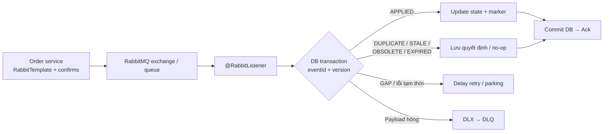

# Xử lý sự kiện trùng, đến muộn hoặc không còn phù hợp trong Spring AMQP

## 1. Vì sao message hợp lệ vẫn có thể gây sai dữ liệu?

Ứng dụng **Spring AMQP** thường dùng `RabbitTemplate` để publish sự kiện và `@RabbitListener` để xử lý message từ RabbitMQ. Exchange, queue và binding giúp định tuyến; acknowledgment, retry và dead-letter giúp khôi phục khi có lỗi. Tuy nhiên, **message được giao thành công không có nghĩa sự kiện đó còn nên được áp dụng vào trạng thái hiện tại**.

Xét dịch vụ xây dựng trạng thái đơn hàng từ các sự kiện:

1. `OrderConfirmed` phiên bản 1 xác nhận đơn `ORDER-1001`.
2. `OrderCancelled` phiên bản 2 hủy đơn.
3. Một bản sao của `OrderConfirmed` phiên bản 1 đến lại do consumer mất kết nối trước khi broker nhận ack.
4. Một sự kiện `OrderConfirmed` phiên bản 3 tới sau khi đơn đã hủy; dù mới về phiên bản, hành động **xác nhận lại** không còn hợp lệ theo quy tắc nghiệp vụ.

Nếu listener chỉ đọc payload rồi thực hiện `UPDATE orders SET state = ...`, trạng thái cuối có thể bị sửa ngược từ `CANCELLED` thành `CONFIRMED`.

Bài học này tập trung vào ba tình huống:

| Tình huống | Dấu hiệu | Cách xử lý mong muốn |
| --- | --- | --- |
| **Sự kiện trùng (duplicate)** | Cùng `eventId` được giao nhiều lần. | Không thực hiện lại tác dụng phụ; xác nhận (ack) message sau khi kiểm tra an toàn. |
| **Sự kiện đến muộn/sai thứ tự (late/out-of-order)** | `aggregateVersion` thấp hơn, bằng hoặc vượt xa phiên bản hiện tại. | Bỏ qua phiên bản cũ; với khoảng trống phiên bản, chờ/khôi phục sự kiện trước hoặc tái đồng bộ từ nguồn. |
| **Sự kiện không còn phù hợp (obsolete/expired)** | Đơn hàng đã ở trạng thái kết thúc, hoặc event đã vượt thời hạn nghiệp vụ. | Ghi nhận quyết định bỏ qua, không gây hiệu ứng trái quy tắc; tùy chính sách có thể cập nhật phiên bản đã quan sát. |

**Mục tiêu:** triển khai một consumer có khả năng quyết định **apply / duplicate / stale / obsolete / expired / retry / dead-letter** rõ ràng, kể cả khi có nhiều instance xử lý đồng thời. Đây là phần cốt lõi của **độ tin cậy đầu cuối** bên cạnh retry, DLQ, giao dịch và quan sát hệ thống.

## 2. Đừng nhầm ba dạng “trùng” và “muộn”

### 2.1. Duplicate: cùng một sự kiện được giao lại

RabbitMQ với manual acknowledgments hỗ trợ cơ chế xử lý theo hướng **at-least-once** trong các tình huống redelivery. Consumer có thể đã commit DB nhưng bị ngắt kết nối trước khi ack tới broker; khi đó broker có thể giao lại **cùng message**. Producer cũng có thể retry publish sau khi không nhận được publisher confirm, tạo thêm bản sao.

Không dùng `deliveryTag` làm khóa chống trùng: tag chỉ có ý nghĩa trong phạm vi channel. Cờ `redelivered` hữu ích để chẩn đoán nhưng **không đủ** để chứng minh message chưa từng được xử lý hoặc có cùng ý nghĩa nghiệp vụ. Cần một khóa ổn định từ producer, thường là `eventId`.

### 2.2. Late: sự kiện phát sinh trước nhưng được thấy sau

RabbitMQ có quy tắc thứ tự giao nhận trong phạm vi cụ thể, nhưng nhiều consumer, requeue, retry queue và nhiều luồng publish có thể khiến **thứ tự hoàn tất nghiệp vụ** không còn trùng với thứ tự sự kiện tại nguồn. Không nên giả định toàn hệ thống có một thứ tự tuyệt đối.

Ví dụ:

```text
Nguồn phát:      ORDER-1001 v1 (confirmed) -> v2 (cancelled)
Consumer thấy:  ORDER-1001 v2              -> v1
```

Nếu event là **delta** (“tăng 1”, “trừ 50”, “chuyển từ NEW sang CONFIRMED”), áp dụng v2 trước v1 có thể sai hoặc thiếu điều kiện. Nếu event là **snapshot trạng thái đầy đủ** từ nguồn đáng tin, ứng dụng có thể thiết kế chính sách “phiên bản cao hơn thắng” mà không cần đủ mọi phiên bản trung gian. Phải chọn chính sách theo **ngữ nghĩa event**, không chỉ theo timestamp.

### 2.3. Obsolete: sự kiện có thể mới nhưng hiệu lực đã hết

Một event `OrderConfirmed` version 3 được tạo sau `OrderCancelled` version 2 vẫn có thể không hợp lệ vì đơn đã ở trạng thái terminal. Đây là kiểm tra **business invariant** khác với so sánh phiên bản.

Một chương trình khuyến mãi có thể gửi event `ApplyDiscount` kèm `expiresAt`. Khi consumer nhận sau thời hạn, event đã quá hạn, dù chưa từng được xử lý. RabbitMQ **message TTL** và thời hạn hiệu lực **nghiệp vụ** không giống nhau: TTL quyết định message sống bao lâu trong queue; `expiresAt` quyết định consumer còn được phép áp dụng tác vụ không.

## 3. Thiết kế hợp đồng sự kiện

Ví dụ JSON dành cho một projection đơn hàng:

```json
{
  "eventId": "evt-101",
  "orderId": "ORDER-1001",
  "version": 1,
  "type": "ORDER_CONFIRMED",
  "occurredAt": "2026-11-26T01:00:00Z",
  "expiresAt": null
}
```

Ý nghĩa từng trường:

| Trường | Mục đích | Lưu ý |
| --- | --- | --- |
| `eventId` | Định danh bất biến của **một sự kiện logic**. | Producer retry phải giữ nguyên event ID; đừng tạo ID mới cho mỗi lần gửi lại. |
| `orderId` | Aggregate/business key, cho phép gom các event của cùng đơn. | Dùng để khóa/cập nhật projection; không dùng một counter toàn cục cho mọi đơn. |
| `version` | Số thứ tự tăng đơn điệu **theo từng aggregate**. | Phải được cấp ở nguồn có quy tắc nhất quán; nếu không có version đáng tin, cần phương án khác. |
| `type` | Hành động nghiệp vụ, ví dụ `ORDER_CONFIRMED`/`ORDER_CANCELLED`. | Consumer phải công bố chính sách cho type không hỗ trợ. |
| `occurredAt` | Thời điểm sự kiện phát sinh ở nguồn. | Dùng để quan sát/đối chiếu, không làm khóa thứ tự duy nhất nếu clock có thể lệch. |
| `expiresAt` | Hạn cuối cho phép áp dụng theo nghiệp vụ. | Optional; phải định nghĩa timezone, cách xử lý biên và sai lệch clock. |

Đối với payload thật, nên bổ sung `schemaVersion`, `producer`, `correlationId`/`causationId` và tenant ID nếu hệ thống đa tenant. Những trường này hỗ trợ migration, truy vết và tránh nhầm event ID của các nguồn độc lập.

**Điều kiện tiên quyết:** ví dụ bên dưới giả định producer phát `version = 1, 2, 3, ...` liên tục theo từng đơn; sự kiện không bị “đánh số lại”; và một sự kiện mới hơn có thể được xác định bằng version đáng tin. Nếu nguồn không bảo đảm điều này, không được tự dùng phép so sánh phiên bản dưới đây như một sự thật nghiệp vụ.

## 4. Bảng quyết định trước khi đụng vào dữ liệu

Giả sử DB lưu `last_version` là phiên bản mới nhất consumer đã quyết định cho từng đơn.

| Kiểm tra | Quyết định | Ack/retry? |
| --- | --- | --- |
| `eventId` đã có trong bảng dấu vết xử lý của **consumer này**. | `DUPLICATE`; bỏ qua side effect. | Ack. |
| `event.version <= last_version`, `eventId` chưa có. | `STALE`; sự kiện cũ hoặc bản phát lại có ID khác. | Ghi nhận và ack. |
| `event.version > last_version + 1` với luồng **delta yêu cầu liên tục**. | `GAP`; thiếu một hay nhiều event trước. | Không ack như thành công; park hoặc retry có delay và giới hạn. |
| `event.version == last_version + 1` nhưng quá `expiresAt`. | `EXPIRED`; không áp dụng nghiệp vụ. | Ghi nhận, tùy domain cập nhật last_version, ack. |
| `event.version == last_version + 1` nhưng vi phạm invariant trạng thái. | `OBSOLETE`; không áp dụng tác vụ. | Ghi nhận, tùy domain cập nhật last_version, ack. |
| `event.version == last_version + 1`, còn hiệu lực, chuyển trạng thái hợp lệ. | `APPLIED`. | Commit DB rồi ack. |
| Payload vô nghĩa/không thể giải mã hoặc type không hỗ trợ. | `INVALID`. | Reject không requeue → DLQ để điều tra. |
| DB/network lỗi tạm thời. | `RETRYABLE_ERROR`. | Rollback, retry có backoff/giới hạn; DLQ khi hết cơ hội. |

**Thứ tự kiểm tra quan trọng:** kiểm tra `eventId` và version, rồi mới chạy hành động nghiệp vụ. Không đánh đồng “sự kiện cũ” với “sự kiện sai”: event đã cũ thường nên được **ack** vì retry không thể làm nó mới trở lại.

Với ví dụ này, ngay cả khi bỏ qua event version mới vì đã quá hạn hoặc không còn hợp lệ, ta vẫn cập nhật `last_version`: đó là **last decided version**, không chỉ là “last applied version”. Nhờ vậy version tiếp theo không bị kẹt ở một khoảng trống đã được consumer xử lý hợp lệ. Chính sách này chỉ đúng khi nguồn version liên tục, đáng tin và quy tắc projection cho phép bỏ qua hiệu ứng của event; nếu mỗi delta đều bắt buộc để tính toán, phải giải quyết thiếu dữ liệu trước.

## 5. Kiến trúc triển khai với Spring AMQP



Nguyên tắc:

1. **Ràng buộc unique trong DB** bảo vệ chống trùng dưới tải đồng thời; kiểm tra bằng bộ nhớ hoặc cache đơn độc không đủ.
2. **Row lock hoặc optimistic locking** giúp nhiều instance không áp dụng version cho cùng `orderId` cùng lúc.
3. **Transaction DB** chứa cả marker `processed_events` và cập nhật projection, tránh “đã đánh dấu xử lý nhưng chưa cập nhật dữ liệu”.
4. Dùng `AcknowledgeMode.AUTO` của Spring AMQP để container ack sau khi listener trả về bình thường; exception sẽ kích hoạt reject/nack theo cấu hình. `AUTO` ở đây **không phải** RabbitMQ auto-ack (`AcknowledgeMode.NONE`).
5. Vẫn tồn tại khoảng hở giữa **DB commit** và **broker nhận ack**: redelivery có thể xảy ra, nên mọi đường xử lý phải idempotent.

### 5.1. Topology mẫu

```java
import org.springframework.amqp.core.BindingBuilder;
import org.springframework.amqp.core.Declarables;
import org.springframework.amqp.core.DirectExchange;
import org.springframework.amqp.core.Queue;
import org.springframework.amqp.core.QueueBuilder;
import org.springframework.context.annotation.Bean;
import org.springframework.context.annotation.Configuration;

@Configuration
public class ProjectionTopology {
    @Bean
    Declarables projectionDeclarations() {
        Queue work = QueueBuilder.durable("orders.projection.q")
                .deadLetterExchange("orders.dlx")
                .deadLetterRoutingKey("orders.projection.failed")
                .build();
        DirectExchange dlx = new DirectExchange("orders.dlx", true, false);
        Queue dead = QueueBuilder.durable("orders.projection.dlq").build();

        return new Declarables(
                work, dlx, dead,
                BindingBuilder.bind(dead).to(dlx)
                        .with("orders.projection.failed")
        );
    }
}
```

Để dễ thực hành, producer có thể gửi vào **default exchange** `""` với routing key `orders.projection.q`. Trong production, nên có exchange nghiệp vụ và binding phù hợp. Queue đã tồn tại với x-arguments khác có thể từ chối redeclare; khi cần điều chỉnh DLX động, cân nhắc policy RabbitMQ.

Ví dụ dưới đây dùng cấu hình:

```yaml
spring:
  rabbitmq:
    listener:
      simple:
        acknowledge-mode: auto
        default-requeue-rejected: false
        prefetch: 10
        concurrency: 2
```

`default-requeue-rejected: false` giúp **demo** đưa lỗi chưa xử lý được vào DLQ, không tạo vòng requeue nóng. Điều này cũng áp dụng cho lỗi tạm thời và **GAP**, nên muốn tự retry có delay trong production cần thêm retry policy/queue riêng. Chính sách này không tự biến việc DLQ thành bảo đảm giao nhận tuyệt đối; exchange và binding đích phải tồn tại và được giám sát.

## 6. Lưu trữ phiên bản và dấu vết xử lý trong PostgreSQL

```sql
CREATE TABLE order_projection (
    order_id      VARCHAR(64) PRIMARY KEY,
    state         VARCHAR(32) NOT NULL,
    last_version  BIGINT NOT NULL DEFAULT 0 CHECK (last_version >= 0),
    updated_at    TIMESTAMPTZ NOT NULL DEFAULT now()
);

CREATE TABLE consumed_events (
    consumer_name VARCHAR(64) NOT NULL,
    event_id      VARCHAR(128) NOT NULL,
    order_id      VARCHAR(64) NOT NULL,
    outcome       VARCHAR(32) NOT NULL,
    decided_at    TIMESTAMPTZ NOT NULL DEFAULT now(),
    PRIMARY KEY (consumer_name, event_id)
);

-- Đã tạo projection ban đầu bằng quy trình bootstrap đáng tin.
INSERT INTO order_projection (order_id, state, last_version)
VALUES ('ORDER-1001', 'NEW', 0),
       ('ORDER-2001', 'NEW', 0);
```

Khóa chính `(consumer_name, event_id)` có chủ đích: **hai nhóm consumer khác nhau** có thể cần xử lý cùng sự kiện độc lập. Nếu có nhiều tenant hoặc namespace producer, hãy đặt chúng vào khóa/định danh phù hợp. Không xóa marker ngay khi nghiệp vụ vừa kết thúc nếu sự kiện vẫn có thể bị replay; thời hạn giữ marker phải dựa trên cửa sổ replay thực tế.

Ví dụ giả định projection của đơn hàng đã được bootstrap. Event đầu tiên tạo một aggregate mới cần có quy trình `INSERT ... ON CONFLICT` hoặc consumer khởi tạo projection từ event `ORDER_CREATED`; **không tự ý coi thiếu projection là một sự kiện đã xử lý thành công**.

## 7. Code ứng dụng: kiểm tra trùng và thứ tự trong một DB transaction

Các ví dụ Java sau tương ứng Spring Boot có `spring-boot-starter-amqp`, `spring-boot-starter-jdbc`, Jackson và PostgreSQL JDBC. Schema ở mục 6 là điều kiện chạy thử. Cần cấu hình `spring.datasource.*`, `spring.rabbitmq.*` theo môi trường.

### 7.1. Contract và kết quả xử lý

```java
package example.orders;

import java.time.Instant;

public record OrderEvent(
        String eventId,
        String orderId,
        long version,
        String type,
        Instant occurredAt,
        Instant expiresAt
) {}
```

```java
package example.orders;

public enum Outcome {
    APPLIED, DUPLICATE, STALE, EXPIRED, OBSOLETE
}
```

Một event được coi là `EXPIRED` khi `expiresAt` không null và đã đến/vượt thời hạn tại thời điểm xử lý. `occurredAt` chỉ dùng trong quan sát và điều tra, không tự quyết định version.

### 7.2. Service có idempotency và row locking

```java
package example.orders;

import java.time.Clock;
import java.time.Instant;
import java.util.List;
import org.springframework.jdbc.core.JdbcTemplate;
import org.springframework.stereotype.Service;
import org.springframework.transaction.annotation.Transactional;

@Service
public class OrderProjectionService {
    private static final String CONSUMER = "orders-projection";

    private final JdbcTemplate jdbc;
    private final Clock clock;

    public OrderProjectionService(JdbcTemplate jdbc, Clock clock) {
        this.jdbc = jdbc;
        this.clock = clock;
    }

    private record CurrentOrder(String state, long version) {}

    @Transactional
    public Outcome apply(OrderEvent event) {
        // 1. Claim eventId có unique constraint trong cùng transaction.
        int claimed = jdbc.update("""
            INSERT INTO consumed_events(consumer_name, event_id, order_id, outcome)
            VALUES (?, ?, ?, 'IN_PROGRESS')
            ON CONFLICT (consumer_name, event_id) DO NOTHING
            """, CONSUMER, event.eventId(), event.orderId());

        if (claimed == 0) {
            return Outcome.DUPLICATE;
        }

        // 2. Khóa aggregate để serialize các sự kiện khác ID cùng order.
        List<CurrentOrder> rows = jdbc.query("""
            SELECT state, last_version
              FROM order_projection
             WHERE order_id = ?
             FOR UPDATE
            """, (rs, row) -> new CurrentOrder(
                    rs.getString("state"), rs.getLong("last_version")),
                event.orderId());

        if (rows.isEmpty()) {
            // Rollback marker: cần sự kiện tạo order hoặc đồng bộ lại nguồn.
            throw new IllegalStateException(
                    "Chưa tồn tại projection: " + event.orderId());
        }

        CurrentOrder current = rows.get(0);
        Outcome result;
        String nextState = current.state();

        // 3. Stale: version đã có quyết định, kể cả event ID khác.
        if (event.version() <= current.version()) {
            result = Outcome.STALE;
        } else {
            // Đây là stream delta yêu cầu liên tục từng version.
            if (event.version() != current.version() + 1) {
                // Exception rollback marker: không ghi nhận là đã xử lý.
                throw new IllegalStateException(
                        "Thiếu version trước " + event.version()
                        + " cho " + event.orderId()
                        + ", hiện tại " + current.version());
            }

            // 4. Hết hạn hoặc không còn phù hợp với state hiện tại.
            if (event.expiresAt() != null
                    && !event.expiresAt().isAfter(Instant.now(clock))) {
                result = Outcome.EXPIRED;
            } else if ("ORDER_CONFIRMED".equals(event.type())) {
                if ("NEW".equals(current.state())) {
                    nextState = "CONFIRMED";
                    result = Outcome.APPLIED;
                } else {
                    result = Outcome.OBSOLETE;
                }
            } else if ("ORDER_CANCELLED".equals(event.type())) {
                if ("NEW".equals(current.state())
                        || "CONFIRMED".equals(current.state())) {
                    nextState = "CANCELLED";
                    result = Outcome.APPLIED;
                } else {
                    result = Outcome.OBSOLETE;
                }
            } else {
                // Không ack một type chưa biết như thể xử lý thành công.
                throw new IllegalArgumentException(
                        "Event type không hỗ trợ: " + event.type());
            }

            // 5. Version phản ánh event đã được quyết định, dù no-op.
            jdbc.update("""
                UPDATE order_projection
                   SET state = ?, last_version = ?, updated_at = now()
                 WHERE order_id = ?
                """, nextState, event.version(), event.orderId());
        }

        // 6. Chỉ commit marker khi transaction và các bước trên thành công.
        jdbc.update("""
            UPDATE consumed_events
               SET outcome = ?, decided_at = now()
             WHERE consumer_name = ? AND event_id = ?
            """, result.name(), CONSUMER, event.eventId());

        return result;
    }
}
```

Spring Boot có thể đăng ký clock để dễ kiểm thử thời hạn:

```java
import java.time.Clock;
import org.springframework.context.annotation.Bean;
import org.springframework.context.annotation.Configuration;

@Configuration
class TimeConfig {
    @Bean
    Clock applicationClock() {
        return Clock.systemUTC();
    }
}
```

**Tại sao dùng cả unique key lẫn `SELECT ... FOR UPDATE`?** Unique key ngăn hai thread áp dụng **cùng eventId**. Row lock đảm bảo hai event **khác eventId nhưng cùng orderId** không đồng thời đọc cùng `last_version` rồi ghi đè nhau. Khi instance A giữ transaction và instance B chạm cùng key, DB sẽ phối hợp lock/unique conflict, cho phép B nhìn thấy kết quả đã commit hoặc phải thử lại khi có deadlock/timeout.

`IN_PROGRESS` chỉ được insert **bên trong** transaction, sau đó cập nhật thành outcome trước commit. Nếu bất kỳ bước nào ném RuntimeException, cả marker lẫn projection rollback. Không triển khai marker kiểu “ghi `processed=true` trước rồi xử lý DB ở một transaction khác” vì khi tiến trình chết giữa chừng, redelivery sẽ bị bỏ qua sai.

**Giới hạn của ví dụ:** khi message cùng `eventId` nhưng payload khác, unique key sẽ coi là duplicate. Hợp đồng producer phải đảm bảo `eventId` bất biến; hệ thống quan trọng nên lưu thêm hash/producer và phát cảnh báo khi phát hiện cùng ID nhưng dữ liệu không nhất quán.

### 7.3. Listener: ack các trường hợp no-op, reject lỗi thật

```java
package example.orders;

import com.fasterxml.jackson.core.JsonProcessingException;
import com.fasterxml.jackson.databind.ObjectMapper;
import org.springframework.amqp.AmqpRejectAndDontRequeueException;
import org.springframework.amqp.rabbit.annotation.RabbitListener;
import org.springframework.stereotype.Component;

@Component
public class OrderProjectionListener {
    private final ObjectMapper mapper;
    private final OrderProjectionService service;

    public OrderProjectionListener(
            ObjectMapper mapper, OrderProjectionService service) {
        this.mapper = mapper;
        this.service = service;
    }

    @RabbitListener(queues = "orders.projection.q")
    public void consume(String json) {
        OrderEvent event;
        try {
            event = mapper.readValue(json, OrderEvent.class);
        } catch (JsonProcessingException ex) {
            throw new AmqpRejectAndDontRequeueException(
                    "JSON message không hợp lệ", ex);
        }

        if (event.eventId() == null || event.eventId().isBlank()
                || event.orderId() == null || event.orderId().isBlank()
                || event.version() <= 0 || event.type() == null
                || !("ORDER_CONFIRMED".equals(event.type())
                        || "ORDER_CANCELLED".equals(event.type()))) {
            throw new AmqpRejectAndDontRequeueException(
                    "Thiếu field hoặc event type không hỗ trợ");
        }

        // Kết quả APPLIED, DUPLICATE, STALE, EXPIRED, OBSOLETE
        // đều là quyết định nghiệp vụ đã hoàn tất -> trả về bình thường.
        Outcome outcome = service.apply(event);
        System.out.printf("event=%s order=%s outcome=%s%n",
                event.eventId(), event.orderId(), outcome);
    }
}
```

Với listener container `AcknowledgeMode.AUTO`, nếu `service.apply(...)` **trả về bình thường sau DB commit**, Spring AMQP ack message. Nếu method ném exception, container reject/nack theo chính sách `defaultRequeueRejected` và error handler; ví dụ cấu hình `false` đưa message thất bại đến DLQ nếu đã có route.

Trong ví dụ, **GAP**, thiếu projection hoặc lỗi database đều ném exception và đi vào DLQ để chờ kiểm tra/phát lại có kiểm soát. Đây là quy tắc demo nhằm tránh vòng requeue nóng; production nên phân biệt **khoảng trống có thể khôi phục** với **message poison**, dùng delayed retry/parking queue riêng và giới hạn số lần thử. Không được nhầm DLQ với “đã xử lý thành công”.

## 8. Kiểm thử các tình huống theo thứ tự

Sử dụng `RabbitTemplate` hoặc Management UI để publish JSON tới default exchange với routing key `orders.projection.q`:

```java
// Trong service/test runner có inject RabbitTemplate:
rabbitTemplate.convertAndSend("", "orders.projection.q", json);
```

### 8.1. Apply rồi nhận bản sao

Gửi event v1:

```json
{"eventId":"evt-101","orderId":"ORDER-1001","version":1,
 "type":"ORDER_CONFIRMED","occurredAt":"2026-11-26T01:00:00Z","expiresAt":null}
```

DB: `ORDER-1001 → CONFIRMED, last_version=1`; marker `evt-101 → APPLIED`. Gửi lại **nguyên JSON đó**: unique key làm service trả `DUPLICATE`, không cập nhật đơn lần nữa và listener ack.

### 8.2. Đơn bị hủy rồi nhận event cũ

Gửi `evt-102` version 2, type `ORDER_CANCELLED`: `ORDER-1001 → CANCELLED, last_version=2`.

Tiếp tục gửi event khác ID nhưng version 1:

```json
{"eventId":"evt-101-republished","orderId":"ORDER-1001","version":1,
 "type":"ORDER_CONFIRMED","occurredAt":"2026-11-26T01:00:00Z","expiresAt":null}
```

Kết quả `STALE`; trạng thái vẫn `CANCELLED`. Đây là lớp bảo vệ thứ hai khi producer vô tình phát một sự kiện logic với **ID mới** nhưng version cũ.

### 8.3. Sự kiện mới nhưng không còn phù hợp

Gửi version 3 với type `ORDER_CONFIRMED`, eventId `evt-103`. Vì đơn đã `CANCELLED`, kết quả `OBSOLETE`, trạng thái giữ `CANCELLED`, nhưng `last_version=3` để tránh kẹt các event phiên bản tiếp theo.

### 8.4. Sự kiện quá hạn

Gửi version 4, eventId `evt-104`, type `ORDER_CONFIRMED`, `expiresAt` là thời điểm trong quá khứ. Kết quả `EXPIRED` và `last_version=4`; không mở lại đơn. Dùng clock cố định trong automated test thay vì phụ thuộc thời gian chạy thực tế.

### 8.5. Sự kiện đến trước phiên bản cần thiết

Với `ORDER-2001` đang có `last_version=0`, gửi **v2 trước v1**:

```json
{"eventId":"evt-202","orderId":"ORDER-2001","version":2,
 "type":"ORDER_CANCELLED","occurredAt":"2026-11-26T02:02:00Z","expiresAt":null}
```

Service ném exception báo thiếu version 1; transaction rollback nên **không lưu marker evt-202**. Với cấu hình demo, message đi vào `orders.projection.dlq`. Sau đó gửi `evt-201` version 1 type `ORDER_CONFIRMED`, chờ apply thành công; lúc này mới **replay có kiểm soát** `evt-202` từ DLQ. Kết quả cuối: `CANCELLED, last_version=2`.

Nếu consumer tự ack `evt-202` trước khi v1 đến, business delta có thể bị mất. Nếu consumer lập tức requeue v2 vô hạn, queue và worker có thể rơi vào vòng lặp nóng. Chính sách delay/parking cần rõ ràng.

## 9. Thiết kế retry, DLQ và xử lý sự kiện lâu ngày

| Loại lỗi | Thao tác phù hợp | Không nên |
| --- | --- | --- |
| Duplicate/stale | Commit no-op + ack; ghi metric. | Nack/requeue vì không có gì mới để retry. |
| Obsolete/expired theo quy tắc rõ ràng | Ghi outcome, commit + ack; lưu audit nếu cần. | Cố áp dụng lại cho đến khi side effect xảy ra. |
| Thiếu version trước | Đưa vào **parking queue** hoặc delayed retry có giới hạn; đồng bộ lại nguồn nếu thiếu lâu. | Requeue tức thì mãi mãi. |
| DB lỗi tạm thời | Rollback, exponential backoff, retry giới hạn; DLQ khi vượt ngân sách. | Ack trước khi DB commit hoặc gửi lỗi mất dấu. |
| Payload không thể hiểu / schema sai | Reject không requeue, DLQ và cảnh báo. | Retry vô hạn cùng một payload không thay đổi. |
| Business invariant vi phạm bất ngờ | Phân biệt **expected obsolete** với lỗi dữ liệu cần điều tra. | Gộp mọi ngoại lệ vào “bỏ qua thành công”. |

DLQ và retry queue phục vụ **hai mục đích khác nhau**. Retry queue chứa message đang có kế hoạch thử lại; DLQ giữ message cần xử lý ngoại lệ hoặc điều tra. Một cách phổ biến là retry queue có TTL và DLX trả về work queue, nhưng phải lưu **retry count** theo hợp đồng rõ ràng, tránh vòng lặp vĩnh viễn; với nhiều cấp delay, thiết kế nhiều queue/policy tương ứng. Lưu ý RabbitMQ có hành vi/quy định riêng đối với quorum queue và giới hạn số lần delivery, có thể thay đổi theo phiên bản broker; không dựa duy nhất vào header `redelivered` hay số lần nack để làm retry counter.

Đối với event “đến quá muộn”, quy tắc còn phụ thuộc **retention window**:

- Nếu nguồn lưu event và hỗ trợ replay: giữ `processed_events` đủ lâu so với khoảng thời gian replay tối đa, hoặc dùng version/watermark để bảo vệ.
- Nếu sự kiện liên quan đến tổng tiền hay hành động có tính pháp lý: đừng tự ý xóa dấu vết hoặc bỏ qua vì `occurredAt` “quá cũ”; quyết định phải bám quy tắc nghiệp vụ.
- Nếu event ID bị phát lại với payload khác: cảnh báo producer vi phạm hợp đồng, không coi như duplicate bình thường.
- Nếu số version “nhảy cóc” do nguồn hợp lệ gửi snapshot: thay đổi thuật toán để kiểm tra snapshot/version và áp dụng **chính sách được xác nhận**; không dùng quy tắc `version == last+1` của delta stream.

## 10. Đảm bảo đầu cuối: ack, transaction, publisher confirms và outbox

Hai tình huống hỏng phổ biến:

```text
Consumer:
  Nhận event -> cập nhật DB COMMIT -> đứt kết nối trước ACK
  => Broker có thể redeliver: eventId + version giúp xử lý idempotent.

Producer:
  Gửi message -> broker nhận nhưng producer mất confirm -> retry publish
  => Broker có thể chứa nhiều bản sao logic: consumer vẫn phải idempotent.
```

`@Transactional` bao quanh service bảo đảm **marker và projection** commit/rollback trong một transaction DB; nó **không cung cấp distributed transaction** giữa PostgreSQL và RabbitMQ. Dùng `channelTransacted`/transaction synchronization có thể cải thiện phối hợp nhưng vẫn không đạt exactly-once xuyên hai hệ thống khi xảy ra lỗi giữa các bước commit.

Nếu consumer sau khi xử lý còn phải publish sự kiện mới, hãy cân nhắc **Transactional Outbox**: trong một transaction DB, cập nhật projection, marker và chèn `outbox_events`; một publisher riêng phát các outbox event với publisher confirms và retry. Publisher vẫn có thể gửi trùng khi mất confirm, vì thế **downstream consumer cũng cần idempotency**.

Các yêu cầu độ tin cậy khác:

- **Ordering:** nếu business logic thực sự đòi thứ tự, nên phân vùng theo `aggregateId` hoặc dùng cơ chế ordering/sequencing ở consumer. Chỉ tăng `prefetch`, tạo thêm consumer hoặc chuyển sang quorum queue không tự bảo đảm xử lý nghiệp vụ theo đúng thứ tự mọi lúc.
- **Concurrency:** row lock hoặc optimistic update `WHERE last_version = ?` bảo vệ khỏi hai event khác nhau cùng sửa trạng thái; xử lý deadlock/lock timeout với retry có giới hạn.
- **Observability:** log `eventId`, `orderId`, `version`, `outcome`, `correlationId`; metric đếm duplicate/stale/obsolete/expired/gap, độ trễ từ `occurredAt` đến lúc xử lý, DLQ depth, unacked, thời gian DB transaction. Không dùng eventId/orderId làm **metric label** có cardinality cao.
- **Replay:** phát lại từ DLQ cần quyền vận hành, giới hạn tốc độ, giám sát và quy tắc tránh tái thực hiện tác vụ không hồi phục.

## 11. Lỗi thiết kế thường gặp và cách sửa

### Sai: kiểm tra trùng bằng cách SELECT rồi INSERT riêng rẽ

```java
// Không an toàn khi có hai consumer cùng xử lý một event.
if (!repository.existsByEventId(eventId)) {
    chargePayment();
    repository.save(new ProcessedEvent(eventId));
}
```

Hai consumer có thể đều nhìn thấy `false` trước khi bên nào insert. Cần **unique constraint** trên event ID và bao bọc thao tác nghiệp vụ trong transaction phù hợp. Với hiệu ứng ngoài DB như gửi email hoặc gọi cổng thanh toán, cần idempotency key ở **hệ thống đích** hoặc một workflow durable/outbox; unique marker nội bộ không thể rollback một giao dịch thanh toán bên ngoài đã xảy ra.

### Sai: quyết định “mới nhất” chỉ bằng thời gian

```java
// Không nên coi timestamp cao hơn luôn là version nghiệp vụ mới hơn.
if (event.occurredAt().isAfter(current.updatedAt())) {
    apply(event);
}
```

Clock của các producer có thể lệch, sự kiện có thể được nhập lại từ quá khứ, còn `updatedAt` của projection có thể thay đổi chỉ vì replay/maintenance. Ưu tiên **monotonic version/sequence** do nguồn nghiệp vụ cấp. Khi chỉ có timestamp, cần xác định rõ conflict resolution theo domain.

### Sai: mọi event cũ đều vào DLQ

`STALE` và `DUPLICATE` thường là kết quả **đúng như dự kiến** trong hệ thống at-least-once. Nếu đưa hết vào DLQ, hệ thống sẽ tạo nhiễu và tăng khối lượng xử lý thủ công. Chỉ đưa vào DLQ những trường hợp chưa xử lý được an toàn hoặc cần điều tra.

### Sai: tự `basicAck` trước khi commit DB

Nếu listener ack trước rồi DB rollback, message có thể biến mất dù cập nhật không thành công. Với `@RabbitListener` đồng bộ và `AcknowledgeMode.AUTO`, hãy để listener trả về sau khi transaction service đã hoàn tất. Nếu chuyển sang `MANUAL` hoặc listener trả `Mono`, phải thiết kế lại rõ ràng thời điểm ack/nack; các chế độ đó có ngữ nghĩa khác.

## 12. Bài thực hành và câu hỏi tự đánh giá

**Bài thực hành:** chạy cùng topology và schema ở trên, gửi các event theo mục 8 rồi xác minh bằng:

```sql
SELECT order_id, state, last_version
FROM order_projection ORDER BY order_id;

SELECT consumer_name, event_id, order_id, outcome
FROM consumed_events ORDER BY decided_at, event_id;
```

```bash
rabbitmqctl list_queues -p / name messages_ready messages_unacknowledged
```

Kết quả dự kiến đối với `ORDER-1001` sau v1, v2, bản cũ, v3 obsolete và v4 expired: `state=CANCELLED`, `last_version=4`, không có side effect lặp. `ORDER-2001` khi nhận v2 trước v1 phải để v2 chờ xử lý lại; sau khi apply v1 và replay v2, `state=CANCELLED` và `last_version=2`.

Câu hỏi:

1. Vì sao `deliveryTag` và cờ `redelivered` không thay thế được `eventId`?
2. Khi `eventId` mới nhưng `version` nhỏ hơn phiên bản đã quyết định, nên ack hay retry? Vì sao?
3. Khi event version 8 đến trong lúc projection đang ở version 5, cách xử lý khác nhau thế nào giữa **delta event** và **snapshot event**?
4. Vì sao một event không còn phù hợp vẫn có thể cần cập nhật `last_version`?
5. DB đã commit, broker chưa nhận ack rồi consumer bị dừng. Cơ chế nào ngăn side effect lặp khi chạy lại?
6. Khi consumer phát thêm message mới sau khi ghi DB, vì sao outbox và publisher confirm chưa loại bỏ nhu cầu idempotency?

**Gợi ý đáp án:** (1) Delivery tag là định danh theo channel còn cờ redelivered không chứng minh hiệu ứng nghiệp vụ; (2) thường commit no-op + ack vì event đã cũ; (3) delta cần xử lý/khôi phục khoảng trống, snapshot đầy đủ có thể cho phép bỏ qua khoảng trống theo chính sách; (4) để các phiên bản sau không bị coi là thiếu event đã có quyết định; (5) unique eventId cùng transaction DB và version/state guard; (6) publisher có thể retry sau khi broker đã nhận event nhưng confirm bị mất, nên downstream vẫn gặp bản sao.

## 13. Tóm tắt

Consumer Spring AMQP đáng tin cậy **không chỉ xử lý message nhận được**, mà phải **quyết định có nên áp dụng sự kiện vào trạng thái hiện tại hay không**. Sử dụng khóa `eventId` và unique constraint để chống duplicate; `aggregateVersion` cùng row lock để xử lý late/out-of-order; invariant trạng thái và `expiresAt` để bỏ qua event obsolete/expired. Các kết quả bỏ qua hợp lệ vẫn cần được commit/ack; lỗi tạm thời hoặc khoảng trống phiên bản cần retry/parking có kiểm soát, còn lỗi dữ liệu đi DLQ để điều tra.

Kết hợp nguyên tắc này với `RabbitTemplate`, `@RabbitListener`, publisher confirms, transaction DB, retry, DLQ, outbox và quan sát sẽ giúp hệ thống xử lý bất đồng bộ duy trì **at-least-once nhưng idempotent**, thay vì dựa vào một giả định “message luôn đến đúng một lần và đúng thứ tự”.

## Tài liệu tham khảo

- [RabbitMQ — Consumer Acknowledgements and Publisher Confirms](https://www.rabbitmq.com/docs/confirms): ack, redelivery, requeue và publisher confirms.
- [RabbitMQ — Queues](https://www.rabbitmq.com/docs/queues): giới hạn bảo đảm ordering trong các cấu hình consumer/requeue khác nhau.
- [RabbitMQ — Dead Letter Exchanges](https://www.rabbitmq.com/docs/dlx): điều kiện dead-letter, DLX và routing.
- [RabbitMQ — Quorum Queues](https://www.rabbitmq.com/docs/quorum-queues): delivery limit, redelivery và at-least-once dead-lettering.
- [Spring AMQP — Resilience: Recovering from Errors and Broker Failures](https://docs.spring.io/spring-amqp/reference/amqp/resilience-recovering-from-errors-and-broker-failures.html): `defaultRequeueRejected`, `AmqpRejectAndDontRequeueException`, retry và error handling.
- [Spring AMQP — Message Listener Container Configuration](https://docs.spring.io/spring-amqp/reference/amqp/containerAttributes.html): acknowledge mode, prefetch, concurrency và requeue policy.
- [Spring Framework — Declarative Transaction Management](https://docs.spring.io/spring-framework/reference/data-access/transaction/declarative.html): ranh giới transaction và rollback trong Spring.
