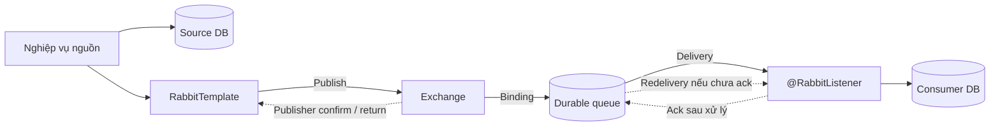
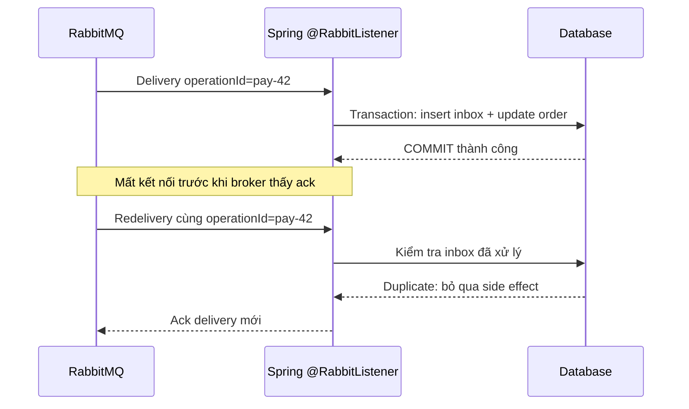
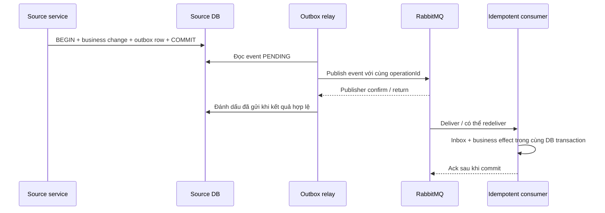

# Exactly-once ở cấp tác động nghiệp vụ và giới hạn bảo đảm của broker

> **Chương:** Độ tin cậy đầu cuối  
> **Công nghệ:** Spring AMQP, RabbitMQ  
> **Trọng tâm:** Thiết kế để **một thao tác nghiệp vụ chỉ có hiệu lực một lần** dù message có thể được gửi hoặc giao lại nhiều lần; hiểu chính xác publisher confirms, consumer acknowledgements và giao dịch broker bảo đảm đến đâu.

## 1. Bài toán: một message có thể được xử lý nhiều lần nhưng tiền không được trừ hai lần

Giả sử hệ thống đặt hàng phát sự kiện `PaymentCaptured` để dịch vụ đơn hàng đánh dấu đơn đã thanh toán. Ứng dụng Spring Boot dùng `RabbitTemplate` gửi sự kiện vào exchange, RabbitMQ định tuyến qua binding đến queue, và `@RabbitListener` cập nhật database. Mọi thứ có vẻ ổn cho đến khi xảy ra một sự cố rất thực tế:

1. Consumer nhận message `PaymentCaptured(operationId=pay-42)`.
2. Consumer cập nhật đơn hàng, **commit database thành công**.
3. Consumer mất kết nối trước khi RabbitMQ nhận được acknowledgement.
4. Broker vẫn coi delivery đó chưa được xác nhận và **giao lại message**.
5. Nếu consumer thực hiện lại nghiệp vụ không có bảo vệ, cùng một thao tác có thể phát sinh tác động lần thứ hai.

Kể cả với queue bền vững, message persistent, publisher confirms và manual acknowledgements, khoảng hở giữa **commit side effect** và **ack broker** vẫn tồn tại. Vì thế, cần tách hai câu hỏi:

- **Delivery guarantee:** Hệ thống vận chuyển message bao nhiêu lần, và có thể làm mất hoặc giao trùng không?
- **Effect guarantee:** Với một định danh thao tác nghiệp vụ, thay đổi dữ liệu/tiền/trạng thái thực tế có thể có hiệu lực bao nhiêu lần?

Mục tiêu của bài học là **exactly-once effect trong phạm vi nghiệp vụ được kiểm soát**, thường đạt được bằng idempotency, unique constraint và transaction dữ liệu. Điều này **không đồng nghĩa** RabbitMQ bảo đảm mỗi message chỉ được publish, lưu, giao hoặc xử lý đúng một lần trên toàn hệ thống.

Sau bài này, bạn có thể xác định các cửa sổ lỗi ở từng bước gửi–lưu–nhận–xử lý–ack; phân biệt khả năng của broker và ứng dụng; triển khai `@RabbitListener` có inbox/deduplication atomically trong database; phối hợp transactional outbox với `RabbitTemplate`; và chọn cách xử lý retry, dead-letter, sự cố mạng và tác động bên ngoài database.

## 2. Exactly-once là lời hứa ở **phạm vi nào**?

Các thuật ngữ thường gặp trong hệ thống message:

| Khái niệm | Ý nghĩa thực tế | Giới hạn quan trọng |
| --- | --- | --- |
| **At-most-once delivery** | Một lần giao không được chủ động gửi lại, chấp nhận khả năng mất message. | Có thể không có tác động nghiệp vụ nào nếu consumer chết trước khi xử lý. |
| **At-least-once delivery** | Khi chưa nhận được xác nhận thành công, hệ thống có thể giao lại để cố không bỏ sót thông điệp. | Một message có thể đến consumer nhiều lần; cần chịu được duplicate. |
| **Exactly-once delivery** | Mỗi message chỉ đến đúng một lần trong phạm vi được định nghĩa. | Không nên suy từ tính năng RabbitMQ thành cam kết tuyệt đối qua mọi network/consumer/database. |
| **Exactly-once business effect** | Một `operationId` cụ thể tạo ra tối đa một thay đổi nghiệp vụ thành công, đồng thời có cơ chế phục hồi để thao tác có thể được hoàn tất. | Chỉ đúng cho tài nguyên, transaction, khóa idempotency và điều kiện vận hành đã thiết kế; không tự lan sang API hoặc hệ thống ngoài. |

Điểm phân biệt then chốt: **“xử lý lại”** có thể xảy ra về mặt kỹ thuật, nhưng **“thực hiện tác động hai lần”** phải được ứng dụng ngăn chặn. Ví dụ listener có thể chạy hai lần và cùng trả thành công; database chỉ có một lần chuyển trạng thái `PENDING → PAID` cho cùng thao tác.

`operationId` biểu thị **một lần thực hiện ý định nghiệp vụ** (ví dụ lệnh giữ chỗ hay ghi nhận thanh toán) và phải giữ nguyên qua mọi retry. `messageId`/`correlationId` là metadata hữu ích cho giao tiếp và tracing; nếu một ý định nghiệp vụ có thể phát ra nhiều message với ID khác nhau, chỉ dedupe theo `messageId` **không đủ**. Nên xác định idempotency key ở cấp nghiệp vụ trước khi triển khai.

## 3. RabbitMQ thực sự bảo đảm những gì?



### 3.1. Bốn lớp xác nhận khác nhau

| Tín hiệu/cấu hình | Nó giúp biết điều gì? | Điều **không** chứng minh |
| --- | --- | --- |
| **Durable exchange/queue** | Định nghĩa topology có thể tồn tại sau broker restart trong phạm vi bảo đảm của loại queue. | Mỗi message đều đã được lưu bền vững hoặc không thể mất trong mọi sự cố. |
| **Persistent message** (`deliveryMode=PERSISTENT`) | Yêu cầu broker áp dụng cơ chế lưu trữ bền vững thích hợp khi message được route vào queue hỗ trợ. | Producer đã nhận xác nhận message an toàn, hoặc consumer đã xử lý. |
| **Publisher confirm** | Broker xác nhận một lần publish đã được chấp nhận theo semantics của broker/queue. | Message đã route đúng queue, business side effect đã commit, hoặc message không bao giờ bị giao trùng. |
| **Publisher return** (`mandatory` + returns) | Có thể cho biết publish vào exchange tồn tại nhưng **không route được** đến queue nào. | Consumer đã xử lý; cũng không thay thế confirm. |
| **Consumer ack** (`basicAck`, `AcknowledgeMode.AUTO`) | Broker được phép coi delivery là hoàn tất; nếu ack không được ghi nhận thì có thể redeliver. | Side effect ở database đã commit, trừ khi ứng dụng chủ động phối hợp đúng thứ tự. |
| **AMQP transaction** (`channelTransacted`) | Có thể commit/rollback các thao tác AMQP trên channel. | Một transaction phân tán nguyên tử giữa RabbitMQ, database, HTTP API và dịch vụ thanh toán. |

Trong Spring AMQP, `AcknowledgeMode.AUTO` có nghĩa **Spring listener container gửi ack sau khi phương thức xử lý thành công**. Nó không phải broker `autoAck=true` (`AcknowledgeMode.NONE`), nơi broker coi delivery đã được xác nhận ngay lúc giao. Với các tác động nghiệp vụ quan trọng, tránh `NONE` vì có thể mất message khi consumer chết trước khi lưu kết quả.

Publisher confirms và consumer acknowledgements là **hai cơ chế độc lập ở hai đầu đường truyền**. Một confirm `ack=true` không phải consumer ack; một consumer ack cũng không có khả năng sửa lại việc producer không biết mình đã publish thành công hay chưa.

### 3.2. Broker có thể giao lại dù mỗi bên đều làm đúng



Đây là tình huống **redelivery bình thường** trong cơ chế at-least-once. Một thiết kế đúng phải xem nó là sự kiện dự kiến và bảo vệ tác động nghiệp vụ, thay vì xem `redelivered=true` là lỗi nghiêm trọng hoặc cố tắt mọi lần giao lại.

## 4. Cửa sổ lỗi: “đã thành công chưa?” thường là điều chưa biết

| Thời điểm gặp sự cố | Quan sát ở phía gửi/nhận | Nguy cơ nếu xử lý ngây thơ | Biện pháp |
| --- | --- | --- | --- |
| Producer crash **trước khi publish** | Không có confirm, có thể chưa có message nào. | Mất nghiệp vụ dù nguồn đã commit. | **Transactional outbox** trong DB nguồn. |
| Broker nhận publish nhưng confirm bị mất trên mạng | Producer không chắc publish đã thành công. | Publish lại tạo message trùng. | Giữ `operationId` ổn định, confirm + retry, consumer idempotent. |
| Message không được route vào queue nào | Confirm có thể vẫn báo publish được broker xử lý. | Sự kiện không đến đích. | `mandatory`, publisher returns, topology monitoring. |
| Consumer crash **trước khi commit DB** | Delivery chưa được ack. | Nếu có ack sớm: mất tác động; nếu không: sẽ giao lại. | Ack sau khi transaction DB thành công. |
| Consumer commit DB xong, crash **trước khi ack** | Broker chưa chắc đã nhận ack. | Redelivery có thể ghi/trừ/thu hai lần. | Inbox/deduplication cùng transaction với thay đổi dữ liệu. |
| Ack đã đến broker nhưng phản hồi/quan sát của app bị đứt | App không biết chắc trạng thái lần giao. | Retry nghiệp vụ không có kiểm soát. | Tra cứu theo `operationId` và thiết kế side effect idempotent. |
| Xử lý DB xong rồi gọi dịch vụ ngoài, dịch vụ ngoài thành công nhưng client timeout | Trạng thái kết quả từ phía caller là **UNKNOWN**. | Gửi lại tạo thanh toán/thông báo thứ hai. | Idempotency key được downstream hỗ trợ hoặc workflow đối soát/compensation. |

Một timeout, lỗi kết nối hoặc thiếu confirm thường báo **“không biết kết quả”**, chứ không tự chứng minh thao tác đã thất bại. Đặt lại cùng một message mà không giữ khóa nghiệp vụ có thể biến lỗi mạng nhỏ thành lỗi số dư nghiêm trọng.

## 5. Mẫu nền tảng: Idempotent Consumer + Transactional Inbox

Giả sử một event `order-paid` có `operationId=pay-42` yêu cầu chuyển đơn `42` sang `PAID`. Ta muốn:

1. Lần nhận đầu tạo đúng một hiệu ứng trong database.
2. Nếu broker giao lại, listener có thể chạy lại nhưng **không update lần hai**.
3. Nếu xử lý DB thất bại, cả bản ghi dedupe lẫn thay đổi nghiệp vụ đều rollback, để hệ thống có thể retry.

Để đạt được, đặt **đánh dấu đã xử lý** và **side effect nghiệp vụ** trong **cùng một database transaction**.

### 5.1. Schema PostgreSQL minh họa

```sql
CREATE TABLE orders (
    id BIGINT PRIMARY KEY,
    payment_status VARCHAR(20) NOT NULL
);

CREATE TABLE processed_operations (
    consumer_name VARCHAR(80) NOT NULL,
    operation_id VARCHAR(100) NOT NULL,
    processed_at TIMESTAMPTZ NOT NULL DEFAULT CURRENT_TIMESTAMP,
    PRIMARY KEY (consumer_name, operation_id)
);

INSERT INTO orders (id, payment_status) VALUES (42, 'PENDING');
```

Khóa chính `(consumer_name, operation_id)` là **cơ chế chặn trùng ở cấp database**, có hiệu lực cả khi nhiều consumer nhận cùng ID đồng thời. Không nên dùng `ConcurrentHashMap`, bộ nhớ tạm hoặc kiểm tra `SELECT` rồi `INSERT` không ràng buộc duy nhất làm cơ chế dedupe cuối cùng: ứng dụng restart sẽ mất dấu, còn hai tiến trình có thể cùng vượt qua bước kiểm tra.

Nếu một event cần nhiều consumer độc lập (ví dụ một consumer cập nhật đơn, một consumer gửi email), **mỗi consumer có namespace dedupe riêng**; vì vậy khóa ở đây gồm `consumer_name`. Các thay đổi của từng consumer phải nằm trong phạm vi transaction/đối soát mà nó quản lý.

### 5.2. Exchange, queue, binding và DLX

```java
import org.springframework.amqp.core.AcknowledgeMode;
import org.springframework.amqp.core.Binding;
import org.springframework.amqp.core.BindingBuilder;
import org.springframework.amqp.core.DirectExchange;
import org.springframework.amqp.core.Queue;
import org.springframework.amqp.core.QueueBuilder;
import org.springframework.amqp.rabbit.annotation.EnableRabbit;
import org.springframework.amqp.rabbit.config.SimpleRabbitListenerContainerFactory;
import org.springframework.amqp.rabbit.connection.ConnectionFactory;
import org.springframework.context.annotation.Bean;
import org.springframework.context.annotation.Configuration;

@Configuration
@EnableRabbit
public class ReliableOrderTopology {
    public static final String EXCHANGE = "demo.reliable.orders.exchange";
    public static final String QUEUE = "demo.reliable.orders.paid";
    public static final String DLX = "demo.reliable.orders.dlx";
    public static final String DLQ = "demo.reliable.orders.dlq";

    @Bean
    DirectExchange reliableOrdersExchange() {
        return new DirectExchange(EXCHANGE);
    }

    @Bean
    DirectExchange reliableOrdersDlx() {
        return new DirectExchange(DLX);
    }

    @Bean
    Queue reliableOrdersQueue() {
        return QueueBuilder.durable(QUEUE)
                .deadLetterExchange(DLX)
                .deadLetterRoutingKey("failed")
                .build();
    }

    @Bean
    Queue reliableOrdersDlq() {
        return QueueBuilder.durable(DLQ).build();
    }

    @Bean
    Binding reliableOrderBinding() {
        return BindingBuilder.bind(reliableOrdersQueue())
                .to(reliableOrdersExchange()).with("paid");
    }

    @Bean
    Binding reliableOrderDeadBinding() {
        return BindingBuilder.bind(reliableOrdersDlq())
                .to(reliableOrdersDlx()).with("failed");
    }

    @Bean("reliableListenerFactory")
    SimpleRabbitListenerContainerFactory reliableListenerFactory(
            ConnectionFactory connectionFactory) {
        SimpleRabbitListenerContainerFactory factory =
                new SimpleRabbitListenerContainerFactory();
        factory.setConnectionFactory(connectionFactory);
        factory.setAcknowledgeMode(AcknowledgeMode.AUTO);
        factory.setDefaultRequeueRejected(false); // Demo: lỗi sẽ tới DLQ
        factory.setPrefetchCount(10);
        return factory;
    }
}
```

Trong ví dụ đơn giản, `defaultRequeueRejected=false` làm các exception chưa xử lý dẫn tới reject không requeue, và message có thể được dead-letter qua DLX đã khai báo. **Trong production, không nên gửi thẳng mọi lỗi tạm thời xuống DLQ**: hãy dùng retry hữu hạn với backoff phù hợp, sau đó DLQ nếu vẫn thất bại. Việc giữ một queue demo tách biệt giúp quan sát cơ chế rõ ràng.

Các queue `durable` giúp bảo toàn định nghĩa topology; message cũng nên được publish persistent. Với sản xuất, chọn loại queue và chính sách replication/durability theo mục tiêu mất dữ liệu chấp nhận được. DLX có thể không định tuyến tới DLQ nếu cấu hình sai; cần theo dõi cả đường dead-letter.

### 5.3. Service ghi inbox và nghiệp vụ **trong một transaction**

Ứng dụng cần `spring-boot-starter-jdbc`, datasource PostgreSQL và Spring transaction manager do Boot cấu hình. Mã ví dụ:

```java
import org.springframework.jdbc.core.JdbcTemplate;
import org.springframework.stereotype.Service;
import org.springframework.transaction.annotation.Transactional;

@Service
public class PaidOrderService {
    private final JdbcTemplate jdbc;

    public PaidOrderService(JdbcTemplate jdbc) {
        this.jdbc = jdbc;
    }

    @Transactional
    public void applyOnce(String operationId, long orderId) {
        int inserted = jdbc.update("""
                INSERT INTO processed_operations(consumer_name, operation_id)
                VALUES (?, ?)
                ON CONFLICT DO NOTHING
                """, "order-paid-projection", operationId);

        if (inserted == 0) {
            // Đã commit thao tác này ở một lần xử lý trước.
            return;
        }

        int updated = jdbc.update("""
                UPDATE orders
                SET payment_status = 'PAID'
                WHERE id = ? AND payment_status = 'PENDING'
                """, orderId);

        if (updated != 1) {
            throw new IllegalStateException(
                    "Unknown order or invalid state: " + orderId);
        }
    }
}
```

Hãy chú ý **thứ tự và ranh giới transaction**. Nếu update thất bại, exception làm rollback luôn bản ghi `processed_operations`; lần giao lại vẫn có cơ hội xử lý. Nếu hai instance đồng thời insert cùng `operationId`, ràng buộc unique khiến chỉ một transaction có thể cam kết khóa này; instance kia phát hiện duplicate sau khi transaction thứ nhất hoàn tất. Nhánh `inserted == 0` không gây thay đổi nghiệp vụ lần hai.

Sử dụng `@Transactional` trên **method của một Spring service bean được gọi từ bean khác** để Spring transaction proxy hoạt động. Không tự tạo connection/commit ngoài transaction được quản lý. Mã trên dựa vào PostgreSQL (`ON CONFLICT DO NOTHING`); với database khác cần cú pháp upsert và semantics khóa/transaction tương đương.

### 5.4. `@RabbitListener` chỉ ack sau khi service commit

```java
import org.springframework.amqp.rabbit.annotation.RabbitListener;
import org.springframework.stereotype.Component;

@Component
public class PaidOrderListener {
    private final PaidOrderService service;

    public PaidOrderListener(PaidOrderService service) {
        this.service = service;
    }

    @RabbitListener(queues = ReliableOrderTopology.QUEUE,
            containerFactory = "reliableListenerFactory")
    public void onPaid(String body) {
        // Demo payload: operationId|orderId. Dùng JSON + schema trong production.
        String[] parts = body.split("\\|", -1);
        if (parts.length != 2 || parts[0].isBlank()) {
            throw new IllegalArgumentException("Invalid paid event: " + body);
        }

        long orderId = Long.parseLong(parts[1]);
        service.applyOnce(parts[0], orderId); // DB transaction commit trước khi trả về
    }
}
```

Với `AcknowledgeMode.AUTO`, listener container **ack khi `onPaid` trả về thành công**. Method `applyOnce` hoàn tất transaction PostgreSQL trước khi `onPaid` return; vậy **DB commit đi trước ack**. Nếu mất mạng ở khoảng giữa hai bước, broker có thể giao lại message, nhưng `processed_operations` ngăn cập nhật lặp. Khi DB lỗi, exception truyền ra listener để container xử lý theo chính sách retry/DLQ.

Đây là **exactly-once effect đối với cập nhật `orders` theo `operationId`** dưới những giả định đã nêu. Broker vẫn có thể giao trùng. Nếu business operation còn gọi API thanh toán/email bên ngoài transaction này, bản ghi inbox chưa tự bảo vệ được side effect ở hệ thống đó.

### 5.5. Publisher gửi thử một event và bản sao của nó

```java
import org.springframework.amqp.core.MessageDeliveryMode;
import org.springframework.amqp.rabbit.core.RabbitTemplate;
import org.springframework.stereotype.Component;

@Component
public class PaidOrderPublisher {
    private final RabbitTemplate template;

    public PaidOrderPublisher(RabbitTemplate template) {
        this.template = template;
    }

    public void publish(String operationId, long orderId) {
        template.convertAndSend(
                ReliableOrderTopology.EXCHANGE,
                "paid",
                operationId + "|" + orderId,
                message -> {
                    message.getMessageProperties().setMessageId(operationId);
                    message.getMessageProperties()
                            .setDeliveryMode(MessageDeliveryMode.PERSISTENT);
                    return message;
                });
    }
}
```

Gọi `publish("pay-42", 42L)` **hai lần** sau khi tạo schema và bản ghi đơn hàng. Hai lần publish có thể đi tới RabbitMQ dưới dạng hai message vật lý riêng. Khi listener xử lý xong, kỳ vọng:

```sql
SELECT id, payment_status FROM orders WHERE id = 42;
-- 42 | PAID

SELECT COUNT(*) FROM processed_operations
WHERE consumer_name = 'order-paid-projection' AND operation_id = 'pay-42';
-- 1
```

Không nên kết luận thành công chỉ từ `COUNT(*)=1` mà không xem trạng thái đơn: mục tiêu là **đánh dấu đã xử lý và tác động nghiệp vụ cùng cam kết**. Nếu thay `operationId` giữa các lần retry, cơ chế inbox sẽ coi đó là các ý định riêng; thiết kế producer phải giữ khóa ổn định.

Lưu ý ví dụ gửi trực tiếp ở trên là demo idempotent consumer; **chưa đủ để chống mất sự kiện ở phía producer khi database nguồn đã commit nhưng app crash trước publish**. Vấn đề đó cần transactional outbox ở phần tiếp theo.

## 6. Mẫu bổ sung: Transactional Outbox cho phía producer

Giả sử một lệnh thanh toán cập nhật bảng giao dịch và cần phát sự kiện `PaymentCaptured`. Nếu thực hiện:

```text
UPDATE payments SET status='CAPTURED';   -- Commit database
rabbitTemplate.convertAndSend(...);      -- App có thể crash ở đây
```

Database đã đổi nhưng RabbitMQ **không nhận được sự kiện**. Nếu đổi thứ tự và publish trước DB commit, sự kiện có thể tới consumer trong khi transaction DB sau đó rollback. Không có một lệnh Java đơn lẻ nào khiến database transaction và AMQP publish commit nguyên tử như một transaction chung.

**Transactional outbox** giải quyết bằng cách lưu **dữ liệu nghiệp vụ và yêu cầu phát sự kiện trong cùng transaction database**:

```sql
CREATE TABLE outbox_events (
    event_id VARCHAR(100) PRIMARY KEY,
    operation_id VARCHAR(100) NOT NULL,
    event_type VARCHAR(100) NOT NULL,
    payload TEXT NOT NULL,
    publish_status VARCHAR(20) NOT NULL DEFAULT 'PENDING',
    created_at TIMESTAMPTZ NOT NULL DEFAULT CURRENT_TIMESTAMP
);
```

Một transaction nguồn thực hiện **cả hai** thay đổi:

```text
BEGIN;
  UPDATE payments SET status='CAPTURED' WHERE id = :paymentId;
  INSERT INTO outbox_events(event_id, operation_id, event_type, payload)
  VALUES (:eventId, :operationId, 'PaymentCaptured', :payload);
COMMIT;
```

Sau đó một publisher/relay độc lập đọc outbox còn `PENDING`, gửi bằng `RabbitTemplate`, theo dõi publisher confirms và returns rồi đánh dấu đã publish:



**Khoảng hở còn tồn tại có chủ đích:** relay có thể publish thành công nhưng crash **trước khi đánh dấu `SENT`**. Khi chạy lại, nó sẽ publish **cùng sự kiện lần nữa**. Đây là lý do **outbox thường đạt at-least-once publication**, không phải exactly-once message delivery; phía nhận vẫn cần inbox/idempotency.

Với Spring Boot/RabbitMQ, cấu hình publisher confirms và returns thường có dạng:

```yaml
spring:
  rabbitmq:
    publisher-confirm-type: correlated
    publisher-returns: true
    template:
      mandatory: true
```

Các tín hiệu này phải được relay xử lý **đúng correlation của từng publish**. Chỉ coi event đủ điều kiện đánh dấu `SENT` khi broker confirm chấp nhận và không có dấu hiệu unroutable tương ứng; nếu timeout/connection lost thì giữ trạng thái có thể retry. Một confirm `ack=true` không tự khẳng định routing thành công khi `mandatory=false`; một return cũng cần được xử lý cùng confirm. Không được đánh dấu `SENT` ngay sau `convertAndSend()` vì hàm gửi không chứng minh broker đã xác nhận message.

Trong triển khai có nhiều relay, cần cơ chế claim row an toàn như `FOR UPDATE SKIP LOCKED`, lease hoặc optimistic version; nếu crash hoặc lease hết hạn thì retry với `event_id`/`operationId` **không đổi**. Có thể dùng Debezium/outbox CDC nếu phù hợp hạ tầng, nhưng vẫn giữ consumer idempotent.

## 7. Vì sao AMQP transaction vẫn chưa phải exactly-once toàn hệ thống?

Spring AMQP hỗ trợ `RabbitTemplate.setChannelTransacted(true)`, transactional listener container và đồng bộ với transaction manager bên ngoài. Nhưng các cơ chế này chỉ điều phối **một số thao tác**, không tạo một transaction phân tán XA giữa tất cả hệ thống.

| Cơ chế | Phạm vi | Giới hạn |
| --- | --- | --- |
| Transaction AMQP (`tx.select`/`tx.commit`/`tx.rollback`) | Publish/ack trên một channel giao dịch của RabbitMQ. | Không bao gồm commit JDBC hoặc API ngoài. |
| Spring DB transaction (`@Transactional`) | Các thao tác dữ liệu tham gia cùng DB transaction. | Không tự nhận biết kết quả broker confirm/ack. |
| Đồng bộ AMQP với Spring transaction | Phối hợp commit AMQP với external transaction theo kiểu **Best Efforts 1 Phase Commit**. | Có cửa sổ một bên đã commit, bên khác commit lỗi; không phải two-phase commit toàn cục. |
| Transactional outbox + inbox | Bền vững hóa ý định gửi ở nguồn và kiểm soát duplicate effect ở đích. | Message có thể publish/giao nhiều lần; correctness phụ thuộc ID ổn định, unique key, transaction và vận hành. |

Ví dụ consumer ghi database thành công rồi AMQP commit/ack thất bại: database có thể đã chứa dữ liệu trong khi RabbitMQ vẫn redeliver. Không có cấu hình `channelTransacted=true` nào tự động đảo ngược commit database đã hoàn thành. **Idempotent consumer vẫn cần thiết** kể cả khi bật AMQP transaction.

## 8. Ranh giới của exactly-once effect khi gọi hệ thống bên ngoài

Ví dụ `onPaid` bên trên chỉ thay đổi một database do chính dịch vụ quản lý. Nếu listener còn gọi một API của cổng thanh toán, thực hiện gửi email, tạo shipment hoặc cập nhật hai database độc lập, vấn đề phức tạp hơn:

```text
Consumer DB transaction BEGIN
  Gọi paymentGateway.charge() -> cổng thanh toán đã trừ tiền
  Consumer crash trước khi lưu processed_operations
Consumer DB transaction không commit

Redelivery -> charge() lần nữa -> có thể trừ tiền hai lần
```

Một transaction cục bộ của database **không rollback được tác động đã hoàn thành tại payment gateway**. Để đạt hiệu ứng một lần qua hệ thống ngoài, cần **hợp đồng idempotency của chính hệ thống đích**: gửi cùng `operationId` như `Idempotency-Key`, kiểm tra và lưu kết quả theo khóa tại đích, hoặc có bước tra cứu/đối soát trước khi retry. Nếu đích không hỗ trợ idempotency, không nên khẳng định exactly-once effect đầu cuối; hãy dùng workflow với trạng thái `UNKNOWN`, reconciliation và compensation phù hợp.

Điều tương tự áp dụng cho email/SMS: việc gửi trùng có thể chấp nhận ở một số nghiệp vụ nhưng không thể “undo” sau khi nhà cung cấp đã gửi. Muốn có bảo đảm mạnh, phải định nghĩa **đúng side effect nào** được bảo vệ và quyền kiểm soát của hệ thống đối với nơi side effect diễn ra.

## 9. Retry, dead-letter và idempotency phải phối hợp

Một policy chỉ `basicNack(requeue=true)` ngay lập tức có thể gây vòng lặp nóng khi listener gặp lỗi vĩnh viễn. Mặt khác, đặt `defaultRequeueRejected=false` cho mọi exception dễ đẩy lỗi database tạm thời xuống DLQ quá sớm. Nên phân loại:

| Nhóm lỗi | Ví dụ | Cách xử lý phù hợp |
| --- | --- | --- |
| **Transient** | DB ngắt kết nối ngắn, network timeout, broker đang chuyển leader. | Retry hữu hạn với backoff/jitter; sau số lần giới hạn, cảnh báo và DLQ. |
| **Permanent data error** | Payload sai schema, trạng thái nghiệp vụ bất hợp lệ, định danh không tồn tại. | Reject không requeue, đưa vào DLQ/quarantine để điều tra. |
| **Duplicate đã commit** | Cùng `operationId` xuất hiện lại. | Không thực hiện side effect lần hai; trả thành công để ack delivery. |
| **Unknown external outcome** | API downstream timeout sau khi có thể đã tạo side effect. | Tra cứu theo idempotency key, đối soát hoặc trạng thái chờ; tránh retry mù. |

`x-death` chỉ được broker bổ sung khi message bị dead-letter, không phải bộ đếm đầy đủ mọi retry trực tiếp trong queue. Header `redelivered` là boolean, không khẳng định số lần chạy nghiệp vụ. Nếu cần giới hạn retry chính xác, dùng metadata/attempt counter được quản lý nhất quán hoặc tính năng delivery limit phù hợp với loại queue (ví dụ quorum queue), đồng thời ghi log theo `operationId`.

Với quorum queue, có các tùy chọn tăng độ bền và dead-lettering an toàn hơn theo cấu hình, nhưng vẫn cần kiểm tra giới hạn cluster, persistence, disk pressure và policy. Không phải queue durable nào cũng đồng nghĩa message **không thể mất trong mọi sự cố**; end-to-end guarantee còn phụ thuộc thiết kế publisher, consumer và storage.

## 10. Quan sát và kiểm thử các cửa sổ lỗi

Đo riêng mỗi lớp thay vì chỉ đếm queue depth:

- **Producer:** số row outbox `PENDING`, tuổi row cũ nhất, publisher confirms ack/nack, publisher returns, timeout, số lần publish cùng `eventId`.
- **Broker:** publish/deliver/ack/redeliver rates, queue ready/unacked, DLQ depth, disk/quorum health, các message không route được.
- **Consumer:** tỷ lệ duplicate từ inbox, tỷ lệ xử lý thành công, số side effect nghiệp vụ thực tế, transaction rollback, retry, DLQ, latency từ event creation đến business commit.
- **Business:** ràng buộc không thể vi phạm như `one payment capture per operationId`, `order cannot be paid twice`, tổng tiền/ledger và số trường hợp phải đối soát.

### Ma trận thử lỗi nên thực hiện

| Thử nghiệm | Kết quả cần kiểm chứng |
| --- | --- |
| Publish hai message có cùng `operationId`. | Consumer có thể chạy hai lần nhưng DB chỉ ghi một tác động và một inbox marker. |
| DB ném exception trước commit. | Inbox marker cùng thay đổi nghiệp vụ đều rollback; lần xử lý sau có thể thực hiện lại. |
| Consumer crash sau DB commit nhưng trước broker ack. | Khi redeliver, không phát sinh thêm side effect, message cuối cùng được ack. |
| Relay crash sau confirm nhưng trước cập nhật outbox. | Relay có thể publish lại; consumer vẫn giữ exactly-once effect. |
| Routing key sai, bật publisher returns. | Không được âm thầm đánh dấu outbox `SENT`; có alert cho sự kiện không route. |
| API downstream đã thực thi nhưng caller timeout. | Dùng cùng idempotency key/tra cứu để tránh gọi thực thi lần hai. |

Với các tình huống crash, phải dùng test tích hợp thực sự có broker/database và fault injection có kiểm soát; **không thể chứng minh tính chất này chỉ bằng unit test gọi trực tiếp listener**. Các bài học nhận thức quan trọng: mỗi lần tái hiện cần theo dõi **trạng thái cuối cùng của nghiệp vụ**, không chỉ log “consumer executed once”.

## 11. Những nhận định dễ sai

| Nhận định | Cách hiểu đúng |
| --- | --- |
| “Durable queue + persistent message = exactly-once.” | Đây chỉ là các thành phần hỗ trợ durability; message vẫn có thể trùng khi retry/redelivery. |
| “Publisher confirm `ack` nghĩa là consumer cập nhật DB thành công.” | Confirm là tín hiệu phía broker đối với publish; consumer ack và DB commit là các bước khác. |
| “`AcknowledgeMode.AUTO` sẽ tự ngăn chạy lại listener.” | Nếu ack bị mất, broker có thể giao lại; idempotency phải ở lớp nghiệp vụ. |
| “Chỉ cần kiểm tra `SELECT id` trước khi xử lý.” | Nếu thiếu unique constraint và transaction, hai consumer có thể cùng kiểm tra rồi cùng thực thi. |
| “Cứ lưu `processed=true` trước, rồi mới đổi trạng thái đơn.” | Nếu hai thao tác không cùng transaction, crash có thể làm marker tồn tại nhưng side effect chưa xảy ra. |
| “`messageId` mới cho mỗi lần retry vẫn được dedupe.” | Nếu dùng message ID làm khóa thì lần retry có ID mới trông như thao tác mới; nên giữ operation id ổn định. |
| “Outbox đảm bảo broker chỉ nhận một bản duy nhất.” | Relay có thể gửi lại sau confirm bị mất hoặc trước khi đánh dấu sent; outbox ưu tiên không mất ý định publish. |
| “`@Transactional` + `channelTransacted` nghĩa là RabbitMQ và DB commit nguyên tử.” | Đồng bộ AMQP với DB theo best efforts không phải XA. |
| “Một inbox marker trong DB ngăn cổng thanh toán trừ tiền hai lần.” | Marker chưa đủ nếu thanh toán xảy ra bên ngoài DB transaction; downstream phải hỗ trợ idempotency/đối soát. |

## 12. Nguyên tắc thiết kế và kết luận

Để xây xử lý bất đồng bộ đáng tin cậy với **Spring AMQP** và **RabbitMQ**, hãy thiết kế như sau:

1. Định nghĩa **tác động nghiệp vụ** nào phải exactly-once và chọn `operationId` bền vững cho tác động đó; không đánh đồng với số lần delivery.
2. Ghi dữ liệu nguồn và sự kiện cần publish bằng **transactional outbox** nếu không thể chấp nhận mất sự kiện sau DB commit.
3. Dùng `RabbitTemplate` với topology chính xác, message persistence và publisher confirms/returns theo yêu cầu, nhưng chuẩn bị cho việc publish lại cùng event.
4. Consumer dùng `@RabbitListener` với ack sau khi xử lý thành công, **inbox deduplication + side effect cùng DB transaction** và unique constraint đủ mạnh cho concurrency.
5. Retry theo loại lỗi, giới hạn số lần, dùng backoff/DLQ/observability; tránh requeue vô hạn và luôn giữ cùng idempotency key.
6. Với side effect bên ngoài DB, yêu cầu idempotency ở hệ thống đích hoặc dùng đối soát/compensation; không hứa exactly-once nếu không kiểm soát được đích.

**Kết luận cốt lõi:** Broker có thể hỗ trợ giao nhận bền vững và at-least-once, song nó không thể tự biến một chuỗi RabbitMQ → consumer → database/API thành **một transaction nghiệp vụ nguyên tử duy nhất**. Exactly-once business effect đạt được khi ứng dụng **chấp nhận khả năng message bị giao trùng** nhưng bảo đảm mỗi khóa thao tác chỉ gây thay đổi nghiệp vụ một lần trong phạm vi được kiểm soát.

### Tài liệu tham khảo

- [RabbitMQ — Reliability Guide](https://www.rabbitmq.com/docs/reliability): failure modes, data safety, confirms, acknowledgements và redelivery.
- [RabbitMQ — Consumer Acknowledgements and Publisher Confirms](https://www.rabbitmq.com/docs/confirms): hai cơ chế xác nhận độc lập và giới hạn của chúng.
- [RabbitMQ — Queues](https://www.rabbitmq.com/docs/queues): durability, loại queue và các đặc tính liên quan đến bảo quản dữ liệu.
- [Spring AMQP — Correlated Publisher Confirms and Returns](https://docs.spring.io/spring-amqp/reference/amqp/template.html): cấu hình xác nhận publish và publisher return.
- [Spring AMQP — Transactions](https://docs.spring.io/spring-amqp/reference/amqp/transactions.html): `channelTransacted`, external transaction và Best Efforts 1 Phase Commit.
- [Spring AMQP — Receiving Messages with `@RabbitListener`](https://docs.spring.io/spring-amqp/reference/amqp/receiving-messages/async-annotation-driven.html): listener container và cơ chế nhận/xác nhận message.
