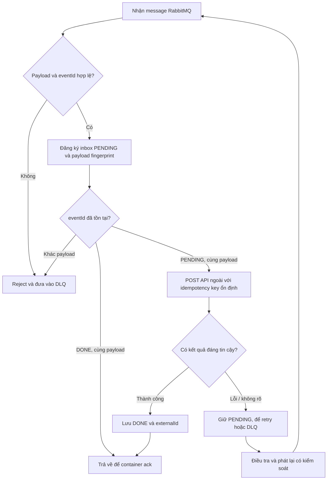
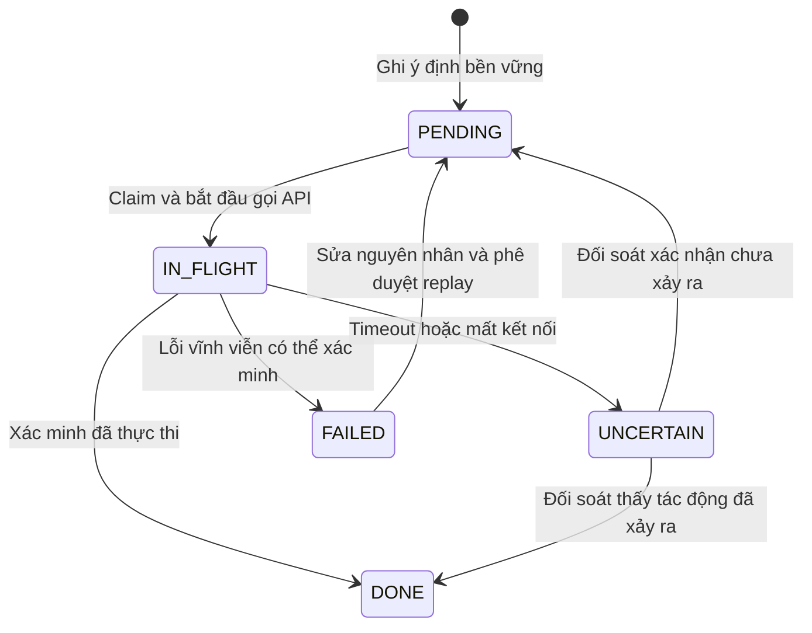

# Phát lại sự kiện và kiểm soát tác động lặp lên hệ thống ngoài với Spring AMQP

Một hệ thống dùng RabbitMQ thường có thể **giao lại message** khi consumer chết, kết nối bị ngắt hoặc quá trình xử lý báo lỗi. Ngoài việc giao lại tự động, đội vận hành còn có thể **phát lại sự kiện** từ dead-letter queue (DLQ), kho lưu sự kiện hoặc một khoảng dữ liệu lịch sử để phục hồi những tác vụ chưa hoàn thành.

Phát lại rất hữu ích để khôi phục dữ liệu, nhưng có một vấn đề quan trọng: **sự kiện được xử lý lại có thể tạo tác động lặp lên hệ thống ngoài**. Ví dụ, một sự kiện yêu cầu tạo vận đơn được gửi đến API hãng vận chuyển, API đã tạo vận đơn nhưng đường mạng đứt trước khi consumer nhận phản hồi. RabbitMQ giao lại sự kiện; nếu consumer gọi API thêm lần nữa mà không có biện pháp bảo vệ, có thể sinh hai vận đơn cho một đơn hàng.

Trong chương **Độ tin cậy đầu cuối** của **SPRING_AMQP**, bài này giải thích cách phối hợp `RabbitTemplate`, `@RabbitListener`, exchange, queue, binding, acknowledgement, retry, dead-letter và quan sát hệ thống để **phát lại an toàn**. Trọng tâm là định danh sự kiện bất biến, idempotency ở ranh giới hệ thống ngoài, trạng thái xử lý bền vững và xử lý kết quả không xác định.

## 1. Phân biệt delivery, redelivery, retry và replay

Các thuật ngữ có liên quan nhưng không đồng nghĩa:

| Thuật ngữ | Ý nghĩa | Ví dụ |
|---|---|---|
| **Delivery** | Broker giao một message cho consumer | RabbitMQ đẩy message từ `shipping.requests` đến `@RabbitListener` |
| **Redelivery** | Broker giao lại message trước đó chưa được xác nhận thành công | Consumer crash trước khi ack; kết nối mới nhận lại message |
| **Retry** | Thử xử lý lại sau lỗi, có thể tại ứng dụng, listener container hoặc broker | Gọi lại API sau lỗi tạm thời, với backoff |
| **Replay** | Chủ động đưa lại một sự kiện đã lưu hoặc đã đi qua hệ thống vào luồng xử lý | Phát lại bản ghi trong DLQ sau khi sửa cấu hình API |
| **Backfill** | Xử lý một tập sự kiện lịch sử để khôi phục hoặc xây lại trạng thái | Đọc sự kiện của tuần trước để bổ sung dữ liệu thiếu |

**Redelivery không nhất thiết tạo một business event mới.** Delivery tag và cờ `redelivered` thuộc quá trình giao nhận, không phải khóa định danh tác động nghiệp vụ. Nếu tái publish từ DLQ, message vật lý mới có thể có `messageId` hoặc metadata broker mới, nhưng sự kiện nghiệp vụ vẫn phải giữ định danh ban đầu.

Trong các luồng at-least-once, nên mặc định một sự kiện logic **có thể được nhìn thấy nhiều lần**. Mục tiêu thực tế là khiến những lần lặp đó không tạo thêm tác động nghiệp vụ ngoài ý muốn.

## 2. Vì sao khó bảo đảm “đúng một lần” khi có API ngoài?

Giả sử consumer nhận sự kiện:

```json
{
  "eventId": "evt-shipment-1042",
  "schemaVersion": 1,
  "orderId": "ORD-1042",
  "addressRef": "ADDR-08"
}
```

Consumer gọi `POST /v1/shipments` ở hệ thống vận chuyển. Các thời điểm lỗi điển hình:

```mermaid
sequenceDiagram
    participant B as RabbitMQ
    participant C as @RabbitListener
    participant D as Inbox database
    participant P as API hãng vận chuyển
    B->>C: Sự kiện evt-shipment-1042
    C->>D: Ghi intent PENDING
    C->>P: POST tạo vận đơn + Idempotency-Key
    P->>P: Tạo vận đơn SHIP-9001
    P--xC: Kết nối đứt trước khi nhận kết quả
    Note over C,D: Chưa lưu DONE; tác động ngoài có thể đã xảy ra
    C-->>B: Xử lý lỗi; chưa ack thành công
    B->>C: Retry / replay cùng eventId
    C->>P: POST lại với cùng Idempotency-Key
    P-->>C: Trả lại kết quả cũ SHIP-9001
    C->>D: Lưu DONE + externalId
    C-->>B: Ack sau khi hoàn thành
```

Không có một giao dịch ACID chung tự động bao trùm **database của consumer**, **RabbitMQ** và **HTTP API của bên thứ ba**. Đặc biệt:

- **Ack trước khi gọi API:** broker có thể coi message đã hoàn tất, trong khi lệnh tạo vận đơn chưa được gửi.
- **Gọi API rồi ack:** crash giữa hai bước có thể khiến RabbitMQ giao lại message, và API bị gọi lần thứ hai.
- **Ghi trạng thái DONE trước khi gọi API:** có thể lưu sai rằng tác động đã hoàn thành dù API chưa nhận request.
- **Ghi DONE sau API:** đúng hơn về ý nghĩa, nhưng crash sau khi API thành công vẫn tạo khoảng thời gian không biết kết quả.

Vì vậy, **chỉ kiểm tra một bảng “event đã xử lý” trong DB chưa đủ để ngăn lặp tác động ngoài** nếu API không hỗ trợ idempotency hoặc tra cứu kết quả. Cần thiết kế cả hai đầu của ranh giới giao tiếp.

## 3. Ba lớp bảo vệ tác động lặp

| Lớp | Cách triển khai | Bảo vệ khỏi điều gì? | Giới hạn |
|---|---|---|---|
| **Định danh sự kiện ổn định** | `eventId` hoặc khóa nghiệp vụ bất biến | Nhận diện cùng một yêu cầu khi retry/replay | Chỉ có ID không tự ngăn side effect |
| **Inbox / processing ledger tại consumer** | Bảng trạng thái `PENDING`, `DONE`, fingerprint, external reference | Bỏ qua event đã xong, phát hiện payload bị thay đổi, phục hồi sau crash | Không thể tự bảo đảm HTTP API không thực thi lặp |
| **Idempotency tại hệ thống ngoài** | Header `Idempotency-Key` hoặc khóa nghiệp vụ duy nhất do provider chấp nhận | Nhiều lần gọi cùng một thao tác chỉ tạo một tác động logic | Phụ thuộc hợp đồng provider, TTL, phạm vi khóa và xử lý concurrent requests |

Nên dùng **một khóa idempotency ổn định cho cùng ý định nghiệp vụ**. Ví dụ `shipment:evt-shipment-1042` có thể xuất hiện trong lần gửi đầu, mọi lần retry và cả những lần phát lại từ DLQ. Không tạo UUID mới cho từng lần gọi API, vì như vậy provider sẽ xem đó là các yêu cầu độc lập.

Ngược lại, khi người dùng cố ý đặt **một yêu cầu tạo vận đơn mới**, hãy cấp định danh nghiệp vụ mới. Đừng dùng cùng khóa cho hai hành động thực sự khác nhau.

### Phân biệt các ID

| Trường | Mục đích | Có giữ nguyên khi replay? |
|---|---|---|
| `eventId` | Định danh sự kiện logic cần xử lý | **Có** |
| `orderId` | Định danh đối tượng nghiệp vụ | Có, nhưng một đơn có thể phát nhiều loại sự kiện |
| `messageId` | Metadata của AMQP message | Không nhất thiết; không dùng làm idempotency key duy nhất |
| Delivery tag | Dùng ack/nack một delivery trên channel | **Không** |
| `correlationId` | Ghép request/reply hoặc liên kết trace | Tùy ngữ cảnh; không thay `eventId` |
| `replayAttemptId` | Ghi nhận một lần vận hành phát lại | Mới ở mỗi lần replay; không thay khóa tác động ngoài |
| `externalShipmentId` | Định danh kết quả tại API bên ngoài | Nên lưu bền vững sau khi biết kết quả |

## 4. Thiết kế luồng xử lý an toàn

Một flow xử lý khả thi khi API ngoài **có hỗ trợ idempotency key**:



Quy tắc chính: **listener chỉ hoàn tất thành công khi trạng thái nghiệp vụ có thể chứng minh đã hoàn thành**. Với `AcknowledgeMode.AUTO`, Spring AMQP ack khi method listener kết thúc bình thường; nếu method ném exception, container sẽ xử lý reject/requeue theo chính sách lỗi đã cấu hình.

Trong thực tế, các consumer chạy đồng thời có thể cùng thấy `PENDING`. Ví dụ triển khai ở phần sau dựa vào **provider tự deduplicate các request đồng thời dùng cùng idempotency key**. Nếu provider không đưa ra bảo đảm đó, cần thêm cơ chế claim/lease, giới hạn concurrency và bước đối soát trước khi gửi lại; riêng khóa duy nhất trong inbox không đủ.

## 5. Ví dụ Spring Boot: tạo vận đơn qua API bên ngoài

Ví dụ minh họa với **Spring Boot 3.2+, Java 17+, RabbitMQ và PostgreSQL**. API hãng vận chuyển là API giả định có đặc tả: nhận header `Idempotency-Key`, cùng key và cùng payload sẽ dẫn đến **một vận đơn logic** và có thể truy xuất lại cùng kết quả. Khi dùng API thật, phải kiểm tra hợp đồng, giới hạn độ dài khóa, trạng thái khi có hai request đồng thời và thời gian lưu khóa của nhà cung cấp.

### 5.1. Dependency và cấu hình

Với Gradle trong dự án Spring Boot quản lý phiên bản:

```groovy
dependencies {
    implementation 'org.springframework.boot:spring-boot-starter-amqp'
    implementation 'org.springframework.boot:spring-boot-starter-jdbc'
    implementation 'org.springframework.boot:spring-boot-starter-web'
    runtimeOnly 'org.postgresql:postgresql'
}
```

`spring-boot-starter-web` ở đây cung cấp `RestClient` và Jackson. Nếu dự án đã có HTTP client khác, có thể thay thế mà giữ nguyên thiết kế idempotency.

```yaml
spring:
  rabbitmq:
    host: localhost
    port: 5672
    username: guest
    password: guest
  datasource:
    url: jdbc:postgresql://localhost:5432/shipping
    username: shipping_app
    password: local-development-only

carrier:
  base-url: http://localhost:8089
```

Đây là cấu hình phát triển cục bộ; không đưa mật khẩu thật vào repository, và phải đặt timeout, TLS, authentication thích hợp khi gọi API ngoài trong môi trường vận hành.

### 5.2. Tạo inbox bền vững

```sql
CREATE TABLE shipment_inbox (
    event_id          VARCHAR(120) PRIMARY KEY,
    payload_sha256    CHAR(64) NOT NULL,
    status            VARCHAR(20) NOT NULL
                      CHECK (status IN ('PENDING', 'DONE')),
    external_shipment_id VARCHAR(120),
    created_at        TIMESTAMPTZ NOT NULL DEFAULT now(),
    updated_at        TIMESTAMPTZ NOT NULL DEFAULT now(),
    CHECK (
        (status = 'PENDING' AND external_shipment_id IS NULL)
        OR (status = 'DONE' AND external_shipment_id IS NOT NULL)
    )
);
```

Ý nghĩa:

- `event_id` là khóa duy nhất. Cùng event được nhận lại sẽ truy cập một dòng inbox.
- `payload_sha256` phát hiện trường hợp ai đó tái dùng cùng `eventId` nhưng thay nội dung tác động ngoài. Fingerprint phải được tạo từ dữ liệu nghiệp vụ đã chuẩn hóa theo quy tắc nhất quán.
- `PENDING` được ghi **trước** khi gọi API; `DONE` và `external_shipment_id` chỉ được ghi **sau** khi nhận hoặc đối soát được kết quả hợp lệ.
- `updated_at` phục vụ theo dõi sự kiện tồn đọng; nó không tự nói được một request HTTP đã được provider thực thi hay chưa.

Đặt bảng inbox trong DB đủ bền vững và có chính sách lưu trữ phù hợp với **khoảng thời gian replay tối đa**. Nếu xóa bản ghi dedupe quá sớm, event lịch sử có thể được coi như yêu cầu mới.

### 5.3. Topology RabbitMQ và xử lý lỗi

```java
import org.springframework.amqp.core.Binding;
import org.springframework.amqp.core.BindingBuilder;
import org.springframework.amqp.core.DirectExchange;
import org.springframework.amqp.core.Queue;
import org.springframework.amqp.core.QueueBuilder;
import org.springframework.amqp.rabbit.annotation.EnableRabbit;
import org.springframework.amqp.rabbit.config.SimpleRabbitListenerContainerFactory;
import org.springframework.amqp.rabbit.connection.ConnectionFactory;
import org.springframework.boot.autoconfigure.amqp.SimpleRabbitListenerContainerFactoryConfigurer;
import org.springframework.context.annotation.Bean;
import org.springframework.context.annotation.Configuration;

@Configuration
@EnableRabbit
public class ShippingAmqpConfig {
    public static final String EXCHANGE = "shipping.events";
    public static final String REQUEST_QUEUE = "shipping.requests";
    public static final String REQUEST_KEY = "shipment.requested";
    public static final String DEAD_EXCHANGE = "shipping.dead";
    public static final String DEAD_QUEUE = "shipping.requests.dlq";
    public static final String DEAD_KEY = "shipment.failed";

    @Bean
    public DirectExchange shippingExchange() {
        return new DirectExchange(EXCHANGE);
    }

    @Bean
    public DirectExchange shippingDeadExchange() {
        return new DirectExchange(DEAD_EXCHANGE);
    }

    @Bean
    public Queue shippingQueue() {
        return QueueBuilder.durable(REQUEST_QUEUE)
                .deadLetterExchange(DEAD_EXCHANGE)
                .deadLetterRoutingKey(DEAD_KEY)
                .build();
    }

    @Bean
    public Queue shippingDeadQueue() {
        return QueueBuilder.durable(DEAD_QUEUE).build();
    }

    @Bean
    public Binding shippingBinding() {
        return BindingBuilder.bind(shippingQueue())
                .to(shippingExchange()).with(REQUEST_KEY);
    }

    @Bean
    public Binding shippingDeadBinding() {
        return BindingBuilder.bind(shippingDeadQueue())
                .to(shippingDeadExchange()).with(DEAD_KEY);
    }

    @Bean("shippingListenerFactory")
    public SimpleRabbitListenerContainerFactory shippingListenerFactory(
            ConnectionFactory connectionFactory,
            SimpleRabbitListenerContainerFactoryConfigurer configurer) {
        SimpleRabbitListenerContainerFactory factory =
                new SimpleRabbitListenerContainerFactory();
        configurer.configure(factory, connectionFactory);
        // Ví dụ chọn chuyển lỗi sang DLQ để điều tra/phát lại có kiểm soát.
        factory.setDefaultRequeueRejected(false);
        return factory;
    }
}
```

Ví dụ này ưu tiên đưa lỗi chưa xử lý vào DLQ, **chưa cấu hình retry tự động**. Trong hệ thống thật có thể bổ sung retry có giới hạn, backoff, delay queue hoặc cơ chế scheduler; phải xác định rõ loại lỗi được retry và tránh vòng requeue vô hạn.

Các queue được khai báo durable; vẫn phải xem xét message persistence, khả năng lưu bền của broker, publisher confirms và cách khai báo topology để có bảo đảm giao nhận phù hợp.

### 5.4. Hợp đồng event và API provider

```java
// Có thể đặt các record này trong các file Java riêng trong cùng package.
public record ShipmentRequested(
        String eventId, int schemaVersion, String orderId, String addressRef) {}

public record CarrierRequest(String orderId, String addressRef) {}

public record CarrierResponse(String shipmentId) {}
```

API giả định:

```http
POST /v1/shipments
Content-Type: application/json
Idempotency-Key: shipment:evt-shipment-1042

{"orderId":"ORD-1042","addressRef":"ADDR-08"}
```

Một provider tuân thủ hợp đồng giả định sẽ dùng khóa idempotency để nhận ra các request trùng ý định, không tạo thêm vận đơn khi thử lại. **Không phải API nào cũng có ngữ nghĩa này**, và có API chỉ lưu key trong một khoảng thời gian nhất định.

Tạo bean HTTP client từ cấu hình môi trường:

```java
import org.springframework.context.annotation.Bean;
import org.springframework.context.annotation.Configuration;
import org.springframework.core.env.Environment;
import org.springframework.web.client.RestClient;

@Configuration
public class CarrierClientConfig {
    @Bean("carrierRestClient")
    public RestClient carrierRestClient(
            RestClient.Builder builder, Environment environment) {
        return builder
                .baseUrl(environment.getRequiredProperty("carrier.base-url"))
                .build();
    }
}
```

### 5.5. Xử lý inbox và tác động ngoài

Đoạn code sau minh họa **cùng một event chỉ dẫn đến cùng một vận đơn logic** khi provider thực thi idempotency key đúng hợp đồng.

```java
import com.fasterxml.jackson.core.JsonProcessingException;
import com.fasterxml.jackson.databind.ObjectMapper;
import java.security.MessageDigest;
import java.security.NoSuchAlgorithmException;
import java.util.HexFormat;
import java.util.List;
import org.springframework.beans.factory.annotation.Qualifier;
import org.springframework.jdbc.core.JdbcTemplate;
import org.springframework.http.MediaType;
import org.springframework.stereotype.Service;
import org.springframework.web.client.RestClient;

@Service
public class ShipmentProcessor {
    private final JdbcTemplate jdbc;
    private final RestClient carrierClient;
    private final ObjectMapper mapper;

    public ShipmentProcessor(
            JdbcTemplate jdbc,
            @Qualifier("carrierRestClient") RestClient carrierClient,
            ObjectMapper mapper) {
        this.jdbc = jdbc;
        this.carrierClient = carrierClient;
        this.mapper = mapper;
    }

    public void process(ShipmentRequested event) {
        validate(event);
        String fingerprint = fingerprint(event);

        // Ghi ý định trước khi gọi bên ngoài; yêu cầu DB commit bước này.
        jdbc.update("""
            INSERT INTO shipment_inbox (event_id, payload_sha256, status)
            VALUES (?, ?, 'PENDING')
            ON CONFLICT (event_id) DO NOTHING
            """, event.eventId(), fingerprint);

        InboxRow row = load(event.eventId());
        if (!row.payloadSha256().equals(fingerprint)) {
            throw new IllegalStateException(
                    "Trùng eventId nhưng payload khác: " + event.eventId());
        }
        if ("DONE".equals(row.status())) {
            return; // Event đã hoàn tất; listener có thể ack.
        }

        // Key ổn định qua mọi lần redelivery, retry và replay.
        CarrierResponse response = carrierClient.post()
                .uri("/v1/shipments")
                .header("Idempotency-Key", "shipment:" + event.eventId())
                .contentType(MediaType.APPLICATION_JSON)
                .body(new CarrierRequest(event.orderId(), event.addressRef()))
                .retrieve()
                .body(CarrierResponse.class);

        if (response == null || response.shipmentId() == null
                || response.shipmentId().isBlank()) {
            throw new IllegalStateException("Chưa có kết quả tạo vận đơn hợp lệ");
        }

        // Một câu UPDATE nguyên tử đánh dấu kết quả đã xác minh.
        int changed = jdbc.update("""
            UPDATE shipment_inbox
            SET status = 'DONE',
                external_shipment_id = ?,
                updated_at = now()
            WHERE event_id = ? AND payload_sha256 = ?
              AND (external_shipment_id IS NULL OR external_shipment_id = ?)
            """, response.shipmentId(), event.eventId(), fingerprint,
                response.shipmentId());

        if (changed != 1) {
            throw new IllegalStateException(
                    "Inbox có kết quả không nhất quán: " + event.eventId());
        }
    }

    private InboxRow load(String eventId) {
        List<InboxRow> rows = jdbc.query("""
            SELECT payload_sha256, status FROM shipment_inbox
            WHERE event_id = ?
            """,
            (rs, index) -> new InboxRow(
                    rs.getString("payload_sha256"),
                    rs.getString("status")),
            eventId);
        if (rows.size() != 1) {
            throw new IllegalStateException("Không tìm thấy inbox: " + eventId);
        }
        return rows.get(0);
    }

    private String fingerprint(ShipmentRequested event) {
        try {
            byte[] data = mapper.writeValueAsBytes(event);
            return HexFormat.of().formatHex(
                    MessageDigest.getInstance("SHA-256").digest(data));
        } catch (JsonProcessingException | NoSuchAlgorithmException e) {
            throw new IllegalStateException("Không tạo được fingerprint", e);
        }
    }

    private void validate(ShipmentRequested event) {
        if (event == null || event.eventId() == null
                || event.eventId().isBlank()
                || event.orderId() == null || event.orderId().isBlank()
                || event.addressRef() == null || event.addressRef().isBlank()
                || event.schemaVersion() != 1) {
            throw new IllegalArgumentException(
                    "ShipmentRequested thiếu dữ liệu hoặc sai schemaVersion");
        }
    }

    private record InboxRow(String payloadSha256, String status) {}
}
```

**Các giả định và giới hạn của ví dụ:**

1. `JdbcTemplate` đang dùng các giao dịch ngắn độc lập theo chế độ thông thường. Dòng `PENDING` phải được commit trước HTTP call. **Không bọc toàn bộ `process()` trong một `@Transactional` kéo dài qua mạng**, vì như vậy có thể giữ transaction/lock lâu và làm ý định chưa được commit trước lúc crash.
2. Mọi lần gọi đồng thời cùng `eventId` có thể đều đi tới provider khi thấy `PENDING`. Ví dụ **dựa vào provider deduplicate đồng thời** bằng idempotency key; đây không phải một cơ chế single-flight ở phía local.
3. `payload_sha256` ở đây được tính từ record đã deserialize rồi serialize theo cùng phiên bản Jackson/schema. Hệ thống nhiều phiên bản phải định nghĩa cách canonicalize ổn định, xử lý schema evolution và phân biệt thay đổi payload không hợp lệ.
4. Nếu xảy ra timeout sau khi provider thành công nhưng trước `UPDATE DONE`, inbox giữ `PENDING`. Replay gọi lại cùng key để lấy lại kết quả, hoặc thực hiện **đối soát** nếu không còn chắc key được provider lưu.
5. Nếu hai request cùng key trả **hai `shipmentId` khác nhau**, đó là vi phạm hợp đồng idempotency giả định. Cần phát hiện và điều tra; chỉ riêng câu `UPDATE` không thể thu hồi tác động đã tạo ở hệ thống ngoài.
6. Cần thiết lập **connect timeout, response timeout**, giới hạn in-flight, authentication và phân loại HTTP error cho client thực tế; các cấu hình hạ tầng đó được lược khỏi ví dụ để làm rõ cơ chế replay.

### 5.6. `@RabbitListener` chỉ ack khi việc xử lý thật sự hoàn tất

```java
import com.fasterxml.jackson.core.JsonProcessingException;
import com.fasterxml.jackson.databind.ObjectMapper;
import org.springframework.amqp.rabbit.annotation.RabbitListener;
import org.springframework.stereotype.Component;

@Component
public class ShipmentListener {
    private final ShipmentProcessor processor;
    private final ObjectMapper mapper;

    public ShipmentListener(ShipmentProcessor processor, ObjectMapper mapper) {
        this.processor = processor;
        this.mapper = mapper;
    }

    @RabbitListener(
            queues = ShippingAmqpConfig.REQUEST_QUEUE,
            containerFactory = "shippingListenerFactory")
    public void handle(String json) throws JsonProcessingException {
        ShipmentRequested event =
                mapper.readValue(json, ShipmentRequested.class);
        processor.process(event);
        // Return bình thường => AUTO ack theo cơ chế container.
    }
}
```

Phía gửi có thể publish String JSON tới exchange `shipping.events` với routing key `shipment.requested` bằng `RabbitTemplate.convertAndSend(...)`. Để tránh mất sự kiện **trước khi consumer nhận**, producer còn cần quản lý việc lưu sự kiện ban đầu, publisher confirms, `mandatory`/returns khi cần và chính sách retry publish. Không suy rằng gọi `convertAndSend()` trả về bình thường là broker hoặc consumer đã xử lý thành công.

Trong cấu hình listener ví dụ, method ném exception sẽ không được ack như một lần xử lý thành công; `defaultRequeueRejected=false` khiến message bị reject/requeue=false và được dead-letter nếu queue có cấu hình DLX hợp lệ. DLQ giữ message để xử lý tiếp theo chính sách vận hành; một DLQ không tự phát lại và cũng không tự sửa lỗi nghiệp vụ.

## 6. Phát lại từ DLQ đúng cách

Một quy trình vận hành an toàn gồm:

1. **Xác định nguyên nhân:** API ngoài ngừng hoạt động, thiếu dữ liệu, sai schema, lỗi xác thực, timeout chưa rõ kết quả hay bug code. Xem lịch sử retry, lỗi listener, trạng thái inbox và kết quả provider.
2. **Đối soát tác động ngoài:** với sự kiện tạo vận đơn, tra cứu theo `eventId`, idempotency key, `orderId` hoặc external reference nếu provider hỗ trợ. Đặc biệt cần làm nếu lần gọi trước có timeout và đã qua TTL của key.
3. **Chọn tập sự kiện:** lọc theo khoảng thời gian, lỗi, phiên bản schema; xác định mục tiêu xử lý lại. Không phát lại toàn bộ DLQ một cách tự động khi chưa rõ nguyên nhân.
4. **Giữ nguyên dữ liệu định danh:** dùng lại `eventId` và các trường xác định cùng hành động nghiệp vụ. Có thể thêm header `replayTicket`/`replayAttemptId` để audit; không dùng header mới đó làm idempotency key.
5. **Phát lại có giới hạn:** giới hạn tốc độ, concurrency và số lần thử; theo dõi queue depth, API rate limit, mức tăng tác động ngoài và tỷ lệ lỗi.
6. **Xác nhận hoàn tất:** kiểm tra inbox `DONE`, external ID hợp lệ và metric; đánh dấu ticket phục hồi. Chỉ xóa/ack bản gốc khỏi DLQ theo quy trình đã bảo đảm replay bền vững.

Ví dụ thao tác phát lại **sau khi đã xét duyệt sự kiện**; method này là utility cho luồng vận hành, không gắn `@RabbitListener` trực tiếp vào DLQ:

```java
import com.fasterxml.jackson.core.JsonProcessingException;
import com.fasterxml.jackson.databind.ObjectMapper;
import org.springframework.amqp.rabbit.core.RabbitTemplate;
import org.springframework.stereotype.Service;

@Service
public class ShippingReplayPublisher {
    private final RabbitTemplate template;
    private final ObjectMapper mapper;

    public ShippingReplayPublisher(
            RabbitTemplate template, ObjectMapper mapper) {
        this.template = template;
        this.mapper = mapper;
    }

    public void replayApproved(String originalJson, String replayTicket)
            throws JsonProcessingException {
        ShipmentRequested event =
                mapper.readValue(originalJson, ShipmentRequested.class);
        if (event.eventId() == null || event.eventId().isBlank()
                || replayTicket == null || replayTicket.isBlank()) {
            throw new IllegalArgumentException("Thiếu eventId/replayTicket");
        }
        template.convertAndSend(
                ShippingAmqpConfig.EXCHANGE,
                ShippingAmqpConfig.REQUEST_KEY,
                originalJson,
                message -> {
                    message.getMessageProperties()
                            .setHeader("replayTicket", replayTicket);
                    return message;
                });
    }
}
```

**Giới hạn của utility:** ví dụ minh họa việc giữ `eventId` khi republish. Trong quy trình thực tế, bản gốc phải được lưu/đọc an toàn, có xác nhận quyền thao tác, hạn mức và audit; cần dùng publisher confirms và theo dõi unroutable messages trước khi xem lần republish là thành công bền vững. Không tự ack/xóa DLQ chỉ dựa trên việc method gửi return.

Header broker như `x-death` có thể phản ánh một số lần dead-letter trước đó, nhưng không nên dựa duy nhất vào nó để đếm toàn bộ vòng đời retry, đặc biệt khi các lần replay đã tạo message mới. Lịch sử vận hành cần được lưu riêng.

## 7. Nếu provider không hỗ trợ idempotency key

Đây là trường hợp khó hơn: API cũ cho phép tạo vận đơn mới cho mỗi `POST`, hoặc một hệ thống gửi email/SMS không có cách truy vấn một yêu cầu đã thực hiện.

Một bảng inbox vẫn hữu ích để **giảm việc xử lý lại**, nhưng không giải quyết được khoảng mất kết nối giữa “API đã tạo tác động” và “consumer ghi DONE”. Không có cách tổng quát nào để bảo đảm chính xác một tác động ngoài khi provider không hỗ trợ deduplication, truy vấn kết quả hoặc một giao thức giao dịch chung.

Khi đó, cần tăng cường:

- **Dùng business key có tính duy nhất ở provider** nếu API hỗ trợ, ví dụ `orderId` là external reference và provider từ chối tạo hai vận đơn cùng tham chiếu.
- **Cơ chế claim/lease tại inbox** để một worker xử lý trong một thời điểm; dùng cập nhật có điều kiện hoặc lock để chống hai consumer cùng khởi tạo công việc. Lease không loại bỏ hoàn toàn việc hai worker cùng gọi API khi thao tác chậm và lease hết hạn.
- **Trạng thái `UNCERTAIN`:** sau timeout/mất kết nối, lưu rằng kết quả chưa xác định thay vì mặc định thất bại. Tạm dừng tự động retry tác động nguy hiểm cho đến khi đối soát.
- **Reconciliation:** tra cứu theo order/reference hoặc qua báo cáo của provider; khi xác định tác động đã xảy ra, ghi external ID rồi hoàn tất inbox. Nếu provider xác nhận chưa xử lý, mới cân nhắc gửi lại.
- **Quy trình thủ công/compensation:** với API không thể truy vấn, phải chấp nhận giới hạn bảo đảm, có bước người vận hành xác minh và cách bù trừ khi lỡ tạo trùng.

Mô hình trạng thái gợi ý:



Sơ đồ này là **một phương án mở rộng thiết kế**, không phải trạng thái của bảng `shipment_inbox` hai trạng thái trong ví dụ code. Muốn triển khai cần thêm schema, điều kiện chuyển trạng thái, claim token, lease expiry, timeout và quy trình phục hồi riêng.

Nếu muốn áp dụng “exactly once” cho API ngoài không hỗ trợ định danh hoặc tra cứu, hãy diễn đạt chính xác **phạm vi bảo đảm** và những trạng thái không thể phân biệt được, thay vì hứa hẹn một giao dịch xuyên hệ thống không tồn tại.

## 8. Retry, ack, dead-letter và publisher confirm phối hợp ra sao?

| Giai đoạn | Cơ chế Spring AMQP/RabbitMQ | Cần bảo đảm |
|---|---|---|
| Producer tạo sự kiện | DB transaction + outbox nếu có dữ liệu cùng commit | Không mất event khi service crash giữa DB commit và publish |
| Publish lên exchange | `RabbitTemplate`, publisher confirm, mandatory/returns khi phù hợp | Theo dõi broker đã nhận publish và khả năng định tuyến |
| Queue nhận message | Durable queue, message persistence, cấu hình broker | Bảo đảm lưu trữ phù hợp mô hình lỗi; không đánh đồng durable queue với mọi điều kiện durability |
| Consumer lấy message | `@RabbitListener`, ack mode `AUTO` hoặc `MANUAL` | Không ack thành công trước khi hoàn tất tác động nghiệp vụ |
| Tác động ngoài | Stable `Idempotency-Key`, inbox, provider response | Retry/replay không tạo tác động lặp ngoài ý định |
| Xử lý thất bại | Bounded retry, backoff, DLX/DLQ | Không retry vô hạn, không bỏ mất dấu sự kiện lỗi |
| Phát lại | Operator/workflow replay với audit | Giữ nguyên `eventId`, đối soát trước khi thử tác động nguy hiểm |

**Publisher confirm và consumer ack xác nhận hai việc khác nhau.** Publisher confirm chỉ liên quan đến quá trình broker xử lý publish; consumer ack xác nhận delivery theo chính sách consumer. Không cơ chế nào trong hai cơ chế này một mình bảo đảm hệ thống ngoài chỉ bị tác động đúng một lần.

Khi retry HTTP:

- Lỗi có khả năng tạm thời như `429`, một số `5xx` hoặc timeout cần xem xét backoff, jitter và `Retry-After` nếu provider cung cấp.
- Lỗi hợp đồng như payload sai hoặc thiếu credential thường cần sửa nguyên nhân trước khi replay. Không áp dụng retry vô hạn cho mọi `4xx`.
- Timeout sau khi gửi request là **trạng thái không xác định**: provider có thể đã thực hiện. Chỉ retry tự động khi hợp đồng idempotency còn hiệu lực; nếu không, đối soát trước.
- Đặt giới hạn tổng số lần thử và thời gian; khi chuyển DLQ phải giữ đầy đủ dữ liệu để xử lý sau.

Nếu một sự kiện bị replay sau nhiều tuần trong khi provider chỉ lưu `Idempotency-Key` trong vài giờ, cùng key **không còn bảo đảm** provider nhận ra yêu cầu cũ. Chính sách retention của inbox, cửa sổ replay và TTL idempotency phía provider phải được thiết kế đồng bộ.

## 9. Phát lại sự kiện lịch sử có thể tạo thay đổi ngoài ý định

Replay không chỉ xảy ra khi message lỗi. Có lúc cần đọc lại mọi `ShipmentRequested` của tháng trước để xây lại một read model. Nếu dùng cùng `@RabbitListener` vừa cập nhật bảng đọc vừa gọi API tạo vận đơn, replay phục hồi báo cáo có thể tạo tác động mới ở hãng vận chuyển.

Hai cách tránh:

1. **Tách xử lý projection khỏi xử lý side effect:** listener hoặc pipeline dùng để xây lại báo cáo chỉ cập nhật trạng thái nội bộ, không gọi API ngoài. Hợp đồng sự kiện và quyền thực hiện side effect được xác định rõ.
2. **Phân biệt ngữ cảnh replay:** một consumer cần biết mình đang thực hiện backfill đọc lại dữ liệu hay đang phục hồi một tác vụ tạo vận đơn chưa hoàn thành. Không dùng cờ `isReplay` làm lý do bỏ mọi kiểm tra idempotency; quyết định phải dựa trên nghiệp vụ và trạng thái bền vững.

Đặc biệt, event schema có thể thay đổi theo thời gian. Trước khi replay sự kiện cũ, cần xác minh:

- Consumer hiện tại có đọc được `schemaVersion` cũ không, và việc chuyển đổi dữ liệu có giữ nguyên ý nghĩa nghiệp vụ không?
- Dữ liệu tham chiếu (địa chỉ, mã sản phẩm, giá) có thay đổi khiến cùng sự kiện tạo tác động khác trước không?
- Nếu lệnh gốc yêu cầu “tạo vận đơn tại thời điểm T”, việc chạy lại sau nhiều tháng còn phù hợp không?
- Có cần chế độ **dry-run**, lọc sự kiện hoặc phê duyệt theo nhóm trước khi gửi lại?

Với tác vụ gây phí hoặc tác động không thể đảo ngược, ưu tiên đối soát và lập kế hoạch trước khi chạy replay hàng loạt.

## 10. Quan sát và audit từ đầu tới cuối

Một message thường đi qua nhiều hệ thống: producer, RabbitMQ, consumer, database inbox, API ngoài và có thể DLQ/replay service. Dữ liệu cần để giải thích một sự cố:

| Dữ liệu | Câu hỏi giải đáp |
|---|---|
| `eventId`, `orderId`, `schemaVersion` | Đây là sự kiện logic nào, thuộc hợp đồng dữ liệu nào? |
| `messageId`, routing key, exchange, consumer queue | Message được publish và định tuyến theo đường nào? |
| Inbox `status`, `payload_sha256`, `external_shipment_id` | Đã xử lý tới đâu, có payload trùng ID nhưng khác nội dung không? |
| Idempotency key, HTTP status, external reference | Hệ thống ngoài có thể đã thực thi yêu cầu nào? |
| Số lần retry, loại lỗi, `replayTicket` | Vì sao sự kiện được xử lý lặp, ai đã phát lại? |
| Timestamp từng bước, duration, trace ID | Thời gian ở broker, DB và provider phân bổ thế nào? |

Các metric hữu ích: queue depth, unacked messages, DLQ depth, tuổi của message lỗi lâu nhất, tỷ lệ duplicate đã bỏ qua, số inbox `PENDING` lâu bất thường, tỷ lệ `DONE`, HTTP timeout/`429`/`5xx`, số trường hợp `UNCERTAIN` cần đối soát, độ trễ đến DONE và số sự kiện replay thành công.

**Không ghi payload, địa chỉ, token hoặc dữ liệu nhạy cảm tùy tiện**. Nên log ID và loại lỗi, áp dụng masking/redaction, và bảo vệ nhật ký audit vì thông tin đó có thể liên quan đến nghiệp vụ và khách hàng.

## 11. Ma trận kiểm thử tích hợp

Unit test cho `ShipmentProcessor` có thể giả lập repository và API, nhưng cần integration test với RabbitMQ, PostgreSQL và một HTTP test server để xác nhận ranh giới thực sự.

| Kịch bản | Điều phải kiểm chứng |
|---|---|
| Xử lý event mới thành công | Có một inbox `DONE`, một `externalShipmentId`, listener ack |
| Cùng event được gửi hai lần nối tiếp | Lần thứ hai bỏ qua qua inbox, API không tạo vận đơn mới |
| Hai consumer xử lý cùng `eventId` đồng thời | Provider với cùng idempotency key chỉ tạo một tác động logic |
| API đã tạo vận đơn nhưng client timeout | Inbox còn `PENDING`; replay thu hồi được kết quả cũ hoặc yêu cầu đối soát |
| Ứng dụng crash sau API thành công trước khi ghi DONE | Redelivery/replay không tạo vận đơn thứ hai |
| Ghi DONE thành công nhưng ack RabbitMQ bị mất | Message được giao lại, consumer thấy DONE và không gọi lại provider |
| Trùng `eventId` nhưng payload khác | Phát hiện vi phạm, không âm thầm dùng lại vận đơn cũ |
| API trả lỗi không thể phục hồi | Message đi qua chính sách reject và DLQ, có thể điều tra |
| Replay sau TTL idempotency của provider | Không tự cho rằng key còn hiệu lực; cần reconciliation |
| Backfill phục hồi read model | Không tạo thêm tác động bên ngoài |
| Publisher mất kết nối trước khi nhận confirm | Có cơ chế gửi lại phù hợp và dedup tại consumer |

**Ví dụ phân tích lỗi:** Nếu API tạo vận đơn thành công, nhưng consumer crash ngay trước khi ghi `DONE`, điều mong đợi sau khởi động lại là nhận cùng `eventId`, đọc inbox `PENDING`, gửi lại cùng idempotency key và nhận kết quả vận đơn cũ. Nếu provider không có hợp đồng idempotency đủ mạnh, test phải cho thấy tác vụ được đánh dấu cần đối soát thay vì thực thi lại thiếu kiểm soát.

## 12. Những hiểu lầm thường gặp

**“RabbitMQ có ack nên không bao giờ xử lý trùng.”** Không đúng. Message đã thực thi side effect nhưng chưa ack vẫn có thể được giao lại.

**“Chỉ cần unique constraint trên `eventId` ở inbox là API ngoài an toàn.”** Chưa đủ. Lỗi giữa HTTP thành công và ghi DONE hoặc hai worker đồng thời vẫn có thể dẫn đến nhiều lần gọi API.

**“Replay thì tạo `eventId` mới để dễ theo dõi.”** Dễ làm hỏng deduplication. Giữ `eventId` cũ cho cùng một ý định, tạo `replayAttemptId` riêng để audit.

**“Có `Idempotency-Key` thì có thể replay bất kỳ lúc nào.”** Phụ thuộc TTL và ngữ nghĩa của provider. Khi hết thời gian bảo lưu, cần đối soát.

**“Timeout đồng nghĩa provider không thực hiện lệnh.”** Không thể kết luận. Đây có thể là trường hợp tác động đã xảy ra nhưng client chưa nhận được phản hồi.

**“Đã bật publisher confirm thì consumer và API ngoài chắc chắn thành công.”** Confirm chỉ xác nhận một giai đoạn của luồng publish; phải xử lý tiếp consumer ack, trạng thái nghiệp vụ và tác động ngoài.

### Câu hỏi tự kiểm tra

1. Phân biệt redelivery và replay thủ công. Vì sao cả hai phải giữ một `eventId` logic ổn định?
2. Tại sao ghi inbox `DONE` trước khi gọi API có nguy cơ mất tác động, còn ghi DONE sau khi gọi API có nguy cơ lặp tác động?
3. Nếu HTTP request timeout sau khi provider đã tạo vận đơn, consumer cần làm gì khi nhận lại cùng event?
4. Unique constraint trong PostgreSQL và `Idempotency-Key` tại provider giải quyết những vấn đề khác nhau thế nào?
5. Khi TTL của idempotency key đã hết, nên xử lý một sự kiện cũ trong DLQ ra sao?
6. Vì sao replay để xây lại read model phải được tách khỏi các tác vụ tạo tác động bên ngoài?

**Ghi nhớ:** RabbitMQ và Spring AMQP giúp truyền và phát lại message đáng tin cậy, nhưng **tính đúng đắn đầu cuối nằm ở ranh giới tác động nghiệp vụ**. Giữ định danh sự kiện bất biến, lưu inbox bền vững, sử dụng idempotency theo hợp đồng hệ thống ngoài, ack sau khi hoàn tất, phân loại retry/DLQ và đối soát trạng thái không xác định. Khi provider không hỗ trợ deduplication hoặc truy vấn kết quả, cần thừa nhận giới hạn bảo đảm và thiết kế quy trình phục hồi có kiểm soát.
