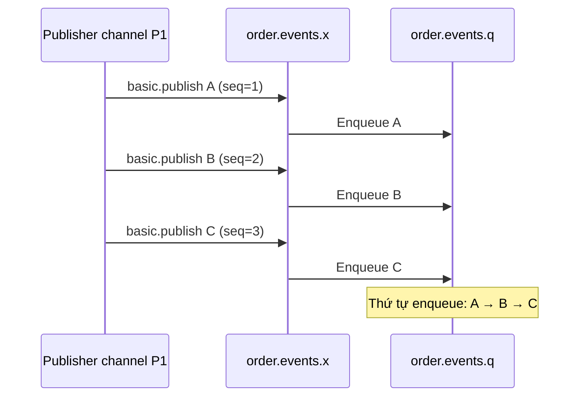
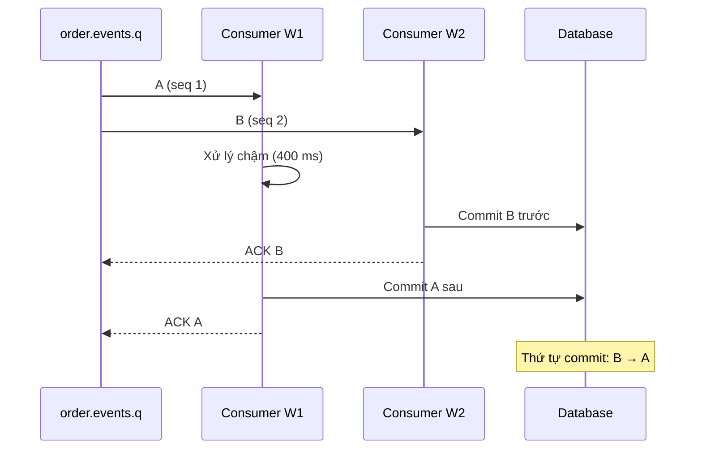
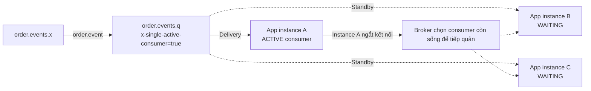
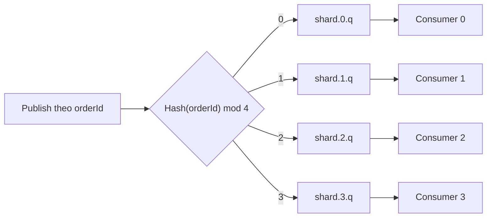

# Phạm vi bảo đảm thứ tự của queue và channel

## 1. FIFO là một bảo đảm có phạm vi, không phải thứ tự hoàn tất nghiệp vụ

Trong **Spring AMQP** với **RabbitMQ**, ta thường publish sự kiện bằng `RabbitTemplate`, định tuyến qua exchange và binding đến queue, rồi xử lý bằng `@RabbitListener`. Nếu một đơn hàng sinh ba sự kiện:

```text
ORD-42, sequence=1, CREATED
ORD-42, sequence=2, PAID
ORD-42, sequence=3, SHIPPED
```

thì kết quả xử lý `SHIPPED` trước `PAID` có thể làm dữ liệu sai. Câu hỏi “RabbitMQ có giữ thứ tự không?” chỉ có thể trả lời chính xác sau khi xác định **thứ tự của giai đoạn nào**, **trên tài nguyên nào**, và **khi có bao nhiêu producer/consumer**.

RabbitMQ queue thường có hành vi **FIFO** (first in, first out). Cụ thể, các message **publish tuần tự trên cùng một channel** được enqueue theo thứ tự publish vào mỗi queue mà chúng được route tới. Queue phân phối delivery ban đầu theo thứ tự enqueue. Nhưng broker không mặc nhiên bảo đảm **nhiều thread nghiệp vụ hoàn tất theo thứ tự đó**. Nhiều publishing channel, consumer cạnh tranh, requeue, priority queue và xử lý song song đều có thể thay đổi thứ tự quan sát được.

Bài thuộc chương **Thứ tự và đồng thời** của module `SPRING_AMQP`. Ta sẽ nối các khái niệm exchange, queue, binding, channel, `RabbitTemplate`, `@RabbitListener`, acknowledgement, retry và dead-letter để xây dựng **bảo đảm thứ tự có giới hạn rõ ràng**, rồi kiểm chứng bằng ví dụ.

### Năm loại thứ tự cần phân biệt

| Loại thứ tự | Câu hỏi tương ứng | Phạm vi điển hình |
| --- | --- | --- |
| Thứ tự phát sinh nghiệp vụ | `CREATED` có thực sự xảy ra trước `PAID`? | Một aggregate như `orderId`; thường do database/version xác định |
| Thứ tự publish trên channel | Broker nhận các lệnh `basic.publish` theo trình tự nào? | **Một** AMQP publishing channel |
| Thứ tự enqueue trong queue | Message được thêm vào **cùng một queue** theo thứ tự nào? | Từng queue, dựa trên thứ tự các publish đến broker |
| Thứ tự delivery | Message được broker phát cho consumer theo thứ tự nào? | Từng queue/consumer; chịu ảnh hưởng của concurrency và redelivery |
| Thứ tự commit nghiệp vụ / ACK | Xử lý nào hoàn tất hoặc được ACK trước? | Từng worker, database, channel và thời điểm hoàn tất |

Một `deliveryTag=2` không có nghĩa event nghiệp vụ số 2, và một `publisherSequenceNumber=2` cũng không phải sequence của đơn hàng. Các bộ đếm này có **phạm vi channel**, không đại diện cho thứ tự toàn hệ thống.

## 2. Ranh giới số một: thứ tự publish trên một channel

### 2.1. Một channel gửi tuần tự

Giả sử một producer gửi A, B, C tuần tự trên **cùng channel** và cả ba đều route đến `order.events.q`:



Điều này áp dụng cho **các message đã được route đến cùng queue**; nó không chứng minh message đã được ghi bền vững hoặc consumer đã xử lý thành công. Publisher confirms và trạng thái delivery là những lớp bảo đảm khác.

### 2.2. Nhiều channel có thể xen kẽ

Một service thường có nhiều request thread. `RabbitTemplate` thông thường lấy channel từ cache trong mỗi lần gửi; **hai lệnh gửi từ hai thread không nhất thiết dùng cùng channel**. Thí dụ một ứng dụng lần lượt log “publish A” rồi “publish B”, nhưng các lệnh chạy trên hai channel khác nhau:

```text
Thời điểm        Channel P1               Channel P2          order.events.q
T1               Bắt đầu publish A
T2                                        Bắt đầu publish B
T3                                        B tới broker         B
T4               A tới broker                                   B, A
```

Không có **global publish order** giữa hai channel/connection độc lập. Broker tạo một thứ tự enqueue thực tế cho mỗi queue, nhưng đó có thể không trùng thứ tự sự kiện ở các thread producer. Mỗi channel có sequence riêng; cùng số thứ tự trên hai channel không thể so sánh như một đồng hồ toàn cục.

**Hệ quả:** Nếu `PAID` và `SHIPPED` được publish đồng thời từ những transaction hoặc instance khác nhau, việc dùng cùng exchange, cùng routing key và cùng queue **không tự sắp chúng theo thứ tự nghiệp vụ**.

### 2.3. Dùng `RabbitTemplate.invoke` để giữ một channel trong một phạm vi

Spring AMQP cung cấp `RabbitTemplate.invoke(...)` để thực hiện nhiều operation trên một channel chuyên biệt, trong **cùng thread**:

```java
import org.springframework.amqp.rabbit.core.RabbitTemplate;
import org.springframework.stereotype.Service;

@Service
public class OrderedEventPublisher {
    private final RabbitTemplate rabbitTemplate;

    public OrderedEventPublisher(RabbitTemplate rabbitTemplate) {
        this.rabbitTemplate = rabbitTemplate;
    }

    public void publishOrderLifecycle() {
        rabbitTemplate.invoke(operations -> {
            operations.convertAndSend(
                    "order.events.x", "order.event", "ORD-42|1|CREATED");
            operations.convertAndSend(
                    "order.events.x", "order.event", "ORD-42|2|PAID");
            operations.convertAndSend(
                    "order.events.x", "order.event", "ORD-42|3|SHIPPED");

            // Cần bật publisher confirms trên ConnectionFactory.
            operations.waitForConfirmsOrDie(10_000L);
            return null;
        });
    }
}
```

Trong callback, thứ tự publish của ba thao tác tới một queue là `1 → 2 → 3`, với điều kiện exchange/binding route chúng tới queue đó. `waitForConfirmsOrDie` đợi broker xác nhận các publish trên channel của invocation; cần cấu hình publisher confirms và xử lý ngoại lệ. Publisher confirm **không có nghĩa consumer đã xử lý**.

Ví dụ cấu hình Spring Boot cho publisher confirms và phát hiện message không route được:

```yaml
spring:
  rabbitmq:
    publisher-confirm-type: correlated
    publisher-returns: true
    template:
      mandatory: true
```

`mandatory` + publisher returns giúp phát hiện message không tới queue nào; riêng publisher confirm ACK có thể vẫn xuất hiện cho một publish không route được. Trong hệ thống thực, cần kiểm tra returned message/correlation cho từng publish hoặc callback tương ứng, thay vì chỉ coi `waitForConfirmsOrDie` là bằng chứng mọi message đã đến đúng queue.

**Giới hạn:** `invoke(...)` chỉ giữ chung channel **bên trong một invocation và cùng thread**. Hai invocation chạy song song vẫn có thể dùng channel khác nhau. Nó cũng không đưa hai transaction database độc lập vào một thứ tự nghiệp vụ. Với yêu cầu sequencing qua nhiều producer, cần **ghi sequence có thẩm quyền trong database**, serialize theo khóa nghiệp vụ hoặc thiết kế outbox/partitioning.

## 3. Ranh giới số hai: FIFO của một queue

Một queue nhận các message có thứ tự enqueue xác định. Với queue thông thường, các **delivery ban đầu** cho một consumer đi theo thứ tự enqueue. Nhưng hãy phân biệt hai khẳng định:

1. **Queue dequeue theo FIFO**: RabbitMQ cố phân phối các message đang sẵn sàng theo thứ tự queue.
2. **Ứng dụng xử lý xong theo FIFO**: chỉ đúng khi thiết kế consumer thực sự xử lý tuần tự và không có yếu tố thay đổi thứ tự.

### Các ngoại lệ và biến thể cần chú ý

| Tình huống | Có thể thay đổi điều gì? |
| --- | --- |
| Nhiều consumer cạnh tranh cùng queue | Delivery ban đầu được phân phối tới các consumer khác nhau; thứ tự **hoàn tất** không còn được bảo đảm |
| `basicNack(requeue=true)` hoặc channel đóng khi còn unacked | Message được giao lại; thứ tự delivery quan sát được có thể khác do các consumer khác đã tiến lên |
| Queue có message priority (`x-max-priority`) | Message ưu tiên cao có thể vượt qua message đến sớm hơn; không còn FIFO đơn giản |
| Dead-letter rồi đưa message quay lại | Message đi qua exchange và được enqueue vào queue nhận; đây là **một lần enqueue mới** trên đường đi đó |
| TTL làm message hết hạn | Một số message có thể biến mất hoặc đi DLX thay vì được xử lý; không thể đòi chuỗi đầy đủ nếu đã loại chúng |
| Consumer tự chia tác vụ vào executor/thread pool | Broker có thể giao đúng thứ tự, nhưng callback nghiệp vụ kết thúc theo thời gian chạy từng task |
| Nhiều queue đích cho một message | Mỗi queue có thứ tự riêng; **không có ACK/commit đồng bộ** giữa các queue |

RabbitMQ có các quy tắc đặt lại message được requeue nhằm giữ thứ tự xuất bản **khi có thể**. Vì vậy không nên diễn đạt đơn giản rằng “NACK luôn đặt message xuống cuối queue”. Điều quan trọng đối với nghiệp vụ là **redelivery không tạo bảo đảm xử lý chính xác một lần hoặc đúng thứ tự trong hệ thống đang cạnh tranh**.

## 4. Ranh giới số ba: channel tiêu thụ, delivery tag và ACK

AMQP channel là đường logic để trao đổi các frame giữa client và broker. Nó không đồng nhất với queue: một connection có thể có nhiều channel; một queue có thể có nhiều consumer/channel; một channel cũng có thể chứa nhiều delivery đang `unacked`.

### Delivery tag là thứ tự giao trên channel, không phải sequence sự kiện

Khi bật consumer acknowledgements, RabbitMQ gán **delivery tag** tăng dần trong phạm vi **channel nhận**. Ví dụ:

```text
Channel C1: deliveryTag=1  → event ORD-42, sequence=1
Channel C2: deliveryTag=1  → event ORD-42, sequence=2
Channel C1: deliveryTag=2  → event ORD-42, sequence=3
```

Hai `deliveryTag=1` hoàn toàn hợp lệ vì nằm trên hai channel khác nhau. Consumer chỉ được `basicAck`/`basicNack` bằng **channel đã nhận delivery đó**; dùng tag trên channel khác có thể gây lỗi channel như `PRECONDITION_FAILED` vì delivery tag không tồn tại ở channel đích.

Một delivery được ACK là tín hiệu broker có thể xóa nó khỏi queue. Không được suy luận rằng **ACK có thứ tự tăng là database commit có thứ tự tăng**. Nếu một callback chuyển việc cho thread khác, các bước nghiệp vụ có thể hoàn tất ngược lại.

### `multiple=true` cần đặc biệt thận trọng

```java
channel.basicAck(tag, false); // ACK chính delivery có tag này.
channel.basicAck(tag, true);  // ACK mọi delivery chưa ACK có tag <= tag này
                              // trên cùng channel.
```

Trong xử lý song song với ACK thủ công, nếu delivery tag 5 hoàn thành trước tag 4 mà gọi `basicAck(5, true)`, broker có thể coi **tag 4 đã hoàn tất dù nghiệp vụ vẫn chạy**. Với các task xử lý độc lập, thường chọn `multiple=false` và bảo đảm không ACK trùng một delivery.

Không dùng chung Rabbit Java Client `Channel` để publish/ACK tùy ý từ nhiều thread mà thiếu cơ chế tuần tự hóa phù hợp. Trong Spring AMQP, nên để listener container quản lý channel và xác nhận sau kết quả xử lý; nếu chuyển task ra executor, cân nhắc listener trả `CompletableFuture` để framework quản lý ACK theo completion.

### Publisher sequence và delivery tag là hai bộ đếm khác nhau

| Bộ đếm | Ai tạo? | Phạm vi | Mục đích |
| --- | --- | --- | --- |
| Publisher confirm sequence | Publishing channel / client | Một publishing channel | Ghép ACK/NACK của broker với các publish |
| Consumer delivery tag | Broker | Một consuming channel | Chỉ định delivery để consumer ACK/NACK |
| `orderVersion`/`eventSequence` | Ứng dụng hoặc database | Một aggregate (hoặc partition nghiệp vụ) | Phát hiện thiếu, trùng hoặc đảo thứ tự nghiệp vụ |

Khi cần thứ tự `CREATED → PAID → SHIPPED`, hãy dựa trên **`orderVersion`** do nghiệp vụ quản lý, không dùng hai bộ đếm AMQP thay thế.

## 5. Thứ tự delivery không đồng nghĩa thứ tự hoàn tất khi có nhiều consumer

Giả sử `order.events.q` có hai consumer `W1`, `W2`. Broker giao `A(sequence=1)` cho `W1`, giao `B(sequence=2)` cho `W2`. `W1` cần 400 ms vì gọi API, còn `W2` xử lý trong 10 ms:



Broker có thể tuân thủ FIFO trong **thứ tự phát delivery**, trong khi database ghi nhận **B trước A**. Điều này còn có thể xảy ra khi một consumer nhận nhiều message rồi tự đưa chúng vào một thread pool chạy song song.

### `prefetch` và `concurrency` của Spring AMQP

- `concurrentConsumers=1` tạo một consumer đầu tiên trong `SimpleRabbitListenerContainer`.
- `maxConcurrentConsumers=1` ngăn container tự tăng số consumer khi tải cao.
- `prefetchCount=1` yêu cầu broker chỉ để tối đa một delivery chưa ACK đang chờ ở mỗi consumer (trừ các thay đổi QoS/batching khác).
- `AcknowledgeMode.AUTO` ACK sau khi listener xử lý thành công và trả về; nếu listener chỉ `executor.submit(...)` rồi return, ACK có thể diễn ra **trước khi tác vụ nền xong**.

Spring AMQP từ phiên bản 2.0 đã tăng prefetch mặc định lên **250** để tối ưu throughput. Vì vậy với yêu cầu thứ tự nghiêm ngặt, **không nên mặc định nghĩ prefetch bằng 1**. Cũng cần kiểm tra `batchSize`, `messagesPerAck`, listener batch và async return, bởi một số cài đặt có thể làm số delivery đang chờ hoặc thời điểm ACK khác dự kiến.

| Cấu hình | Khả năng giữ thứ tự hoàn tất trên một queue | Đánh đổi |
| --- | --- | --- |
| 1 consumer, prefetch 1, handler đồng bộ | Dễ chứng minh xử lý tuần tự trong điều kiện bình thường | Throughput giới hạn bởi một handler |
| 1 consumer, prefetch 10, handler đồng bộ | Handler vẫn chạy lần lượt nếu không tự tạo task song song | Nhiều message có thể `unacked`; crash/requeue phức tạp hơn |
| 4 consumer, prefetch 1 | Mỗi consumer có một delivery đang chạy, **toàn queue có thể xử lý song song** | Thứ tự commit chung không được bảo đảm |
| 1 consumer, prefetch 10, handler dispatch vào executor | Worker pool có thể hoàn tất ngược thứ tự | Phải quản lý Future/ACK và idempotency |
| Single Active Consumer (SAC), prefetch 1, handler đồng bộ | Tối đa một consumer hoạt động và một delivery outstanding; tốt cho thứ tự trong queue | Mất khả năng xử lý song song **trên chính queue đó** |

`prefetch=1` **một mình không đủ**: nếu có bốn consumer thì vẫn có thể có bốn message xử lý đồng thời. Tương tự, `concurrency=1` trên mỗi instance **không đủ** nếu bạn triển khai ba instance cùng subscribe một queue.

## 6. Single Active Consumer giữ một consumer hoạt động trên cả queue

RabbitMQ hỗ trợ **Single Active Consumer (SAC)** cho classic queue và quorum queue. Nhiều consumer có thể đăng ký, nhưng broker chỉ giao message cho **một consumer active tại một thời điểm**; consumer còn lại chờ để tiếp quản khi consumer active bị hủy hoặc mất kết nối.

SAC được bật lúc **khai báo queue** bằng argument `x-single-active-consumer=true`. Không nên dựa vào việc thêm policy sau đó để bật SAC cho queue đã có. Nếu queue cũ tồn tại với các arguments khác, khai báo lại sai có thể gây lỗi `PRECONDITION_FAILED`; cần kế hoạch tạo/chuyển đổi queue.



**SAC không phải khóa nghiệp vụ toàn cục**: nó chỉ ngăn broker phát delivery mới cho nhiều consumer active cùng queue. Nó không tự quản lý những side effect từ consumer cũ vẫn đang chạy sau khi connection lỗi, không bảo đảm publisher gửi đúng trình tự, và không loại bỏ duplicate/redelivery. Khi consumer active mất kết nối, delivery chưa ACK có thể được giao lại cho consumer được chọn tiếp theo.

### 6.1. Topology mẫu: work queue có SAC và một parking queue

Ví dụ Spring AMQP (phù hợp Java 17+, Spring Boot 3.x) dưới đây dùng `DirectExchange`, `QueueBuilder` và binding:

```java
import org.springframework.amqp.core.BindingBuilder;
import org.springframework.amqp.core.Declarables;
import org.springframework.amqp.core.DirectExchange;
import org.springframework.amqp.core.Queue;
import org.springframework.amqp.core.QueueBuilder;
import org.springframework.context.annotation.Bean;
import org.springframework.context.annotation.Configuration;

@Configuration
public class OrderEventTopology {

    @Bean
    public Declarables orderedEventDeclarables() {
        DirectExchange workX =
                new DirectExchange("order.events.x", true, false);
        DirectExchange parkingX =
                new DirectExchange("order.parking.x", true, false);

        Queue workQ = QueueBuilder.durable("order.events.q")
                .withArgument("x-single-active-consumer", true)
                .deadLetterExchange("order.parking.x")
                .deadLetterRoutingKey("order.parking")
                .build();

        Queue parkingQ =
                QueueBuilder.durable("order.parking.q").build();

        return new Declarables(
                workX, parkingX, workQ, parkingQ,
                BindingBuilder.bind(workQ).to(workX).with("order.event"),
                BindingBuilder.bind(parkingQ).to(parkingX).with("order.parking")
        );
    }
}
```

`order.parking.q` là nơi cách ly message không thể áp dụng ngay, chẳng hạn event sai định dạng hoặc phát hiện gap sequence. Việc đưa message đến parking queue giúp lưu lại để điều tra, nhưng **không tự khôi phục thứ tự**: nếu seq 2 bị chuyển ra khỏi queue và seq 3 tiếp tục chạy, nghiệp vụ phải chặn việc áp dụng seq 3 trước khi sửa seq 2. Phần 7 bổ sung kiểm tra version để giải quyết điều này.

### 6.2. Cấu hình listener xử lý đồng bộ và tuần tự

```java
import org.springframework.amqp.core.AcknowledgeMode;
import org.springframework.amqp.rabbit.config.SimpleRabbitListenerContainerFactory;
import org.springframework.amqp.rabbit.connection.ConnectionFactory;
import org.springframework.context.annotation.Bean;
import org.springframework.context.annotation.Configuration;

@Configuration
public class OrderedListenerConfiguration {

    @Bean("orderedListenerFactory")
    public SimpleRabbitListenerContainerFactory orderedListenerFactory(
            ConnectionFactory connectionFactory) {
        SimpleRabbitListenerContainerFactory factory =
                new SimpleRabbitListenerContainerFactory();
        factory.setConnectionFactory(connectionFactory);
        factory.setConcurrentConsumers(1);
        factory.setMaxConcurrentConsumers(1);
        factory.setPrefetchCount(1);
        factory.setAcknowledgeMode(AcknowledgeMode.AUTO);

        // Demo: exception chưa xử lý đi DLX -> order.parking.q.
        // Production: phân loại lỗi tạm thời để retry có delay riêng.
        factory.setDefaultRequeueRejected(false);
        return factory;
    }
}
```

Kết hợp **SAC ở broker** và **mỗi instance một consumer, prefetch 1, handler đồng bộ** sẽ giảm đáng kể số trường hợp xử lý song song trên cùng queue. Spring Boot có thể dùng factory này qua `@RabbitListener(containerFactory = "orderedListenerFactory")`. Nếu dùng `@RabbitListener(concurrency = "...")`, cần nhớ annotation có thể ghi đè cấu hình concurrency của factory.

Đây là một chính sách ưu tiên **thứ tự** hơn throughput. Khi workload có hàng nghìn `orderId` độc lập, một queue/consumer có thể trở thành nút thắt; các phần sau giới thiệu phân vùng theo khóa nghiệp vụ.

## 7. Ví dụ: chặn event đến sai version ngay trong database

Đặt ba message `ORD-42|1|CREATED`, `ORD-42|2|PAID`, `ORD-42|3|SHIPPED` lên `order.events.q`. Dù SAC và prefetch 1 giúp xử lý tuần tự, consumer vẫn cần **kiểm soát version nghiệp vụ** để chống duplicate, gap và đảo thứ tự khi gửi từ nhiều publisher.

### 7.1. Lưu trạng thái và version theo order

Ví dụ dùng PostgreSQL và `JdbcTemplate` (ứng dụng phải có datasource và Spring JDBC):

```sql
CREATE TABLE order_projection (
    order_id       VARCHAR(64) PRIMARY KEY,
    last_sequence  BIGINT NOT NULL DEFAULT 0,
    last_status    VARCHAR(32) NOT NULL DEFAULT 'NEW'
);
```

Ta quy ước **sequence của mỗi order bắt đầu từ 1 và tăng đúng một đơn vị**. `last_sequence` đại diện cho event mới nhất đã áp dụng **và commit**. Nếu event 3 đến trong khi database mới có version 1, handler **không được ghi `SHIPPED`**.

### 7.2. Phân tích payload và áp dụng trong database transaction

```java
record OrderEvent(String orderId, long sequence, String status) {

    static OrderEvent parse(String payload) {
        String[] fields = payload.split("\\|", 3);
        if (fields.length != 3
                || fields[0].isBlank() || fields[2].isBlank()) {
            throw new IllegalArgumentException("Invalid order event");
        }
        long sequence = Long.parseLong(fields[1]);
        if (sequence <= 0) {
            throw new IllegalArgumentException("Sequence must be positive");
        }
        return new OrderEvent(fields[0], sequence, fields[2]);
    }
}
```

```java
import org.springframework.jdbc.core.JdbcTemplate;
import org.springframework.stereotype.Service;
import org.springframework.transaction.annotation.Transactional;

@Service
public class OrderProjectionService {
    private final JdbcTemplate jdbc;

    public OrderProjectionService(JdbcTemplate jdbc) {
        this.jdbc = jdbc;
    }

    @Transactional
    public void applyInOrder(OrderEvent event) {
        jdbc.update("""
                INSERT INTO order_projection
                    (order_id, last_sequence, last_status)
                VALUES (?, 0, 'NEW')
                ON CONFLICT (order_id) DO NOTHING
                """, event.orderId());

        // Khóa hàng theo orderId để bảo vệ khi có worker khác đi đường khác.
        Long last = jdbc.queryForObject("""
                SELECT last_sequence
                FROM order_projection
                WHERE order_id = ?
                FOR UPDATE
                """, Long.class, event.orderId());

        if (last == null) {
            throw new IllegalStateException("Projection row not found");
        }
        if (event.sequence() <= last) {
            // Event cũ/trùng đã được commit: không tạo side effect lần nữa.
            return;
        }
        if (event.sequence() != last + 1) {
            throw new SequenceGapException(
                    "Order " + event.orderId()
                    + ": expected " + (last + 1)
                    + ", received " + event.sequence());
        }

        jdbc.update("""
                UPDATE order_projection
                SET last_sequence = ?, last_status = ?
                WHERE order_id = ?
                """,
                event.sequence(), event.status(), event.orderId());
    }

    static class SequenceGapException extends RuntimeException {
        SequenceGapException(String message) {
            super(message);
        }
    }
}
```

`@Transactional` và `SELECT ... FOR UPDATE` bảo vệ việc đọc + cập nhật version **trong database**. Chúng không thay đổi thứ tự enqueue ở broker; thay vào đó, chúng bảo đảm hệ thống **không commit một bước nghiệp vụ bỏ qua version**. Một event có `sequence <= last` được coi là cũ/trùng theo quy ước mẫu; với hệ thống thật, cần lưu thêm `eventId` hoặc hash payload để phát hiện **hai nội dung khác nhau mang cùng sequence**, không lặng lẽ bỏ qua dữ liệu mâu thuẫn.

### 7.3. Listener chỉ ACK sau khi service commit

```java
import org.springframework.amqp.rabbit.annotation.RabbitListener;
import org.springframework.stereotype.Component;

@Component
public class OrderedOrderListener {
    private final OrderProjectionService service;

    public OrderedOrderListener(OrderProjectionService service) {
        this.service = service;
    }

    @RabbitListener(
            queues = "order.events.q",
            containerFactory = "orderedListenerFactory")
    public void receive(String payload) {
        OrderEvent event = OrderEvent.parse(payload);
        service.applyInOrder(event);
        // Service transaction đã commit trước khi listener return.
        // AUTO ACK được container gửi sau khi method xử lý thành công.
    }
}
```

Nếu quá trình DB rollback, method ném exception; container xử lý lỗi theo cấu hình và **không ACK như một lần thành công**. Trong demo, `defaultRequeueRejected(false)` khiến message lỗi đi qua DLX của work queue tới `order.parking.q`; trong production, cần **phân loại** exception do sai schema, gap sequence và lỗi DB tạm thời, lựa chọn retry có delay/parking/tạm dừng listener cho từng loại.

Hãy theo dõi các trường hợp:

| Event nhận | `last_sequence` trước đó | Hành động | Trạng thái sau |
| --- | ---: | --- | ---: |
| `ORD-42|1|CREATED` | 0 | Áp dụng và commit | 1 |
| `ORD-42|2|PAID` | 1 | Áp dụng và commit | 2 |
| `ORD-42|2|PAID` (duplicate) | 2 | Bỏ qua side effect, listener ACK | 2 |
| `ORD-42|4|SHIPPED` | 2 | Phát hiện thiếu seq 3, ném gap exception | 2 |
| `ORD-42|3|PACKED` | 2 | Áp dụng và commit | 3 |
| Replay `ORD-42|4|SHIPPED` | 3 | Áp dụng và commit | 4 |

**Điểm quan trọng:** Khi message seq 4 nằm trong parking queue, không nên xả toàn bộ DLQ trở lại work queue vô điều kiện. Chỉ replay nó sau khi seq 3 đã commit và có quy trình kiểm soát thứ tự, tránh vòng lặp giữa work queue và DLQ.

### 7.4. Thử publish các event trên một channel

Sau khi cấu hình topology và listener, gọi `OrderedEventPublisher.publishOrderLifecycle()` ở mục 2.3. Với ứng dụng demo, `order_projection` của `ORD-42` sẽ có `last_sequence=3` và `last_status='SHIPPED'`, khi các publish và xử lý thành công.

Để quan sát việc thiếu thứ tự, hãy cố tình publish `ORD-99|2|PAID` **trước** `ORD-99|1|CREATED`. Event version 2 đi vào `order.parking.q` do gap; event version 1 sau đó được xử lý. Replay version 2 có kiểm soát sẽ hoàn tất chuỗi. Kịch bản này cho thấy broker không thể tự sửa thứ tự nghiệp vụ đã sai ngay từ publisher.

## 8. Những gì làm thứ tự thay đổi dù có một consumer

### 8.1. Requeue và redelivery

Khi consumer nhận A rồi bị mất connection trước ACK, RabbitMQ có thể giao lại A. Nếu các consumer khác đã nhận B hoặc C, thứ tự **commit** hoàn toàn có thể trở thành B → A → C. Với một consumer active, prefetch 1 và handler đồng bộ, số message đồng thời ít hơn, nhưng **duplicate** vẫn có thể xảy ra khi DB commit đã hoàn tất mà ACK chưa tới broker.

Không nên sử dụng `basicNack(requeue=true)` như một cơ chế chờ có thời hạn: broker có thể giao lại ngay, tạo **retry nóng**. Nếu dùng retry queue với TTL + dead-letter exchange, message được gửi sang retry queue và sau đó **enqueue lại** ở work queue. Trong lúc chờ, các message khác của cùng order có thể đi trước; muốn giữ thứ tự nghiệp vụ phải khóa/gating theo version hoặc đưa cả chuỗi vào cùng quy trình tạm dừng.

### 8.2. DLX, TTL và priority

- **DLX** chuyển message sang exchange và có thể đưa nó vào queue khác. Không suy luận rằng message quay về work queue vẫn giữ vị trí ban đầu.
- **TTL** khiến một message hết hạn hoặc bị dead-letter trước khi được xử lý. Thứ tự của các message còn lại không chứng minh mọi version đã được áp dụng.
- **Priority queue** ưu tiên message có mức ưu tiên cao; không thích hợp nếu thứ tự thời gian toàn queue là yêu cầu bất biến.
- **Nhiều queue** nhận cùng sự kiện có tốc độ xử lý riêng, nên `shipping.q` có thể commit trước `billing.q`; RabbitMQ không cung cấp một commit toàn cục giữa hai queue đó.

### 8.3. Consumer cũ chưa dừng hẳn khi failover

SAC điều khiển việc **giao delivery** trên broker, nhưng một process đã mất kết nối có thể vẫn đang thực hiện side effect (HTTP hoặc database) mà không biết nó đã mất quyền tiêu thụ. Sau đó process mới nhận message được requeue và có thể cùng ghi dữ liệu.

Vì vậy, với job có rủi ro ghi trùng hoặc đảo thứ tự, cần **idempotency, khóa/version có điều kiện, timeout và khi cần thì fencing token/lease** ở tầng nghiệp vụ. SAC không thay thế transaction/điều kiện cập nhật dữ liệu.

## 9. Giữ thứ tự theo từng `orderId` nhưng vẫn có throughput

Một consumer cho cả queue có thể chặn mọi order chỉ vì một order xử lý chậm. Trong nhiều hệ thống, yêu cầu thật sự là:

> Các sự kiện của **cùng một order** phải xử lý theo version; các order khác nhau được phép chạy đồng thời.

Khi đó, có thể **partition theo khóa nghiệp vụ**. Ví dụ chia thành bốn queue:

```text
order.events.shard.0.q
order.events.shard.1.q
order.events.shard.2.q
order.events.shard.3.q
```

Producer định tuyến ổn định theo `orderId`:

```java
int shard = Math.floorMod(orderId.hashCode(), 4);
String routingKey = "order.shard." + shard;

rabbitTemplate.convertAndSend(
        "order.shards.x", routingKey, eventPayload);
```

Mỗi routing key phải có binding tới một queue tương ứng, và mỗi queue có thể dùng **SAC + prefetch 1 + handler đồng bộ**. Các order rơi vào các shard khác nhau chạy song song; mọi event của `ORD-42` sẽ vào **cùng shard** nếu quy tắc hash và số shard không thay đổi.



Tuy nhiên, **cùng shard không đồng nghĩa cùng publish channel**. Nếu hai producer đẩy version 3 và 4 đồng thời vào shard 1, thứ tự enqueue vẫn có thể là 4 → 3. Vì thế cần **sequence và kiểm tra version** như phần 7, hoặc một cơ chế serialize publish theo aggregate (ví dụ một relay outbox theo khóa).

Một số đánh đổi khi partition:

| Vấn đề | Hệ quả | Biện pháp |
| --- | --- | --- |
| Một shard chứa nhiều order “nóng” | Các order trong cùng queue chặn nhau | Chọn số shard phù hợp, theo dõi phân bố tải |
| Tăng từ 4 lên 8 shard bằng phép `mod` | Một `orderId` có thể chuyển queue khi còn message cũ | Migration/dual routing có kiểm soát, drain và quản lý thứ tự |
| Hai publisher gửi cùng order qua hai channel | Queue có thể nhận version đảo | Serial hóa nguồn hoặc lưu/gating version |
| Failover consumer | Có thể redelivery | Idempotent handler, khóa dữ liệu và replay an toàn |
| Một event bị parking | Các version sau có thể tiếp tục đến cùng shard | Kiểm tra version và chiến lược hold/replay cho order bị gap |

Khi không muốn tự lập hash, RabbitMQ có các cơ chế exchange/partition phù hợp như consistent-hash hoặc modulus-hash tùy plugin và phiên bản đang vận hành. Dù chọn cách nào, hãy **xác thực quy tắc định tuyến** và ràng buộc mỗi khóa nghiệp vụ vào cùng partition trong giai đoạn chuyển đổi.

## 10. Không trộn lẫn order, độ bền và exactly-once

Thứ tự, độ tin cậy và tính duy nhất là ba thuộc tính khác nhau:

| Yêu cầu | Cơ chế liên quan | Giới hạn |
| --- | --- | --- |
| Gửi 1 → 2 → 3 trong một channel | Publish tuần tự trên cùng channel; scoped operations khi phù hợp | Không sửa thứ tự sai từ nghiệp vụ; không ràng buộc các channel khác |
| Nhận từng message theo FIFO queue | Một active consumer, prefetch 1, xử lý đồng bộ | Không loại bỏ ảnh hưởng redelivery, lỗi, priority |
| Không làm lại side effect đã commit | Event ID, version, inbox/dedup trong DB transaction | ACK có thể thất lạc; cần nhận biết duplicate |
| Không áp dụng seq 3 trước seq 2 | Version check và transaction/locking | Có thể phải hold/retry khi thiếu sequence |
| Message không mất khi crash | Durable queue, persistent message, publisher confirm và retry có kiểm soát | Không đồng nghĩa xử lý đúng thứ tự hoặc chính xác một lần |
| Cùng order đi tới cùng consumer/shard | Routing ổn định theo `orderId` và SAC cho mỗi shard | Không có thứ tự toàn cục giữa các shard |

Ví dụ, nếu handler commit DB thành công rồi process chết **trước khi ACK**, broker có quyền redeliver. Message được giao **hai lần** dù queue đã giữ đúng thứ tự ban đầu. Kiểm tra `last_sequence` giúp lần thứ hai trở thành **no-op** rồi ACK.

Khi nghiệp vụ vừa ghi DB vừa gửi sự kiện mới, cần nhớ RabbitMQ ACK/publisher confirm **không phải transaction nguyên tử với database**. Transactional outbox và idempotent consumer thường cần thiết để đạt kết quả đáng tin cậy qua nhiều hệ thống.

Nếu yêu cầu là đọc lại một log sự kiện có **offset bất biến**, nhiều nhóm tiêu thụ độc lập hoặc replay lịch sử lớn, hãy đánh giá **RabbitMQ Streams**. Stream có mô hình ordering/offset khác queue thông thường; không nên áp nguyên xi cam kết FIFO và ACK của queue sang stream.

## 11. Kiểm thử phạm vi thứ tự bằng thí nghiệm

Hãy thử với `order.events.x`, `order.events.q`, `orderedListenerFactory` và bảng `order_projection` ở các phần trước. Khi làm thực hành, ghi log đủ:

```text
eventId, orderId, businessSequence,
publisherInstance, publisherChannelId,
queue, consumerId, redelivered,
receiveTime, commitTime, ackTime
```

Nếu không có sẵn cách lấy `publisherChannelId` trong luồng hiện tại, ghi một ID do producer gán để đối chiếu; đừng tự coi đó là delivery tag. `receiveTime`/`commitTime` dùng để phân tích thời gian, **không dùng timestamp từ nhiều máy làm nguồn thứ tự tuyệt đối** nếu đồng hồ chưa đồng bộ và không có version nghiệp vụ.

### Kịch bản đối chiếu

| Kịch bản | Thao tác | Kết quả dự kiến |
| --- | --- | --- |
| 1. Một channel, một consumer | Publish seq 1, 2, 3 trong `RabbitTemplate.invoke`, SAC + prefetch 1 | Nếu không lỗi, commit theo 1 → 2 → 3 |
| 2. Hai publisher đồng thời | Publish seq 2 và seq 1 trên hai channel khác nhau | Queue có thể nhận 2 trước 1; version check ngăn áp dụng seq 2 |
| 3. Nhiều consumer | Tắt SAC trên queue thử nghiệm riêng; chạy concurrency=2, mỗi handler delay khác nhau | B có thể commit trước A dù delivery A đến trước |
| 4. Prefetch thay đổi | Thử prefetch=1 rồi 10; giữ concurrency=1 và handler đồng bộ | Handler vẫn chạy tuần tự bình thường; số outstanding có thể tăng ở prefetch=10 |
| 5. Crash trước ACK | Commit DB rồi ngắt kết nối consumer trước ACK | Message có thể được redeliver; version check bỏ qua duplicate |
| 6. Gap sequence | Gửi seq 3 khi `last_sequence=1` | Không commit seq 3; message vào parking theo cấu hình demo |
| 7. DLQ replay | Sau khi commit seq 2, replay seq 3 từ parking có kiểm soát | Seq 3 áp dụng thành công; không cần bỏ version guard |
| 8. Nhiều shard | Hai `orderId` khác nhau route đến hai shard | Có thể xử lý song song; không có ordering toàn cục |

Quan sát trên RabbitMQ Management UI hoặc qua metrics: `messages_ready`, `messages_unacknowledged`, `deliver_get`, `ack`, `redeliver`, số active consumer và backlog từng shard. Theo dõi thêm **sequence gap**, duplicate bị bỏ qua, số event đang parking và độ trễ xử lý theo `orderId`. Nếu số gap tăng đột biến, cần kiểm tra luồng publish, shard migration và retry/DLX trước khi chỉ tăng consumer.

## 12. Những hiểu lầm phổ biến

1. **“Queue là FIFO nên bất cứ hai event nào cũng xử lý xong theo đúng thứ tự gửi.”** FIFO có phạm vi queue và enqueue/delivery; nhiều consumer hoặc async worker có thể đảo thứ tự hoàn tất.
2. **“Cùng một `RabbitTemplate` thì chắc chắn luôn cùng channel.”** Template có channel caching; trong môi trường đa thread không có bảo đảm các lệnh gửi tiếp theo dùng cùng channel.
3. **“`prefetch=1` đủ để có thứ tự toàn queue.”** Nếu có nhiều consumer active, mỗi consumer vẫn có thể xử lý một message song song.
4. **“Một consumer trong mỗi pod nghĩa là toàn hệ thống chỉ có một consumer.”** Nhiều pod subscribe một queue sẽ có nhiều consumer. Cân nhắc SAC hoặc một cơ chế điều phối tương đương.
5. **“`x-single-active-consumer=true` cũng sắp lại event từ nhiều publisher theo version.”** SAC chỉ kiểm soát consumer, không kiểm soát thứ tự publish giữa các channel.
6. **“NACK với `requeue=true` luôn đưa message xuống cuối.”** RabbitMQ cố khôi phục vị trí ban đầu khi có thể, và redelivery làm thứ tự quan sát được phức tạp hơn.
7. **“Delivery tag tăng dần là order sequence.”** Tag chỉ tăng trong phạm vi consumer channel và không có ý nghĩa nghiệp vụ.
8. **“Publisher confirm ACK nghĩa là consumer commit DB rồi.”** Confirm thuộc publisher và broker; consumer ACK/DB commit là sự kiện độc lập.
9. **“Nếu message không mất thì không thể bị xử lý trùng.”** Message chưa ACK có thể redeliver sau crash dù DB đã commit.
10. **“Có thể tăng số shard trực tiếp bằng đổi `mod 4` thành `mod 8`.”** Đổi số shard có thể đưa event mới của cùng `orderId` sang queue khác trong khi event cũ còn tồn đọng.

## 13. Câu hỏi tự kiểm tra

1. Hai producer cùng publish vào `order.events.x` trên hai channel khác nhau. Queue nhận event số 2 trước số 1 có trái với bảo đảm FIFO của RabbitMQ không? Vì sao?
2. Vì sao thứ tự `basic.publish` trên một channel và thứ tự hoàn tất `@RabbitListener` không phải cùng một bảo đảm?
3. `deliveryTag=5` trên channel A và `deliveryTag=5` trên channel B có liên quan với nhau không? Rủi ro của `basicAck(tag, true)` khi xử lý song song là gì?
4. Một ứng dụng đặt `concurrency=1`, nhưng có ba replica đang chạy. Có chắc chỉ một consumer nhận message không? Giải thích vai trò SAC.
5. `prefetch=1` làm được gì và không làm được gì khi có bốn consumer cùng queue?
6. Nếu version 4 được nhận khi `last_sequence=2`, nên làm gì để không tạo trạng thái nghiệp vụ sai? Trình bày quy trình parking, bổ sung version 3 và replay.
7. Khi consumer đã commit DB nhưng ACK thất lạc, vì sao duplicate vẫn xuất hiện? Dùng version/idempotency thế nào?
8. Hãy thiết kế tám shard xử lý theo `orderId`: cần những quy tắc nào để cùng order không bị tách qua hai queue khi deploy thay đổi routing?
9. Vì sao message priority, DLX và TTL không phù hợp với giả định “mọi message đều được xử lý chính xác theo thứ tự phát sinh”?
10. Khi nào nên đánh đổi throughput để lấy thứ tự chặt chẽ, và khi nào nên chuyển từ một queue sang nhiều partition theo khóa nghiệp vụ?

**Ghi nhớ:** RabbitMQ bảo đảm **thứ tự publish trên một channel** và FIFO **trong từng queue ở các điều kiện xác định**. `@RabbitListener` chạy song song, prefetch, requeue, dead-letter và nhiều publisher có thể làm **thứ tự commit nghiệp vụ** khác thứ tự enqueue. Muốn xử lý theo thứ tự của một `orderId`, hãy kết hợp routing ổn định, số consumer phù hợp/SAC, prefetch nhỏ, `eventSequence` và transaction/idempotency ở tầng dữ liệu.

### Tài liệu tham khảo chính thức

- [RabbitMQ — Queues: Message Ordering](https://www.rabbitmq.com/docs/queues): FIFO, thứ tự theo publishing channel, nhiều consumer và redelivery.
- [RabbitMQ — Consumers: Single Active Consumer](https://www.rabbitmq.com/docs/consumers): cơ chế SAC, failover và queue argument.
- [RabbitMQ — Consumer Prefetch](https://www.rabbitmq.com/docs/consumer-prefetch): giới hạn delivery unacked và phạm vi prefetch.
- [RabbitMQ — Consumer Acknowledgements and Publisher Confirms](https://www.rabbitmq.com/docs/confirms): ACK, redelivery, requeue và publisher confirms.
- [Spring AMQP — AmqpTemplate: Scoped Operations and Strict Ordering](https://docs.spring.io/spring-amqp/reference/amqp/template.html): `RabbitTemplate.invoke`, channel caching và publish đa thread.
- [Spring AMQP — Asynchronous Consumer](https://docs.spring.io/spring-amqp/reference/amqp/receiving-messages/async-consumer.html): prefetch mặc định và khuyến nghị khi cần thứ tự.
- [Spring AMQP — Message Listener Container Configuration](https://docs.spring.io/spring-amqp/reference/amqp/containerAttributes.html): `concurrentConsumers`, `maxConcurrentConsumers`, `prefetchCount`, `acknowledgeMode`.
