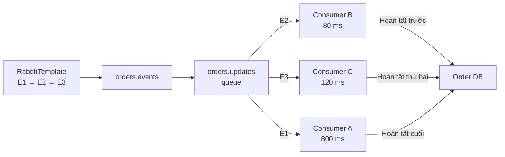
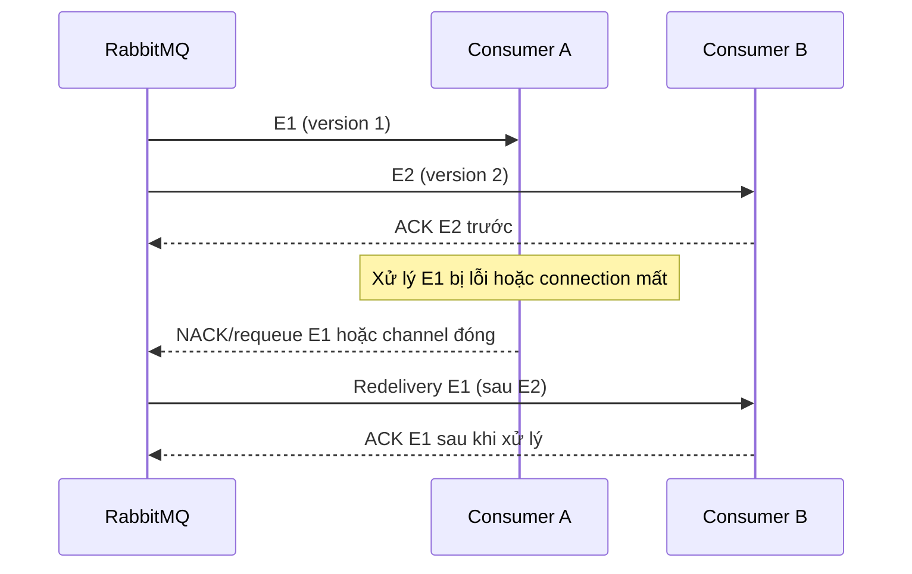

# Nhiều consumer, prefetch và hoàn tất xử lý không cùng thứ tự

Trong RabbitMQ, một queue có thể nhận các message theo thứ tự `M1 → M2 → M3` nhưng ứng dụng Spring AMQP lại **hoàn tất xử lý theo thứ tự `M2 → M3 → M1`**. Tình huống này hoàn toàn có thể xảy ra khi có nhiều `@RabbitListener` cạnh tranh nhận message, mỗi consumer mất thời gian xử lý khác nhau, hoặc một delivery bị lỗi và được giao lại.

Với tác vụ độc lập như tạo thumbnail, gửi thông báo hoặc tính chỉ số cho nhiều người dùng khác nhau, hoàn tất không cùng thứ tự thường chấp nhận được. Nhưng với chuỗi sự kiện của **cùng một đơn hàng** — `CREATED (v1)`, `PAID (v2)`, `CANCELLED (v3)` — xử lý sai thứ tự có thể ghi đè trạng thái mới bằng trạng thái cũ, gây ra side effect sai hoặc trả kết quả không nhất quán.

Bài thuộc chương **Thứ tự và đồng thời** của module `SPRING_AMQP`. Nội dung kết hợp `RabbitTemplate`, exchange, queue, binding, `@RabbitListener`, consumer acknowledgement, prefetch, retry và dead-letter để giải thích giới hạn của FIFO và cách thiết kế xử lý bất đồng bộ đáng tin cậy.

Sau bài học, bạn có thể:

- Phân biệt **thứ tự enqueue**, **thứ tự giao delivery**, **thứ tự bắt đầu xử lý**, **thứ tự commit** và **thứ tự ack**.
- Giải thích tại sao tăng số consumer hoặc `prefetchCount` làm tăng số message đang xử lý nhưng **không bảo đảm hoàn tất đúng thứ tự**.
- Dự đoán tác động của redelivery, retry, `basicAck` và `basicNack` tới chuỗi sự kiện.
- Cấu hình Spring AMQP theo hướng **throughput cao** hoặc **giữ thứ tự**, tùy yêu cầu.
- Thiết kế thứ tự **theo khóa nghiệp vụ** bằng partition/sharding, sequence number, transaction và idempotency.

## 1. Năm khái niệm thứ tự cần tách biệt

Trước khi bàn về cấu hình, cần xác định cụ thể “theo thứ tự” đang nói đến điều gì:

| Loại thứ tự | Câu hỏi | Có thể bị thay đổi bởi |
| --- | --- | --- |
| **Publish/enqueue order** | Broker nhận và xếp message vào queue theo thứ tự nào? | Nhiều publisher, kết nối/channel, routing, priority và chính sách queue |
| **Delivery order** | Broker giao message cho consumer nào, vào lúc nào? | Nhiều consumer, prefetch credit, requeue/redelivery |
| **Start order** | Listener bắt đầu xử lý message nào trước? | Thread scheduling, consumer khác nhau, async dispatch |
| **Commit/completion order** | Database hoặc side effect nào hoàn tất trước? | Thời gian I/O, lock, transaction, retry, thread scheduling |
| **Ack order** | Broker nhận xác nhận của delivery nào trước? | Thời điểm commit, manual ack và lỗi mạng |

Một queue thường ưu tiên giao các message theo thứ tự chúng được enqueue trong điều kiện thông thường, nhưng **không tạo một cam kết toàn cục rằng mọi consumer sẽ commit theo thứ tự đó**. Càng không có bảo đảm rằng hai publisher độc lập sẽ publish các event cùng một thực thể theo đúng thứ tự nghiệp vụ chỉ vì mỗi publisher gọi `RabbitTemplate.convertAndSend(...)` thành công.

Khi nói về FIFO, luôn ghi kèm **phạm vi**: một queue, một luồng publish được tuần tự hóa, một active consumer, không có delivery bị trả lại, và listener xử lý đồng bộ. Thay đổi một trong các điều kiện này có thể thay đổi hành vi quan sát.

### Ví dụ xuyên suốt

Một đơn hàng `ORD-42` có ba event:

| Event | Sequence nghiệp vụ | Trạng thái đích | Thời gian xử lý minh họa |
| --- | --- | --- | --- |
| `E1` | `version=1` | `CREATED` | 800 ms |
| `E2` | `version=2` | `PAID` | 80 ms |
| `E3` | `version=3` | `CANCELLED` | 120 ms |

Giả sử broker đã enqueue đúng `E1, E2, E3`. Nếu có ba consumer đang chờ và cả ba được giao message gần nhau, trạng thái có thể được cập nhật theo thứ tự **`PAID → CANCELLED → CREATED`** nếu ứng dụng ghi trực tiếp `status` mà không kiểm soát sequence. Giá trị cuối `CREATED` là sai, dù mọi message đều được ack thành công.

**Điều quan trọng:** đây là **sai tính đúng đắn nghiệp vụ**, không nhất thiết là lỗi mất message ở RabbitMQ. Durable queue, persistent message và publisher confirm đều không phát hiện được trạng thái bị ghi đè sai.

## 2. Nhiều competing consumers làm gì với một queue?

Trong Spring AMQP, cấu hình concurrency lớn hơn một thường khiến listener container tạo nhiều **competing consumers** cùng đọc một queue. Broker phân phối delivery dựa trên consumer có thể nhận thêm và tình trạng prefetch, không yêu cầu consumer xử lý xong một message trước khi giao message kế tiếp cho consumer khác.



**Dòng thời gian minh họa** (không phải quy tắc phân phối cố định):

| Thời điểm | Consumer A | Consumer B | Consumer C | Database thấy |
| --- | --- | --- | --- | --- |
| 0 ms | Nhận `E1`, xử lý | Nhận `E2`, xử lý | Nhận `E3`, xử lý | Trạng thái ban đầu |
| 80 ms | Chưa xong | Commit `E2`, ack | Chưa xong | `PAID` |
| 120 ms | Chưa xong | Sẵn sàng nhận message khác | Commit `E3`, ack | `CANCELLED` |
| 800 ms | Commit `E1`, ack | — | — | `CREATED` nếu ghi đè không kiểm soát |

Kết luận từ ví dụ: **thứ tự delivery không quyết định thứ tự commit khi các delivery được xử lý đồng thời**. Điều này xảy ra ngay cả khi cả ba consumer đều hoạt động chính xác và không có retry.

### 2.1. Delivery tag không phải số thứ tự toàn cục

RabbitMQ cấp `deliveryTag` tăng dần **trong từng AMQP channel**. Ba consumer thường có các channel riêng, vì vậy cả ba message `E1`, `E2` và `E3` đều có thể mang `deliveryTag=1` trên ba channel khác nhau.

`deliveryTag` dùng để `basicAck`/`basicNack` delivery trên **đúng channel nhận nó**, không dùng để so sánh thứ tự giữa consumer hoặc làm sequence của đơn hàng. Nếu mang tag từ channel A sang channel B để ack, broker có thể đóng channel vì tag không hợp lệ.

### 2.2. Số consumer và số thread xử lý

Với `SimpleMessageListenerContainer`, thuộc tính `concurrentConsumers` xác định số consumer chạy song song; `maxConcurrentConsumers` là trần nếu bật khả năng mở rộng động. Đặt cùng một giá trị cho cả hai để có số consumer cố định khi thử nghiệm.

Với `DirectMessageListenerContainer`, mô hình thread và cấu hình khác; không áp dụng máy móc mọi thuộc tính của `SimpleMessageListenerContainer`. Trong bài này các ví dụ Java dùng **`SimpleRabbitListenerContainerFactory`**.

## 3. Prefetch là giới hạn delivery chưa ack, không phải cơ chế giữ thứ tự

RabbitMQ hỗ trợ QoS/prefetch để hạn chế số **delivery chưa được xác nhận** mà broker cho phép consumer giữ. Với cách dùng phổ biến trong Spring AMQP, `prefetchCount=N` giới hạn số delivery outstanding **trên mỗi consumer**, không có nghĩa container phải xử lý đồng thời N message.

Ví dụ cấu hình:

```text
concurrentConsumers = 3
prefetchCount       = 5

Outstanding deliveries có thể tiến tới 3 × 5 = 15
(nếu các consumer có đủ message được giao và chưa ack).
```

Đây là số lượng message tối đa theo prefetch trong ví dụ đơn giản, **không phải 15 thread xử lý**. Với listener đồng bộ và mỗi consumer có một luồng xử lý, ba consumer có thể thực sự xử lý ba message cùng lúc; phần message được prefetch thêm có thể nằm chờ ở client/consumer.

| Cấu hình | Điều thay đổi | Điều **không** suy ra được |
| --- | --- | --- |
| 1 consumer, `prefetch=1` | Một delivery chưa ack tại một thời điểm | Không bảo đảm hai publisher độc lập phát đúng thứ tự nghiệp vụ |
| 1 consumer, `prefetch=20` | Có thể giữ tới 20 delivery chưa ack | Không tự biến thành 20 lần xử lý đồng thời nếu listener vẫn đồng bộ |
| 3 consumer, `prefetch=1` | Tối đa khoảng 3 delivery chưa ack ở cùng thời điểm | **Không giữ completion order** giữa ba consumer |
| 3 consumer, `prefetch=20` | Có thể có tới khoảng 60 delivery outstanding | Không bảo đảm tăng throughput tuyến tính; phạm vi redelivery khi mất kết nối lớn hơn |

**Ngộ nhận phổ biến:** chỉ cần đặt `prefetch=1` là thứ tự toàn queue sẽ được giữ. Điều này **sai khi vẫn có nhiều consumer**: ba consumer có `prefetch=1` vẫn có thể nhận ba event khác nhau và hoàn tất ngoài thứ tự.

Ngoài ra, nếu ứng dụng chủ động đẩy việc xử lý sang thread pool hoặc chạy bất đồng bộ rồi ack từ những đường xử lý khác nhau, một consumer logic duy nhất cũng có thể làm mất thứ tự hoàn tất. Khi cần thứ tự chặt chẽ, hãy kiểm soát cả **số consumer lẫn cách listener thực thi và thời điểm ack**.

## 4. Cấu hình một hệ thống xử lý song song bằng Spring AMQP

Giả sử producer publish từng cập nhật đơn hàng vào direct exchange `orders.events` với routing key `order.updated`. Queue `orders.updates` nhận message qua binding. Ta thử ba consumer và prefetch năm.

### 4.1. Exchange, queue, binding và container factory

```java
import org.springframework.amqp.core.AcknowledgeMode;
import org.springframework.amqp.core.Binding;
import org.springframework.amqp.core.BindingBuilder;
import org.springframework.amqp.core.DirectExchange;
import org.springframework.amqp.core.Queue;
import org.springframework.amqp.core.QueueBuilder;
import org.springframework.amqp.rabbit.config.SimpleRabbitListenerContainerFactory;
import org.springframework.amqp.rabbit.connection.ConnectionFactory;
import org.springframework.context.annotation.Bean;
import org.springframework.context.annotation.Configuration;

@Configuration
public class OrderUpdatesConfig {
    @Bean
    DirectExchange ordersEventsExchange() {
        return new DirectExchange("orders.events", true, false);
    }

    @Bean
    Queue ordersUpdatesQueue() {
        return QueueBuilder.durable("orders.updates").build();
    }

    @Bean
    Binding ordersUpdatesBinding(Queue ordersUpdatesQueue,
                                 DirectExchange ordersEventsExchange) {
        return BindingBuilder.bind(ordersUpdatesQueue)
                .to(ordersEventsExchange).with("order.updated");
    }

    @Bean("parallelOrderFactory")
    SimpleRabbitListenerContainerFactory parallelOrderFactory(
            ConnectionFactory connectionFactory) {
        SimpleRabbitListenerContainerFactory factory =
                new SimpleRabbitListenerContainerFactory();
        factory.setConnectionFactory(connectionFactory);
        factory.setConcurrentConsumers(3);
        factory.setMaxConcurrentConsumers(3);
        factory.setPrefetchCount(5);
        factory.setAcknowledgeMode(AcknowledgeMode.MANUAL);
        return factory;
    }
}
```

Đây là cấu hình hướng đến **throughput**, dùng queue durable và một direct exchange với binding xác định. Cấu hình này **không duy trì thứ tự commit cho cùng `orderId`**; phải bổ sung cơ chế ở tầng nghiệp vụ nếu event có phụ thuộc thứ tự.

Nếu dùng `AcknowledgeMode.AUTO`, container quản lý ack và xử lý exception theo cấu hình; dùng `MANUAL` ở đây để thấy rõ trách nhiệm ack sau commit. Đừng gọi `basicAck` thủ công trong listener do AUTO ack quản lý mà không có lý do được framework hỗ trợ rõ ràng.

### 4.2. Producer: event ID và sequence cần được tạo từ nghiệp vụ

Mỗi cập nhật cần ít nhất một định danh sự kiện ổn định và sequence trong phạm vi đơn hàng. Ví dụ payload đơn giản `ORD-42|2|PAID`:

```java
import org.springframework.amqp.core.MessageDeliveryMode;
import org.springframework.amqp.rabbit.core.RabbitTemplate;

public class OrderUpdatesPublisher {
    private final RabbitTemplate rabbitTemplate;

    public OrderUpdatesPublisher(RabbitTemplate rabbitTemplate) {
        this.rabbitTemplate = rabbitTemplate;
    }

    public void publish(String orderId, long version, String status) {
        String payload = orderId + "|" + version + "|" + status;
        rabbitTemplate.convertAndSend(
                "orders.events", "order.updated", payload,
                message -> {
                    message.getMessageProperties().setMessageId(
                            orderId + ":" + version);
                    message.getMessageProperties().setDeliveryMode(
                            MessageDeliveryMode.PERSISTENT);
                    return message;
                });
    }
}
```

Trong ví dụ, `orderId + ":" + version` là **event ID** chỉ khi domain bảo đảm mỗi phiên bản của một đơn hàng tương ứng đúng một event. Nếu có nhiều sự kiện ở cùng version, hãy dùng event UUID/ID riêng và giữ nguyên qua retry; vẫn phải mang `orderId` và `version` riêng để kiểm soát thứ tự.

**Nguồn phát phải cấp version đúng.** Nếu nhiều thread/publisher cùng cập nhật một đơn hàng và tự tăng biến đếm cục bộ, có thể sinh trùng hoặc đảo version. Nên cấp sequence qua transaction của aggregate/database và ghi sự kiện bằng **transactional outbox** trong cùng transaction cập nhật trạng thái. Publisher confirms/returns giúp biết trạng thái gửi tới broker, nhưng **không tự sửa thứ tự nghiệp vụ do nhiều publisher phát sai**.

## 5. Listener: ACK đúng sau commit vẫn không tự giữ thứ tự

Một listener song song thường có mẫu:

```java
import java.io.IOException;
import java.nio.charset.StandardCharsets;

import com.rabbitmq.client.Channel;
import org.springframework.amqp.core.Message;
import org.springframework.amqp.rabbit.annotation.RabbitListener;
import org.springframework.dao.TransientDataAccessException;
import org.springframework.stereotype.Component;

@Component
public class OrderUpdatesListener {
    private final OrderProjectionService service;

    public OrderUpdatesListener(OrderProjectionService service) {
        this.service = service;
    }

    @RabbitListener(
            queues = "orders.updates",
            containerFactory = "parallelOrderFactory")
    public void onMessage(Message message, Channel channel)
            throws IOException {
        long tag = message.getMessageProperties().getDeliveryTag();
        try {
            String raw = new String(
                    message.getBody(), StandardCharsets.UTF_8);
            // parse yêu cầu ba phần orderId|version|status.
            OrderUpdate event = OrderUpdate.parse(raw);

            // Service khác bean, có transaction database và idempotency.
            service.applyInOrder(event);
            channel.basicAck(tag, false);   // Chỉ ACK sau commit
        } catch (IllegalArgumentException ex) {
            channel.basicReject(tag, false); // Dữ liệu lỗi vĩnh viễn -> DLQ
        } catch (SequenceGapException ex) {
            // Minh họa tín hiệu retry. Production cần backoff và giới hạn.
            channel.basicNack(tag, false, true);
        } catch (TransientDataAccessException ex) {
            channel.basicNack(tag, false, true);
        }
    }
}
```

Các lớp `OrderUpdate`, `OrderProjectionService` và `SequenceGapException` là thành phần nghiệp vụ do ứng dụng triển khai; logic kiểm soát version sẽ được mô tả ở mục 8. Trong bản triển khai thực tế, parser phải phân loại rõ input không hợp lệ, service cần transaction/unique constraint, và listener cần xử lý exception ngoài các trường hợp ví dụ theo một chính sách lỗi rõ ràng.

Ở đây mỗi message chỉ được ack **sau** khi `applyInOrder` hoàn tất và transaction đã commit. Điều này tránh việc broker xóa message trước khi database lưu thành công, nhưng **không bảo đảm đúng thứ tự** nếu `applyInOrder` chỉ chạy `UPDATE orders SET status = :status` mà không so khớp sequence.

### 5.1. Cẩn trọng với `multiple=true`

`basicAck(tag, false)` xác nhận **một delivery**. Trong AMQP, `basicAck(tag, true)` xác nhận **mọi delivery còn chưa ack có tag không lớn hơn `tag` trên cùng channel**. Nó không có nghĩa “ack message có version thấp hơn hoặc bằng version này”, và không thể ack message trên channel khác.

Nếu xử lý bất đồng bộ trên **cùng channel** khiến delivery có tag 12 hoàn tất trước tag 11, gọi `basicAck(12, true)` có thể xác nhận cả tag 11 đang xử lý dở. Ngược lại, `basicNack(12, true, true)` có thể requeue nhiều delivery đang chờ. Khi cần xác nhận độc lập, dùng `multiple=false` và tuân thủ đúng channel gốc.

**Không sử dụng delivery tag để phân định thứ tự nghiệp vụ.** Event version phải do producer/domain phát hành và có tính ổn định qua mọi lần redelivery.

## 6. Redelivery làm bài toán thứ tự khó hơn

Ngay cả với một queue đã nhận đúng `E1 → E2 → E3`, một delivery bị lỗi có thể được trả về queue:



Khi `requeue=true`, RabbitMQ cố gắng đưa message trở lại vị trí phù hợp trong queue, nhưng với nhiều consumer và delivery đang lưu chuyển, **vị trí chính xác và thứ tự giao lại không được bảo đảm như luồng ban đầu**. Một message còn unacked cũng có thể được broker giao lại khi channel/connection đóng, kể cả nếu database đã commit nhưng ack chưa đến broker.

| Tình huống | Ảnh hưởng thứ tự |
| --- | --- |
| `basicNack(tag, false, true)` | Delivery có thể quay lại queue và được giao sau message version lớn hơn |
| Consumer chết trước ack | Tất cả delivery unacked liên quan được requeue; thứ tự xử lý có thể thay đổi |
| Retry queue dùng TTL + DLX | Message rời luồng chính, quay lại muộn hơn các message mới |
| DLQ và replay thủ công | Event cũ có thể xuất hiện sau khi các version mới đã xử lý |
| Nhiều publisher độc lập | Thứ tự đến queue có thể khác thứ tự nghiệp vụ ngay từ đầu |
| Message priority/đường routing khác nhau | Thứ tự dequeue có thể khác thứ tự publish được kỳ vọng |

**Cần phân biệt giao lại với xử lý trùng:** cờ `redelivered` cho biết broker đánh dấu message đã được giao lại, **không chứng minh** việc xử lý trước đó đã commit hay chưa. Tầng nghiệp vụ phải dùng event ID và transaction idempotent để quyết định có áp dụng tác dụng phụ lần nữa không.

## 7. Khi nào chấp nhận hoàn tất ngoài thứ tự?

Không phải tất cả workload đều cần serialize mọi message.

| Workload | Có phụ thuộc thứ tự? | Hướng thiết kế |
| --- | --- | --- |
| Gửi email độc lập cho các người nhận khác nhau | Thường không | Nhiều consumer, prefetch phù hợp, idempotency theo notification ID |
| Tạo thumbnail của các ảnh độc lập | Thường không | Chia tải song song; ack sau khi ảnh được lưu |
| Cập nhật trạng thái **cùng một** đơn hàng | Có | Single active consumer, partition theo orderId hoặc version check |
| Cộng số lượng giao dịch độc lập vào bộ đếm | Có thể ít phụ thuộc nếu phép cộng đúng tính chất | Atomic increment + dedup; kiểm tra yêu cầu hiển thị/side effect |
| Áp dụng ledger/balance với hạn mức và kiểm tra số dư | Thường có | Transaction/serialization theo accountId và sequence |
| Sync snapshot giá mới nhất | Có thể nhận snapshot mới hơn trước snapshot cũ | Dùng version monotonic, chỉ nhận version mới nhất; xác định rõ hợp đồng dữ liệu |

**Quy tắc quan trọng:** “sự kiện có thể xử lý độc lập” phải được chứng minh từ nghiệp vụ, không suy ra chỉ vì chúng đến qua các message khác nhau. Hai event cập nhật cùng một aggregate thường đòi hỏi phối hợp thứ tự ngay cả khi từng event không tạo exception.

## 8. Ba chiến lược duy trì thứ tự

### 8.1. Cách đơn giản: một consumer, prefetch bằng một

Nếu workload ít, một queue có một consumer duy nhất, xử lý **đồng bộ** và ack sau commit là cách dễ hiểu nhất:

```java
@Bean("orderedOrderFactory")
SimpleRabbitListenerContainerFactory orderedOrderFactory(
        ConnectionFactory connectionFactory) {
    SimpleRabbitListenerContainerFactory factory =
            new SimpleRabbitListenerContainerFactory();
    factory.setConnectionFactory(connectionFactory);
    factory.setConcurrentConsumers(1);
    factory.setMaxConcurrentConsumers(1);
    factory.setPrefetchCount(1);
    factory.setAcknowledgeMode(AcknowledgeMode.MANUAL);
    return factory;
}
```

Đây là **một phần phương thức cấu hình** đặt trong lớp `@Configuration` với các import tương tự mục 4. Khi ứng dụng chạy nhiều instance, mỗi instance vẫn có thể tạo một consumer cho queue đó; đặt concurrency bằng một trên từng instance **không có nghĩa toàn cluster chỉ có một consumer**.

Để broker chỉ cho **một consumer hoạt động tại một thời điểm** dù có nhiều instance, có thể khai báo queue với argument `x-single-active-consumer=true` **ngay từ lúc tạo queue**:

```java
@Bean
Queue orderedOrdersQueue() {
    return QueueBuilder.durable("orders.ordered")
            .withArgument("x-single-active-consumer", true)
            .build();
}
```

Đây là **một queue riêng** cho ví dụ chế độ tuần tự; không dùng tên `orders.updates` đang tồn tại nếu muốn đổi queue arguments trong lúc chạy. RabbitMQ không cho chỉnh các immutable queue arguments tùy ý trên queue đã khai báo. Trong mô hình hoàn chỉnh, cần binding và listener trỏ đến `orders.ordered`, dùng factory một consumer/prefetch một ở trên.

**Single Active Consumer (SAC)** cho phép có consumer chờ dự phòng nhưng chỉ một consumer được broker chọn để nhận delivery tại một thời điểm. Khi active consumer mất kết nối, broker có thể chuyển vai trò sang consumer khác. SAC giúp duy trì một luồng giao tuần tự ở broker; nó **không biến publish từ nhiều nguồn thành sequence nghiệp vụ đúng**, không khử duplicate sau failover, và không bảo vệ nếu listener tự spawn tác vụ song song/ack quá sớm.

Với `prefetch=1`, listener chạy đồng bộ, một active consumer và nguồn phát sự kiện cùng khóa theo thứ tự, khả năng xử lý từng delivery theo thứ tự tăng lên rõ rệt. Đánh đổi là **một message chậm hoặc lỗi có thể chặn toàn bộ queue**.

### 8.2. Tăng throughput: chia queue theo khóa nghiệp vụ

Khi cần xử lý đồng thời nhiều đơn hàng nhưng vẫn giữ thứ tự **trong từng đơn**, có thể phân vùng bằng khóa ổn định:

```text
shard = stableHash(orderId) % 4

orders.events exchange
  routingKey=orders.shard.0 -> orders.shard.0 -> 1 active consumer
  routingKey=orders.shard.1 -> orders.shard.1 -> 1 active consumer
  routingKey=orders.shard.2 -> orders.shard.2 -> 1 active consumer
  routingKey=orders.shard.3 -> orders.shard.3 -> 1 active consumer

Mọi event của cùng orderId luôn vào cùng shard.
Các orderId khác có thể xử lý đồng thời ở shard khác.
```

Có thể dùng direct exchange và khai báo bốn binding tương ứng. Producer chọn routing key theo `orderId`. Nếu không muốn tự duy trì hàm băm/routing, có thể nghiên cứu plugin consistent-hash exchange hoặc một cơ chế phân vùng phù hợp với nền tảng, nhưng cần kiểm tra hỗ trợ triển khai.

**Ràng buộc thiết kế:**

- Hàm băm phải **ổn định giữa tất cả producer**; đừng dùng `String.hashCode()` kết hợp thuật toán chọn shard thay đổi ngẫu hứng mà không có kế hoạch di chuyển.
- Không tự tăng số shard bằng cách đổi từ `%4` sang `%8` khi vẫn còn backlog: cùng `orderId` có thể chuyển queue, khiến version mới vượt version cũ còn ở shard trước. Cần quy trình drain/migration và version router.
- Mỗi shard cần tối đa một luồng **áp dụng state** tại một thời điểm nếu muốn dựa vào thứ tự đến queue; có thể dùng SAC + xử lý đồng bộ.
- **Cùng shard không tự làm đúng thứ tự phát từ upstream.** Producer phải tạo sequence đúng, publish qua outbox theo chính sách giữ thứ tự per aggregate; retry/delay có thể vẫn phá thứ tự giao.
- Sự cố của một event có thể chặn shard chứa nhiều orderId; cần chọn mức chia shard theo throughput, độ trễ và khả năng khôi phục.

### 8.3. Kiểm soát bằng sequence và transaction ở database

Một lựa chọn khác là cho nhiều consumer xử lý song song, nhưng **bảo vệ trạng thái ở database**. Mỗi event chứa `orderId`, `eventId` và `version` tăng tuần tự trong aggregate. Database giữ `last_applied_version`:

```text
Nếu version == last_applied_version + 1:
    Áp dụng state trong transaction, lưu eventId, tăng version.
Nếu eventId đã xử lý:
    Bỏ qua side effect, xác nhận delivery.
Nếu version > last_applied_version + 1:
    Có khoảng trống (gap) -> giữ lại/chờ version trước.
Nếu version <= last_applied_version nhưng eventId chưa biết:
    Có xung đột hoặc event cũ -> xử lý theo hợp đồng dữ liệu,
    không tự động coi mọi trường hợp là duplicate.
```

Ví dụ có hàng projection đã được khởi tạo cho từng `orderId` với `last_applied_version=0`. Câu lệnh cập nhật có điều kiện sau giúp ngăn ghi đè version cũ:

```sql
UPDATE order_projection
SET status = :newStatus,
    last_applied_version = :version
WHERE order_id = :orderId
  AND last_applied_version = :version - 1;
```

Nếu câu lệnh ảnh hưởng **một hàng**, version đó có thể đã được áp dụng; cần cập nhật dữ liệu liên quan và đánh dấu `eventId` trong **cùng transaction**. Nếu ảnh hưởng **0 hàng**, không được ack ngay như thành công mà phải xác định lý do: đã xử lý, bị thiếu version trước, không tồn tại aggregate hay xung đột. Có thể đọc row với lock (`SELECT ... FOR UPDATE`), dùng optimistic locking/unique constraint và quy tắc riêng cho từng loại event.

Một thiết kế xử lý event đáng tin cậy cần đồng thời:

1. **Idempotency:** bảng `processed_events(consumer_name, event_id)` có unique constraint; marker và thay đổi state được commit trong một transaction.
2. **Ordering:** `last_applied_version` hoặc quy tắc version riêng của aggregate; không ghi đè state mới bằng event cũ.
3. **Gap handling:** khi v3 đến trước v2, giữ v3 trong pending/inbox để thử lại sau khi v2 xuất hiện, hoặc delayed retry với backoff; **không ack bỏ luôn v3** nếu đây là event dạng delta cần áp dụng.
4. **Conflict handling:** nếu hai event khác ID cùng nhận một version, báo xung đột và điều tra upstream; không âm thầm chọn event đến cuối.
5. **Recovery:** có cảnh báo cho gap kéo dài, biết cách tìm sự kiện bị thiếu, replay từ outbox/DLQ và kiểm tra lại projection.

**Một ngoại lệ hợp lệ:** với event dạng **full snapshot** chỉ cần trạng thái mới nhất, có thể cố ý áp dụng `version > currentVersion` và bỏ qua snapshot cũ. Với event dạng **delta/command** như `Debit(100)` hoặc `AddItem`, bỏ qua các version nằm giữa có thể mất thao tác nghiệp vụ. Cần nêu rõ hợp đồng dữ liệu trước khi chọn chiến lược.

## 9. Vì sao retry tức thời có thể làm tệ thêm việc giữ thứ tự?

Trong listener mục 5, khi thấy `SequenceGapException`, ví dụ gọi `basicNack(tag, false, true)`. Broker có thể giao lại message rất nhanh khi version trước chưa xuất hiện; điều này dẫn đến:

- **Hot loop:** v3 bị requeue nhiều lần, tốn CPU/network, tăng log và khiến consumer không còn năng lực phục vụ v2.
- **Head-of-line blocking:** nếu một shard có một consumer và prefetch một, message lỗi có thể cản cả shard; retry quá nhanh có thể chiếm luồng xử lý.
- **Nguy cơ reordering:** nếu v3 được đưa vào retry queue TTL rồi quay lại muộn, v4/v5 có thể đến trước.
- **Nguy cơ duplicate:** nếu service commit rồi ack mất, broker redeliver; cần idempotency cả khi retry không phải do logic gap.

Do đó production nên dùng **delayed retry có giới hạn**, một **pending-events table** theo `orderId/version` hoặc hàng chờ phụ thuộc được giám sát. Khi v2 đã được áp dụng, worker có thể đánh thức v3 từ pending và áp dụng tiếp. Thiết kế nên đặt một ngưỡng thời gian hợp lý để điều tra nếu version bị thiếu vĩnh viễn.

Khi dùng DLQ, lưu ý message bị đẩy sang dead-letter không chứng minh chuỗi nghiệp vụ đã hoàn thành. Nếu v2 vào DLQ mà v3/v4 vẫn chờ gap, cần một quy trình sửa lỗi và replay đủ để khôi phục chuỗi, tránh tự động bỏ gap.

## 10. Ack, giao dịch và idempotency trong môi trường nhiều consumer

Thứ tự commit và ack là hai chuyện khác nhau. Khi `service.applyInOrder(...)` commit database thành công rồi tiến trình chết trước khi gọi `basicAck`, broker có thể giao lại cùng event tới consumer khác:

```mermaid
sequenceDiagram
    participant B as RabbitMQ
    participant A as Consumer A
    participant D as Database
    participant C as Consumer B
    B->>A: E2 (order=ORD-42, version=2)
    A->>D: Commit v2 + processed_events(E2)
    Note over A,B: A mất kết nối trước ACK
    B->>C: Redeliver E2
    C->>D: Kiểm tra eventId/version
    D-->>C: E2 đã xử lý; không áp dụng lại
    C-->>B: basicAck (trên channel của C)
```

`@Transactional` của database không tự tạo giao dịch nguyên tử với RabbitMQ consumer ack. Kết hợp **at-least-once delivery + idempotent transaction** là cách phổ biến để tránh tác dụng phụ trùng. Nếu consumer còn gọi API bên ngoài, idempotency ở local database vẫn chưa đủ: cần idempotency key tại API đích, outbox hoặc cơ chế trạng thái/reconciliation phù hợp.

Publisher confirm cũng không quyết định thứ tự commit. Nó xác nhận broker tiếp nhận publish ở phía `RabbitTemplate`, trong khi thứ tự hoàn tất phụ thuộc consumer và database. Không lấy thời gian confirm hoặc `deliveryTag` để thay cho sequence nghiệp vụ.

## 11. Chọn cấu hình theo nhu cầu: throughput và ordering

| Mục tiêu | Consumer/prefetch | Cơ chế nghiệp vụ | Đánh đổi |
| --- | --- | --- | --- |
| Xử lý nhiều tác vụ **độc lập** | Nhiều consumer, prefetch theo đo đạc | Idempotency, ack sau commit, retry/DLQ | Completion không cùng thứ tự |
| Thứ tự **toàn queue** ở mức xử lý đồng bộ | SAC hoặc bảo đảm chỉ một consumer toàn hệ thống; prefetch 1 | Producer có thứ tự, ack sau commit, kiểm soát redelivery | Throughput thấp; một message chậm chặn queue |
| Thứ tự **theo orderId/accountId** nhưng vẫn cần throughput | Chia shard theo key, một active consumer mỗi shard | Sequence + event ID + outbox | Quản lý shard, chuyển shard phức tạp |
| Nhiều consumer trên cùng queue, vẫn muốn state đúng | Concurrency theo năng lực DB; prefetch phù hợp | Row lock/optimistic locking, version + inbox pending | Gap handling, lock contention và retry phức tạp |
| Chỉ cần snapshot mới nhất | Có thể xử lý song song | So sánh version, cập nhật nếu mới hơn | Không dùng được cho delta bắt buộc áp dụng đầy đủ |

Không có một giá trị `prefetchCount` tối ưu cho mọi hệ thống. Prefetch lớn có thể giảm thời gian chờ broker, nhưng nhiều outstanding deliveries đồng nghĩa có nhiều message cần redelivery khi consumer chết. Prefetch thấp giảm phạm vi outstanding nhưng có thể làm throughput thấp nếu xử lý cực nhanh và độ trễ mạng đáng kể.

Điểm quyết định không chỉ là “nhanh hay chậm” mà là **bất biến nghiệp vụ cần giữ**: mỗi event có bắt buộc được áp dụng hay chỉ cần trạng thái cuối, và thứ tự cần giữ trên toàn hệ thống hay chỉ trong từng aggregate.

## 12. Kiểm chứng thực nghiệm: nhìn cả delivery và completion order

Thiết lập RabbitMQ thử nghiệm với `orders.events`, queue `orders.updates` và ba consumer ở mục 4. Sử dụng event ID, order ID và version trong log; quan sát cả `messages_ready`, `messages_unacknowledged`, số consumer và số lần redelivery.

1. **Đối chứng tuần tự:** chạy một consumer, prefetch một, producer tuần tự gửi v1, v2, v3. Cho listener xử lý đồng bộ. Ghi thứ tự bắt đầu, commit và ack để xác định baseline.
2. **Ba consumer và thời gian xử lý khác nhau:** chạy concurrency ba, prefetch một; cho v1 chậm 800 ms, v2 80 ms, v3 120 ms. Quan sát commit `v2 → v3 → v1` dù broker được cung cấp message `v1 → v2 → v3`. Với version check, các event đến sớm phải chờ hoặc retry an toàn thay vì ghi đè state.
3. **Tăng prefetch nhưng giữ một consumer:** từ 1 lên 10. Với listener đồng bộ, chứng minh rằng prefetch cao hơn **không tự tạo 10 tác vụ xử lý đồng thời**; số unacked có thể tăng.
4. **Giữ prefetch một nhưng dùng nhiều consumer:** cho ba event độc lập và độ trễ khác nhau; chứng minh `prefetch=1` không bảo đảm completion order giữa các consumer.
5. **Crash sau commit trước ack:** dừng consumer sau khi ghi state và event ID nhưng trước ack. Khởi động lại; xác minh event redeliver, bảng idempotency ngăn áp dụng state lần hai.
6. **Gap version:** đưa v3 vào queue trước v2. Kiểm tra projection không được nhảy sai; cơ chế pending/retry phải áp dụng v2 trước rồi mới v3, hoặc phát cảnh báo nếu v2 vắng quá hạn.
7. **Poison message và DLQ:** tạo v2 lỗi vĩnh viễn. Kiểm tra v3 đang chờ gap, DLQ có event cần điều tra và hệ thống không âm thầm báo đơn hàng đã hoàn thành.
8. **Failover single active consumer:** trên queue SAC thử nghiệm, dừng active consumer và quan sát consumer dự phòng nhận delivery. Xác minh redelivery không làm trùng side effect và thứ tự projection vẫn được kiểm soát.

### Logging và metrics cần thiết

Ghi tối thiểu `eventId`, `aggregateId/orderId`, `version`, listener instance, consumer tag, delivery tag, `redelivered`, thời điểm bắt đầu, thời điểm commit, ack/nack và kết quả xử lý. Delivery tag chỉ hữu ích khi đi kèm nhận diện **channel**, không phải global sequence.

Theo dõi:

- **RabbitMQ:** `messages_ready`, `messages_unacknowledged`, `consumer_count`, tốc độ deliver/ack/redeliver, độ sâu DLQ, trạng thái queue.
- **Spring listener:** concurrency đang hoạt động, thời gian xử lý p95/p99, prefetch, exception/retry, số lần đứt connection.
- **Nghiệp vụ:** tỷ lệ event có `version gap`, thời gian chờ gap, duplicate bị chặn, xung đột version, rollback và số aggregate có trạng thái không nhất quán.
- **Độ trễ đầu cuối:** thời gian từ khi outbox ghi event đến khi projection đã commit version đó; so sánh theo từng aggregate.

Nếu throughput tăng nhưng số gap/duplicate/rollback tăng theo, việc “tối ưu” concurrency có thể đang gây thiệt hại cho tính đúng đắn và chi phí phục hồi.

## 13. Những lỗi thiết kế thường gặp

| Sai lầm | Vì sao sai | Cách sửa |
| --- | --- | --- |
| “Queue FIFO nên mọi listener xử lý đúng thứ tự” | FIFO của queue không bảo đảm commit của nhiều consumer | Nêu phạm vi thứ tự; dùng single consumer hoặc sequence/partition |
| “`prefetch=1` là đủ để giữ thứ tự” | Nhiều consumer vẫn xử lý đồng thời | Giới hạn tổng active consumer hoặc kiểm soát version |
| “Một consumer thì luôn đúng thứ tự” | Async task, nhiều producer và requeue có thể phá thứ tự | Xử lý đồng bộ, prefetched delivery phù hợp, hợp đồng producer rõ |
| “Delivery tag lớn hơn nghĩa là business version mới hơn” | Tag chỉ có hiệu lực trên một channel | Gắn `aggregateId` và `version` từ nghiệp vụ |
| “Ack message mới nhất là đã ack cả chuỗi event cũ” | `multiple=true` theo delivery tag trên channel, không theo sequence nghiệp vụ | Ack từng delivery hoặc chỉ ack dải thực sự thành công |
| “Retry ngay là an toàn” | Gây hot loop, reordering, nghẽn các event khác | Backoff, delayed retry/pending table, giới hạn và DLQ |
| “Event cũ cứ bỏ đi” | Với delta event, bỏ sót một operation sẽ làm sai state | Phân biệt snapshot và delta, kiểm tra gap |
| “Chỉ cần DB unique orderId là tránh mọi duplicate” | Duplicate event có thể gây side effect khác hoặc khác version | Unique event ID, transaction, version check, idempotency API ngoài |

## 14. Câu hỏi tự kiểm tra

1. RabbitMQ enqueue `E1 → E2 → E3` và có ba consumer. Vì sao `E2` có thể commit trước `E1` dù broker giao đúng thứ tự?
2. `concurrentConsumers=3` và `prefetchCount=5`: có thể có bao nhiêu delivery outstanding trong trường hợp đơn giản? Điều đó có nghĩa 15 thread cùng xử lý không?
3. Vì sao `prefetch=1` vẫn không bảo đảm thứ tự commit nếu có ba competing consumers?
4. `deliveryTag` có dùng để so sánh sự kiện từ hai channel khác nhau không? Vì sao?
5. Một consumer commit v2 rồi mất kết nối trước ack; broker redeliver v2. Làm sao vừa ack an toàn vừa không áp dụng tác dụng phụ lần hai?
6. Khi v3 được nhận trước v2, hành vi đúng khác nhau thế nào giữa event dạng snapshot và event dạng delta?
7. SAC khác gì với đặt `concurrentConsumers=1` trên từng instance ứng dụng?
8. Vì sao tăng shard từ bốn lên tám bằng cách đổi hàm `hash(key) % N` trực tiếp có thể làm mất thứ tự theo key?
9. Nếu phiên bản trước bị đưa vào DLQ mà phiên bản sau đang chờ, vì sao không thể coi việc phiên bản sau nhận được confirm/ack là nghiệp vụ thành công?

## Tài liệu tham khảo

- [RabbitMQ — Queues](https://www.rabbitmq.com/docs/queues): đặc tính queue, thứ tự, requeue và các điều kiện ảnh hưởng việc giao message.
- [RabbitMQ — Consumers](https://www.rabbitmq.com/docs/consumers): competing consumers, Single Active Consumer và hành vi khi consumer thay đổi.
- [RabbitMQ — Consumer Prefetch](https://www.rabbitmq.com/docs/consumer-prefetch): `basic.qos`, giới hạn delivery chưa ack và cách RabbitMQ áp dụng per-consumer prefetch.
- [RabbitMQ — Consumer Acknowledgements and Publisher Confirms](https://www.rabbitmq.com/docs/confirms): delivery tags, `basicAck`/`basicNack`, redelivery và mức bảo đảm.
- [RabbitMQ — Dead Letter Exchanges](https://www.rabbitmq.com/docs/dlx): xử lý message lỗi, dead-letter và tác động tới thứ tự.
- [Spring AMQP — Listener Concurrency](https://docs.spring.io/spring-amqp/reference/amqp/listener-concurrency.html): cấu hình concurrency của listener containers.
- [Spring AMQP — Listener Container Properties](https://docs.spring.io/spring-amqp/reference/amqp/containerAttributes.html): prefetch, acknowledge mode và các thuộc tính liên quan.
- [Spring AMQP — Annotation-driven Listener Endpoints](https://docs.spring.io/spring-amqp/reference/amqp/receiving-messages/async-annotation-driven.html): `@RabbitListener` và phương thức xử lý message.
