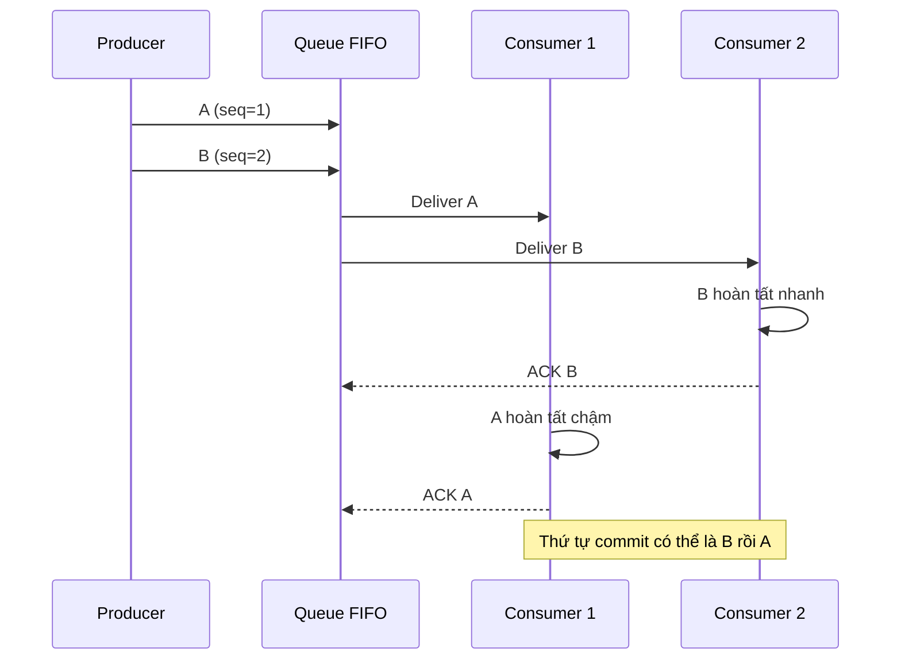
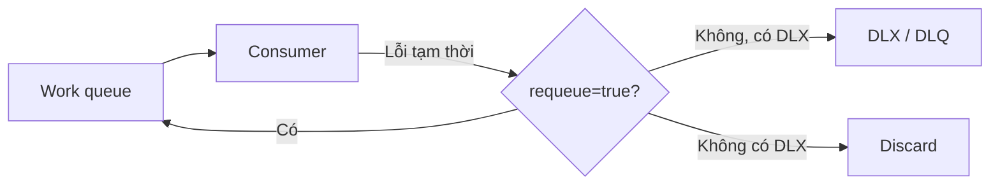
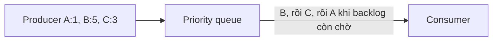
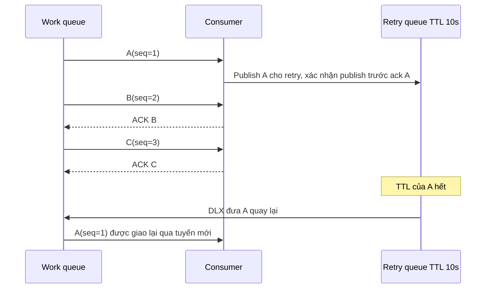

# Requeue, redelivery, priority và retry làm thay đổi thứ tự

> **Chương:** Thứ tự và đồng thời  
> **Module:** SPRING_AMQP — tích hợp RabbitMQ với Spring AMQP qua `RabbitTemplate`, `@RabbitListener`, exchange, queue và binding; thực hành định tuyến message, xác nhận giao nhận, retry, dead-letter, giao dịch và quan sát để xây dựng xử lý bất đồng bộ đáng tin cậy.
>
> **Trọng tâm:** Vì sao message được gửi theo thứ tự A → B → C nhưng ứng dụng lại xử lý thành công theo thứ tự B → C → A? Cần phân biệt *enqueue*, *delivery*, *bắt đầu xử lý* và *hoàn tất nghiệp vụ*; sau đó kiểm soát tác động của `requeue`, `redelivery`, `priority` và `retry`.

## 1. Mục tiêu học tập

Sau bài này, bạn có thể:

1. Mô tả điều kiện RabbitMQ giữ thứ tự khi publish, enqueue và phát delivery, và những giới hạn do nhiều channel, nhiều consumer, prefetch, bất đồng bộ và failure.
2. Giải thích sự khác nhau giữa `basic.reject(requeue=true)`, `basic.nack(..., requeue=true)`, redelivery sau mất kết nối và publish lại vào retry queue.
3. Phân tích lý do priority queue cho phép message có ưu tiên cao vượt message đến trước, và lý do ưu tiên không thể lấy lại delivery đang ở consumer.
4. So sánh retry tại chỗ trong listener với retry có trì hoãn qua exchange/queue/DLX và tác động của chúng tới thứ tự.
5. Cấu hình Spring AMQP để khảo sát các tình huống thay đổi thứ tự; chọn `concurrency`, `prefetch`, single active consumer, giới hạn retry và DLQ hợp lý.
6. Thiết kế xử lý đúng thứ tự **theo thực thể nghiệp vụ** bằng `aggregateId`, `sequence/version`, idempotency, kiểm soát lỗi và đối soát.

## 2. “Thứ tự” có nhiều nghĩa

Giả sử producer phát ba sự kiện của cùng một đơn hàng:

| Sự kiện | Nội dung | Version của đơn |
|---|---|---:|
| A | `OrderCreated` | 1 |
| B | `OrderPaid` | 2 |
| C | `OrderShipped` | 3 |

Nghiệp vụ cần áp dụng A rồi B rồi C. Nhưng cần phân biệt ít nhất **năm mốc**:

| Mốc | Ý nghĩa | Dấu hiệu nên đo |
|---|---|---|
| **Publish order** | Thứ tự producer gửi lệnh publish qua channel | `eventId`, `aggregateId`, `sequence`, log publish |
| **Enqueue order** | Thứ tự broker đưa message vào từng queue sau routing | Thứ tự vào queue, dấu vết producer/broker |
| **Delivery order** | Thứ tự broker gửi delivery tới consumer | Timestamp/sequence của handler, consumer tag |
| **Processing start order** | Thứ tự ứng dụng bắt đầu xử lý | Structured log khi handler bắt đầu |
| **Completion/commit order** | Thứ tự tác dụng nghiệp vụ hoàn tất và transaction commit | Version trong DB, processing result, ack |

**FIFO ở queue không tự động đồng nghĩa hoàn tất FIFO ở database.** Với hai consumer, A có thể được giao trước B nhưng B xử lý nhanh hơn. Ngay cả khi broker gửi delivery theo thứ tự, ứng dụng dùng thread pool, `CompletableFuture` hay coroutine không được chờ hoàn tất vẫn có thể đảo thứ tự kết quả.

### 2.1. Điều kiện FIFO cơ bản của RabbitMQ

RabbitMQ thường enqueue các message publish từ **một channel** theo thứ tự publish vào mỗi queue được route tới. Với **nhiều channel/connection**, lệnh publish có thể đan xen, nên không được suy ra thứ tự toàn cục chỉ từ thời điểm phía producer ghi log.

Ở một queue thông thường, broker phát các delivery ban đầu theo thứ tự enqueue. Các yếu tố như **nhiều consumer, redelivery và priority** khiến thứ tự quan sát được ở ứng dụng thay đổi. Một thông điệp có thể được giao trước nhưng được ack sau; queue không ép tất cả side effect kết thúc theo thứ tự.



Trong thiết kế nghiệp vụ, hãy luôn nêu rõ đang cần **thứ tự delivery**, **thứ tự xử lý hiệu ứng** hay **thứ tự cho từng `aggregateId`**. Bảo đảm cùng một thứ tự cho hàng triệu sự kiện không liên quan thường làm giảm throughput không cần thiết; nhiều hệ thống chỉ cần thứ tự riêng cho từng đơn hàng/tài khoản.

## 3. Requeue làm thay đổi thứ tự như thế nào?

`requeue` nghĩa là broker trả một delivery chưa được ack về trạng thái có thể được giao lại. Có ba trường hợp phổ biến:

- Consumer chủ động gửi `basic.reject(deliveryTag, true)`.
- Consumer gửi `basic.nack(deliveryTag, false, true)` (đối số thứ hai là `multiple`, đối số thứ ba là `requeue`).
- Consumer mất channel/connection khi còn unacked delivery; broker tự đưa những delivery này trở lại để redeliver.

### 3.1. “Requeue về vị trí cũ nếu có thể” không phải cam kết FIFO tuyệt đối

RabbitMQ cố đặt message requeue về **vị trí cũ** nếu có thể. Khi có nhiều consumer đang lấy message hoặc ack song song, vị trí cũ có thể không còn phù hợp; message được đặt gần đầu queue hơn theo thuật toán của broker. Vì vậy, không thể dựa vào `requeue=true` để tái tạo chính xác thứ tự enqueue ban đầu.

Ví dụ minh họa với hai consumer và `prefetch=1`:

```text
Thời điểm      Consumer-1                Consumer-2
--------------------------------------------------------------
t0            nhận A (seq=1)           nhận B (seq=2)
t1            A gặp lỗi, NACK requeue  B xử lý thành công
t2            broker xếp lại A         ACK B
t3            A được giao lại          nhận C (seq=3)
t4            A xử lý thành công       C có thể đã commit trước

Thứ tự publish:   A, B, C
Thứ tự hoàn tất:  B, A, C (hoặc B, C, A; tùy timing)
```

Đây là một **lịch diễn tiến có thể xảy ra**, không phải thứ tự mà RabbitMQ luôn tạo ra. Điều chắc chắn hơn là: sau khi có unacked delivery, concurrent consumers và requeue, **không thể suy luận kết quả nghiệp vụ chỉ từ thứ tự publish**.

### 3.2. Requeue ngay có thể tạo vòng lặp nóng

Nếu database đang outage và tất cả consumer đều `nack(requeue=true)` ngay, broker có thể giao lại A ngay lập tức, sau đó A tiếp tục bị nack. Vòng lặp này tốn CPU, băng thông và chỗ cho delivery khác; đồng thời nhiều lần giao lại không cho downstream thời gian phục hồi.



Giới hạn số lần retry, backoff và đường đi tới DLQ là thành phần bắt buộc của chính sách xử lý lỗi. **Không coi requeue=true là một cơ chế trì hoãn**: nó chỉ trả message lại queue, không hẹn giờ retry.

### 3.3. `basic.reject` và `basic.nack`

| Lệnh AMQP | Tác dụng | Rủi ro liên quan thứ tự |
|---|---|---|
| `basic.reject(tag, true)` | Requeue một delivery | Delivery có thể xuất hiện lần nữa, xen với các message khác. |
| `basic.reject(tag, false)` | Không requeue; dead-letter nếu có DLX | Không đưa message lỗi quay lại work queue ngay; nếu replay sau đó, thời điểm xử lý sẽ muộn. |
| `basic.nack(tag, false, true)` | Nack một delivery và requeue | Tương tự reject với requeue, có thêm khả năng nack nhiều delivery. |
| `basic.nack(tag, true, true)` | Nack hàng loạt unacked delivery trên cùng channel tới `tag` | Nhiều message cùng quay về, thứ tự xử lý có thể khó dự đoán hơn. |
| `basic.ack(tag, false)` | Xác nhận delivery đã xử lý | Message không còn cần redelivery từ delivery này; không bảo đảm side effect của consumer khác hoàn tất sau nó. |

Đối với quorum queue, cách broker tính `delivery-count`/`delivery-limit` còn phụ thuộc loại settlement và phiên bản. Ví dụ RabbitMQ hiện đại phân biệt reject/nack từng delivery với nack hàng loạt; **không** dùng một giả định cố định “mỗi lần gọi nack đều tăng retry count” cho mọi cấu hình. Kiểm tra tài liệu đúng phiên bản và thử nghiệm thực tế.

## 4. Redelivery: lần giao thứ hai khác bản phát mới

**Redelivery** là broker giao lại một message đã từng được deliver nhưng chưa được xử lý/ack thành công theo trạng thái broker. Nó có thể xảy ra sau `requeue=true`, consumer crash, đóng channel hoặc mất connection. Delivery mới có thể được gửi tới **consumer khác**.

### 4.1. Các metadata hữu ích

| Trường | Nguồn | Cách diễn giải |
|---|---|---|
| `MessageProperties.isRedelivered()` | Broker truyền AMQP `redelivered`, Spring AMQP ánh xạ | `true` cho biết message đang được giao lại theo nhận biết broker; **không** phải số lần thử. |
| `deliveryTag` | Broker trên channel nhận | Định danh delivery để ack/nack **trong channel đó**; không ổn định qua redelivery. |
| `messageId` | Producer/transport property | Có thể được giữ qua redelivery; **không** thay thế `eventId` nghiệp vụ nếu producer không đảm bảo duy nhất. |
| `eventId`, `aggregateId`, `sequence` | Hợp đồng message nghiệp vụ | Dùng cho idempotency, kiểm soát thứ tự và audit. |
| `x-death` | Broker bổ sung khi dead-letter | Lịch sử dead-letter theo queue/lý do; không đếm mọi lần requeue. |
| `x-delivery-count` | Quorum queue ở những phiên bản hỗ trợ | Liên quan số lần delivery thất bại theo quy tắc broker; khác với tổng số lần handler ứng dụng chạy. |

**Chú ý:** `redelivered=false` không chứng minh “sự kiện nghiệp vụ này chưa từng được xử lý”; producer hoặc replay job có thể gửi **một message mới** chứa cùng `eventId`. Cũng không nên coi `x-death.count` là số lần retry trong Spring Retry vì nhiều lần retry tại chỗ có thể xảy ra trong **một** delivery, không qua dead-letter.

### 4.2. Ví dụ ghi log để quan sát thứ tự

```java
import java.nio.charset.StandardCharsets;
import org.springframework.amqp.core.Message;
import org.springframework.amqp.rabbit.annotation.RabbitListener;
import org.springframework.stereotype.Component;

@Component
public class OrderDeliveryObserver {

    @RabbitListener(
        queues = "orders.observer.q",
        containerFactory = "observerListenerContainerFactory"
    )
    public void onMessage(Message raw) {
        var p = raw.getMessageProperties();
        String body = new String(raw.getBody(), StandardCharsets.UTF_8);

        // Demo: thay bằng logger có cấu trúc trong production.
        System.out.printf(
            "messageId=%s redelivered=%s tag=%d consumer=%s body=%s%n",
            p.getMessageId(),
            p.isRedelivered(),
            p.getDeliveryTag(),
            p.getConsumerTag(),
            body
        );
    }
}
```

Đoạn minh họa chỉ phục vụ quan sát, giả định `orders.observer.q` và factory quan sát đã được khai báo. Đừng ghi toàn bộ payload nhạy cảm vào production log; ghi `eventId`, `sequence`, consumer tag, kết quả xử lý và trace/correlation ID. Với listener có chế độ acknowledgment tự động của container, trả về bình thường thường dẫn đến ack theo chính sách container.

### 4.3. Khi mất ack nhưng DB đã commit

```text
1. Consumer nhận OrderPaid(eventId=E2, sequence=2).
2. Consumer commit DB thành công.
3. Kết nối RabbitMQ mất trước khi broker nhận basic.ack.
4. Broker redeliver E2 (redelivered=true).
5. Nếu consumer trừ tiền/điểm lần nữa, tác dụng phụ bị lặp.
```

Giải pháp là idempotent consumer theo `eventId`, transaction rõ ràng và kiểm tra trạng thái nghiệp vụ. Retry/redelivery **không đảm bảo exactly-once**; nếu side effect nằm ngoài database, bên nhận cũng cần idempotency key hoặc compensation.

## 5. Priority thay đổi thứ tự chọn message

Với priority queue, một message đến sau nhưng có priority cao có thể được deliver **trước** message priority thấp còn đang chờ trong queue.

| Message | Thứ tự enqueue | Priority | Thứ tự delivery có thể thấy khi tất cả đang chờ |
|---|---:|---:|---:|
| A | 1 | 1 | 3 |
| B | 2 | 5 | 1 |
| C | 3 | 3 | 2 |



Ví dụ giả định cả ba message đã có trong queue **trước khi consumer bắt đầu nhận**. Nếu queue đang rỗng và consumer nhận A ngay, B đến sau dù priority cao cũng **không thể thu hồi A đang được xử lý**. Priority thay đổi lựa chọn giữa các message **chưa được giao**; nó không preempt một delivery unacked.

### 5.1. Priority của **message** khác priority của **consumer**

- **Message priority:** property `priority` do producer gắn vào message; broker cân nhắc khi dispatch các message còn chờ.
- **Consumer priority:** ưu tiên consumer nào được broker giao việc khi nhiều consumer đăng ký cùng queue; không biến một message thành thông điệp ưu tiên hơn message khác.

Không lấy cấu hình ưu tiên consumer làm giải pháp để xử lý đúng thứ tự các event theo `orderId`.

### 5.2. Classic queue và quorum queue có quy tắc khác nhau

**Classic queue:** Để bật ưu tiên, khai báo `x-max-priority` khi tạo queue; ví dụ `QueueBuilder.durable("orders.priority.q").maxPriority(5).build()`. RabbitMQ khuyên dùng ít mức (thường 1–5) vì nhiều mức tốn tài nguyên CPU/bộ nhớ. Message không có priority được coi là mức 0; priority vượt mức max được giới hạn theo max của queue.

**Quorum queue:** Khả năng priority **phụ thuộc phiên bản RabbitMQ**. Theo tài liệu RabbitMQ hiện hành, từ **RabbitMQ 4.3** quorum queues có **strict message priority 0–31** và không cần `x-max-priority`; bản trước 4.3 sử dụng cách phân nhóm/dispatch khác, nên không thể áp dụng kết quả của classic queue cho mọi quorum queue. Quorum requeue còn có quy tắc riêng cho các message được return; đọc tài liệu của **đúng version broker đang chạy**.

Việc thay `x-max-priority` của một classic queue đã tồn tại không phải thay đổi động đơn giản bằng Spring bean: queue argument thường được xác lập lúc tạo queue. Muốn đổi phải lập kế hoạch thay topology/di chuyển dữ liệu; không redeclare queue khác argument khi đang có message.

### 5.3. Prefetch ảnh hưởng quan sát priority

Giả sử một consumer có `prefetch=100` và broker đã chuyển 100 message priority thấp vào trạng thái unacked. Một message priority cao xuất hiện sau đó **không thể tự chen vào 100 delivery đã chuyển tới client**. Hạ prefetch sẽ giúp broker có nhiều cơ hội lựa chọn từ backlog khi message priority cao đến, đánh đổi throughput.

Nếu yêu cầu thứ tự theo nghiệp vụ là tuyệt đối, tránh dùng priority trên cùng queue chứa các event phụ thuộc nhau. Nếu chỉ ưu tiên loại việc độc lập, cân nhắc tách queue theo SLA thay vì trộn event có ràng buộc nhân quả.

## 6. Retry: ba cơ chế, ba tác động tới ordering

| Chiến lược | Message lỗi nằm ở đâu khi chờ? | Message sau có thể vượt qua không? | Rủi ro |
|---|---|---|---|
| **Retry ngay trong listener** (Spring Retry interceptor/backoff) | Delivery giữ ở consumer, chưa ack | Với **một consumer xử lý tuần tự**: cùng consumer chưa lấy tiếp, nên ít cơ hội vượt; nhiều consumer vẫn xử lý song song | Giữ tài nguyên, tăng latency, crash có thể redeliver. |
| **Nack với requeue=true** | Trả lại work queue, sẵn sàng phát lại | **Có**, tùy consumer/prefetch và thời điểm | Hot loop, đảo thứ tự, không backoff. |
| **Retry queue/TTL/DLX hoặc trì hoãn broker** | Rời work queue, chờ điều kiện retry rồi quay về | **Có, thường là chủ đích**: B/C vẫn tiếp tục khi A chờ | A có thể quay lại sau B/C, cần xử lý dependency/sequence. |

### 6.1. Retry tại chỗ trong Spring AMQP

Trong Spring AMQP, có thể gắn `RetryOperationsInterceptor` vào listener container. Với **stateless retry**, cùng lần gọi listener có thể được thử lại vài lần trước khi recoverer quyết định xử lý. Đối với listener đồng bộ, một consumer, prefetch=1 và không tạo công việc bất đồng bộ tách rời, A thường giữ consumer trong lúc thử lại trước khi listener chuyển sang B.

Tuy vậy, không phải mọi application đều phù hợp với stateless retry: khi transaction bên ngoài phải rollback giữa những lần thử, có thể cần **stateful retry**; khi đó message có thể được trả về broker rồi redeliver và thứ tự vẫn thay đổi. Stateful retry còn cần khóa nhận diện message tin cậy (messageId hoặc `MessageKeyGenerator`).

**Phân biệt số lần:** `maxRetries(2)` trong builder minh họa là **hai lần thử lại thêm** sau lần ban đầu theo cơ chế retry tương ứng, không phải “broker requeue hai lần”. Retry trong handler không nhất thiết tăng `x-death`, `redelivered` hay broker `delivery-count`.

### 6.2. Retry qua queue trì hoãn

Ví dụ A gặp lỗi tạm thời và được chuyển sang retry queue TTL 10 giây; worker tiếp tục xử lý B rồi C. Khi TTL hết, broker dead-letter A trở lại work exchange/queue:



Ở đây B và C **có thể hoàn tất trước A** ngay cả khi chỉ có một active consumer. Đừng hiểu delayed retry là “giữ nguyên vị trí cũ và đợi”; message rời work queue, sau đó được enqueue trở lại, trở thành một lần đi vào queue khác.

Với mô hình TTL/DLX:

- Cần binding giữa work/retry/dead-letter exchange và các queue tương ứng; thiếu binding có thể làm message không tới đích.
- TTL queue không phải hẹn giờ chính xác tuyệt đối. Với per-message TTL ở queue, message hết hạn có thể chỉ được loại khi tới đầu queue; có thể gặp head-of-line blocking. Tách queue theo các mức delay có thể giúp dễ kiểm soát.
- Không tạo chu trình `work → retry → work` vô hạn. Cần giới hạn số lần và dead-letter/quarantine khi vượt budget.
- Nếu consumer **tự republish** A sang retry exchange rồi ack A ở work queue, phải kiểm tra publisher confirm và mandatory returns (ở channel publish phù hợp) **trước khi ack nguồn**. Nếu ack A trước khi publish được xác nhận, mất kết nối có thể làm mất A. Nếu publish thành công nhưng ack nguồn thất bại, duplicate vẫn có thể xảy ra.
- Quorum queue trên những phiên bản RabbitMQ mới còn có cơ chế delayed retry trực tiếp; kiểm tra tài liệu phiên bản trước khi chọn mô hình TTL/DLX.

### 6.3. Republish không giống broker requeue

Khi ứng dụng lấy A từ DLQ hoặc retry staging rồi **publish message mới** về work exchange, broker xử lý nó như một lần enqueue mới. `redelivered` của delivery mới có thể là `false`, dù `eventId` nghiệp vụ là của A đã xử lý thất bại trước đó.

Muốn đo tổng số lần xử lý xuyên các lần republish, dùng metadata/audit riêng như `eventId`, `retry-attempt`, `replay-batch-id` và `first-failed-at`. Trên các RabbitMQ hiện đại, không tùy tiện đặt lại header broker sở hữu như `x-death` để giả lịch sử; broker có quy tắc riêng với các header này.

## 7. Thực hành Spring AMQP: topology, producer, consumer

Ví dụ dưới đây dành cho **Spring Boot 3.x + Spring AMQP 3.x + RabbitMQ AMQP 0.9.1**, bằng Java. Các đoạn class có thể đặt trong các file riêng cùng package. Mục đích là quan sát sự đảo thứ tự, không phải triển khai một ứng dụng production hoàn chỉnh.

### 7.1. Khai báo work queue, retry queue và DLQ

```java
import org.springframework.amqp.core.BindingBuilder;
import org.springframework.amqp.core.Declarables;
import org.springframework.amqp.core.DirectExchange;
import org.springframework.amqp.core.Queue;
import org.springframework.amqp.core.QueueBuilder;
import org.springframework.context.annotation.Bean;
import org.springframework.context.annotation.Configuration;

final class FlowAmqp {
    static final String WORK_X = "orders.flow.x";
    static final String WORK_Q = "orders.flow.q";
    static final String WORK_KEY = "order.event";
    static final String RETRY_X = "orders.retry.x";
    static final String RETRY_Q = "orders.retry.10s.q";
    static final String RETRY_KEY = "order.retry";
    static final String DEAD_X = "orders.dead.x";
    static final String DEAD_Q = "orders.dead.q";
    static final String DEAD_KEY = "order.failed";
    private FlowAmqp() {}
}

@Configuration
class FlowTopology {
    @Bean
    Declarables flowBindings() {
        var workExchange = new DirectExchange(FlowAmqp.WORK_X, true, false);
        var retryExchange = new DirectExchange(FlowAmqp.RETRY_X, true, false);
        var deadExchange = new DirectExchange(FlowAmqp.DEAD_X, true, false);

        Queue workQueue = QueueBuilder.durable(FlowAmqp.WORK_Q)
            .singleActiveConsumer()
            .deadLetterExchange(FlowAmqp.DEAD_X)
            .deadLetterRoutingKey(FlowAmqp.DEAD_KEY)
            .build();

        Queue retryQueue = QueueBuilder.durable(FlowAmqp.RETRY_Q)
            .ttl(10_000)
            .deadLetterExchange(FlowAmqp.WORK_X)
            .deadLetterRoutingKey(FlowAmqp.WORK_KEY)
            .build();

        Queue deadQueue = QueueBuilder.durable(FlowAmqp.DEAD_Q).build();

        return new Declarables(
            workExchange, retryExchange, deadExchange,
            workQueue, retryQueue, deadQueue,
            BindingBuilder.bind(workQueue).to(workExchange)
                .with(FlowAmqp.WORK_KEY),
            BindingBuilder.bind(retryQueue).to(retryExchange)
                .with(FlowAmqp.RETRY_KEY),
            BindingBuilder.bind(deadQueue).to(deadExchange)
                .with(FlowAmqp.DEAD_KEY)
        );
    }
}
```

Các ranh giới:

- `x-single-active-consumer` khiến tối đa **một consumer active** nhận delivery từ work queue tại một thời điểm, dù nhiều consumer đã đăng ký. Đây là công cụ hỗ trợ ordering và failover, nhưng retry queue vẫn có thể đưa A về sau B/C.
- `workQueue` có DLX về DLQ, nên message được reject với `requeue=false` sẽ vào `orders.dead.q` nếu routing hoạt động. `retryQueue` lại có TTL rồi DLX quay về work exchange; **chúng là hai đường đi khác nhau**.
- Ví dụ retry queue chỉ khai báo topology. Muốn chuyển message sang retry queue phải có **publisher/recoverer có xác nhận** hoặc cơ chế broker phù hợp; mặc định reject ở work queue của cấu hình này sẽ **vào DLQ**, không tự tới retry queue.
- Khi chạy production, cân nhắc RabbitMQ policy thay cho hardcode nhiều `x-argument` trên queue đang tồn tại. Đừng redeclare queue với arguments khác rồi mong broker tự đổi ngay.

### 7.2. Producer mang theo aggregateId, sequence và priority

```java
import org.springframework.amqp.rabbit.core.RabbitTemplate;
import org.springframework.stereotype.Component;

@Component
public class OrderEventPublisher {
    private final RabbitTemplate rabbit;

    public OrderEventPublisher(RabbitTemplate rabbit) {
        this.rabbit = rabbit;
    }

    public void send(
        String aggregateId,
        String eventId,
        long sequence,
        int priority,
        String body
    ) {
        rabbit.convertAndSend(
            FlowAmqp.WORK_X,
            FlowAmqp.WORK_KEY,
            body,
            message -> {
                var properties = message.getMessageProperties();
                properties.setMessageId(eventId);
                properties.setHeader("event-id", eventId);
                properties.setHeader("aggregate-id", aggregateId);
                properties.setHeader("sequence", sequence);
                properties.setPriority(priority);
                return message;
            }
        );
    }
}
```

Trong **work queue bình thường** của mục 7.1, `priority` chỉ là metadata: classic queue chưa bật `x-max-priority` nên không thực hiện message prioritization. Để kiểm tra riêng priority trên **classic queue**, tạo một queue **mới**:

```java
@Bean
org.springframework.amqp.core.Queue classicPriorityQueue() {
    return QueueBuilder.durable("orders.priority.demo.q")
        .maxPriority(5)  // x-max-priority, áp dụng cho classic queue
        .build();
}
```

Sau đó binding queue thử nghiệm này tới exchange thích hợp và publish A(priority=1), B(priority=5), C(priority=3) khi chưa có consumer; lúc kích hoạt consumer, quan sát delivery theo priority. Khi thử nghiệm với quorum queue, dùng đúng thông số và kỳ vọng của phiên bản RabbitMQ; đừng giả định mọi bản quorum có cùng semantics priority.

### 7.3. Container cho thí nghiệm thứ tự

```java
import org.springframework.amqp.rabbit.config.SimpleRabbitListenerContainerFactory;
import org.springframework.amqp.rabbit.connection.ConnectionFactory;
import org.springframework.context.annotation.Bean;
import org.springframework.context.annotation.Configuration;

@Configuration
class FlowListenerConfig {
    @Bean("orderedListenerContainerFactory")
    SimpleRabbitListenerContainerFactory orderedFactory(
        ConnectionFactory connectionFactory
    ) {
        SimpleRabbitListenerContainerFactory factory =
            new SimpleRabbitListenerContainerFactory();
        factory.setConnectionFactory(connectionFactory);
        factory.setConcurrentConsumers(1);
        factory.setMaxConcurrentConsumers(1);
        factory.setPrefetchCount(1);
        factory.setDefaultRequeueRejected(false);
        return factory;
    }
}
```

Đây là **baseline** để quan sát luồng theo thứ tự: một consumer, một delivery outstanding và không có requeue tự động khi handler ném exception. Nếu nghiệp vụ cần throughput cao, có thể mở rộng theo partition/aggregate, nhưng không tự tăng concurrency trên cùng queue rồi vẫn kỳ vọng thứ tự commit toàn cục.

### 7.4. Consumer ghi dấu thứ tự và phân loại lỗi

```java
import org.springframework.amqp.core.Message;
import org.springframework.amqp.rabbit.annotation.RabbitListener;
import org.springframework.amqp.rabbit.support.AmqpRejectAndDontRequeueException;
import org.springframework.stereotype.Component;

@Component
public class OrderEventListener {
    private final OrderedOrderService service;

    public OrderEventListener(OrderedOrderService service) {
        this.service = service;
    }

    @RabbitListener(
        queues = FlowAmqp.WORK_Q,
        containerFactory = "orderedListenerContainerFactory"
    )
    public void onMessage(Message raw) {
        var props = raw.getMessageProperties();
        String aggregateId = (String) props.getHeaders().get("aggregate-id");
        Object seqRaw = props.getHeaders().get("sequence");
        String eventId = (String) props.getHeaders().get("event-id");

        if (aggregateId == null || eventId == null ||
            !(seqRaw instanceof Number)) {
            throw new AmqpRejectAndDontRequeueException(
                "Missing event metadata"
            );
        }

        long sequence = ((Number) seqRaw).longValue();
        System.out.printf(
            "START aggregate=%s seq=%d redelivered=%s tag=%d%n",
            aggregateId, sequence,
            props.isRedelivered(), props.getDeliveryTag()
        );

        // Hàm nghiệp vụ phải validate version và idempotency trong DB.
        service.apply(eventId, aggregateId, sequence, raw.getBody());

        System.out.printf(
            "DONE aggregate=%s seq=%d%n",
            aggregateId, sequence
        );
    }
}
```

`OrderedOrderService` là abstraction nghiệp vụ cần hiện thực theo phần 9. Listener đang dùng container ack mode mặc định (AUTO): khi handler hoàn tất bình thường container ack; khi exception không được xử lý, container áp dụng `defaultRequeueRejected(false)`. **Không bắt exception rồi trả về thành công** nếu phải retry hoặc dead-letter.

Với `prefetch=1` và một consumer đang xử lý đồng bộ, thí nghiệm happy path nên thấy A → B → C. Đổi sang nhiều active consumers trên một queue **không có single-active-consumer**, tăng prefetch hoặc đưa A sang retry queue để quan sát các thứ tự khác.

## 8. Dùng Spring Retry khi muốn xử lý lỗi trước khi chuyển delivery khác

Ví dụ khác với container của mục 7: thay factory bằng một factory có interceptor retry **đồng bộ**, retry tối đa 2 lần thêm trong listener rồi reject để DLQ khi hết retry:

```java
import org.springframework.amqp.rabbit.config.RetryInterceptorBuilder;
import org.springframework.amqp.rabbit.config.SimpleRabbitListenerContainerFactory;
import org.springframework.amqp.rabbit.connection.ConnectionFactory;
import org.springframework.amqp.rabbit.retry.RejectAndDontRequeueRecoverer;
import org.springframework.context.annotation.Bean;
import org.springframework.context.annotation.Configuration;

@Configuration
class BoundedRetryListenerConfig {
    @Bean("boundedRetryListenerContainerFactory")
    SimpleRabbitListenerContainerFactory boundedRetryFactory(
        ConnectionFactory connectionFactory
    ) {
        var factory = new SimpleRabbitListenerContainerFactory();
        factory.setConnectionFactory(connectionFactory);
        factory.setConcurrentConsumers(1);
        factory.setPrefetchCount(1);
        factory.setDefaultRequeueRejected(false);
        factory.setAdviceChain(
            RetryInterceptorBuilder.stateless()
                .maxRetries(2)
                .backOffOptions(500, 2.0, 2_000)
                .recoverer(new RejectAndDontRequeueRecoverer())
                .build()
        );
        return factory;
    }
}
```

Gắn factory trên vào `@RabbitListener` khi chạy thí nghiệm tương ứng. Các giá trị `500 ms`, multiplier `2.0` và max `2.000 ms` chỉ để minh họa. Khi retry trong cùng lời gọi listener, A đang được xử lý sẽ chiếm một slot; một consumer duy nhất thường chưa chuyển sang B cho đến khi retry của A kết thúc (thành công hoặc recoverer xử lý). Điều này đánh đổi throughput/latency để giảm khả năng B vượt A **trong một consumer đồng bộ**.

**Cảnh báo giao dịch:** Stateless retry đơn giản khi không có transaction ngoài cần rollback. Với transaction manager hoặc xử lý cần rollback qua broker giữa các lần thử, đọc hướng dẫn **stateful retry**; cách đó có thể redeliver và làm mất thứ tự. Retry interceptor không tự bảo đảm transaction giữa RabbitMQ và database, cũng không ngăn duplicate side effect. Đặc biệt kiểm chứng riêng listener bất đồng bộ/`suspend`/`CompletableFuture`, vì retry callback đồng bộ có thể không quan sát lỗi phát sinh sau khi handler trả về.

### 8.1. Thao tác NACK để thấy tác động: chỉ dùng làm thử nghiệm

Đoạn sau minh họa thao tác broker requeue trực tiếp. **Đây là anti-pattern cho lỗi kéo dài**, không phải cấu hình production:

```java
import com.rabbitmq.client.Channel;
import java.io.IOException;
import org.springframework.amqp.core.Message;
import org.springframework.amqp.rabbit.annotation.RabbitListener;

@RabbitListener(queues = "orders.requeue.demo.q", ackMode = "MANUAL")
public void demoRequeue(Message raw, Channel channel) throws IOException {
    long tag = raw.getMessageProperties().getDeliveryTag();

    if (isTemporaryFailure(raw)) {
        channel.basicNack(tag, false, true); // requeue ngay, không có delay
        return;
    }
    processIdempotently(raw);
    channel.basicAck(tag, false);
}
```

`isTemporaryFailure` và `processIdempotently` là các hàm minh họa do người học hiện thực; queue demo phải được khai báo riêng. Với manual ack, nếu xử lý nghiệp vụ ném exception trước khi ack, ứng dụng phải có quy tắc xử lý delivery rõ ràng, tránh để unacked treo đến khi channel bị đóng. Trong ứng dụng thật, ưu tiên retry có giới hạn/backoff hoặc đưa message tới DLQ/quarantine có quy trình sửa và replay.

## 9. Khi bắt buộc đúng thứ tự theo từng thực thể nghiệp vụ

**Đừng phụ thuộc hoàn toàn vào vị trí trong queue.** Nếu các sự kiện của `orderId=O-123` cần áp dụng theo version 1, 2, 3, hãy đưa quy tắc thứ tự vào dữ liệu nghiệp vụ:

```json
{
  "eventId": "evt-order-123-v2",
  "aggregateId": "O-123",
  "sequence": 2,
  "eventType": "OrderPaid",
  "occurredAt": "2026-11-26T02:00:00Z"
}
```

### 9.1. Ba quy tắc tối thiểu

1. **Idempotency:** mỗi `eventId` chỉ được áp dụng một lần. Nếu broker redeliver hoặc replay tool publish lại cùng eventId, không lặp side effect.
2. **Expected sequence:** chỉ áp dụng một event mới khi `sequence == currentVersion + 1`; version cũ phải được phân loại là duplicate/stale, version vượt quá một đơn vị là **gap** cần chờ/đối soát.
3. **Atomic update:** cập nhật version cùng thay đổi nghiệp vụ trong **một database transaction** (hoặc một cơ chế nhất quán tương đương), để hai consumer không đồng thời vượt qua cùng một kiểm tra version.

Ví dụ SQL giả định bảng trạng thái đã có bản ghi cho aggregate:

```sql
CREATE TABLE order_projection (
    order_id VARCHAR(64) PRIMARY KEY,
    version BIGINT NOT NULL,
    state VARCHAR(32) NOT NULL
);

-- Ví dụ cập nhật một sự kiện seq=:seq theo optimistic concurrency.
UPDATE order_projection
SET version = :seq, state = :newState
WHERE order_id = :orderId
  AND version = (:seq - 1);
```

Nếu số hàng cập nhật là 0, **không được mặc định** coi đó là “đã xử lý rồi”. Cần truy vấn trạng thái trong một transaction phù hợp và phân biệt:

- `currentVersion >= seq`: event có thể trùng/stale; đối chiếu `eventId` và trạng thái thực tế trước khi bỏ qua.
- `currentVersion < seq - 1`: đang thiếu version trước đó; **không ghi đè trạng thái bằng event đến sau**.
- Không có aggregate: có thể thiếu event tạo thực thể, sai routing hoặc dữ liệu nghiệp vụ lỗi; đưa vào luồng điều tra.

Đừng xử lý gap bằng cách **block vô hạn** consumer duy nhất chờ event cũ, vì event cũ có thể đang nằm **phía sau** message mới hoặc trong retry queue. Nên park message thiếu điều kiện vào một nơi lưu có trạng thái và deadline, cho phép luồng còn lại tiến lên; khi version thiếu xuất hiện, kích hoạt xử lý lại có kiểm soát.

### 9.2. Partition theo aggregateId khi cần vừa nhanh vừa đúng thứ tự

Một queue/consumer cho toàn hệ thống dễ hiểu nhưng có thể trở thành nút thắt. Thường có thể phân theo `aggregateId`:

```text
          orderId -> consistent partition
O-101  ----------------------------> queue-0 (SAC, prefetch=1)
O-102  ----------------------------> queue-1 (SAC, prefetch=1)
O-103  ----------------------------> queue-2 (SAC, prefetch=1)
O-104  ----------------------------> queue-0 (SAC, prefetch=1)
```

Các event cùng `aggregateId` phải có routing ổn định về cùng partition. Có thể dùng routing phía producer hoặc **consistent-hash exchange plugin** nếu đã cài và cấu hình phù hợp; đây không phải khả năng mặc định của mọi broker. Mỗi partition dùng một active consumer, và service vẫn kiểm tra `sequence` để đối phó redelivery, delayed retry và event publish từ nhiều nguồn.

Không tự ý tăng/giảm số partition mà không có kế hoạch di chuyển, vì mapping `aggregateId → partition` có thể đổi, dẫn đến cùng aggregate được xử lý đồng thời từ hai queue. Có thể cần checkpoint/hand-off khi rebalance.

### 9.3. Nếu phải tôn trọng total order toàn hệ thống

Với yêu cầu audit/replay toàn bộ event theo một offset bất biến, cân nhắc công nghệ **append-only log/stream** có offset và consumer có checkpoint; RabbitMQ Streams là một lựa chọn trong hệ sinh thái RabbitMQ. Queue thông thường kèm requeue/priority/retry không phải cơ chế để truy xuất lại toàn bộ log theo thứ tự tuyệt đối.

Ngay cả với stream, ứng dụng vẫn phải kiểm soát thứ tự commit nếu xử lý nhiều offset song song; thứ tự offset không tự ép thứ tự side effect.

## 10. Những thí nghiệm nên chạy

Thử nghiệm trên queue **riêng**, dùng payload có `eventId`, `aggregateId`, `sequence`, log `START`, `COMMIT`, `ACK` và đủ dữ liệu để phân biệt nhiều delivery của cùng event.

| Thí nghiệm | Cấu hình / hành động | Điều dự kiến quan sát |
|---|---|---|
| **A. Baseline FIFO** | Một producer channel; một consumer; prefetch=1; không retry/priority | Start/complete A → B → C nếu xử lý đồng bộ, không lỗi. |
| **B. Competing consumers** | Hai active consumers trên queue không bật SAC; A xử lý lâu, B nhanh | Broker có thể deliver A trước B nhưng B commit trước A. |
| **C. Requeue** | A fail rồi `nack(requeue=true)`, B/C vẫn được xử lý | Có redelivery của A; không được giả định completion A → B → C. |
| **D. Consumer crash** | A xử lý/commit DB nhưng đóng channel trước ack | A có thể redeliver; idempotency chặn side effect trùng. |
| **E. Classic priority** | Queue mới `x-max-priority=5`, gửi A:1, B:5, C:3 trước khi start consumer | Có thể observe B → C → A; message đã gửi tới consumer trước đó không bị lấy lại. |
| **F. Prefetch cao** | Một consumer prefetch=50; gửi backlog thấp trước rồi message cao | Priority cao có thể phải chờ các delivery đã unacked. |
| **G. Retry tại chỗ** | Một consumer prefetch=1; retry interceptor có backoff | A giữ slot khi retry; B chưa được handler này xử lý cho đến khi A hoàn tất/recover. |
| **H. Retry queue TTL** | A vào retry 10 giây, B/C tiếp tục; A quay lại | B/C có thể commit trước A; A không trở lại vị trí enqueue ban đầu. |
| **I. Gap detection** | Gửi seq=3 trước seq=2 cho cùng aggregate | DB không chấp nhận seq=3 nếu currentVersion=1; message được park/điều tra. |
| **J. Replay/duplicate** | Republish cùng eventId với messageId mới | Consumer bỏ qua hiệu ứng trùng, audit vẫn ghi nhận delivery mới. |

### 10.1. Cách thu thập kết quả có ý nghĩa

Ghi lại ở ba nơi:

1. **Producer:** `eventId`, `aggregateId`, `sequence`, timestamp publish và channel/connection nếu cần điều tra.
2. **Consumer:** `eventId`, `deliveryTag`, `redelivered`, consumer tag, `startTime`, `commitTime`, `ackResult`.
3. **Database:** version cuối cùng, marker `processed_events`/inbox và mọi side effect nghiệp vụ.

So sánh ba thứ tự riêng biệt: publish, handler start và commit. Đừng kết luận “RabbitMQ sắp xếp sai” chỉ vì log của hai thread xen nhau hoặc vì timestamp ở các máy chưa được đồng bộ.

### 10.2. Bài tập tình huống

Queue xử lý sự kiện vận chuyển có A(version=10), B(11), C(12). A bị HTTP 503 và được gửi sang retry queue 30 giây; B và C hoàn tất trước. Sau 30 giây A quay lại.

Hãy trả lời:

1. Vì sao `singleActiveConsumer=true` trên work queue vẫn **không đủ** giữ completion order 10 → 11 → 12?
2. Nếu database đã lưu version 12, điều gì xảy ra khi A version 10 quay lại? Có nên áp dụng nội dung của A lên state mới hơn không?
3. Nếu nghiệp vụ bắt buộc mọi transition đúng thứ tự, làm sao park B và C chờ A mà không làm consumer bị block vô hạn?
4. Bạn sẽ dùng `eventId` hay `deliveryTag` để deduplicate, vì sao?
5. Nếu A đã commit thành công trước khi ack mất và giờ redeliver, cần kiểm tra gì trước khi gọi lại API ngoài?

**Gợi ý hướng giải:** dùng version/expected sequence trong DB, inbox/deduplication và cơ chế parking/rehydration có deadline. Với event stale, bỏ qua hoặc đối soát theo hợp đồng nghiệp vụ; không ghi đè trạng thái mới chỉ vì message vừa được deliver.

## 11. Quan sát và vận hành

| Chỉ số / log | Dấu hiệu đáng chú ý | Hành động |
|---|---|---|
| `messages_ready`, `messages_unacknowledged` | Backlog tăng hoặc nhiều delivery bị giữ | Kiểm tra prefetch, số consumer, downstream latency. |
| Redelivery rate / `redelivered` | Requeue, consumer crash hoặc ack failure tăng | Tìm nhóm eventId trùng và nguyên nhân retry. |
| Nack/reject rate | Nhiều handler thất bại | Xem exception class, retry budget và DLQ. |
| Tuổi message ở retry/DLQ | Message bị kẹt, hết SLA | Phân loại nguyên nhân, có quy trình replay được duyệt. |
| Time-to-commit p95/p99 | Một số message chậm gây đảo completion | Giới hạn concurrent I/O, tối ưu downstream. |
| Sequence gaps/stale events | Event đến sai version mong đợi | Kích hoạt parking, timeout và đối soát. |
| Duplicate events bị từ chối | Broker redelivery/replay hoặc producer retry | Kiểm tra idempotency, vẫn ghi audit. |
| Priority distribution và aging | Low priority chờ lâu | Cân nhắc mức ưu tiên, tách queue, starvation control. |

Metric tên cụ thể tùy RabbitMQ Management/Prometheus, Micrometer và cách ứng dụng instrument; không mặc định broker có sẵn mọi metric theo tên trên. `eventId` có cardinality cao, nên đưa vào **structured logs/traces**, không đưa thành nhãn metric. `aggregateId` cũng cần cân nhắc cardinality.

Khi thay `prefetch`/`concurrency` để tăng throughput, đo đồng thời **correctness** bằng tỉ lệ sequence gap, duplicate side effect và trạng thái nghiệp vụ. Một hệ thống nhanh hơn nhưng chuyển trạng thái đơn hàng sai thứ tự không đạt yêu cầu.

## 12. Các hiểu nhầm thường gặp

| Hiểu nhầm | Điều cần hiểu đúng |
|---|---|
| “RabbitMQ là FIFO nên service luôn xử lý A trước B.” | FIFO enqueue/delivery khác với thứ tự completion khi có concurrency, failure hoặc redelivery. |
| “`requeue=true` đưa message về cuối queue.” | RabbitMQ cố đưa về vị trí cũ nếu có thể, nếu không thường gần đầu; không cam kết vị trí cuối. |
| “`requeue=true` giữ nguyên thứ tự.” | Trong thực tế có thể thay đổi thứ tự do concurrency và các delivery đã in flight. |
| “`redelivered=false` nghĩa là chưa từng xử lý nghiệp vụ.” | Producer/replay có thể publish bản mới mang cùng `eventId`. |
| “`x-death.count` là tổng số lần retry.” | Chỉ đếm các lần dead-letter theo quy tắc broker; retry tại chỗ và requeue thường không được biểu diễn như vậy. |
| “Priority cao sẽ chen lên ngay dù consumer đang bận.” | Priority chủ yếu lựa chọn giữa message đang chờ; không thu hồi unacked delivery. |
| “Tăng `prefetch` chỉ làm nhanh hơn.” | Nhiều in-flight delivery, khó quan sát strict ordering và priority hiệu quả. |
| “Single active consumer giải quyết mọi trường hợp sai thứ tự.” | Không cứu được thứ tự sau delayed retry hoặc code xử lý bất đồng bộ tách rời/đến từ nhiều source. |
| “Retry bằng TTL vẫn giữ thứ tự ban đầu.” | Message rời work queue, quay lại sau và có thể bị B/C vượt. |
| “Chỉ cần dùng priority theo business version.” | Priority không thay thế kiểm tra version/sequence và idempotency; high version có thể vượt low version. |
| “Chỉ cần không nack là đạt exactly-once.” | Connection có thể mất trước ack; transaction commit có thể thành công và message vẫn redeliver. |

## 13. Ghi nhớ và tài liệu tham khảo

Thứ tự RabbitMQ nhìn thấy ở producer, broker và consumer là những khái niệm khác nhau. **Requeue/redelivery** đưa lại delivery chưa hoàn tất, **priority** thay đổi thứ tự lựa chọn các message đang chờ, **retry** có thể giữ slot ở consumer hoặc đưa event sang queue khác rồi quay lại. Các yếu tố đó phá vỡ giả định rằng thứ tự publish luôn bằng thứ tự hoàn tất nghiệp vụ.

Với Spring AMQP, hãy bắt đầu bằng `@RabbitListener` có prefetch/concurrency rõ ràng, retry có giới hạn, DLQ và quan sát delivery. Khi event có quan hệ nhân quả, dùng **`aggregateId` + `sequence` + idempotency + transaction**, kết hợp single active consumer/partition khi cần. Hãy coi queue ordering là một hỗ trợ của broker; **quy tắc đúng thứ tự cuối cùng phải được kiểm chứng ở tầng nghiệp vụ**.

**Tài liệu chính thức:**

- RabbitMQ — Queues, *Message Ordering*: https://www.rabbitmq.com/docs/queues
- RabbitMQ — Consumer Acknowledgements, Negative Acknowledgements, Requeue: https://www.rabbitmq.com/docs/confirms
- RabbitMQ — Priority Support in Queues: https://www.rabbitmq.com/docs/priority
- RabbitMQ — Quorum Queues (priority và delivery limit theo phiên bản): https://www.rabbitmq.com/docs/quorum-queues
- RabbitMQ — Consumers, Single Active Consumer: https://www.rabbitmq.com/docs/consumers
- RabbitMQ — Time-To-Live and Expiration: https://www.rabbitmq.com/docs/ttl
- RabbitMQ — Dead Letter Exchanges: https://www.rabbitmq.com/docs/dlx
- Spring AMQP — Message Listener Container Configuration: https://docs.spring.io/spring-amqp/reference/amqp/containerAttributes.html
- Spring AMQP — Resilience, Retry and Recoverers: https://docs.spring.io/spring-amqp/reference/amqp/resilience-recovering-from-errors-and-broker-failures.html
