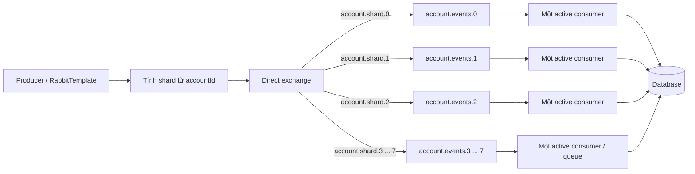

# Phân vùng theo khóa nghiệp vụ qua nhiều queue

## 1. Bài toán: cần giữ thứ tự theo từng đối tượng nhưng vẫn xử lý song song

Trong chương **Thứ tự và đồng thời** của **Spring AMQP**, một tình huống thường gặp là hệ thống có hàng nghìn đối tượng nghiệp vụ độc lập nhưng **các sự kiện của cùng một đối tượng phải được xử lý theo thứ tự**. Ví dụ:

- Tài khoản `A` phát sinh `Credit(100) → Debit(30) → Debit(20)`; kết quả của ba thay đổi phải tương ứng thứ tự phát sinh.
- Đơn hàng `O-17` đi qua `CREATED → PAID → SHIPPED`; không được xử lý `SHIPPED` trước `PAID`.
- Thiết bị `D-8` gửi `Connected → Disconnected → Connected`; báo cáo trạng thái sẽ sai nếu cập nhật theo thứ tự bất kỳ.

Đưa mọi sự kiện vào **một queue với một consumer** giúp việc thực thi tuần tự tương đối đơn giản nhưng giới hạn công suất. Ngược lại, mở nhiều consumer cạnh tranh trên cùng queue có thể khiến các message liên quan cùng đối tượng được xử lý đồng thời và **hoàn thành đảo thứ tự**.

Giải pháp thường dùng là **phân vùng theo khóa nghiệp vụ** (*key-based partitioning*): tính một shard từ `accountId`, `orderId` hoặc `deviceId`, rồi định tuyến mọi message có cùng khóa vào **cùng một queue**. Các queue khác nhau được xử lý song song; bên trong từng queue sử dụng một consumer đang hoạt động và xử lý tuần tự.

### Mục tiêu học tập

Sau bài này, bạn có thể:

1. Phân biệt **thứ tự trong một queue**, **thứ tự theo khóa nghiệp vụ** và **thứ tự toàn hệ thống**.
2. Dùng `RabbitTemplate`, direct exchange, queue và binding để định tuyến một khóa vào đúng shard với thuật toán nhất quán.
3. Cấu hình `@RabbitListener` và listener container để mỗi queue có một consumer hoạt động tại một thời điểm, kể cả khi ứng dụng chạy nhiều replica.
4. Nhận diện các ngoại lệ về thứ tự do nhiều producer, prefetch, retry, requeue, DLQ và chuyển shard.
5. Thiết kế `sequence`, idempotency, giám sát và phương án thay đổi số shard mà không làm sai trạng thái nghiệp vụ.

## 2. Ý tưởng: nhiều khóa chia sẻ một tập queue cố định

Giả sử có **8 queue**, mỗi tài khoản được ánh xạ vào một shard:

```text
shard(accountId) = floorMod(stableHash(accountId), 8)

account-101 -> shard 3 -> account.events.3
account-205 -> shard 6 -> account.events.6
account-308 -> shard 3 -> account.events.3
```

Những số shard ở trên chỉ minh họa; kết quả thực phụ thuộc thuật toán hash. `account-101` và `account-308` có thể chia sẻ queue do hash collision/modulo, nhưng cả hai vẫn giữ **các chuỗi sự kiện riêng**. Chúng không cần có queue riêng cho từng tài khoản.



### 2.1. Quy tắc định tuyến

Một mapping đơn giản trong Java:

```java
public final class AccountShardRouter {
    public static final int SHARD_COUNT = 8;

    private AccountShardRouter() {}

    public static int shardOf(String accountId) {
        if (accountId == null || accountId.isBlank()) {
            throw new IllegalArgumentException("accountId is required");
        }
        // Không dùng Math.abs(hashCode): Integer.MIN_VALUE vẫn âm.
        return Math.floorMod(accountId.hashCode(), SHARD_COUNT);
    }

    public static String routingKey(String accountId) {
        return "account.shard." + shardOf(accountId);
    }

    public static String queueName(int shard) {
        if (shard < 0 || shard >= SHARD_COUNT) {
            throw new IllegalArgumentException("Invalid shard: " + shard);
        }
        return "account.events." + shard;
    }
}
```

`String.hashCode()` có kết quả ổn định cho cùng chuỗi Java và cùng nội dung Unicode, đủ cho ví dụ chỉ có producer Java. Với **nhiều ngôn ngữ** hoặc thư viện hash khác nhau, phải công bố một thuật toán hash chuẩn (cùng encoding, seed, kiểu số, modulo), kiểm thử bằng cùng bộ test vector và thống nhất cách chuẩn hóa khóa. Nếu một producer tính shard khác, cùng `accountId` có thể bị gửi tới hai queue và mất bảo đảm tuần tự.

**Không lấy số queue từ giá trị mặc định trên từng instance** rồi hy vọng chúng giống nhau. Số shard và thuật toán định tuyến phải là một hợp đồng được version hóa cho toàn hệ thống. Đổi `SHARD_COUNT` từ 8 sang 12 sẽ làm thay đổi queue của nhiều khóa; đây là một hoạt động migration, không chỉ là sửa một hằng số.

### 2.2. Thứ tự được bảo vệ tới đâu?

| Cấp độ | Kỳ vọng hợp lý | Giới hạn |
|---|---|---|
| Trong một queue | Broker xếp các message đã enqueue theo cơ chế FIFO cơ bản của queue | Redelivery, requeue, priority, TTL, nhiều consumer và các tính năng broker có thể ảnh hưởng thứ tự quan sát |
| Trong một shard | Với một active consumer xử lý đồng bộ, delivery có thể được xử lý tuần tự | Một message lỗi có thể chặn cả shard hoặc bị đưa DLQ, tạo khoảng trống |
| Trong một `accountId` | Mọi message cùng account được định tuyến tới cùng shard | Chỉ đúng khi **publisher đã phát theo đúng thứ tự nghiệp vụ** và routing không đổi |
| Giữa hai account ở hai shard | Có thể xử lý độc lập, song song | Không có tổng thứ tự toàn cục |
| Giữa nhiều producer của cùng account | Broker ghi nhận thứ tự **message đến broker** | Không tự suy ra thứ tự phát sinh nghiệp vụ giữa những producer cạnh tranh |

Ví dụ: producer 1 tạo sự kiện `sequence=10` nhưng bị chậm mạng; producer 2 tạo `sequence=11` và publish thành công trước. Cùng một routing key **không tự sắp lại** thành 10 trước 11; RabbitMQ xếp chúng theo thứ tự broker nhận. Vì vậy, phải kết hợp phân vùng với **nguồn phát có thứ tự** và/hoặc **kiểm tra sequence trong database**.

## 3. RabbitMQ topology: direct exchange + một queue cho mỗi shard

RabbitMQ không tự biết khái niệm `accountId`; chúng ta tạo một **direct exchange** và các **binding** tường minh:

```text
exchange: account.events.direct

routing key          queue
----------------------------------------
account.shard.0  ->   account.events.0
account.shard.1  ->   account.events.1
...
account.shard.7  ->   account.events.7
```

Producer tự tính `routingKey(accountId)` rồi gọi `RabbitTemplate.send(...)`. Không tạo một exchange cho từng tài khoản và không tạo hàng triệu queue theo từng `accountId`, vì mỗi queue tiêu thụ metadata, bộ nhớ và tài nguyên vận hành trên broker.

### 3.1. Khai báo exchange, queue, binding và DLQ theo shard

Ví dụ Spring Boot với `spring-boot-starter-amqp`:

```xml
<dependency>
    <groupId>org.springframework.boot</groupId>
    <artifactId>spring-boot-starter-amqp</artifactId>
</dependency>
<dependency>
    <groupId>org.springframework.boot</groupId>
    <artifactId>spring-boot-starter-jdbc</artifactId>
</dependency>
```

Topology mẫu dưới đây tạo **8 request queue** và **8 DLQ**, mỗi queue gắn một dead-letter routing key để lỗi của shard này không trộn lẫn với shard khác.

```java
import java.util.ArrayList;
import java.util.List;
import org.springframework.amqp.core.BindingBuilder;
import org.springframework.amqp.core.Declarable;
import org.springframework.amqp.core.Declarables;
import org.springframework.amqp.core.DirectExchange;
import org.springframework.amqp.core.Queue;
import org.springframework.amqp.core.QueueBuilder;
import org.springframework.context.annotation.Bean;
import org.springframework.context.annotation.Configuration;

@Configuration
public class AccountShardTopology {
    public static final String EXCHANGE = "account.events.direct";
    public static final String DLX = "account.events.dead";

    @Bean
    Declarables accountShardDeclarables() {
        DirectExchange normal = new DirectExchange(EXCHANGE, true, false);
        DirectExchange dead = new DirectExchange(DLX, true, false);

        List<Declarable> declarations = new ArrayList<>();
        declarations.add(normal);
        declarations.add(dead);

        for (int shard = 0;
                shard < AccountShardRouter.SHARD_COUNT; shard++) {

            String key = "account.shard." + shard;
            String queueName = AccountShardRouter.queueName(shard);
            String deadKey = "account.dead." + shard;

            Queue queue = QueueBuilder.durable(queueName)
                    .withArgument("x-single-active-consumer", true)
                    .deadLetterExchange(DLX)
                    .deadLetterRoutingKey(deadKey)
                    .build();

            Queue dlq = QueueBuilder.durable(queueName + ".dlq").build();

            declarations.add(queue);
            declarations.add(BindingBuilder.bind(queue)
                    .to(normal).with(key));
            declarations.add(dlq);
            declarations.add(BindingBuilder.bind(dlq)
                    .to(dead).with(deadKey));
        }
        return new Declarables(declarations);
    }

    @Bean("accountShardQueueNames")
    String[] accountShardQueueNames() {
        String[] result = new String[AccountShardRouter.SHARD_COUNT];
        for (int shard = 0; shard < result.length; shard++) {
            result[shard] = AccountShardRouter.queueName(shard);
        }
        return result;
    }
}
```

Thuộc tính RabbitMQ `x-single-active-consumer=true` (SAC) yêu cầu broker chỉ chọn **một consumer active** cho mỗi queue; các consumer khác có thể tồn tại ở trạng thái chờ để tiếp nhận khi active consumer mất kết nối. SAC phù hợp khi nhiều replica cùng subscribe vào mỗi shard. Nó không giới hạn toàn bộ hệ thống còn một consumer: **mỗi shard có thể có một active consumer riêng**.

SAC phải được broker/queue type hỗ trợ; kiểm tra phiên bản RabbitMQ và cấu hình loại queue (classic hoặc quorum phù hợp). Queue argument này là một phần thuộc tính khai báo: nếu queue đã có với arguments khác, việc redeclare có thể bị broker từ chối. Khi đưa vào hệ thống đang chạy, cần quy trình migration topology.

**DLQ ở ví dụ không tự bảo đảm thứ tự.** Nếu message `sequence=10` lỗi và bị dead-letter, consumer vẫn có thể nhận `sequence=11` trên queue chính. Giải pháp bảo vệ nghiệp vụ là không commit 11 trước 10, sau đó phục hồi và replay theo chính sách. Trường hợp cần *strict progression* nên dừng/pause shard khi phát hiện khoảng trống, thay vì cho các message sau tiếp tục fail hàng loạt.

### 3.2. Một vài lưu ý về độ bền

`QueueBuilder.durable(...)` yêu cầu queue tồn tại qua restart broker; nó không tự bảo đảm mọi message được lưu bền trong mọi trường hợp lỗi. Producer nên dùng message persistent và publisher confirms; khi cần phát hiện routing key sai, có thể bật `mandatory` và theo dõi publisher returns. Nếu chưa có binding tương ứng, message gửi tới direct exchange có thể không vào queue nào.

Trong production, cấu hình dead-letter qua **RabbitMQ policy** thường linh hoạt hơn hard-code queue arguments; ví dụ dùng arguments để minh họa quan hệ tuyến đường rõ ràng. Khi sử dụng quorum queue, hãy đánh giá thêm quorum replication, dead-letter strategy và chi phí tài nguyên theo yêu cầu độ tin cậy.

## 4. Producer: gửi cùng khóa tới cùng queue, giữ nguyên id và sequence

Một message nghiệp vụ nên có ít nhất:

| Trường | Mục đích |
|---|---|
| `eventId` | Định danh duy nhất **một sự kiện**; dùng cho idempotency qua redelivery và publish retry |
| `accountId` | Khóa phân vùng; tất cả sự kiện của cùng account phải về cùng shard |
| `sequence` | Thứ tự tăng đơn điệu trong **mỗi account**, thường do nguồn dữ liệu có thẩm quyền cấp |
| `delta` | Nội dung thay đổi số dư trong ví dụ |
| `schemaVersion` (production) | Cho phép consumer đọc các phiên bản payload khác nhau |

Để ví dụ dễ đọc, chúng ta dùng payload `eventId|accountId|sequence|delta`. Ứng dụng thật nên dùng JSON/Avro/Protobuf với schema, validation và `MessageConverter` nhất quán. Ký tự phân cách trong ví dụ không được xuất hiện trong `eventId` hoặc `accountId`.

```java
public record AccountEvent(
        String eventId, String accountId, long sequence, long delta) {

    public AccountEvent {
        if (eventId == null || eventId.isBlank() ||
                accountId == null || accountId.isBlank() ||
                eventId.contains("|") || accountId.contains("|") ||
                sequence <= 0) {
            throw new IllegalArgumentException("Invalid account event");
        }
    }

    public String encode() {
        return eventId + "|" + accountId + "|" + sequence + "|" + delta;
    }

    public static AccountEvent decode(String input) {
        String[] fields = input.split("\\|", -1);
        if (fields.length != 4) {
            throw new IllegalArgumentException("Malformed account event");
        }
        return new AccountEvent(
                fields[0], fields[1],
                Long.parseLong(fields[2]), Long.parseLong(fields[3]));
    }
}
```

```java
import java.nio.charset.StandardCharsets;
import org.springframework.amqp.core.Message;
import org.springframework.amqp.core.MessageBuilder;
import org.springframework.amqp.core.MessageProperties;
import org.springframework.amqp.rabbit.core.RabbitTemplate;
import org.springframework.stereotype.Service;

@Service
public class AccountEventPublisher {
    private final RabbitTemplate template;

    public AccountEventPublisher(RabbitTemplate template) {
        this.template = template;
    }

    public void publish(AccountEvent event) {
        Message message = MessageBuilder
                .withBody(event.encode().getBytes(StandardCharsets.UTF_8))
                .setContentType(MessageProperties.CONTENT_TYPE_TEXT_PLAIN)
                .setMessageId(event.eventId())
                .setHeader("accountId", event.accountId())
                .setHeader("sequence", event.sequence())
                .build();

        template.send(
                AccountShardTopology.EXCHANGE,
                AccountShardRouter.routingKey(event.accountId()),
                message);
    }
}
```

Ví dụ với `new AccountEvent("evt-101", "acc-42", 7, 100)`: message sẽ dùng routing key do `AccountShardRouter.routingKey("acc-42")` tính. Event tiếp theo của cùng tài khoản, chẳng hạn `("evt-102", "acc-42", 8, -30)`, phải dùng **cùng thuật toán, cùng số shard và cùng accountId chuẩn hóa**.

**Đừng tạo `eventId` mới khi retry publish cùng một sự kiện.** Giữ nguyên `eventId`, `accountId` và `sequence` qua các lần gửi lại; downstream mới nhận diện được bản sao. `RabbitTemplate.send(...)` thành công ở phía gọi không có nghĩa broker đã persist chắc chắn: cấu hình publisher confirms/correlated confirms và returns nếu cần bảo đảm delivery tới queue.

### 4.1. Nguồn nào tạo sequence đúng?

Không nên cấp `sequence` bằng `System.currentTimeMillis()` hay bộ đếm cục bộ trên từng instance, vì hai producer có thể trùng hoặc cấp ngược thứ tự.

Một mẫu phổ biến với database quan hệ:

1. Transaction của hệ thống nguồn khóa aggregate `accountId`.
2. Tăng version của account từ `n` thành `n+1` và ghi thay đổi nghiệp vụ.
3. Ghi một hàng **outbox** với `eventId`, `accountId`, `sequence=n+1` và payload trong **cùng DB transaction**.
4. Outbox relay phát các event theo đúng thứ tự `sequence` của từng account, dùng cùng hàm phân vùng.
5. Chỉ đánh dấu hàng outbox đã publish khi có xác nhận phù hợp; nếu relay crash giữa publish và ghi dấu, event có thể phát lại, nên consumer phải idempotent.

Chỉ có outbox và `ORDER BY sequence` chưa đủ nếu **nhiều relay tranh nhau lấy event của cùng account**: chúng cần cơ chế partition/lease/lock và giữ thứ tự publish per-key. Broker không tự sửa thứ tự phát khi relay publish lệch nhau.

## 5. Consumer: một active worker trên mỗi queue

Nếu bạn dùng một `SimpleRabbitListenerContainerFactory` với một listener subscribe **toàn bộ queue** và `concurrentConsumers=1`, một consumer có thể lắng nghe nhiều queue cùng lúc và khiến mọi shard chia sẻ một luồng xử lý. Để ví dụ thể hiện **mỗi queue có consumer riêng**, chọn `DirectRabbitListenerContainerFactory` với `consumersPerQueue=1`.

```java
import org.springframework.amqp.rabbit.config.DirectRabbitListenerContainerFactory;
import org.springframework.amqp.rabbit.connection.ConnectionFactory;
import org.springframework.context.annotation.Bean;
import org.springframework.context.annotation.Configuration;

@Configuration
public class AccountEventConsumerConfig {

    @Bean("orderedShardFactory")
    DirectRabbitListenerContainerFactory orderedShardFactory(
            ConnectionFactory connectionFactory) {

        DirectRabbitListenerContainerFactory factory =
                new DirectRabbitListenerContainerFactory();
        factory.setConnectionFactory(connectionFactory);
        factory.setConsumersPerQueue(1);
        factory.setPrefetchCount(1);
        // Một message lỗi không được requeue nóng vô hạn.
        // Message bị reject đi tới DLQ nếu topology có DLX tương ứng.
        factory.setDefaultRequeueRejected(false);
        return factory;
    }
}
```

`prefetchCount=1` hạn chế số message vật lý chưa ack đang được giao cho một consumer. Khi listener xử lý đồng bộ và không tách công việc sang thread pool rồi trả về sớm, cách này giúp dễ quan sát tiến trình tuần tự trong mỗi queue. Đổi lại, thông lượng mỗi shard có thể giảm vì broker chờ ack trước khi cấp thêm message.

Với nhiều replica, mỗi replica có thể tạo consumer cho các queue, nhưng RabbitMQ **Single Active Consumer** giúp chỉ một consumer thực sự nhận từ mỗi queue ở một thời điểm. Khi active consumer mất kết nối, broker có thể chọn consumer dự phòng và **giao lại các message chưa ack**; do đó phải xử lý trùng. SAC không tự đảm bảo mọi tác dụng phụ đã commit đúng một lần.

### 5.1. Listener thực thi nghiệp vụ

```java
import org.springframework.amqp.rabbit.annotation.RabbitListener;
import org.springframework.stereotype.Component;

@Component
public class AccountEventListener {
    private final AccountLedgerService ledger;

    public AccountEventListener(AccountLedgerService ledger) {
        this.ledger = ledger;
    }

    @RabbitListener(
            queues = "#{@accountShardQueueNames}",
            containerFactory = "orderedShardFactory")
    public void handle(String raw) {
        AccountEvent event = AccountEvent.decode(raw);
        ledger.applyOnceInOrder(event);
        // Chỉ trở về bình thường sau khi DB transaction đã commit.
        // Container mới coi delivery được xử lý thành công để ack.
    }
}
```

Bean `accountShardQueueNames` ở mục 3 trả về danh sách tên queue; expression trong `@RabbitListener` cho phép đăng ký cùng một handler trên tất cả shard. `AccountLedgerService` là một Spring bean riêng để giao dịch `@Transactional` chạy qua proxy thay vì tự gọi phương thức trong cùng đối tượng.

**Về thứ tự:** cấu hình container này chỉ giữ được sự tuần tự **ở thời điểm gọi handler cho một queue trên đường đi bình thường**. Nếu callback tự mở `CompletableFuture` hoặc chuyển `AccountEvent` sang executor rồi return trước khi hoàn tất, broker có thể ack sự kiện trước và message sau được thực thi trước message trước. Hãy hoàn tất xử lý và commit trước khi listener trả về, hoặc thiết kế hàng đợi nội bộ có thứ tự và acknowledgement chính xác.

### 5.2. Database kiểm tra sequence và idempotency

Chỉ dựa vào routing và SAC chưa đủ. Hãy thiết kế trạng thái của mỗi account cùng `last_sequence` và bảng event đã áp dụng:

```sql
-- PostgreSQL minh họa: mỗi account đã được tạo trước khi nhận event.
CREATE TABLE account_ledger (
    account_id      VARCHAR(100) PRIMARY KEY,
    balance         BIGINT NOT NULL DEFAULT 0,
    last_sequence   BIGINT NOT NULL DEFAULT 0
);

CREATE TABLE applied_account_events (
    event_id    VARCHAR(100) PRIMARY KEY,
    account_id  VARCHAR(100) NOT NULL,
    sequence    BIGINT NOT NULL,
    delta       BIGINT NOT NULL,
    UNIQUE (account_id, sequence)
);
```

Trong một transaction database, worker cần:

1. Khóa dòng `account_ledger` của `accountId` (ví dụ `SELECT ... FOR UPDATE`). Account phải được khởi tạo atomically hoặc đã tồn tại trước khi xử lý; tránh hai consumer cùng tạo một account.
2. Kiểm tra `eventId` trong `applied_account_events`. Nếu đã thấy **đúng accountId, sequence và payload**, trả thành công mà **không cộng/trừ tiền lần nữa**. Nếu `eventId` trùng nhưng payload khác, báo lỗi xung đột.
3. Nếu chưa xử lý, kiểm tra `event.sequence == last_sequence + 1`. Nếu nhỏ hơn hay bằng `last_sequence` nhưng chưa ghi dấu, không được âm thầm bỏ qua; đây là dữ liệu sai hoặc thiếu lịch sử cần điều tra.
4. Nếu lớn hơn `last_sequence + 1`, phát hiện **sequence gap**. Không cập nhật số dư; dừng/pause shard hoặc chuyển xử lý sang luồng đối soát để tìm sự kiện thiếu.
5. Nếu đúng sequence kế tiếp, cập nhật balance và `last_sequence`, ghi `eventId` với unique constraint, rồi **commit tất cả trong một transaction**.
6. Nếu commit thất bại, để lỗi đi ra ngoài để message có thể được xử lý lại theo chính sách; không ack khi dữ liệu còn ở trạng thái chưa xác định.

Ví dụ triển khai bằng `JdbcTemplate`, giả định account row đã được provision sẵn:

```java
import java.util.List;
import org.springframework.jdbc.core.JdbcTemplate;
import org.springframework.stereotype.Service;
import org.springframework.transaction.annotation.Transactional;

@Service
public class AccountLedgerService {
    private final JdbcTemplate jdbc;

    public AccountLedgerService(JdbcTemplate jdbc) {
        this.jdbc = jdbc;
    }

    @Transactional
    public void applyOnceInOrder(AccountEvent event) {
        Long lastSequence = jdbc.queryForObject(
                "SELECT last_sequence FROM account_ledger " +
                "WHERE account_id = ? FOR UPDATE",
                Long.class, event.accountId());

        List<AccountEvent> applied = jdbc.query(
                "SELECT event_id, account_id, sequence, delta " +
                "FROM applied_account_events WHERE event_id = ?",
                (rs, row) -> new AccountEvent(
                        rs.getString("event_id"),
                        rs.getString("account_id"),
                        rs.getLong("sequence"),
                        rs.getLong("delta")),
                event.eventId());

        if (!applied.isEmpty()) {
            if (!applied.get(0).equals(event)) {
                throw new IllegalStateException("EVENT_ID_CONFLICT");
            }
            return; // Đã commit trước đó, chỉ cần ack bản giao lại.
        }

        if (event.sequence() != lastSequence + 1) {
            throw new IllegalStateException(
                    "SEQUENCE_GAP_OR_REGRESSION: account="
                    + event.accountId() + ", expected="
                    + (lastSequence + 1) + ", received="
                    + event.sequence());
        }

        int updated = jdbc.update(
                "UPDATE account_ledger SET " +
                "balance = balance + ?, last_sequence = ? " +
                "WHERE account_id = ? AND last_sequence = ?",
                event.delta(), event.sequence(),
                event.accountId(), lastSequence);

        if (updated != 1) {
            throw new IllegalStateException("CONCURRENT_UPDATE");
        }

        jdbc.update(
                "INSERT INTO applied_account_events " +
                "(event_id, account_id, sequence, delta) VALUES (?,?,?,?)",
                event.eventId(), event.accountId(),
                event.sequence(), event.delta());
    }
}
```

Ở đây `@Transactional` chỉ bảo vệ dữ liệu trong **database này**. Sau khi database commit nhưng trước khi broker ack, kết nối có thể lỗi và broker redeliver: nhờ bảng `applied_account_events`, lần xử lý sau sẽ nhận ra event đã áp dụng. Không được giả định Spring AMQP cung cấp giao dịch nguyên tử giữa DB và RabbitMQ; cấu hình `channelTransacted` hay transaction synchronization vẫn không tự biến hai tài nguyên thành XA.

Ví dụ dùng tiền để minh họa thứ tự, nhưng hệ thống thanh toán thực tế cần thêm quy tắc số dư, định danh giao dịch, kiểm soát gian lận, định dạng số tiền và đối soát. Không dùng một phép cộng số dư mẫu làm đủ mọi bảo vệ nghiệp vụ tài chính.

## 6. Điều gì làm mất thứ tự dù đã phân vùng đúng?

### 6.1. Nhiều active consumer hoặc xử lý bất đồng bộ trong một shard

Nếu `account.events.3` có hai consumer active, message `seq=8` có thể được consumer thứ hai xử lý nhanh hơn `seq=7` đang chạy ở consumer thứ nhất. Khi đó thứ tự nhận tại broker không còn là thứ tự **commit nghiệp vụ**.

Khuyến nghị cho nhu cầu thứ tự nghiêm ngặt:

- Bật **Single Active Consumer** trên từng queue hoặc bảo đảm chỉ đúng một consumer cho queue đó bằng điều phối bên ngoài.
- Với `DirectRabbitListenerContainerFactory`, đặt `consumersPerQueue=1`; khi scale nhiều replica vẫn cần cơ chế chọn một active consumer trên broker.
- Dùng listener đồng bộ, kiểm soát `prefetch` và tránh chuyển các fragment của một khóa sang nhiều thread mà không có serialized executor.
- Dùng `sequence`/version ở database làm hàng rào cuối cùng.

`prefetch=1` không tự tạo thứ tự nghiệp vụ nếu producer publish sai thứ tự; SAC cũng không thay đổi thực tế đó.

### 6.2. Retry, requeue và dead-letter

Đây là tình huống dễ gây nhầm nhất:

```text
account-42: seq=7 [thành công]
account-42: seq=8 [lỗi tạm thời]
account-42: seq=9 [đang chờ]
```

Nếu để `seq=8` vào DLQ rồi tiếp tục xử lý `seq=9`, consumer có thể chạy qua lỗ hổng thứ tự. Với ví dụ `AccountLedgerService` ở trên, `seq=9` **không được commit** vì `last_sequence` đang là 7; điều này giữ nguyên tính đúng đắn của dữ liệu nhưng làm shard/đối tượng không tiến lên được.

| Chính sách khi seq=8 thất bại | Lợi ích | Rủi ro và giới hạn |
|---|---|---|
| Requeue ngay | Có thể xử lý lại nhanh khi lỗi thật sự thoáng qua | Có thể lặp nóng, tốn CPU, gây nghẽn và làm thứ tự delivery khó dự đoán |
| Retry trong listener với backoff ngắn và giới hạn | Giữ việc xử lý seq=8 tại vị trí hiện tại trong thời gian retry | Chiếm consumer của **toàn shard** trong lúc đợi |
| Đưa seq=8 vào DLQ, tiếp tục đọc queue chính | Cách ly message hỏng, tránh vòng lặp | Seq=9 có thể đến sớm; cần sequence guard hoặc dừng shard để tránh cập nhật sai |
| Pause/dừng consumer của shard khi có lỗi cần xử lý | Không tiến sang các message sau trước khi sửa seq=8 | Một khóa lỗi có thể chặn **những khóa khác** cùng shard |
| Tách retry theo từng account ở tầng ứng dụng | Hạn chế head-of-line blocking khi có nhiều account độc lập | Phải tự quản lý state/ordering, buffer, deadline và acknowledgement; phức tạp hơn nhiều |

Ví dụ topology đã cấu hình DLQ và `defaultRequeueRejected=false` để tránh vòng lặp nóng. **Đó là cách đơn giản để minh họa lỗi được cách ly**, chưa phải chính sách hoàn chỉnh cho strict ordering. Đối với nghiệp vụ buộc duy trì chuỗi không gián đoạn, khi phát hiện `sequence gap` nên **dừng shard hoặc kích hoạt quy trình giải quyết tuần tự**; không cứ thế reject hàng loạt các event tiếp theo. Sau sửa lỗi, replay `seq=8` trước `seq=9` và kiểm tra phiên bản trong database.

Không nên tự động replay DLQ mà bỏ qua `eventId`, `sequence` hoặc thay `accountId`. Replay có thể xuất hiện sau khi broker đã redeliver bản gốc: người tiêu thụ phải idempotent.

### 6.3. Producer crash và publish lại

Khi producer không nhận được publisher confirm, nó có thể không biết message đã đến broker hay chưa. Gửi lại an toàn đòi hỏi **giữ nguyên eventId** và sử dụng cùng mapping shard. Nếu publisher retry tạo event mới hoặc đổi số shard giữa hai lần gửi, một nghiệp vụ có thể xuất hiện ở nhiều queue.

Trong nguồn dữ liệu có transaction, **transactional outbox** giảm khả năng cập nhật DB thành công nhưng không publish event. Tuy nhiên relay vẫn có thể gửi trùng; bảo đảm tác dụng phụ không lặp phải đặt ở consumer.

### 6.4. TTL, priority và các cơ chế định tuyến khác

Message priority có thể làm sự kiện đến sau được xử lý trước sự kiện đã enqueue trước đó. TTL, queue overflow, dead-letter/requeue và retry queue cũng có thể loại bỏ hoặc làm trễ event đứng giữa chuỗi. Với luồng yêu cầu thứ tự nghiêm ngặt, hãy tránh dùng priority tùy ý cho cùng một stream, đồng thời ghi rõ cách xử lý khi một event hết hạn hoặc bị chuyển sang DLQ.

Nếu cần “sự kiện trạng thái mới nhất thắng” thay vì “áp dụng mọi sự kiện theo thứ tự”, có thể dùng optimistic version hoặc projection chỉ nhận `version` mới hơn. Nhưng cách đó **không tương đương** với xử lý tuần tự các giao dịch thay đổi số dư; phải chọn theo invariant của domain.

## 7. Quy mô: tăng số shard, chia tải và tránh điểm nóng

Giả sử service nhận **12.000 event/giây**, có **12 shard**, mỗi shard xử lý tối đa 1.200 event/giây ở điều kiện lý tưởng. Nếu phân bố đều, tải trung bình là 1.000 event/giây/shard, còn ít dư địa cho đột biến. Nếu một tài khoản “nóng” tạo 2.000 event/giây thì riêng một shard có thể vượt công suất dù các shard khác rảnh.

Các con số này chỉ là bài tính giả định; cần đo benchmark theo số câu SQL, kích thước payload, broker, độ trễ ack, prefetch và phần cứng thực tế.

### 7.1. Chọn khóa phân vùng

Khóa tốt phải phản ánh **ranh giới cần giữ thứ tự**:

| Trường hợp | Khóa phù hợp | Trường hợp không phù hợp |
|---|---|---|
| Trạng thái đơn hàng | `orderId` | `eventId`: mỗi event khác nhau nên có thể đi nhiều shard |
| Biến động số dư tài khoản | `accountId` | `transactionId` nếu nhiều giao dịch cùng account phải tuần tự |
| Timeline của thiết bị | `deviceId` | `eventType`: Connected và Disconnected có thể bị phân sang hai queue |
| Cập nhật giá theo sản phẩm | `productId` | `timestamp`: không bảo đảm cùng sản phẩm ở cùng shard |

Đặt shard count theo throughput và ngân sách vận hành, không bằng số key nghiệp vụ. Quá ít shard tạo điểm nghẽn; quá nhiều queue tăng kết nối/consumer/metadata và chi phí quan sát. Hash chỉ phân tán khi khóa có đủ độ đa dạng; nó không tự giải quyết **hot key** duy nhất.

### 7.2. Một hot key không thể tăng tốc vô hạn bằng thêm consumer

Nếu một `accountId` phải xử lý tuần tự thì không thể chạy hai event của cùng account song song mà vẫn giữ invariant như trước. Các hướng xử lý khác gồm tối ưu transaction, batch các thao tác có thể gộp theo quy tắc nghiệp vụ, hoặc thay đổi mô hình dữ liệu để cho phép các nhánh cập nhật độc lập. Chỉ tăng `consumersPerQueue` lên 5 sẽ làm mất cơ chế thực thi tuần tự đang cần.

### 7.3. Khi số shard thay đổi

Công thức `hash(key) % N` làm phần lớn khóa đổi queue khi `N` thay đổi. Rủi ro lớn nhất là **message cũ của account đang nằm ở shard cũ trong khi message mới đã gửi sang shard mới**.

Một quy trình migration đơn giản với cửa sổ bảo trì:

1. Chốt phiên bản routing mới, tạo sẵn exchange/binding/queue mới và xác định cách rollback.
2. Dừng hoặc tạm khóa publish trong khoảng chuyển đổi; các nguồn phát quan trọng ghi sự kiện vào outbox để không mất dữ liệu.
3. Đợi consumer xử lý và ack hết message ở topology cũ, kiểm tra cả retry/DLQ và các sequence gap chưa giải quyết. Không chỉ nhìn `ready=0`; còn phải kiểm tra `unacked` và trạng thái nghiệp vụ.
4. Cập nhật **tất cả publisher và consumer** sang cùng phiên bản mapping và shard count; đừng để hai phiên bản gửi cùng account sang hai queue.
5. Phát tiếp từ outbox sau mốc chuyển đổi; kiểm tra thứ tự `sequence` trên database trước khi loại bỏ topology cũ.

Hệ thống không thể dừng có thể dùng **rào chắn (barrier) theo key**, lưu routing-version trên event, đồng bộ offset và tiến độ theo `sequence`, chỉ chuyển khóa sau khi phiên bản cũ hoàn thành. Thiết kế đó phức tạp hơn và cần stateful migration, không thể thay bằng một phép đổi modulo trong cấu hình đang chạy.

Các thuật toán **consistent hashing** và virtual shard có thể giảm số khóa phải di chuyển khi scale nhưng **không giải quyết tự động** việc drain và thứ tự giữa queue cũ/mới. RabbitMQ có cơ chế/plugin consistent-hash exchange trong một số triển khai, song cần xác nhận plugin có sẵn và thuật toán định tuyến ổn định trước khi sử dụng; direct exchange với binding tường minh là lựa chọn minh bạch cho bài thực hành.

## 8. Quan sát hệ thống và kiểm thử tính đúng đắn

### 8.1. Metric quan trọng

| Nguồn | Chỉ số hoặc log | Dấu hiệu |
|---|---|---|
| Publisher | Số event gửi theo shard, publisher confirm/return, routing version | Producer phân vùng lệch hoặc message không tới queue |
| RabbitMQ theo queue | `messages_ready`, `messages_unacknowledged`, deliver/ack rate, consumer count, redelivery | Shard quá tải, consumer mất kết nối hoặc retry nhiều |
| DLQ theo shard | Độ sâu, tuổi event lâu nhất, nguyên nhân reject | Một lỗi đang chặn tiến độ của shard |
| Consumer | Latency p50/p95/p99, thời gian xử lý DB, lỗi theo type, lần retry | Điểm nghẽn trong xử lý tuần tự |
| Nghiệp vụ | `last_sequence`/account, duplicate `eventId`, `SEQUENCE_GAP`, lag giữa event tạo và commit | Thứ tự nghiệp vụ bị đứt dù queue vẫn hoạt động |
| Phân bố khóa | Top account theo event rate, tỷ lệ message/shard | Hot key hoặc hash quá lệch |

Log và trace nên mang `accountId` (được xử lý phù hợp quyền riêng tư), `eventId`, `sequence`, `shard` và `routingVersion`, nhưng không log toàn bộ payload nhạy cảm. Nếu dashboard chỉ tổng hợp tất cả queue, một shard nghẽn nghiêm trọng có thể bị che bởi throughput tốt ở những shard khác.

### 8.2. Kịch bản kiểm thử

1. **Cùng một account:** phát `seq=1,2,3`, bảo đảm mỗi event đi cùng routing key và DB có `last_sequence=3`.
2. **Hai account:** gửi xen kẽ sự kiện của account A và B trên hai shard khác nhau. Xác nhận có thể xử lý song song nhưng thứ tự **mỗi account** vẫn đúng.
3. **Trùng message:** gửi lại `eventId` của `seq=2` sau khi DB đã commit. Đảm bảo không ghi delta thêm lần nữa và listener có thể ack.
4. **Thiếu sequence:** phát `seq=5` khi `last_sequence=3`. Hệ thống phải báo gap, **không commit** và kích hoạt cách phục hồi.
5. **Out-of-order producer:** cố tình publish `seq=8` trước `seq=7` cho cùng account. Kiểm tra sequence guard từ chối 8 đến khi 7 được áp dụng.
6. **Failover active consumer:** chạy hai replica cùng subscribe các shard bật SAC, dừng replica đang active giữa xử lý. Kiểm tra broker có thể redeliver, và idempotency tránh tác dụng phụ trùng.
7. **Poison message:** cho một event lỗi vĩnh viễn vào DLQ, kiểm tra `last_sequence` không bị tăng sai và quy trình replay giữ `eventId`/`sequence`.
8. **Cấu hình sai mapping:** cho một producer dùng `SHARD_COUNT=8` và producer khác dùng 12. Quan sát cùng account có thể đi queue khác và khôi phục sau khi thống nhất routing.
9. **Hot key:** phát nhiều event cho một account và đo queue lag; giải thích vì sao thêm consumer không giải quyết được nếu cùng key phải tuần tự.

## 9. Sai lầm thường gặp

| Sai lầm | Hậu quả | Cách phòng tránh |
|---|---|---|
| Hash theo `eventId` thay vì aggregate ID | Sự kiện của cùng đối tượng đi các queue khác nhau | Chọn khóa theo invariant của domain |
| Chỉ tăng concurrency mà vẫn cần thứ tự | Nhiều message của cùng đối tượng xử lý đồng thời | Một active consumer/queue và kiểm tra sequence |
| Coi direct exchange tự hiểu `accountId` | Không định tuyến đúng nếu routing key sai | Hash tại producer, binding theo shard |
| Hai publisher dùng khác số shard/thuật toán | Cùng key rơi vào nhiều queue | Hợp đồng mapping thống nhất, version hóa |
| Dựa vào FIFO để suy thứ tự thời gian phát sinh | Concurrent producers có thể publish ngược | Gán sequence tại nguồn và phát theo thứ tự |
| Retry/requeue không giới hạn | Hot loop, backlog, duplicate | Retry có giới hạn, idempotency, pause/recovery |
| Đẩy message lỗi sang DLQ rồi vẫn commit message sau | Mất thứ tự nghiệp vụ | Sequence guard và giải quyết khoảng trống |
| Đổi `N` khi queue cũ chưa drain | Cùng key tồn tại đồng thời trên hai shard | Rào chắn migration, drain, kiểm tra `unacked` |
| Chỉ giám sát tổng lưu lượng | Không nhìn thấy một shard nóng hoặc bị lỗi | Metric theo shard và khóa |

## 10. Câu hỏi ôn tập

1. Vì sao hash theo `accountId` giữ quan hệ cùng shard, còn hash theo `eventId` không phù hợp với yêu cầu tuần tự theo account?
2. Với 8 queue và một active consumer mỗi queue, có bao nhiêu account có thể cùng chia sẻ một queue? Điều gì xảy ra nếu một account nóng liên tục?
3. Nếu `seq=12` được publish trước `seq=11`, RabbitMQ có tự sắp về đúng thứ tự nghiệp vụ không? Giải thích cách sequence guard giải quyết.
4. Khác biệt giữa `prefetch=1` và Single Active Consumer là gì? Tại sao có thể cần cả hai?
5. Nếu `seq=5` bị dead-letter còn `seq=6` đã đến queue chính, nên làm gì để không cập nhật trạng thái sai?
6. Vì sao database commit thành công trước broker ack vẫn có thể dẫn tới duplicate, và bảng `applied_account_events` giúp gì?
7. Thay shard count từ 8 sang 16 khi message cũ còn chờ có thể gây lỗi thứ tự như thế nào? Phác thảo kế hoạch migration an toàn.
8. Khi một khóa tạo ra 70% lưu lượng, tăng số shard có chắc giảm tải cho shard chứa khóa đó không? Đề xuất hai cách giải quyết theo domain.

## 11. Tài liệu tham khảo

- [RabbitMQ — Consumer Acknowledgements and Publisher Confirms](https://www.rabbitmq.com/docs/confirms): giới hạn của ack/confirm và rủi ro redelivery.
- [RabbitMQ — Consumer Prefetch](https://www.rabbitmq.com/docs/consumer-prefetch): số delivery chưa được ack và tác động đến consumer.
- [RabbitMQ — Single Active Consumer](https://www.rabbitmq.com/docs/consumers#single-active-consumer): lựa chọn một active consumer trên mỗi queue.
- [RabbitMQ — Message Ordering](https://www.rabbitmq.com/docs/queues#message-ordering): điều kiện giữ thứ tự và các trường hợp requeue.
- [Spring AMQP Reference — Listener Concurrency](https://docs.spring.io/spring-amqp/reference/amqp/listener-concurrency.html): điều khiển concurrency cho các listener container.
- [Spring AMQP Reference — Receiving Messages](https://docs.spring.io/spring-amqp/reference/amqp/receiving-messages.html): `@RabbitListener` và listener container.
- [Spring AMQP Reference — Sending Messages](https://docs.spring.io/spring-amqp/reference/amqp/sending-messages.html): `RabbitTemplate`, publish và message properties.

**Ghi nhớ:** Phân vùng theo **khóa nghiệp vụ** giúp cùng một account/order/device luôn đến **cùng shard**, trong khi nhiều shard có thể xử lý song song. Để thứ tự này trở thành **tính đúng đắn của nghiệp vụ**, còn phải có nguồn phát theo sequence, một active consumer trên mỗi queue, xử lý đồng bộ, idempotency và quy trình xử lý gap/retry/DLQ. Thêm queue hay đổi thuật toán hash chỉ an toàn khi hệ thống quản lý đúng routing contract và migration.
